# 7.2：第二部分：高斯判别分析 🧠

在本节课中，我们将学习第一个非玩具示例的生成模型，即高斯判别分析。我们将首先定义该模型，然后探讨如何将其拟合到数据中，以及使用何种目标函数和优化算法。

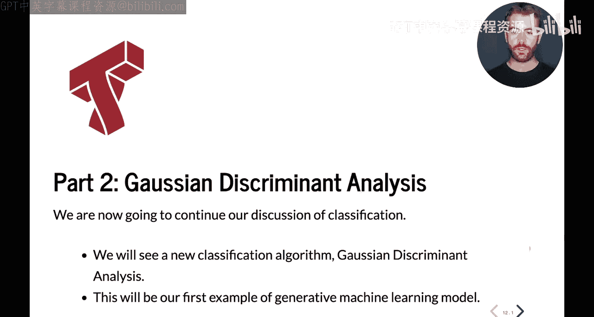

---

## 分类问题回顾 📊

上一节我们介绍了分类问题的基本设定。在监督机器学习中，我们有一个包含输入 `x` 和目标 `y` 的训练数据集。如果目标 `y` 是连续的，我们面临回归问题；如果 `y` 是离散的，即取 `K` 个可能值之一，我们则面临分类问题。我们的目标是预测新输入 `x` 的真实类别。

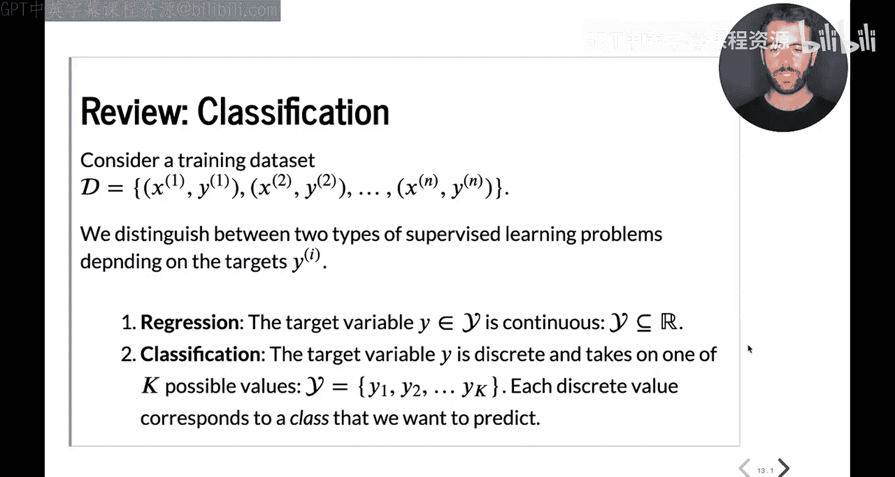

---

## 生成模型与判别模型 🔄

在上一节中，我们看到了两种解决分类问题的方法，主要区别在于我们拟合的模型类型。监督学习算法涉及选择模型，特别是概率模型。我们可以使用两种概率模型：

1.  **生成模型**：对 `x` 和 `y` 的联合分布进行建模，形式为 `p(x, y)`。
2.  **判别模型**：仅对给定 `x` 时 `y` 的条件分布进行建模，形式为 `p(y | x)`。

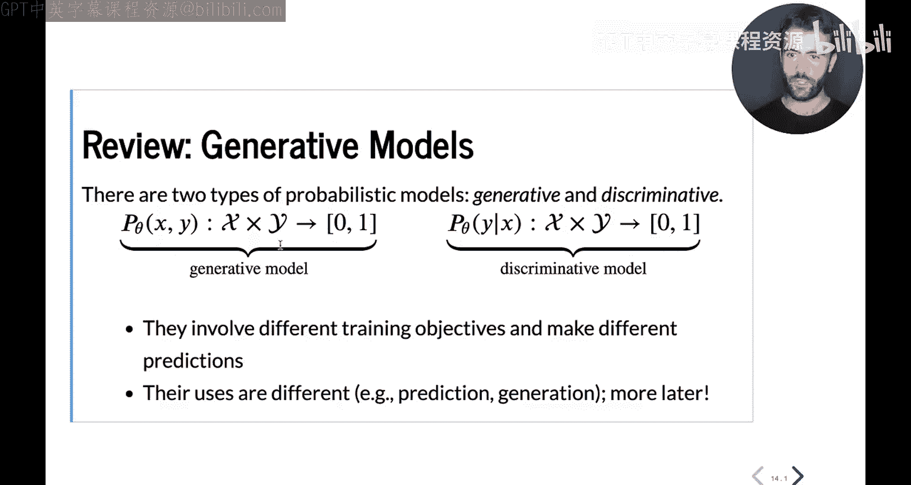

这两种方法代表了机器学习算法中一个非常重要的区别。在本节中，我们将定义一个生成模型的具体示例。

---

## 高斯混合模型介绍 🎲

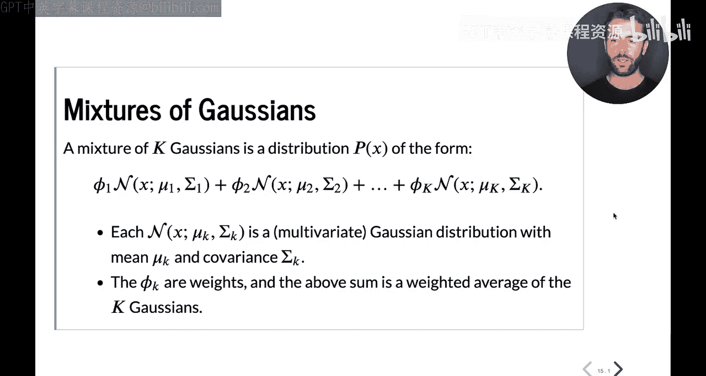

在定义生成模型之前，我们先介绍**高斯混合模型**的概念。

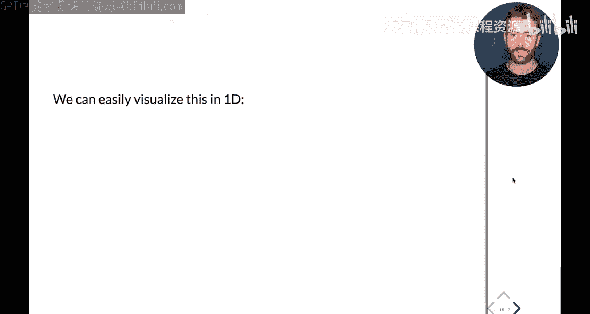

高斯混合模型是一种概率分布，其形式如下：

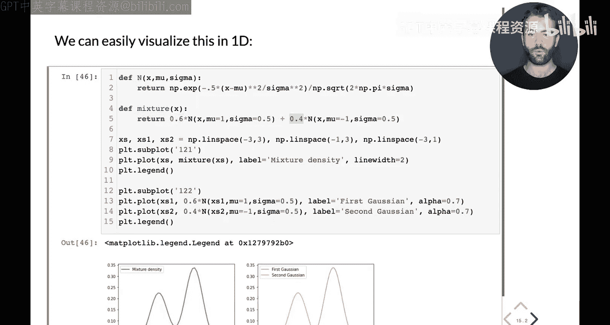

```
p(x) = Σ_{k=1}^{K} φ_k * N(x | μ_k, Σ_k)
```

其中：
*   `N(x | μ_k, Σ_k)` 是均值为 `μ_k`、协方差矩阵为 `Σ_k` 的高斯分布的概率密度函数。
*   `φ_k` 是分配给每个高斯分布的权重，介于0和1之间，且所有 `φ_k` 之和为1。

这本质上是 `K` 个高斯分布的加权平均，`φ_k` 定义了每个高斯分布的混合比例。

---

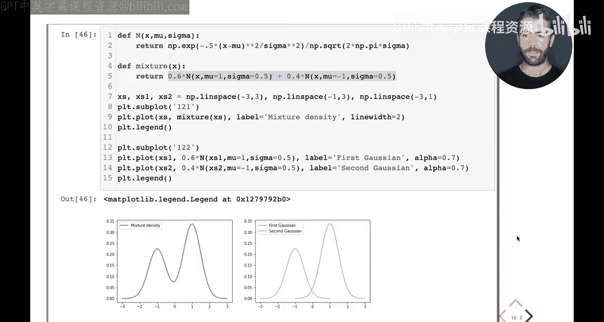

### 可视化高斯混合模型 📈

在一维情况下，我们可以轻松可视化高斯混合模型。例如，考虑两个高斯分量的混合：
*   第一个高斯分量：均值 `μ_1 = 1`，标准差 `σ_1 = 0.5`，权重 `φ_1 = 0.6`。
*   第二个高斯分量：均值 `μ_2 = -1`，标准差 `σ_2 = 0.5`，权重 `φ_2 = 0.4`。

混合后的概率密度函数将有两个峰值，分别对应两个高斯分量的中心。这个混合分布本身也是一个有效的概率分布，其积分总和为1。

---

## 高斯判别分析模型 🧩

我们将使用高斯混合模型的概念来定义一个生成模型，作为**高斯判别分析**算法的基础。

为了定义联合分布 `p_θ(x, y)`，我们需要定义两个部分：

1.  **类别 `y` 的分布**：我们假设 `y` 服从**分类分布**。这意味着 `y` 取第 `k` 个类别的概率是 `φ_k`。
    ```
    p(y = k) = φ_k
    ```

2.  **给定类别 `y` 时 `x` 的条件分布**：对于每个类别 `k`，我们假设 `x` 服从一个**多元高斯分布**，具有特定的均值 `μ_k` 和协方差矩阵 `Σ_k`。
    ```
    p(x | y = k) = N(x | μ_k, Σ_k)
    ```

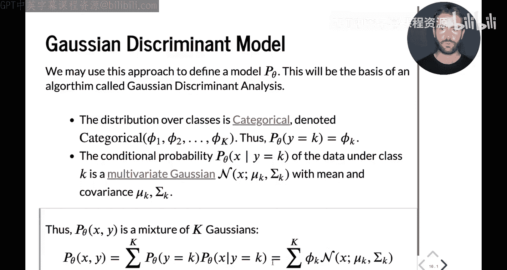

将这两部分结合起来，我们就得到了 `x` 和 `y` 的联合分布，它正是一个**高斯混合模型**：
```
p(x, y) = Σ_{k=1}^{K} φ_k * N(x | μ_k, Σ_k)
```

这就是高斯判别分析算法的主要建模假设。

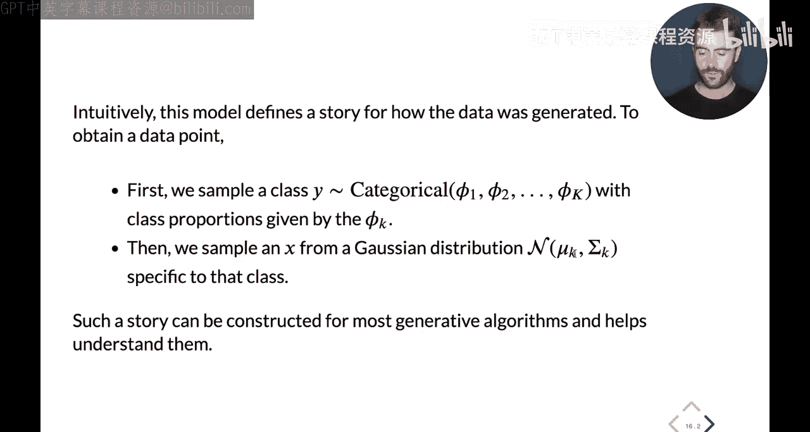

---

### 数据生成的故事 📖

理解这个模型的一种方式是将其视为一个**数据生成过程**的故事：

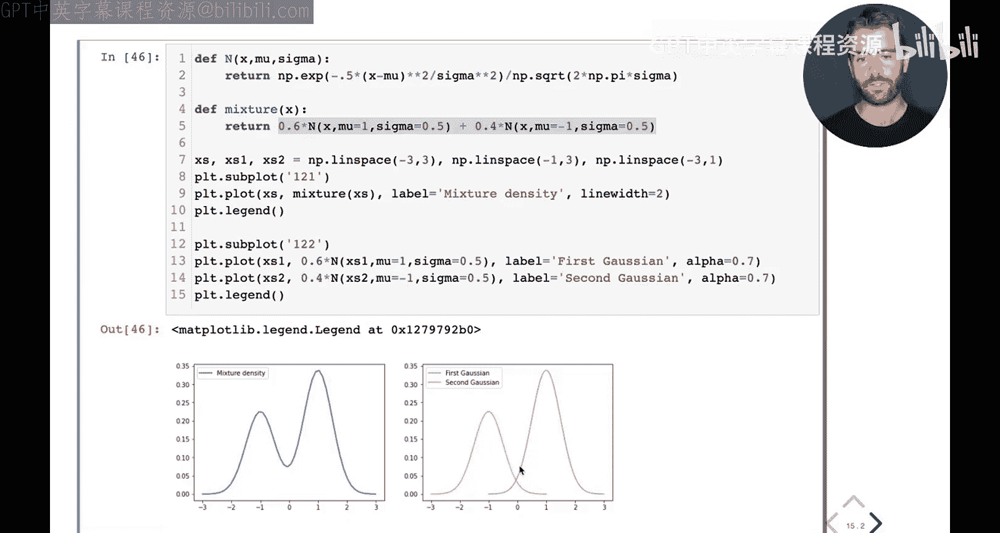

1.  首先，从分类分布中抽样一个类别 `y`。我们有 `K` 个可能的类别，其比例由 `φ_k` 给出。
2.  然后，根据抽到的类别 `k`，从对应的高斯分布 `N(x | μ_k, Σ_k)` 中抽样一个数据点 `x`。

如果我们回到之前的高斯混合模型示例，可以想象我们反复抛一枚硬币来决定是从橙色还是蓝色的高斯分布中抽样，然后绘制一个点。重复多次后，所有点的分布将呈现出混合模型的形状。

这种用故事定义生成模型的方法非常有趣，许多生成模型都可以通过这种数据生成的故事来理解和构建。

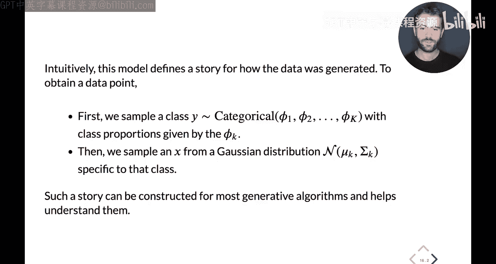

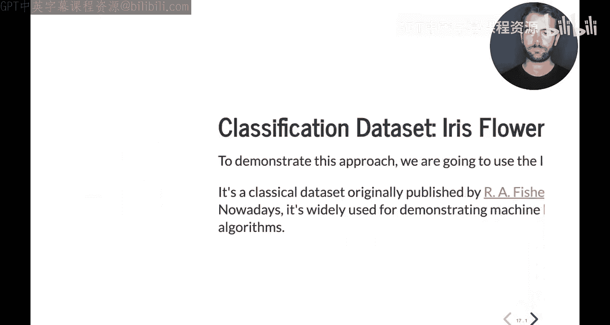

---

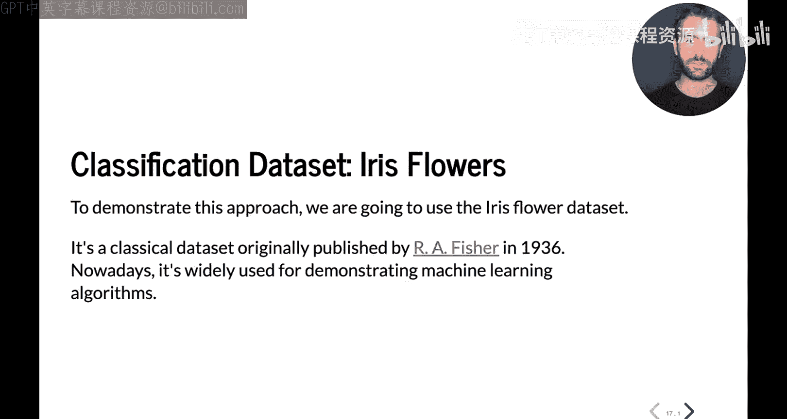

## 在鸢尾花数据集上的示例 🌸

现在，让我们看一个在更实际数据上应用高斯混合模型的例子——鸢尾花数据集。

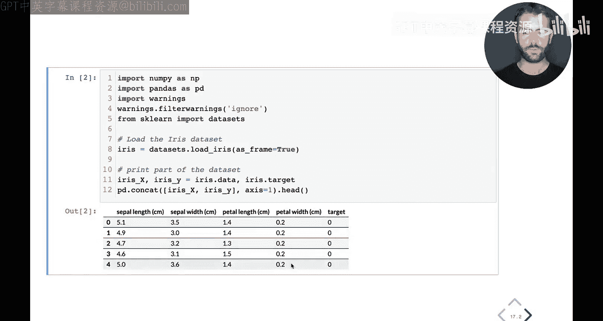

该数据集包含三种鸢尾花的四个测量值。如果我们只取前两个维度进行可视化，数据点呈现出三个类别的聚类。

---

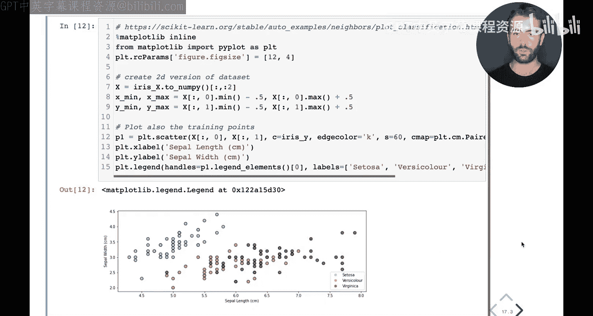

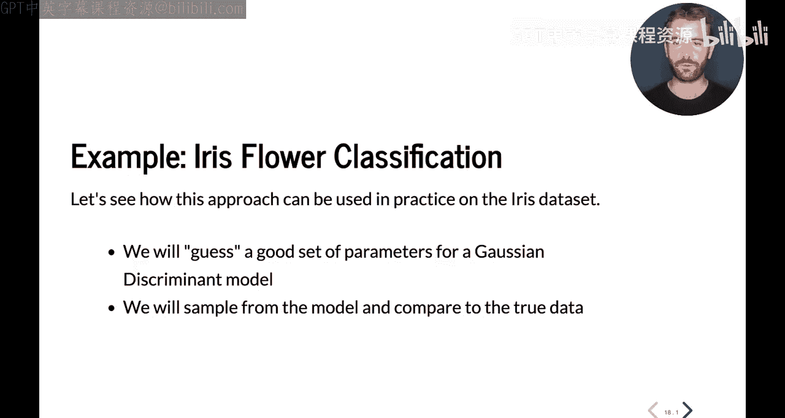

### 定义并采样模型数据 🎯

我们尝试为这个数据集拟合一个生成模型。首先，我们凭直觉猜测模型的参数，然后从模型中抽样数据，并与真实数据进行比较，以验证模型是否合理。

我们假设的参数如下：
*   **类别比例 `φ_k`**：由于有三个类别，我们假设均匀分布，即每个 `φ_k = 1/3`。
*   **均值 `μ_k`**：通过目视检查二维图，我们为三个类别分别设定均值。
*   **协方差矩阵 `Σ_k`**：我们为每个分布假设一个对角协方差矩阵，并缩放一个较小的因子（如0.05）。

定义了这些参数后，我们可以轻松地从模型中生成数据：
1.  首先抽样一组随机的类别标签 `y`。
2.  然后根据每个类别对应的高斯分布抽样数据点 `x`。

---

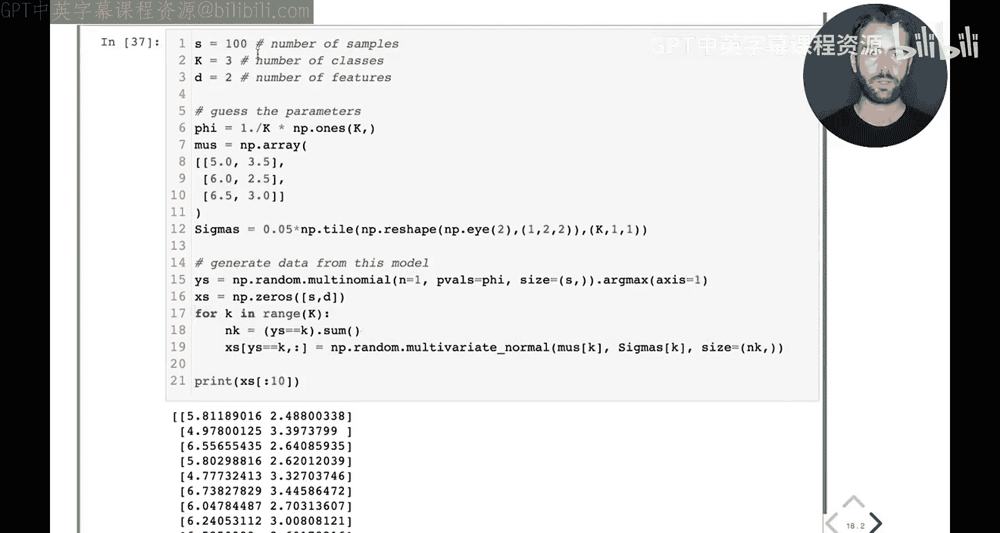

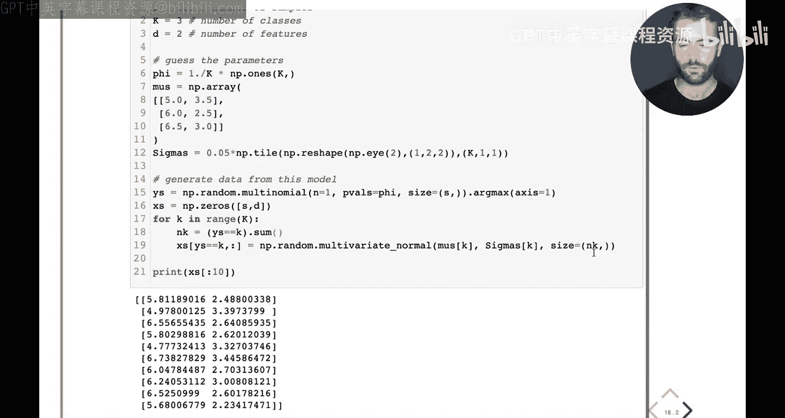

### 可视化与比较 👁️

将生成的样本数据与真实数据一起可视化，我们可以看到：
*   从“蓝色”类别生成的样本点大致落在真实蓝色数据点的区域。
*   从“浅棕色”和“深棕色”类别生成的样本点也分别落在对应真实数据的近似区域。

这表明，即使只是通过目视检查并凭直觉选择参数，我们的模型也能生成与真实数据结构相似的数据。这证明了该模型能够捕捉数据中某些相关的模式。

---

## 总结 📝

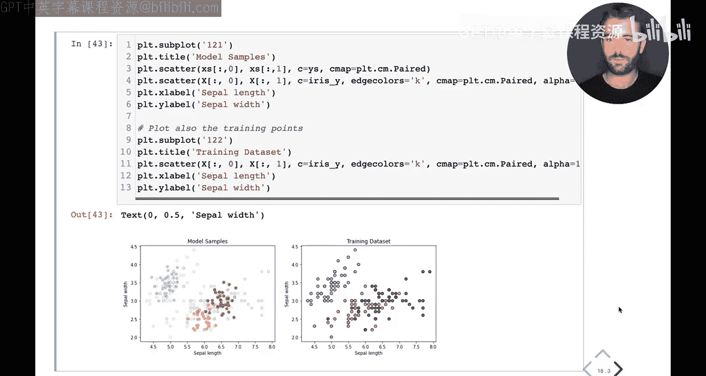

在本节课中，我们一起学习了：
1.  **高斯判别分析**是一种生成式监督学习算法。
2.  其核心是假设数据由**高斯混合模型**生成，即每个类别的数据服从一个特定的高斯分布，而类别本身服从一个分类分布。
3.  该模型可以理解为一个**数据生成过程**：先抽样类别，再根据该类别的分布抽样特征。
4.  通过一个简单的示例，我们展示了即使使用直观猜测的参数，该模型也能生成与真实鸢尾花数据集结构相似的样本数据。

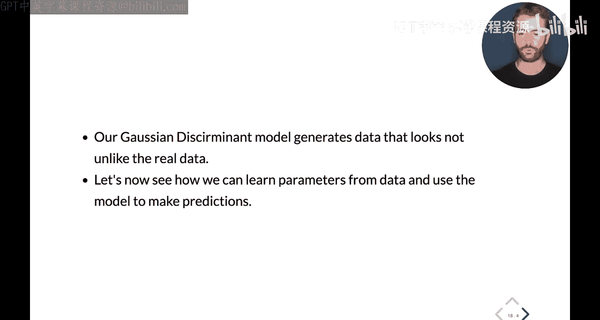

在下一节中，我们将探讨如何从数据中**学习**这些模型参数，从而形成一个完整的学习算法。