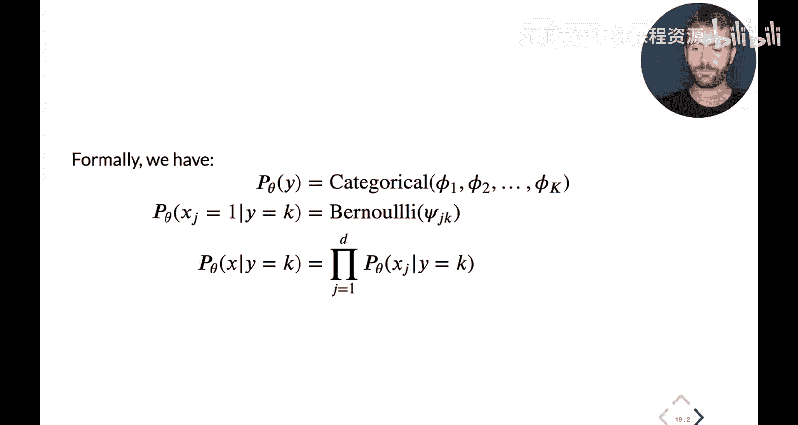

# 8.2：朴素贝叶斯（第二部分） 🧠

在本节课中，我们将要学习朴素贝叶斯算法。上一节我们介绍了文本分类问题及其特征表示方法，本节中我们来看看如何为这类问题构建一个专门的生成式模型。

## 概述

朴素贝叶斯算法是一种用于分类的生成式模型，特别适用于文本分类等具有高维、离散特征的问题。它通过一个关键的简化假设，使得模型在计算上变得可行。

## 文本分类问题回顾

我们的核心问题是文本分类。这是一个分类问题，其中输入 **x** 是一个单词或字符序列，长度可变且维度很高。我们需要将 **x** 分类到特定类别中。实际应用包括垃圾邮件过滤、欺诈检测和医疗记录分类等。

应用机器学习算法的主要挑战在于如何将输入 **x** 转化为特征。我们提出的方法是**词袋特征表示法**。

以下是词袋特征表示法的定义：
*   给定输入 **x** 和一个词汇表 **V**（我们考虑的所有单词的集合）。
*   **x** 的特征表示是一个长向量，每个单词对应一个分量。
*   该分量的值为 0 或 1，取决于该单词是否出现在 **x** 中。

例如，如果词汇表是 `[“church”, “doctor”, “patient”]`，而输入句子是 `“doctor patient”`，那么其特征向量就是 `[0, 1, 1]`。

## 生成式模型与判别式模型

我们已见过两类监督学习算法：判别式模型（如逻辑回归）和生成式模型（如高斯判别分析）。它们的区别在于是否对 **x** 和 **y** 的联合分布进行建模。

生成式模型的思想是：我们学习每个类别下数据点 **x** 的分布模型。当需要对新数据点 **x'** 进行预测时，我们计算它在每个类别模型下的概率，并报告概率最高的类别。

数学上，这可以定义为：
**y_hat = argmax_y P(y | x) = argmax_y P(x | y) * P(y)**

高斯判别分析是生成式模型的一个例子。它假设给定 **y** 时 **x** 的条件概率是一个多元高斯分布（正态分布），而类别分布是一个分类分布。这定义了一个高斯混合模型。

## 将 GDA 应用于文本分类的问题

如果我们尝试将高斯判别分析算法应用于文本分类，会立即遇到一个问题：我们的数据（词袋表示）是**离散的**，而 GDA 模型假设数据服从**连续的正态分布**。因此，这个模型是“错误设定”的。

我们可以尝试通过假设条件分布是**分类分布**来解决这个问题。然而，这带来了另一个问题：如果我们的特征向量维度 **D** 非常大（例如，词汇表有 10000 个词），那么 **x** 可能取值的数量是 **2^D**（2 的 10000 次方），这是一个天文数字。用分类分布来建模 **x**，意味着我们需要指定 **2^D - 1** 个参数，这在计算和存储上都是不可能的。

## 朴素贝叶斯假设

朴素贝叶斯算法通过一个关键的简化假设解决了这个高维问题，这个假设被称为**朴素贝叶斯假设**。

为了处理高维的 **x**，我们假设给定 **y** 时 **x** 的分布可以按以下形式分解：
**P(x | y) = ∏_{j=1}^{D} P(x_j | y)**

这意味着，给定类别 **y**，特征向量 **x** 中每个分量（例如，每个单词是否出现）的概率是**相互独立**的。**x** 的整体概率只是各个分量概率的乘积。

具体到我们的二进制词袋表示例子中，每个分量 **x_j** 给定 **y** 的概率可以用一个**伯努利分布**来建模。伯努利分布只有一个参数（单词出现的概率）。因此，整个 **P(x | y)** 的分布就是 **D** 个伯努利分布的乘积。

现在，我们只需要 **D** 个参数（而不是 **2^D - 1** 个）来指定这个分布。这是一个巨大的简化，使得算法可以扩展到非常大的词汇量。

当然，这个假设做了很大的简化（例如，“医生”和“病人”这些词在现实中通常是相关的），但实践表明，这种算法的经验性能通常很好。

## 伯努利朴素贝叶斯模型

基于朴素贝叶斯假设，我们现在可以定义朴素贝叶斯算法。首先定义其模型。

与高斯判别分析策略相同，我们将定义一个关于 **y** 的概率分布，以及一个给定 **y** 时 **x** 的条件概率分布。

1.  **类别先验分布**：与 GDA 相同，是一个分类分布。
    *   **P(y = k) = φ_k**

2.  **条件似然分布**：与 GDA 使用高斯分布不同，这里我们使用基于朴素假设的伯努利分布乘积。
    *   **P(x | y = k) = ∏_{j=1}^{D} P(x_j | y = k)**
    *   其中，每个 **P(x_j | y = k)** 都是一个伯努利分布。

因此，伯努利朴素贝叶斯模型的完整数学形式是：
**P(x, y) = P(y) * P(x | y) = (Categorical(y; φ)) * (∏_{j=1}^{D} Bernoulli(x_j; ψ_{jk}))**

这里，模型参数包括分类分布的参数 **φ** 和所有伯努利分布的参数 **ψ_{jk}**（对于第 **k** 个类别，第 **j** 个单词出现的概率）。参数总数大约是 **K * D**，这是可管理的。

## 总结

本节课中我们一起学习了朴素贝叶斯算法的核心思想。我们回顾了文本分类问题，指出了直接将高斯判别分析等模型应用于离散高维数据时遇到的问题。为了解决参数爆炸的难题，朴素贝叶斯引入了**条件独立性假设**，将高维联合分布分解为多个一维分布的乘积，从而极大地简化了模型。最后，我们定义了**伯努利朴素贝叶斯模型**的具体形式。在下一节中，我们将探讨如何从数据中学习这个模型的参数。