# 9.1：分类间隔 📏

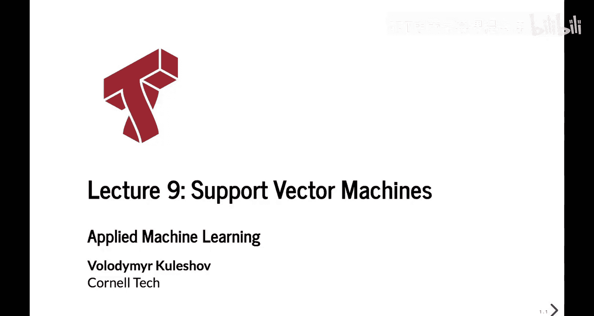

在本节课中，我们将学习机器学习中一个非常重要的算法家族——支持向量机。支持向量机是一种可以应用于多种问题的算法，包括回归、分类，甚至某些类型的无监督学习。本节课我们将首先介绍支持向量机背后的核心思想：分类间隔。

## 背景与问题设定

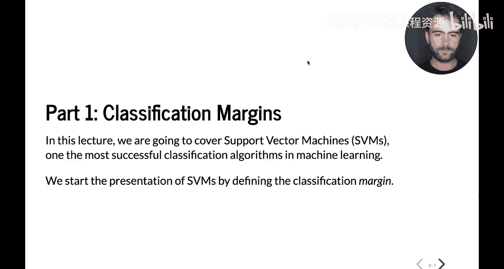

上一节我们介绍了支持向量机的基本概念。本节中，我们来看看支持向量机所针对的具体问题背景。

我们将专注于**二元分类**问题。在二元分类中，我们有一个监督学习数据集，包含输入 **X** 和目标 **Y**。目标 **Y** 取两个可能值之一。在本讲中，我们将引入新的符号表示：用 **+1** 和 **-1** 来表示这两个类别，这会使后续的数学推导更简洁。

我们将考虑的模型类别是**线性模型**。模型形式如下：

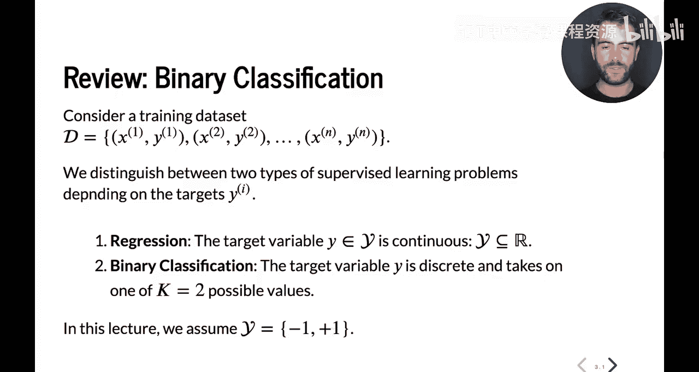

**公式：** `f(x) = θ^T x + θ_0`

这里，**θ** 是权重向量，**θ_0** 是偏置项。我们特意将偏置项 **θ_0** 与权重向量 **θ** 分开表示，以简化推导。

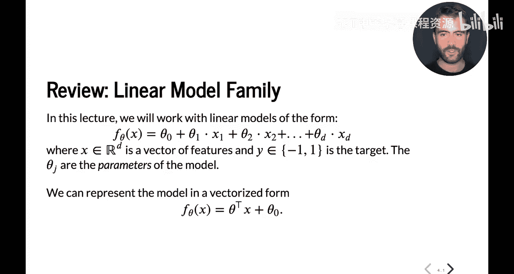

## 示例数据集：鸢尾花

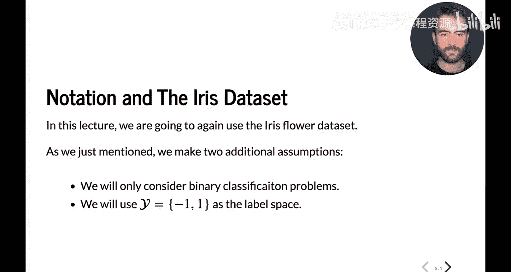

为了有一个贯穿本讲的运行示例，我们将使用之前见过的**鸢尾花数据集**。

该数据集包含每朵花的四个特征（植物各部分的测量值）。我们将鸢尾花 Setosa 类别标记为 **+1**，其他两个类别合并标记为 **-1**。下图展示了一个数据子集的可视化，蓝色点代表 Setosa 花（+1），棕色点代表其他花（-1）。

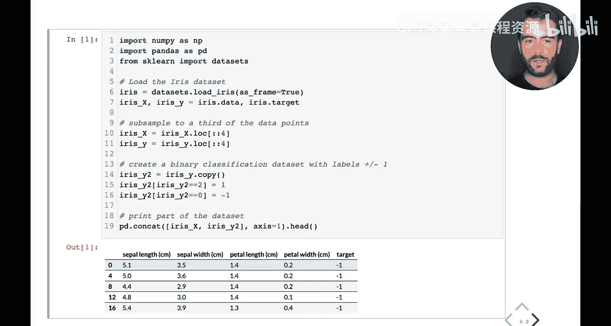

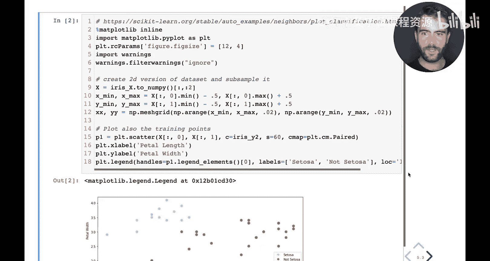

## 选择最佳决策边界 🤔

考虑鸢尾花数据集。我们之前已经见过多种可用于此数据集分类的机器学习方法。

每种算法都会计算出一个分离两个类别的决策边界，而不同的算法会输出不同的边界。例如，逻辑回归会输出一条线，高斯判别分析会输出一个不同的超平面。

一个关键问题是：我们如何确定哪个边界是最好的？特别是在这个例子中，两个类别是**线性可分**的，这意味着存在无限多个能完美分离数据的超平面。那么，我们如何从这无限多个可能的超平面中进行选择呢？

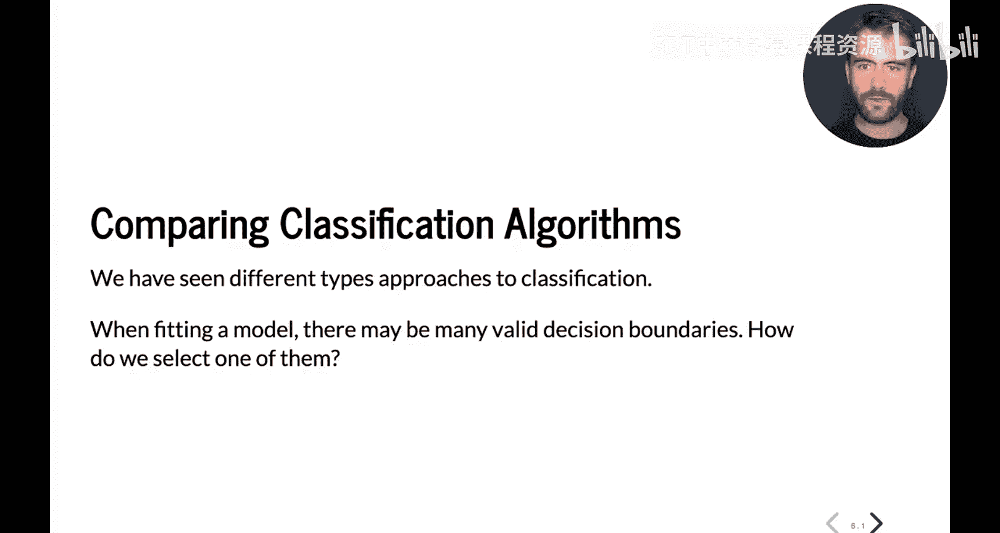

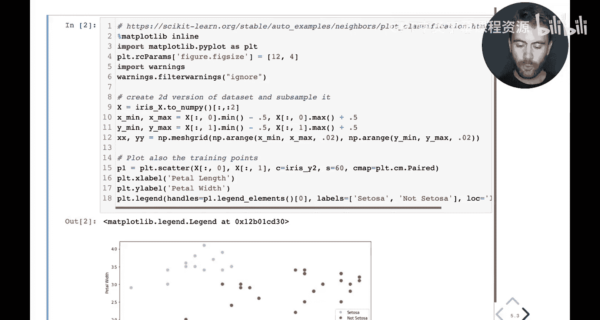

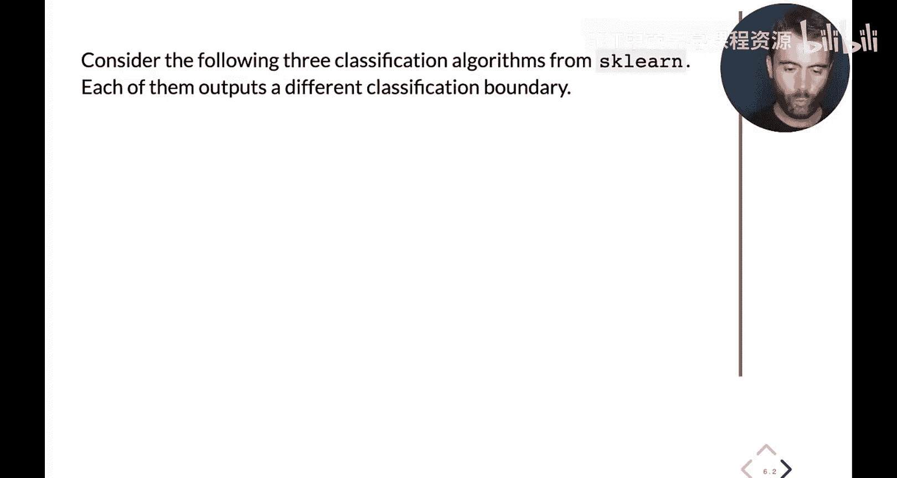

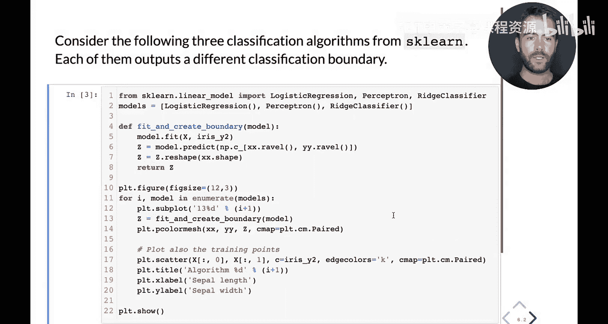

为了说明这个问题，请看以下示例。我们使用三种不同的算法（逻辑回归、感知机、Ridge分类器）拟合同一数据集，它们给出了显著不同的边界。

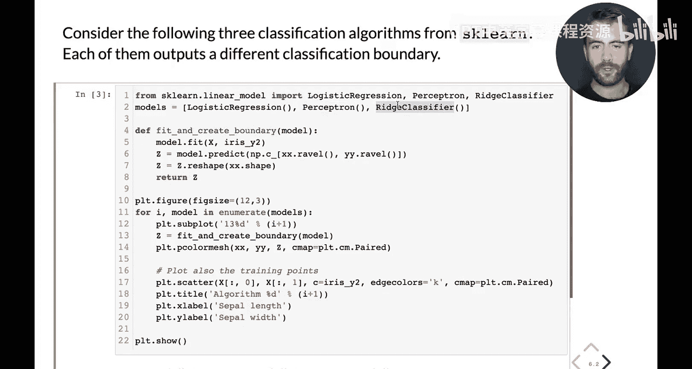

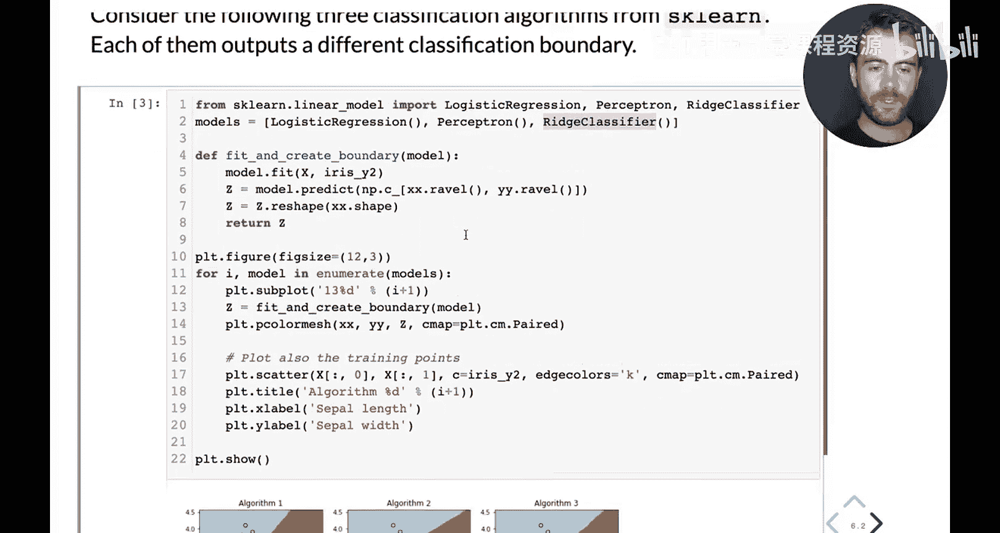

你可以看到这些线的斜率不同，边界的位置也不同。有的边界非常靠近棕色点，有的则靠近蓝色点。那么，哪个超平面最好呢？

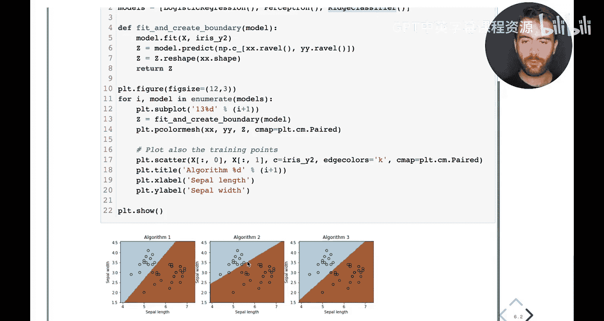

## 间隔的直观理解 🛡️

支持向量机算法的核心思想是选择具有**高间隔**的边界。支持向量机的基本前提是：我们应该选择具有**最大可能间隔**的决策边界，这意味着边界应尽可能远离数据点。

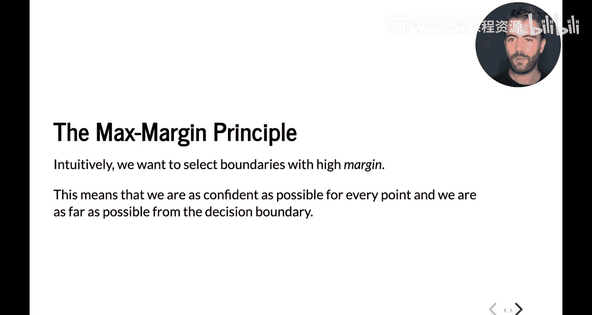

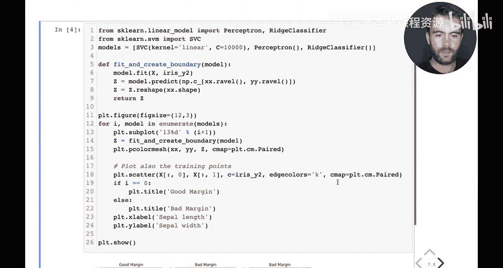

**间隔**可以理解为分离超平面与最近数据点之间的距离。我们希望最大化这个间隔，将分离边界放置在尽可能远离数据点的位置。

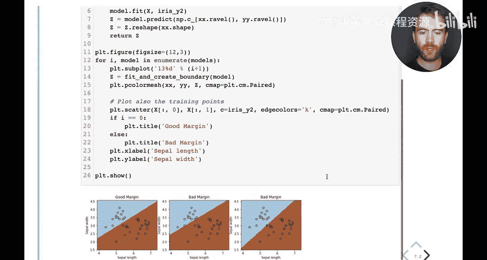

让我通过一个例子来具体说明这意味着什么。

考虑以下分离超平面。这个超平面存在问题，因为它非常靠近棕色数据集。事实上，这个棕色点几乎就在决策边界上。

现在，想象如果我们稍微扰动这个数据集，或者测量中存在微小误差，这个棕色点很容易越过边界并被错误分类。同样，在中间的例子中，超平面也非常靠近蓝色点，轻微的扰动也会导致误分类。

相比之下，左侧的超平面距离数据点较远，具有**高间隔**。如果我们扰动数据点或超平面，由于存在误差裕度，分类结果仍然可能是正确的。因此，这个超平面看起来更稳定，对误差和扰动更具鲁棒性。

这就是为什么从无限多个能完美分离数据的超平面中，我们可能希望选择像这样具有高间隔的超平面的直观原因。这个直观论证为寻找高间隔超平面的算法（如支持向量机）提供了依据。

在下图中，高间隔超平面（黑色实线）与最近的数据点（黑色圆圈标出）之间有健康的间隔区域（虚线之间）。这个区域的宽度就是间隔的大小，我们希望使其尽可能大。

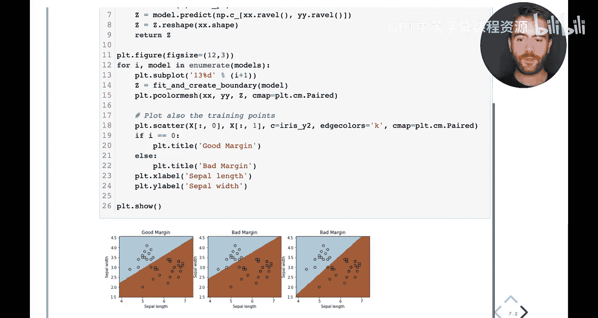

## 形式化定义间隔 📐

我们已经对如何找到好的分离超平面有了直观理解。现在，我们来看看如何将这个直觉形式化。第一步是给出间隔更正式的定义。

由于我们的目标 **y** 是 **+1** 或 **-1**，我们可以使用以下定义：一个数据点的间隔是其预测值的大小。预测值 **f(x)** 是一个数字。如果这个数字很大，我们预测为正类；如果非常负，则预测为负类。

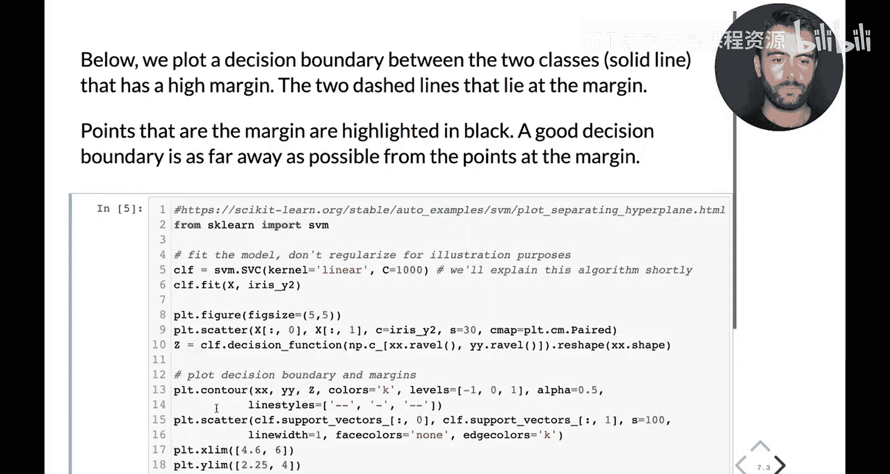

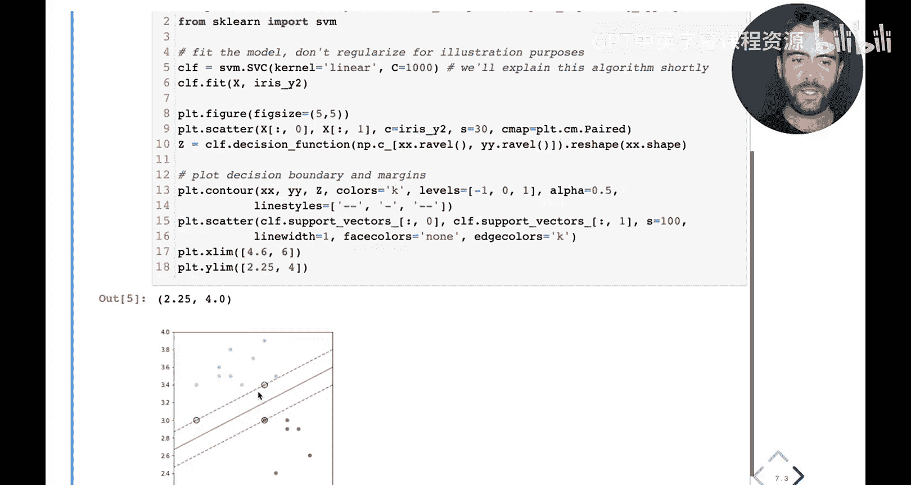

为了确保间隔值为正，我们将其乘以 **y**。因此，任何被正确分类的点都会有一个正的间隔。我们希望这个值很高。

**公式：** `γ̃_i = y_i * f(x_i) = y_i * (θ^T x_i + θ_0)`

我声称这是一个好的间隔定义。如何验证呢？

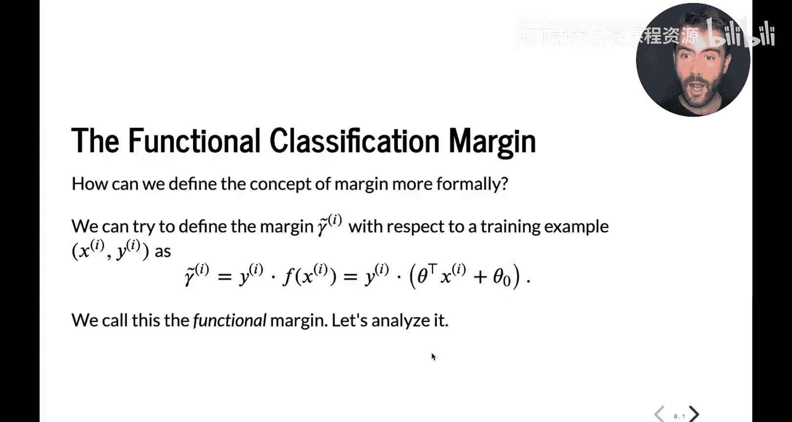

考虑两种情况：
1.  假设一个点 **x_i** 的真实标签是正的（**y_i = +1**）。如果模型的分数 **f(x_i)** 非常大且为正，那么这个间隔也会很大。这意味着我们非常确信这是一个正类点，或者说该点远离超平面（分数为0时正好在边界上）。所以，高分意味着高置信度和高间隔。
2.  反之，如果真实标签是负的（**y_i = -1**），当分数趋向负无穷时，间隔最大化。这意味着我们以高置信度将其分类为负类。

因此，更高的间隔意味着更高的分类置信度，也意味着该点距离决策边界更远。

## 几何间隔：解决缩放问题 ⚖️

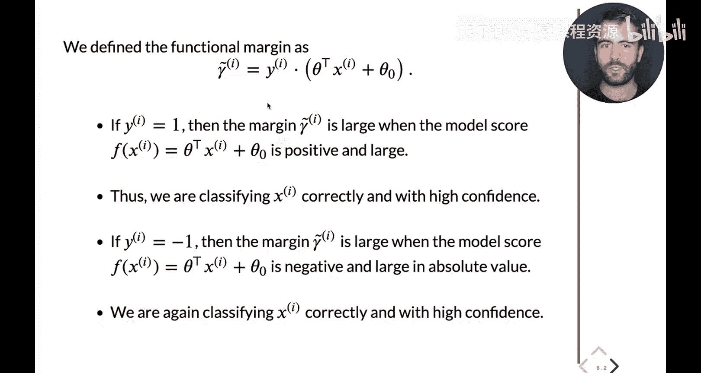

然而，上述定义存在一个问题。如果我们取参数 **θ** 和 **θ_0** 并乘以一个正标量 **α**，得到新参数。由于 **α** 为正，它不会改变分配给每个点的分数的符号，因此不会改变预测的标签。但是，我们定义的间隔却被缩放了 **α** 倍。

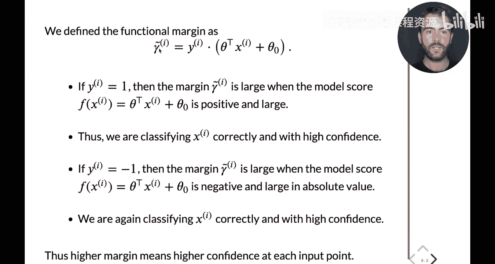

这意味着我们可以仅通过重新缩放参数来任意增大间隔，而没有真正改变决策边界的位置或分配的标签。这是一个不好的特性。

为了解决这个问题，我将稍微修改之前的定义，引入**几何间隔**的概念。

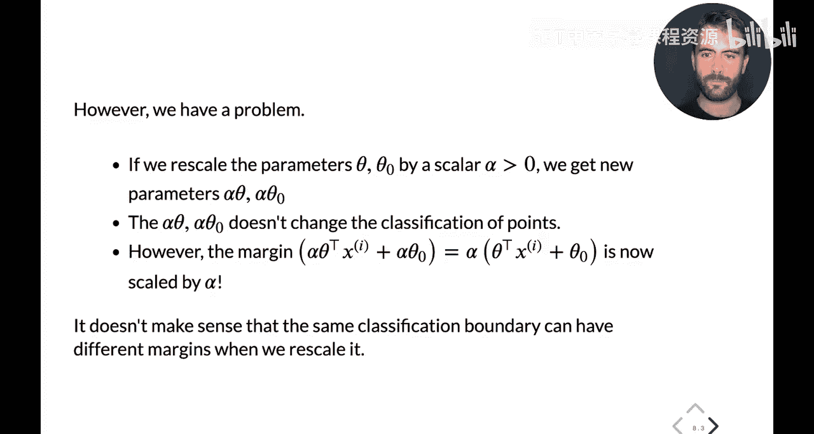

**公式：** `γ_i = y_i * (θ^T x_i + θ_0) / ||θ||`

这里，我通过 **θ** 的范数 **||θ||** 对分数进行了归一化。现在，如果我们重新缩放 **θ**，由于进行了归一化，我们不能再任意增大间隔了。这个缩放技巧不再有效。

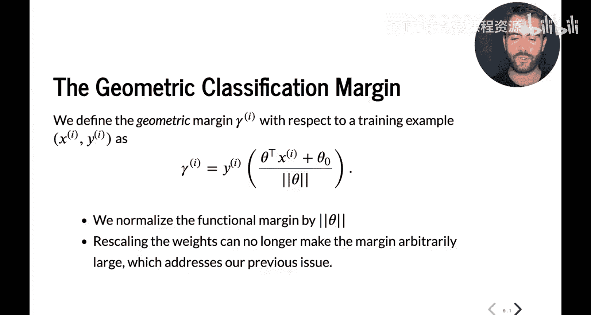

这个几何间隔的定义既保留了之前的直观含义，又解决了缩放问题。这将是我们在本讲中使用的间隔定义。

## 几何间隔的几何解释 📏

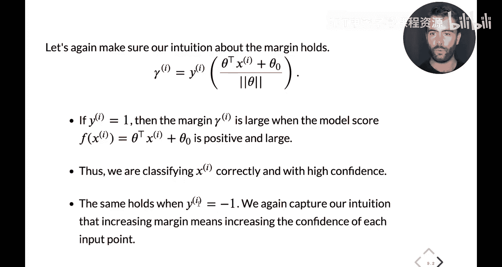

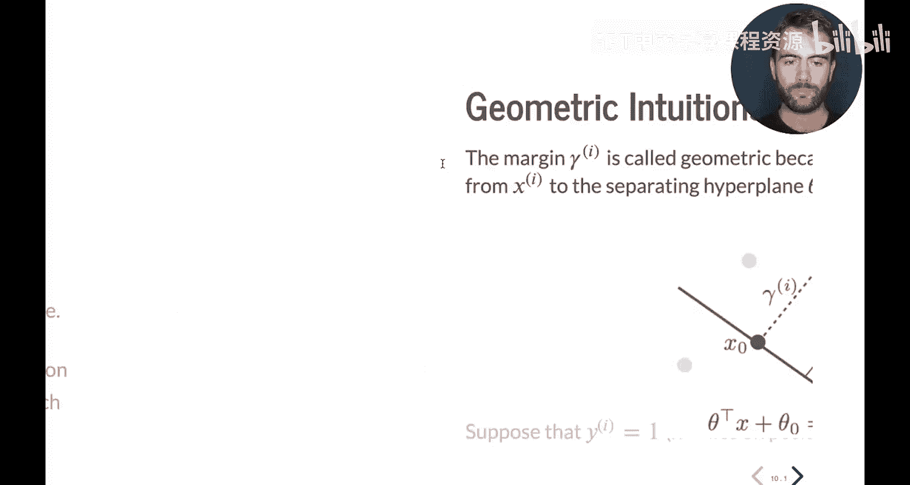

为了让你确信这是一个好的定义，我将从另一个角度——几何角度——推导这个公式。这也解释了为什么我称之为“几何”间隔。

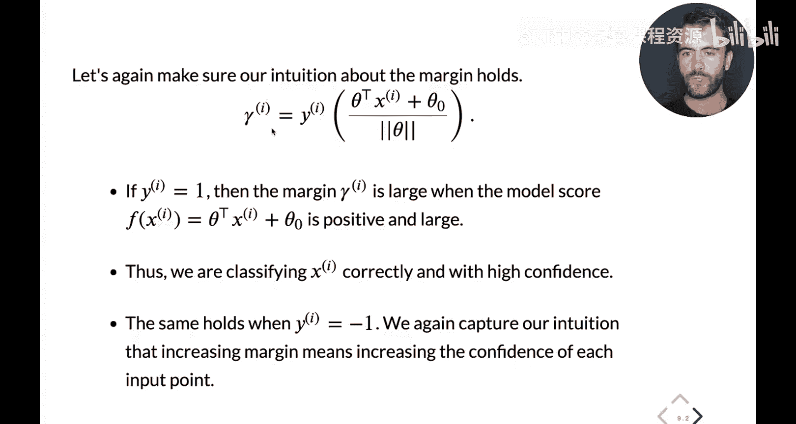

我给出的几何间隔公式 **γ_i** 实际上精确地对应于点 **x_i** 到分离超平面的**距离**。

如何证明这一点呢？论证并不复杂。

首先，为了简化推导，假设真实标签 **y_i = +1**（对于 **y_i = -1**，论证类似）。然后基于两个观察：

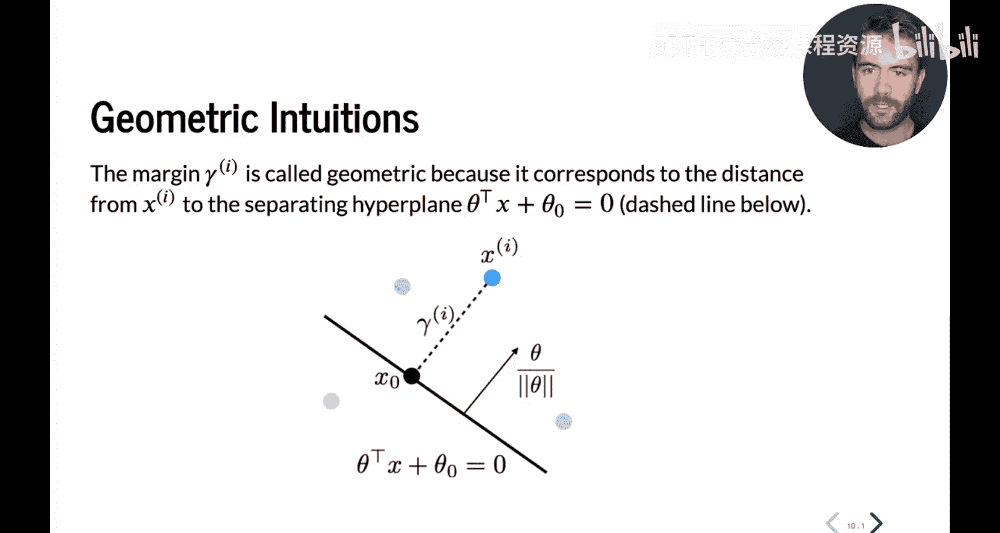

1.  **决策边界上的点**满足方程：`θ^T x + θ_0 = 0`。这是一个多维向量空间中描述超平面的公式。
2.  向量 **θ / ||θ||** 垂直于这个分离超平面，并且其范数为1（根据我们的构造，因为除以了范数）。

从几何上看，从点 **x_i** 到超平面的最短路径（垂线）方向正是单位法向量 **θ / ||θ||** 的方向。设这个最短距离为 **γ_i**，那么边界上离 **x_i** 最近的点 **x_0** 可以表示为：
`x_0 = x_i - γ_i * (θ / ||θ||)`

由于 **x_0** 在超平面上，它满足 `θ^T x_0 + θ_0 = 0`。将 **x_0** 的表达式代入并求解 **γ_i**，我们得到：
`γ_i = (θ^T x_i + θ_0) / ||θ||`
这正是我们之前定义的几何间隔公式（当 **y_i = +1** 时）。

因此，几何间隔 **γ_i** 就是点 **x_i** 到决策超平面的欧几里得距离。这进一步证实了我们定义的合理性。

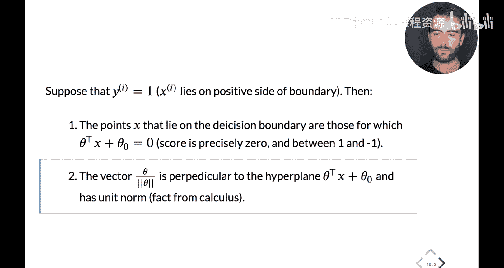

我们可以用代码绘制出这些表示间隔的线段，其长度正是最近点到超平面的距离。

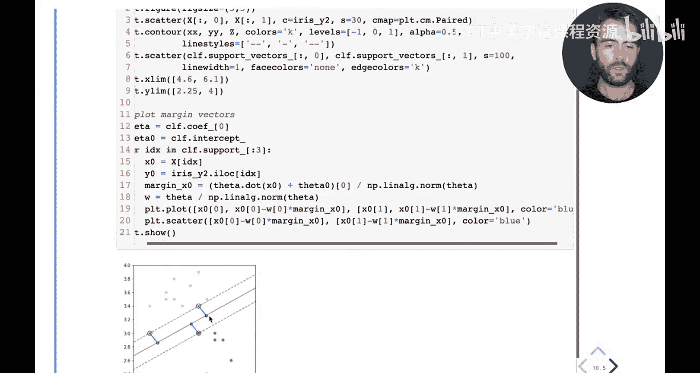

## 总结

本节课我们一起学习了支持向量机算法的核心动机——**最大化分类间隔**。

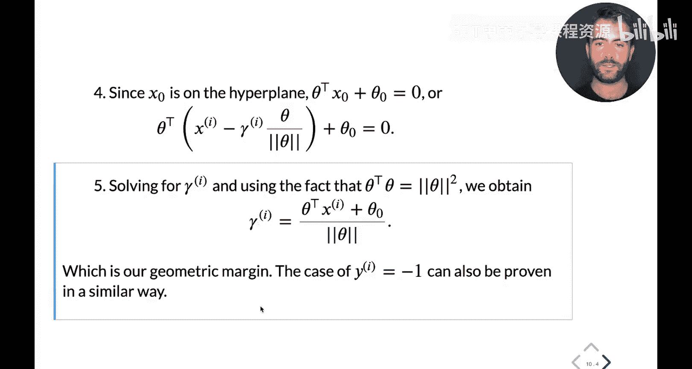

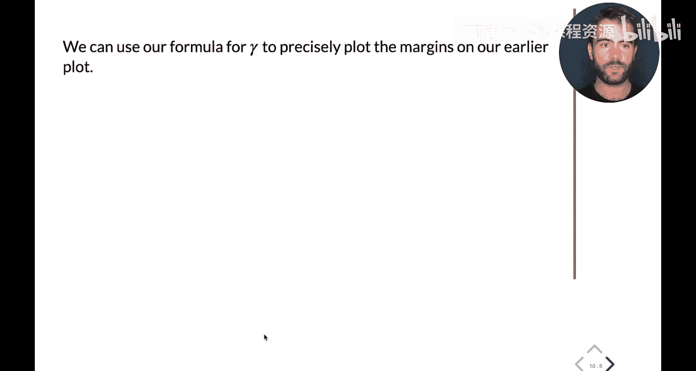

首先，我们明确了在二元分类问题中，当数据线性可分时，存在无数个分离超平面。为了从中选出最鲁棒、最稳定的一个，我们引入了**间隔**的概念。间隔越大，决策边界离数据点越远，模型对数据扰动和测量误差的容忍度就越高。

接着，我们形式化地定义了间隔。最初的简单定义 `γ̃_i = y_i * f(x_i)` 虽然直观，但存在参数缩放导致间隔任意增大的问题。为此，我们引入了**几何间隔** `γ_i = y_i * (θ^T x_i + θ_0) / ||θ||`。这个定义不仅保留了高间隔代表高分类置信度的直观意义，还通过归一化权重向量的范数解决了缩放问题。更重要的是，我们证明了**几何间隔在数值上等于数据点到决策超平面的几何（欧几里得）距离**，这为其命名和重要性提供了坚实的几何解释。

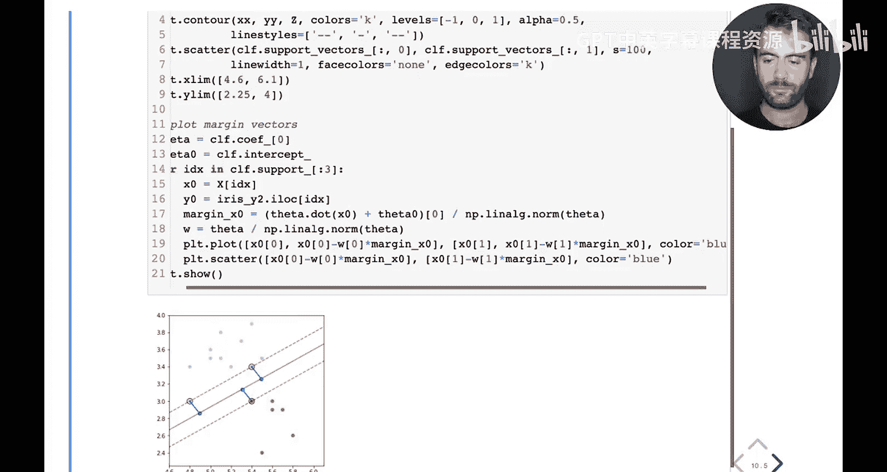

现在，我们已经建立了寻找高间隔分类器的目标。在接下来的课程中，我们将基于这个目标，推导出能够实际计算出最大间隔超平面的算法——即**支持向量机**。