# 9.4：支持向量机优化（第四部分）🎯

在本节课中，我们将学习支持向量机（SVM）的优化方法，特别是基于合页损失（Hinge Loss）的无约束优化问题。我们将从上一节介绍的合页损失公式出发，探讨如何通过梯度下降法来优化这个目标函数，并最终实现一个完整的SVM算法。

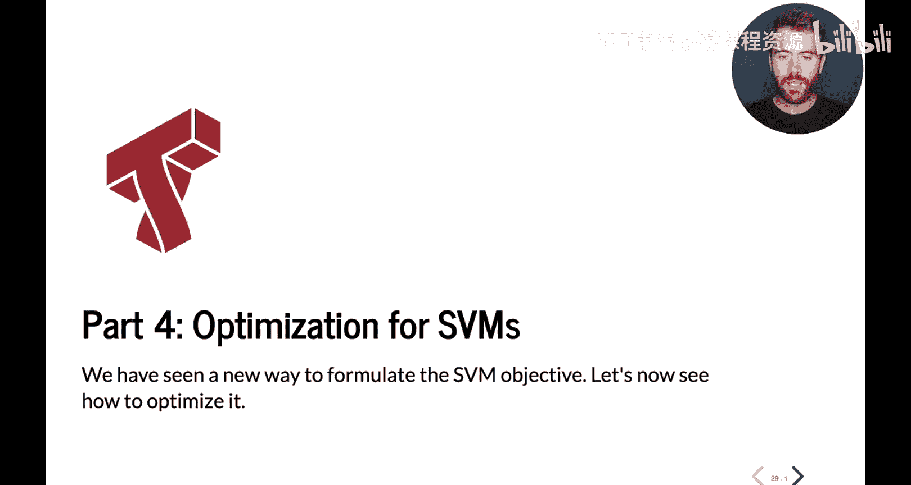

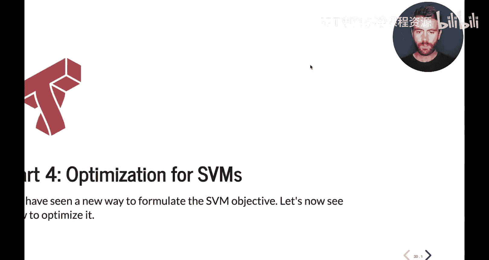

## 模型与损失函数回顾

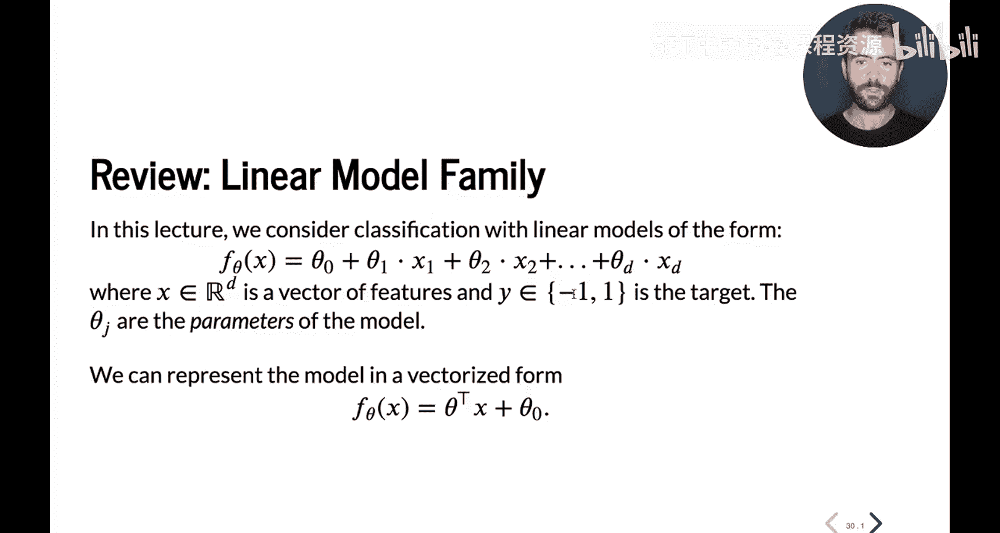

上一节我们介绍了SVM的一种新形式，它涉及一个无约束优化问题，其核心是最小化合页损失。让我们先回顾一下这个模型。

我们处理的是线性模型，其向量化形式为：
\[
f(x) = \theta^T x
\]
其中，目标变量 \( y \) 是二元的，取值为 -1 或 1。

合页损失函数定义为：
\[
\ell_{\text{hinge}}(y, f(x)) = \max(0, 1 - y \cdot f(x))
\]
这个损失函数具有有趣的特性：它类似于L1损失，但只惩罚那些导致错误分类的预测。具体来说，如果预测值 \( y \cdot f(x) < 1 \)，则会产生线性惩罚；如果 \( y \cdot f(x) \geq 1 \)，则惩罚为零。

SVM的目标可以看作是优化一个正则化的合页损失：
\[
J(\theta) = \sum_{i=1}^{n} \max(0, 1 - y^{(i)} \cdot f(x^{(i)})) + \frac{\lambda}{2} \|\theta\|^2
\]
其中，\( \lambda \) 是正则化参数。

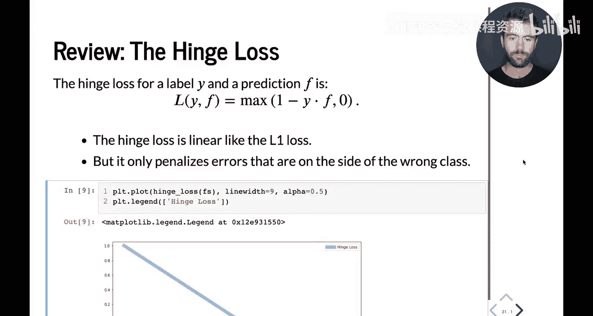

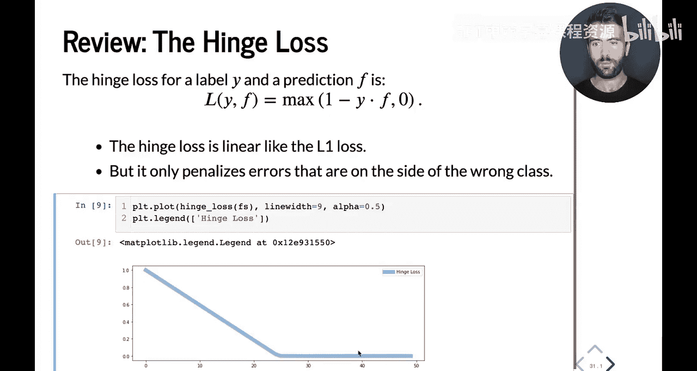

## 梯度下降法简介

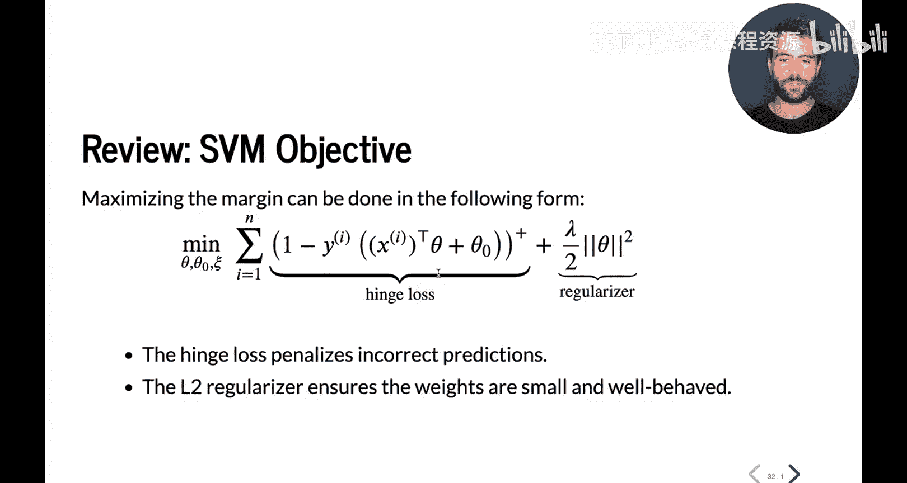

在之前的课程中，我们使用梯度下降法来优化其他算法的参数。梯度下降是一种迭代算法，我们从参数的某个初始猜测开始，然后反复应用以下更新步骤：
\[
\theta_{\text{new}} = \theta_{\text{old}} - \eta \nabla J(\theta_{\text{old}})
\]
其中，\( \eta \) 是学习率，\( \nabla J(\theta) \) 是目标函数 \( J \) 在 \( \theta \) 处的梯度。通过沿着负梯度方向移动一小步，我们可以确保目标函数值减小。

## 合页损失的梯度

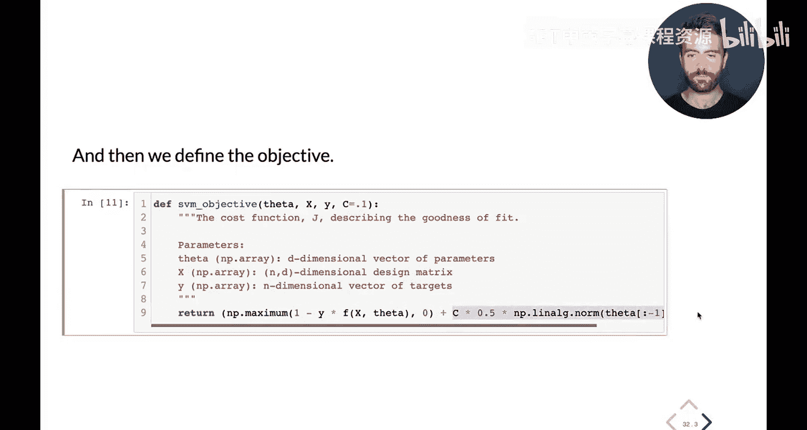

现在，我们来看看如何将梯度下降法应用于合页损失。合页损失函数有两个不同的区域，这取决于预测值 \( y \cdot f(x) \) 是否小于1。

### 线性区域

当 \( y \cdot f(x) < 1 \) 时，我们处于线性区域。此时，损失函数为：
\[
\ell_{\text{hinge}} = 1 - y \cdot f(x)
\]
其梯度为：
\[
\nabla \ell_{\text{hinge}} = -y \cdot \nabla f(x)
\]
由于我们的模型是线性的，即 \( f(x) = \theta^T x \)，因此梯度简化为：
\[
\nabla \ell_{\text{hinge}} = -y \cdot x
\]

### 平坦区域

当 \( y \cdot f(x) > 1 \) 时，我们处于平坦区域。此时，损失函数为零，因此梯度也为零：
\[
\nabla \ell_{\text{hinge}} = 0
\]

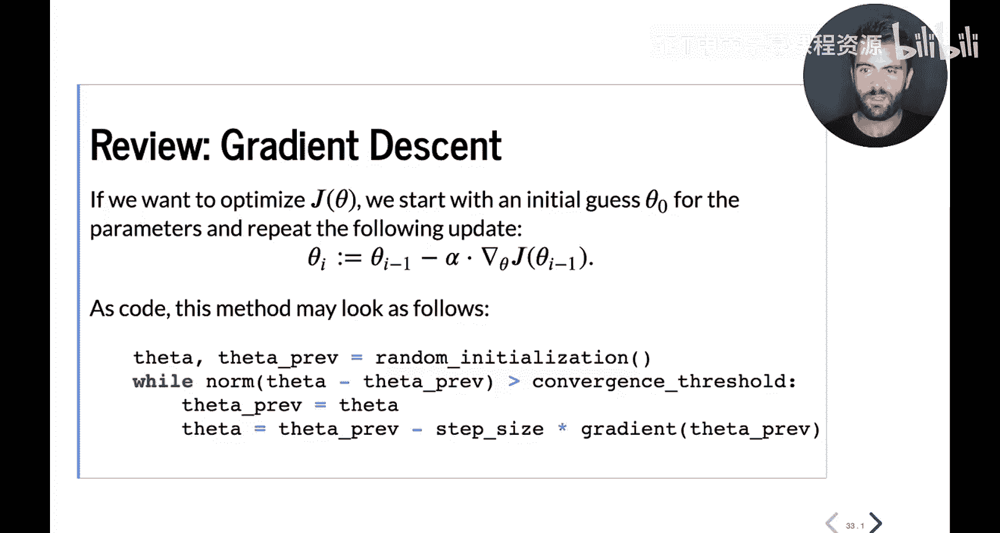

### 拐点处的梯度

当 \( y \cdot f(x) = 1 \) 时，函数有一个拐点。从技术上讲，梯度在此处未定义。然而，在实际优化中，我们可以选择线性区域的梯度或平坦区域的梯度（或它们的任意组合），这仍然有效。这种可能的梯度集合被称为次梯度（subgradient）。

## 次梯度下降算法

基于以上观察，我们可以定义一个“类梯度”函数，用于优化合页损失。以下是该函数的定义：
\[
\tilde{\nabla} \ell_{\text{hinge}} = 
\begin{cases} 
-y \cdot x & \text{if } y \cdot f(x) < 1 \\
0 & \text{if } y \cdot f(x) > 1
\end{cases}
\]
在拐点处，我们可以选择任意值（例如0或 \(-y \cdot x\)），这不会影响优化结果。

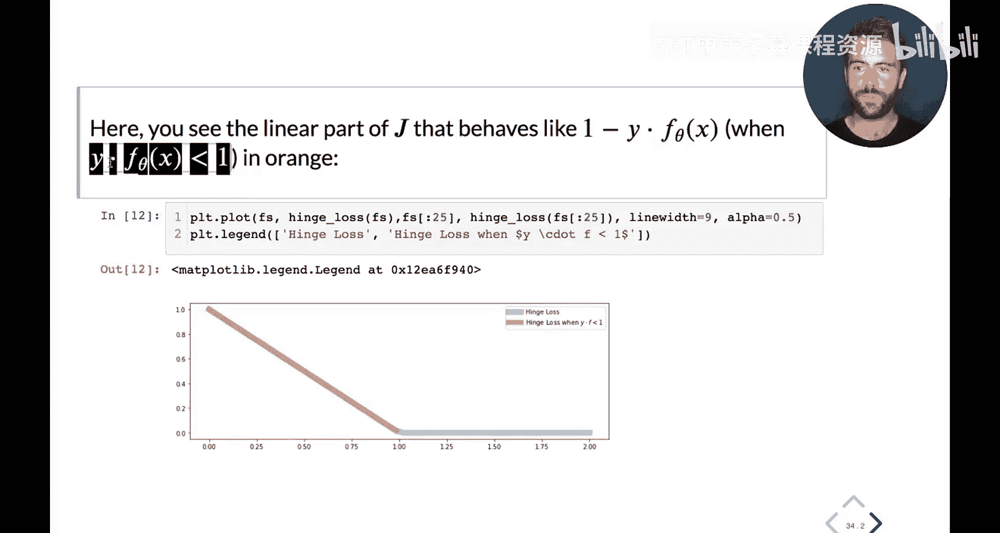

现在，我们可以使用这个“类梯度”函数来实现次梯度下降算法。算法的伪代码如下：

1. 初始化参数 \( \theta \)。
2. 重复直到收敛：
   a. 计算“类梯度” \( \tilde{\nabla} J(\theta) \)。
   b. 更新参数：\( \theta \leftarrow \theta - \eta \tilde{\nabla} J(\theta) \)。

## Python实现

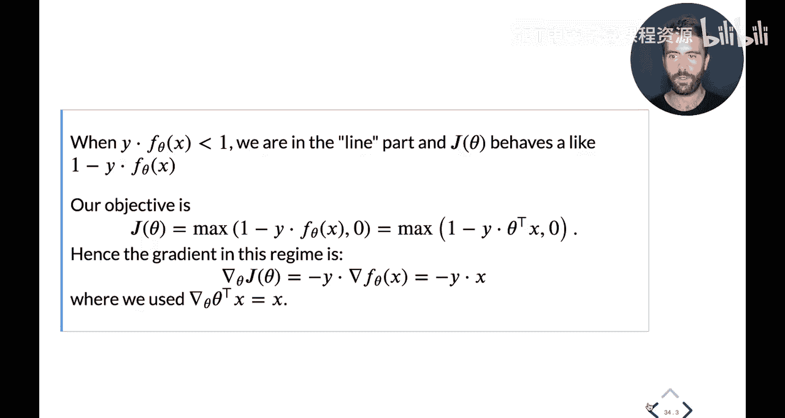

以下是使用Python实现SVM优化算法的步骤。

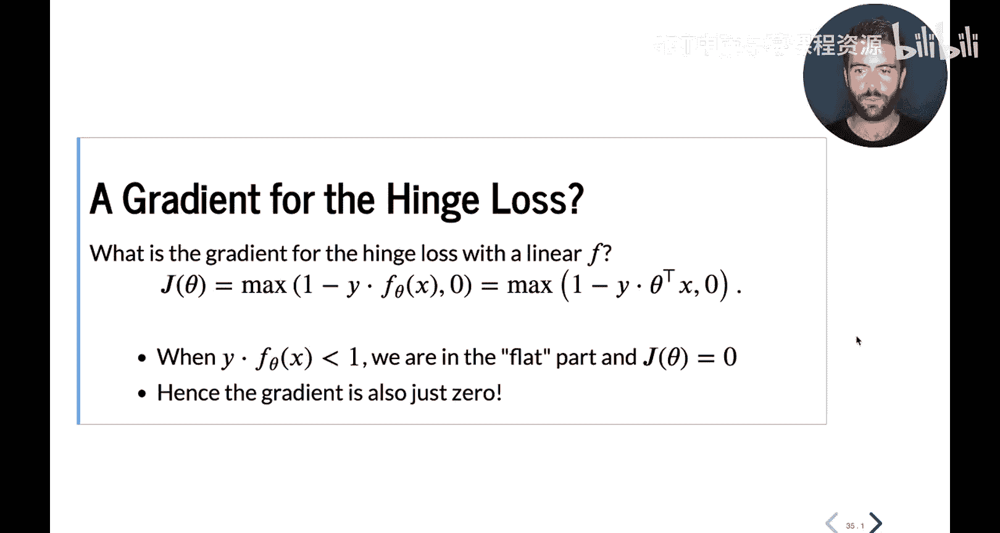

### 定义模型和损失

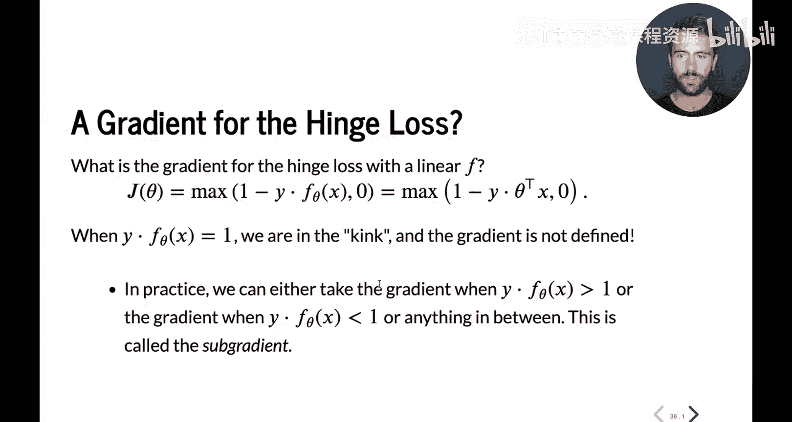

首先，我们定义线性模型和合页损失函数。

```python
import numpy as np

def linear_model(x, theta):
    return np.dot(x, theta)

def hinge_loss(y, f):
    return np.maximum(0, 1 - y * f)

def objective(theta, X, y, lambda_reg):
    f = linear_model(X, theta)
    loss = np.sum(hinge_loss(y, f))
    reg = (lambda_reg / 2) * np.dot(theta, theta)
    return loss + reg
```

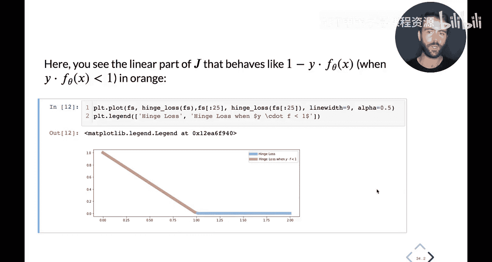

### 实现次梯度

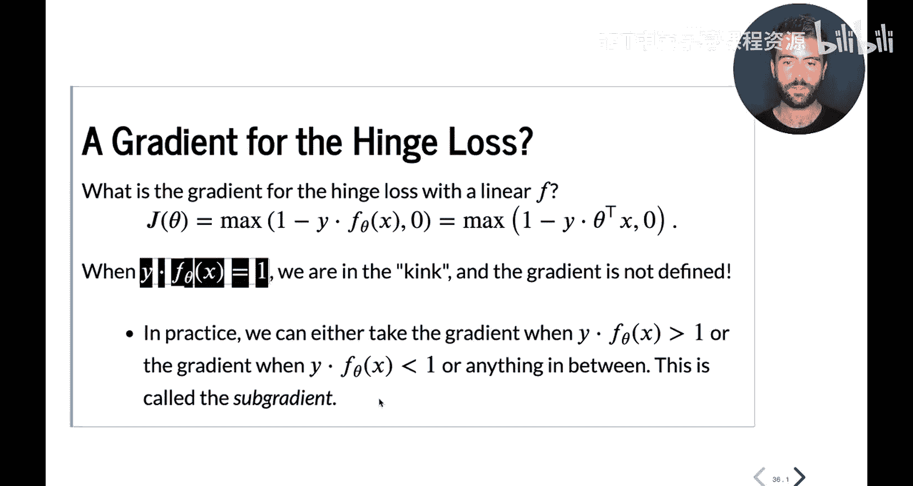

接下来，我们实现“类梯度”函数。

```python
def approximate_gradient(theta, X, y):
    f = linear_model(X, theta)
    mask = (y * f) < 1
    grad = np.zeros_like(theta)
    if np.any(mask):
        grad = -np.dot(X[mask].T, y[mask])
    return grad
```

### 次梯度下降算法

最后，我们实现次梯度下降算法来优化参数。

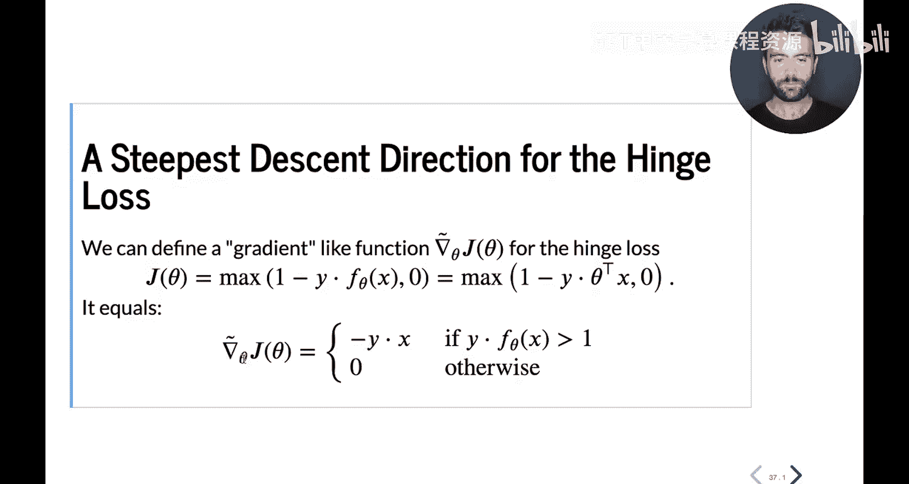

```python
def subgradient_descent(X, y, lambda_reg, learning_rate=0.01, iterations=1000):
    n_features = X.shape[1]
    theta = np.zeros(n_features)
    
    for i in range(iterations):
        grad = approximate_gradient(theta, X, y)
        theta = theta - learning_rate * (grad + lambda_reg * theta)
        
        # 可选：打印每次迭代的目标函数值
        if i % 100 == 0:
            obj = objective(theta, X, y, lambda_reg)
            print(f"Iteration {i}: Objective = {obj}")
    
    return theta
```

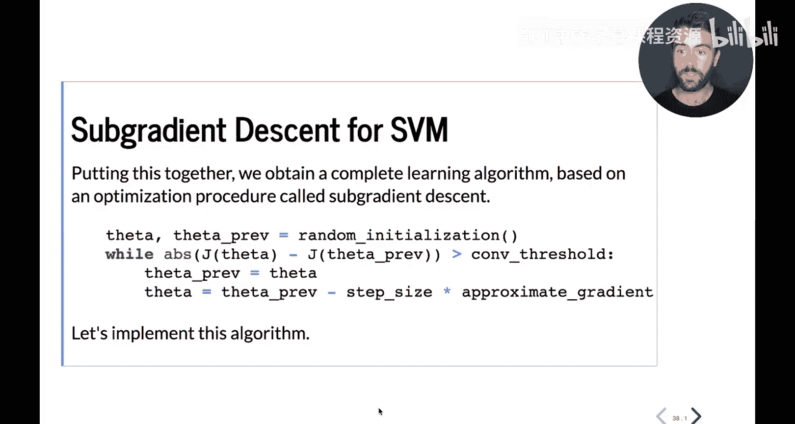

### 可视化结果

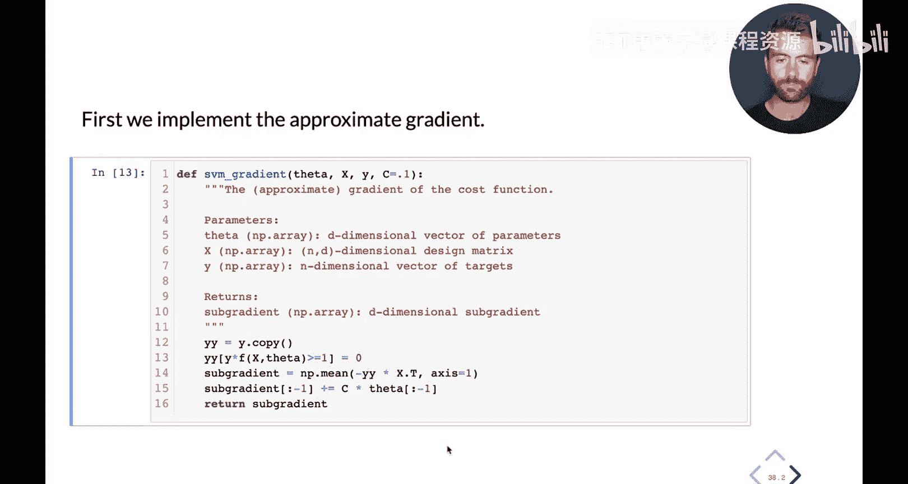

优化完成后，我们可以可视化决策边界，以验证模型是否能够正确分类数据并保持较大的间隔。

```python
import matplotlib.pyplot as plt

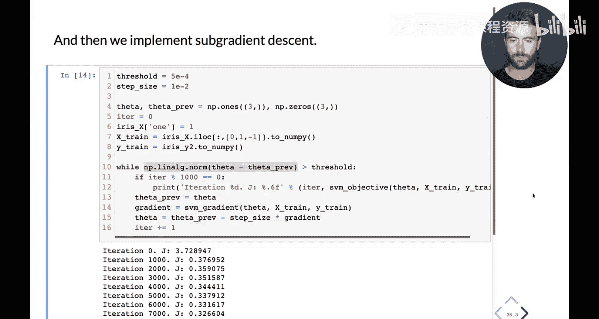

# 假设 X 和 y 是训练数据
theta_optimal = subgradient_descent(X, y, lambda_reg=0.1)

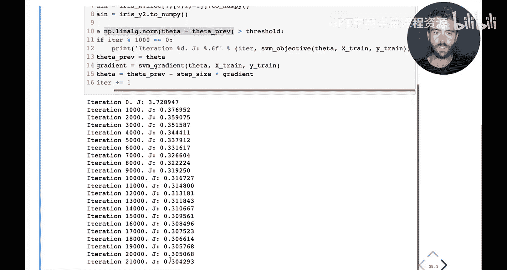

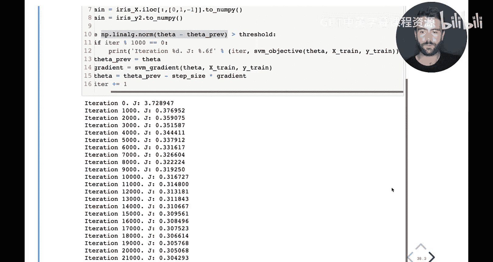

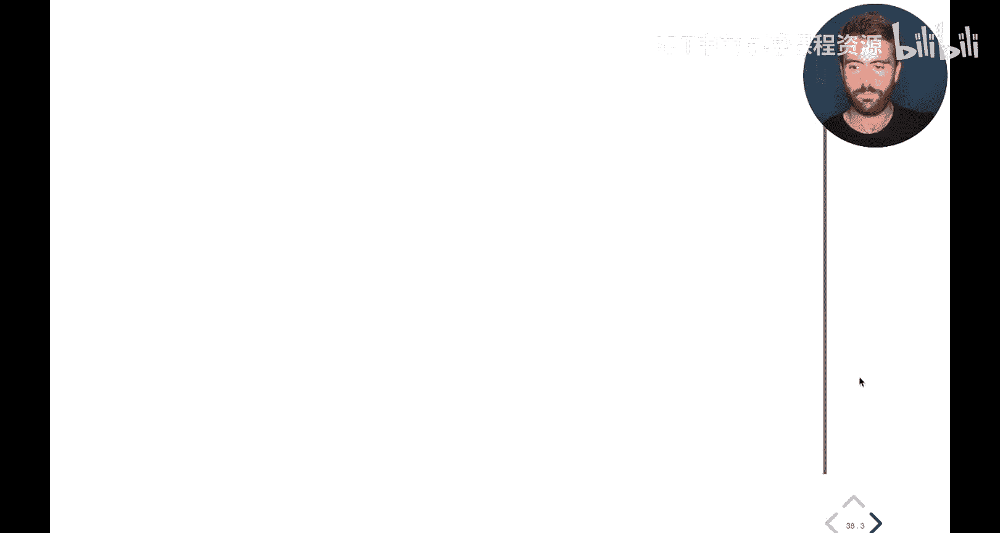

# 绘制数据点和决策边界
plt.scatter(X[:, 0], X[:, 1], c=y, cmap='bwr')
x_boundary = np.linspace(X[:, 0].min(), X[:, 0].max(), 100)
y_boundary = -(theta_optimal[0] * x_boundary) / theta_optimal[1]
plt.plot(x_boundary, y_boundary, 'k-')
plt.show()
```

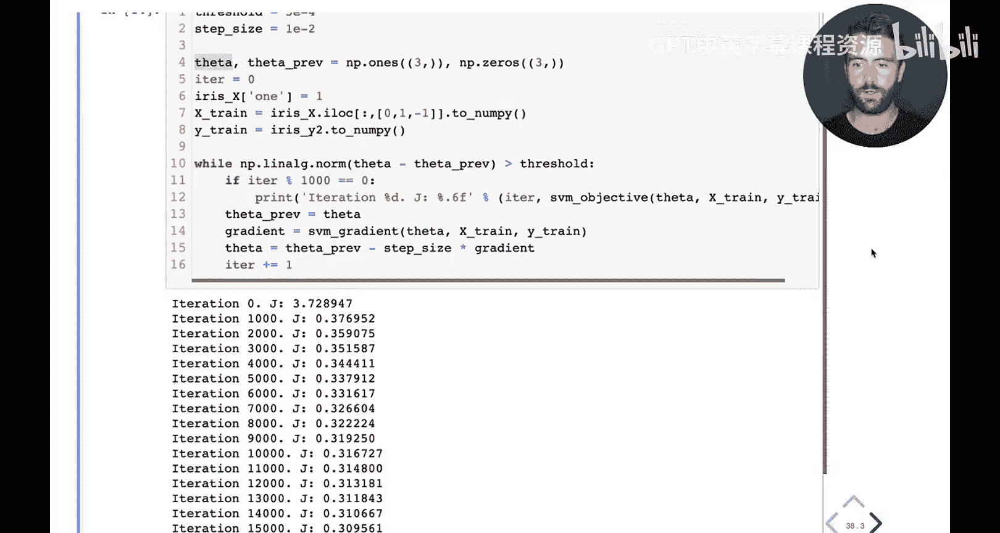

## 算法总结

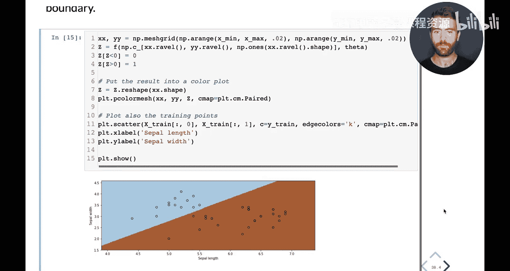

本节课我们一起学习了支持向量机的优化方法，特别是基于合页损失的无约束优化问题。我们回顾了合页损失函数的定义，探讨了其梯度在不同区域的行为，并引入了次梯度的概念。通过实现次梯度下降算法，我们成功优化了SVM的目标函数，并可视化了一个具有较大间隔的决策边界。

总结一下，我们的SVM算法具有以下特点：
*   **任务**：监督式二分类。
*   **模型族**：线性模型。
*   **目标函数**：L2正则化的合页损失。
*   **优化器**：次梯度下降法。

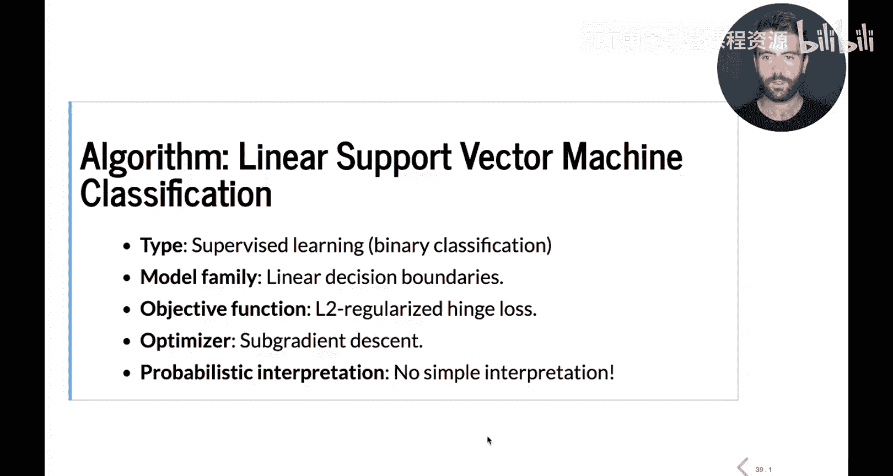

这种方法在实际应用中非常常见，因为它避免了处理复杂的约束条件，同时仍然能够产生具有良好泛化能力的模型。