# 10.1：拉格朗日对偶（第一部分）🚀

在本节课中，我们将继续学习支持向量机，并引入一种新的、重要的方法来表述最大间隔问题。这种方法被称为**拉格朗日对偶**，它不仅为支持向量机提供了另一种求解视角，也是优化和机器学习中广泛使用的核心概念。我们将首先介绍拉格朗日对偶的一般数学概念，然后在后续课程中将其应用于支持向量机。

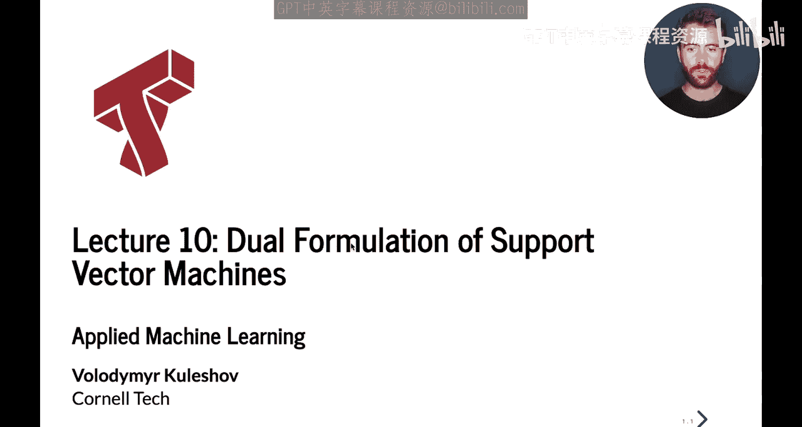

## 回顾：支持向量机作为约束优化问题

在上一讲中，我们介绍了支持向量机，并将其定义为一系列优化问题的解。其中一个关键形式是以下**约束优化问题**：

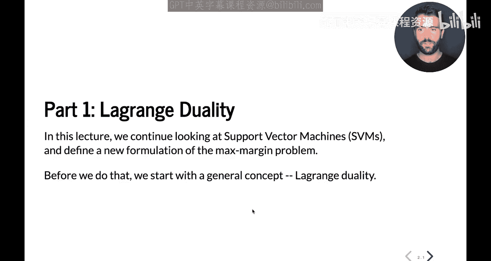

我们寻找一个分离超平面 **θ**，使其具有较小的 L2 范数，并且所有样本都被正确分类。这等价于寻找具有**最大间隔**的超平面。其数学形式可以概括为：

**最小化目标函数 J(θ)**，同时满足一系列**约束条件 C_k(θ) ≤ 0**。

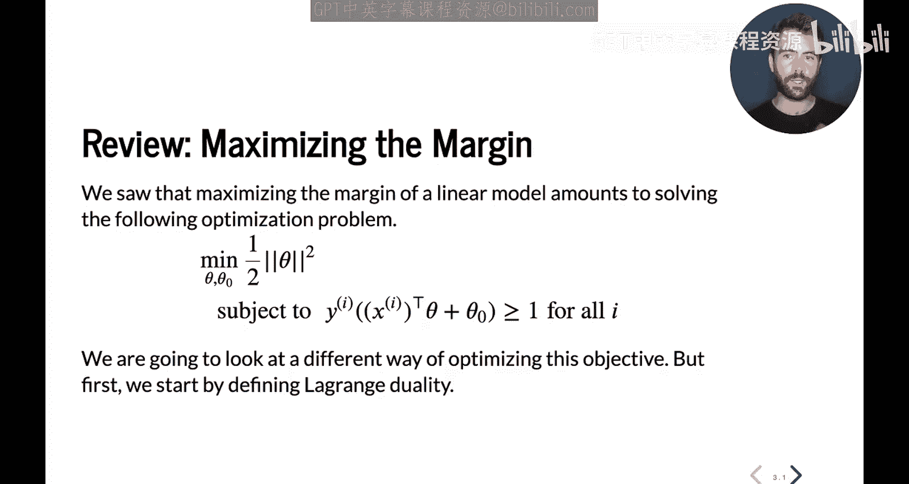

这个公式将 SVM 表述为一个带约束的优化问题。而拉格朗日对偶正是研究这类约束优化问题性质的一套强大工具。

## 拉格朗日方法：从约束到惩罚

上一节我们回顾了SVM的约束优化形式。本节中，我们来看看拉格朗日方法如何提供一种不同的视角。

考虑一个通用的约束优化问题：
**最小化 J(θ)**，约束条件为 **C_k(θ) ≤ 0**（对于所有 k）。

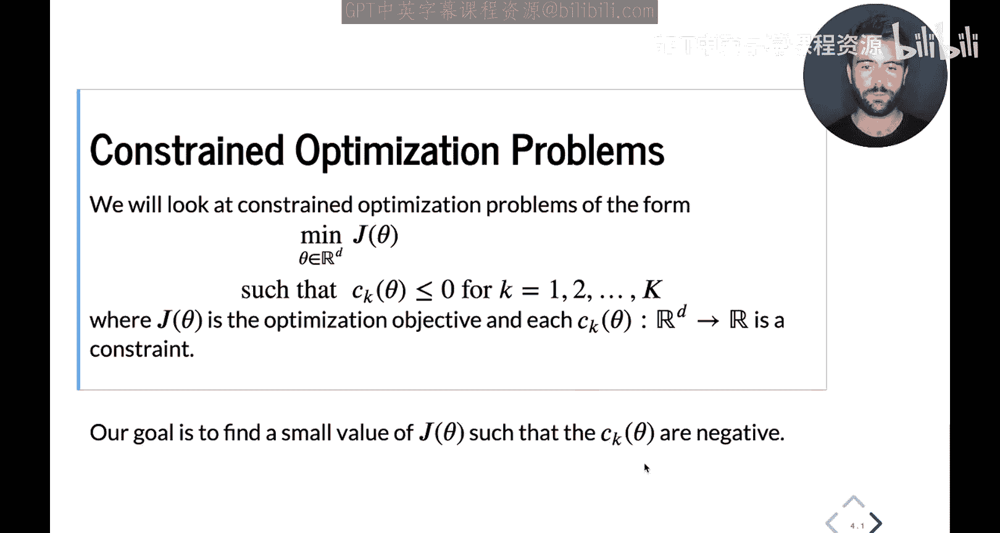

拉格朗日方法的核心思想是将约束条件转化为目标函数中的**惩罚项**。我们引入非负的**拉格朗日乘子 λ_k**，并构造**拉格朗日函数 L(θ, λ)**：

`L(θ, λ) = J(θ) + Σ_k λ_k * C_k(θ)`

这里，λ_k 衡量了对应约束 C_k(θ) ≤ 0 的重要性。通过最小化这个拉格朗日函数，我们实际上是在同时最小化原始目标 J(θ) 和惩罚违反约束的行为（因为 C_k(θ) > 0 会导致惩罚项为正）。当 λ_k 足够大时，任何违反约束的 θ 都会使 L(θ, λ) 变得很大，从而在优化过程中被排除。

## 原问题与对偶问题

上一节我们介绍了拉格朗日函数。本节中，我们将基于它定义两个密切相关的优化问题：**原问题**和**对偶问题**。

首先，我们定义**原拉格朗日形式 P(θ)**：
`P(θ) = max_{λ ≥ 0} L(θ, λ)`

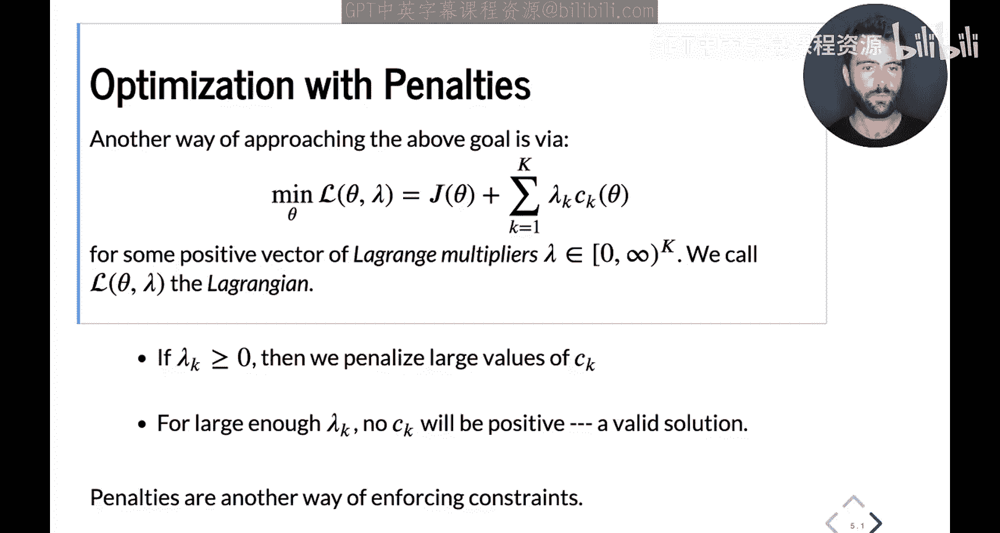

这个函数对每个 θ，取拉格朗日函数在所有非负 λ 上的最大值。一个关键结论是：**最小化 P(θ) 等价于求解原始的约束优化问题**。

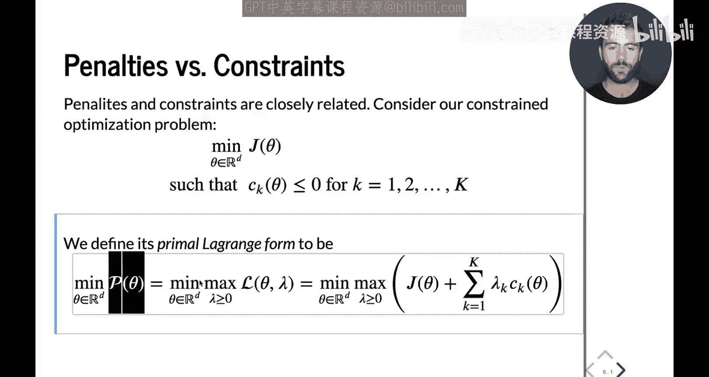

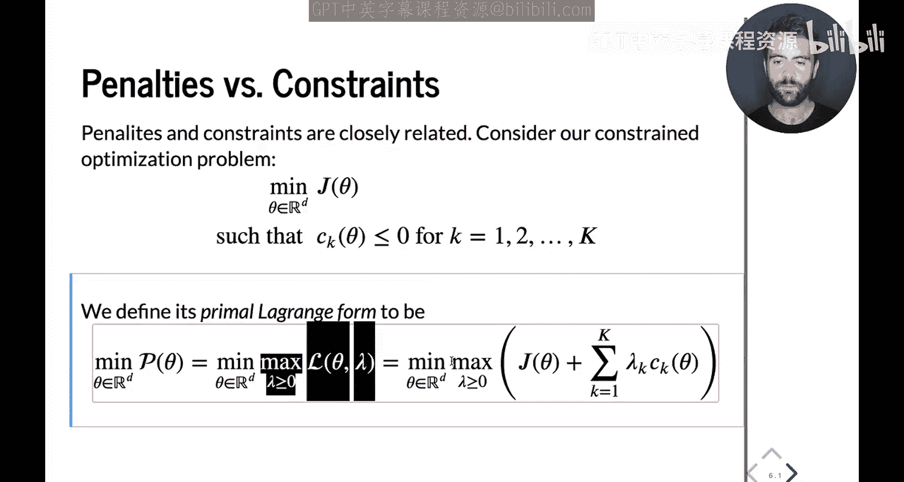

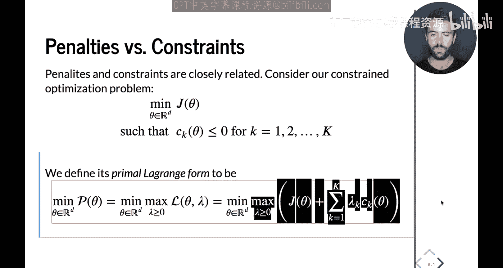

直观理解如下：
*   如果某个 θ 违反了约束（即存在 C_k(θ) > 0），那么通过令对应的 λ_k → +∞，可以使 L(θ, λ) 趋于 +∞，从而 P(θ) = +∞。因此，最小化 P(θ) 时绝不会选择违反约束的 θ。
*   如果 θ 满足所有约束（即所有 C_k(θ) ≤ 0），那么为了使 L(θ, λ) 最大，最优的 λ_k 应为 0（因为此时 C_k(θ) ≤ 0，乘以正的 λ_k 只会减少 L 的值）。此时，P(θ) = J(θ)。

因此，`min_θ P(θ)` 的解就是原始问题 `min_θ J(θ) s.t. C_k(θ) ≤ 0` 的解。

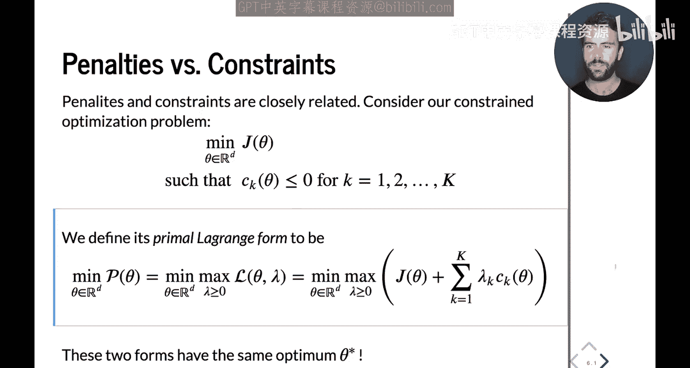

现在，我们通过交换 min 和 max 的顺序，得到**对偶函数 D(λ)**：
`D(λ) = min_θ L(θ, λ)`

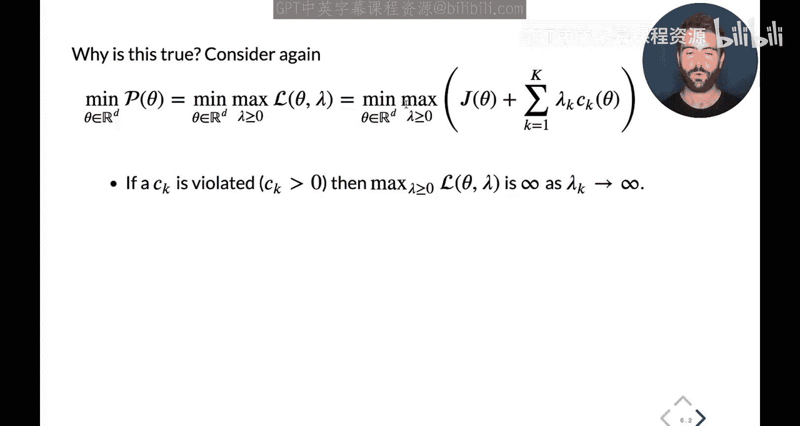

然后，定义**对偶问题**为：**最大化 D(λ)**，约束条件为 **λ ≥ 0**。

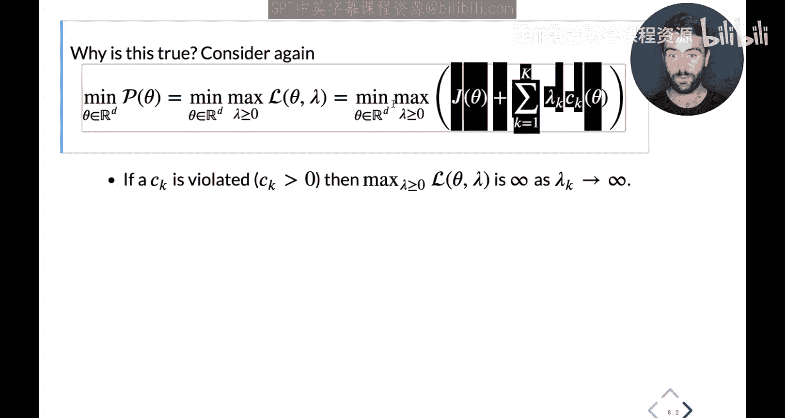

## 原问题与对偶问题的关系

上一节我们分别定义了原问题和对偶问题。本节中，我们来看看它们之间深刻的关系。

一个基本的不等式总是成立：**对偶问题的最优值 ≤ 原问题的最优值**。即：
`max_{λ ≥ 0} D(λ) ≤ min_θ P(θ)`

这个性质被称为**弱对偶性**。

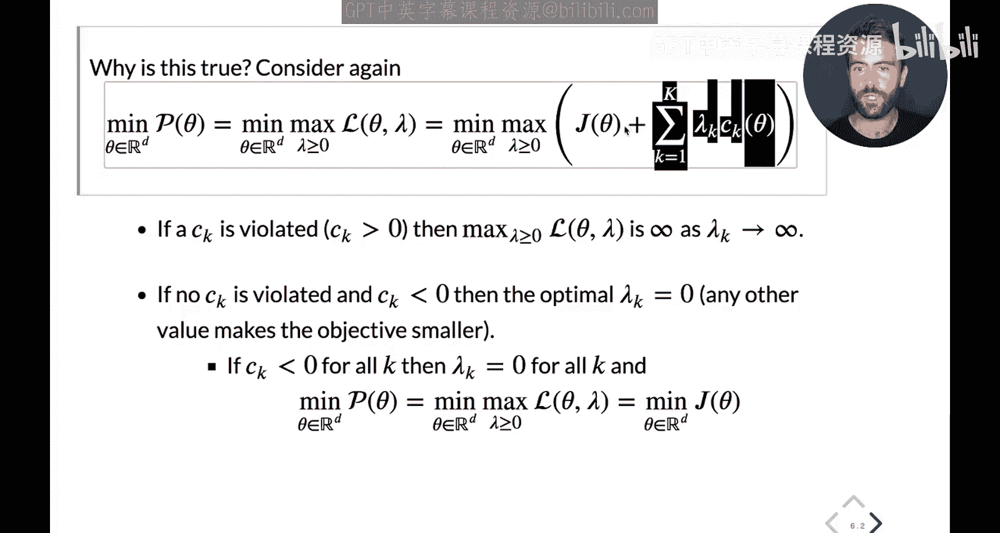

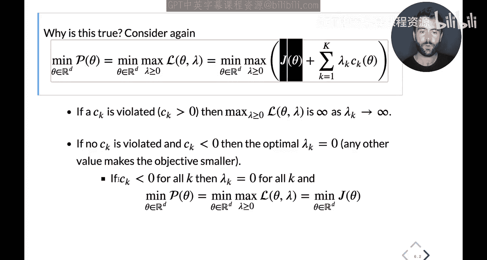

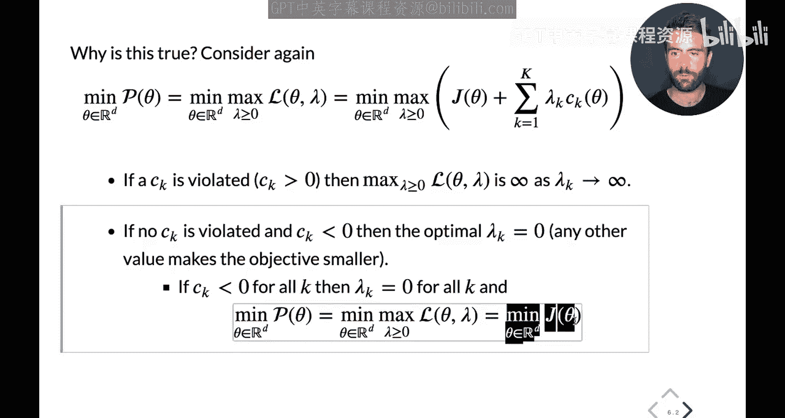

然而，在许多重要且常见的问题中（包括线性规划和我们即将讨论的SVM），一个更强的性质成立：**强对偶性**。这意味着：
`max_{λ ≥ 0} D(λ) = min_θ P(θ)`

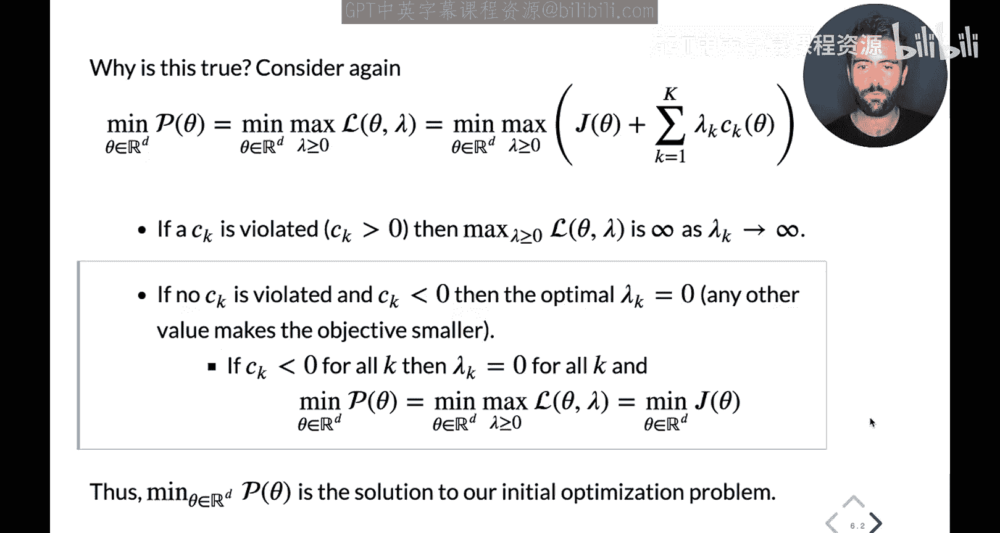

也就是说，原问题和对偶问题具有**相同的最优目标值**。因此，我们可以通过求解对偶问题来获得原问题的最优解。这通常能带来计算或理论上的优势，例如将对 θ 的复杂约束转化为对 λ 的更简单的约束（如非负性），或者揭示问题的新结构。

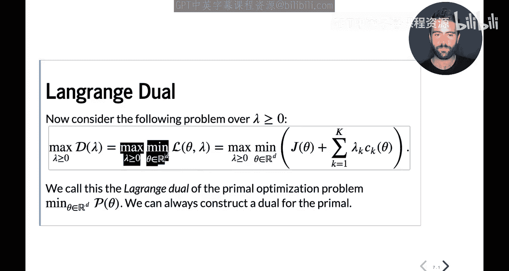

## 与正则化的联系

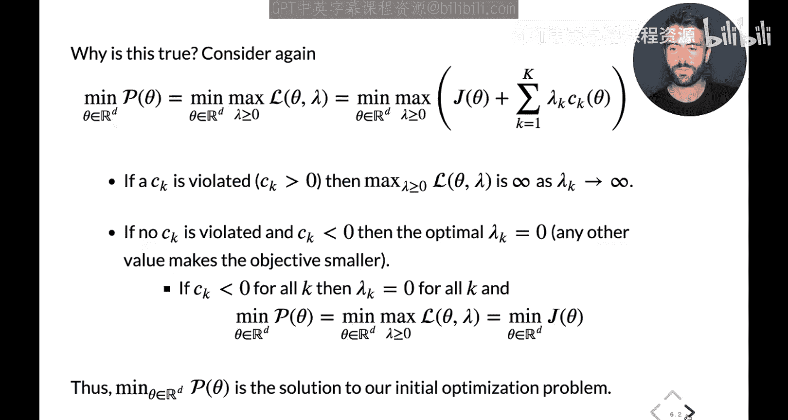

在继续将拉格朗日对偶应用于SVM之前，我们简要回顾一下它与之前所学知识的联系。

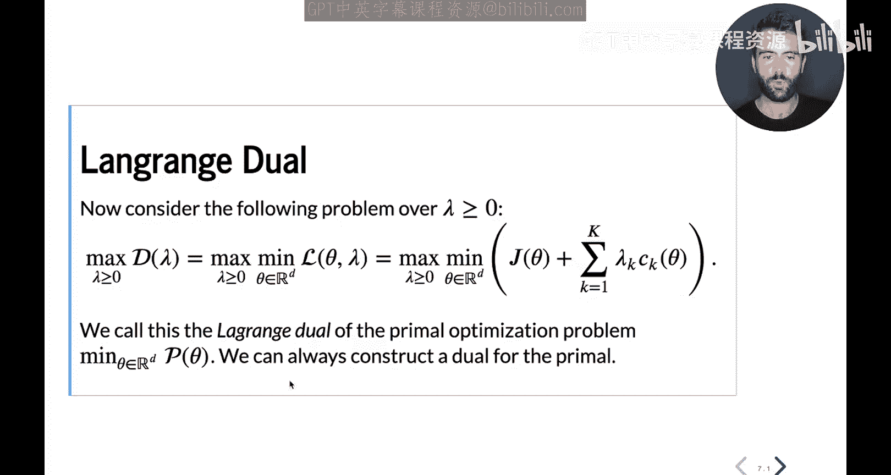

还记得我们之前讨论的**正则化**吗？我们经常处理如下形式的优化问题：
`min_θ J(θ) + β * R(θ)`
其中 R(θ) 是正则化项（如 L2 范数），β 是控制正则化强度的超参数。

利用本节介绍的拉格朗日对偶理论，可以严格证明：这种基于**惩罚项（β * R(θ)）** 的正则化形式，等价于一个带有**约束（R(θ) ≤ t）** 的优化问题。参数 β 和约束边界 t 之间存在一一对应的关系。这再次印证了“惩罚”与“约束”在优化中的紧密联系。

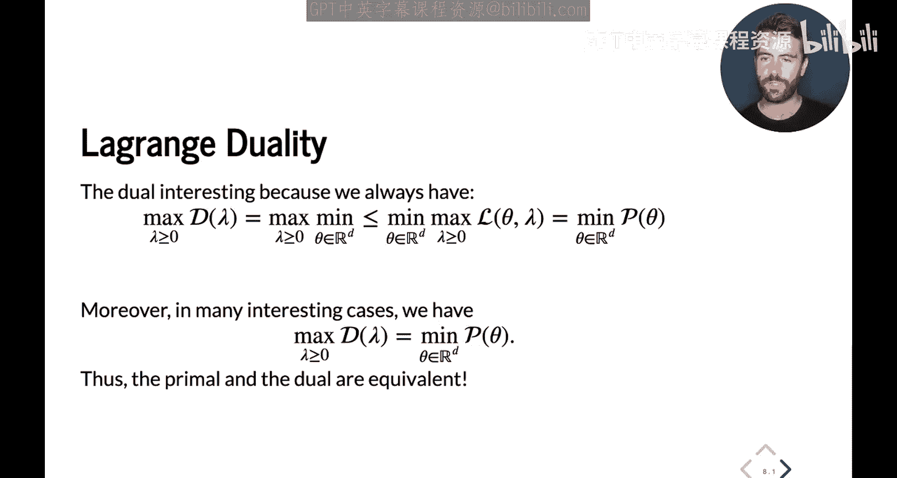

## 总结

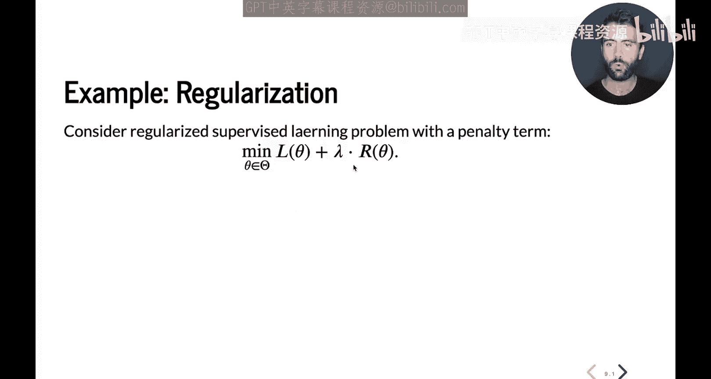

本节课我们一起学习了**拉格朗日对偶**的核心概念。我们了解到：
1.  拉格朗日方法通过引入乘子 λ，将约束优化问题转化为无约束的拉格朗日函数。
2.  通过定义**原问题** `min_θ max_{λ≥0} L(θ, λ)`，我们恢复了原始的约束优化。
3.  通过交换极值顺序，我们得到**对偶问题** `max_{λ≥0} min_θ L(θ, λ)`。
4.  在满足强对偶性的条件下，求解对偶问题等价于求解原问题，这常常能简化计算或提供新的见解。
5.  这一理论统一了“惩罚”与“约束”的视角，并为我们之前学习的正则化提供了理论基础。

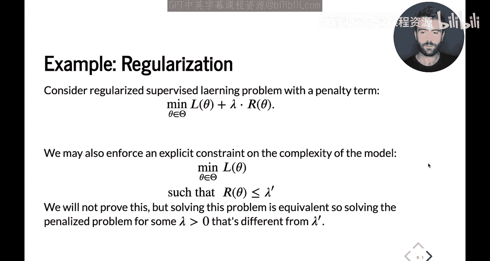

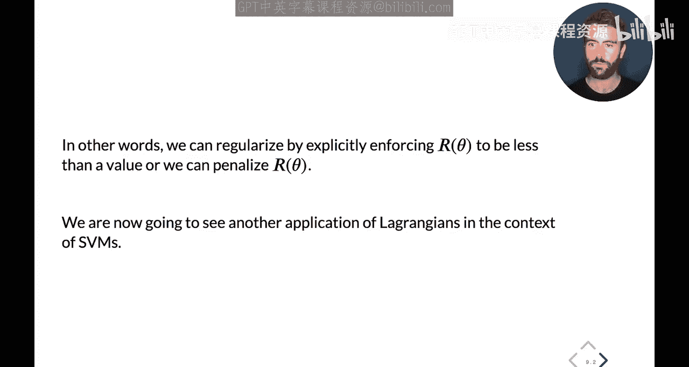

在下一讲中，我们将应用这套强大的拉格朗日对偶工具，重新推导支持向量机，并得到其著名的**对偶形式**，这将揭示SVM的更多重要性质。