# 10.3：支持向量机对偶问题详解 🧠

在本节课中，我们将深入学习支持向量机（SVM）的对偶问题。我们将从回顾SVM的基本概念开始，然后探讨如何处理不可分数据集，接着介绍如何求解对偶问题，最后通过一个实际例子来展示SVM的应用。

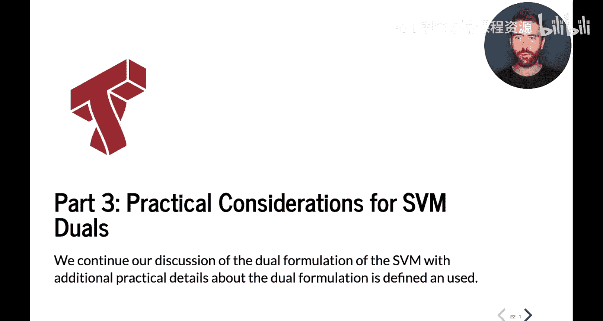

## 回顾：支持向量机与最大间隔

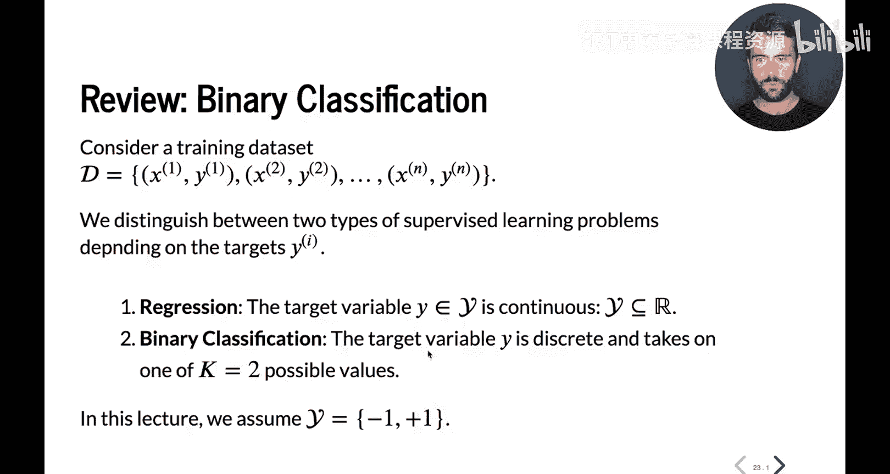

上一节我们介绍了支持向量机的基本思想，即寻找一个能够最大化分类间隔的决策超平面。本节中，我们来看看如何通过优化问题来形式化这一目标。

我们处理的是二分类问题。我们有一个训练数据集，包含样本 \( x \) 和标签 \( y \)，其中 \( y \) 取值为 -1 或 +1，表示样本所属的类别。

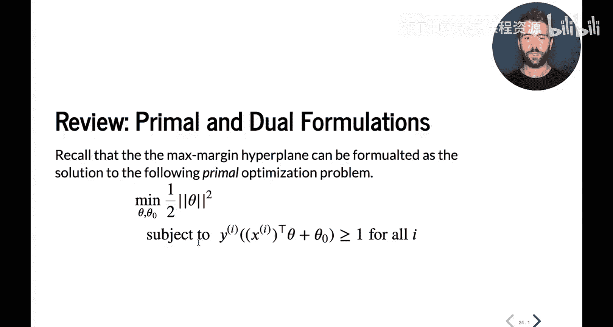

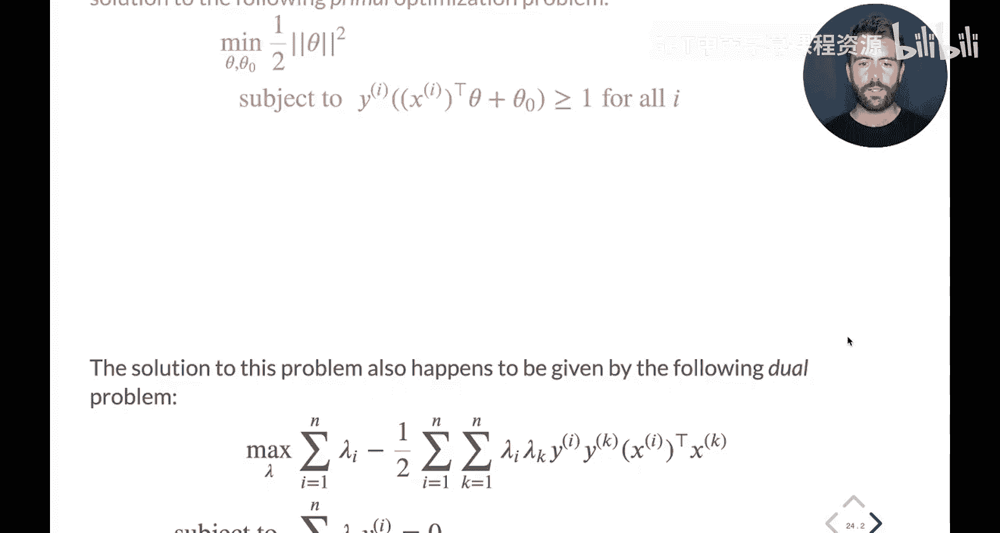

寻找最大间隔超平面可以表述为以下约束二次优化问题（原问题）：

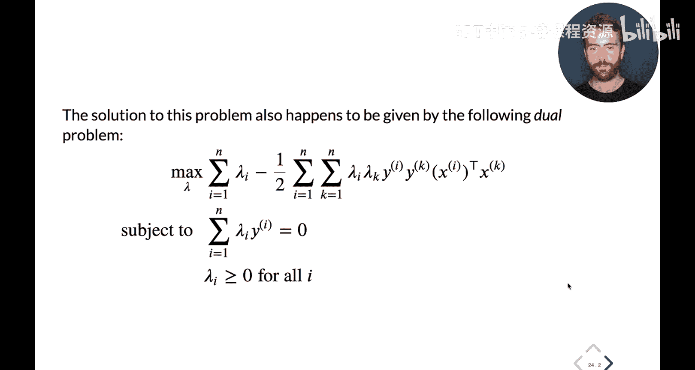

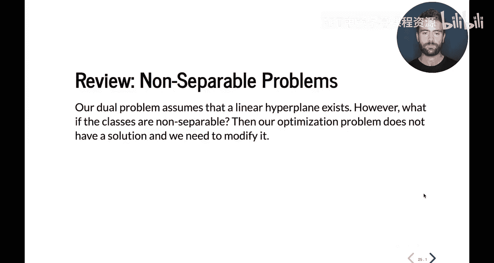

$$
\begin{aligned}
\min_{\theta, \theta_0} \quad & \frac{1}{2} \|\theta\|^2 \\
\text{s.t.} \quad & y^{(i)}(\theta^T x^{(i)} + \theta_0) \geq 1, \quad \forall i
\end{aligned}
$$

## 引入拉格朗日对偶

利用拉格朗日理论，我们可以推导出上述原问题的对偶问题。求解这个对偶问题可以得到与原问题相同的最优目标值。

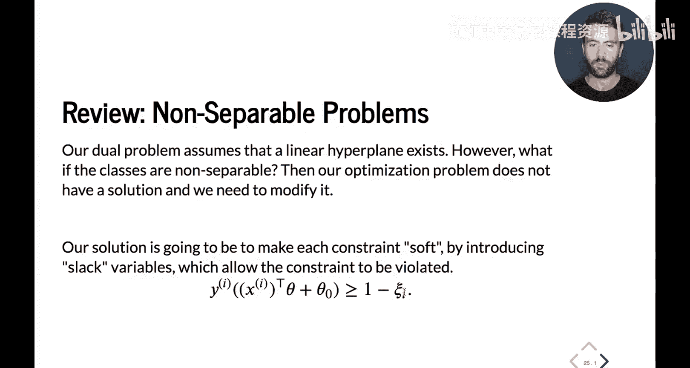

对偶问题的形式如下：

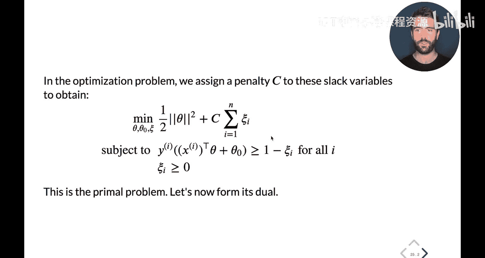

$$
\begin{aligned}
\max_{\lambda} \quad & \sum_{i=1}^n \lambda_i - \frac{1}{2} \sum_{i=1}^n \sum_{j=1}^n \lambda_i \lambda_j y^{(i)} y^{(j)} (x^{(i)})^T x^{(j)} \\
\text{s.t.} \quad & \lambda_i \geq 0, \quad \forall i \\
& \sum_{i=1}^n \lambda_i y^{(i)} = 0
\end{aligned}
$$

## 处理不可分数据：松弛变量

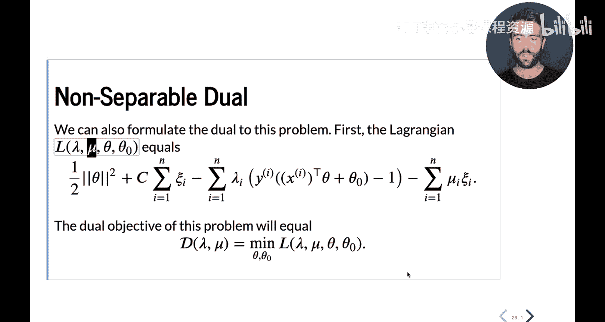

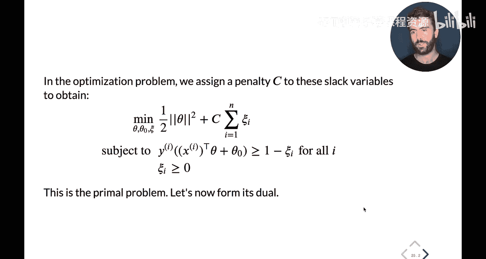

到目前为止的分析仅适用于线性可分问题。在实践中，数据往往不是线性可分的，这意味着不存在一个能完美分类所有训练样本的线性决策边界。

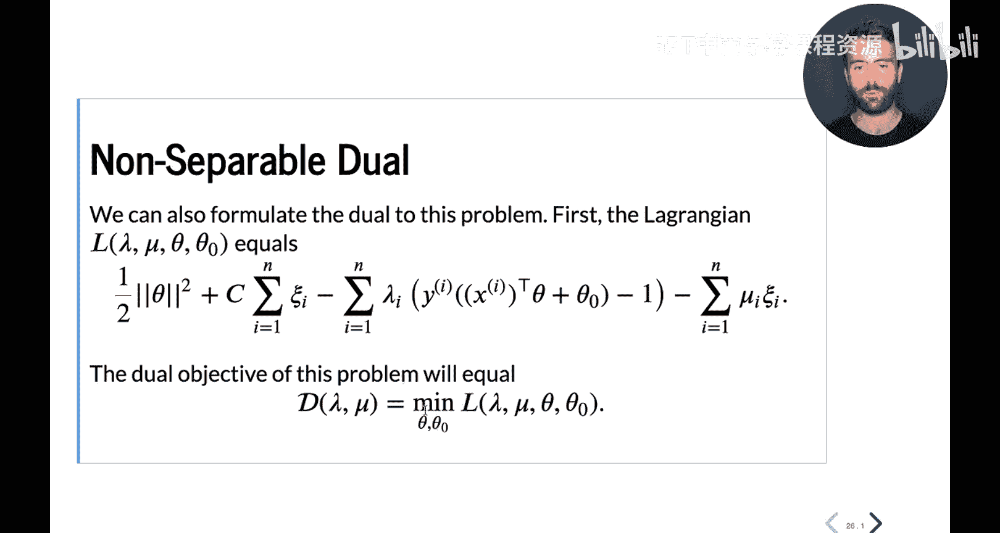

为了解决这个问题，我们需要修改优化问题。我们在之前的讲座中通过引入松弛变量 \( \xi_i \) 来实现。

松弛变量允许约束被轻微违反，其违反程度由 \( \xi_i \) 的大小表示。我们希望这种违反尽可能小，因此在目标函数中引入惩罚项 \( C \sum_{i=1}^n \xi_i \)。

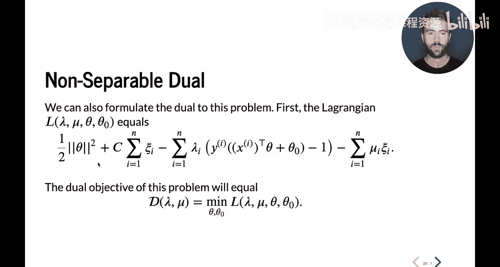

引入松弛变量后的原问题（软间隔SVM）为：

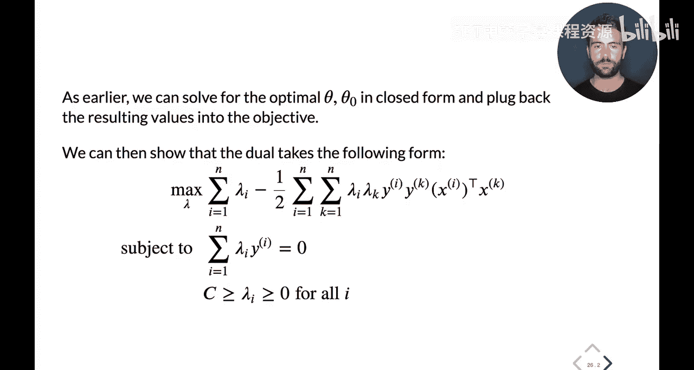

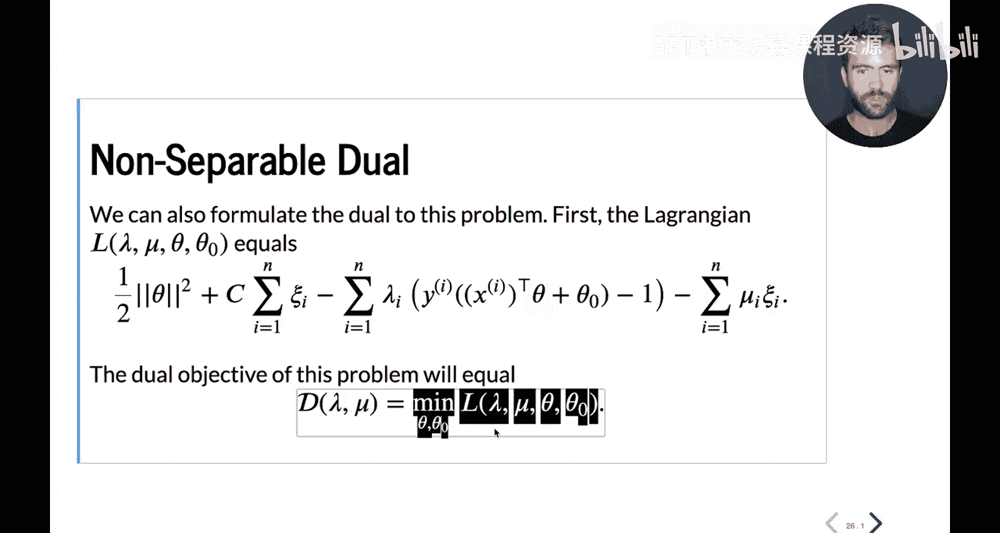

$$
\begin{aligned}
\min_{\theta, \theta_0, \xi} \quad & \frac{1}{2} \|\theta\|^2 + C \sum_{i=1}^n \xi_i \\
\text{s.t.} \quad & y^{(i)}(\theta^T x^{(i)} + \theta_0) \geq 1 - \xi_i, \quad \forall i \\
& \xi_i \geq 0, \quad \forall i
\end{aligned}
$$

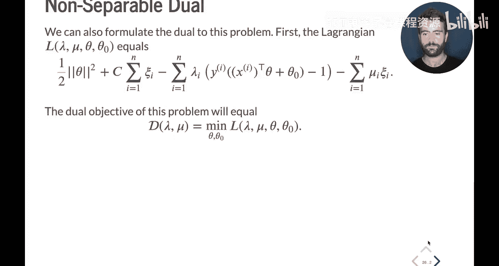

## 软间隔SVM的对偶问题

现在，我们来看软间隔SVM的对偶问题。为了找到对偶，我们首先定义拉格朗日函数，它现在包含两组对偶变量：\( \lambda \) 和 \( \mu \)。

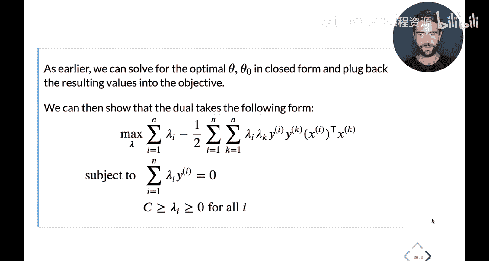

拉格朗日函数 \( \mathcal{L} \) 定义为：

$$
\mathcal{L}(\theta, \theta_0, \xi, \lambda, \mu) = \frac{1}{2}\|\theta\|^2 + C\sum_{i=1}^n \xi_i - \sum_{i=1}^n \lambda_i [y^{(i)}(\theta^T x^{(i)} + \theta_0) - 1 + \xi_i] - \sum_{i=1}^n \mu_i \xi_i
$$

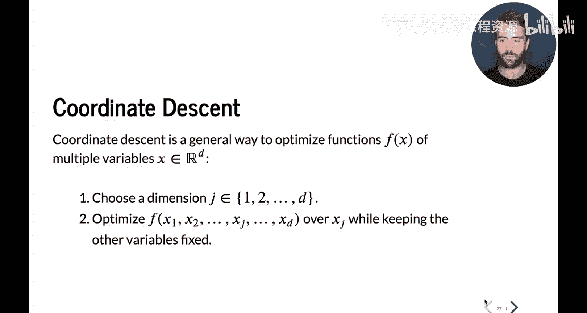

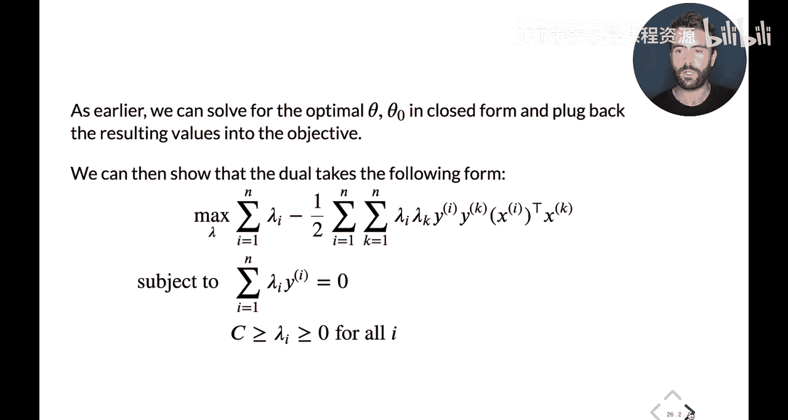

通过对原变量 \( \theta, \theta_0, \xi \) 最小化拉格朗日函数，并代入最优条件，我们可以推导出对偶问题。

简化后的对偶问题形式如下：

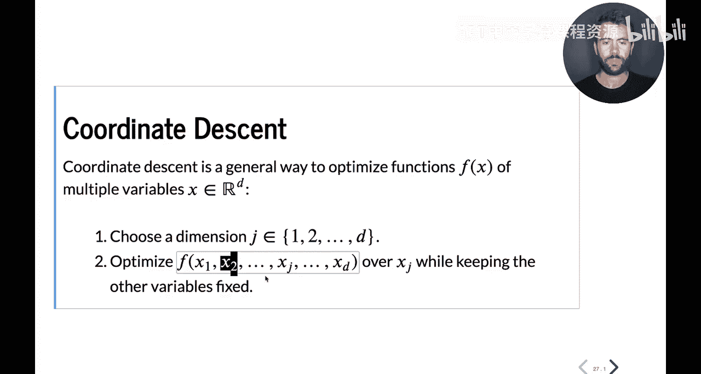

$$
\begin{aligned}
\max_{\lambda} \quad & \sum_{i=1}^n \lambda_i - \frac{1}{2} \sum_{i=1}^n \sum_{j=1}^n \lambda_i \lambda_j y^{(i)} y^{(j)} (x^{(i)})^T x^{(j)} \\
\text{s.t.} \quad & 0 \leq \lambda_i \leq C, \quad \forall i \\
& \sum_{i=1}^n \lambda_i y^{(i)} = 0
\end{aligned}
$$

这与之前的对偶形式非常相似，只是增加了对 \( \lambda_i \) 的上界约束 \( C \)。

## 如何求解对偶问题？🔧

现在我们有了对偶优化问题。一个有趣的问题是：如何实际求解它？

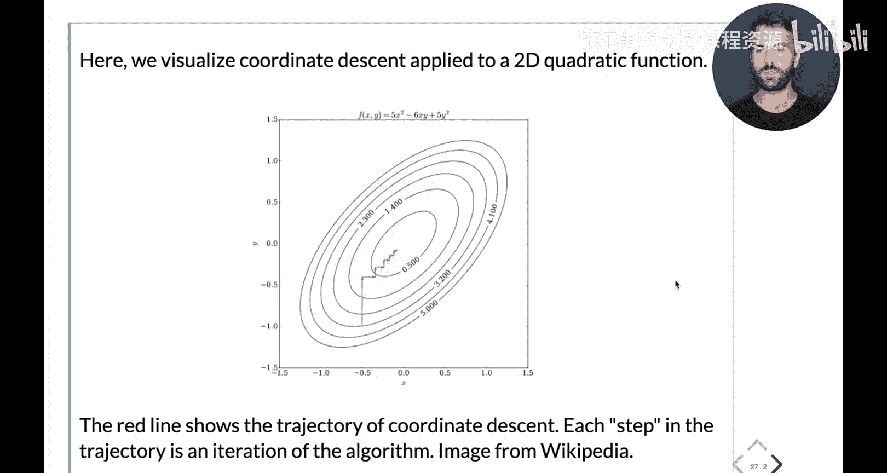

虽然可以使用通用的二次规划求解器，但这并非最高效的方法。存在许多专门为此类问题设计的优化算法。

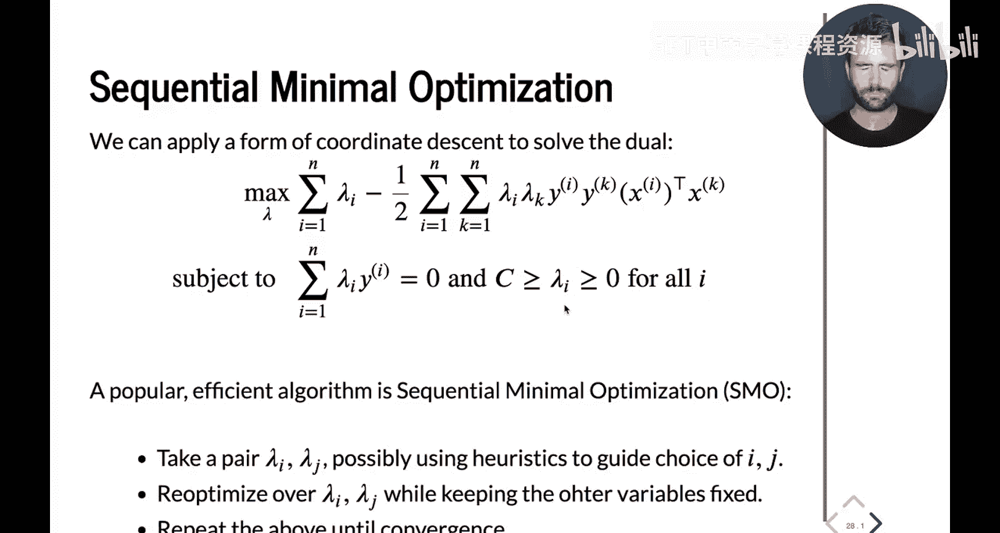

其中一种方法是基于**坐标下降**的思想。坐标下降是一种优化多变量函数的通用方法，其思想很简单：在每次迭代中，选择一个维度（变量），固定其他所有变量，仅在该维度上优化目标函数，然后循环往复。

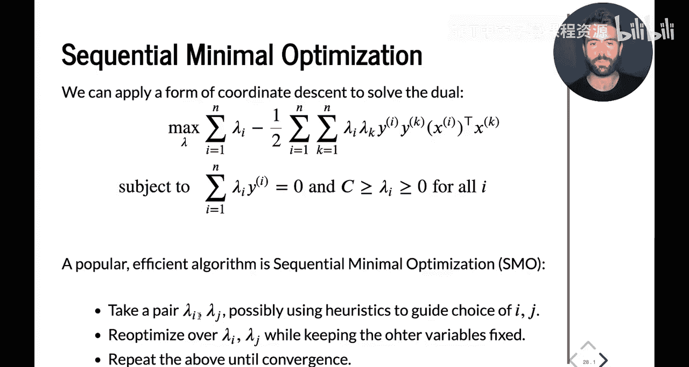

以下是坐标下降的步骤概述：
1.  选择目标函数 \( F \) 的一个维度 \( j \)。
2.  固定所有其他变量 \( x_k (k \neq j) \)。
3.  找到使 \( F \) 最小的 \( x_j \) 值。
4.  选择另一个维度，重复上述过程，直到函数收敛。

对于SVM对偶问题，由于其存在约束 \( \sum_{i=1}^n \lambda_i y^{(i)} = 0 \)，我们不能一次只优化一个变量。因此，在实践中采用一种称为**序列最小优化** 的算法。

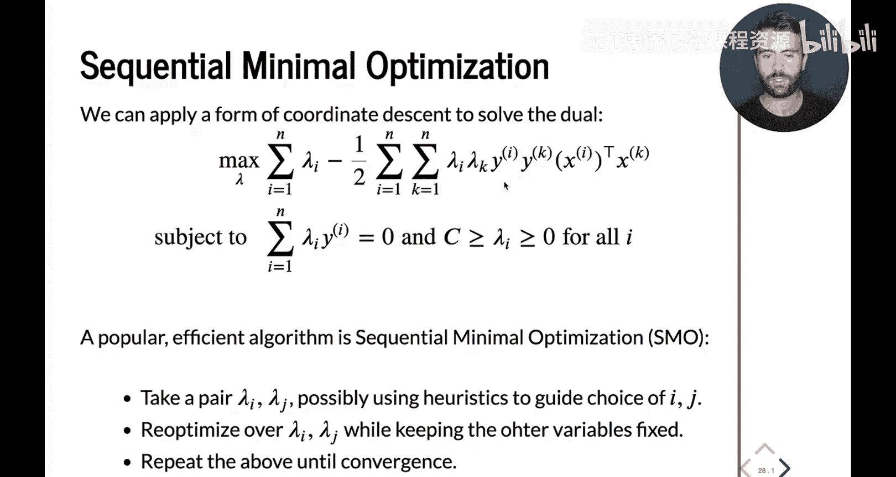

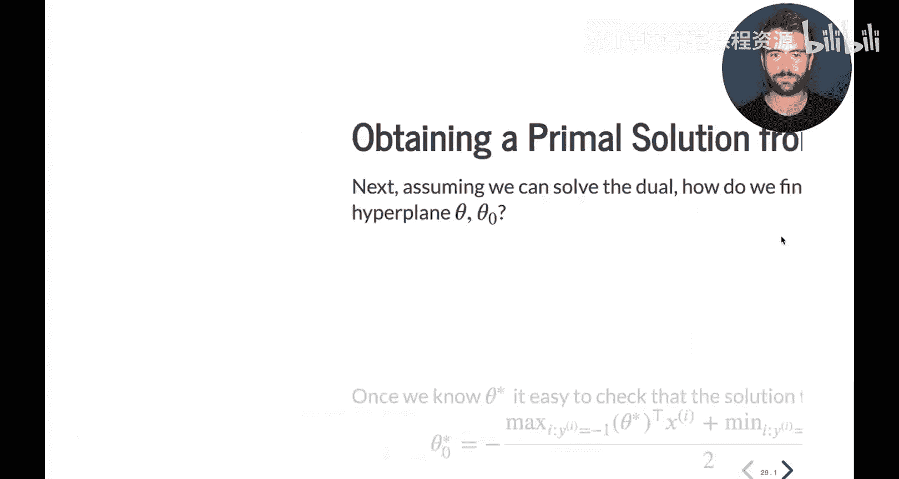

SMO算法步骤如下：
1.  重复以下步骤直至收敛。
2.  选择一对拉格朗日乘子 \( \lambda_i \) 和 \( \lambda_j \)（实践中存在启发式方法选择这对变量）。
3.  固定所有其他 \( \lambda_k (k \neq i, j) \)。
4.  在满足约束的条件下，联合优化 \( \lambda_i \) 和 \( \lambda_j \)。
5.  选择另一对变量，重复此过程。

这个过程在实践中非常高效，是求解SVM对偶问题的标准方法。

## 从对偶解恢复原始解

在求解对偶问题后，我们最终仍然关心分离超平面的参数 \( \theta \) 和 \( \theta_0 \)。那么，如何从对偶解中恢复原始解呢？

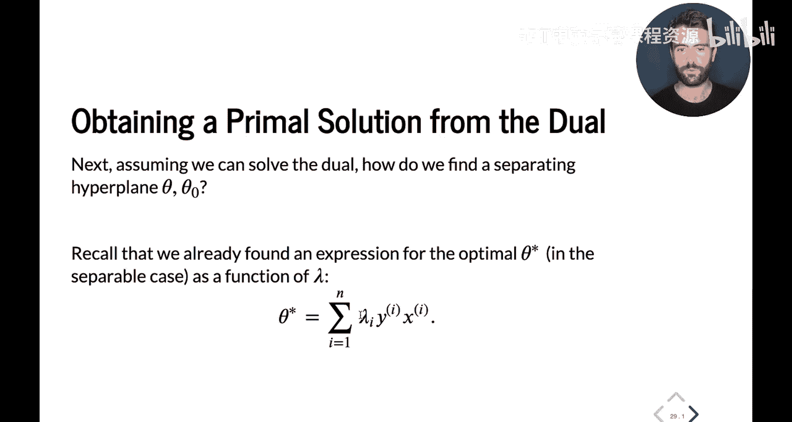

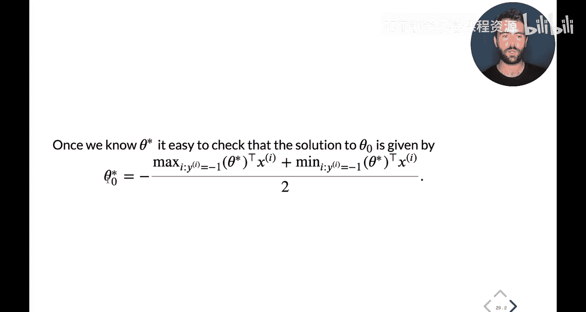

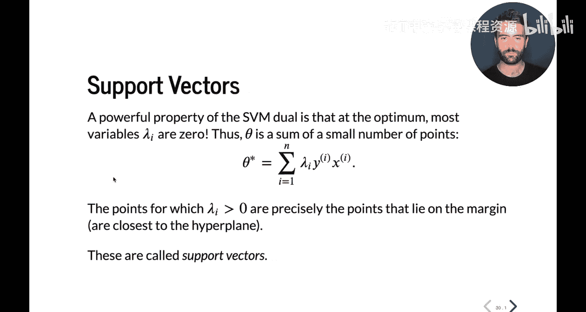

在推导对偶问题时，我们通过最小化拉格朗日函数对 \( \theta \) 求导，得到了 \( \theta \) 关于 \( \lambda \) 的表达式。因此，给定最优的 \( \lambda \)，最优的 \( \theta \) 具有以下形式：

$$
\theta = \sum_{i=1}^n \lambda_i y^{(i)} x^{(i)}
$$

对于截距项 \( \theta_0 \)，也可以通过支持向量计算得到。例如，对于任意支持向量 \( x^{(j)} \)（即 \( \lambda_j > 0 \) 且 \( \xi_j = 0 \)），有：

$$
\theta_0 = y^{(j)} - \theta^T x^{(j)}
$$

## 支持向量与模型稀疏性 🎯

支持向量机一个有趣的性质是，观察最优参数 \( \theta \) 的表达式：

$$
\theta = \sum_{i=1}^n \lambda_i y^{(i)} x^{(i)}
$$

这个求和是对所有数据点 \( i \) 进行的，每个数据点 \( x^{(i)} \) 由一个标量 \( \lambda_i y^{(i)} \) 加权。

在实践中，对偶问题的最优解中，大多数 \( \lambda_i \) 的值将为0。因此，尽管求和形式上是对 \( n \) 个项，但实际上只有少数 \( \lambda_i \) 非零的项对求和有贡献。

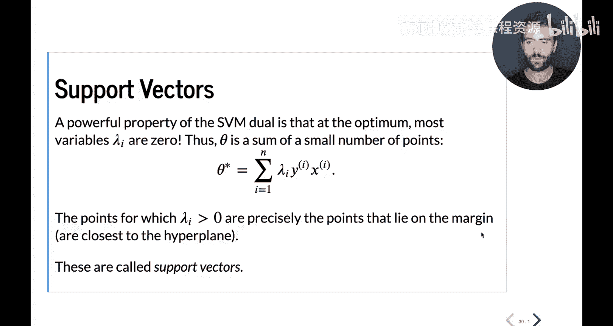

那些 \( \lambda_i > 0 \) 所对应的数据点，正是距离分离超平面最近的点，也就是位于间隔边界上的点。这些点被称为**支持向量**。

直观上，最大间隔超平面的位置仅由最靠近它的那些点（即支持向量）决定。远离边界的点如何移动，并不会改变决策边界。这就是为什么SVM的解具有稀疏性，并且算法得名“支持向量机”。

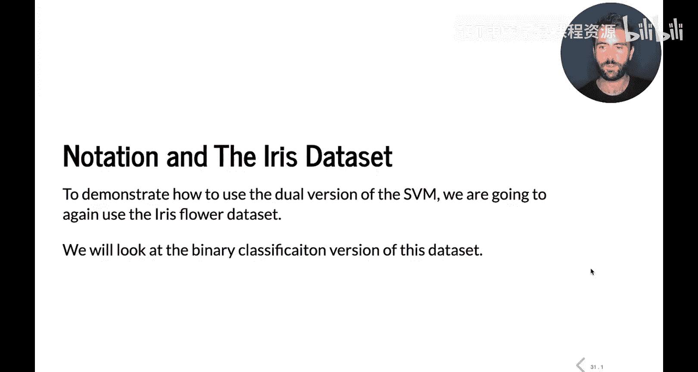

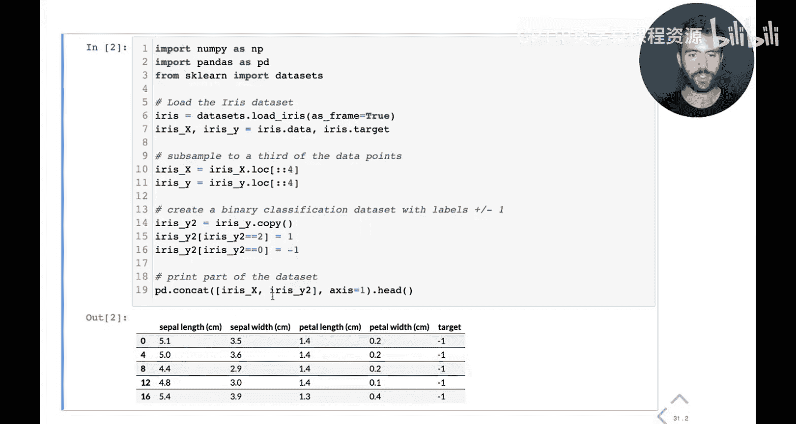

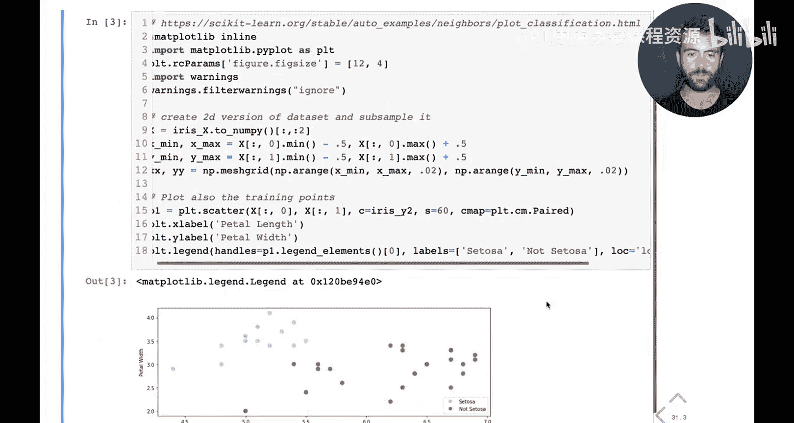

## 实例演示：鸢尾花数据集 🌸

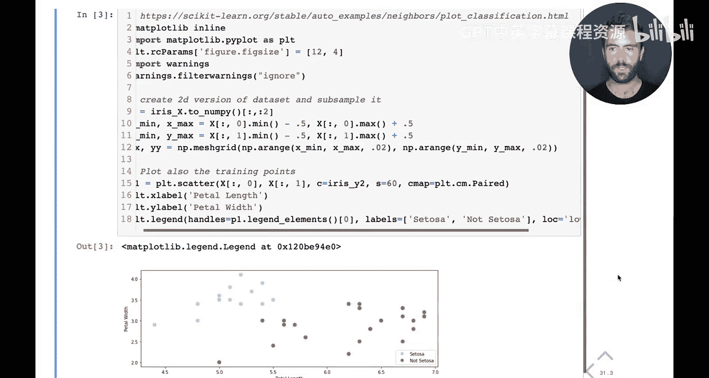

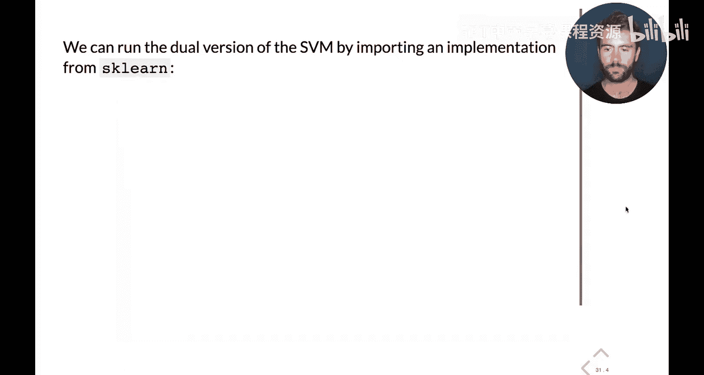

现在，我们通过一个例子来演示SVM的应用。我们将使用经典的鸢尾花数据集，并只使用前两个特征进行二分类（判断是否为山鸢尾）。

以下是使用 `scikit-learn` 库中SVM算法的步骤概要：
1.  加载并预处理数据，将标签转换为 -1 和 +1。
2.  使用 `SVC` 类（默认求解对偶问题）或 `LinearSVC` 类（求解原问题或合页损失形式）来训练模型。
3.  拟合模型后，可以可视化决策超平面和间隔边界。
4.  从训练好的模型中提取支持向量。

在可视化结果中，实线代表分离超平面，虚线代表间隔边界。位于虚线（间隔边界）上的点被突出显示（例如用黑色圆圈圈出），这些点就是支持向量。可以看到，决策边界的形状完全由这些支持向量决定。如果改变那些远离边界的点，决策边界不会发生变化。

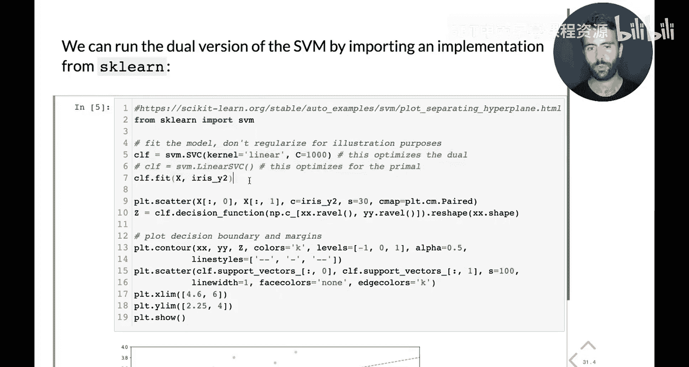

## 总结

本节课中，我们一起深入学习了支持向量机的对偶问题。

我们首先回顾了通过最大化间隔来寻找最优超平面的原问题。接着，我们利用拉格朗日理论推导了其对应的对偶问题，并了解到求解对偶问题可以得到相同的最优解。

为了处理现实中常见的线性不可分数据，我们引入了松弛变量，得到了软间隔SVM的原问题及其对偶形式。

我们探讨了如何高效求解对偶问题，介绍了坐标下降的思想以及专门为SVM设计的序列最小优化 算法。

最后，我们学习了如何从对偶解中恢复原始超平面参数，并理解了支持向量的核心概念——正是这些位于间隔边界上的少数点决定了最终模型，赋予了SVM稀疏性和鲁棒性。

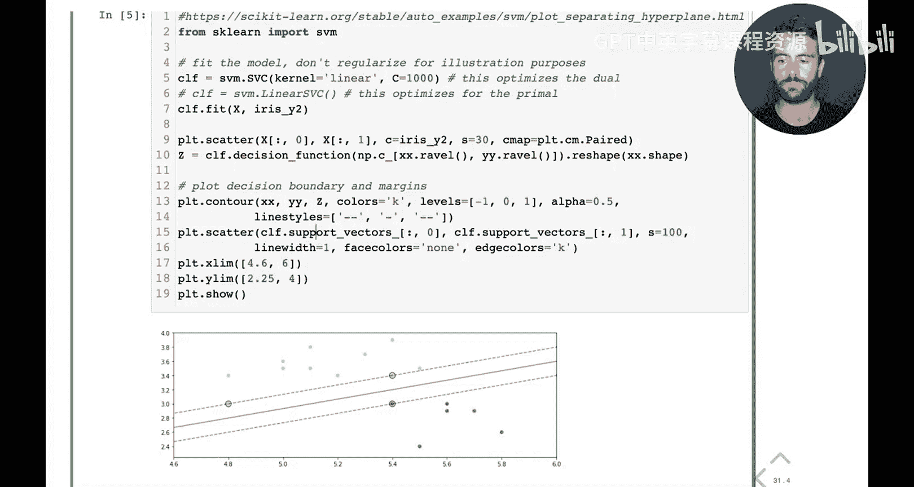

通过鸢尾花数据集的实例，我们直观地观察了支持向量如何影响决策边界。对偶形式不仅是求解SVM的有效工具，也为后续引入核方法以处理非线性问题奠定了重要基础，这将是我们在后续课程中探讨的内容。