# 11.2：核技巧（示例）🚀

在本节课中，我们将学习核技巧（Kernel Trick）的核心概念。我们将通过一个具体的例子，展示如何高效地计算特征之间的点积，从而避免直接处理高维特征向量，提升机器学习算法的效率。

---

## 概述

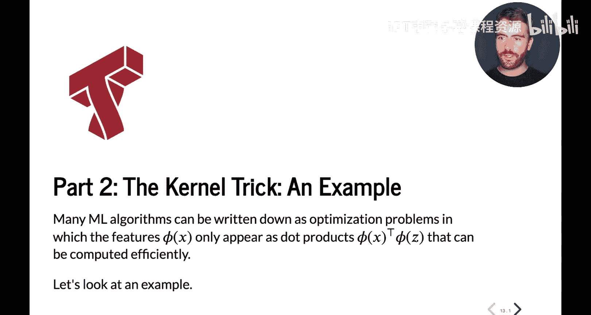

在上一节中，我们介绍了线性回归模型，并展示了如何通过特征映射（Feature Mapping）将其转化为非线性模型。我们注意到，某些算法的优化过程仅依赖于特征之间的点积，而非特征本身。本节中，我们将通过多项式特征的例子，详细说明如何利用核技巧高效计算这些点积。

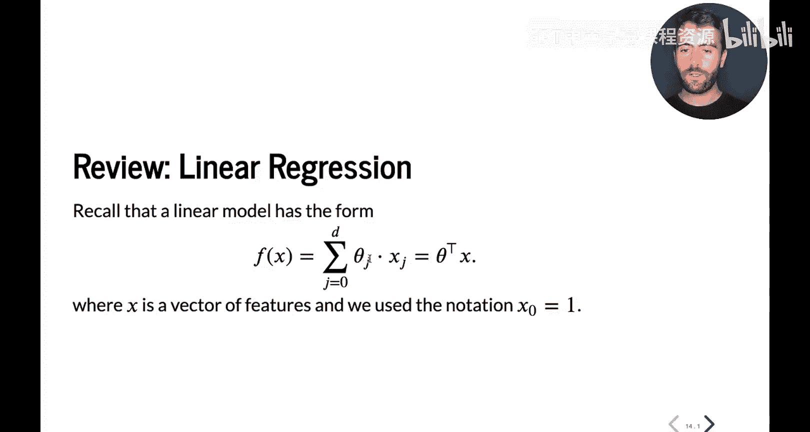

---

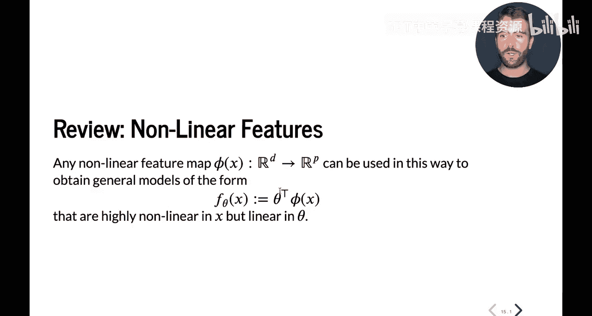

## 线性回归与特征映射

线性回归模型的预测形式为：

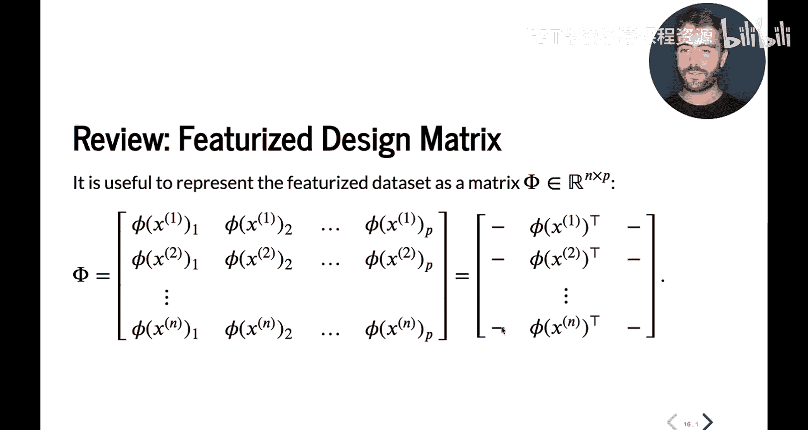

\[
f(x) = \theta^T \phi(x)
\]

其中，\(\phi(x)\) 是将原始输入 \(x\) 映射到高维特征空间的非线性函数。通过这种方式，我们可以在保持模型对参数 \(\theta\) 线性的同时，学习输入 \(x\) 的非线性关系。

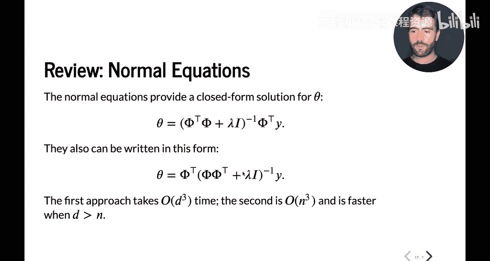

---

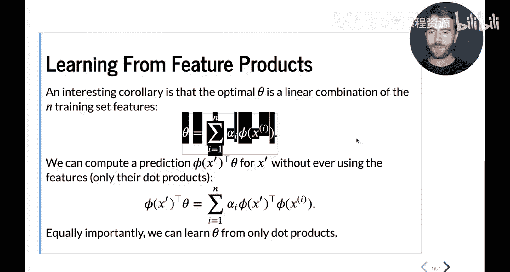

## 特征化设计矩阵

为了表示所有训练样本的特征，我们定义特征化设计矩阵 \(\Phi\)：

\[
\Phi = \begin{bmatrix}
\phi(x_1)^T \\
\phi(x_2)^T \\
\vdots \\
\phi(x_n)^T
\end{bmatrix}
\]

这个矩阵的每一行对应一个样本的特征向量转置。

---

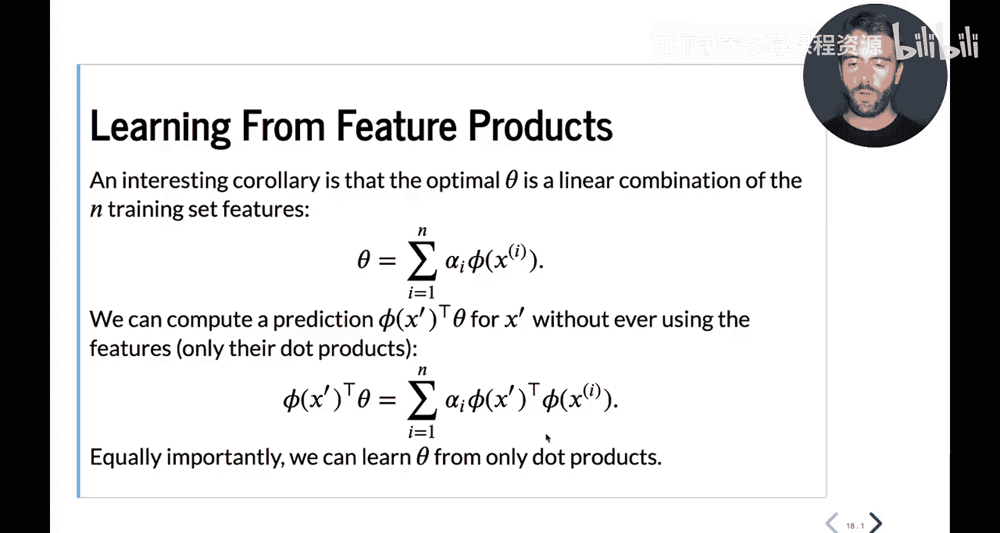

## 对偶形式与点积

线性回归的正规方程可以表示为对偶形式。在对偶形式中，最优参数 \(\theta^*\) 可以表示为训练样本特征的线性组合：

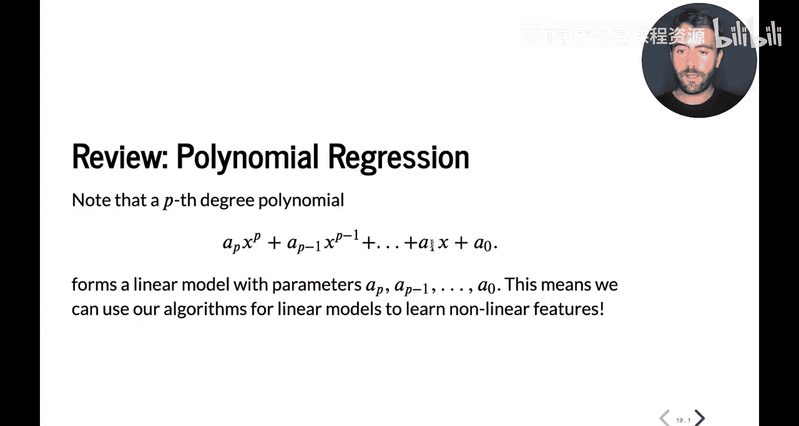

\[
\theta^* = \sum_{i=1}^{n} \alpha_i \phi(x_i)
\]

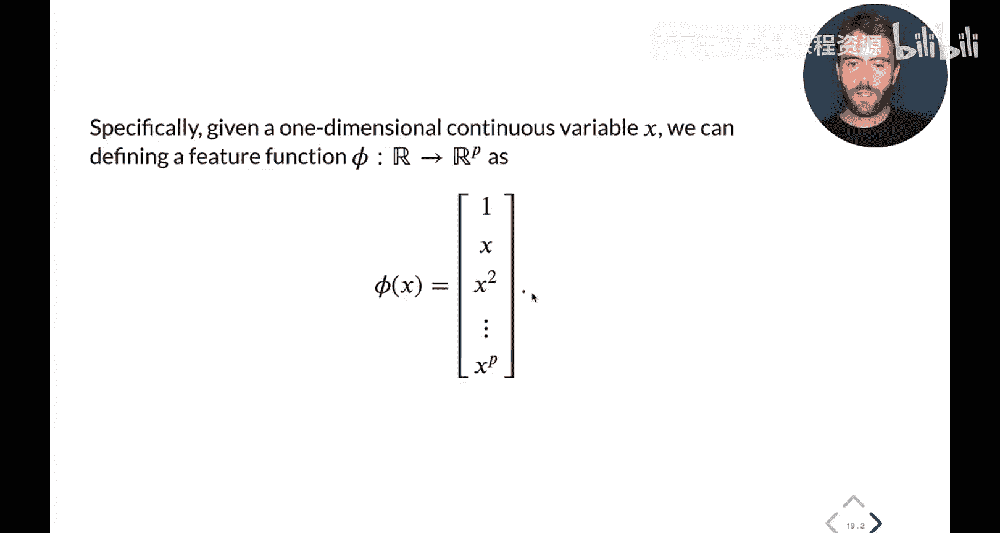

其中，\(\alpha_i\) 是权重系数。模型的预测可以重写为：

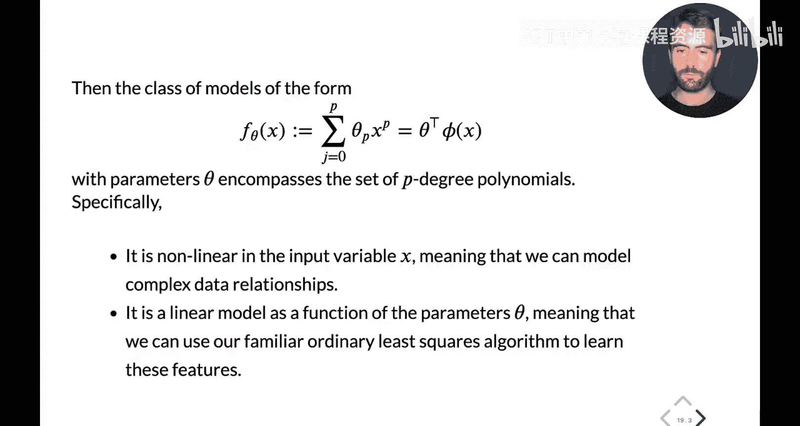

\[
f(x') = \phi(x')^T \theta^* = \sum_{i=1}^{n} \alpha_i \phi(x')^T \phi(x_i)
\]

这个表达式仅涉及特征之间的点积 \(\phi(x')^T \phi(x_i)\)，而不需要显式计算特征向量本身。

---

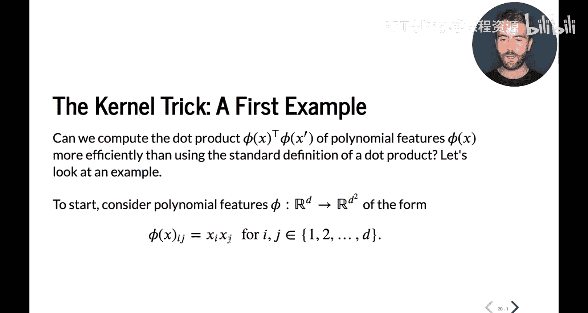

## 核技巧示例：多项式特征

以下是一个具体的例子，说明如何高效计算多项式特征的点积。

### 多项式特征定义

假设输入 \(x\) 是一个 \(d\) 维向量。我们定义二阶多项式特征映射 \(\phi\)，其维度为 \(d^2\)。特征向量的每个分量由两个输入属性的乘积构成：

\[
\phi(x)_{ij} = x_i \cdot x_j
\]

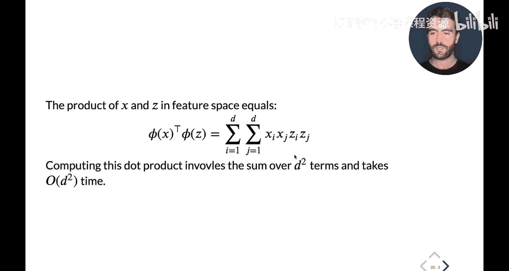

例如，当 \(d=3\) 时，特征向量包含9个分量：\(x_1^2, x_1x_2, x_1x_3, x_2x_1, x_2^2, x_2x_3, x_3x_1, x_3x_2, x_3^2\)。

### 直接计算点积

直接计算两个样本 \(x\) 和 \(z\) 的特征点积需要 \(O(d^2)\) 时间：

\[
\phi(x)^T \phi(z) = \sum_{i=1}^{d} \sum_{j=1}^{d} (x_i x_j) (z_i z_j)
\]

### 高效计算点积

然而，我们可以利用以下恒等式，在 \(O(d)\) 时间内计算相同的点积：

\[
\phi(x)^T \phi(z) = (x^T z)^2
\]

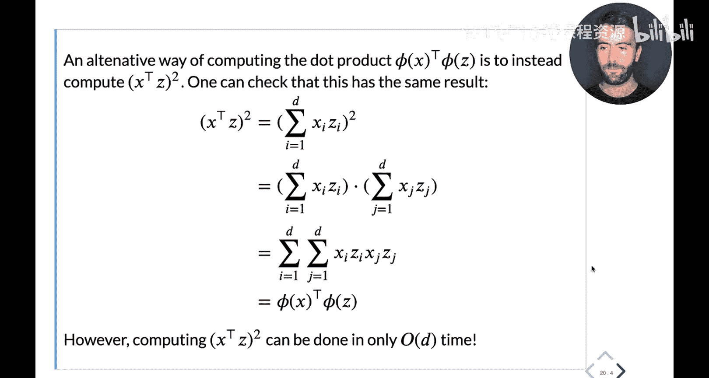

证明如下：

\[
(x^T z)^2 = \left( \sum_{i=1}^{d} x_i z_i \right)^2 = \sum_{i=1}^{d} \sum_{j=1}^{d} (x_i z_i)(x_j z_j) = \sum_{i=1}^{d} \sum_{j=1}^{d} (x_i x_j)(z_i z_j) = \phi(x)^T \phi(z)
\]

通过这种方式，我们避免了显式构造高维特征向量，大幅提升了计算效率。

---

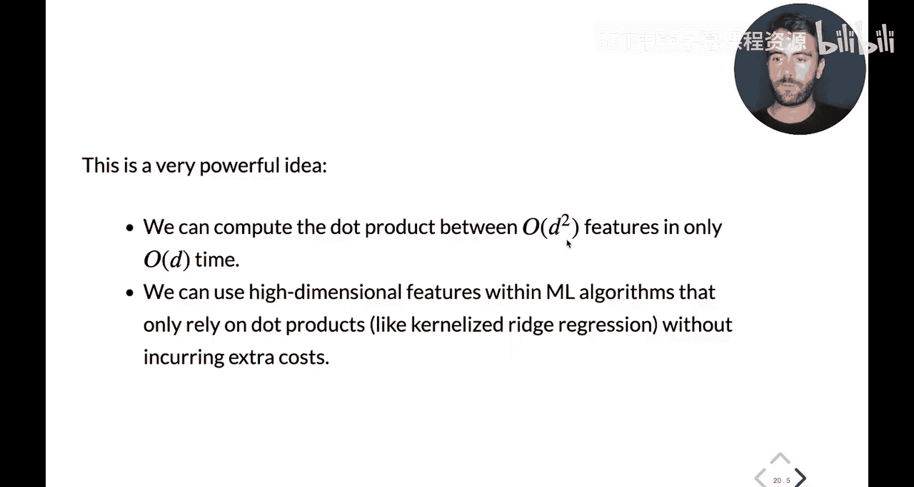

## 推广到高阶多项式

上述技巧可以推广到任意阶 \(p\) 的多项式特征。此时，特征映射的维度为 \(d^p\)，直接计算点积需要 \(O(d^p)\) 时间。但利用核技巧，我们可以高效计算：

\[
\phi_p(x)^T \phi_p(z) = (x^T z)^p
\]

这个计算仅需 \(O(d)\) 时间，与特征维度无关。这意味着我们可以使用任意高阶的多项式特征，而不会增加额外的计算成本。

---

## 核化岭回归

基于上述观察，我们可以定义核化岭回归（Kernelized Ridge Regression）算法。该算法利用对偶形式和核技巧，仅通过点积进行训练和预测，从而高效处理高维甚至无限维特征空间。

---

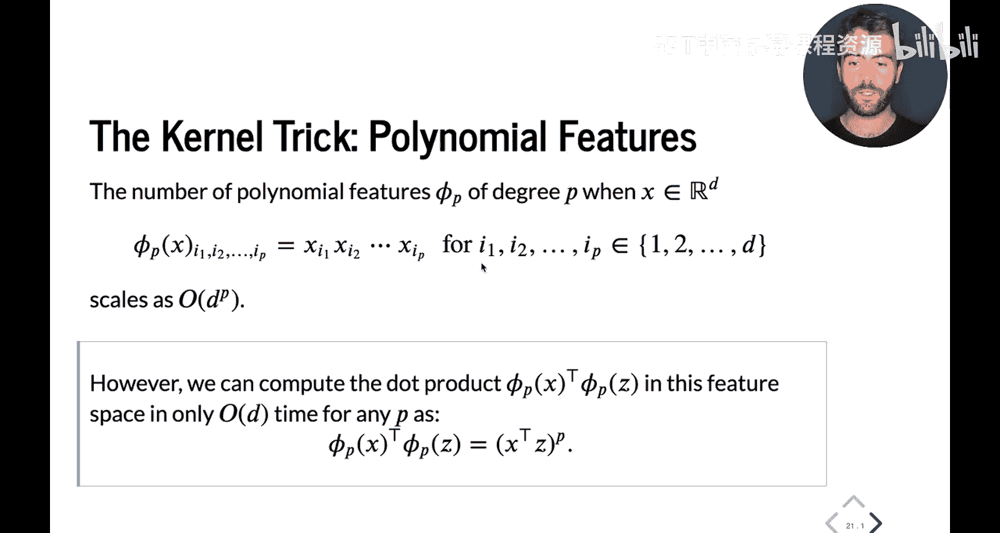

## 核技巧的广泛应用

核技巧不仅适用于岭回归，还可以应用于许多其他机器学习算法：

以下是核技巧的一些应用场景：

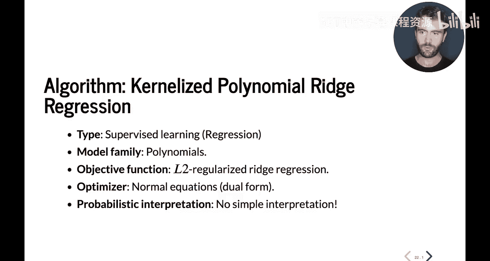

*   **分类算法**：如逻辑回归和支持向量机（SVM）。
*   **无监督学习**：如核主成分分析（Kernel PCA）和密度估计。
*   **其他线性模型**：任何仅依赖于特征点积的算法都可以进行核化。

核技巧的核心思想是：当算法仅依赖于特征点积时，我们可以通过定义高效的核函数 \(K(x, z) = \phi(x)^T \phi(z)\) 来隐式地在高维特征空间中操作，而无需显式计算 \(\phi(x)\) 和 \(\phi(z)\)。

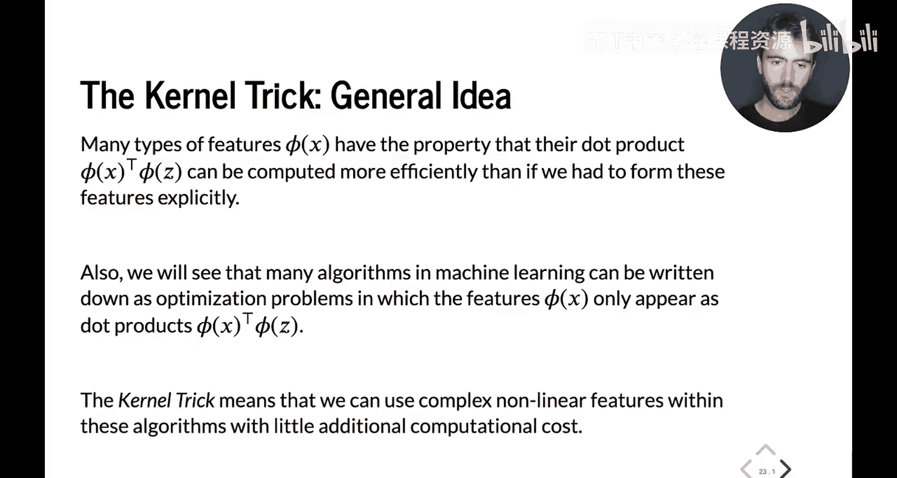

---

## 总结

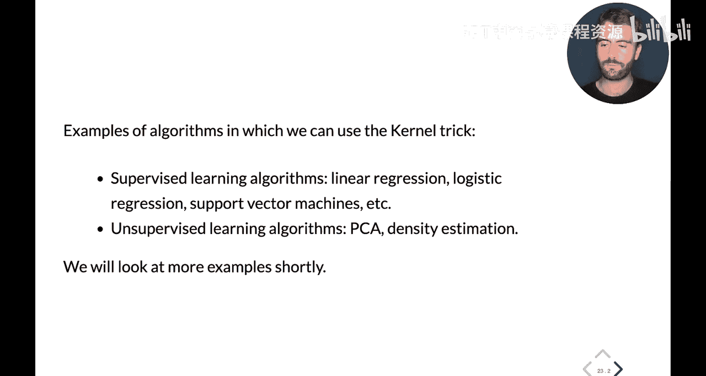

本节课中，我们一起学习了核技巧的基本原理。我们通过多项式特征的例子，展示了如何高效计算高维特征空间中的点积，从而避免直接处理高维向量带来的计算负担。核技巧允许我们在许多机器学习算法中使用复杂、高维的特征映射，而不会显著增加计算成本，这是机器学习中一项强大而实用的技术。