# 12.1：决策树（第一部分）🎯


在本节课中，我们将学习一种新的监督学习算法——决策树。这与我们之前见过的监督学习算法有很大不同。之前的算法多从数学建模的角度出发，而决策树则试图模仿人类在解决特定机器学习任务时的决策过程。我们将首先定义什么是决策树，然后探讨如何学习它们。


## 概述

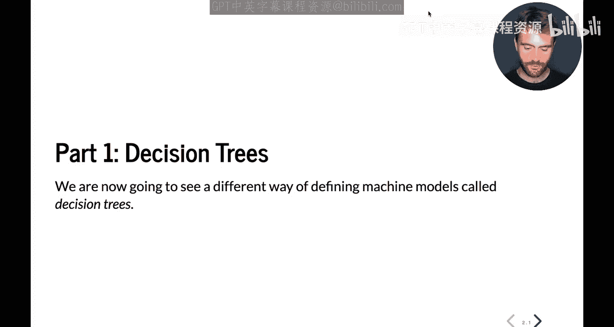

决策树属于基于树的算法家族。它是一种直观的模型，通过一系列简单的规则来做出预测。本节我们将正式定义决策树及其核心组成部分。

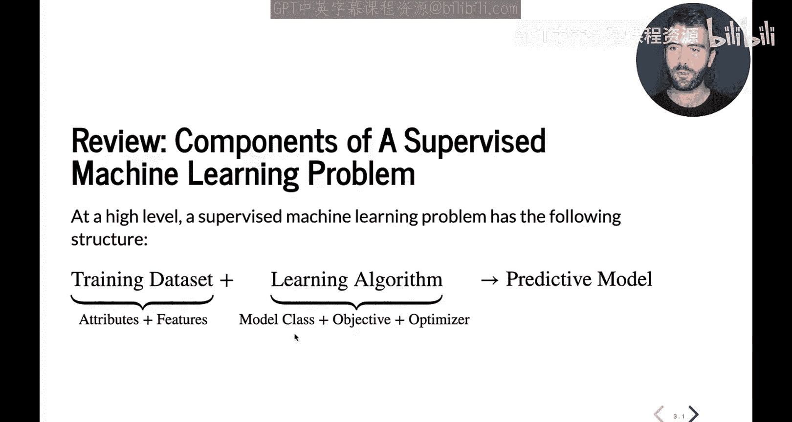


## 决策树模型定义

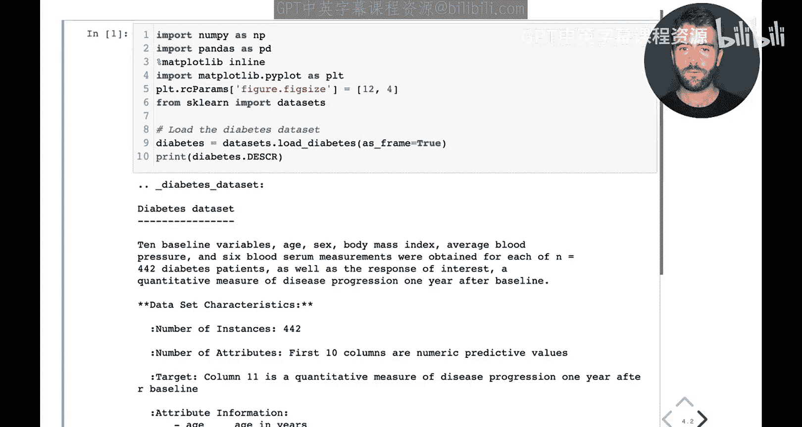

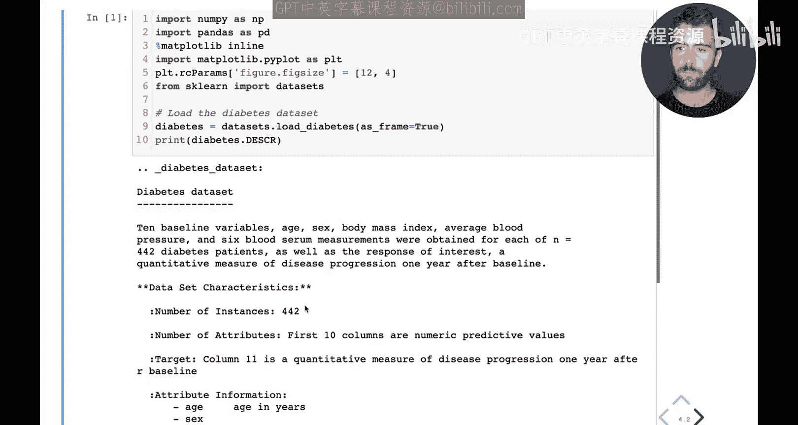

回顾监督学习的定义，我们需要定义数据、模型类别、目标函数和优化器。决策树是一种与我们之前所见截然不同的模型类别。

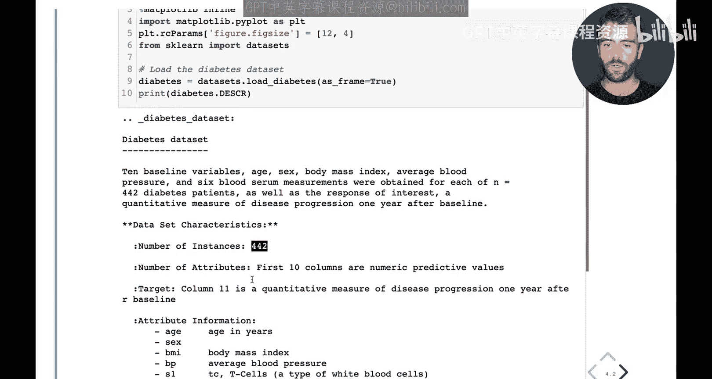

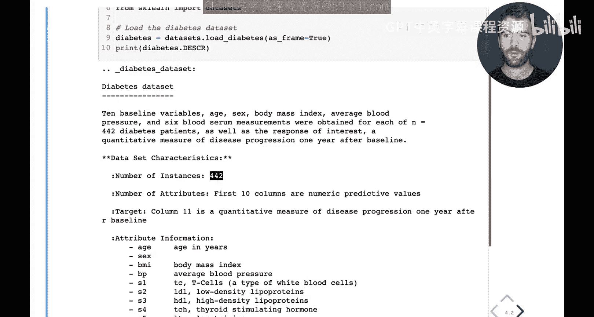

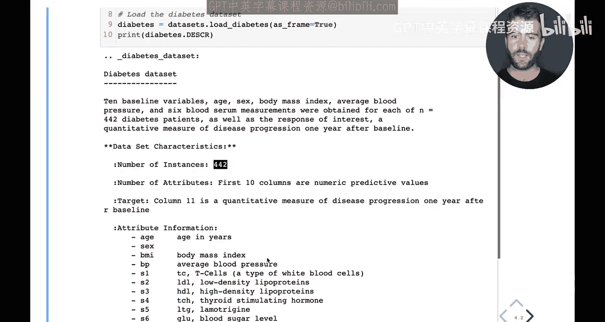

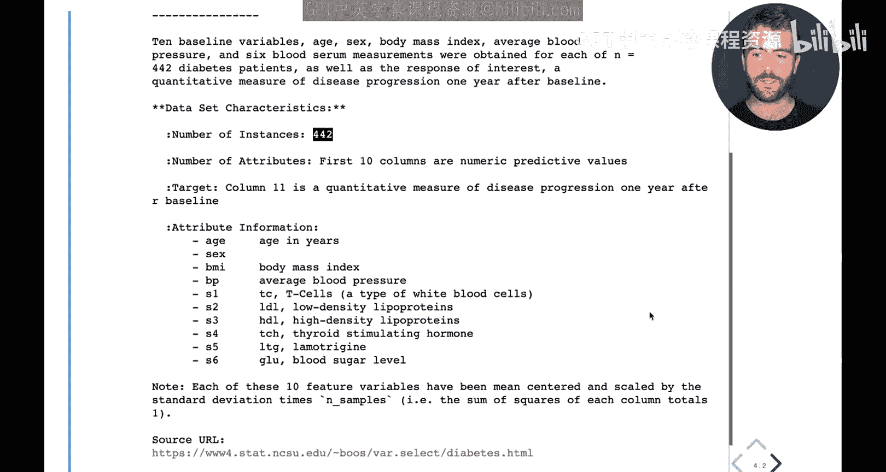

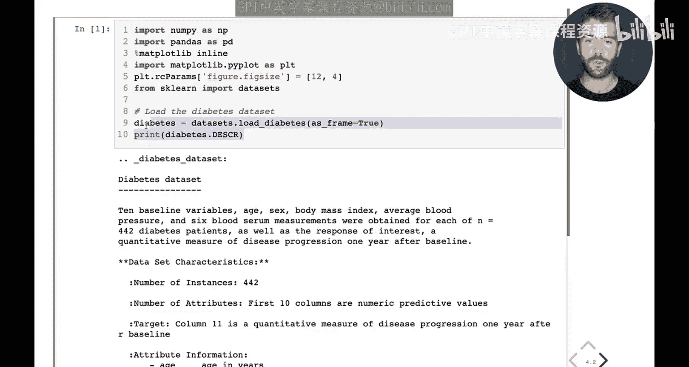

为了定义这个模型类别，我们以之前见过的糖尿病数据集为例。

### 数据集示例：糖尿病风险预测

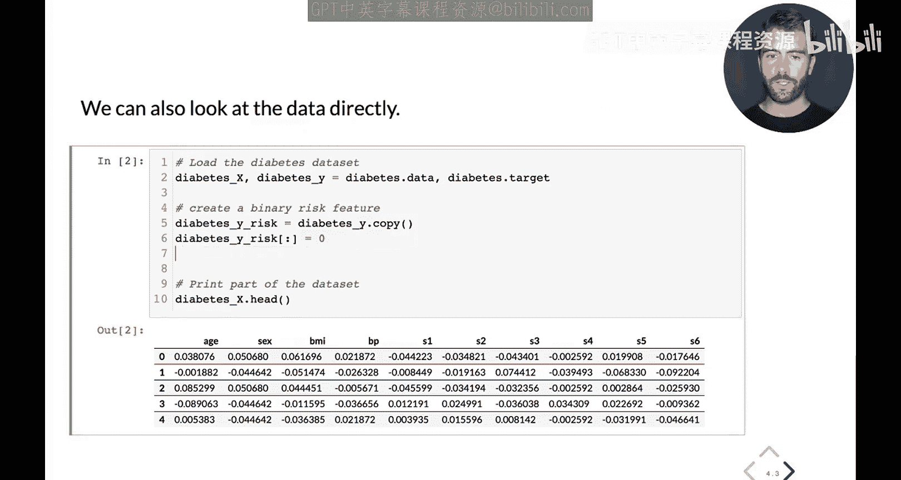

该数据集包含约442名患者的各项生理测量指标，例如年龄、性别、BMI、血压等，共10个属性。我们的目标是根据这些属性预测患者的糖尿病风险。为简化问题，我们将风险二值化：风险值大于150为高风险，否则为低风险。

### 人类决策过程的模拟

想象一下，如果是一位医生来诊断，他可能会遵循一个基于规则的过程。例如，先看患者的年龄，如果是老年人，再考虑性别，接着可能查看特定的生理指标。这种分步骤、基于规则的决策方式，正是决策树试图模仿的。

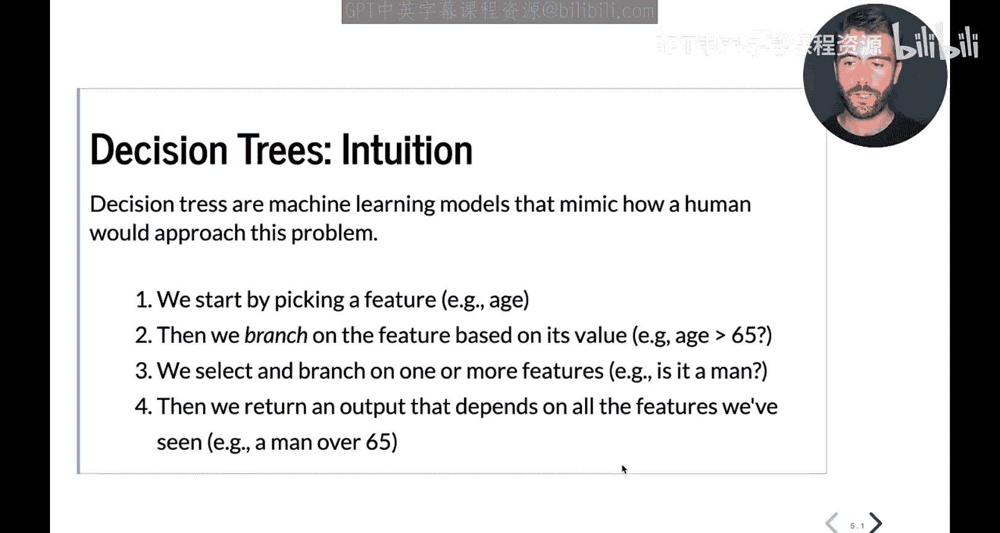

### 决策树算法示例

以下代码展示了如何使用Scikit-learn中的决策树分类器，并在糖尿病数据集上进行训练和可视化：

```python
from sklearn.tree import DecisionTreeClassifier, plot_tree
# 假设 X_train 包含特征数据，y_train 包含标签（高风险/低风险）
clf = DecisionTreeClassifier(max_depth=2)
clf.fit(X_train[:, :3], y_train) # 仅使用前三个特征
plot_tree(clf)
```

运行后，我们会得到一个树状图。树的每个节点对应一个基于数据的决策规则。例如，第一个规则可能是“BMI是否小于0.009”。根据这个判断，数据会流向左侧或右侧分支。在第二层，可能根据血压值再次进行划分。最终，每个叶节点代表一个决策区域，并给出该区域内样本的风险分布（例如，86个样本中，76个高风险，10个低风险）。这个树结构以一种完全数据驱动的方式，识别出了具有高BMI和高血压的高风险患者群体。

## 决策树的形式化定义

现在，让我们更精确、更形式化地定义决策树。

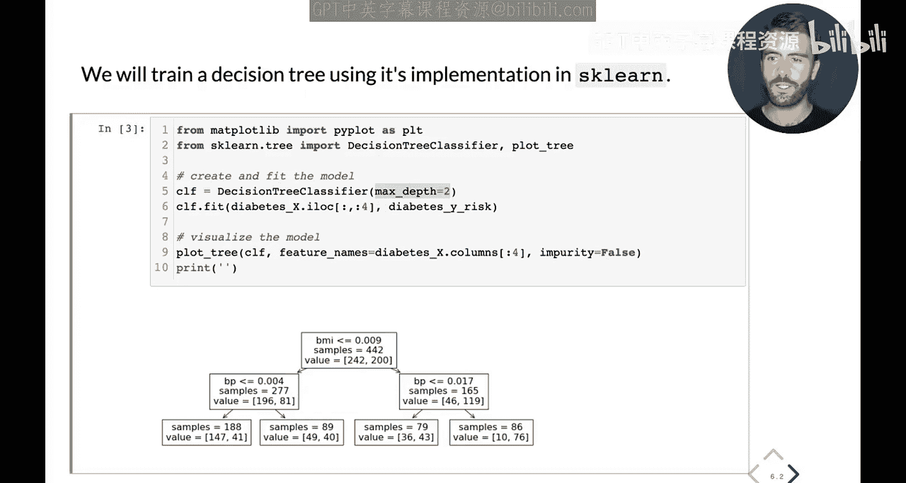

### 核心概念1：决策规则

决策规则是决策树最基本的构建模块。本质上，一个决策规则将特征空间划分为两个互不相交的区域。

*   **形式**：一个规则通常只应用于一个特征或属性。它输出一个二元结果（真/假）。
*   **数学表示**：对于连续变量，规则通常基于一个阈值 `c` 进行划分。规则可以表示为：
    *   如果 `x_j < c`，则流向左侧分支。
    *   如果 `x_j >= c`，则流向右侧分支。
*   **图形解释**：在决策树中，规则与内部节点关联。根据规则的结果（真/假），数据实例会沿着相应的边（左或右）流向子节点。

### 核心概念2：决策区域

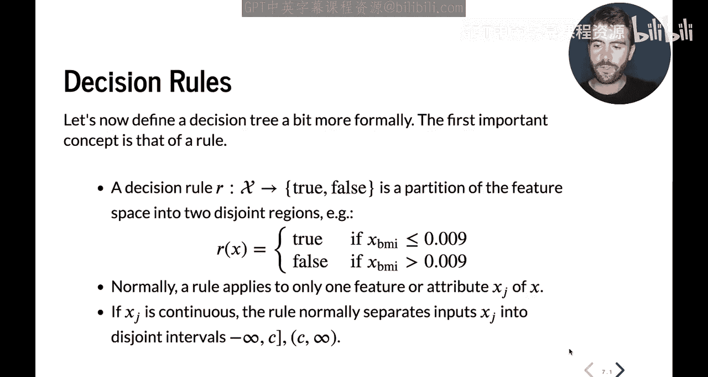

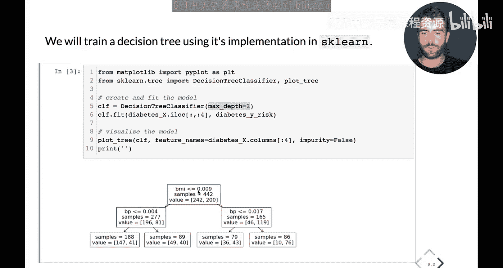

决策区域由一系列决策规则定义。

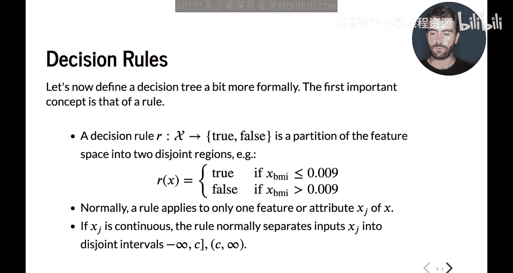

*   **定义**：考虑一个由 `M` 个规则组成的序列。对于这些规则结果的每一种可能赋值组合（例如，规则1为真，规则2为假……），我们都会得到一个特定的决策区域。
*   **数学表示**：区域 `R` 是满足该特定规则赋值组合的所有输入 `x` 的集合。
*   **与树的关系**：在决策树中，这些区域对应着树的**叶节点**。从根节点到叶节点的路径，定义了一个唯一的规则序列，从而确定了一个唯一的区域。

### 决策树的数学表达

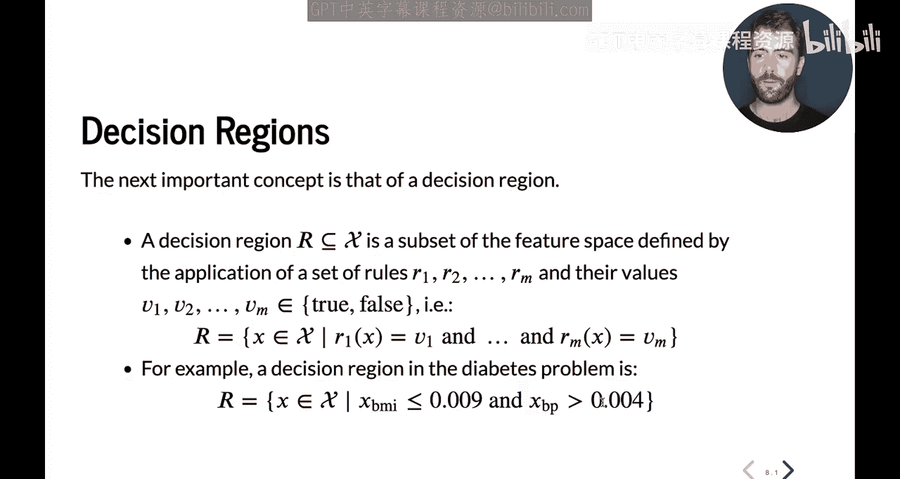

有了区域的概念，我们可以如下定义决策树模型：

决策树将特征空间划分为一系列决策区域 `R ∈ ℛ`。对于每个区域 `R`，模型学习一个预测值 `y_R`。那么，对于任意输入 `x`，决策树的预测 `f(x)` 为：


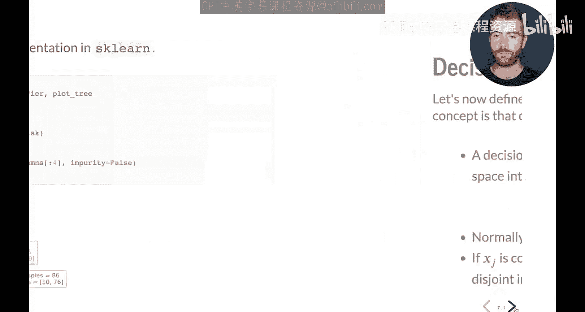

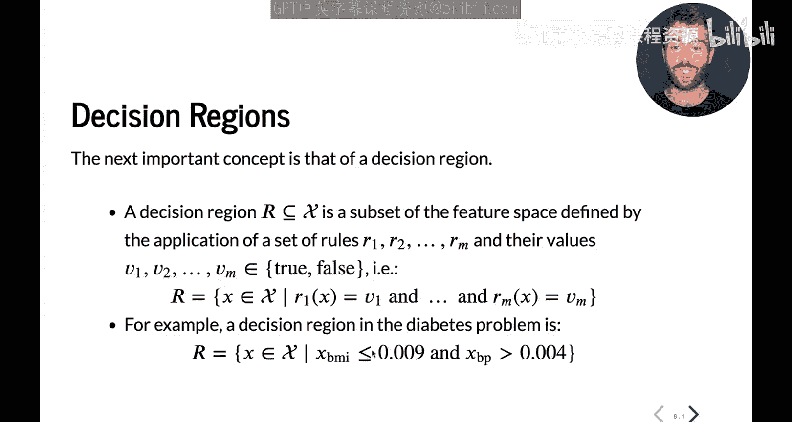

`f(x) = Σ_{R∈ℛ} y_R * I(x ∈ R)`

其中，`I(·)` 是指示函数（当条件为真时值为1，否则为0）。由于区域互斥且完备，对于任何 `x`，有且仅有一个区域的指示函数值为1，因此 `f(x)` 就等于 `x` 所属区域对应的预测值 `y_R`。

需要强调的是，这些区域是通过**递归分割**得到的，这使得它们可以被组织成树形结构。

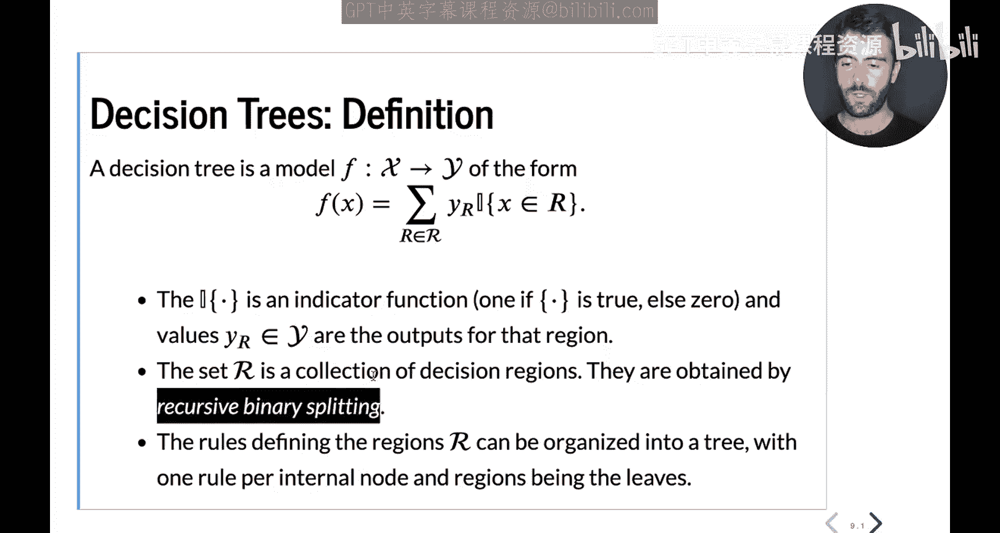

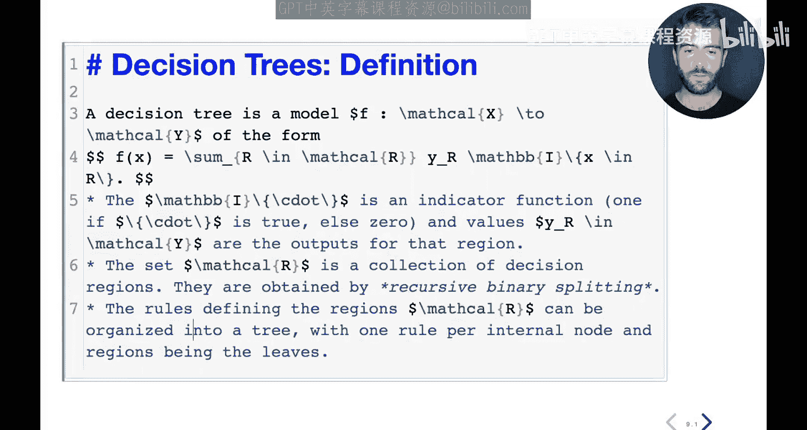

### 决策树结构图示

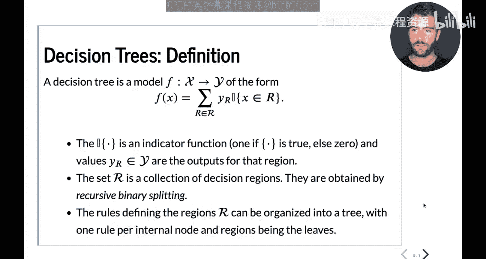

以下是一个决策树及其对应特征空间划分的经典示例（参考Hastie等人教材）：
*   **树结构**：根节点根据 `x1` 是否小于 `t1` 进行分割。右侧分支继续根据 `x1` 是否小于 `t3` 分割，然后再根据 `x2` 进行分割，最终形成5个叶节点（区域R1-R5）。
*   **区域划分**：在二维特征空间 `(x1, x2)` 中，这些规则将空间划分为多个矩形区域。每个矩形对应树中的一个叶节点。
*   **预测可视化**：如果为每个区域分配一个预测值（例如一个实数），我们可以在三维空间中将其可视化为一个阶梯状的平面。

**重要说明**：并非所有区域划分都能由决策树产生。决策树产生的区域具有轴平行（axis-aligned）的特性。例如，一个斜对角划分的区域就无法通过仅基于单个变量阈值的递归分割得到。

## 决策树的优缺点

决策树是一种直观且重要的机器学习算法。

**优点**：
1.  **高度可解释性**：树结构可以轻松可视化，规则易于人类理解和表述。
2.  **数据预处理要求低**：无需担心特征缩放、连续/离散变量编码等问题。同时适用于回归和分类任务，是一种便捷的“开箱即用”算法。

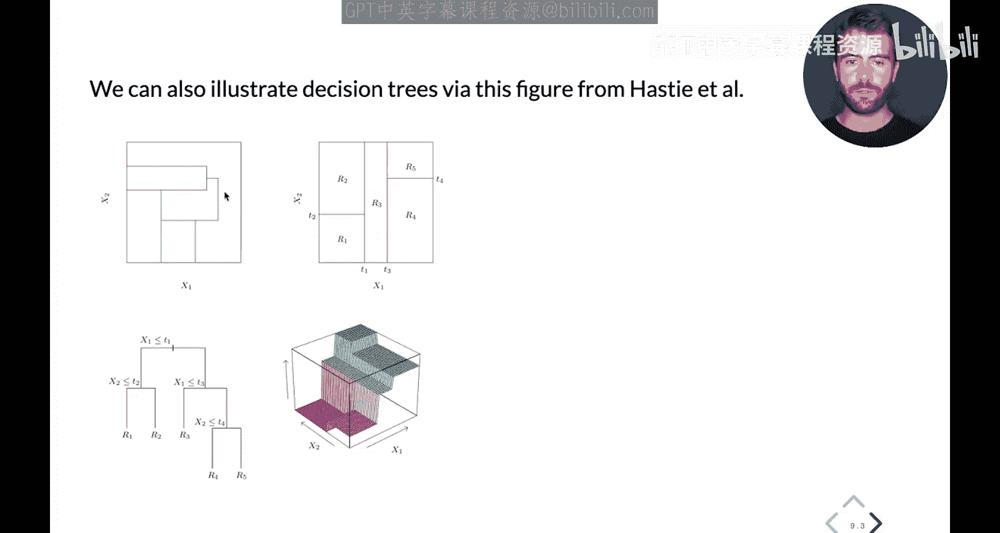

**缺点**：
1.  **模型能力与复杂度权衡**：如果树很小（简单），则模型可能不够强大（欠拟合）。如果树很大（复杂），则极易过拟合训练数据。
2.  **正则化困难**：对于过拟合的决策树，没有特别直观的正则化方法（尽管存在剪枝等技术）。

尽管如此，决策树仍然是机器学习中一个非常重要且被广泛使用的算法。

## 总结

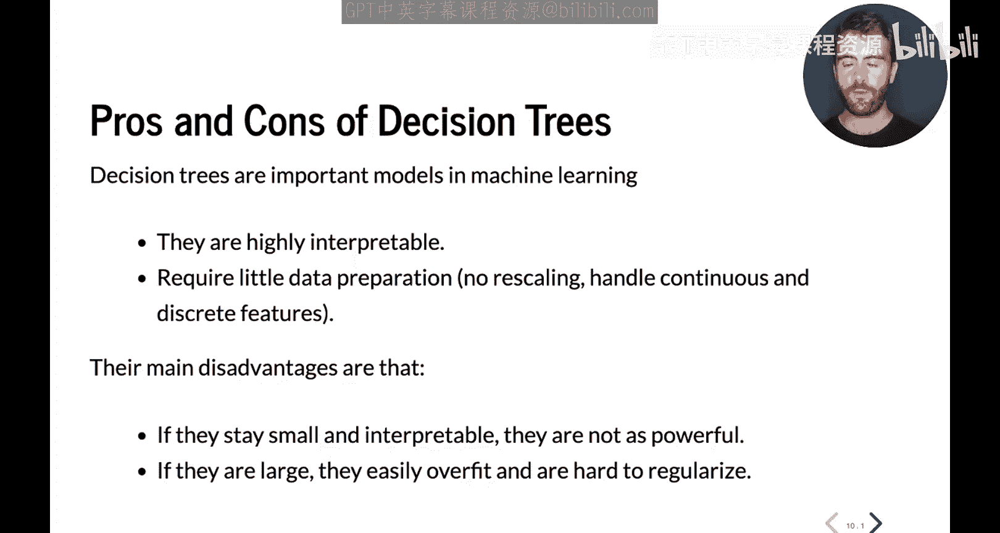

本节课我们一起学习了决策树的基本概念。我们了解到决策树是一种模仿人类规则推理的监督学习模型。它通过递归地应用基于单个特征的简单决策规则，将特征空间划分为不同的区域，并在每个区域给出预测。我们形式化地定义了决策规则、决策区域以及整个决策树模型，并通过示例说明了其工作原理和直观解释。最后，我们讨论了决策树易于解释、预处理要求低等优点，以及可能存在的过拟合和正则化挑战等缺点。在接下来的课程中，我们将深入探讨如何从数据中学习（构建）这些决策树。