# 13.1：第1部分：提升与集成学习 🚀

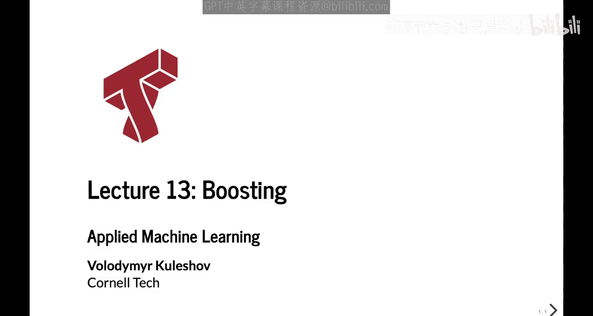

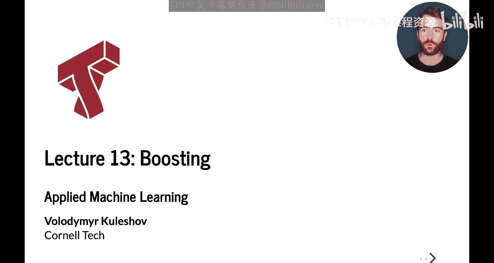

在本节课中，我们将学习一类新的机器学习算法，其核心思想称为“提升”。我们将从上一讲关于决策树的内容出发，探索如何将决策树等简单算法与其他算法结合，构建更复杂、更强大的机器学习模型。本讲介绍的提升算法在实践中非常重要，它们代表了在许多实际关键问题上机器学习精度的最先进水平。

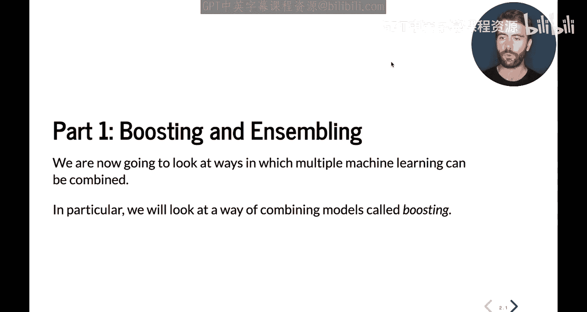

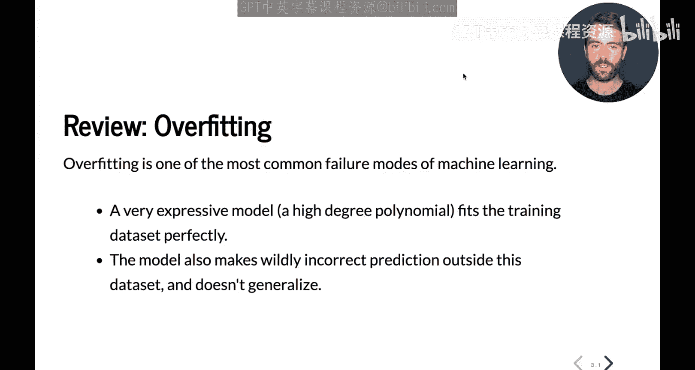

## 从装袋法到提升法 📦

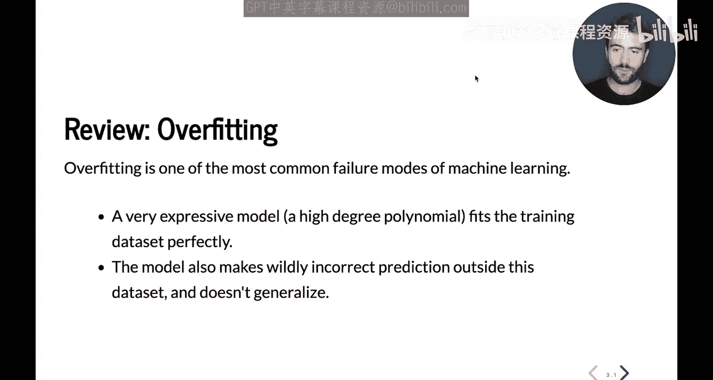

上一讲中，我们讨论了过拟合问题。这是机器学习中常见的一种失效模式，尤其是在使用大型决策树时。问题在于模型表达能力过强，对于我们所拥有的少量数据来说过于强大，因此它能完美拟合训练集，但无法泛化，无法在训练集之外产生准确的预测。

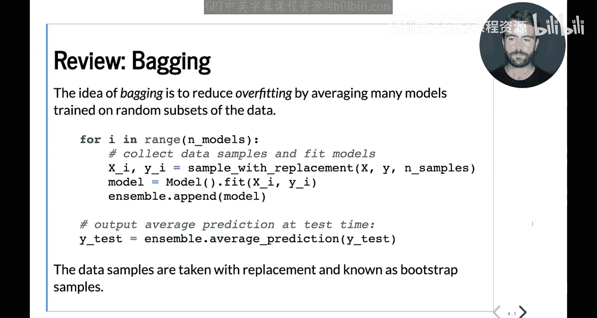

我们介绍了一种通过平均多个模型来减少机器学习模型过拟合的通用方法，这些模型各自在数据的随机子集上训练。这被称为**装袋法**。在装袋法中，我们反复从训练集中抽取随机子样本，在每个随机样本上拟合一个新模型，并将其添加到我们的模型集合中。在预测时，我们输出所有这些模型的平均值。由于每个模型都是在略有不同的训练数据版本上训练的，它们在训练区域之外产生的误差往往不同。具体来说，这些误差会相互抵消。一个模型可能预测过高，另一个可能预测过低。但平均而言，这种抵消会产生泛化能力更好的预测。

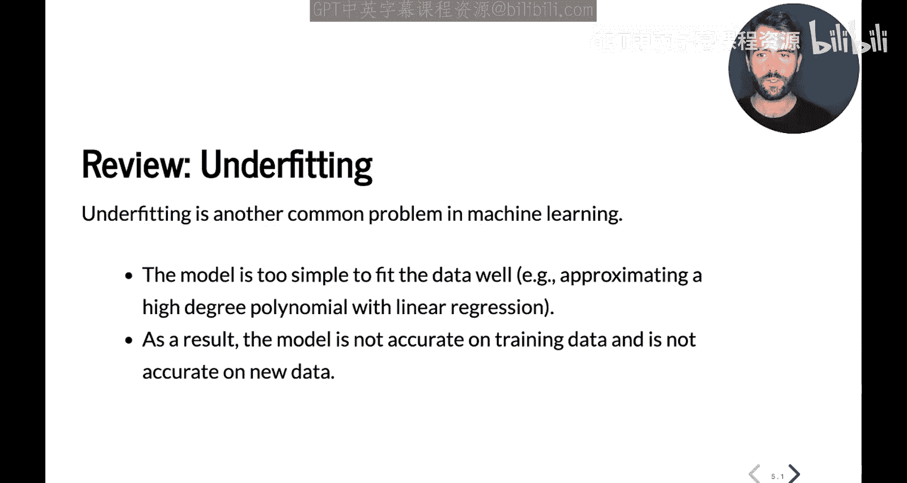

与过拟合相反的问题是**欠拟合**。当我们的模型对于所拥有的数据来说过于简单时，就会发生欠拟合。例如，如果数据更适合用高阶多项式描述，但我们尝试使用线性回归，那么我们将无法很好地拟合训练数据，因此对于来自与训练数据相同分布的新数据，我们也不会准确。

## 提升法的核心思想 ⬆️

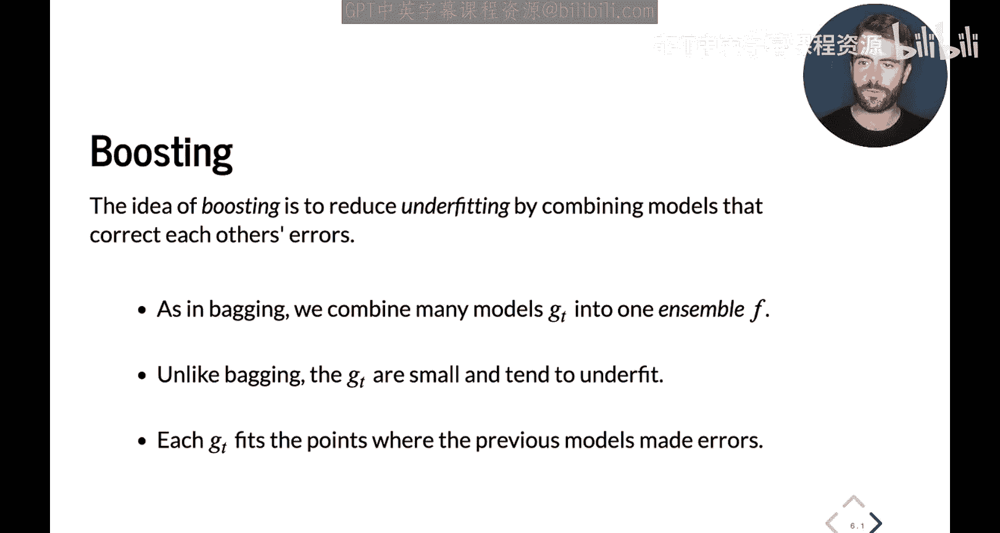

本讲将介绍的提升法，可以看作是通过将不同的机器学习模型组合成一个更大、更强大的模型来减少欠拟合的一种方法。从这个意义上说，它与装袋法非常相似。我们将许多更简单的模型组合成一个更大的模型，我们称之为**集成模型**，用 **F** 表示。

但与装袋法不同，装袋法中的基模型往往表达能力过强，我们希望通过平均来减少其过拟合；而在提升法中，这些基模型 **G** 太小、太简单，往往对数据欠拟合。我们使用提升法使模型集成比每个单独模型更强大、更具表现力。

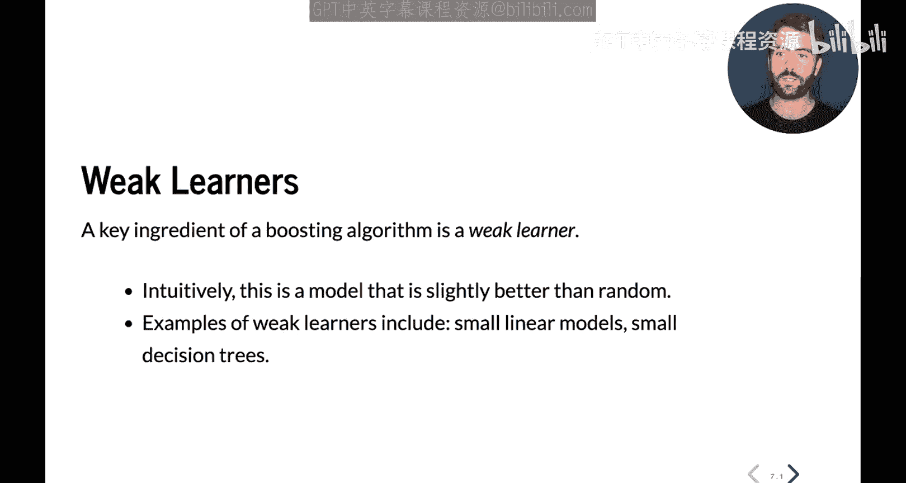

我们实现这一目标的一般方法是：让每个新添加到集成中的模型，查看先前模型的误差，并尝试拟合其他模型未能很好拟合的那部分数据。这样，每个新模型都会纠正集成中先前模型所犯的错误。

## 弱学习器 🤖

定义或使用提升算法的一个关键要素是模型 **G**，它被称为**弱学习器**。之所以称之为弱学习器，是因为对这些模型的唯一要求是它们比随机猜测略好一些。在实践中，弱学习器可以是线性模型、特征数量较少的简单线性模型、小型决策树（如深度为1、2或3的决策树），或者任何确实对数据欠拟合但仍能提取少量信号、使其准确率高于随机猜测的模型。

## 提升算法的一般步骤 🔄

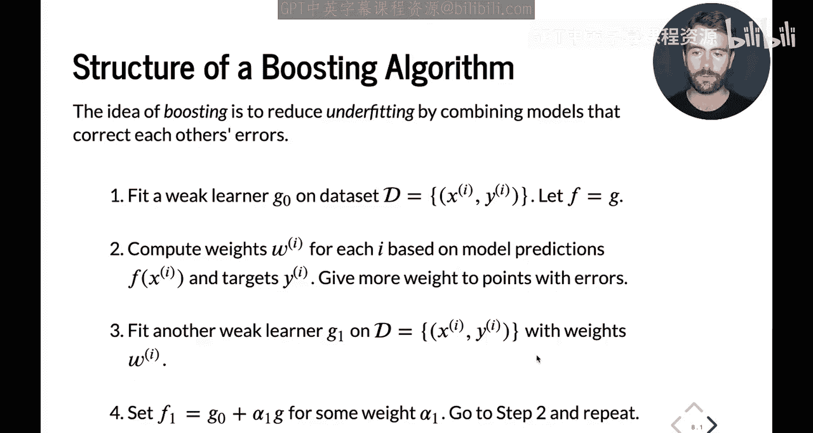

给定一个能产生比平均略好模型的弱学习算法，我们可以通过以下方式将这些模型组合成一个更强大的模型，这是提升法采用的一般方法。

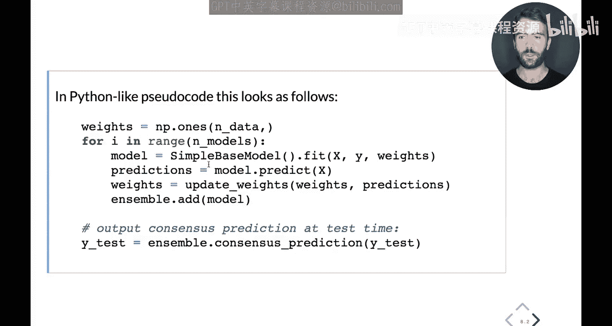

1.  我们从一个初始弱学习器开始，将其拟合到我们的数据集上，并最初将我们的集成模型设置为该模型。
2.  然后，我们根据当前集成模型在这些数据点上的准确性来计算数据点的权重。如果我们的集成模型 **F**（最初仅由基学习器组成）是准确的，那么该点的权重将很小；如果它非常不准确，我们将为不准确的点分配更多权重。
3.  接着，我们将在同一数据集上拟合下一个弱学习器，但现在我们将添加这些权重 **W**。我们将通过这个权重来衡量每个点的损失。因此，现有模型准确性较低的点将拥有更大的权重，我们将倾向于更多地最小化这些点的误差，而不是在模型更准确的其他点上。
4.  现在，我们有了第二个弱学习器，它经过训练以拟合先前模型的误差，我们将其以某个权重 **α** 添加到我们的集成中，该权重决定了这个新基学习器的重要性。
5.  然后我们回到步骤2，重新计算权重，训练另一个弱学习器，并重复步骤2、3、4，直到我们得到一个足够强大的模型 **F**。

可以看到，在每一步，模型 **F** 都会变得越来越有表现力，因为它将是大量弱学习器的总和，每个弱学习器在数据的不同子集上是准确的，因此它们的集成将能够在我们整个训练数据集上实现良好的准确性。

如果用Python实现，可以使用以下通用结构：最初从一组均匀的权重开始，然后如果要创建包含多个模型的集成，则使用初始权重集拟合模型，查看其预测，创建新的权重集，然后将其添加到集成中。输出将是某种共识，例如在此过程中训练的所有弱学习器预测的加权平均值。

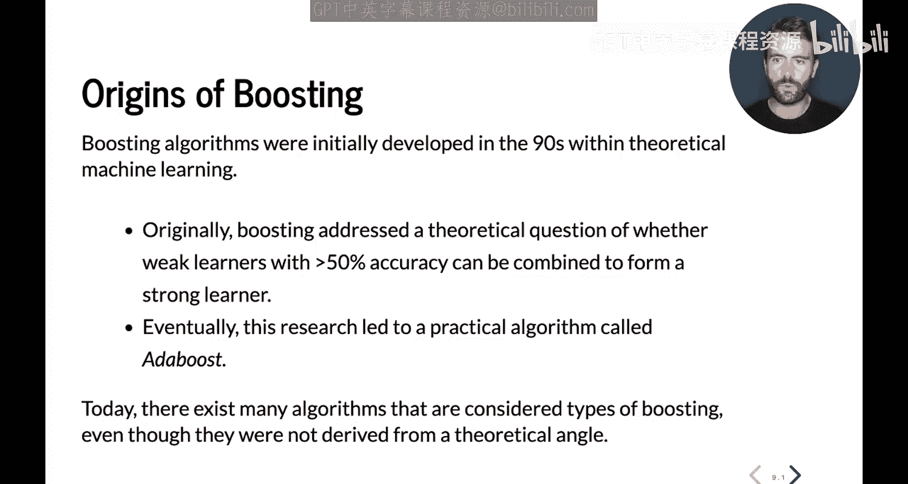

## AdaBoost 算法简介 📜

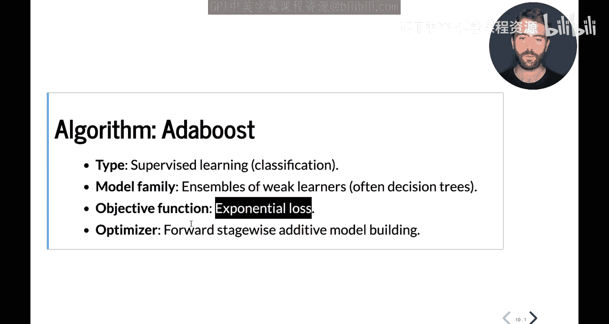

提升法最初源于机器学习理论文献。有一个理论问题是：是否可能将每个仅比随机猜测略好（准确率略高于50%）的弱学习器组合成一个具有高准确率的强学习器，并以一种可证明的方式，用定理保证该算法的成功。这个问题在80年代末和90年代初被研究，最初得出了一些理论结果，最终这条研究路线催生了第一个实用的提升算法，称为 **AdaBoost**。AdaBoost 在历史上非常重要，从理论角度看，它解决了人们提出的这个理论问题；在实践中，它长期以来一直是一个非常强大的机器学习算法，应用广泛，并长期被认为是该领域的最先进技术。

AdaBoost 最初是为分类问题开发的算法，尽管也有适用于回归的版本。它学习一个弱学习器的集成，这些弱学习器通常是决策树，使用一种称为指数损失的目标函数，以及一种特定形式的优化器。我们将在下一个视频中讨论这些细节。

以下是该算法的高层结构，作为一个具体的提升算法示例：

1.  从一组均匀的权重和一个空集成开始。
2.  进行多次迭代：
    *   拟合一个弱学习器（例如决策树）。
    *   计算加权误分类误差。如果所有权重为1，则这只是误分类点的百分比；如果权重非零，则这是误分类点的加权平均值。
    *   定义模型权重 **α**，它是误分类误差的简单函数。
    *   以确定的权重 **α** 将此弱学习器添加到我们的集成中。
    *   使用特定的更新规则计算数据点的新权重 **W**，该规则通过 **α** 的指数来增加误分类数据点的权重。这保证了所有权重为正，并且我们出错的点拥有更大的权重。

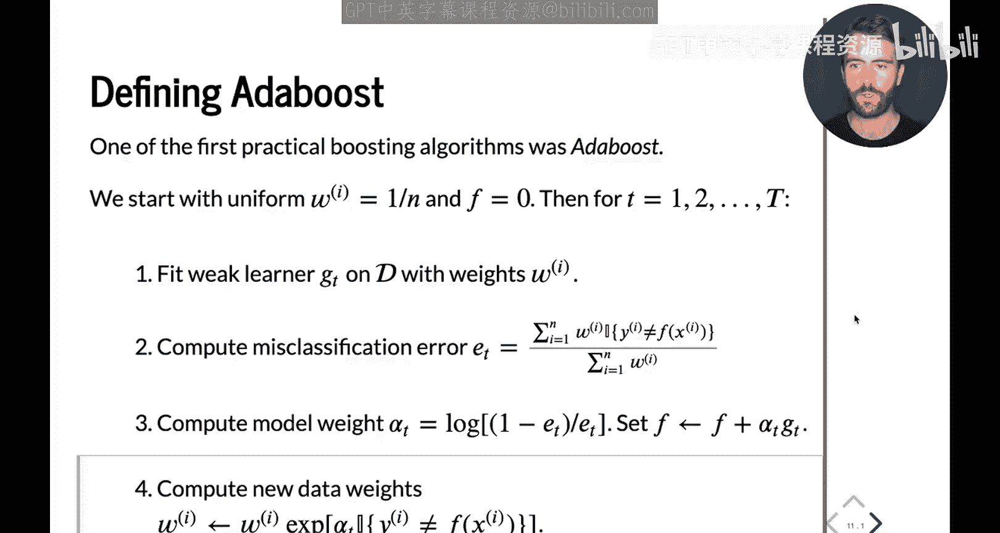

这个过程遵循我们之前看到的高层提升结构：我们为准确性较低的点分配更多权重。重复此过程，我们就得到了 AdaBoost 算法。

## AdaBoost 实践演示 🎯

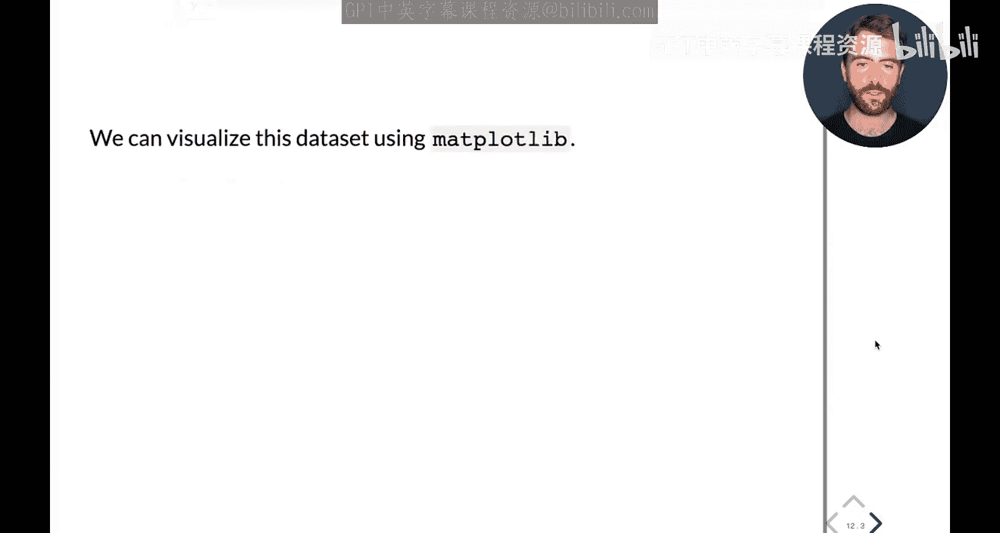

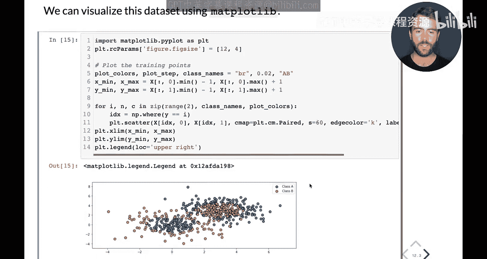

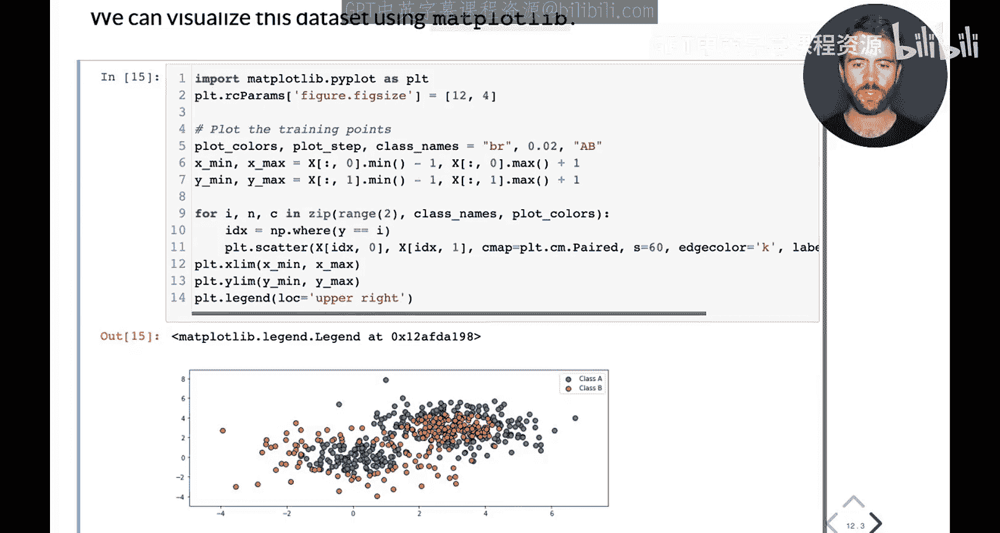

现在让我们看看这个算法在一个小型玩具数据集上的实际效果。这里我们使用一个简单的二维数据集，其中有两个类别（蓝色和橙色）。这个数据集明显是线性不可分的：蓝色类别被橙色类别包围在一个簇中，而在另一个簇中，橙色类别被蓝色点包围。这是一个复杂的数据集。

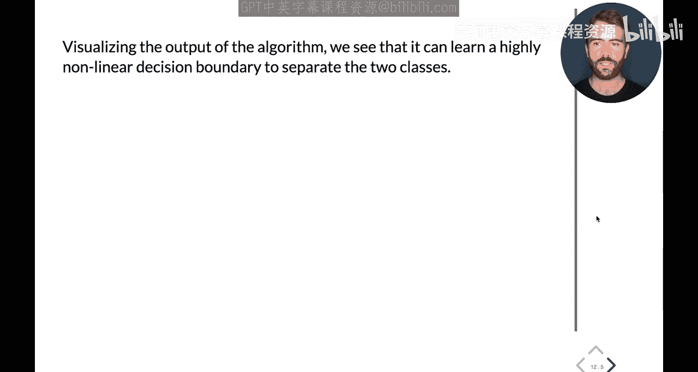

让我们在这个数据集上训练 AdaBoost。在实践中使用 AdaBoost 很简单，例如使用 scikit-learn 库。我们可以导入 `AdaBoostClassifier`。由于它是一个提升算法，它需要一个基分类器（弱学习器），这里我们定义为一个深度为1的决策树分类器。我们将学习一个包含200个这样的分类器的集成。

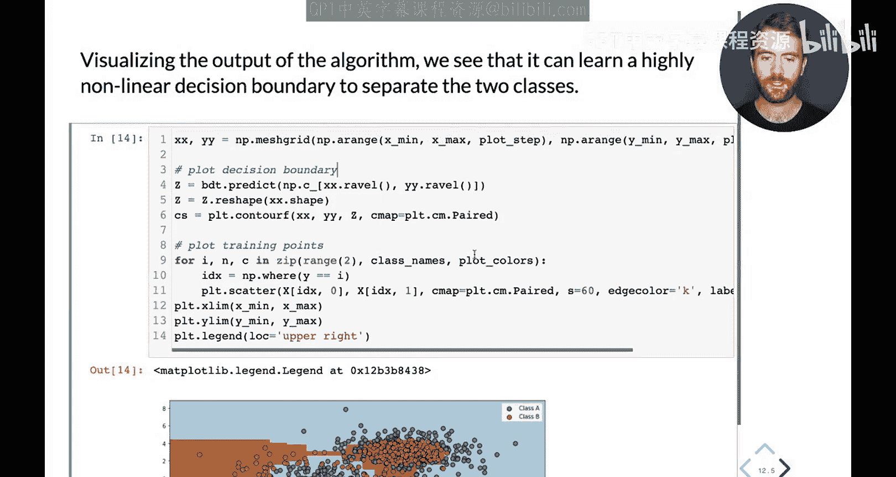

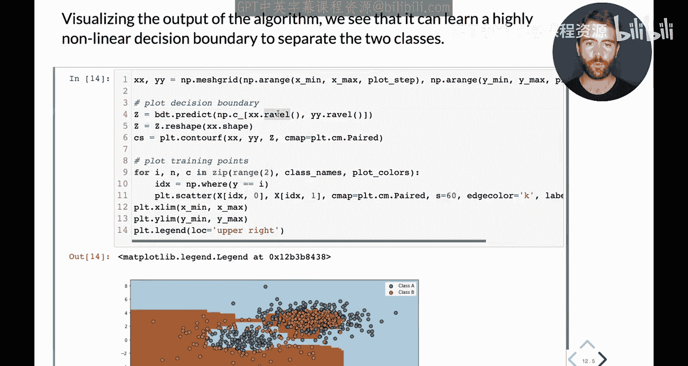

定义此算法非常简单，我们可以用一行代码将其拟合到数据上。结果给出了以下决策边界。可以看到，即使使用一个非常简单的模型（200个深度为1的决策树），我们也能够学习到这个数据的结构。算法识别出橙色类别几乎正确地包围了蓝色区域，而在另一个区域则相反。使用一个非常简单的现成模型，无需任何重要的超参数调整，就能够学习到这个高度非线性可分的结构。这初步展示了提升算法的强大能力。

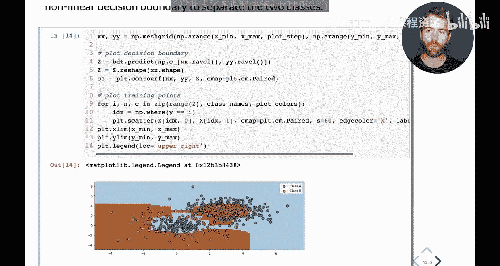

## 集成学习概览 🤝

需要指出的是，提升法和装袋法是称为**集成学习**的通用思想的特例。集成学习意味着将多个机器学习模型组合成一个更大、更强大的模型。装袋法和提升法是两种最流行的集成技术，分别用于减少过拟合和欠拟合。但还有其他类型的集成方法也值得了解。

其中之一是**堆叠法**。堆叠法意味着我们训练 M 个输入模型，每个模型都在我们的训练数据下训练。然后我们冻结它们，再训练另一个模型，该模型的输入特征是这些模型的输出。因此，输出模型 **F** 的输入属性将是模型 **G** 的输出。这是一种简单的尝试方法，当基模型 **G** 差异很大时效果最好，例如结合决策树、支持向量机、线性模型和朴素贝叶斯，然后以这四个输出作为特征训练另一个模型，这通常是一种可以有效带来额外性能提升的方法。

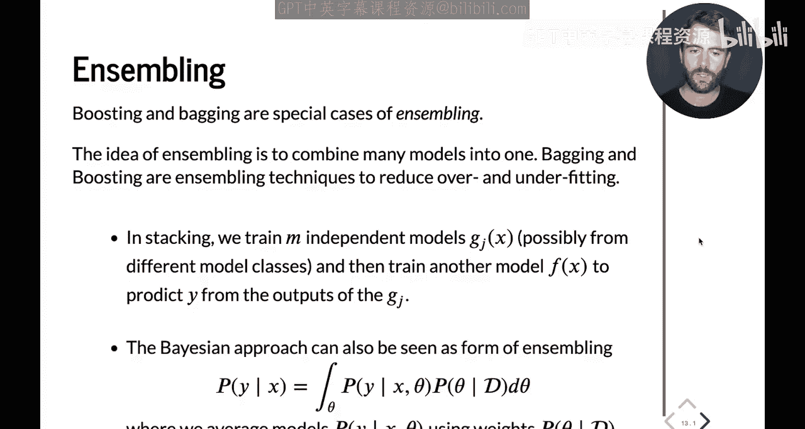

另外需要强调的是，我们在早期讲座中看到的**贝叶斯方法**，在技术上也是一种集成形式，因为我们平均了许多具有不同参数 **θ** 的模型，并有效地使用了这些权重集合。贝叶斯方法实际上是定义集成算法的一种非常有原则的方法。在实践中，这个公式可能无法精确实现，但许多集成算法在某种意义上都是这个公式的特例，因为它们提供了对其的近似。

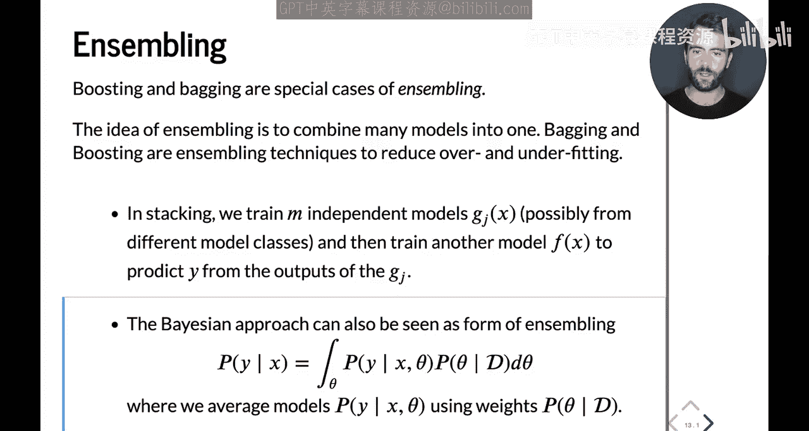

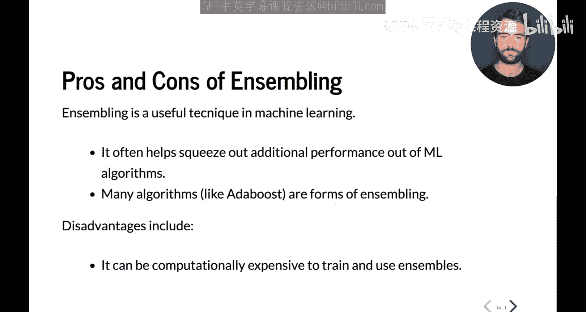

集成学习的理念对于应用机器学习非常有用。在实践中，使用许多最先进的算法时，如果我们尝试集成，通常总能再挤出一点性能。例如，对于神经网络，如果我们从不同的初始点训练几种不同类型的神经网络，我们可以进一步提高性能。此外，集成很重要，因为机器学习中的许多算法，如提升算法，实际上都是集成的形式。当然，在实践中我们可能并不总是能够使用集成，因为训练多种不同类型的模型成本很高。

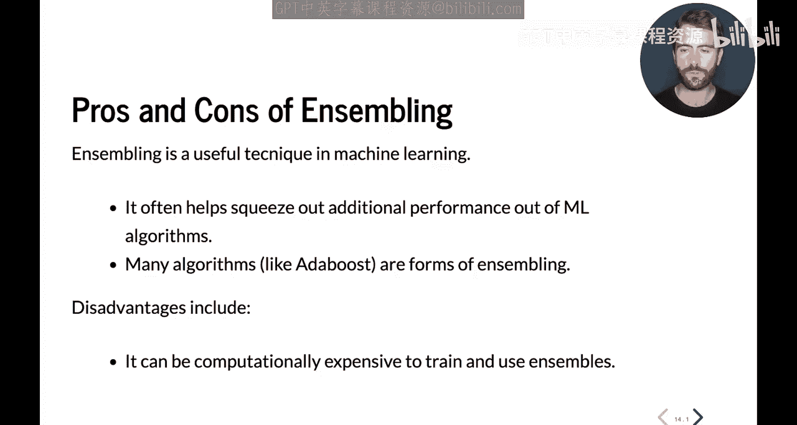

本节课我们一起学习了提升算法的核心思想、一般步骤，并通过 AdaBoost 了解了其具体实现。我们还探讨了提升法与装袋法的区别，以及集成学习的 broader 概念。下一节我们将从另一个视角来看待提升法，并利用它来定义新的算法。