# 13.3：梯度提升 🚀

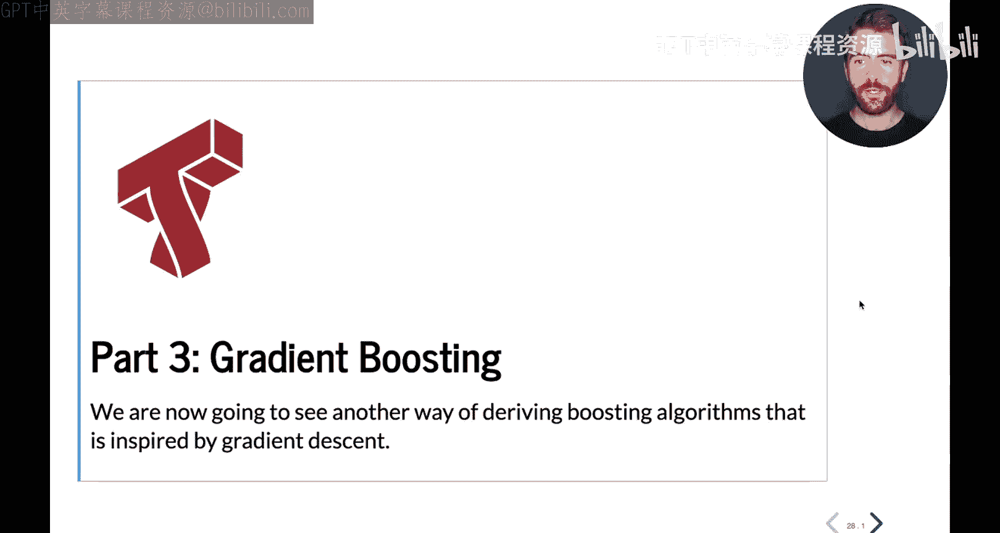

在本节课中，我们将要学习一种非常强大的集成学习方法——梯度提升。梯度提升是目前性能最先进的提升算法之一，在Kaggle等机器学习竞赛中取得了大量优异成绩。我们将从基本概念出发，逐步理解其工作原理和实现方式。

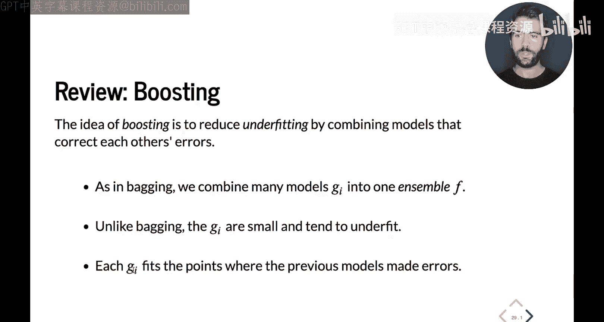

## 提升算法回顾

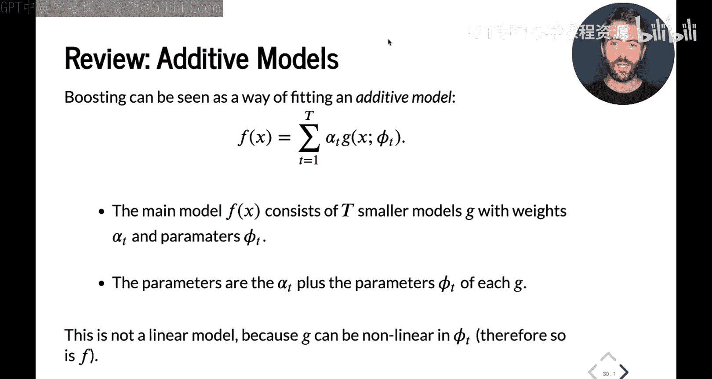

上一节我们介绍了提升算法的基本思想，本节中我们来看看梯度提升的具体实现。

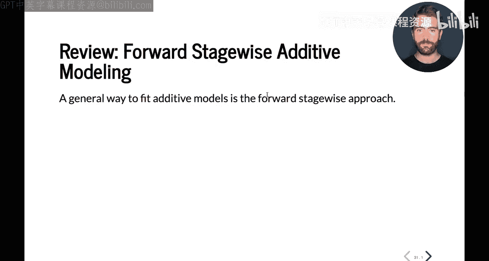

提升是一种通过组合多个较弱的“基学习器”来构建强大模型的技术。其核心思想是顺序地训练模型，每个新模型都专注于纠正前序模型所犯的错误。

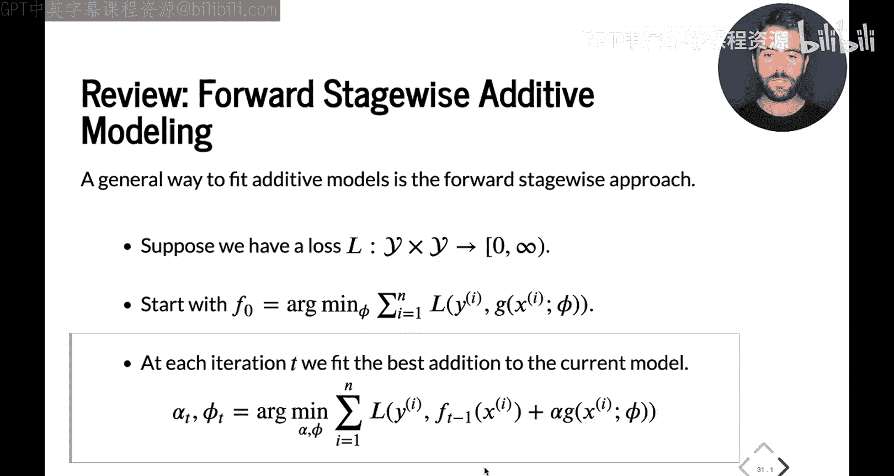

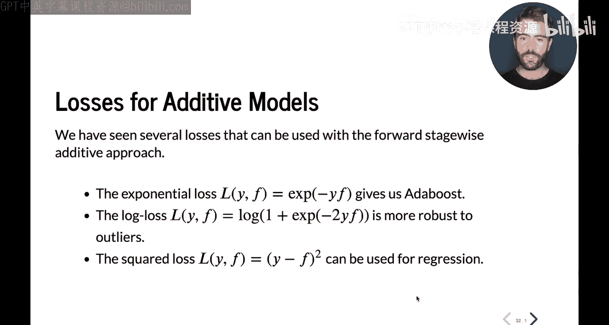

我们可以将提升过程视为拟合一个**加性模型**。该模型的形式如下：

$$
F_T(x) = \sum_{t=1}^{T} \alpha_t g_t(x; \phi_t)
$$

其中：
*   `F_T(x)` 是最终的集成模型。
*   `g_t` 是第 `t` 个基学习器（例如决策树）。
*   `\alpha_t` 是第 `t` 个模型的权重。
*   `\phi_t` 是第 `t` 个模型的参数。

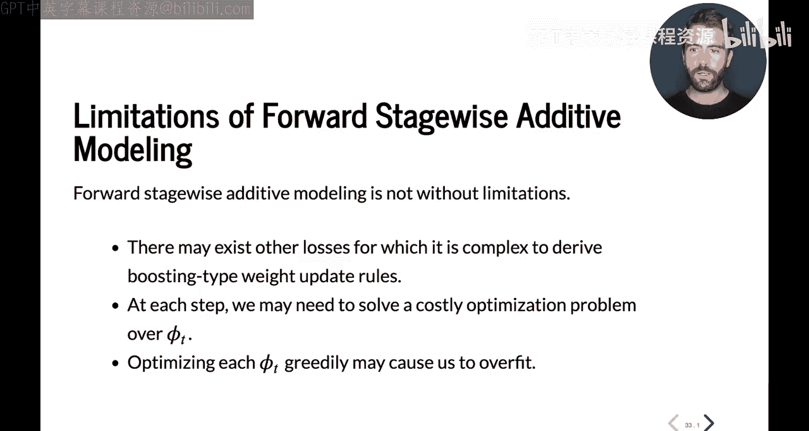

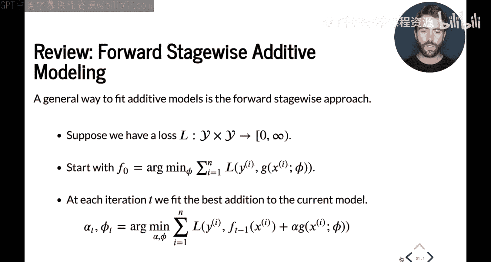

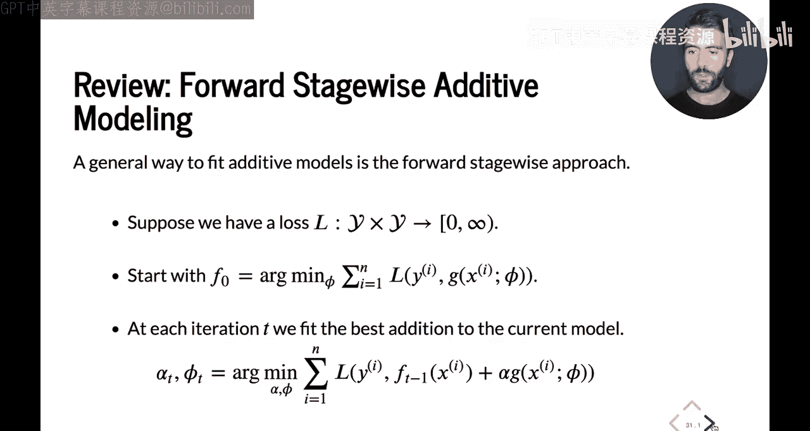

整个模型的参数是所有 `\alpha_t` 和 `\phi_t` 的集合。这个模型是“加性”的，但由于每个 `g_t` 对其参数 `\phi_t` 可能是高度非线性的，因此整个模型并不是线性的。

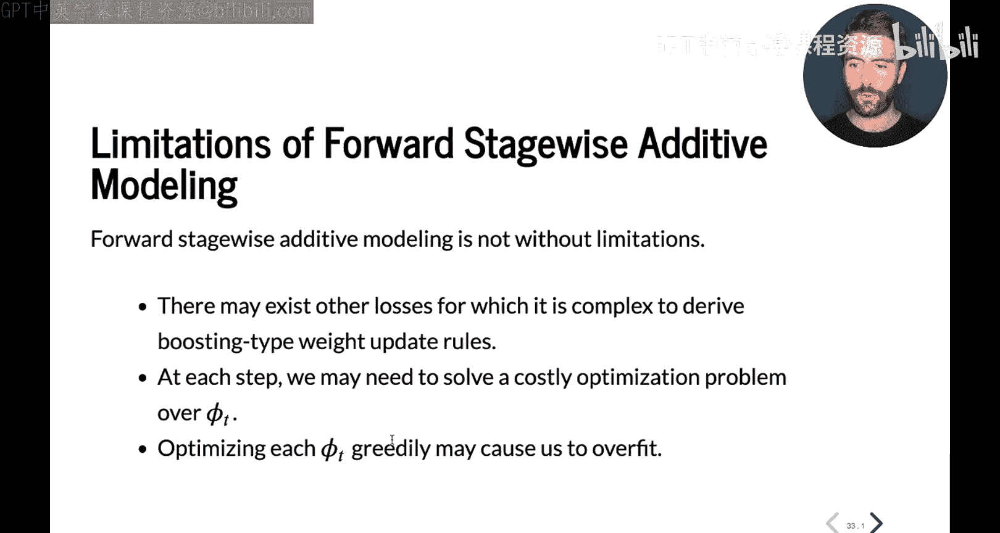

拟合这类加性模型的通用方法是**前向分步加法建模**。其过程如下：
1.  初始化模型，例如设 `F_0(x) = 0`。
2.  对于第 `t` 步，固定前 `t-1` 步已学到的所有模型参数。
3.  仅针对当前步骤的残差或损失，优化求解第 `t` 个基学习器 `g_t` 及其权重 `\alpha_t`。

这种方法将复杂的整体优化问题分解为一系列可处理的子问题。

我们之前看到，通过选择不同的损失函数，可以推导出不同的提升算法：
*   使用**指数损失**，得到 AdaBoost。
*   使用 **L2 损失（均方误差）**，得到用于回归的 L2Boost。

然而，前向分步方法也存在一些局限性：
*   对于每种新的损失函数，都需要手动推导权重 `\alpha_t` 的更新公式，这个过程繁琐且并非总是可行。
*   如果在每一步都精确地求解最优的基学习器（即“完全拟合”），算法可能会过于贪婪，导致在某个步骤上过拟合，特别是当基学习器 `g_t` 本身非常灵活时。

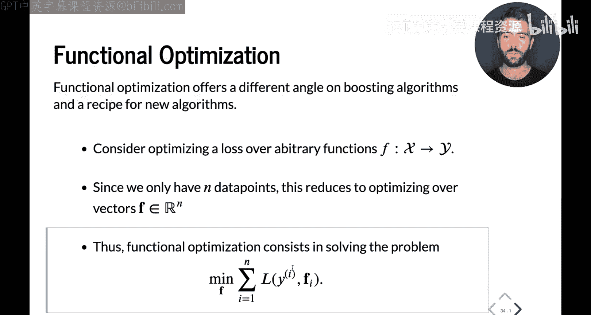

因此，我们希望找到一种方法，能够通用地处理各种损失函数，易于训练，并能更有效地控制过拟合。这就是**梯度提升**算法。

## 从函数空间优化到梯度提升 🧠

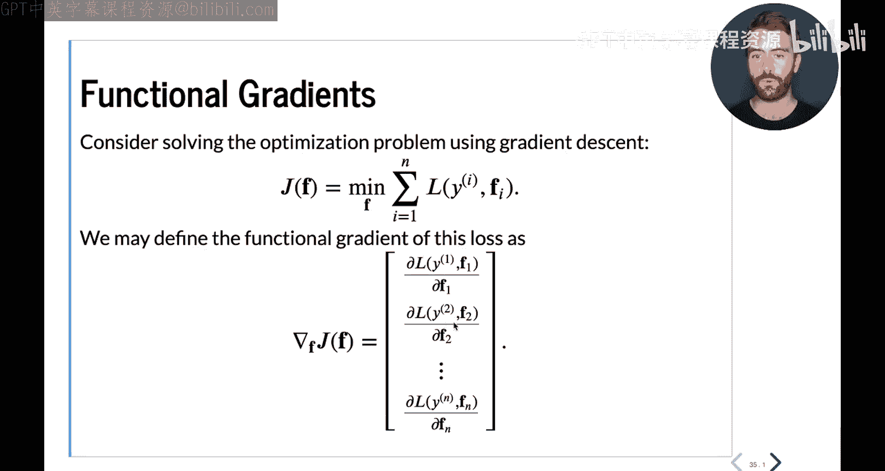

为了理解梯度提升，我们首先需要了解**函数空间优化**的概念。这是一种思想实验，帮助我们建立直觉。

在传统的参数优化中，我们优化的是模型（如线性回归的权重）的参数。而在函数空间优化中，我们设想直接在一个由所有可能函数 `F: X -> Y` 组成的空间中进行优化。

一个关键的观察是：我们只有 `n` 个训练数据点。因此，尽管函数空间是无限的，但对于拟合训练集这个目的而言，我们只关心函数在这 `n` 个点上的值。所有在这些点上输出相同值的函数，在训练集上是等价的。

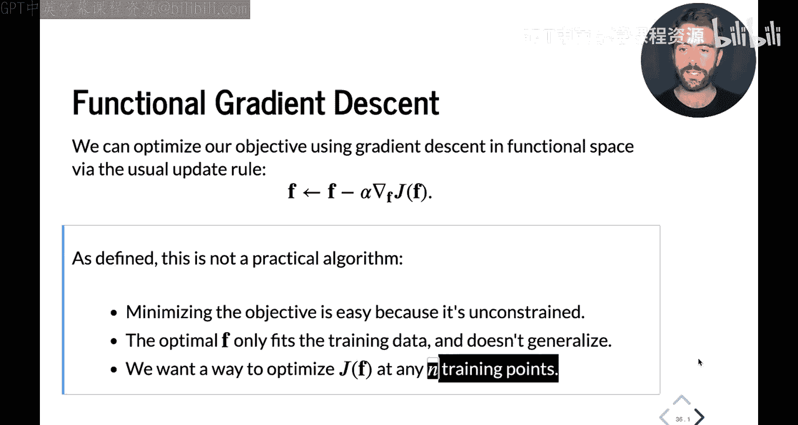

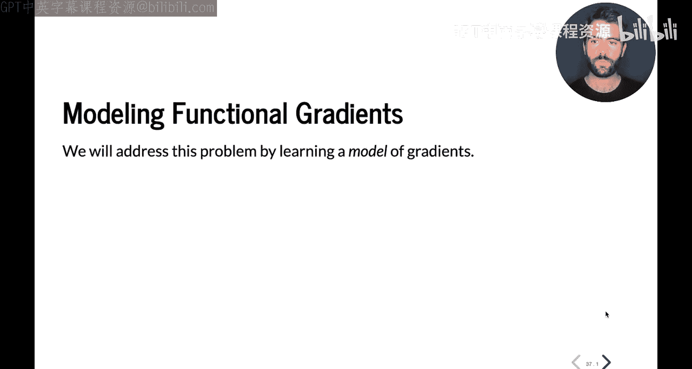

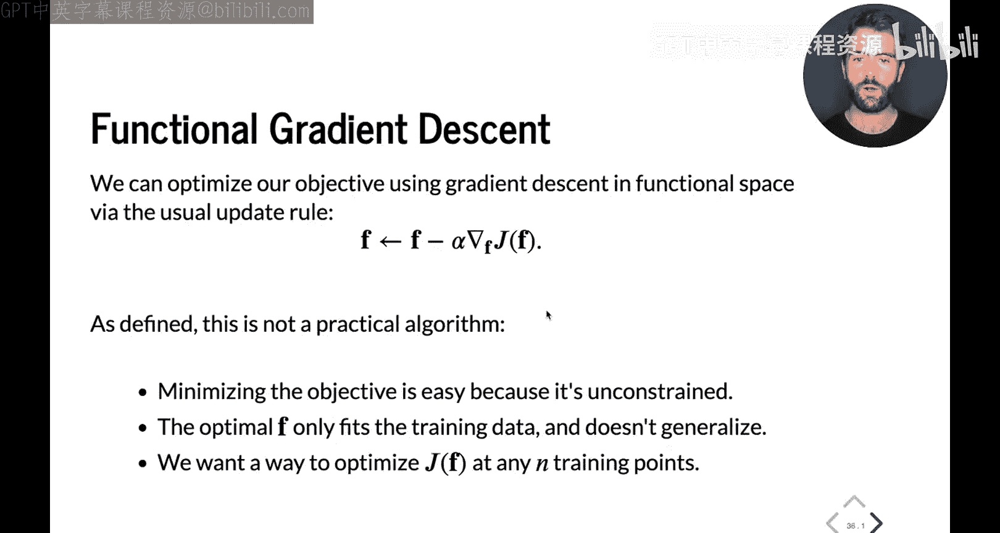

因此，优化整个函数空间等价于优化一个 `n` 维向量 `\mathbf{F} = [F(x_1), F(x_2), ..., F(x_n)]`。我们的优化目标变为：

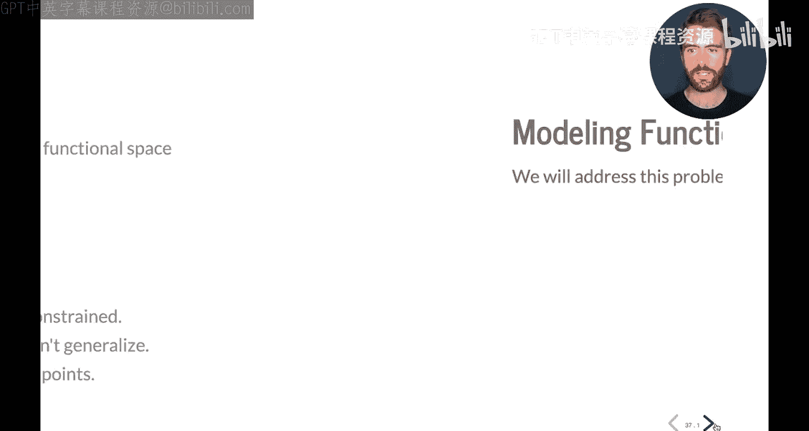

$$
\min_{\mathbf{F} \in \mathbb{R}^n} J(\mathbf{F}) = \sum_{i=1}^{n} L(y_i, F_i)
$$

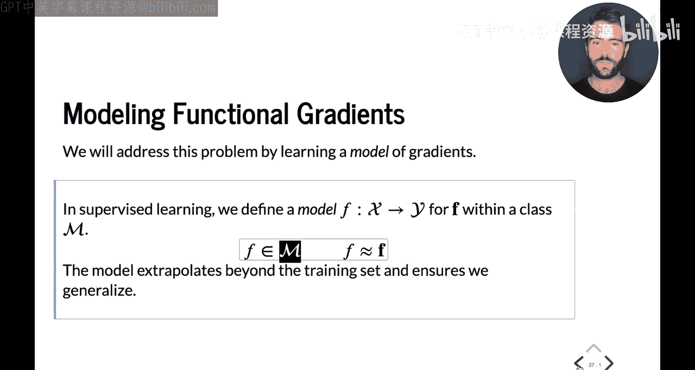

其中 `F_i = F(x_i)`，`L` 是损失函数。

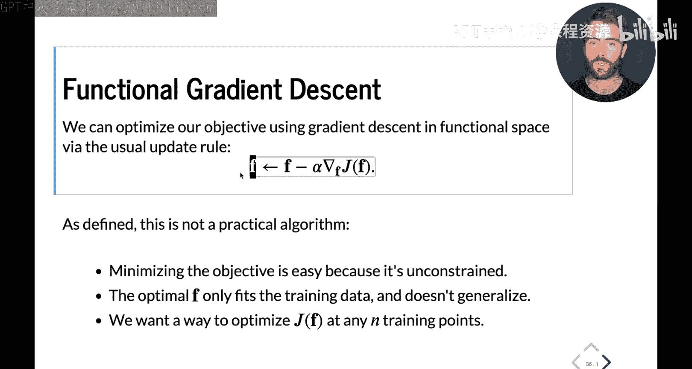

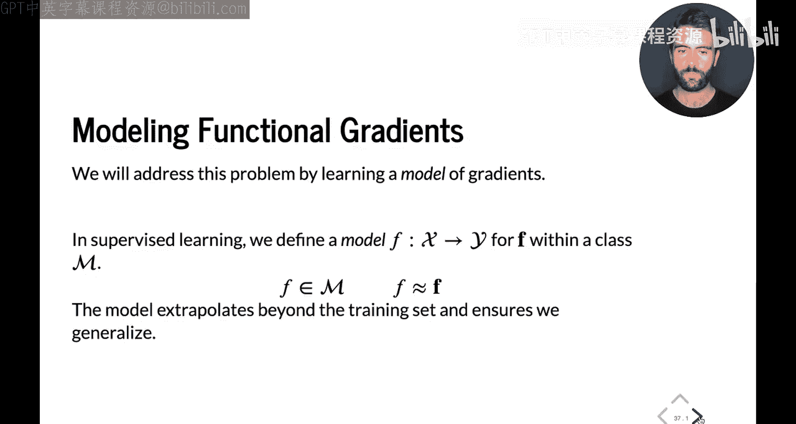

如果我们要用梯度下降法优化这个目标，就需要计算损失 `J` 相对于向量 `\mathbf{F}` 的梯度。这个梯度的第 `i` 个分量是：

$$
[\nabla J(\mathbf{F})]_i = \frac{\partial L(y_i, F_i)}{\partial F_i}
$$

这定义了一个有效的梯度。那么，梯度下降更新步骤为：

$$
\mathbf{F} \leftarrow \mathbf{F} - \alpha \nabla J(\mathbf{F})
$$

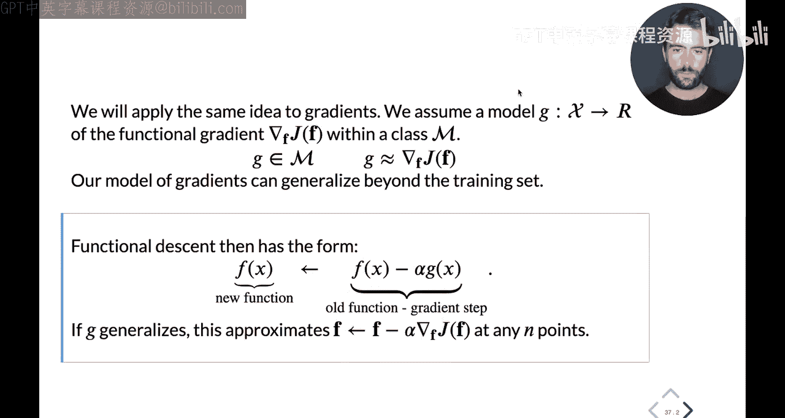

其中 `\alpha` 是学习率。

**但请注意，这只是一个思想实验**。直接这样优化有两个主要问题：
1.  **过于简单**：这是一个无约束优化问题。对于许多损失函数（如L2损失），我们可以直接令 `F_i = y_i` 来达到理论上的最小损失，但这毫无意义。
2.  **无法泛化**：我们学习到的只是一组在训练集上完美的数值 `F_i`，但并没有得到一个可以在新数据点 `x` 上进行预测的函数 `F(x)`。这样的“模型”在测试集上会完全失败。

我们真正想要的是：找到一个**函数** `F(x)`，它不仅在训练集上损失小，更重要的是，对于从数据分布中采样的任何新数据点，它都能做出准确预测。

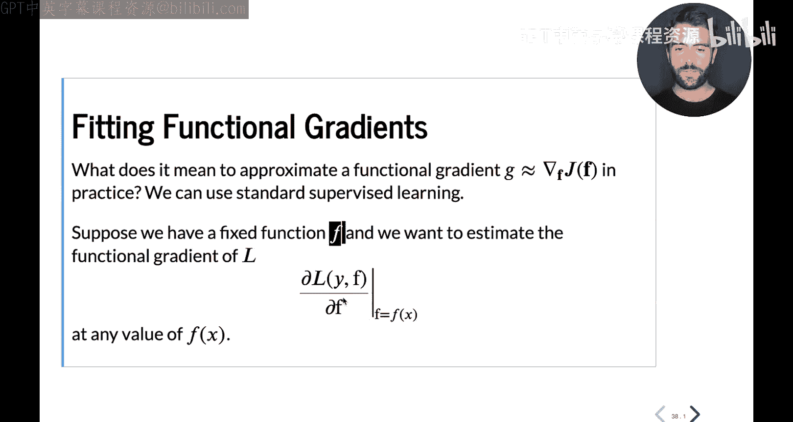

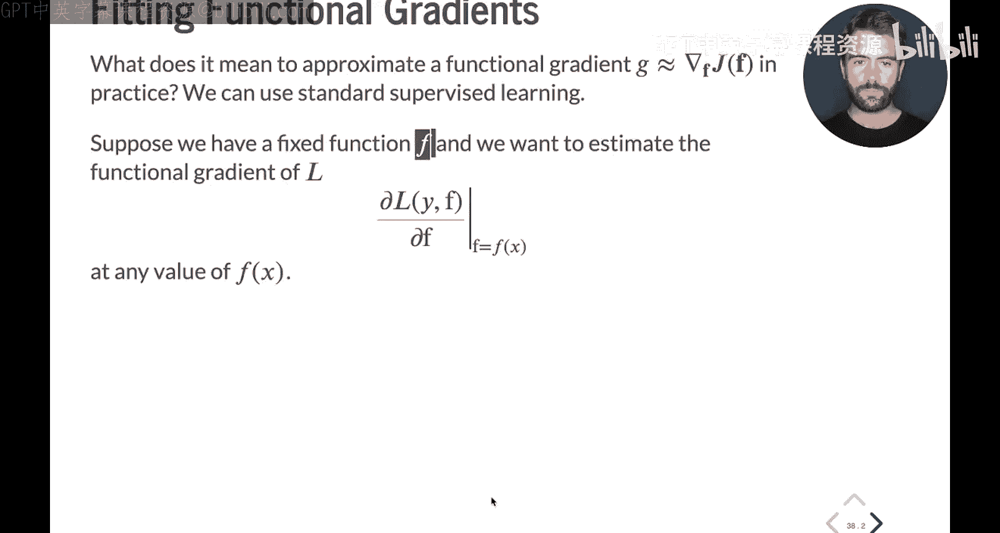

那么，如何实现呢？答案是：**通过一个模型来学习这个梯度**。

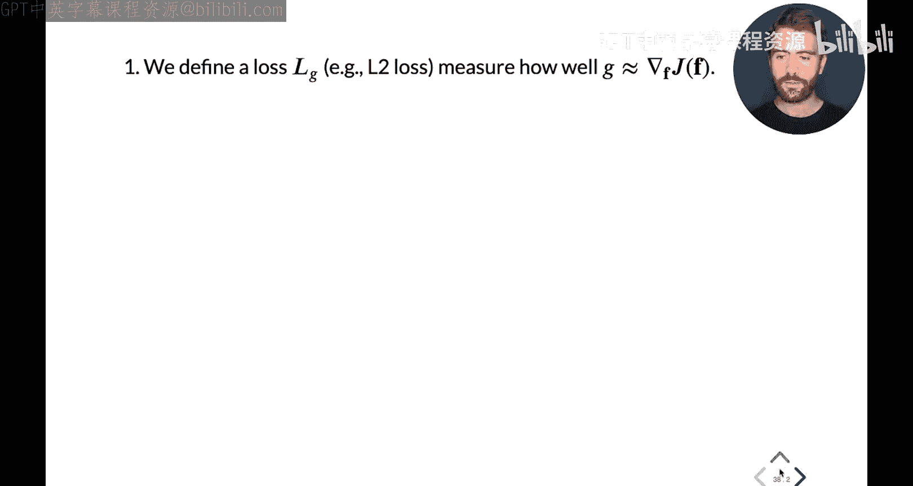

## 梯度提升算法详解 ⚙️

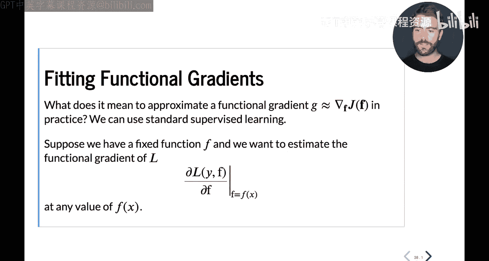

梯度提升的核心思想是：在函数空间中进行梯度下降，但每一步的“梯度”不再是一个简单的数值向量，而是通过一个**监督学习模型**来近似。

### 1. 近似函数梯度

假设在当前步骤，我们有一个函数估计 `F(x)`。我们想要计算其**函数梯度**。对于任意输入 `x`，函数梯度定义为：

$$
g(x) = \left[ \frac{\partial L(y, s)}{\partial s} \right]_{s=F(x)}
$$

这是一个从 `x` 到实数的函数。在训练集上，我们可以精确计算出每个点 `x_i` 对应的梯度值 `g(x_i)`。

现在，我们面临一个标准的监督学习问题：
*   **输入**：特征 `x_i`
*   **输出/目标**：函数梯度值 `g(x_i)`
*   **目标**：学习一个模型 `G(x)`，使得 `G(x_i) ≈ g(x_i)`

我们通常使用 **L2 损失** 来拟合这个模型，并且选择**决策树**作为基学习器 `G` 的模型族。决策树不需要复杂的特征预处理，能处理各种类型的数据，且通过控制树深可以方便地控制模型复杂度，防止过拟合。

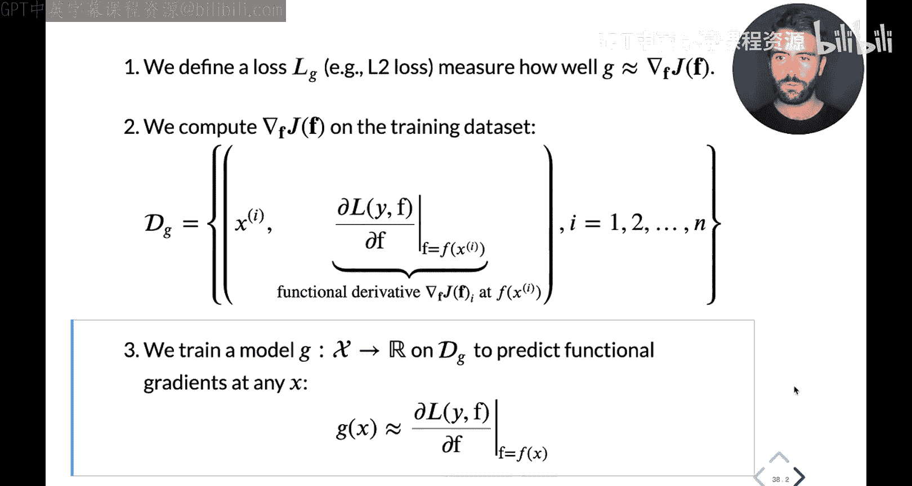

这样，我们得到的 `G(x)` 就是对真实函数梯度 `g(x)` 的一个**具有泛化能力的近似**。即使对于未见过的 `x`，`G(x)` 也能给出合理的梯度估计。

### 2. 梯度提升步骤

将上述近似梯度代入函数空间的梯度下降更新公式，就得到了梯度提升算法。

以下是梯度提升算法的步骤：

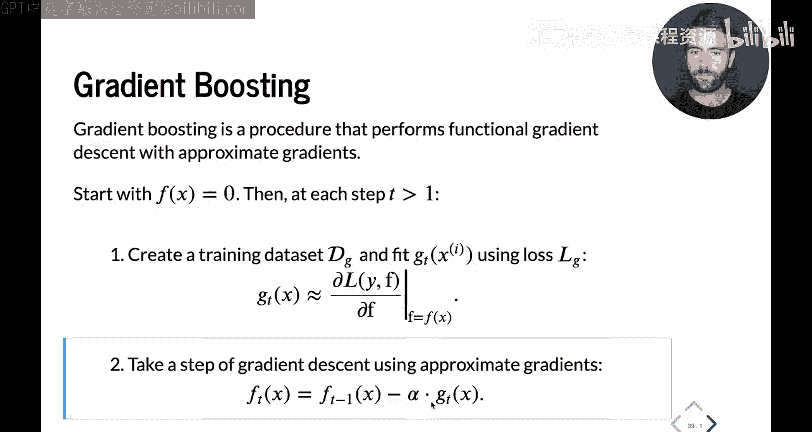

1.  **初始化**：以一个简单的模型开始，例如常数值：`F_0(x) = \arg\min_{\gamma} \sum_{i=1}^n L(y_i, \gamma)`。

2.  **对于 `t = 1` 到 `T`（迭代次数）**：
    *   **a. 计算伪残差（负梯度）**：对于 `i = 1, ..., n`，计算
        $$
        r_{ti} = -\left[ \frac{\partial L(y_i, F(x_i))}{\partial F(x_i)} \right]_{F(x)=F_{t-1}(x)}
        $$
    *   **b. 拟合基学习器**：使用决策树等基学习器，在数据集 `{(x_i, r_{ti})}_{i=1}^n` 上拟合一个模型 `g_t(x)`，目标是让 `g_t(x_i)` 接近 `r_{ti}`。
    *   **c. 计算最优权重**：对于树 `g_t(x)` 的每个叶子节点 `j`，计算该节点内的最优权重 `\gamma_{tj}`，以最小化损失：
        $$
        \gamma_{tj} = \arg\min_{\gamma} \sum_{x_i \in R_{tj}} L(y_i, F_{t-1}(x_i) + \gamma)
        $$
        其中 `R_{tj}` 是第 `t` 棵树第 `j` 个叶子节点对应的样本区域。
    *   **d. 更新模型**：
        $$
        F_t(x) = F_{t-1}(x) + \nu \cdot g_t(x)
        $$
        其中 `\nu` 是学习率（收缩因子），通常 `0 < \nu < 1`，用于控制每棵树的影响，防止过拟合。

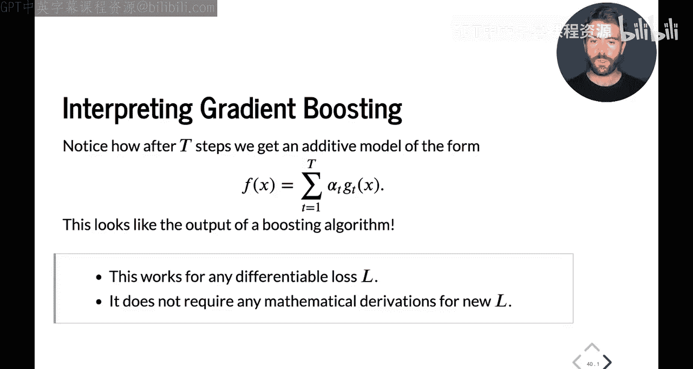

3.  **输出最终模型**：`F_T(x)`。

最终模型是一个加性模型：`F(x) = F_0(x) + \nu \sum_{t=1}^T g_t(x)`。

### 3. 算法优势与特性

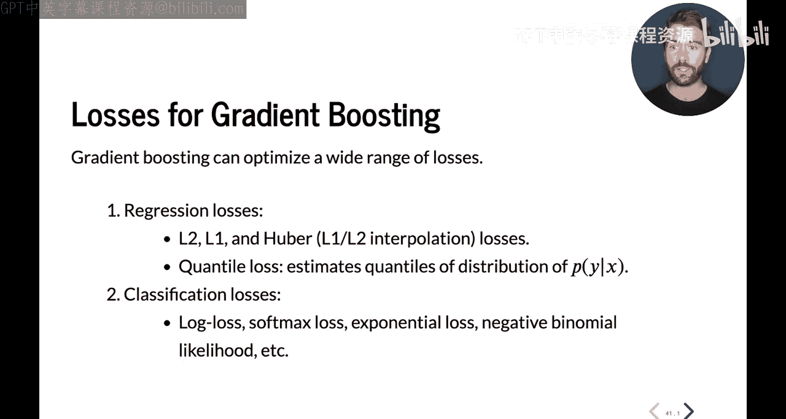

梯度提升算法具有以下显著优势：

*   **通用性**：适用于任何**可微分的损失函数**，无需为每种损失手动推导特定更新规则。
    *   **回归**：L2损失（均方误差）、L1损失（绝对误差）、Huber损失（鲁棒回归）、分位数损失（预测区间）。
    *   **分类**：对数损失（逻辑回归）、指数损失（AdaBoost）。
    *   **其他**：泊松损失（计数数据）、负二项式损失等。
*   **强大的基学习器**：通常使用**决策树**，因其能处理混合类型特征、无需特征缩放、并能自动进行特征选择。
*   **有效的正则化**：
    *   **树复杂度**：通过限制树的最大深度、叶子节点数等来控制。
    *   **学习率 (`\nu`)**：较小的学习率需要更多的树，但通常能获得更好的泛化性能。
    *   **子采样**：每次迭代时随机使用一部分训练数据（类似随机梯度下降），增加随机性，防止过拟合。
    *   **早停**：在验证集性能不再提升时停止迭代。
*   **高性能**：在结构化数据（表格数据）问题上，梯度提升树（如XGBoost, LightGBM, CatBoost）通常是性能最好的算法之一，在许多Kaggle竞赛中占据主导地位。

## 梯度提升示例与应用 🎯

让我们通过一个简单的回归示例来直观感受梯度提升的能力。

假设真实函数为 `y = \sin(2\pi x) + \epsilon`，其中 `\epsilon` 是噪声。我们从这个函数中采样一些点作为训练数据。

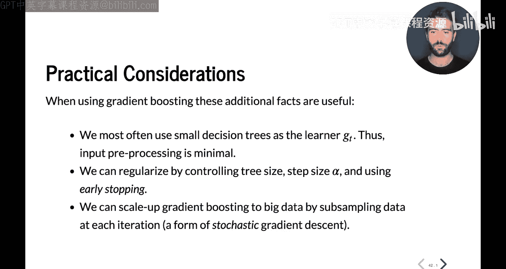

使用梯度提升回归（例如Scikit-learn中的 `GradientBoostingRegressor`），设置基学习器为最大深度为3的决策树，共训练250棵树。拟合结果如下图所示：

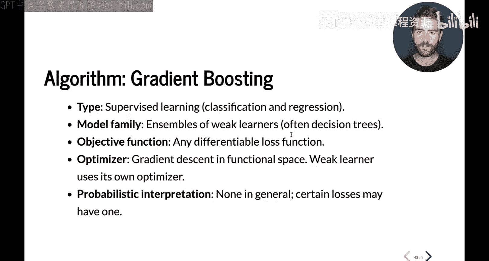

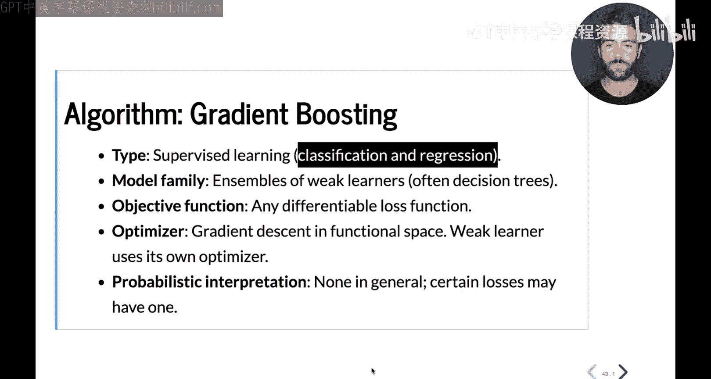

（想象一条平滑的正弦曲线，上面散布着一些噪声点。梯度提升模型拟合出的是一条紧密跟随数据点趋势的红色曲线。这条曲线由许多小决策树的输出叠加而成，因此在局部可能呈现不规则的阶梯状，但整体上能很好地捕捉数据的非线性模式。）

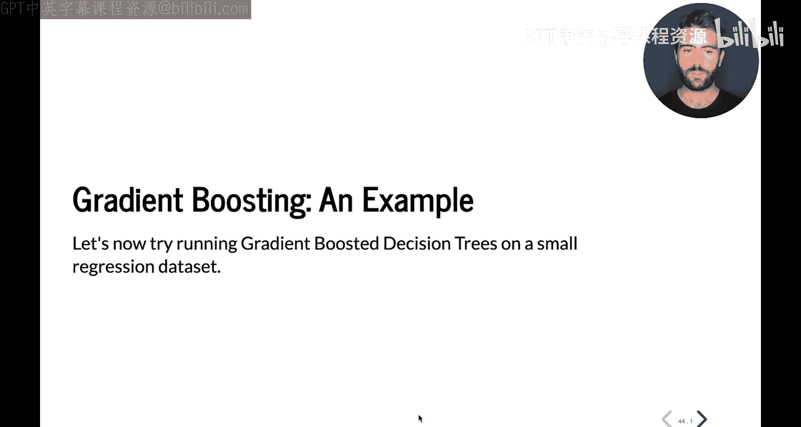

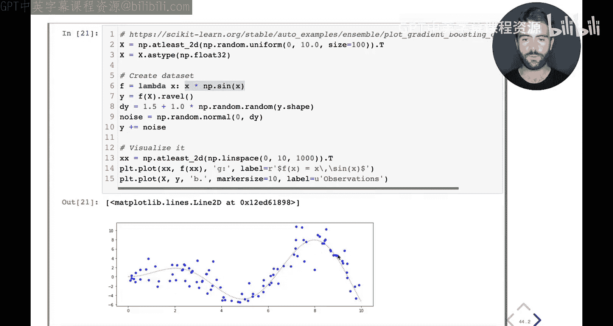

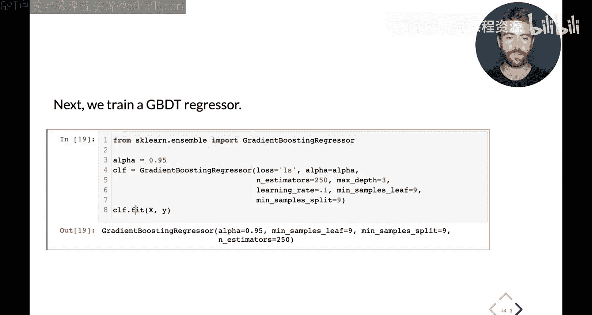

这个例子展示了梯度提升如何无需对数据分布做任何强假设（如多项式形式），仅通过组合简单的决策树，就能灵活地拟合复杂的非线性关系。

## 总结与展望 📚

本节课中我们一起学习了梯度提升算法。

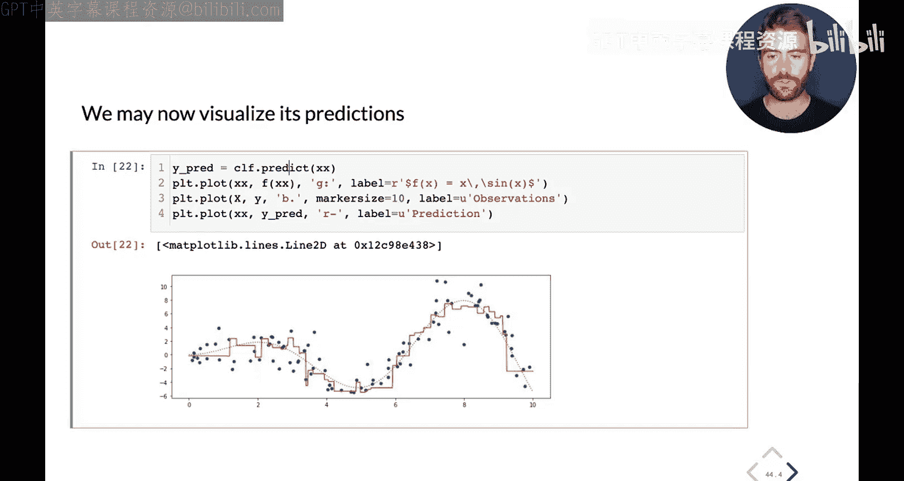

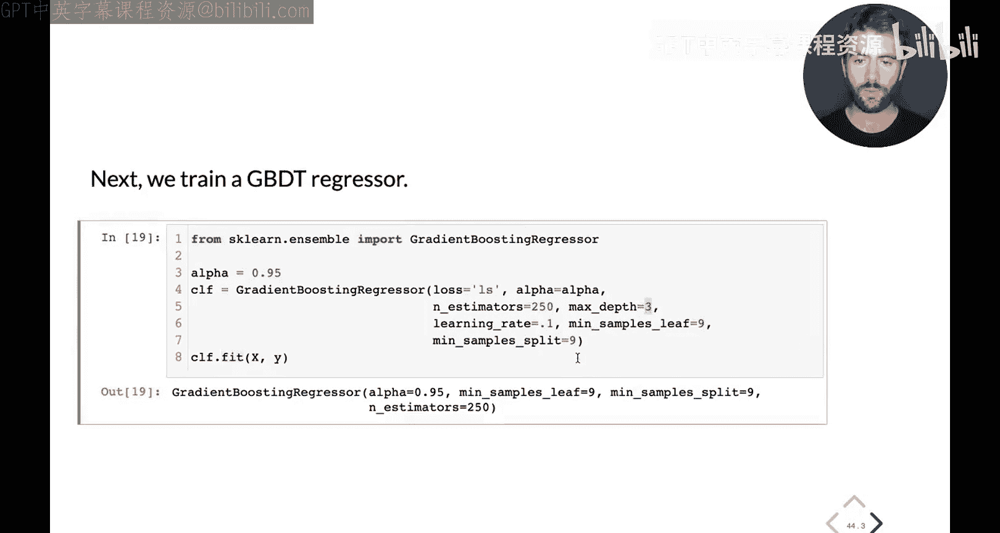

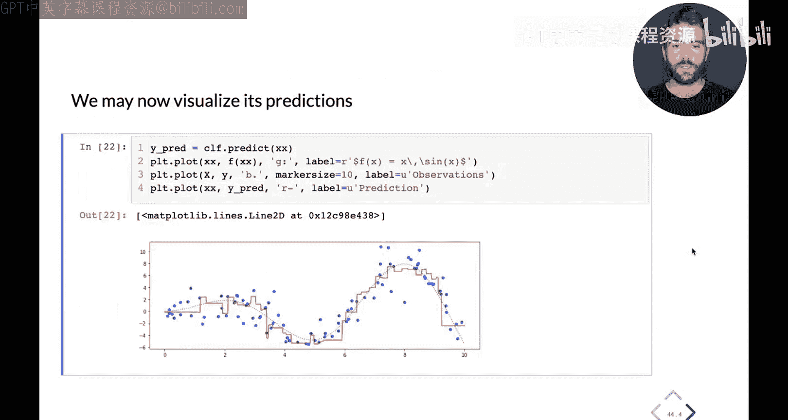

我们首先回顾了提升算法的核心思想，并指出了前向分步加法建模的局限性。接着，我们通过“函数空间优化”的思想实验，引出了梯度提升的概念：**在函数空间中进行梯度下降，并用一个监督学习模型来近似每一步的梯度**。

我们详细剖析了梯度提升算法的步骤：计算负梯度（伪残差）、用基学习器（通常是决策树）拟合这些残差、更新加性模型。该算法因其**通用性**（适用于任何可微损失）、**强大的正则化手段**（树参数、学习率、子采样、早停）和**卓越的性能**而闻名，是处理结构化数据问题的利器。

梯度提升树是当前最强大的提升算法形式，也是机器学习中性能最先进的算法之一。它在许多实际问题中表现优异，常常超越其他流行方法。其成功得益于对数据预处理要求低、可扩展性强以及能够优化多样化的目标函数。

当然，梯度提升也有其局限性。它主要适用于**结构化数据**（具有明确特征列的数据），对于图像、音频、文本等非结构化数据，决策树作为基学习器难以直接有效地处理，此时深度学习等方法通常更合适。

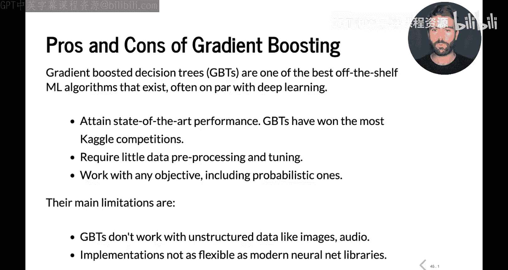

总而言之，对于特征定义清晰的表格数据问题，梯度提升树应该是你优先尝试的算法。它集成了简单与强大，是机器学习工具箱中不可或缺的组件。