# 15.1：什么是深度学习？🧠

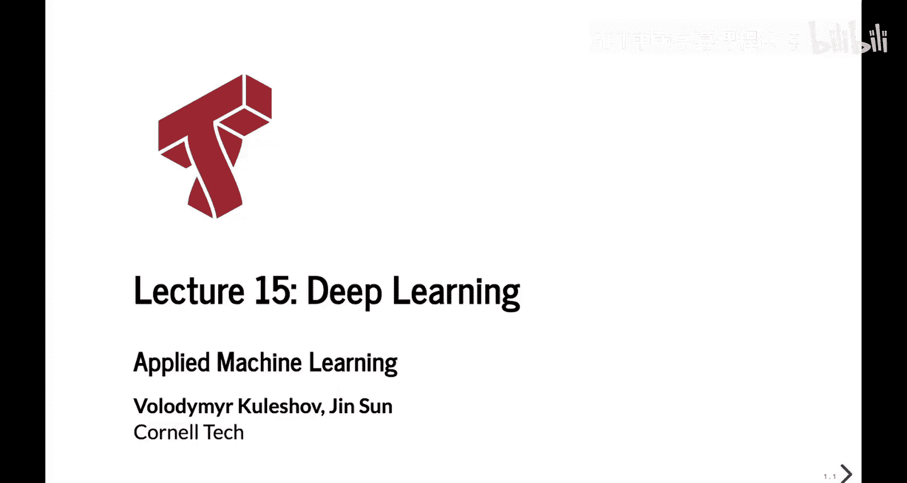

在本节课中，我们将继续学习神经网络系列讲座。我们将探讨比之前课程中介绍的更现代的神经网络版本。这些更现代的神经网络属于一个非常激动人心的机器学习领域，即**深度学习**。深度学习将是本讲的重点。在第一部分视频中，我们将介绍什么是深度学习、它为何有趣，并给出高层次的学习动机，同时解释它与早期神经网络工作的对比。

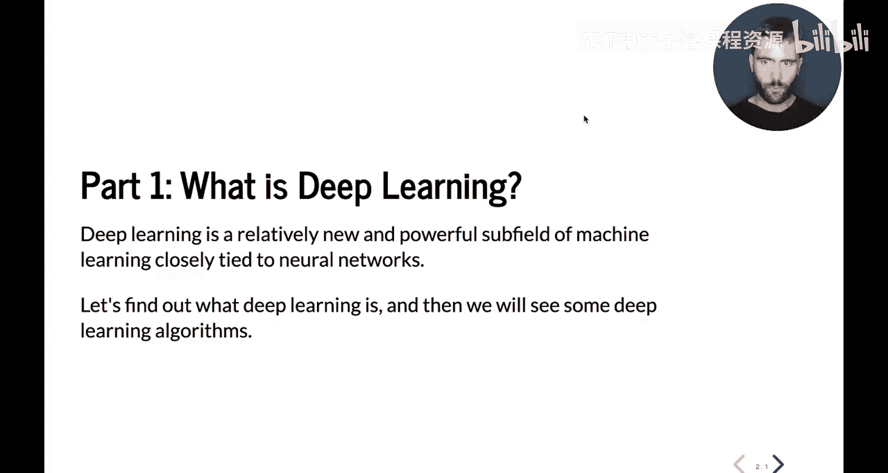

---

## 回顾经典神经网络

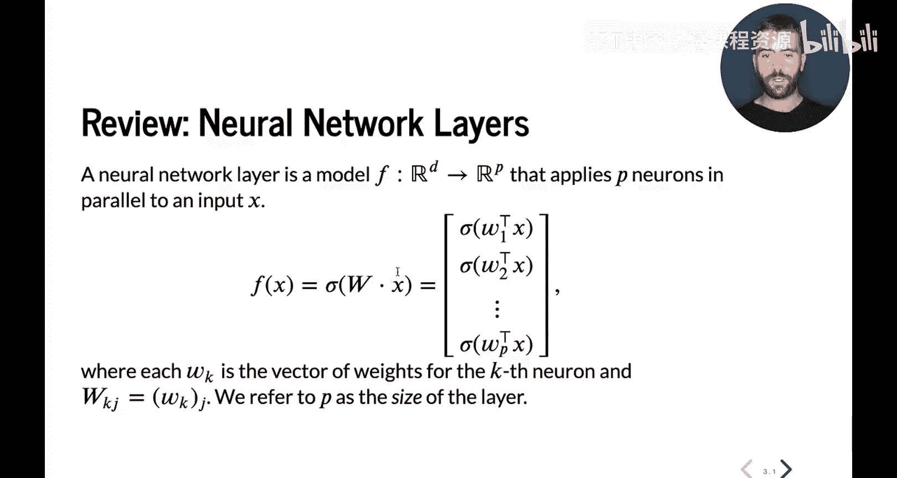

上一讲我们回顾了，神经网络是由多层神经元组成的模型。每一层都是一组人工神经元。它接收输入 **X**，并应用一个变换。该变换包含 **P** 个神经元，每个神经元都有权重。这些权重用于调制输入，然后输入进入激活函数，激活函数产生信号，即该层的输出。在向量化形式中，我们可以这样表示：

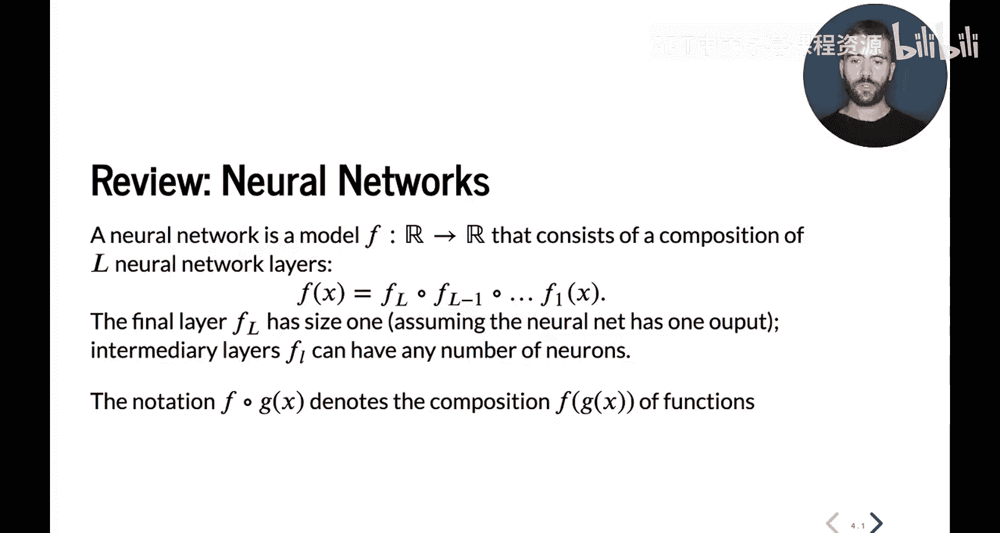

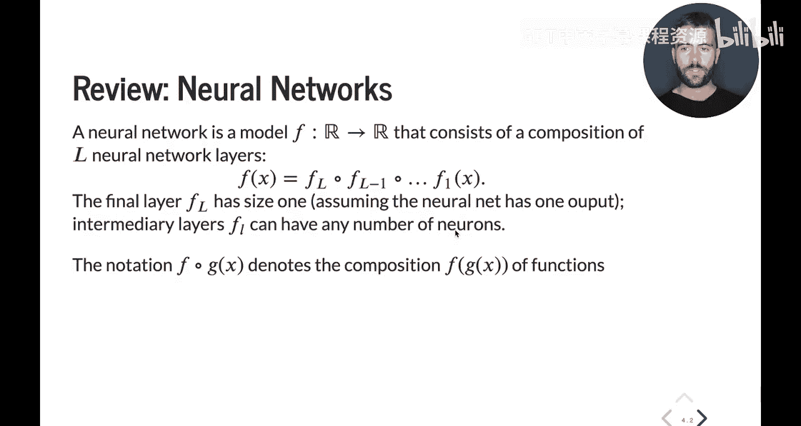

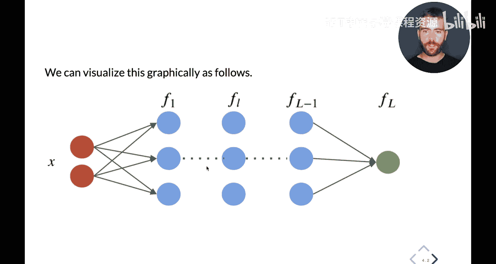

**公式：** `输出 = 激活函数(权重 * 输入 + 偏置)`

当我们把多个这样的层串联起来应用时，就得到了所谓的神经网络。因此，神经网络是如下函数的组合：

**公式：** `f(x) = f_L(... f_2(f_1(x)))`

我们可以将其可视化为一个图。最后一层是单个神经元，即输出层。中间这些蓝色层被称为神经网络的**隐藏层**。

---

## 什么是深度学习？🚀

这些是经典的神经网络。近年来，它们在某种意义上被重新定义为一个新的领域、一套新的算法，称为**深度学习**。

深度学习本质上仍然是神经网络的研究。但现代神经网络与早期神经网络的不同之处在于，它们往往**更大**，尤其是**更深**，即拥有更多层。在神经网络发展的早期，大多数研究关注的是层数较少的网络，可能通常只有一个隐藏层，有时两、三、四、五层。而作为深度学习一部分的现代神经网络，可以拥有数百甚至数千层，这使它们的能力显著增强。

深度学习的另一个重点是，将这些神经网络应用于**非常大的数据集**。早期的神经网络模型较小，训练也更困难，因此通常应用于较小的数据集。这在很大程度上也是因为当时只有较小的数据集可用。然而，在过去的15到20年里，更大的数据集变得可用，并且人们发现神经网络在这些大型数据集上表现非常好，这也是推动神经网络重新受到关注的部分原因。

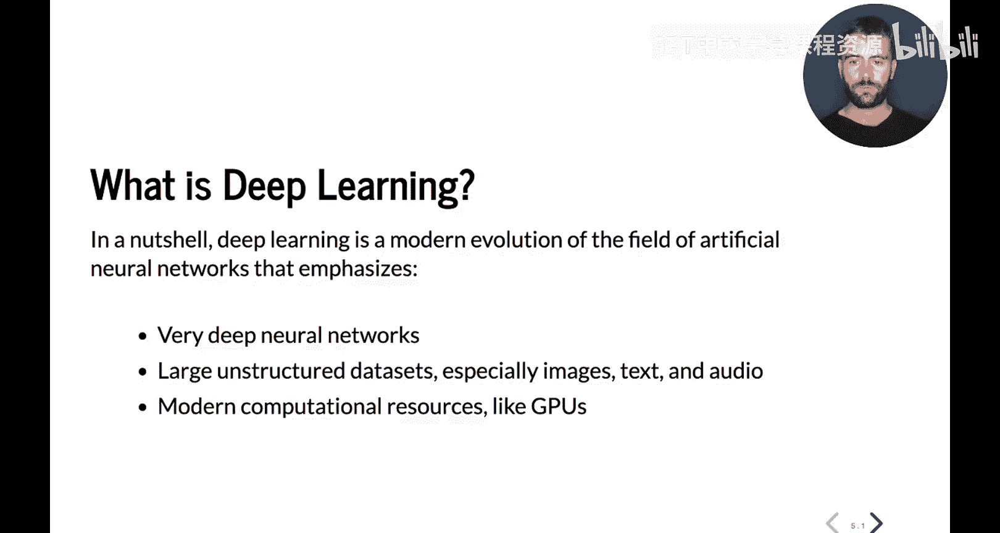

当我们谈论深度学习时，通常指的是将神经网络应用于拥有数百万甚至更多输入样本的非常大的数据集。这些神经网络在大型数据集上，对所谓的**非结构化数据**效果最好。非结构化数据指的是原始信号，如图像、音频，有时是字符级别的文本。这些输入是非结构化的，因为很难为它们定义特征。例如，为一张图片是否包含猫或狗定义特征，不像为医疗记录定义特征（如患者是否为老年人或是否患有某些已知重要的疾病组合）那么容易。我们无法轻易地为图像、文本或音频等非结构化数据手工设计特征，至少非常困难。而神经网络和深度学习正是在这类非结构化输入的大型数据集上大放异彩。

最后，现代深度学习的另一个重要方面是其实现和运行方式。我们之所以能在大型数据集上训练神经网络，部分原因在于专用硬件的可用性，如图形处理单元以及更现代的芯片（你可能听说过张量处理单元）。此外，还有许多专门用于训练这类深度神经网络的特殊方法。

---

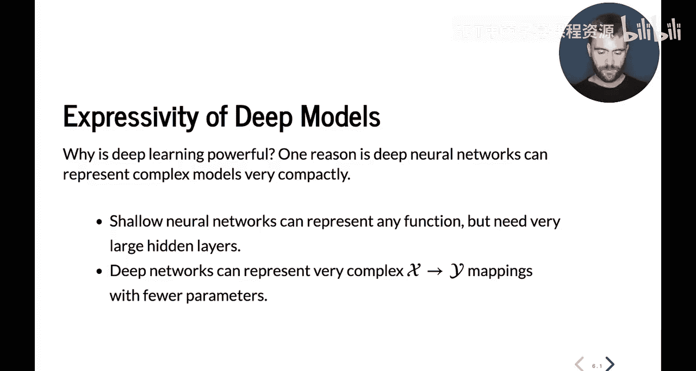

## 为什么深度模型如此有趣？💡

深度模型或拥有许多层的模型之所以有趣，原因之一是，一个深的神经网络能够以比浅层网络更紧凑的方式表示更复杂的模型。

换句话说，许多理论工作已经表明，即使只有一个隐藏层的神经网络也可以逼近任何函数。因此，这些神经网络是非常灵活的模型。但是，这个隐藏层的大小可能非常大，它会随着函数的复杂性而快速增长。相反，如果我们有一个更深的网络，我们可以使用相对较少、较小的隐藏层来表示相同复杂度的函数。因此，通过使神经网络变深，我们可以学习真正复杂的映射。

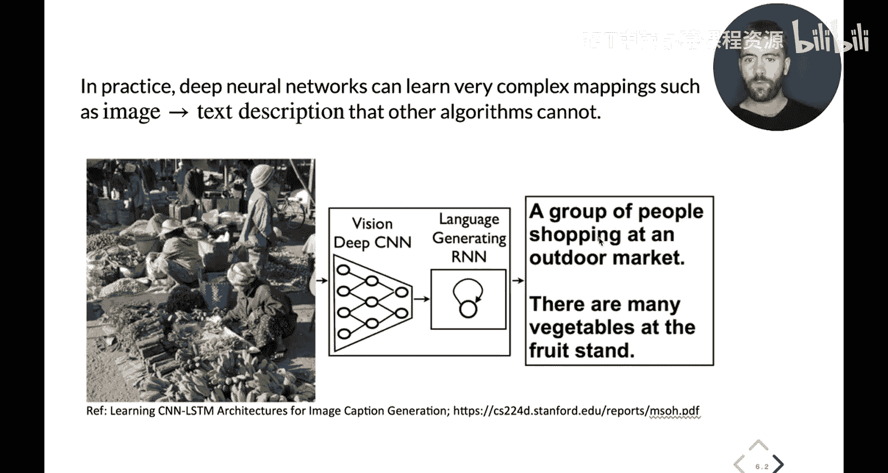

为了让你了解神经网络可以学习何种映射，这里有一个称为“图像描述”的应用示例。我们有一张图像，希望输出描述图像内容的英文文本。这是一个非常困难的问题，我们目前学到的任何经典算法都无法直接应用于此问题。我们无法将逻辑回归或朴素贝叶斯应用于此任务。但是，当我们应用带有深度神经网络的深度学习时，我们可以将图像输入一系列神经元，然后是另一系列称为循环神经网络的神经元。这些神经元的输出将类似于以下内容，这是对图像内容的惊人准确的描述。这展示了深度神经网络可以学习的映射的复杂性和丰富性。

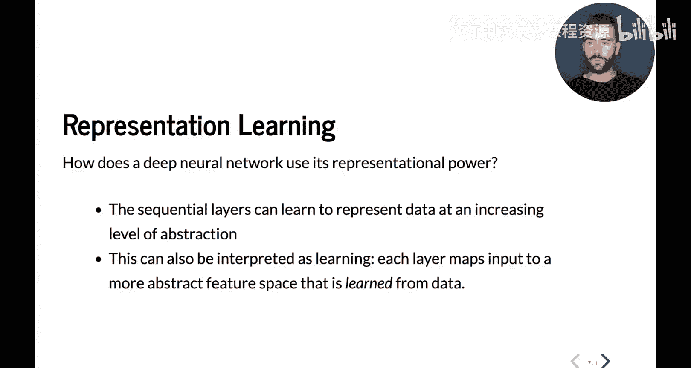

---

## 深度神经网络如何工作？🔍

深度神经网络之所以有效，并且能够更紧凑地学习复杂映射，是因为它们能够构建数据的有用**表示**。

当我们通过神经网络的多个层输入数据时，我们发现每一层倾向于学习越来越抽象的数据特征或表示，并且这些表示建立在之前层的表示之上。

让我给你一个具体的例子。这是一个具有两个隐藏层的神经网络的可视化（这实际上被认为是相对较浅的网络）。如果我们使这些神经网络足够深，我们会发现它将学习特别有用的特征。例如，如果我们检查较低层（可能是第一或第二层）神经元的权重，通常会看到类似这样的东西：它们是一些小的边缘。因此，每个神经元对其输入应用一个小边缘检测器，当它在图像中看到该边缘时就会激活。

然后，如果我们观察中层特征，我们会发现这些神经元倾向于在看到这些边缘的特定组合时激活，这些组合形成了有趣的特征。在这里，你看到一只眼睛、一只耳朵、一个鼻子。这意味着，当该神经元看到来自较低层的输入组合，而这些组合对应于构成耳朵、鼻子或某种熟悉形状的边缘结构时，它就会激活。

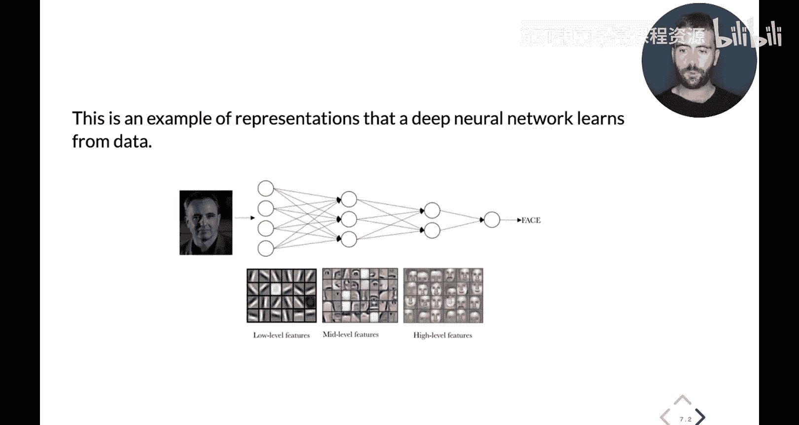

在神经元的最高层，我们可能会看到一般类型的人脸。这意味着，当输入具有与某些高层人脸类型相似特征的人脸时，这些神经元就会激活。

换句话说，当我们从数据中训练深度神经网络时，它学习的权重编码了数据的有用表示。神经网络纯粹从数据中学习这些表示，它事先并不知道什么是脸或什么是鼻子。这些神经元以越来越抽象的层次组织起来，这是深度学习算法的一个特征。深度学习模型的许多成功都归功于其学习这种**分层表示**的能力。

---

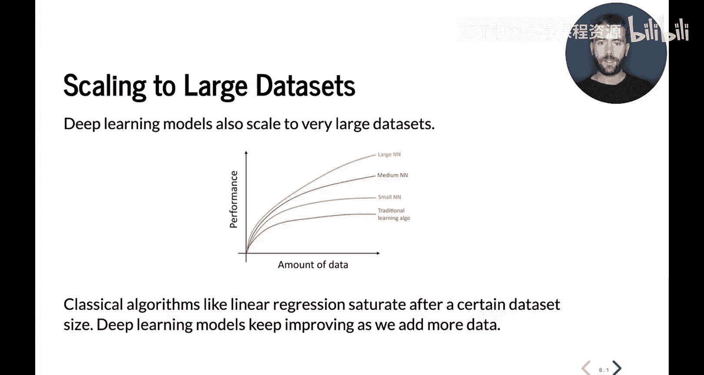

## 深度学习的优势与驱动力

我之前提到，深度神经网络可以实现非常好的性能。部分原因在于它们能够非常高效地利用数据。

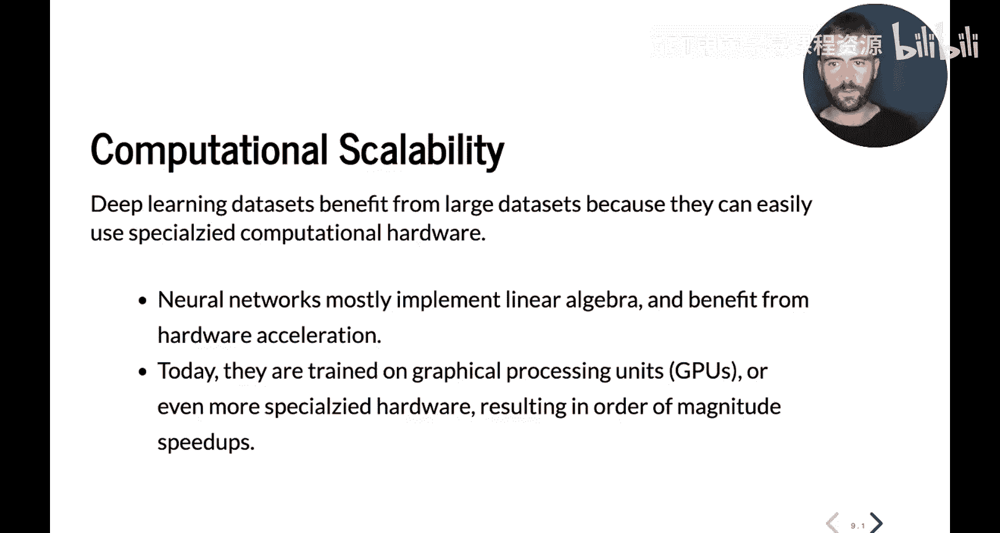

考虑算法性能作为其接收数据量的函数。如果我们只有少量数据，性能会提高。但对于传统学习算法，一旦达到某个数据点数量（可能是1万或10万），模型性能就会饱和，更多的数据不再有用。然而，对于神经网络，性能往往会随着数据量的增加而持续提高。如果我们有一个非常大的神经网络，其性能会随着数据量的增加而持续提升。因此，在数据量非常大的情况下，大型神经网络往往显著优于经典的机器学习模型。

一种理解方式是，神经网络是一个非常复杂的模型，拥有大量参数，表达能力非常强。通过给它大量数据，它可以利用其强大的表示能力，非常准确地从数据中提取大量信号，从而实现高精度。

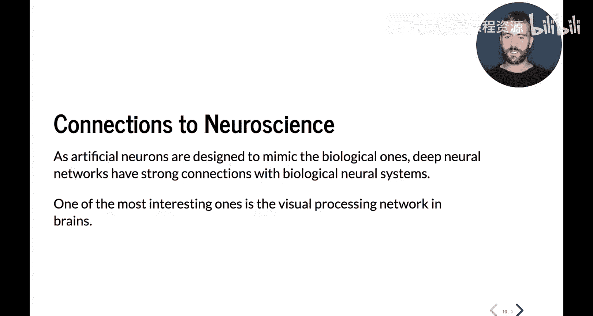

我们之所以能够首先使用这类数据集，是因为神经网络可以从特定的专用硬件中受益。换句话说，有许多专门的工具，包括软件框架和硬件（如图形处理单元），使得神经网络能够扩展到真正的大型数据集。并非所有算法都能从这些专用计算单元中受益，但由于神经网络基于涉及线性代数的一系列操作，它们往往能从中大大受益。这也是我们能够将它们扩展到非常大的数据集的部分原因，也是其有效性的一个重要原因。

最后，关于深度学习的另一个有趣之处是，它仍然与神经科学有很多联系。简单的神经网络最初就是受大脑工作原理启发而定义的。如果我们进一步研究大脑的功能，会发现大脑内部的许多连接由许多层神经元组成。因此，我们大脑内部的神经网络是深的，这有时被认为是构建深度人工神经网络的动机之一。

事实上，如果我们分析大脑的某些部分，例如视觉皮层，会发现许多行为与我们在深度神经网络模型中看到的非常相似。在人类大脑的视觉系统中，通常有一系列区域，如V1、V2，以及下游的一些其他区域。如果我们研究具有这类视觉系统的动物大脑，通常会发现这些神经元序列（或区域）对应于以顺序模式相互连接的神经元层，每个区域对应于越来越抽象的数据表示。例如，在处理视觉输入的大脑最前端部分，有类似于边缘检测器的结构，这类似于我之前展示的人工神经网络图像中的边缘。随着我们沿着视觉系统向前移动，这些神经元倾向于被越来越复杂的模式激活。从这个意义上说，生物神经网络往往也是深的，并且也倾向于编码这种分层表示。因此，深度神经网络的行为与生物神经网络惊人地相似。

---

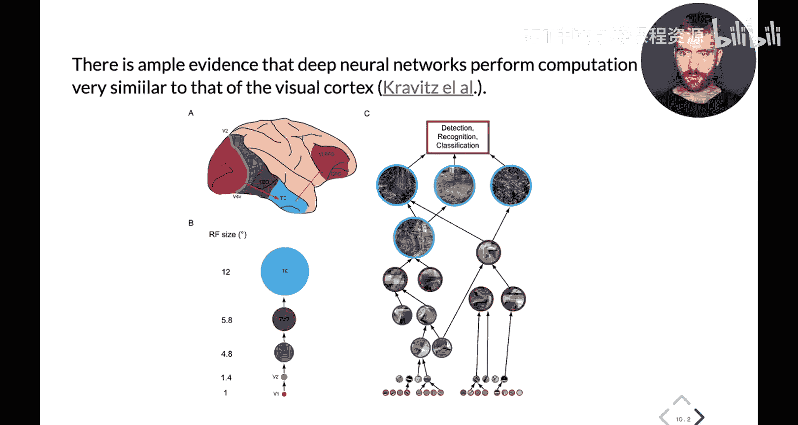

## 深度学习的成功应用与总结

由于我提到的所有这些特性——能够使用大量数据、能够高效训练、能够学习表示——深度学习在过去十年左右取得了巨大成功。事实上，这是一次真正的突破，它推动了许多技术的最先进水平，如语音识别或机器翻译。今天的机器翻译系统（例如在谷歌翻译中）的准确性显著提高。如果你进行对比，你会对机器翻译准确性的提升感到震惊，这主要归功于过去五年左右的创新。

此外，它还实现了许多以前不可能的新成果。这里展示一个有趣的例子：这些图像实际上是由神经网络生成的。我们可以将神经网络用于监督学习，也可以用它来生成图像。如果你以前没见过，我鼓励你访问相关网站，它会使用神经网络实时生成并不真实存在的人脸图片。这都是由一个在大型人脸数据集上训练的神经网络生成的。从这个意义上说，神经网络解锁了新的功能，每年仍然让研究人员感到惊讶。

因此，正如我所说，神经网络是非常强大的模型，它们达到了新的技术水平，并且可以与其他算法结合。例如，我们可以推导出这些算法的变体，其中某些组件是神经网络，其他组件是概率性的。我们可以将所有这些混合在一起，推导出作为经典算法更强大泛化的新算法。

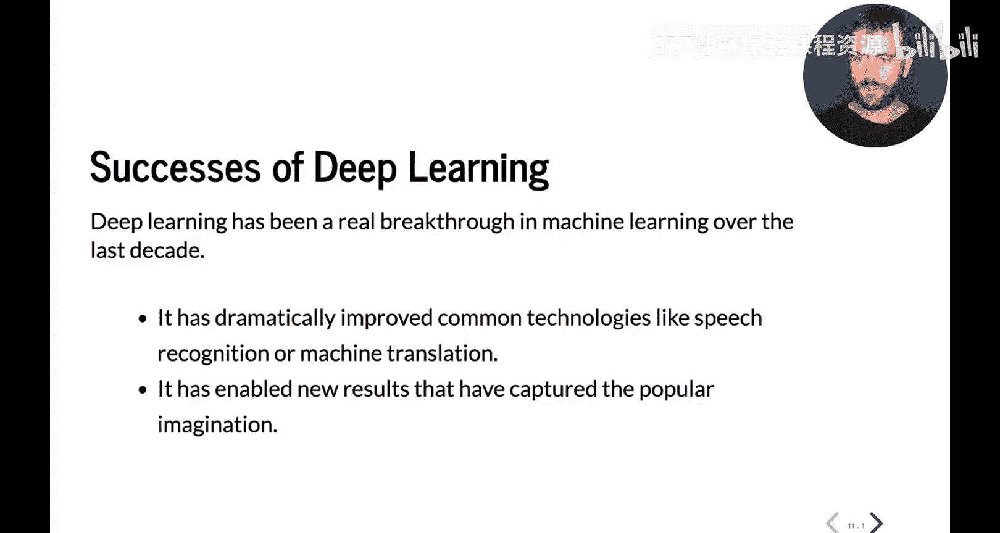

我认为深度神经网络的主要缺点与我之前谈论常规神经网络时提到的相同：由于数值不稳定性，它们通常训练缓慢且困难，并且需要大量训练数据。

---

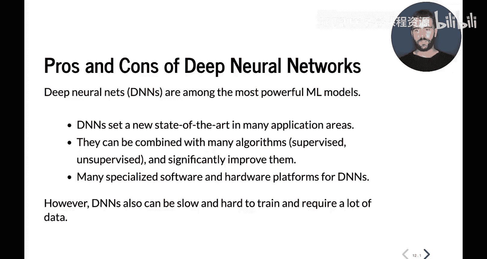

**本节课总结：**
在本节课中，我们一起学习了深度学习的核心概念。我们回顾了经典神经网络的基本结构，并将其与更现代、更深的神经网络进行了对比。我们探讨了深度学习为何强大，包括其通过深度结构紧凑表示复杂函数的能力、从数据中自动学习分层特征表示的能力，以及利用大规模数据和专用硬件实现卓越性能的潜力。我们还看到了深度学习在图像描述等复杂任务上的成功应用，并了解了其与生物神经系统的联系。最后，我们总结了深度学习的优势与当前面临的挑战。