# 15.2：卷积与池化 🧠

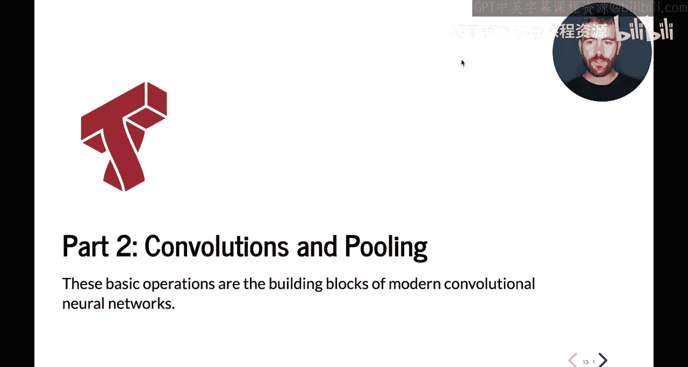

在本节课中，我们将学习卷积神经网络的两个核心构建模块：**卷积**与**池化**操作。我们将从基本定义出发，通过直观的例子理解它们的工作原理，并探讨它们在处理图像等数据时的强大能力。

---

## 卷积操作 🔍

上一节我们介绍了深度学习的背景。本节中，我们来看看卷积操作的具体定义。

卷积是在两个向量 **F**（滤波器）和 **G**（信号）之间进行的一种运算。假设 **F** 的维度为 N，**G** 的维度为 M（通常 M > N）。在深度学习中，卷积运算（通常指互相关）定义如下：

**公式**：`(F * G)[p] = Σ_{t=0}^{N-1} F[t] * G[p + t]`

其中，我们约定当索引超出 **G** 的范围时，其值为 0。这个运算可以理解为滤波器 **F** 在信号 **G** 上“滑动”并进行点积。结果值的大小反映了滤波器所代表的模式在信号该位置的匹配程度。

为了更直观地理解，请看以下图示示例：


图中绿色方块代表一个三维滤波器 `[1, 0, -1]`，灰色方块代表信号。黄色方块展示了在每个位置进行卷积计算的结果。例如，在位置 p=0 时，计算为 `1*0 + 0*0 + (-1)*2 = -2`。

**技术说明**：在数学上，严格定义的卷积运算会先将滤波器翻转。但在深度学习的语境和大多数库的实现中，“卷积”通常指代上述的互相关运算。两者在实践效果上是等价的。

以下是一个简单的Python实现示例：
```python
def convolve_1d(signal, filter):
    result_length = len(signal) - len(filter) + 1
    result = []
    for i in range(result_length):
        result.append(np.dot(filter, signal[i:i+len(filter)]))
    return np.array(result)
```

---

## 卷积的直观应用 🎯

理解了基本定义后，我们通过两个具体例子来看看卷积能做什么。

### 边缘检测

我们可以设计一个特定的滤波器来检测信号中的突变（边缘）。

**代码**：
```python
filter = np.array([-1, 1]) # 边缘检测滤波器
signal = np.ones(30)
signal[10:15] = 0 # 在信号中插入两段零值
signal[20:25] = 0
result = convolve_1d(signal, filter)
```

可视化结果如下：

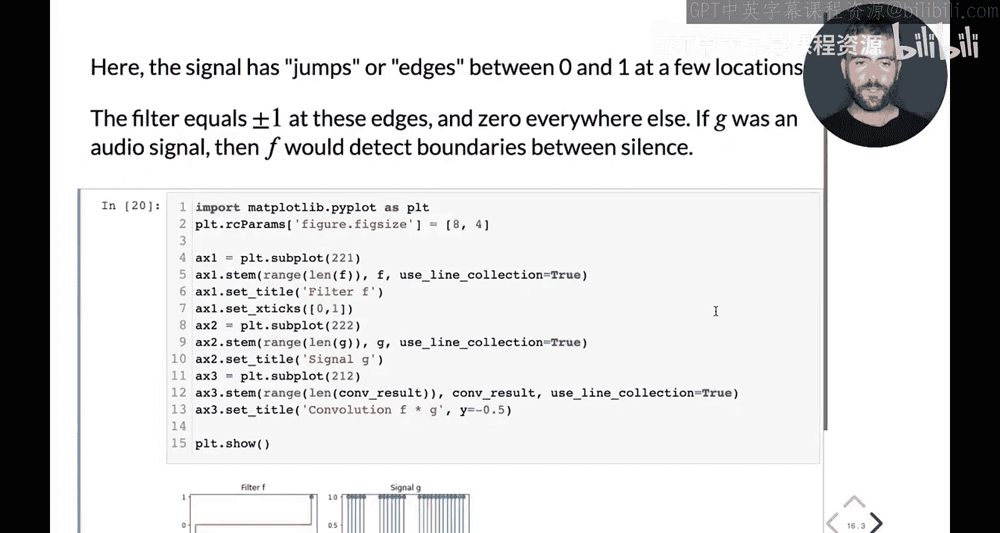


上图中，蓝色是滤波器，橙色是原始信号，绿色是卷积结果。可以看到，卷积结果仅在信号值发生从1到0或从0到1跳变的位置（即“边缘”）出现非零值（1或-1）。这证明了该滤波器成功定位了信号中的边缘。

### 信号平滑

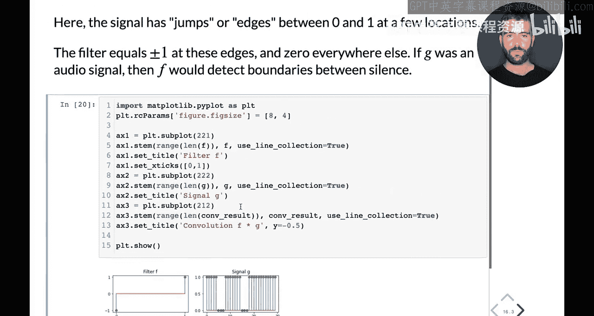

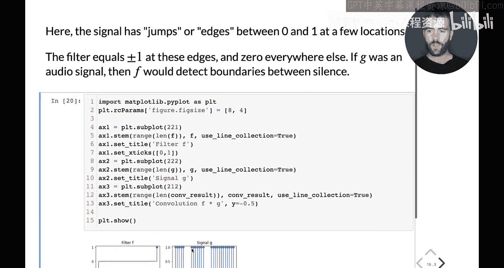

卷积也可以用于平滑信号，例如通过一个类似钟形曲线的滤波器计算加权移动平均。

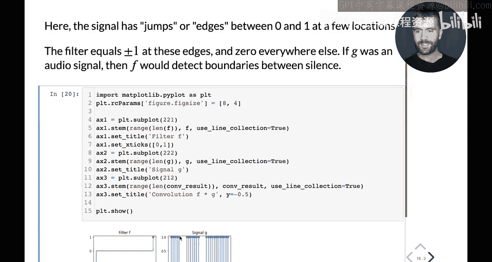

**代码**：
```python
filter = np.array([0.05, 0.1, 0.2, 0.3, 0.2, 0.1, 0.05]) # 平滑滤波器（示例值）
smoothed_signal = convolve_1d(signal, filter)
```

结果如下图所示：

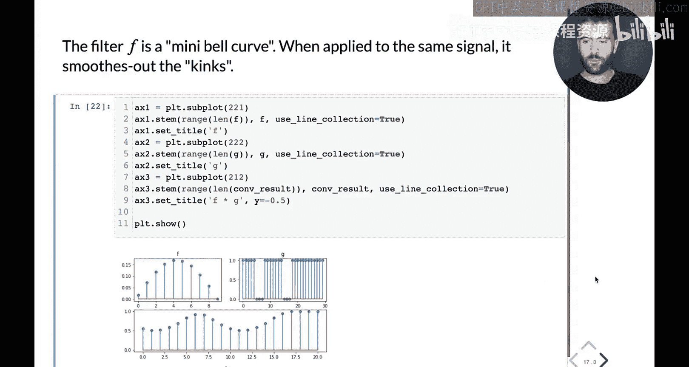

经过卷积后，原始信号（橙色）中的尖锐过渡被平滑（绿色曲线），但整体形状得以保留。


**小结**：通过设计不同的滤波器，卷积操作可以提取信号特征（如边缘）或改变信号特性（如平滑）。在机器学习中，这些滤波器的参数通常不是手动设计，而是通过梯度下降从数据中学习得到，使其能自动检测对任务有用的模式。

---

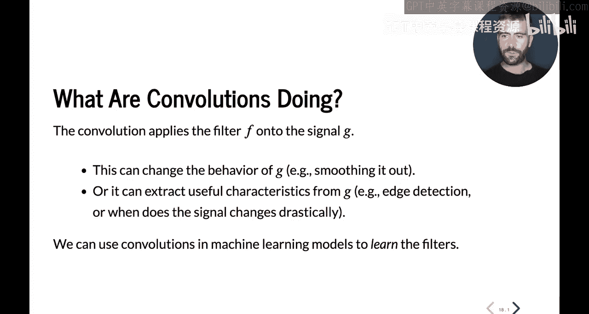

## 扩展到二维与卷积层 🖼️

卷积的概念可以自然地扩展到二维，这对于图像处理至关重要。

在二维卷积中，信号 **G** 是一个矩阵（如图像），滤波器 **F** 是一个小矩阵（如3x3）。运算过程是滤波器在图像的长和宽两个方向上滑动，在每个位置计算对应区域的点积。

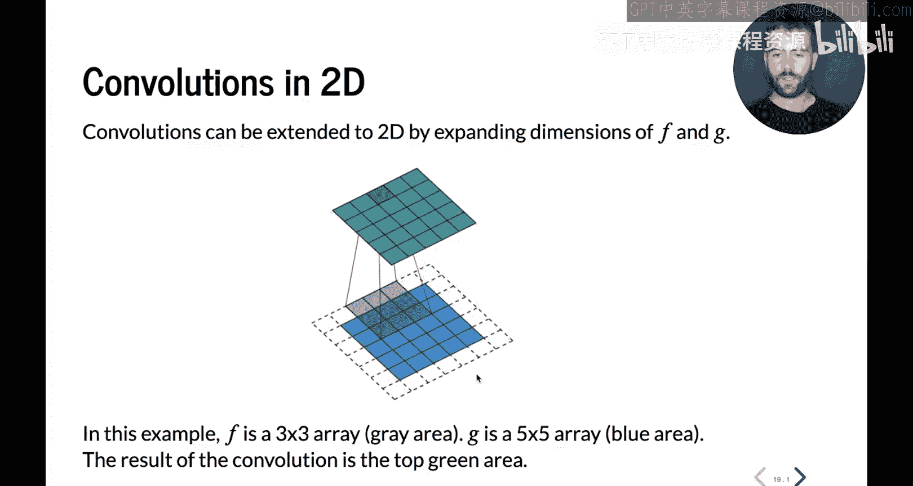

下图展示了二维卷积的过程：


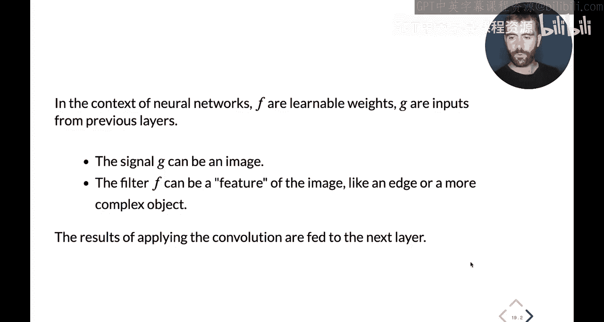

蓝色网格是输入图像，灰色方块是滤波器，绿色网格是输出的**激活图**。激活图上每个点的值，代表了滤波器所寻找的模式在输入图像对应位置的匹配强度。


基于此，我们可以定义神经网络中的**卷积层**。与全连接层使用矩阵乘法不同，卷积层使用卷积运算。一个卷积层包含多个不同的滤波器，每个滤波器会产生一张独立的激活图。

考虑一个32x32像素的彩色图像，它可以表示为一个32（高）x 32（宽）x 3（颜色通道）的三维数组（张量）。如果我们使用一个5x5x3的滤波器对其进行卷积，将得到一张28x28的二维激活图（因为5x5的滤波器在32x32的图像上，每边有4个像素无法完全覆盖，这被称为“边缘效应”）。

一个卷积层通常有多个滤波器。例如，一个有5个滤波器的层，会对同一输入图像进行5次不同的卷积操作，产生5张激活图。这些激活图可以堆叠起来，形成一个28（高）x 28（宽）x 5（通道）的新三维张量，作为下一层的输入。

---

## 二维卷积实例：图像边缘检测 📸

让我们将之前一维的边缘检测思想应用到二维图像上。

我们定义两个3x3的滤波器，分别用于检测垂直边缘和水平边缘。

**代码**：
```python
import numpy as np
from scipy import signal

# 定义边缘检测滤波器
vertical_filter = np.array([[1, 0, -1],
                            [1, 0, -1],
                            [1, 0, -1]])

horizontal_filter = np.array([[1, 1, 1],
                              [0, 0, 0],
                              [-1, -1, -1]])

# 假设 `image` 是一个灰度图像矩阵
vertical_edges = signal.correlate2d(image, vertical_filter, mode='valid')
horizontal_edges = signal.correlate2d(image, horizontal_filter, mode='valid')
```

应用这些滤波器到一张建筑图像上的效果如下：

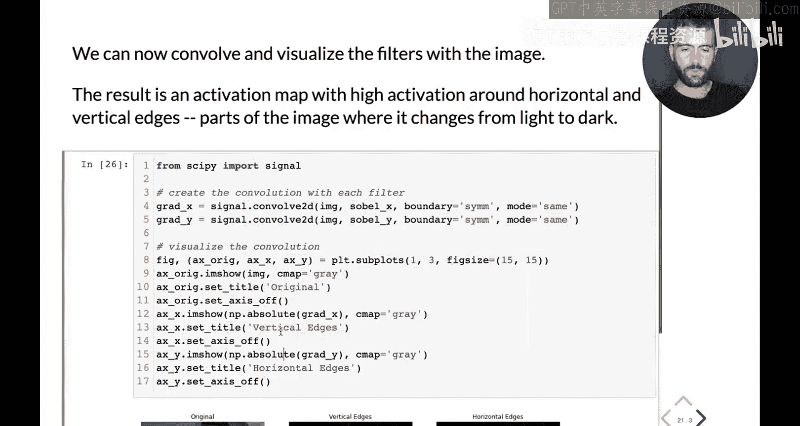

左图是垂直边缘滤波器的输出，它高亮了图像中的垂直线条（如楼梯）。右图是水平边缘滤波器的输出，它高亮了水平线条。图像中平坦的区域（如天空）在激活图中显示为暗色（值接近0）。

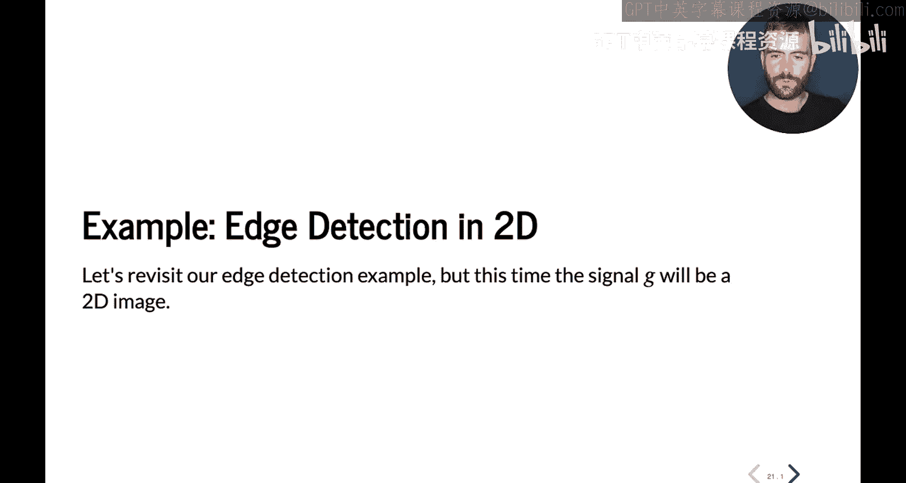

**卷积的适用场景**：当我们的任务具有**空间不变性**时，卷积特别有用。例如，在图像分类中，我们关心图像中是否包含“猫耳朵”这种纹理，而不在乎它具体出现在图像的哪个位置。卷积滤波器通过在整张图像上滑动来检测特征，正好满足了这一需求。

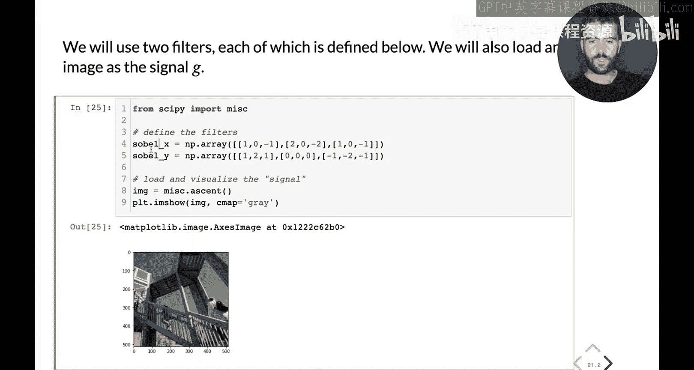

---


## 池化操作 ⬇️

在卷积层之后，我们常常会使用**池化**操作。池化层的作用是降低数据的空间维度（即缩小图像尺寸），它本身没有可学习的参数。

最常见的池化方式是**最大池化**。它将输入图像划分成不重叠的区域（例如2x2的方块），然后输出每个区域内的最大值。

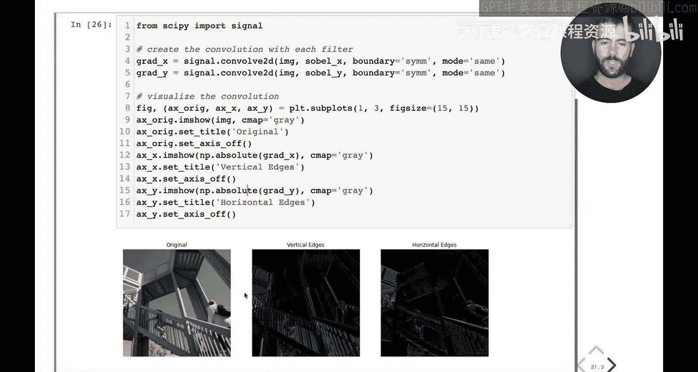

下图展示了最大池化的过程：

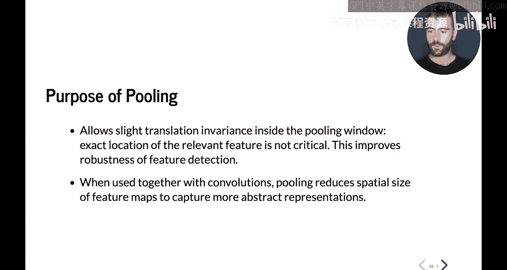

一个4x4的输入被划分为四个2x2的区域。最大池化后，每个区域取其最大值，得到一个2x2的输出。**平均池化**是另一种选择，它取每个区域的平均值。

**池化的意义**：池化提供了对平移的小幅度不变性。它告诉网络“特征是否在这个大致区域出现”，而不关心其精确位置。这既减少了后续层需要处理的数据量，降低了计算复杂度，也有助于防止过拟合，并能使模型关注更宏观的特征。

---

## 总结 📝

本节课中我们一起学习了卷积神经网络的两个基础操作：
1.  **卷积**：一种滑动点积运算，使用滤波器从输入数据（如一维信号或二维图像）中提取局部特征。滤波器参数可以通过学习得到，使其能自动识别对任务有用的模式。
2.  **池化**：一种下采样操作（如最大池化），用于减少数据的空间尺寸，增强模型对特征位置微小变化的鲁棒性，并降低计算负担。


卷积和池化是构建卷积神经网络的核心模块。在接下来的课程中，我们将看到如何将这些模块组合起来，形成强大的深度学习模型，以处理图像、语音等具有空间或时间结构的数据。