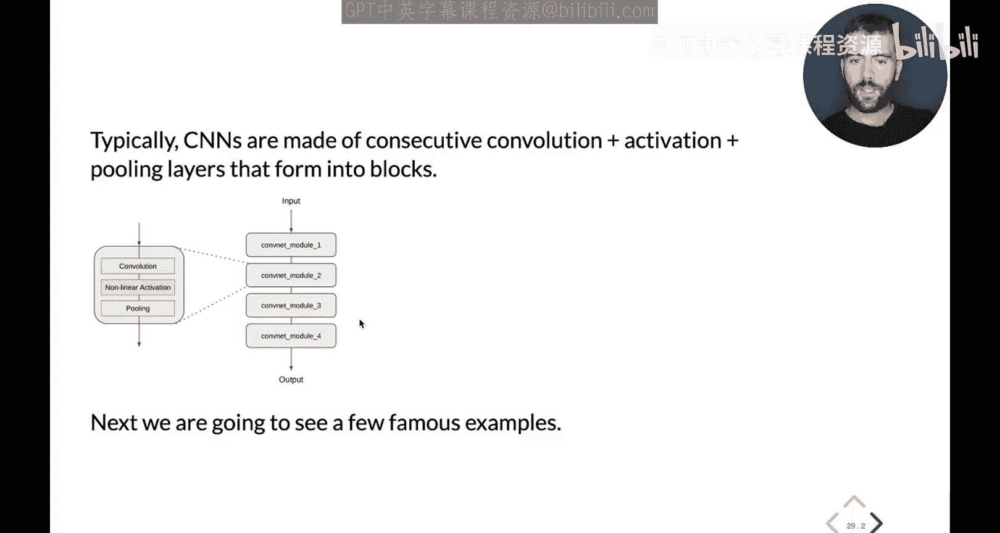
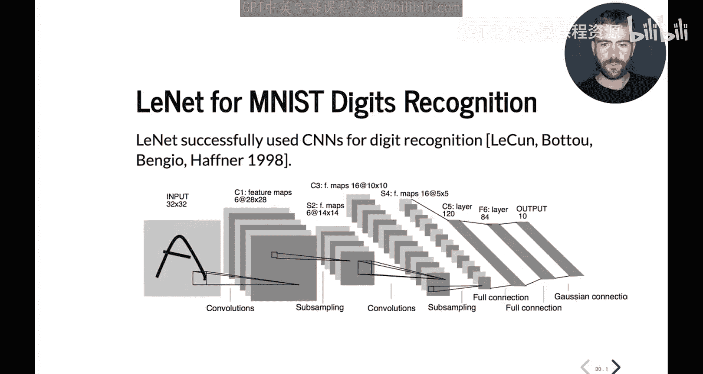
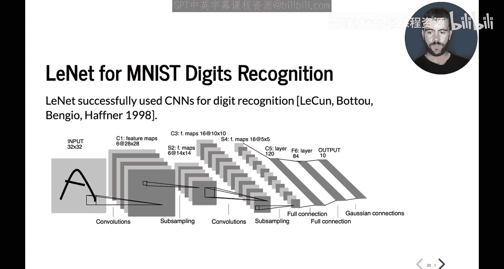
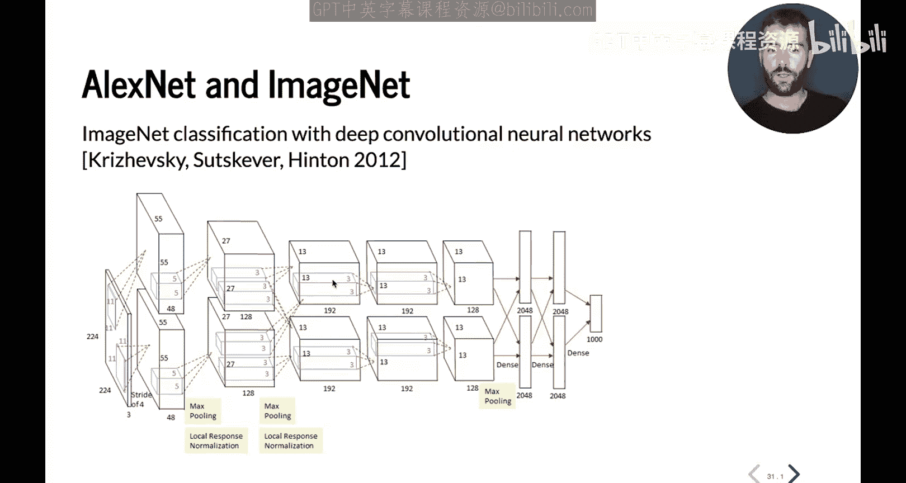
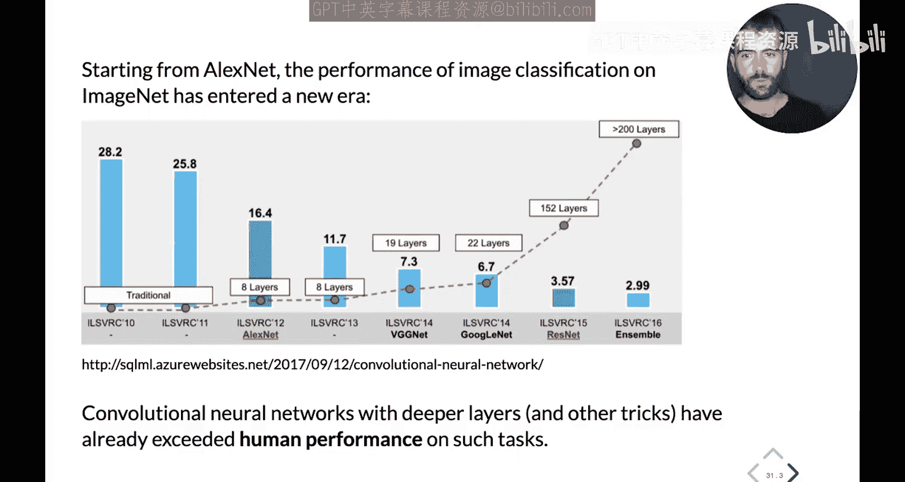
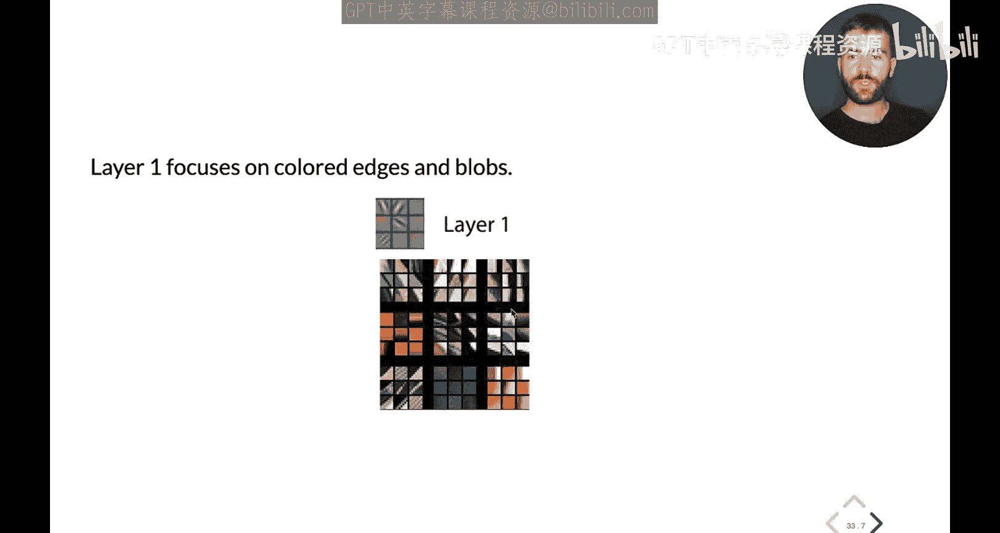
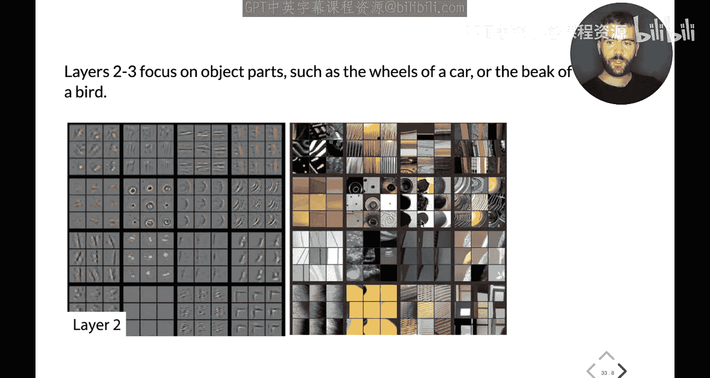
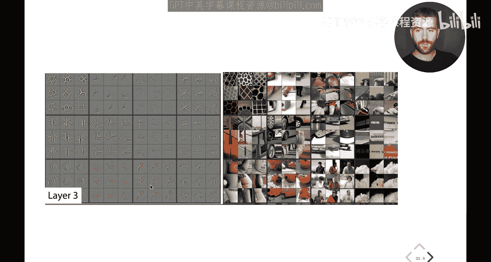
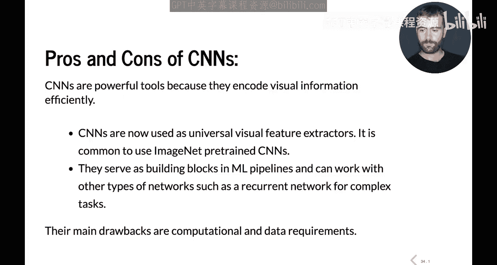

# 15.3：卷积神经网络（第三部分） 🧠

在本节课中，我们将学习一种重要的深度学习模型——卷积神经网络。我们将结合上一讲中介绍的两个核心操作：卷积和池化，来构建和理解这种网络。

## 卷积与池化回顾

上一节我们介绍了卷积和池化操作。本节中，我们来看看如何将它们组合起来构建卷积神经网络。

卷积是一种对信号（如图像）进行的操作。我们使用一个滤波器在信号上滑动，并在每个位置计算点积，从而生成一个激活图。这个激活图能反映出滤波器所编码的特定模式在信号中的位置和强度。

池化操作则通常作用于卷积的输出上。它将输入（例如一个2x2的网格）划分为多个区域，并仅保留每个区域中的最大值。这样做的好处是，只要某个有用特征出现在该区域（如上象限），无论它具体在哪个像素上，信息都被保留了下来。池化降低了数据的维度，保留了关键信息，并使后续的数据分析更加容易。

## 卷积神经网络的结构 🏗️

卷积神经网络本质上也是一系列层的组合，但这些层现在可以按模块进行组织。每个模块通常包含以下结构：

1.  **卷积层**：应用多个滤波器对输入进行卷积运算，生成一组堆叠的激活图。
2.  **非线性激活层**：例如Sigmoid或ReLU（修正线性单元），为网络引入非线性。
3.  **池化层**：对激活图进行下采样，减少其空间尺寸。

通常在网络的最后，还会连接一个或多个**全连接层**（或称密集层），用于最终的分类或回归任务。

因此，卷积神经网络的定义很简单：它是由我们之前学过的操作（卷积、激活、池化）组合而成的。网络的参数主要存在于卷积层的滤波器中，网络会通过训练学习哪些滤波器是重要的。

这是一个基础的网络结构，即使对这个结构进行微小的修改，也能在实践中取得非常好的效果。

## 经典网络架构实例 📚

以下是两个历史上著名的卷积神经网络实例，它们展示了这种结构的强大能力。

### LeNet-5 (1998)

这是一个用于手写数字识别的早期成功模型。其工作流程如下：

*   **输入**：一张灰度数字图像。
*   **处理过程**：图像经过多个卷积层和池化层（图中称为“子采样”）的交替处理。特征图的尺寸逐渐减小，而深度（滤波器数量）可能变化。
*   **输出**：最终的特征被展平并输入到几个全连接层中，最后一个输出层为10个可能的数字类别生成概率。

这个模型在当时达到了最先进的性能，并被成功应用于邮件分拣等实际任务中。

### AlexNet (2012)

这是一个在ImageNet大规模视觉识别挑战赛中取得突破性成果的网络。

*   **输入**：一张224x224像素的三通道彩色图像。
*   **处理过程**：网络使用了更大尺寸的卷积核（如11x11），并包含了更多的卷积层和池化层。特征图的尺寸在过程中不断减小，而深度（激活图数量）则显著增加。
*   **输出**：最终的特征被送入全连接层，输出一个1000维的向量，对应1000个图像类别。

AlexNet在2012年将图像分类的错误率大幅降低，证明了卷积神经网络的巨大潜力，并推动了其在计算机视觉各个领域的广泛应用。

## 卷积神经网络的特征学习 🔍

在卷积神经网络出现之前，计算机视觉算法依赖于手工设计的特征（如SIFT、HOG）。卷积神经网络的优势在于，它能够以纯数据驱动的方式，自动从数据中学习到层次化的特征。

为了理解这一点，我们可以可视化网络不同层学到的内容：

*   **底层**：神经元学习检测简单的几何形状，如各种方向的**边缘**、**斑点**或颜色过渡。
*   **中层**：神经元开始对更复杂的图案产生响应，例如**曲线**、**圆形**或**初级纹理**，这些看起来像是物体的局部组件（如车轮）。
*   **高层**：神经元变得高度专业化，能够响应非常具体和复杂的模式，例如**狗的鼻口部**、**眼睛**，甚至是**人的轮廓**。

这意味着卷积神经网络能够自动构建一个从简单到复杂的特征层次结构，这种强大的表示能力是其在许多真实数据集上取得高精度的关键。

## 卷积神经网络的特性与扩展 💡

卷积神经网络不仅本身是强大的模型，还具有一些有用的特性：

*   **迁移学习**：我们可以在一个大型数据集（如ImageNet）上预训练一个卷积神经网络，然后将其中的部分层（尤其是高层特征提取器）迁移到另一个较小的、不同的数据集任务上。即使新数据集很小，也能获得高性能。
*   **模块化组件**：卷积神经网络可以作为更复杂算法的构建模块。例如，在第一讲中提到的图像描述生成算法，就使用卷积神经网络作为初始的图像解析器。

## 总结 📝

本节课中，我们一起学习了卷积神经网络。我们回顾了其核心组件——卷积和池化操作，并了解了如何将它们组织成有效的网络结构。通过分析LeNet-5和AlexNet这两个经典实例，我们看到了卷积神经网络在实际应用中的演变和强大性能。更重要的是，我们探讨了网络如何自动学习从简单边缘到复杂物体的层次化特征，这是其成功的关键。最后，我们还了解了卷积神经网络的迁移学习能力和其作为基础模块的扩展性。正是这些特点，使得卷积神经网络成为计算机视觉领域不可或缺的强大工具。