# 16.3：无监督学习的实践应用

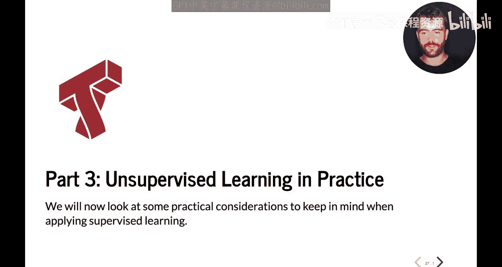

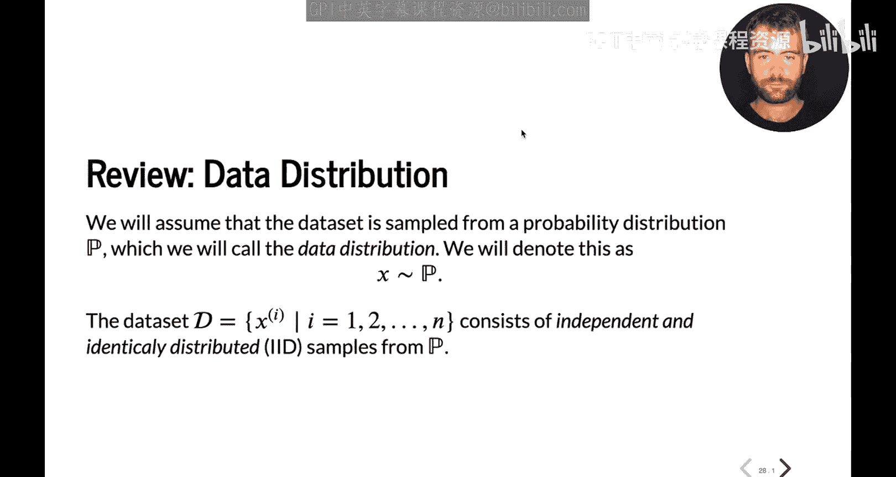

在本节课中，我们将探讨在实际应用无监督学习算法时需要考虑的一些重要方面。我们已经定义了第一个无监督学习算法，现在来看看在实践中使用它时需要注意的关键事项。

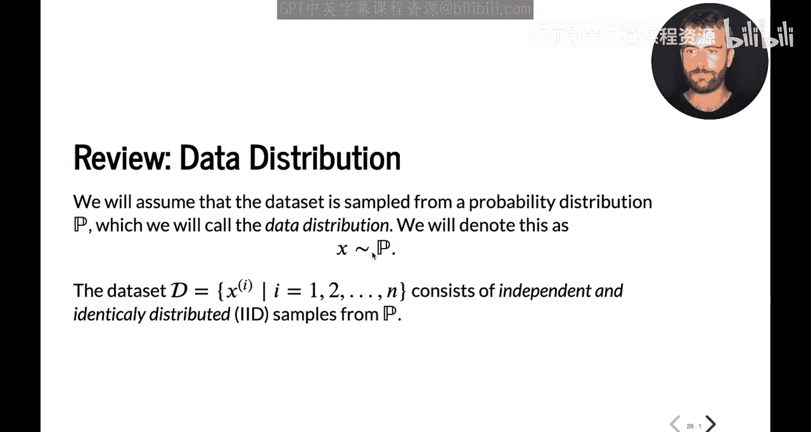

## 泛化概念在无监督学习中的延伸

上一节我们介绍了无监督学习的基本算法，本节中我们来看看如何将“泛化”这一概念从监督学习延伸到无监督学习。

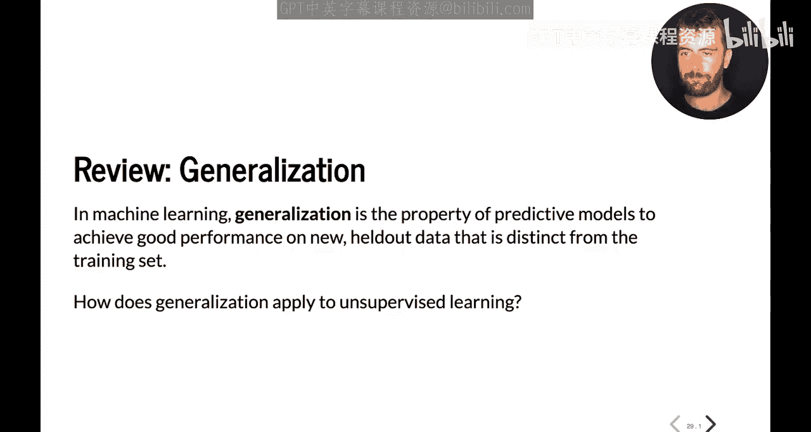

在监督学习中，泛化意味着模型在训练数据上学习后，对于来自同一分布的新数据（测试数据）也能表现良好。然而，在无监督学习中，由于没有标签，我们无法直接沿用基于训练集和测试集准确率的泛化定义。

尽管如此，无监督学习仍然存在一种有用的泛化概念。我们可以将数据分布视为由两部分组成：**信号** 和 **噪声**。信号可能代表隐藏的聚类结构、人类语音或数据所在的低维空间；而噪声则是干扰信号的随机性，例如聚类内部的随机散布、语音中的白噪声或数据点偏离低维空间的微小扰动。

一种适用于监督和无监督学习的泛化思考方式是：一个好的模型应该学习信号 `F`，而丢弃噪声 `E`。这种直觉可以帮助我们更好地理解无监督学习何时有效，何时无效。

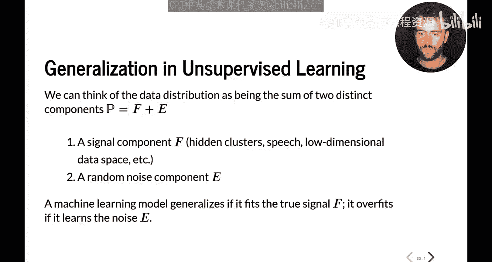

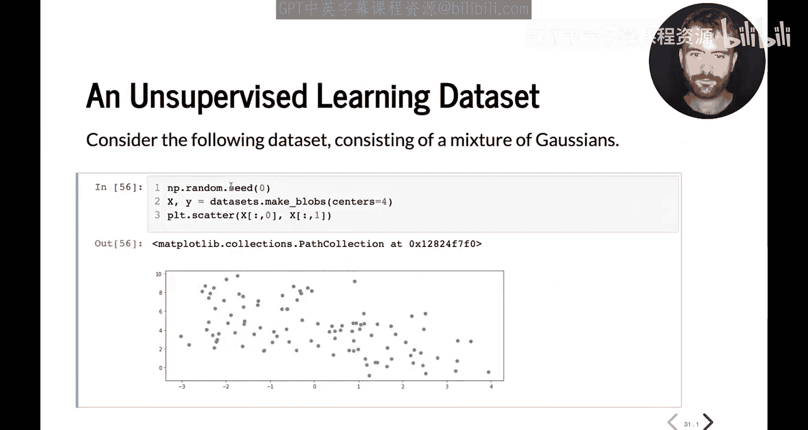

## 一个运行示例：带隐藏结构的数据

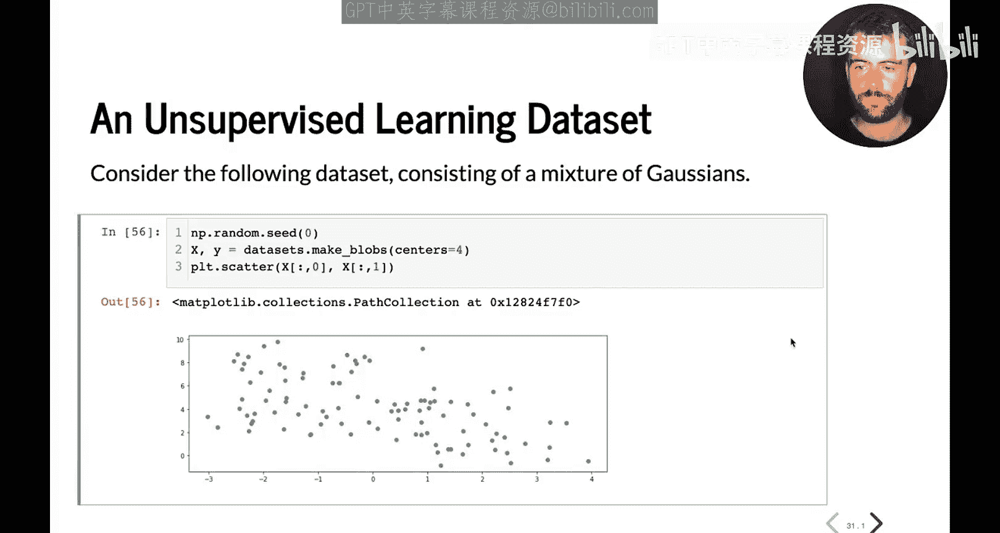

为了说明这些概念，我们将使用一个二维数据集作为本视频的运行示例。该数据由四个真实的聚类组成，但当我们移除标签后，数据看起来像是均匀分布的，而实际上其内部隐藏着结构。

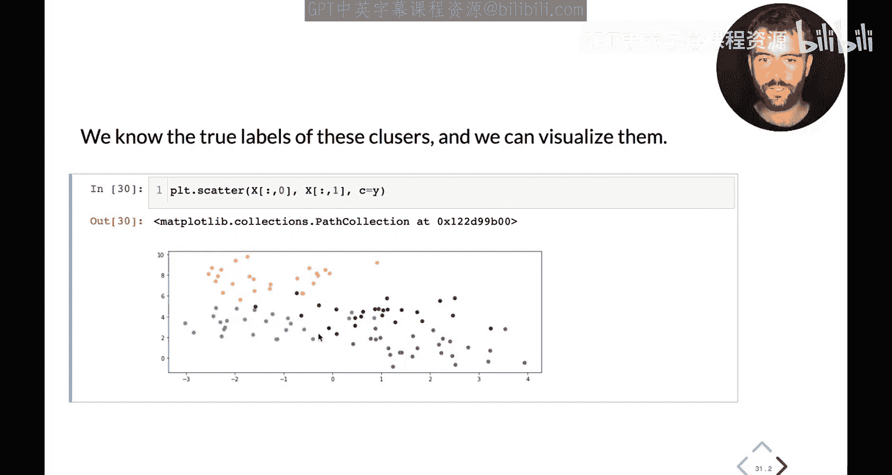

以下是生成该数据的代码片段：
```python
# 使用 make_blobs 生成包含四个聚类的二维数据
from sklearn.datasets import make_blobs
X, y_true = make_blobs(n_samples=300, centers=4, cluster_std=0.60, random_state=0)
```

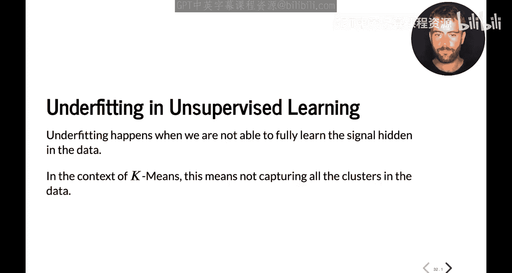

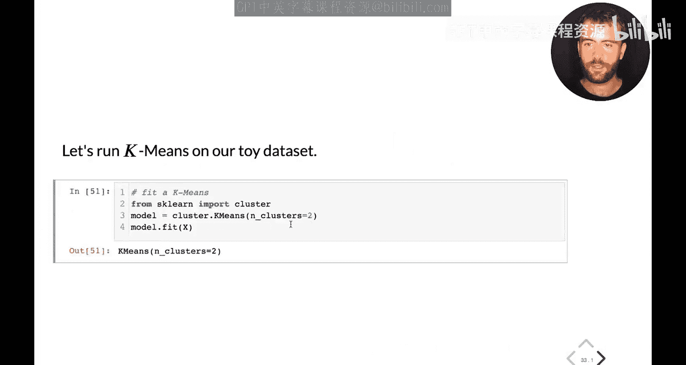

## 模型过于简单：欠拟合现象

在无监督学习中，如果我们尝试使用过于简单的模型来拟合数据，可能会观察到类似“欠拟合”的现象。

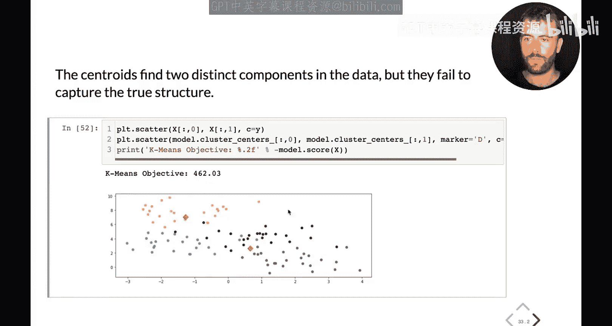

例如，让我们在这个数据集上运行 K-Means 算法，并要求它找出两个聚类（`k=2`）。算法会返回两个质心（用红色菱形表示）。虽然它确实找到了两组有用的点（例如，视觉上该区域有更多空白，表明这两组点似乎彼此不同），但这个结果仍然不能令人满意，因为它没有识别出数据中全部的结构信息。此时，目标函数（如惯性）的值约为 462。

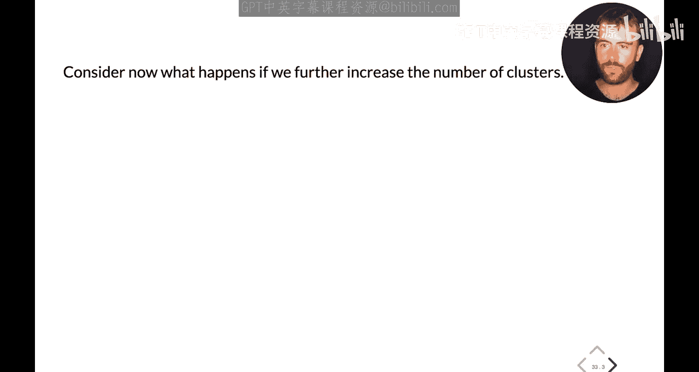

## 增加模型复杂度：从拟合信号到拟合噪声

当然，为了缓解这个问题，我们可以增加聚类的数量。

当我们将聚类数增加到四个（`k=4`）时，结果恢复了我们已知的数据结构。同时，目标函数值从 462 改善到了 164。

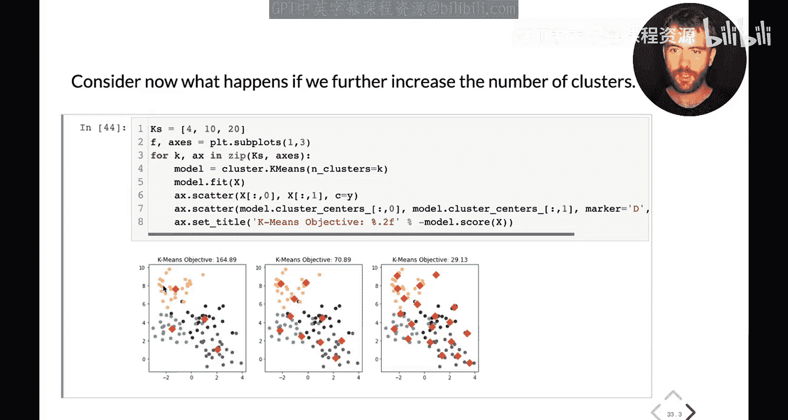

我们可以继续增加聚类数。例如，设置 `k=10` 或 `k=20`，目标函数值会变得更小。然而，尽管目标函数值很小，但超过某个点后，聚类结果就不再有用。算法开始将来自同一高斯分布的样本中，由于采样随机性形成的空白区域或稀疏点群识别为独立的聚类。此时，模型不再拟合真实的信号，而是在拟合数据中的噪声。

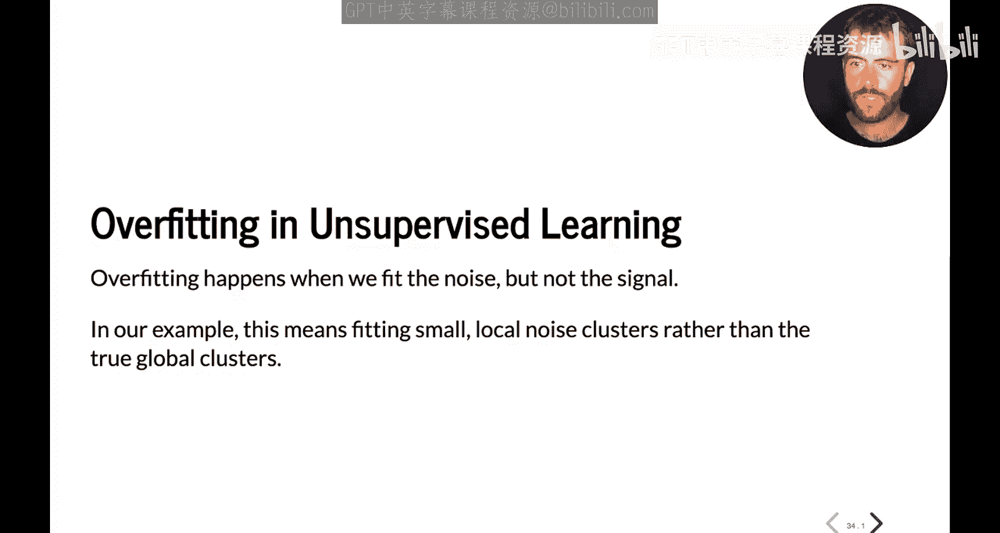

从这种意义上说，我们本质上是在**过拟合**数据。我们开始拟合噪声而非信号。虽然“过拟合”这个概念主要定义并用于监督学习，但在此我想指出，这是无监督学习的另一种失败模式：模型识别的“信号”现在对应的是噪声，而不是数据分布中真实的信号。

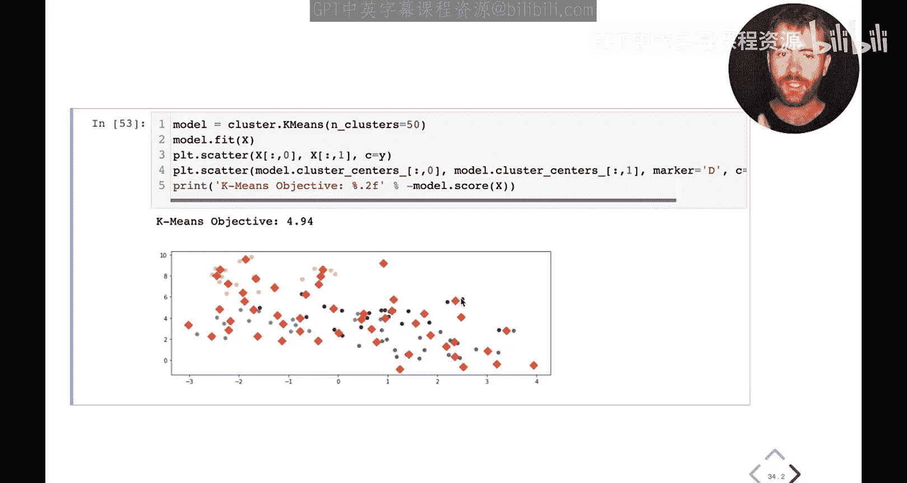

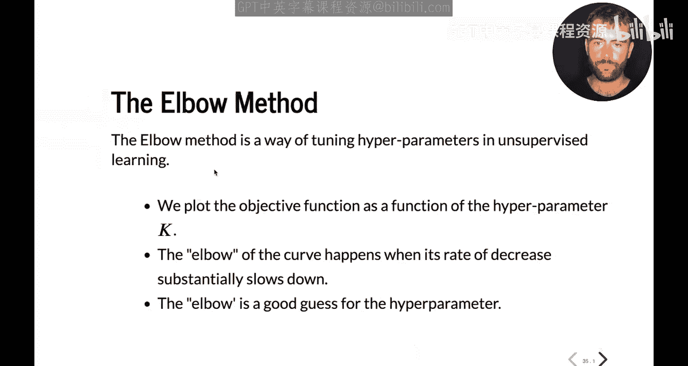

将例子推向极端，使用 `k=50` 时，算法会将少数几个点识别为一个独立的聚类，这显然是仅仅在拟合噪声，即使 K-Means 的目标函数值非常小，这也毫无用处。

## 评估聚类质量：启发式方法

与监督学习不同，在无监督学习中我们通常没有真实的标签来客观评估聚类的质量。不过，存在一些启发式方法。

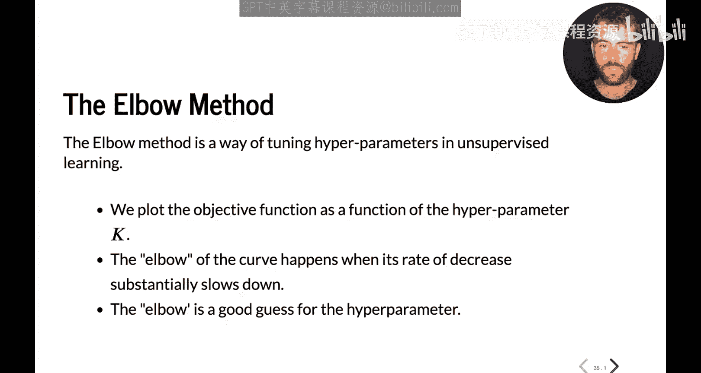

一种流行的启发式方法是**肘部法则**。这是一种用于调整无监督学习超参数的通用方法。

该方法的思路是，绘制我们之前看到的目标函数值（例如惯性）随超参数 `k`（聚类数）变化的曲线。然后观察这条曲线，我们将曲线下降速率发生转折的点称为“肘部”。损失值会随着 `k` 增加而下降，但在某个点之后，下降速率会变慢，曲线趋于平缓。这个“肘部”点通常是对模型超参数的一个良好猜测。

以下是应用肘部法则的示例步骤：
1.  对不同 `k` 值（例如从 1 到 10）运行 K-Means。
2.  记录每个 `k` 对应的惯性值。
3.  绘制惯性随 `k` 变化的曲线。
4.  寻找曲线拐点（斜率明显变化处），该点对应的 `k` 值即为建议的聚类数。

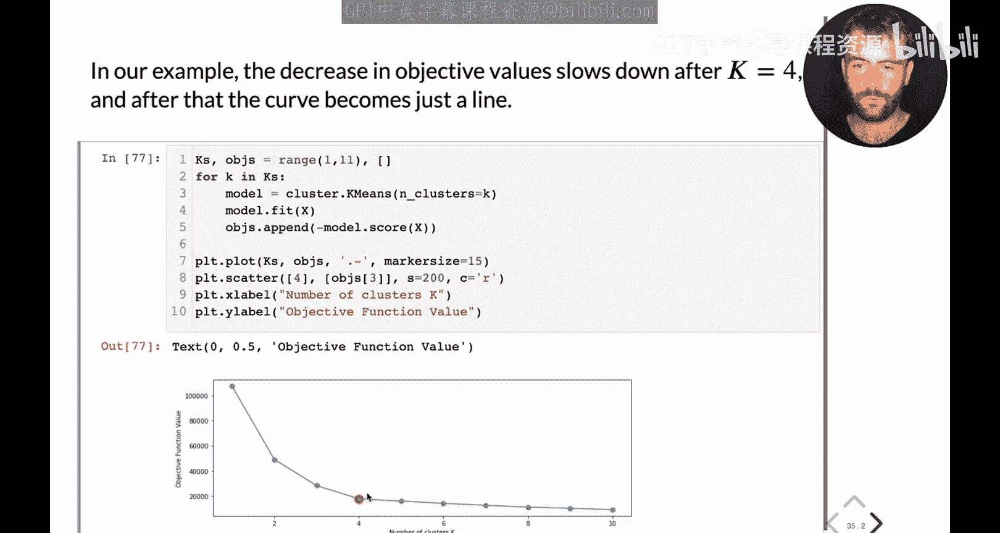

在我们的示例中，当 `k` 大约为 4 时，曲线变得平缓，下降速率饱和。`k=4` 正是数据中真实的聚类数量，这个红点就被称为“肘部”。

## 诊断失败模式与解决方案

更一般地说，检测这些失败模式（我将其类比为过拟合和欠拟合）在实践中可能更通用的正确说法是：我们是在拟合噪声还是未拟合信号。我倾向于将其与监督学习中的过拟合/欠拟合进行类比。

这个问题在无监督学习中诊断起来更加困难，通常需要依赖我们的直觉或人工评估，以判断发现的结构是否有用。在某些应用中，我们可能可以访问到少量标签，或者可以手动标注一些数据点进行检查（例如，在处理数字图像时，可以手动标记一些数字以查看发现的结构是否有用）。也存在一些基于真实标签来衡量拟合准确性的技术。

此外，有一类本质上是概率性的模型（我们很快会讨论无监督学习中的概率方法），在那里我们可以通过查看数据的**似然**来获得类似于监督学习中过拟合/欠拟合的定义。我们将为无监督学习定义与监督学习相同的优化对数似然的理念，并且这个似然目标函数实际上可以用来评估模型在训练集和留存数据上的拟合质量。这是理解无监督学习这两种失败模式的第三种方法，我们将在后续课程中探讨。

目前，对于像 K-Means 这样的算法，评估通常需要：
*   人工直觉和检查。
*   创建小型标注数据集或获取标签，然后使用基于标签的质量评估技术。

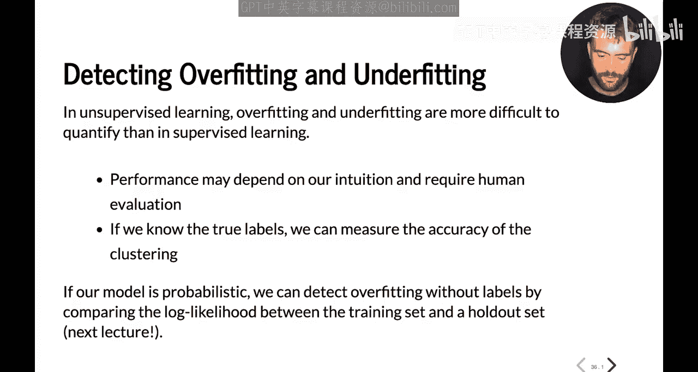

如果我们认为正在过拟合数据中的噪声，当然有不同的解决方案：
*   **降低模型复杂度**：例如，在 K-Means 中减少 `k` 的值。
*   **惩罚高复杂度**：在单一模型中，可以对选择较大的 `k` 值施加惩罚（成本）。
*   **使用概率模型与正则化**：采用概率模型并对其应用正则化技术。

## 总结

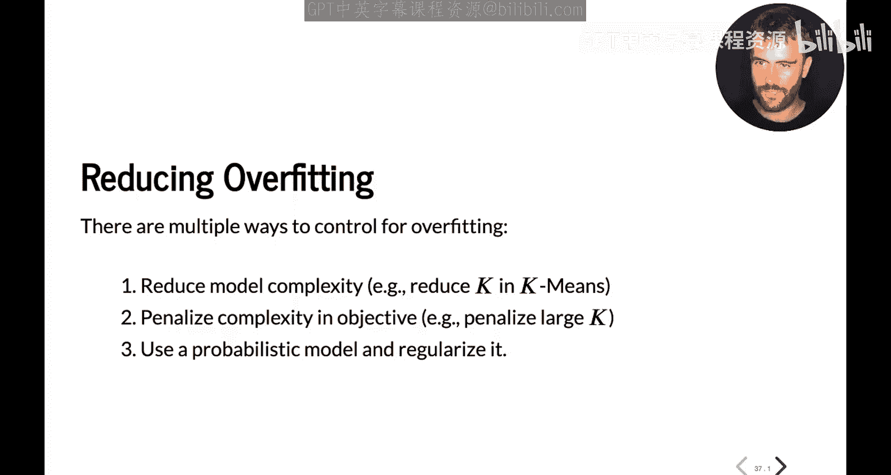

本节课中我们一起学习了在实际中应用无监督学习算法并非总是直截了当的。我们很容易出现两种问题：要么未能提取出全部信号（欠拟合），要么开始拟合噪声（过拟合）。监督学习中也存在类似问题，但在无监督学习中，由于缺乏标注数据，挑战更大，需要专门的技术。

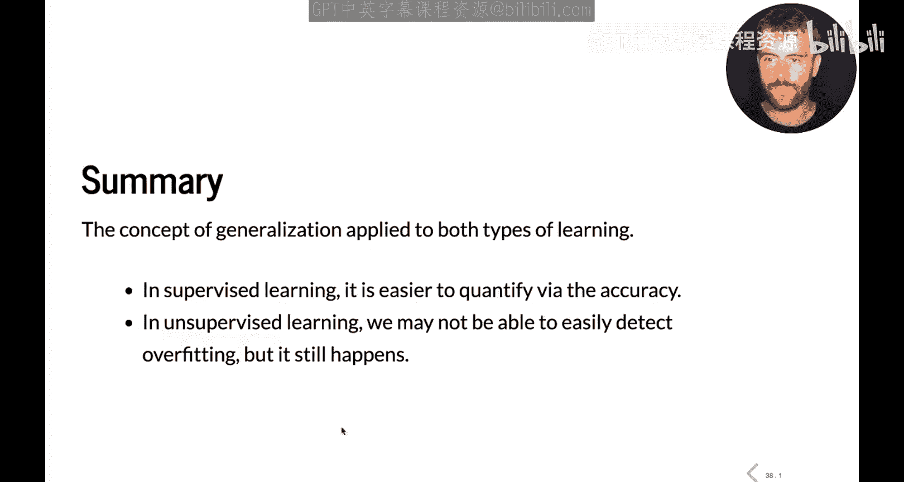

在实践中，应用无监督学习时需要考虑的主要问题是：你是在拟合噪声还是在拟合信号？存在一些技术来评估这个问题，其中一些已在本次课程中提到，另一些我们将在后续讲座中看到。