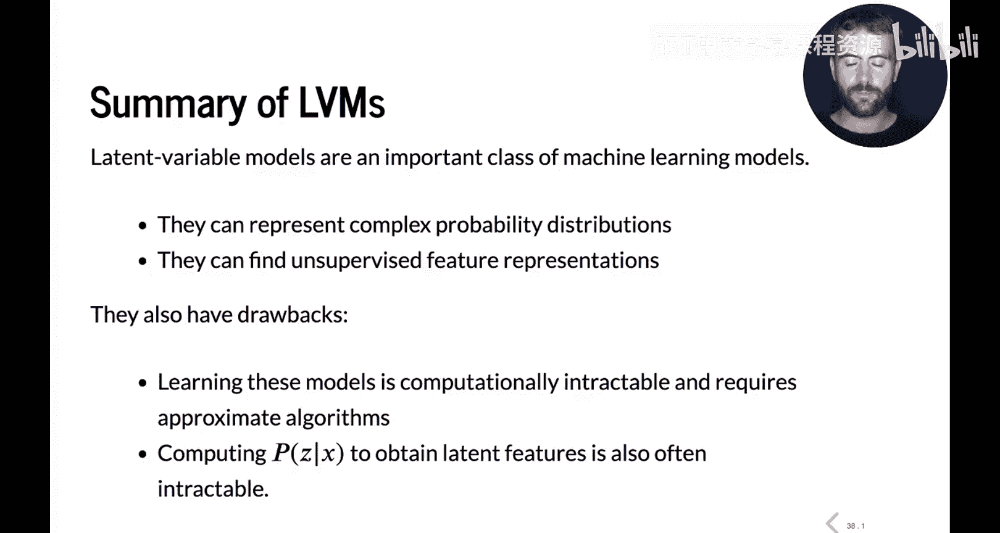

# 17.3：第3部分：隐变量模型 🧩

在本节课中，我们将要学习**隐变量模型**。这是一种特殊的概率模型，对于理解后续视频中的算法至关重要。我们将探讨其基本概念、动机、示例、优势以及学习时面临的挑战。

## 概述

上一节我们介绍了概率模型的基础。本节中，我们来看看如何通过引入**隐变量**来构建更强大、更具表达能力的模型。隐变量模型能够捕捉数据中复杂的、未标注的结构，例如人脸数据中的性别、姿态等特征。

## 什么是隐变量模型？

一个标准的概率模型是定义在观测变量 **x** 空间上的概率分布，记作 **P(x; θ)**。我们通过最大化数据的对数似然来拟合模型。

然而，我们经常需要建模的数据集（例如人脸图像）具有复杂的结构。这些结构（如性别、姿态）是数据中真实存在的变异因素，但在训练数据中并未被标注或观测到。**隐变量模型** 的思想就是将这些未观测到的变异因素作为额外的变量 **z** 引入模型。

更正式地说，一个隐变量模型是定义在两类变量上的联合概率分布：**P(x, z; θ)**。其中 **x** 是我们观测到的多维数据点，而 **z** 是那些未被观测到但具有意义的结构性变量。

通过边缘化隐变量 **z**，我们可以得到仅关于观测数据 **x** 的分布：**P(x; θ) = Σ_z P(x, z; θ)**。这个模型同样可以用来近似真实的数据分布。

## 为什么使用隐变量模型？

以下是引入隐变量 **z** 的两个主要原因：

1.  **简化条件分布学习**：如果我们知道了 **z**（例如，知道了性别、姿态），那么在给定这些条件下，图像 **x** 的分布 **P(x|z)** 会比无条件分布 **P(x)** 简单得多，也更容易学习。
2.  **学习数据的有意义表示**：训练好模型后，我们可以通过计算后验概率 **P(z|x)** 来推断给定数据 **x** 最可能的隐表示 **z**。这可以用于聚类或发现数据中的有趣结构。

## 一个简单示例：高斯混合模型

最简单的隐变量模型之一是**高斯混合模型**。

*   **隐变量 z**：一个分类变量，表示数据点属于哪个混合成分（例如，K个类别之一）。其分布为分类分布：**P(z=k) = φ_k**。
*   **观测变量 x**：在给定隐变量类别 **z=k** 的条件下，**x** 的分布是一个多元高斯分布：**P(x|z=k) = N(x; μ_k, Σ_k)**。

因此，联合分布定义为：**P(x, z=k; θ) = φ_k * N(x; μ_k, Σ_k)**。

高斯混合模型比单一高斯分布更能拟合复杂数据。例如，对于具有两个簇的数据，单一高斯只能给出一个宽泛的拟合，而混合高斯可以用两个分量精确地捕捉每个簇。

## 隐变量模型的应用

一旦模型被训练，隐变量 **z** 可以成为数据的有用表示：

*   **在表示上进行算术运算**：例如，在图像数据中，我们可以计算“微笑女性”的隐向量与“中性女性”的隐向量之差，然后将这个差异加到“中性男性”的隐向量上，从而生成“微笑男性”的隐表示，并最终生成对应的图像。
*   **可视化与聚类**：我们可以将高维的隐表示 **z** 投影到二维空间进行可视化。通常，具有相似语义的数据点（如相同的手写数字）会在隐空间中聚集在一起。

## 学习隐变量模型的挑战

尽管强大，隐变量模型的学习存在主要挑战：**计算复杂性**。

应用最大似然原则意味着我们需要最大化边缘对数似然：**log P(x; θ) = log Σ_z P(x, z; θ)**。

这个目标函数中的求和（或积分）项 **Σ_z** 通常是计算上难以处理的。即使 **z** 是维度不高的离散变量，可能的组合数也会呈指数增长（例如，30维二值变量有约10亿种组合）。对于连续隐变量，则需要处理难以计算的积分。

因此，直接优化这个目标函数在大多数实际应用中是不可行的。

## 总结与展望

本节课中我们一起学习了隐变量模型。

*   **核心思想**：通过引入未观测的隐变量 **z** 来增强概率模型的表达能力，使其能够捕捉数据中复杂的内部结构。
*   **主要优势**：模型更强大，能够学习数据的有意义表示（**z**），这些表示可用于聚类、数据操作等任务。
*   **主要挑战**：模型的学习（最大化边缘似然）和推断（计算后验 **P(z|x)**）通常计算困难，需要借助近似算法。

在接下来的课程中，我们将看到几个具体的隐变量模型实例，并学习如何通过近似方法（如期望最大化算法、变分推断等）来有效地学习和使用这些模型，以解决无监督学习中的有趣问题。