# 20.1：机器学习开发工作流程 🚀

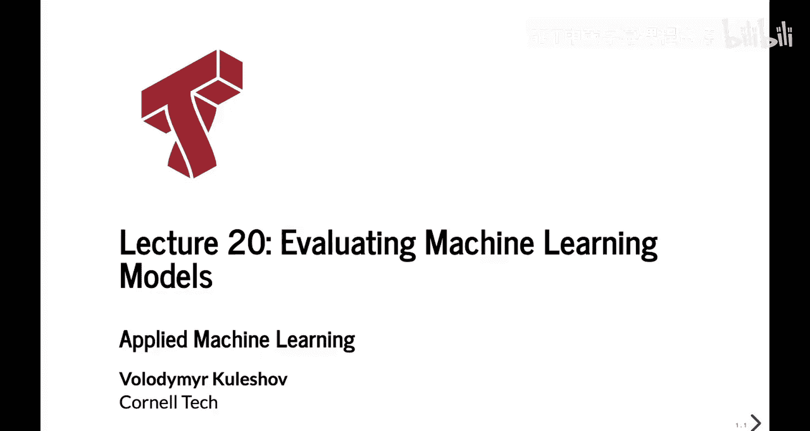

在本节课中，我们将开始课程的一个新主题，重点介绍构建机器学习模型、理解其性能并以系统化、迭代的方式改进性能的技术。

## 概述 📋

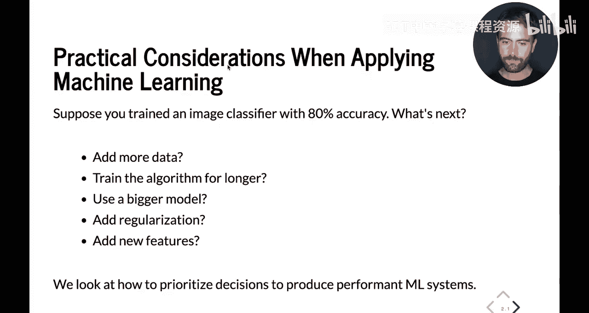

作为我们即将探讨内容的动机，请考虑以下例子。假设你在一个数据集上训练了一个图像分类器，现在达到了80%的准确率。接下来该做什么？你可以尝试通过向算法添加更多数据来进一步提高准确率，或者可以检查算法是否得到了适当的优化，也可以尝试训练更长时间。你可以尝试使用更大的模型、更小的模型，可以进行正则化，可以添加特征。这些都是为了尝试提高准确率而可能做出的各种设计决策和改进。本课程这一部分的重点，将是关于如何优先处理这些决策并以系统化的方式改进机器学习模型性能的原则性方法。

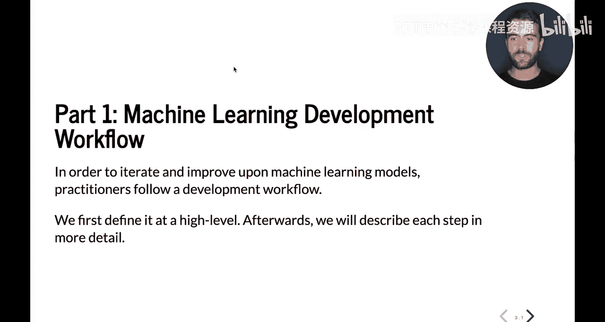

## 机器学习开发工作流程 🔄

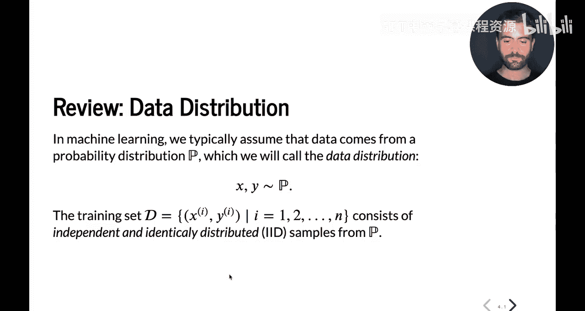

本讲座的第一部分将重点介绍一个特定的机器学习开发工作流程，我将对其进行介绍。这本质上是一种改进和迭代机器学习模型的系统化方法。我将首先对这个工作流程进行高层次概述，然后在本次讲座的剩余部分以及接下来的讲座中，我们将深入探讨具体细节，并审视这个工作流程中各个步骤的细节。

### 监督学习背景回顾 📊

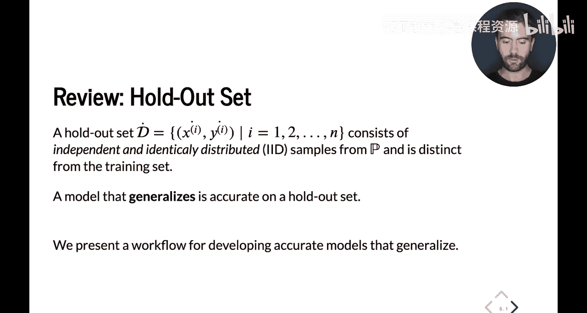

在开始之前，让我们回顾一下在进行机器学习时所处的通用环境。在本讲座中，我将以监督学习作为贯穿始终的例子，但这些思想也可以扩展到无监督学习。回想一下，在监督学习中，我们假设处理的数据来自一个称为数据分布的概率分布，我们的数据集 **D** 是一组来自分布 **P** 的独立同分布样本。

### 泛化与评估 🎯

当我们构建机器学习模型时，特别是在监督学习中，我们通常在训练集上优化其性能。但正如我们在课程开始时所见，这并不是机器学习的真正目标。我们的机器学习算法只有在能够很好地泛化到新数据时才有效。为了评估我们的算法是否泛化良好，我们引入了“保留集”这个概念，它是一个来自相同分布但与训练集不同的数据集。如果我们正确地学习了数据中的信号，那么我们应该能够泛化到这个新数据集，并且在这个独立的保留集上也应该有很高的准确率。这就是我们如何知道是否成功训练了一个机器学习模型。因此，在本视频中，我将介绍一个工作流程算法，用于构建具有良好泛化能力并在机器学习算法的实际部署中表现良好的模型。

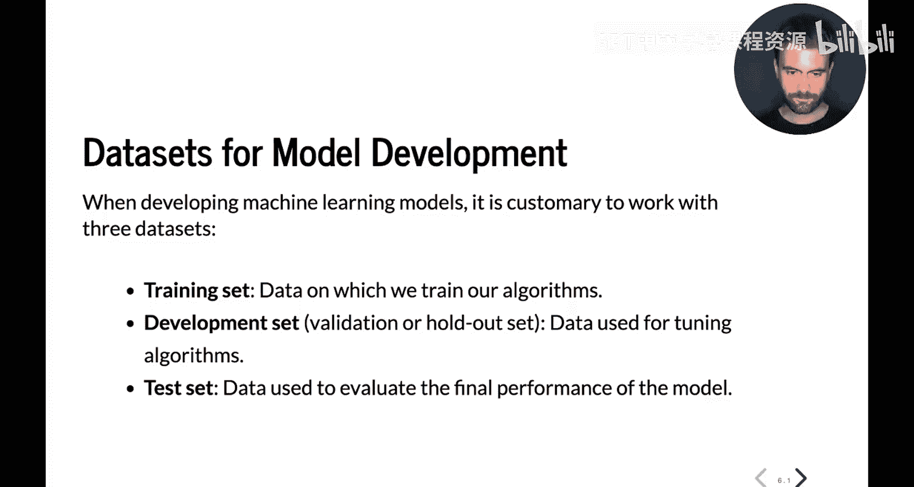

### 数据集划分：训练集、开发集与测试集 📁

在机器学习工作中，通常将数据划分为几个不同的子集。数据的主要且通常是最大的子集称为**训练集**，这是我们整个课程中一直使用的核心数据，我们在此之上训练算法、最小化目标函数。此外，通常还会使用一个称为**开发集**的数据集，也称为验证集或保留验证集。这是一个独立的数据集，用于调整算法，例如，我们可以用它来执行超参数选择，比如选择正则化器的最佳强度。因此，顾名思义，这是一个我们用于开发模型的数据集。最后，我们通常还有一个单独的**测试集**，用于在模型开发完成后评估其最终性能。

### 核心工作流程步骤 🛠️

这三个数据集定义了以下用于构建和迭代机器学习模型的工作流程：

1.  **训练模型**：通常，当我们开始构建机器学习模型时，从一个初始想法开始，然后在训练集上拟合它。
2.  **评估开发集性能**：然后，我们观察它在开发集上的性能，并使用指标来评估其在开发集上的表现。由于开发集与训练集不同，这让我们初步了解该模型在现实世界中的表现如何，是否过拟合或其性能是否足够。
3.  **模型选择与改进**：基于观察到的性能，我们思考对模型的改进，执行所谓的“模型选择”。我们可能会对模型进行更改，例如，更改某些超参数（如正则化强度），或者尝试新的神经网络架构，或者向模型添加新特征。
4.  **迭代循环**：根据第二步的性能，我们决定要进行哪些更改，然后实施这些更改，回到步骤1，重新训练模型，再次观察其在开发集上的性能。如果我们的更改成功，通常会保留它们，然后可以尝试其他想法，用这些新想法再次重新训练模型，只要模型在开发集上的性能在提高，我们就不断重复步骤1和2。
5.  **最终测试与部署**：最后，一旦我们对模型的性能感到满意，就在测试集上评估它。如果对性能满意，就部署模型。模型在测试集上的性能是我们对模型部署到现实世界后预期表现的最准确估计。

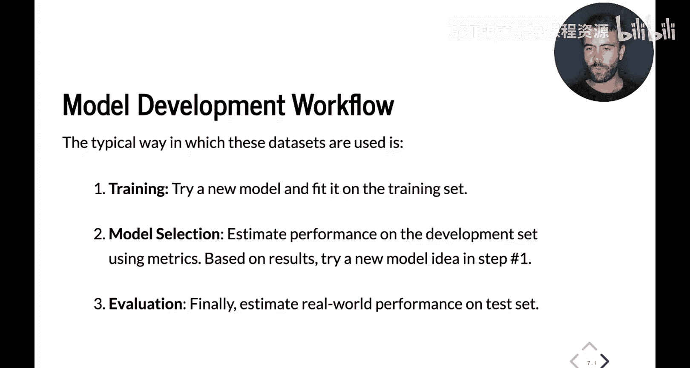

这是一个非常高层次的工作流程。在本视频以及接下来的讲座中，我将介绍这个工作流程的细节，例如使用哪些指标，如何使用这些指标的结果来确定对模型进行哪些更改等。

### 关于工作流程的高级观察 👁️

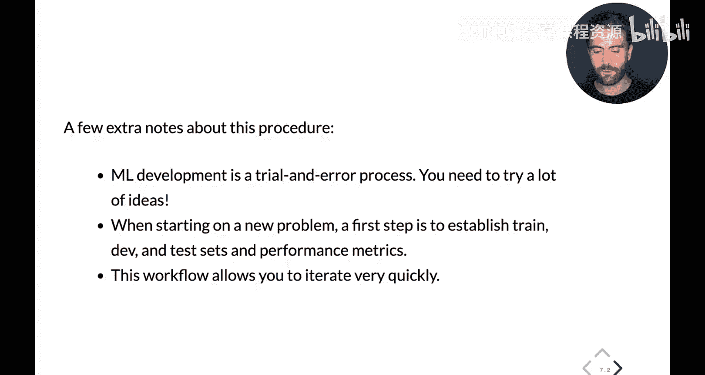

我还想对这个流程提出几点高层次观察。

第一个观察是，这个过程本质上涉及试错。机器学习是一个领域，至少在应用方面，经常有很多试错。我们相信某些特征或架构更改是有用的，我们尝试它们，训练模型，根据结果观察其表现，我们可能对哪些更改成功、哪些需要不同更改有一些直觉，然后只要性能在提高，我们就执行这个试错过程。

我描述的这个工作流程有助于快速迭代模型。当你开始构建机器学习模型时，第一步是建立数据集（训练集、开发集、测试集），建立性能指标，然后运行这个工作流程，快速迭代模型的性能，开始朝着一个能在某种程度上解决问题的第一个原型努力，然后快速进行更改和改进。

## 如何选择开发集与测试集？ 🤔

现在，在这个工作流程中，一个重要决策是如何选择开发集和测试集？

首先，让我们看看它们的目标。如前所述，开发集的目标从根本上说是检测模型性能的变化。我们使用开发集来测试我们对模型所做的各种更改是否提高了性能，以及我们是否在朝着改进系统的方向前进。

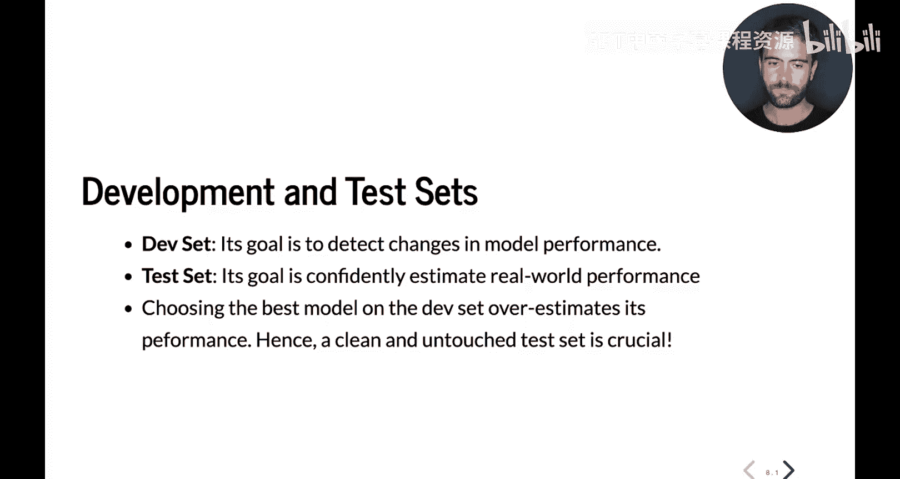

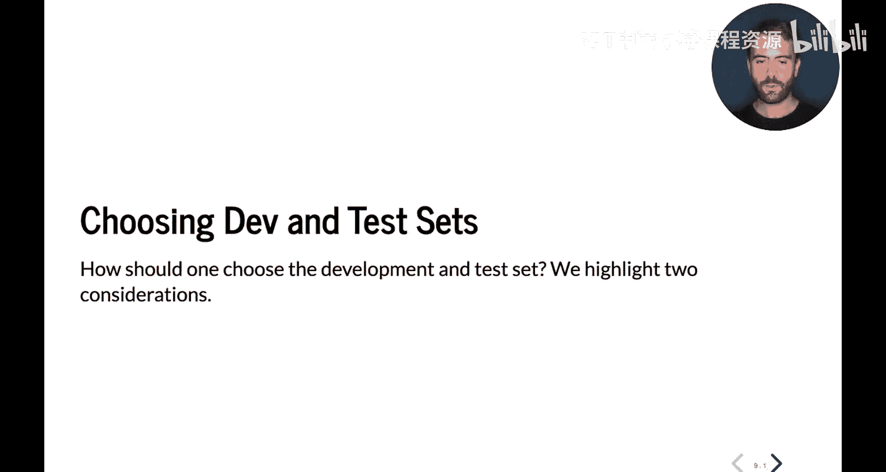

而测试集的目标是，在我们完成实验和模型迭代后，自信地估计现实世界的性能。因为我们反复选择在开发集上表现最好的模型，最终我们有过拟合开发集性能的风险。如果我们执行了数百次迭代，并且总是只选择在开发集上表现最好的模型，那么很可能我们会过于乐观，选择的模型在开发集上的表现会优于在整个数据分布上的表现。这就是为什么拥有一个独立的测试集很重要，因为一旦我们完成了所有更改，并且真正优化了模型以在开发集上表现良好，我们很可能已经略微过度优化了它，我们希望有一个对未来性能的独立、无偏估计。这就是我们拥有测试集的原因。我们在测试集上运行模型，现在最终知道一旦模型部署到现实世界，我们的性能水平是多少。实际上，这可能比我们在开发集上的性能略低。

为了能够对未来性能进行这种无偏且自信的估计，重要的是在迭代模型时将测试集放在一边，不去动它。如果我们也开始在测试集上迭代，或者过于频繁地查看测试集，那么我们也有风险对模型进行针对测试集优化的更改，因此测试集将不再是对未来性能的准确估计。这是一个重要的实践细节，是你在实践中构建机器学习系统时需要遵循的重要规则。

### 选择数据集的两个重要考虑因素 ⚖️

那么，我们如何选择这两个数据集呢？我想强调两个重要的考虑因素。

**考虑因素一：代表性**

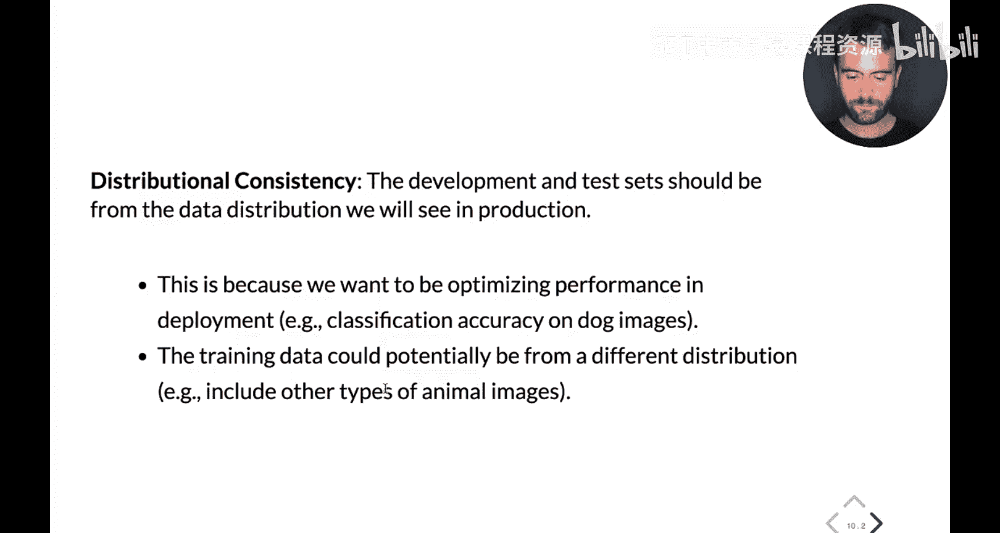

第一个考虑因素是，我们从这些数据集中获得的未来性能估计，必须代表我们将在现实世界中看到的实际性能。因此，这些数据集中的数据应来自我们预期在生产中看到的相同数据分布。当我说“生产”时，我指的是在现实世界中，或者一旦我们部署了模型并且它在现实世界中做有用的事情时。我们将看到一些数据，这些数据的分布应尽可能接近我们开发和测试集中的数据。这样我们才能知道模型部署后将如何工作。

例如，考虑一个检测特定图像是否包含狗的**图像分类器**。如果我们想预测算法检测狗的效果如何，我们希望在我们的开发和测试集中有一组狗的图像。训练数据通常也来自相同的分布，但这并非严格必要。例如，我们可以在训练期间尝试用其他动物的额外图像来增强数据，这是一种数据增强形式，是训练机器学习模型的一种方式，我们可以用额外的输入来增强这些数据，以尝试提高性能。但我们最终感兴趣的是狗的**分类准确率**，这就是为什么我们的数据应该由狗的图片组成。

另一个例子是，如果我们有高分辨率或低分辨率图像，并且我们知道在现实世界中只会看到低分辨率图像，那么在测试集和开发集中包含这些图像就很重要。或者，如果我们看到来自不同地理区域的图像或输入，例如来自欧洲和北美，并且我们知道我们的系统将只在欧洲部署，那么测试集中应该只有欧洲的输入。但是，如果发现仅仅拥有更多数据有助于模型学习额外的信号，我们可以在训练集中添加一些北美输入，这在原则上可能有助于训练，尽管不能保证。

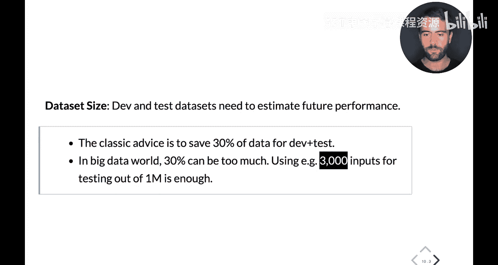

**考虑因素二：数据集大小**

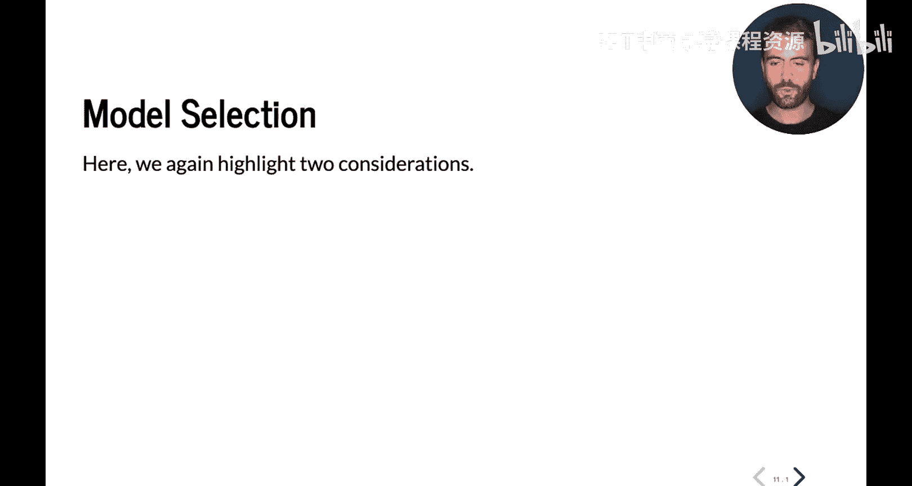

另一个问题是这些数据集应该有多大。在经典机器学习中，曾经有一个规则，大约20%到30%的数据应保留给开发和测试集。在现代机器学习中，我们的数据集通常很大，例如，我们可能有数十万甚至数百万张图像的数据集。由于我们的最终目标是估计未来性能，我们不需要30%的数据，我们不需要30万张图像在测试集中。很可能我们可以用3000或5000个输入的测试集来估计未来性能。因此，我们实际需要的数据点数量主要取决于任务的复杂性，但最好将其视为一个绝对数字：什么数字能给我们足够的变异性？或者什么数字能足够大地减少这种估计的方差和不确定性？估计这一点的一种方法是，对大小为3000的各种输入进行子采样，观察它们之间的方差。如果大小为3000的各种子集给出相似的性能，那么大小为3000的随机子集很可能就是未来性能的一个稳定估计。

## 模型选择中的实践考虑 💡

以上是关于如何选择我们使用的数据集的讨论。我还想强调在执行模型选择时的两个实践考虑，即在模型选择步骤决定对模型进行哪些更改时。

**考虑因素一：定义优化指标**

作为这个工作流程的一部分，需要做出的关键决策是我们要优化哪些指标。为了以系统化的方式改进机器学习模型，我们需要一个概念，需要一个准确且量化的概念，来定义什么是好的机器学习模型，什么是坏的机器学习模型。这可能意味着像准确率这样简单的东西，也可能意味着更复杂的东西。例如，如果我们在一个敏感的医疗应用中，并且对假阳性或假阴性的数量有严格的阈值，那么这也可以作为我们指标的一部分。例如，如果我们正在做一个信息检索系统，那么精确率和召回率可能是有用的指标（我们稍后会看到什么是精确率和召回率）。为了以系统化的方式迭代模型，我们需要以某种方式将所有考虑因素、所有我们拥有的指标组合成一个单一的数字，一个单一的主指标。这只是为了让我们能够确定某个特定更改是否有用，这是一个二元决策，因此必须根据某个单一的量化度量来进行。如果我们有多个感兴趣的指标，例如，如果我们对精确率和召回率感兴趣，我们可以通过取它们的平均值或某种组合将它们合并成一个单一指标。在这个例子中，结合精确率和召回率会得到所谓的 **F 分数**。或者，如果我们有其他指标，比如计算性能可能是一个，假阳性数量可能是另一个，我们也可以将这些作为约束条件。如果一个更改违反了我们对最差计算复杂度的容忍度，那么我们就不对模型进行这个更改。但再次强调，为了能够执行这种系统化的迭代，拥有一个衡量分类器好坏的单一度量标准至关重要，这样我们才能在每一步、每次在开发集上评估一个新想法时，能够接受或拒绝这个想法。这需要一个性能的量化度量，我们可以说它相对于之前是否更好。

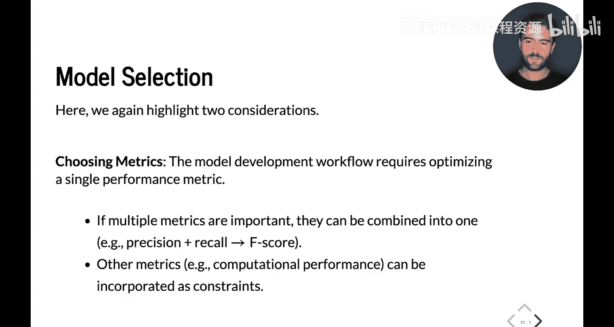

**考虑因素二：如何更新模型**

最后一个问题是，我们如何更新模型？我们将更详细地探讨这一点，但本质上，一旦我们观察了性能，我们就想决定是保留这个模型还是进行更改。这可以基于我们的直觉。例如，如果我们注意到模型过拟合了，那么我们知道需要更多地正则化它，这将指导我们在下一次迭代中尝试的新想法类型。或者，我们可以遵循一种系统化的方法，执行某种网格搜索，甚至还有来自名为“贝叶斯优化”等领域的更专门的算法可以用于此过程。我们稍后将对此提供更多直觉。

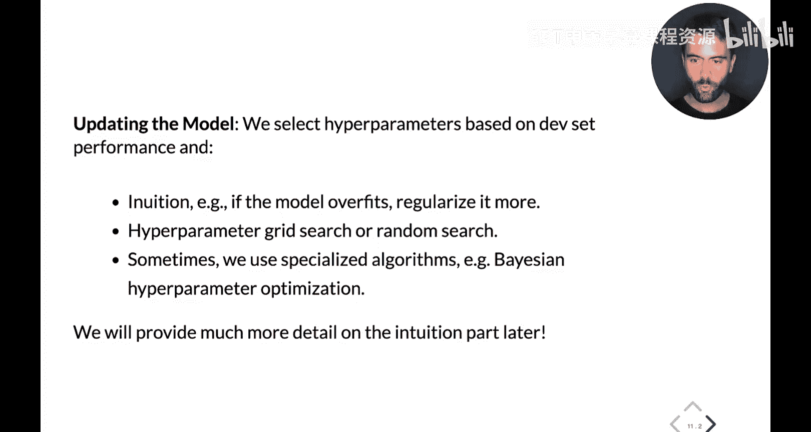

## 工作流程示例：训练神经网络 🧠

最后，我想用一个例子来总结。想象一下，我们正在训练一个神经网络，并且希望将这种工作流程应用于训练神经网络。

假设我们最初想进行图像分类。我们从卷积神经网络开始，在开发集上获得了90%的准确率。然后，我们可以观察其性能，发现它有点过拟合数据。于是，我们可以对Dropout层的强度进行网格搜索，看看是否能使其性能更高一些。然后我们发现，使用不同的值，我们可以获得95%的准确率，这就是我们下一个最佳模型。然后，我们甚至可以尝试一个全新的想法，例如在网络内部添加残差连接等新的架构元素。现在我们正在改变架构。假设我们这样做了，现在在开发集上获得了更大的性能提升。我们在训练集上重新训练新架构，在开发集上评估，现在获得了99%的性能，这更好了。现在我们非常满意，并在测试集上估计这个性能，现在性能略低，为97%，但仍然相当不错。但这表明我们略微过拟合了开发集的性能，因为我们只选择了在开发集上表现良好的更改。97%仍然很好，现在我们可以将模型部署到生产中，并且可以断言，一旦开始部署到真实图像上，这个模型的性能很可能在97%左右。

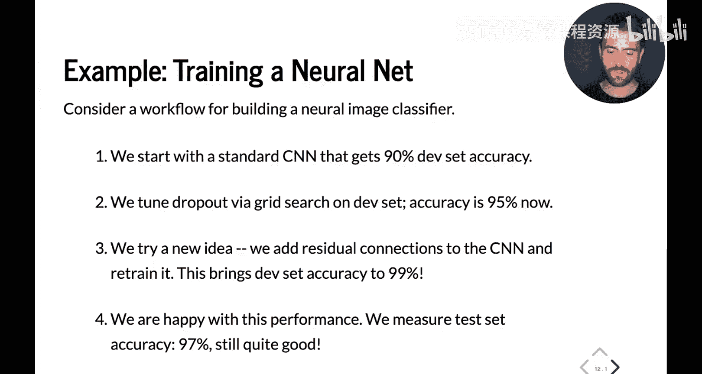

## 工作流程的局限性与总结 📝

最后，整个工作流程并非没有一些局限性。如前所述，过拟合开发集是一个我们可能遇到的问题。此外，在现实世界中，一旦模型运行并接收真实输入，用户提供给模型的输入类型往往会发生变化。例如，如果我们将这个模型部署到欧洲和北美地区，随着时间的推移，我们可能会有更多来自欧洲的用户，他们看起来与北美用户不同，因此我们在生产中看到的分布可能会发生变化。同时，我们可能在某些时候意识到，我们一直在优化的指标并不是用户真正关心的，我们需要进一步改变它。因此，在这些情况下，我们需要回过头来，对我们的流程进行更改。如果我们意识到这不是我们关心的，我们可能想要更改指标；如果我们过拟合了它们，或者它们不再代表整体分布，我们可能需要定期更新我们的开发和测试集。这些都是你应该意识到的局限性。

接下来，我们将更具体地探讨如何在这个工作流程中评估机器学习系统的性能。

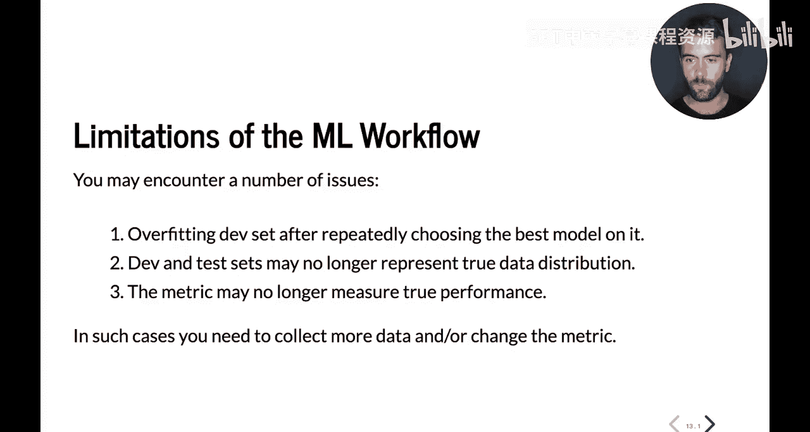

在本节课中，我们一起学习了机器学习开发的核心工作流程，包括数据集划分（训练集、开发集、测试集）、迭代改进模型的步骤、选择开发集与测试集的原则，以及模型选择中的关键考虑因素。这个系统化的方法旨在帮助我们高效地构建和优化能够良好泛化的机器学习模型。