# 20.2：第二部分：评估分类模型 📊

在本节课中，我们将学习如何评估机器学习模型。在上一节视频中，我们介绍了一个以原则性方式构建、迭代和改进机器学习模型的工作流程。该流程的一个关键步骤是理解和量化我们当前模型的性能，以及模型下一次迭代的表现。本节视频将定义一组适用于许多机器学习算法的重要指标，这些指标在整个机器学习领域中被广泛使用，并将作为量化我们性能的准确方法。我们将从分类问题开始。

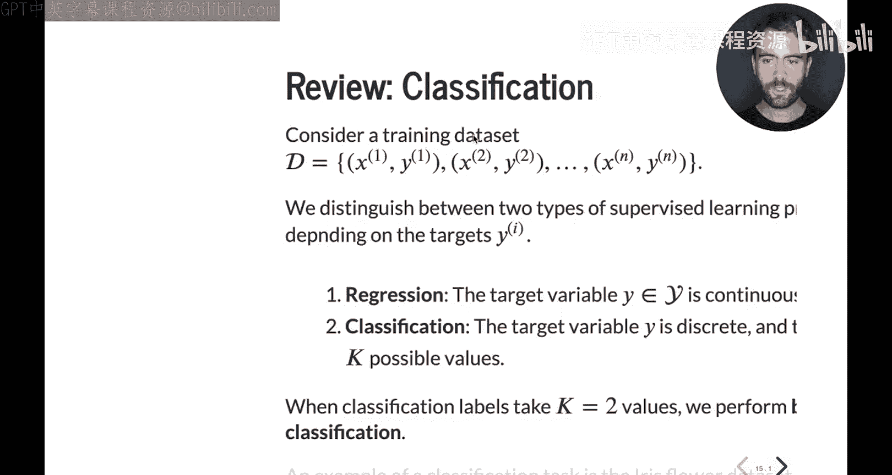

## 分类问题回顾 📈

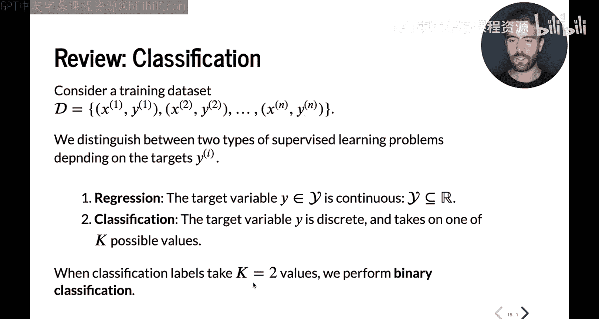

分类是监督学习的一种形式，其中我们的目标变量 **y** 是离散的，它取 **K** 个可能值中的一个，其中 **K** 是类别数量。如果 **K=2**，我们有一个特殊情况，称为**二分类**，此时我们只有两个类别。

一个分类任务的例子是我们在本课程中一直使用的**鸢尾花数据集**。在本视频中，我将创建一个此数据集的略微修改版本，其中一个类别的样本数量较少。通常，这个数据集有三个类别，每个类别有50个样本，但现在我只取120个样本：前两个类别各取50个，第三个类别取20个，从而使这个数据人为地变得不平衡。此外，我将使用一个函数将数据集分成两个子集：第一个子集记为 **X**，作为我们的标准训练集；另一个包含50个样本的数据集将作为我们的**保留集**。这个分割是随机进行的。

我们可以像之前一样在二维空间中可视化这个数据集，其中每种颜色对应三个不同类别中的一个。你可以看到棕色类别的点比其他类别的点少，这同样是因为我对这个数据集进行了子采样。此外，对于本视频将要进行的分析，我将只关注图中显示的以下两个特征，因此所有点都将是二维的。

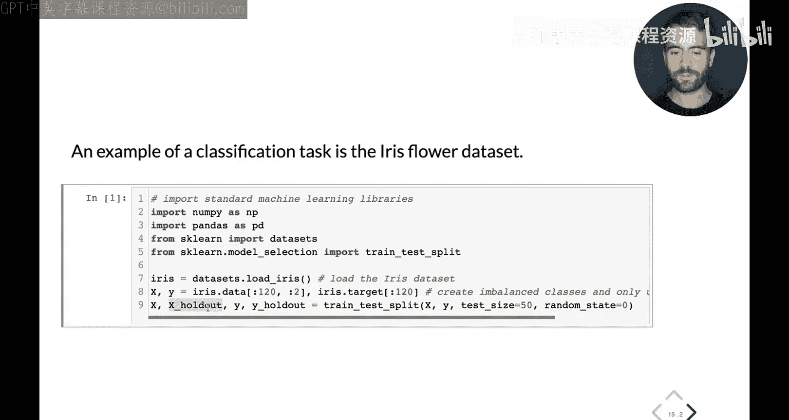

## 模型训练与预测 🚀

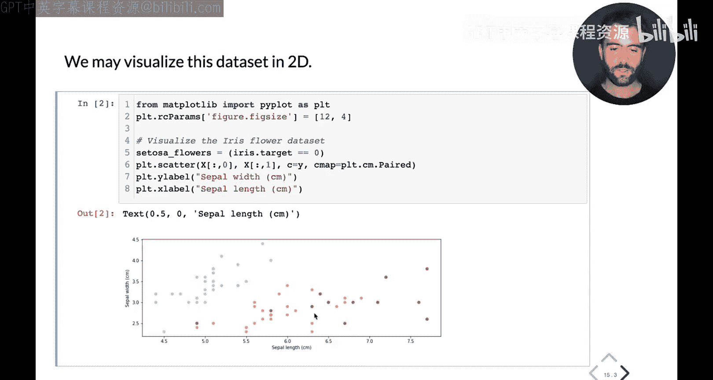

由于这是监督学习，我们处理的是具有特定形式的机器学习模型：我们有一个输入 **x**，我们的模型 **f** 将 **x** 转换为目标 **y**。

我们可以在刚刚创建的数据集上训练一个这种形式的模型。这里我将拟合一个 **softmax 模型**，它在 scikit-learn 中通过 `LogisticRegression` 类实现。我在这里实例化这个模型，然后在训练集上拟合它，接着在我们的保留集上生成预测。这组预测将存储在向量 **y_pred** 中。本视频中将要介绍的指标将量化这个向量 **y_pred** 的准确性、性能和质量。

## 准确率：最简单的性能度量 ✅

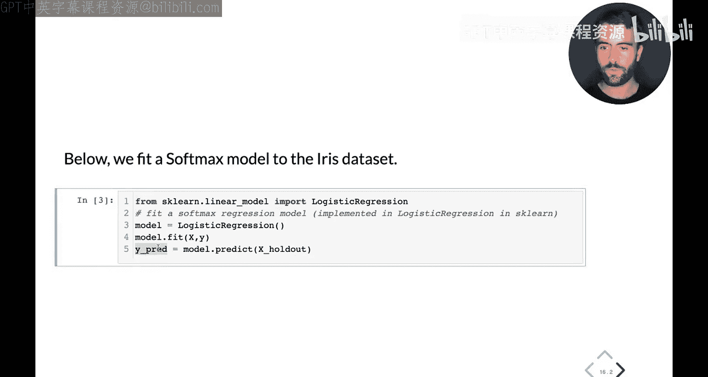

我们可以使用的最简单的性能度量是分类器的**准确率**，它简单地表示我们预测正确标签的点的百分比。当准确率达到100%时，我们完全准确；为0%时，我们完全不准确。在这个特定数据上，我们可以轻松测量准确率，只需一行 NumPy 代码即可完成。我们在这个数据上的准确率是 **84%**。

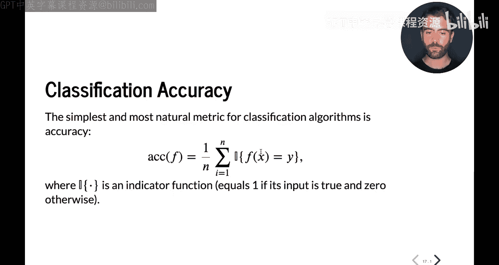

请注意，我们是在**保留集**上评估准确率，因为这是实际用于估计未来性能的预测集。此外，如果我们在进行模型迭代或模型选择，尝试不同的模型思路，我们希望使用这个保留集（或称为**开发集**）的准确率来指导我们的模型设计。

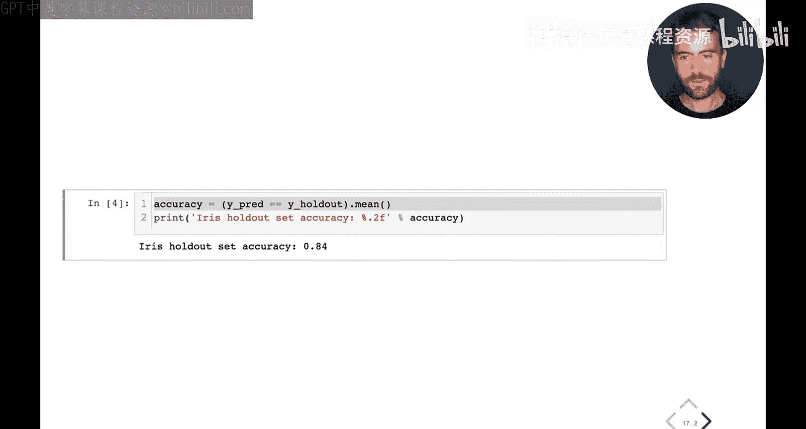

## 混淆矩阵：更详细的性能视图 📊

准确率并不是查看分类器性能的唯一方式。另一个有用的工具是**混淆矩阵**。混淆矩阵是一个简单的表格：如果我们有 **K** 个类别，那么我们有 **K** 行和 **K** 列。我将用变量 **y_j** 索引行（y轴），用变量 **ŷ_k** 索引列（x轴）。位于第 **y_j** 行、第 **ŷ_k** 列的单元格，包含了真实类别为 **y_j** 但被分类为 **ŷ_k** 的样本数量。

让我给你一个具体的例子。这里我使用 scikit-learn 中的 `plot_confusion_matrix` 函数为鸢尾花数据集的保留集生成混淆矩阵。如前所述，因为我们有 **K=3** 个类别，所以我们有三行三列。每列由类别索引 0、1 或 2 索引，行也是如此。如果我查看位于 (0, 0) 的单元格，这是真实类别为 0 且被正确分配为类别 0 的点数，我有 19 个这样的点。

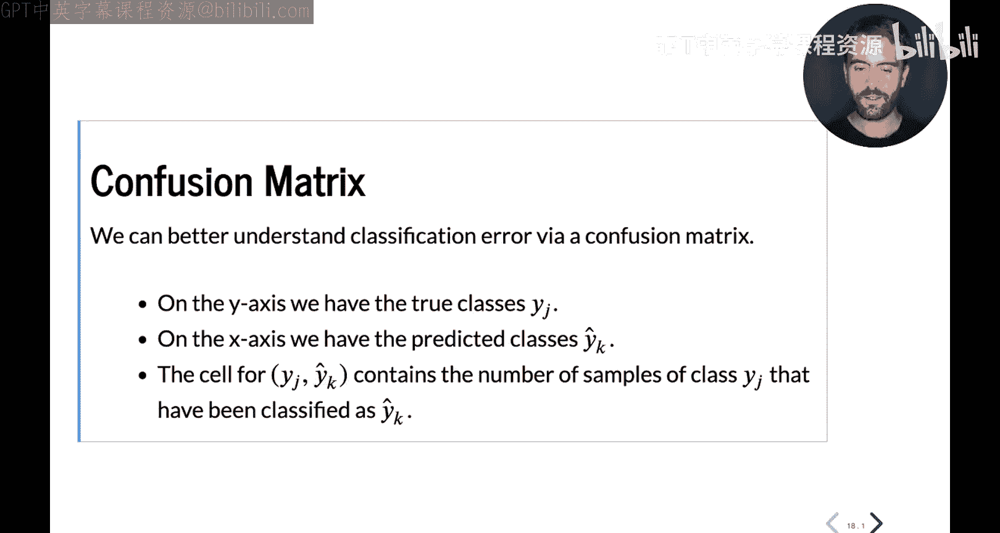

在单元格 (1, 1) 中，我有真实标签为 1 且预测标签也为 1 的点数，即它们被正确分类，我有 22 个这样的点。但是，我还有另外两个类别 1 的点：一个被错误地分配了标签 0，另一个被错误地分配了标签 2。所以，在总共 24 个点中，22 个被正确分类，2 个被错误分类。对于类别 0，我们总共有 19 个点，它们都被正确分类。所以，我们对这两个类别的分类效果非常好。

但是，如果我们看第三个类别（标签为 2 的类别），那么总共有 7 个点，但其中 6 个被错误分类，它们被错误地分配了标签 1。因此，实际上，尽管我们在这个数据集上的总体准确率是相当可观的 84%，但我们几乎完全错误分类了所有属于类别 2 的标签。这是通过查看混淆矩阵可以获得的一个重要附加信息。

## 二分类中的关键概念与指标 🔑

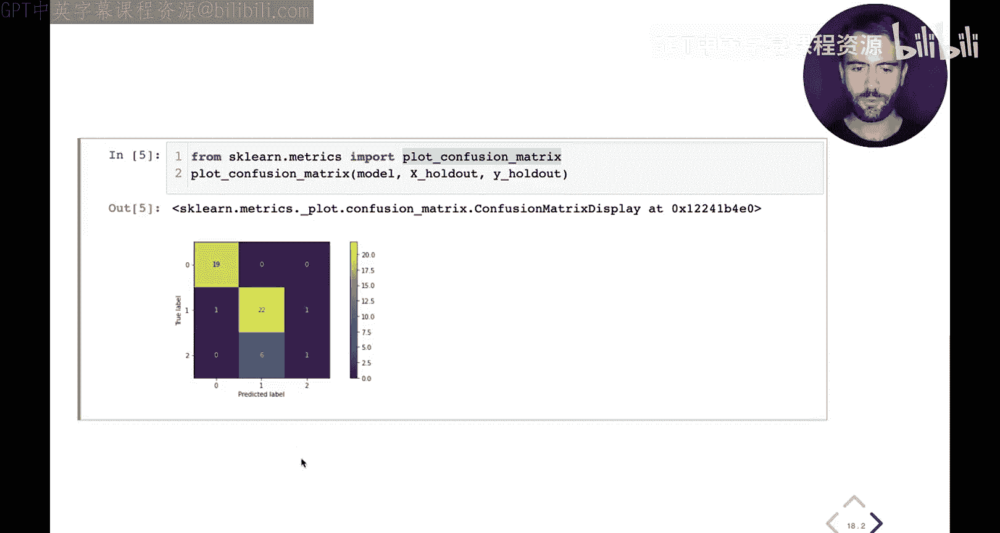

混淆矩阵还可以用来推导几个重要的概念、定义和用于衡量分类器性能的指标。首先在二分类的背景下定义它们会最容易。

在二分类中，我们的混淆矩阵只是一个 2x2 的表格。这里，我们的两行是两个可能的类别，列也对应两个类别。由于是二分类，我随机地将两个类别中的一个标记为**正类**（y=1），另一个标记为**负类**（y=0）。然后，在正类中，在真正为正类的点中，有一部分被正确分类为正类，这些是**真正例**，它们的数量在这个单元格中。但有一部分被错误地误分类为负类，因此它们的数量在**假反例**单元格中，它们被称为假反例。类似地，对于另一个类别，我们有**假正例**和**真反例**。

这些术语——真正例、假正例、假反例——在整个机器学习和统计学中都非常重要，了解它们是什么很重要，通过查看这个简单的 2x2 混淆矩阵很容易理解它们。

我们也可以使用这些术语来定义我们之前看到的**准确率**。准确率就是正确预测的数量除以总预测的数量。正确预测的数量是真正例和真反例的数量，除以所有预测的数量（即所有单元格中的数字之和）。这就是我们之前定义的准确率。

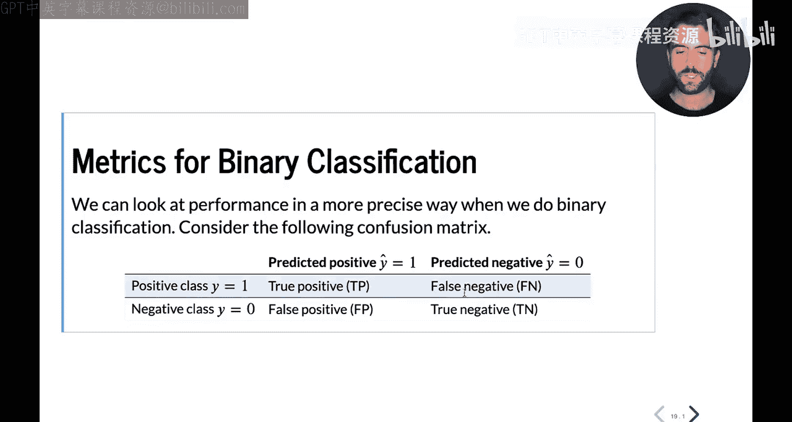

## 敏感度与特异度：更精确的度量 🎯

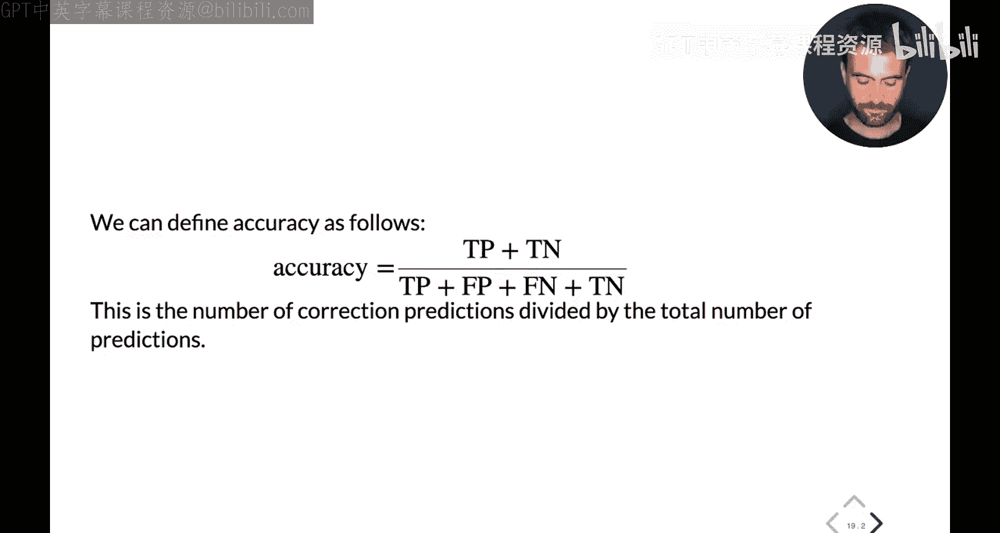

现在，我们可以定义更精确的准确率概念，称为**敏感度**和**特异度**。在许多应用中，例如在医学应用中，我们也希望衡量并在每个类别上达到最低的性能水平。我们希望正例和负例都准确。这就是敏感度和特异度所捕捉的。

**敏感度**，也称为**召回率**或**真正例率**，你可以将其视为正类上的“准确率”。因此，分子是真正例的数量，分母是正类点的数量，即真正例的数量加上假反例的数量。

类似地，**特异度**是负类上的“准确率”，即真反例的数量除以负类点的数量，负类点的数量是真反例的数量加上假正例的数量。

敏感度和特异度在机器学习和统计学中经常用于衡量二分类器的性能，理解和掌握这些概念非常重要。

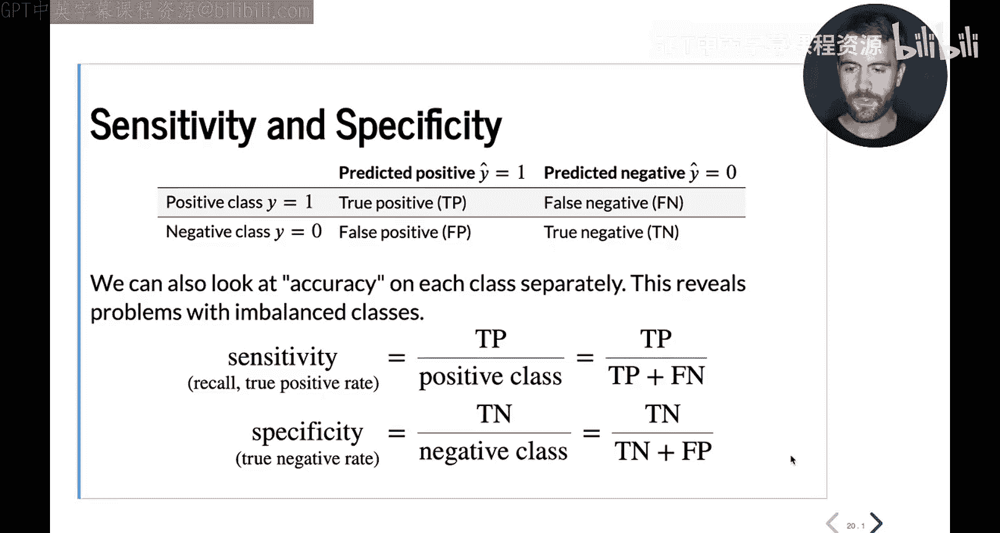

## 平衡准确率：综合敏感度与特异度 ⚖️

敏感度和特异度之所以有用，其中一个原因是，尤其是在类别不平衡的情况下，通常可能具有很高的特异度，但敏感度却很差。我们甚至可能具有很高的准确度和很高的特异度，但敏感度可能很低，反之亦然。因此，同时查看两者很重要。我们也可以查看一个将它们结合起来的单一度量，称为**平衡准确率**，它简单地取两者的平均值。这个度量对于检测类别不平衡以及其中一个度量表现不佳的情况很有用。

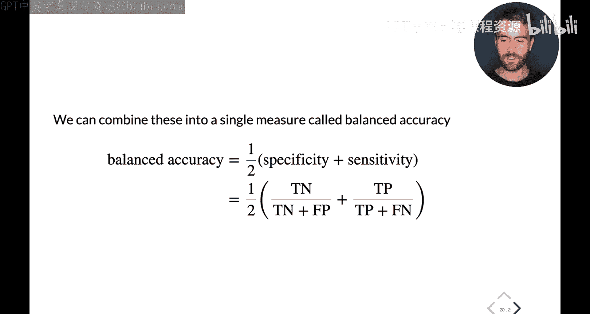

## 精确率与召回率：关注正类预测 🔍

另一组与敏感度和特异度类似但不完全相同的指标是**精确率**和**召回率**。

**精确率**，也称为**阳性预测值**，是真正例的数量占我们预测为正类的所有点的比例。我们预测为正类的点的数量是真正例加上假正例，这些是我们分配了正类标签的所有点，它们位于这一列中。

**召回率**与敏感度是同一个概念，即被正确识别的正类点的数量。

这两个度量在机器学习的应用中很有用，例如在信息检索中。例如，我们正在构建一个搜索引擎，我们想知道在所有相关结果（正类）中，我们分类为相关的结果有多少是真正相关的，这就是精确率；在所有存在的相关结果中，我们捕捉到了多少，这就是召回率。这就是一个可以思考精确率和召回率的应用场景。同样，如果我们构建一个搜索引擎，正例是相关的网页，那么精确率关注的是搜索引擎返回的所有网页中有多少是真正相关的，而召回率衡量的是我们找到了多少相关网页。

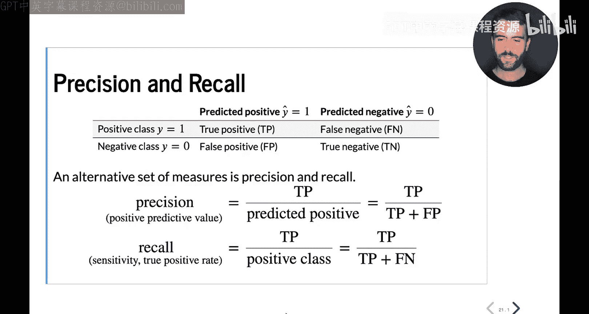

一个重要说明是，这并没有真正报告任何关于负类的性能。它只报告了关于正类预测的性能，我们没有量化我们在负例上的准确性。我们不这样做的原因是，在诸如搜索引擎的应用中，我们假设存在一个非常大的负类点集合，但我们并不真正关心我们是否将这些点识别为负类。我们只关心返回的点，这是用户唯一看到的东西，我们希望在这方面看起来准确。负类点，搜索引擎的用户永远不会看到它们，因此，将我们的分析重点放在这些点上就不那么重要了。

因此，精确率和召回率在此类应用中很有用。这也为我们在何时可能希望使用精确率和召回率，而不是敏感度和特异度提供了直觉。我想指出，如果我们有完美的精确率和召回率，我们也将有完美的敏感度和特异度，反之亦然。所以，这些度量并非完全不同，它们都衡量分类器的性能，但它们往往比其他度量更能揭示某些特性。例如，如果我们处于一个不关心真反例的环境中，比如在搜索引擎中，我们只关心识别正确的正例而不遗漏任何正例，那么精确率和召回率更有用。但是，例如，在医学环境中，我们正在检测一个人是否患有某种疾病，那么我们希望在正例（我们预测有疾病或疾病真正存在的例子）上报告我们的性能，同时也在没有疾病的患者上报告性能，我们也希望正确地告诉他们他们没有患病。因此，如果这两个值都很重要，那么通过查看特异度和敏感度，我们可以更清晰、更直观地了解我们系统的性能。

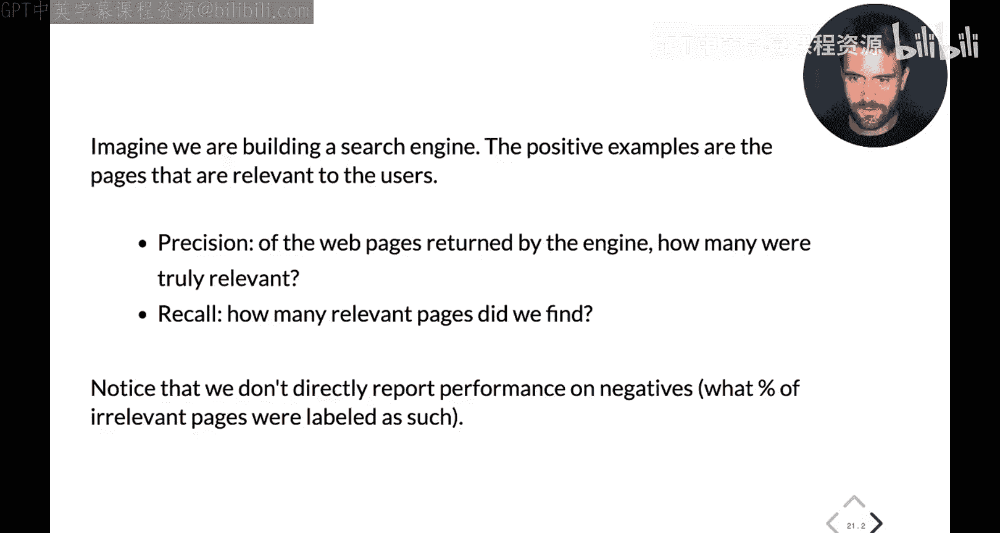

## F1 分数：结合精确率与召回率 📊

最后，可以将这些度量结合成一个单一的度量，称为 **F 分数**。F 分数定义为精确率和召回率的**几何平均值**。几何平均值使用这个公式定义：我们不取算术平均值，而是查看精确率和召回率的倒数，然后应用这个公式。它的特性是结合了它们，并且有用，因为首先，如果我们有完美的精确率和完美的召回率，它等于 1，这正是我们想要的；其次，如果精确率或召回率为 0，它也等于 0。这比算术平均值更有用，因为即使召回率为 0，算术平均值仍然可能非零。因此，在极端情况下，它能更好地捕捉我们期望的行为。

## 总结 📝

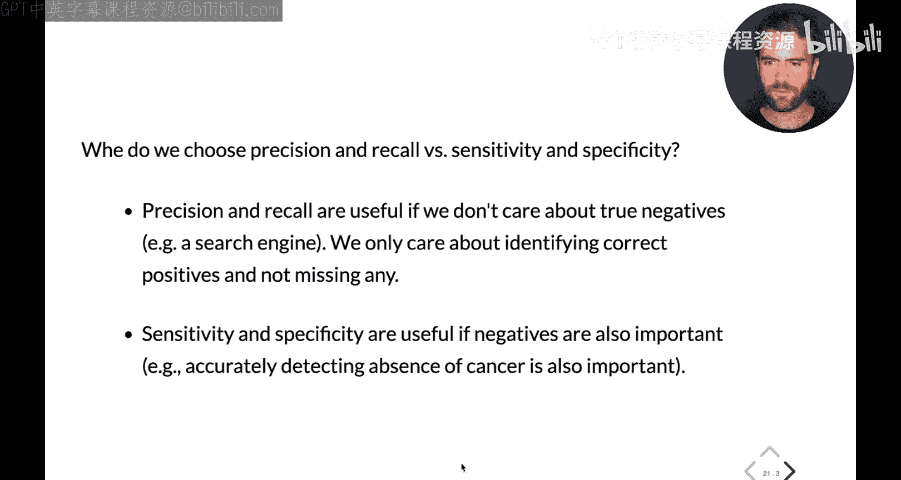

在本节课中，我们一起学习了评估分类模型性能的关键指标。我们从最简单的**准确率**开始，然后介绍了**混淆矩阵**，它提供了更详细的性能视图。基于混淆矩阵，我们定义了二分类中的核心概念：**真正例**、**假正例**、**真反例**和**假反例**。

接着，我们探讨了更精确的度量：**敏感度**（召回率）和**特异度**，它们分别衡量模型在正类和负类上的表现。我们还介绍了**平衡准确率**，用于综合评估类别不平衡时的性能。

然后，我们学习了**精确率**和**召回率**，这两个指标特别关注正类预测的质量，常用于信息检索等场景。最后，我们了解了如何通过 **F1 分数**（精确率和召回率的调和平均数）将精确率和召回率结合成一个单一的综合指标。

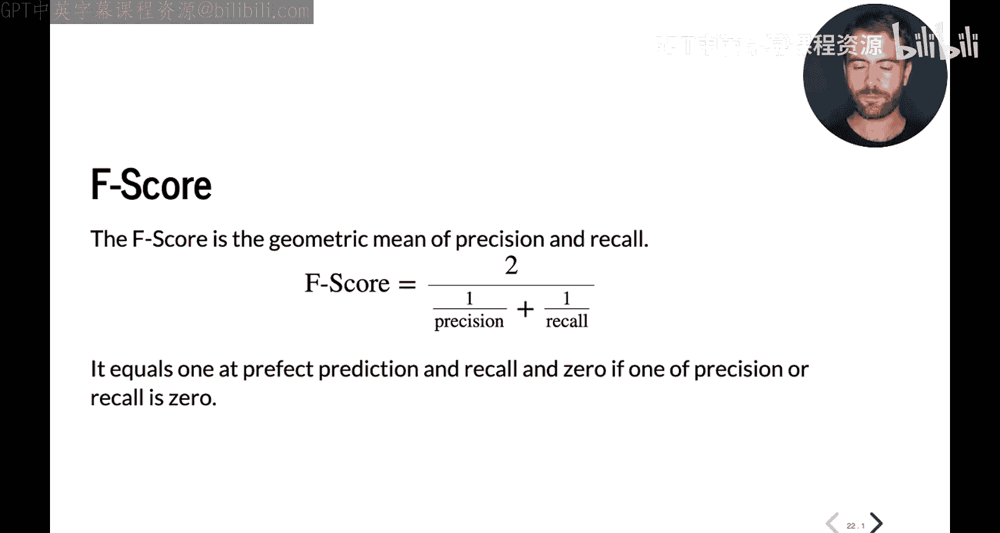

这些指标是评估分类算法性能的基础工具，理解它们对于构建和迭代有效的机器学习模型至关重要。在下一节视频中，我们将探讨一些更高级的分类评估指标。