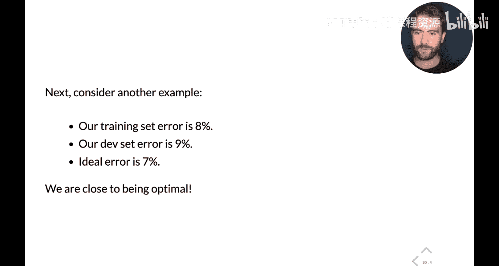

# 21.3：第3部分：基线模型 🧪


在本节课中，我们将学习一个用于诊断机器学习模型性能的重要工具：**基线模型**。基线模型帮助我们理解模型性能的好坏，为评估提供上下文和参考标准。

---

## 概述

在上一节中，我们讨论了模型评估的指标和方法。本节中，我们将介绍基线模型的概念及其在机器学习分析中的重要性。基线模型是用于比较的简单模型，帮助我们判断当前模型的性能是否令人满意。

---

## 什么是基线模型？

基线模型的核心思想是**将机器学习系统的结果和性能置于上下文中**。通过比较基线模型，我们可以更好地理解当前模型的优劣。

例如，假设你训练了一个回归模型，其平均L1误差为20。这个误差是好是坏？为了判断，我们可以计算训练集中所有目标值的平均值，并创建一个始终输出该平均值的模型。如果这个简单模型的误差也是20，那么我们的机器学习模型就没有学到任何有用的信息，因为它并不比简单地预测平均值更好。

在许多其他情况下，误差20可能是一个非常好的结果。因此，我们需要通过与其他模型比较来理解这个结果的好坏。

---

## 基线模型的类型

以下是几种常见的基线模型类型，它们可以帮助我们从不同角度评估模型性能。

### 1. 简单模型

简单模型包括随机猜测或输出常数/平均预测。这些模型虽然简单，但能揭示我们训练的机器学习模型的弱点。

**公式示例：**
- 平均预测：`y_pred = mean(y_train)`

### 2. 可解释模型

可解释模型如线性回归或决策树模型，可以作为基线模型与复杂的非线性模型（如神经网络）进行比较。有时，经过良好调优的线性模型性能可能与复杂的先进模型相当。

**代码示例：**
```python
from sklearn.linear_model import LinearRegression
model = LinearRegression()
model.fit(X_train, y_train)
```

### 3. 现有模型或上一代模型

在实际部署机器学习系统时，我们可能需要与现有的或上一代模型进行比较。这有助于评估新模型的改进程度。

### 4. 非机器学习方法

有些问题可能不需要机器学习，通过手动编写的规则或经典编程方法就能解决。这些方法通常更简单、易于维护且稳定。因此，与非机器学习基线模型比较也非常有用。

---

## 性能上下界

基线模型可以帮助我们确定性能的**下界**，即我们希望超越的最低性能标准。同时，我们还需要估计性能的**上界**，即最优性能。

最优性能通常非零，即使在图像识别或语音识别等任务中，人类也无法达到完美性能。因此，估计最优性能有助于指导我们的努力方向。

**公式示例：**
- 总误差 = 可避免偏差 + 不可避免偏差 + 方差
- 可避免偏差 = 训练误差 - 最优误差
- 不可避免偏差 = 最优误差

---

## 如何估计最优性能？

估计最优性能有多种方法，以下是几种常见的方式：

### 1. 人工标注

通过人工标注数据，我们可以估计人类在随机子集或开发集上的性能。如果人工标注成本过高，可以使用众包服务（如Amazon Mechanical Turk）。

### 2. 下游应用需求

下游应用可能对性能有特定要求，这些要求可以作为我们的目标或上界。

### 3. 偏差-方差分析

通过引入最优误差的概念，我们可以更精确地量化偏差和方差，并将其分为可避免和不可避免的部分。

---

## 偏差-方差分析示例

假设我们有以下性能数据：
- 最优误差：7%
- 训练误差：8%
- 开发误差：9%

在这种情况下，训练误差和开发误差都接近最优误差，说明模型性能已经接近理想水平。如果训练误差远高于最优误差，则存在可避免的偏差；如果开发误差远高于训练误差，则存在方差问题。

**公式示例：**
- 偏差 = 训练误差 - 最优误差
- 方差 = 开发误差 - 训练误差

---

## 总结

在本节课中，我们一起学习了基线模型的概念及其在机器学习分析中的重要性。基线模型帮助我们理解模型性能的上下文，通过比较简单模型、可解释模型或非机器学习方法，我们可以更好地评估当前模型的优劣。此外，通过估计性能的上下界，我们可以更精确地进行偏差-方差分析，指导模型改进的方向。



基线模型是机器学习实践中不可或缺的工具，它让我们的评估更加全面和可靠。在下一节中，我们将进一步探讨如何利用这些工具优化模型性能。