# 22.1：第1部分：学习曲线 📈

在本节课中，我们将继续探讨如何在实践中应用机器学习，以及如何运用系统性的方法和技术，使机器学习系统在现实应用中提供良好且可靠的性能。本讲的重点是介绍各种有助于诊断模型性能的工具和技术，这些工具能提供比我们目前所见更深入的模型性能视图。

## 概述

上一讲我们讨论了机器学习实践中的一般性问题。本节中，我们将介绍一种名为“学习曲线”的新工具。学习曲线能帮助我们理解如何解释当前的性能水平，以及如何对机器学习模型进行何种调整。

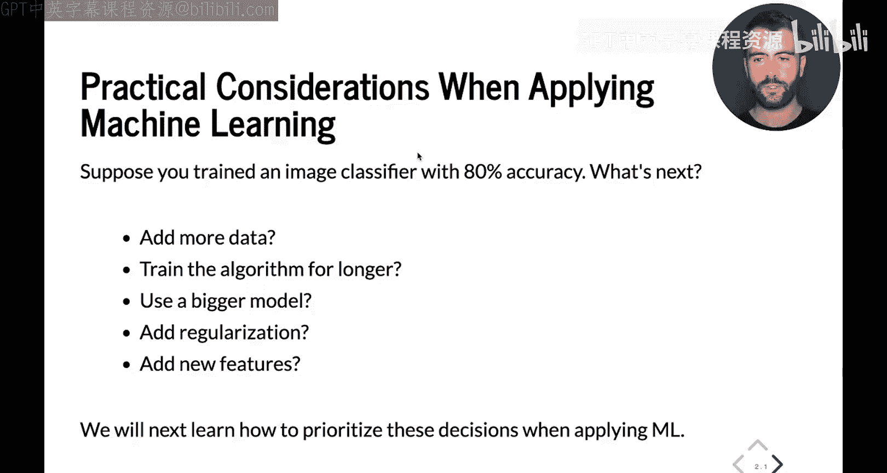

## 学习曲线的动机

整体而言，本系列讲座的动机可以用以下例子概括：假设我们训练了一个机器学习分类器，其准确率达到了可接受的水平（例如80%）。作为系统开发者，我们想知道下一步该做什么：是添加更多数据、尝试更复杂的模型，还是增加更多特征？我们希望找到系统性的方法来优先处理这些决策，以最小的努力快速达到良好的准确率水平。

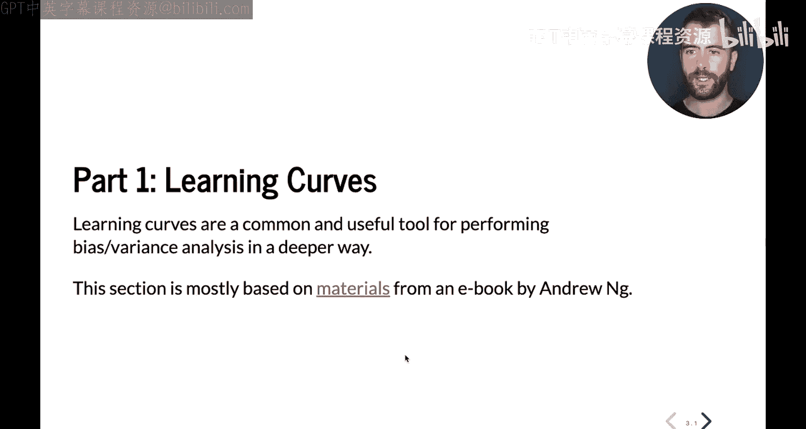

## 偏差与方差问题回顾

在之前的课程中，我们了解到机器学习模型通常受两类问题影响：过拟合和欠拟合。

*   **过拟合**：当我们尝试将一个表达能力非常强的模型（例如高阶多项式）应用于数据量不足以支撑该模型容量的数据集时，就会发生过拟合。结果，模型会“记住”训练集，其学到的解仅在训练集上表现良好，而在新数据上表现不佳。过拟合的模型也被称为**高方差**模型。之所以得此名，是因为如果我们稍微扰动训练集，模型在训练集之外的预测结果往往会大不相同。由于过拟合算法的输出对训练集的微小变化很敏感，我们称之为高方差。
*   **欠拟合**：与高方差问题相反的是欠拟合，也称为**偏差**。这意味着我们尝试使用的模型对于所拥有的数据集来说过于简单。例如，我们可能试图用一个线性函数去拟合一个非常复杂的高阶多项式。我们最多只能捕捉到总体趋势，但无法准确学习信号的全部内容。当一个模型无法拟合数据时，我们说它具有高偏差。

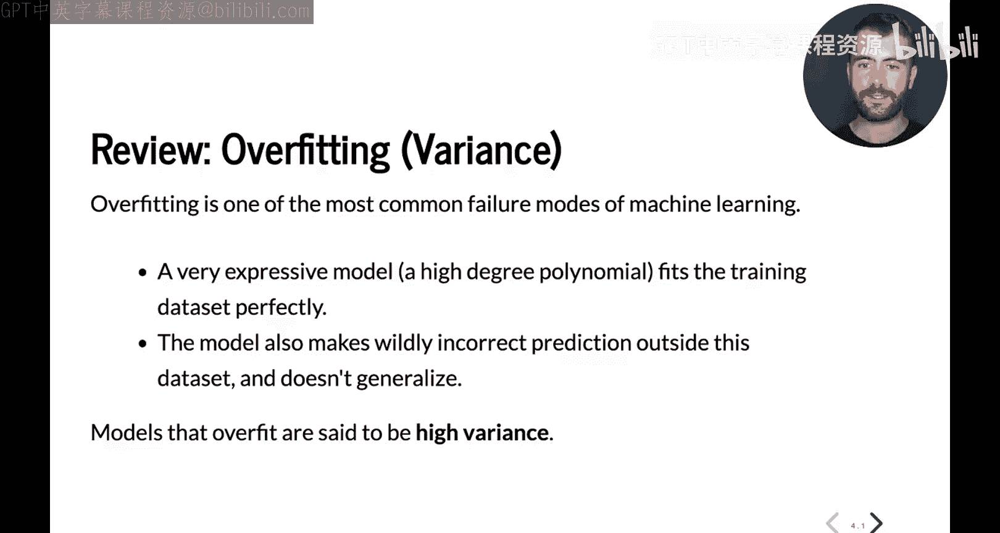

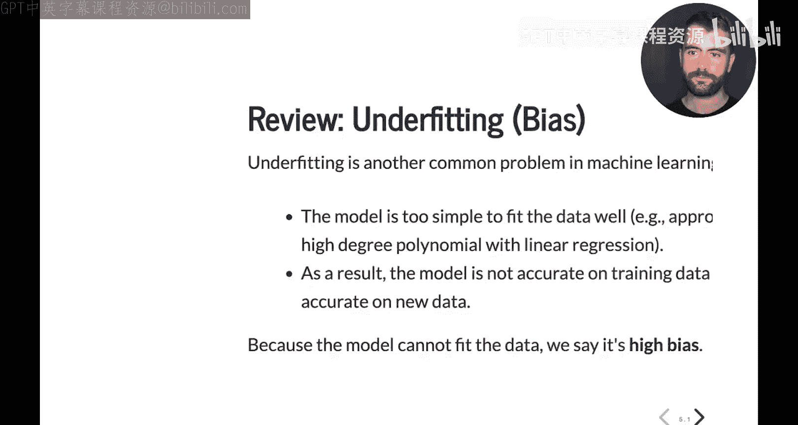

这两类问题几乎是定义上机器学习中仅有的两类问题：要么我们没有正确拟合训练数据，要么我们拟合了训练数据但解无法泛化。如果我们很好地拟合了训练数据并且解能够泛化，那么我们就解决了问题。因此，几乎可以定义，任何阻碍机器学习算法达到最佳性能的问题，要么是偏差问题，要么是方差问题。这就是理解这两类问题的重要性所在。

## 什么是学习曲线？

学习曲线是通过以下图表来更深入理解过拟合和欠拟合的一种方法。这里有一个学习曲线的例子。

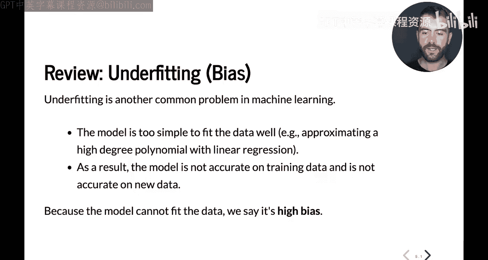

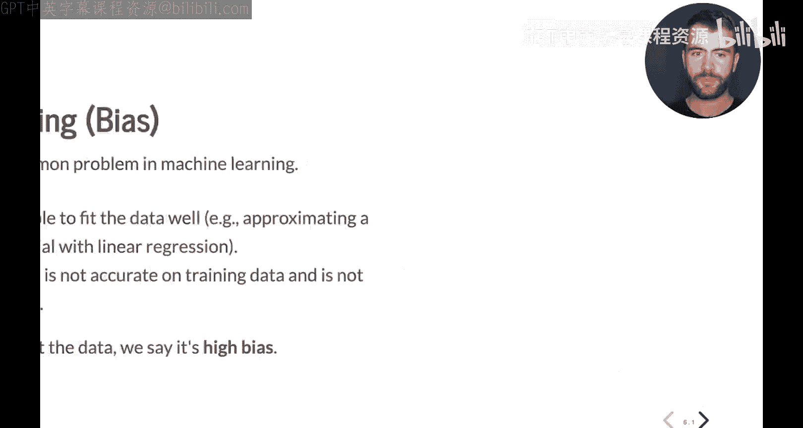

这张学习曲线图展示了模型性能随训练集大小的变化关系。

*   **X轴**：表示用于训练的数据点数量。我们从较小的数量开始，随着在X轴上向右移动，数据量逐渐增加。
*   **Y轴**：表示模型产生的误差。原则上，这可以是任何性能度量指标。

图中红色的曲线是学习曲线，它展示了机器学习模型在**开发集**上的性能如何随训练集大小变化。可以看到，随着我们给模型提供更多数据，它的性能变得更好，因此红色的开发集误差下降。

需要注意的是，这条曲线是针对使用**特定一组超参数**的模型定义的，并且这组超参数是**固定**的。因此，对于每个训练集大小 `M`，为了获得对应的性能点，我们都会重新训练模型，但关键在于，在整个曲线生成过程中，我们**重用同一组超参数**。例如，我们使用具有相同层数和层大小的神经网络，或者如果使用岭回归，则保持相同的正则化参数。这样，曲线上不同点之间才具有可比性。

## 理想性能与数据需求

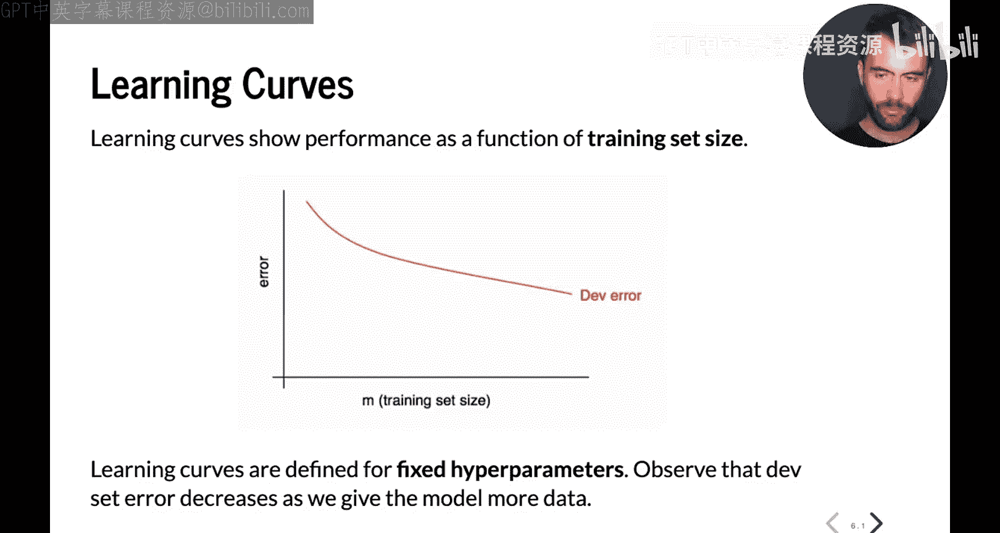

在此图中还可以显示其他元素，其中之一是我们的性能上限或理想/期望性能，我在图中用绿色表示。通常，在构建机器学习系统时，设定一个我们希望达到的性能目标上限非常有用。这使我们能够估计还有多少工作要做，更系统地优先考虑对模型的更改，并为我们提供关于导致效率低下的原因的直觉。它还可以帮助我们诊断模型所犯错误的类型。

在同一张图上显示期望性能（绿色）后，学习曲线立即为我们提供了另一组有用的信息：即我们的算法当前需要多少额外数据才能达到某个期望的性能水平。

在这个特定例子中，可以看到开发集误差呈下降趋势，即使在我们提供了现有最大数据量时，它似乎仍在继续线性下降。因此，通过观察此图，我们可以推断开发集误差的未来走向。似乎如果我们再提供大约两倍（甚至可能更少）的数据，按照这个速度，它很快就能达到我们期望的性能水平。这告诉我们，收集更多数据将非常有益，并且有一个简单的解决方案可以实现我们所需的性能水平。

因此，在查看学习曲线时，可视化最优、理想或期望性能通常非常有用。

## 识别性能瓶颈

相对于期望性能水平查看学习曲线，也可以告诉我们存在其他类型的问题，并且我们可以识别出比刚才展示的例子更棘手的问题。

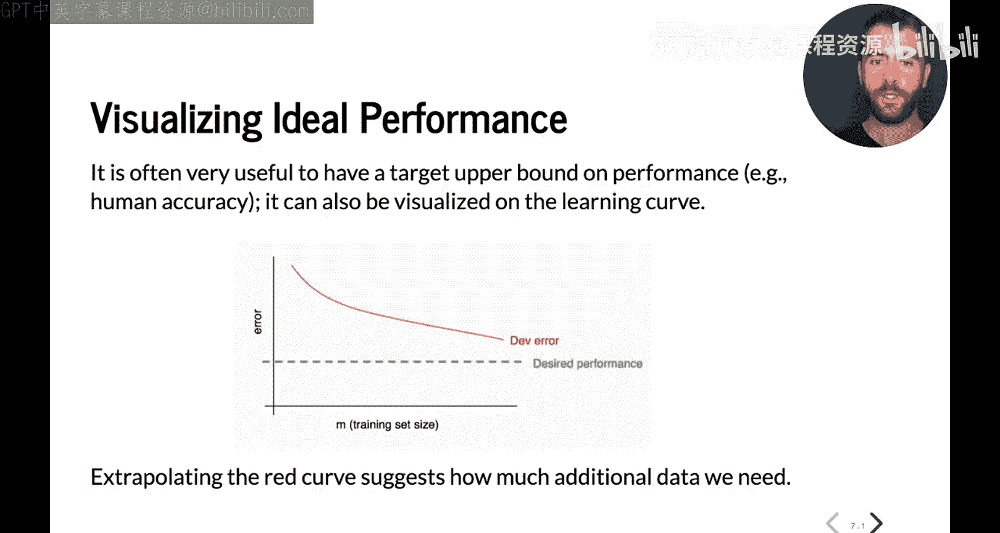

在这个例子中，可以看到开发集误差已经趋于平稳，即使我们提供更多数据，它仍然表现出相同的性能水平。因此，这是一个通过观察曲线我们发现，收集更多数据并将其提供给模型**无法解决**我们问题的例子。这同样是构建这些模型时非常有用的信息，对于指导我们的工作非常重要。

## 训练误差学习曲线

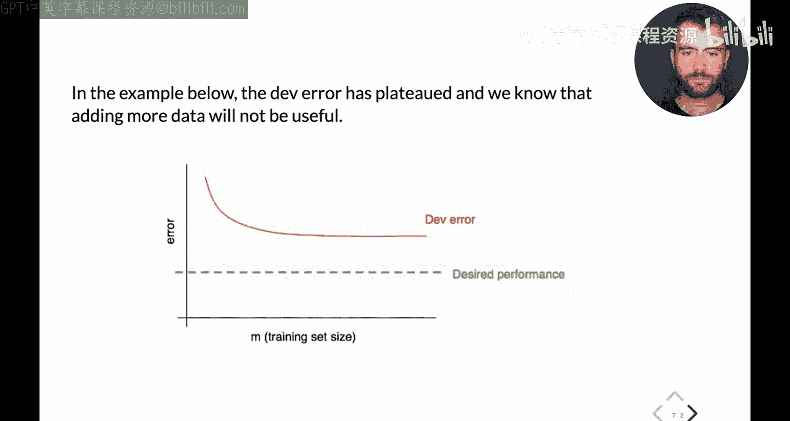

学习曲线不仅可以在开发集上测量，也可以在训练集上测量。图中蓝色的曲线表示训练误差。

这里有几个重要的观察点：

1.  我们的训练误差几乎总是（实际上应该总是）低于开发误差。这仅仅是因为训练误差是我们可以直接优化的目标，我们可以拟合一个直接最小化训练集的模型。而开发误差除了训练集本身的误差外，还需要泛化到开发集。因此，从训练到开发，我们不仅需要准确拟合训练集，还需要泛化到开发集，这是一个更难的问题，所以开发误差总是高于训练误差。
2.  与开发误差不同，训练误差随着我们给模型提供更多数据而**增加**。其直觉如下：如果我们有一个或两个训练点，模型很容易“记住”这两个点（我们在此曲线的每个点都使用相同的超参数集，因此模型表达能力相同）。但随着我们给模型越来越多的数据，它不再能够完美拟合这些数据，因此其训练误差增加。一个具有固定容量的模型，面对一个非常大的、包含许多需要建模的边缘情况的数据集，在固定的表达能力下，将无法完美拟合一个庞大的训练集。因此，对于更大的训练集，我们的训练误差会更高；而对于可以记忆的微小数据集，训练误差几乎完美。

这些是关于训练误差曲线形状的两个观察点。当你构建自己的学习曲线时，你应该也能看到我描述的这些现象。

## 诊断高偏差问题

利用开发集和训练集上的学习曲线，我们可以诊断之前在课程中看到的许多错误，特别是可以更精确地诊断偏差和方差问题。

下图所示的曲线代表了一个**高偏差**数据集或一个对于我们所拥有数据来说偏差过高的模型。

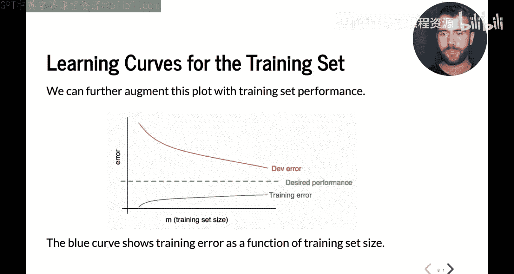

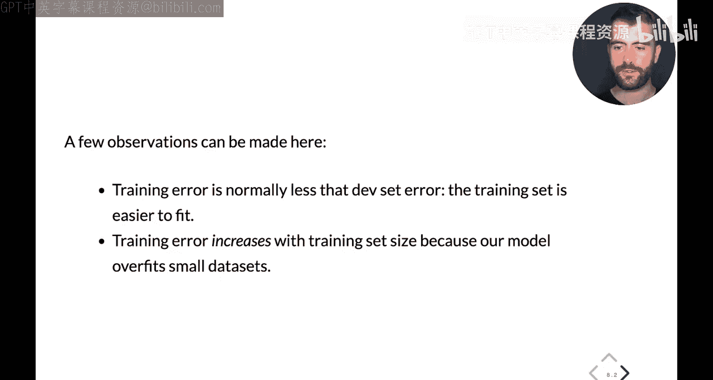

随着我们给模型更多数据，它不再能够很好地拟合，并且稳定在一个仍然远低于期望性能水平的高错误率上。这表明模型无法很好地拟合数据，因此我们面临一种偏差问题。

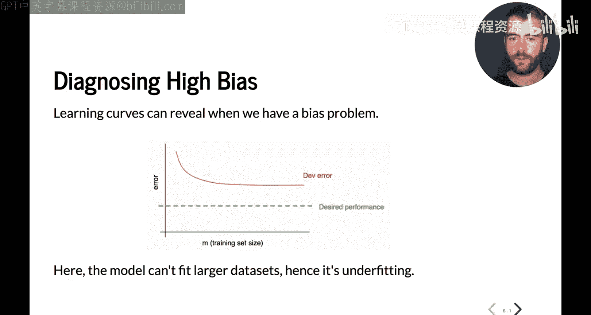

在实践中，通过同时查看训练误差来诊断这个问题要容易得多。一个原因是，仅凭视觉可能不容易检测开发误差何时达到平台期。从更实际的角度来看，拥有额外的信息源——即训练误差学习曲线——总是好的。

在这里我们看到，训练误差也在增加并趋于平稳，稳定在一个相当高的水平。这为我们提供了强有力的证据，表明给模型更多数据将不再有帮助，模型根本无法很好地拟合我们已有的数据。这提供了额外的证据，因为我们知道训练误差必须始终低于开发误差。现在训练误差稳定在一个过高的水平，开发误差将无法进一步下降，因为它无法跨越蓝色曲线。因此，我们的红色误差确实处于平台期，并且永远不会达到绿色的期望性能水平。

这种类型的学习曲线是高偏差问题的特征，它使我们能够更可靠地诊断偏差问题，并提供比常规偏差-方差分析更多的信息。常规分析可能只关注特定数据量 `M` 下的开发误差、训练误差和期望性能值。而通过查看所有值、查看整个曲线，我们可以更可靠地确定我们是否真的存在过拟合问题，或者是否真的存在偏差问题。通过查看整个学习曲线，而不是仅仅一个点，我们可以更有信心地进行这些诊断。

## 诊断高方差问题

同样，学习曲线也可以帮助我们诊断高方差问题。

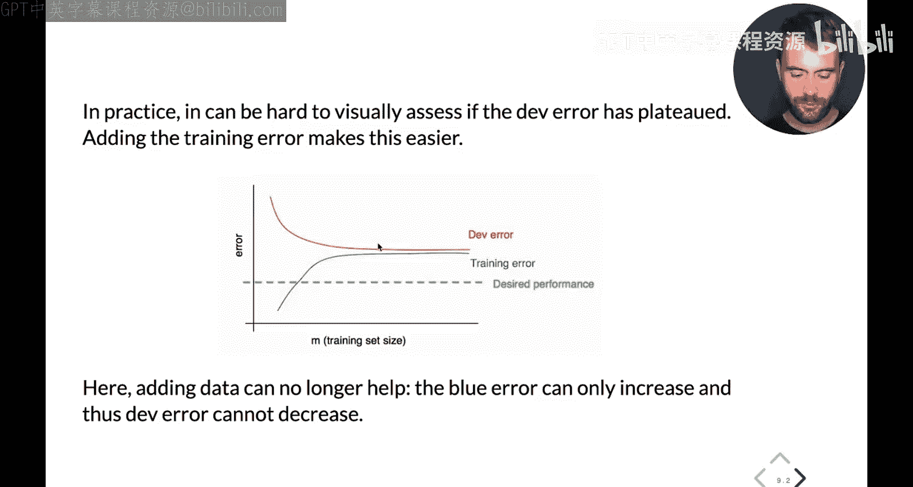

在这个例子中，我们的训练误差很好，接近最优，但我们的开发误差明显更高。这表明我们处于一个由于这个差距而无法很好泛化到开发集的阶段。因此，我们可以给这个模型更多数据。我们还可以看到，随着提供更多数据，这些曲线仍在快速变化。所以，如果我们推断这些曲线的形状，以及红色曲线和蓝色曲线之间仍然存在很大可填补的差距这一事实，我们可以预期开发误差会降低。这与我们的直觉相符：模型既存在过拟合，而提供更多数据将有助于缓解过拟合。提供更多数据是防止过拟合的最佳方法，并且我们根据这条曲线预期该解决方案会奏效。

## 同时存在高偏差和高方差

最后，在这个例子中，我们同时存在高方差和高偏差。

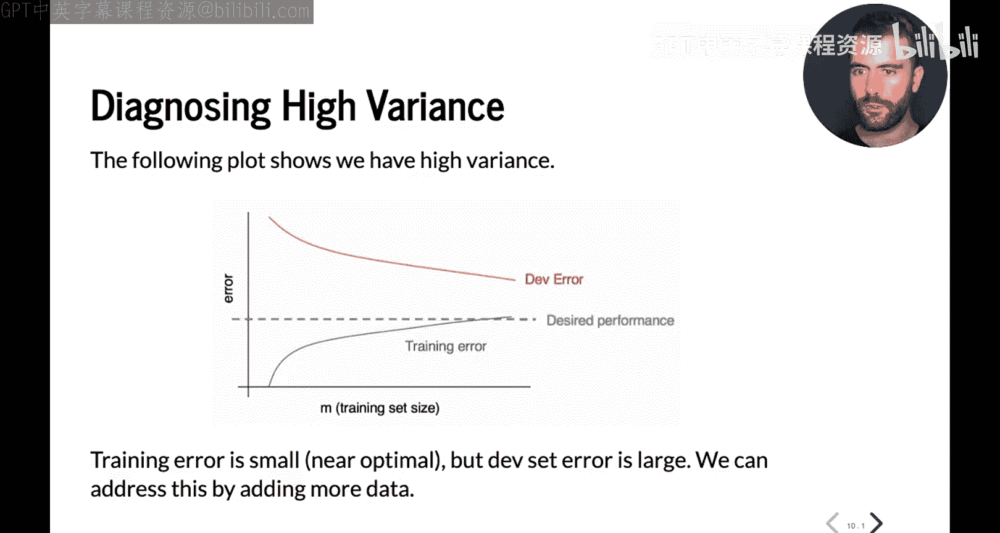

蓝色曲线达到的平台期显著高于绿色性能水平，而红色曲线甚至比蓝色曲线更高。这表明我们同时存在偏差和方差问题。

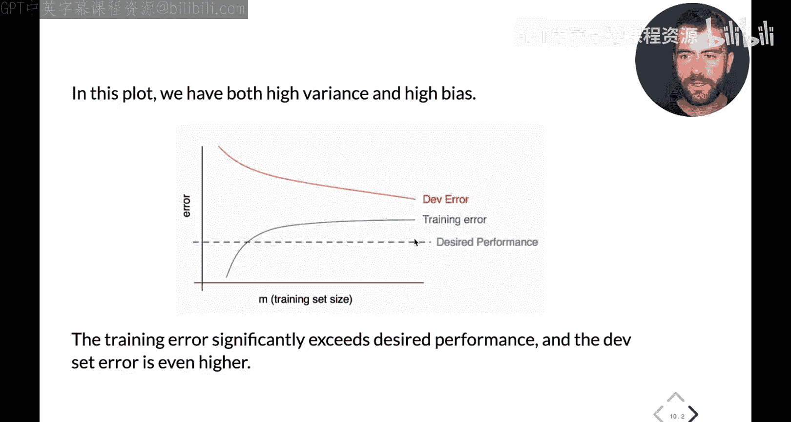

## 实例分析：手写数字识别

为了进一步说明学习曲线，让我们看一个在本课程早期见过的算法实例。

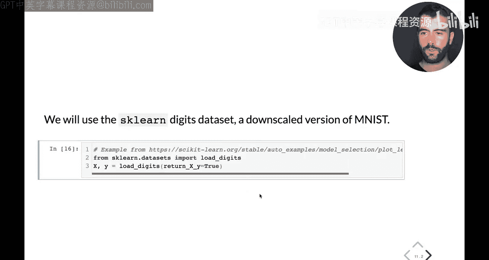

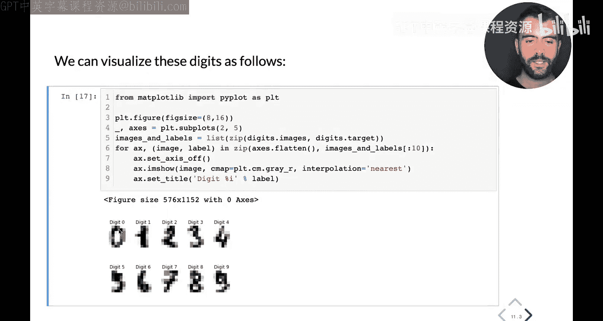

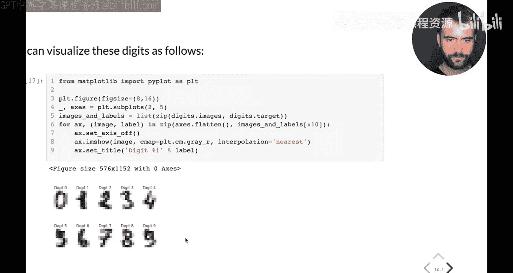

对于这个例子，我们将使用 `scikit-learn` 的数字数据集，这是我在早期讲座中介绍过的 MNIST 数据集的降维版本。它包含手写数字，已降维到 8x8 的网格。这里展示了每个数字的样本，以便了解它们的外观。

以下代码定义了一些用于可视化学习曲线的样板代码。你不需要理解这段代码来理解这个例子，核心示例在下面。

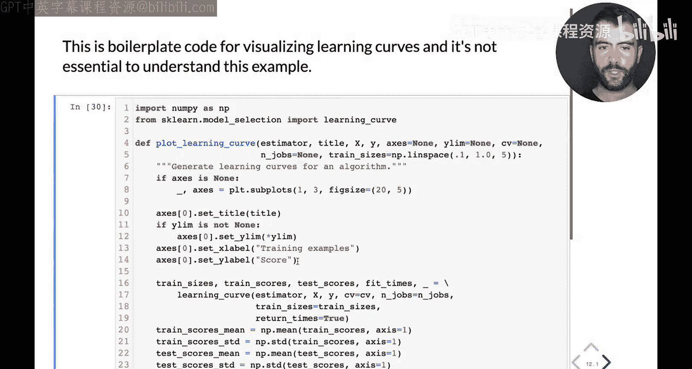

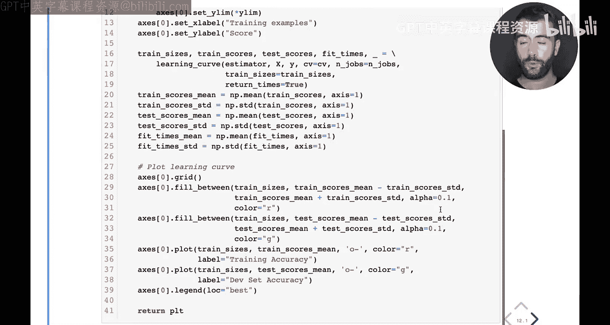

现在，我将使用上述函数为数字数据集上的两种算法生成学习曲线。

第一种算法是**高斯朴素贝叶斯模型**，这是朴素贝叶斯算法对连续输入 `X` 的扩展。回想一下，最常见的标准朴素贝叶斯形式假设 `X` 是离散值，但我们也可以定义一个适用于连续输入的版本，它是一个略有不同的变体。

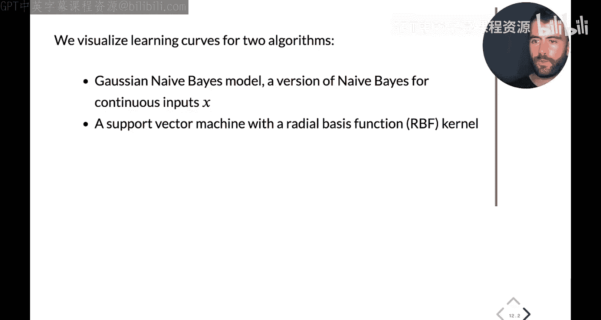

我们还将把它与使用**RBF（径向基函数）核**的支持向量机进行比较。RBF核有时也可能被称为高斯核，因为它使用高斯分布（钟形曲线）来衡量两个输入之间的距离。

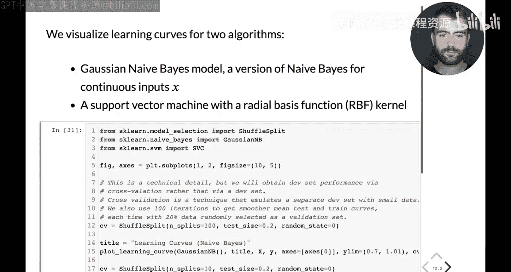

现在，在这段代码中，我们为两种算法生成学习曲线：左侧是高斯朴素贝叶斯模型，右侧是SVM。Y轴表示开发集上的准确率。

你可以看到，其形状符合我们之前的直觉：随着给模型更多数据，训练准确率下降，但开发集准确率上升，然后这两条曲线稳定在大约85%的准确率水平。我们看到，一旦达到大约1400个数据点，高斯朴素贝叶斯算法就不再真正受益于拥有更多数据，我们基本上已经达到了该算法当前能处理的最佳数据量。这是一个相当低的值，这与朴素贝叶斯是一个相当简单的线性算法的事实一致，因此对于像我们试图分类的数字这样更复杂的数据集，它往往达到较低的性能水平。

这里我们展示了使用RBF核的SVM的性能。SVM，尤其是带有RBF核的SVM，是一种表达能力更强且非线性的算法。因此，其性能明显更高。开始时，红色训练曲线和开发集之间存在巨大差距。随着我们提供更多数据，开发集性能提高。这里有趣的是，训练准确率几乎不下降，这再次表明这是一个表达能力非常强的模型，即使对于大型数据集也能很好地拟合。但我们看到，如果我们给算法大约600或800个样本，我们将处于曲线急剧下降的区域，那么我们的学习曲线分析会告诉我们，需要给它更多数据。即使在这里，如果我们有更多数据，仍然可以给模型提供，它可能还会继续改进。

此外，这里绿色和红色曲线之间可能仍存在微小差距，这表明可能存在一点过拟合。因此，我们可能希望调整超参数 `gamma` 来解决这个问题。

总之，这些图是在真实算法上生成的，并且与我们之前概述的理论一致。

## 学习曲线的局限性

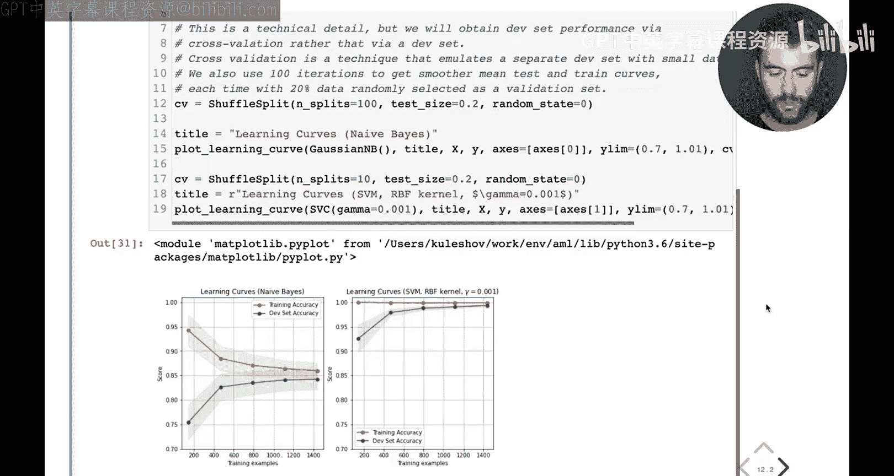

最后，关于学习曲线可能存在的局限性：

1.  **计算时间**：计算这些曲线需要一定的时间，因为我们必须为数据的每个子集重新训练算法。
2.  **噪声**：如果数据量很小，这些曲线的形状有时可能会有噪声。例如，如果我们只有20个样本，根据我们选择哪20个样本，我们可能会有不同的性能水平。这就是我所说的学习曲线可能有噪声的意思。为了纠正这一点，我们需要对多个20点子集进行平均，这又会增加计算强度。
3.  **需要经验解读**：学习曲线需要人类直觉来解读，并且需要一些经验才能更熟悉这些曲线。

## 总结

本节课中，我们一起学习了**学习曲线**这一重要工具。我们了解到，学习曲线通过绘制模型性能（如误差或准确率）随训练集大小变化的图表，帮助我们深入诊断模型是存在**高偏差（欠拟合）** 还是**高方差（过拟合）** 问题。我们探讨了如何结合**训练误差曲线**和**开发集误差曲线**进行更可靠的诊断，并通过手写数字识别的实例看到了学习曲线在实际算法中的应用。最后，我们也认识了学习曲线在计算成本、噪声和解读经验方面的局限性。掌握学习曲线，能为我们系统性地改进机器学习模型提供宝贵的指导。