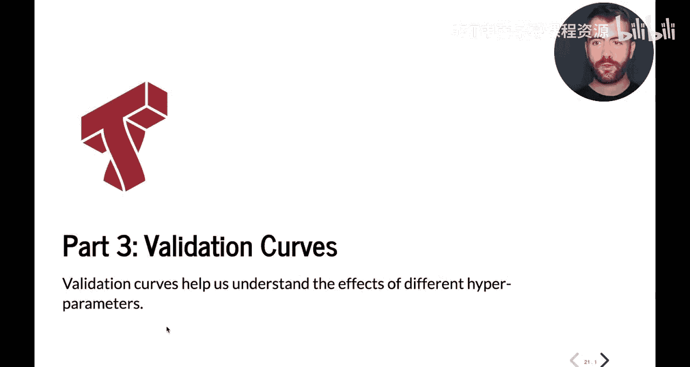
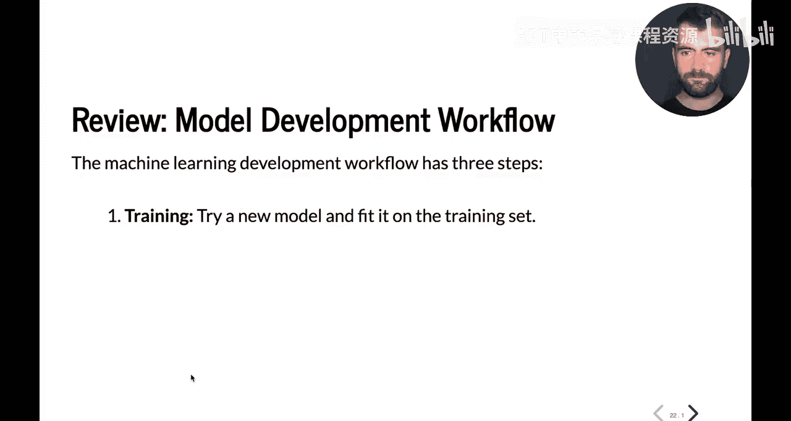
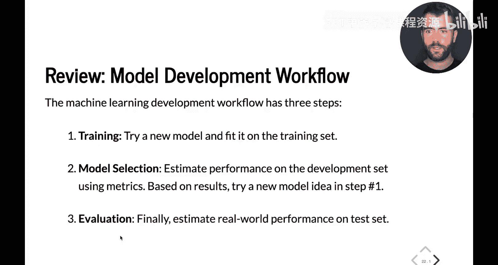
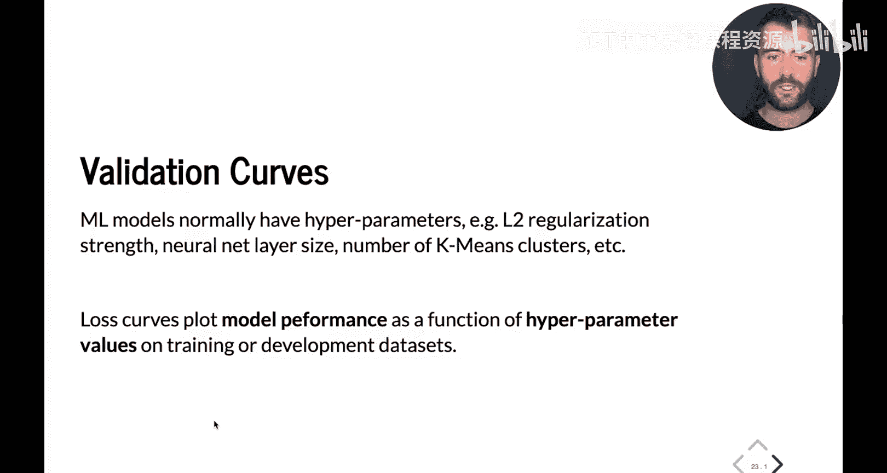
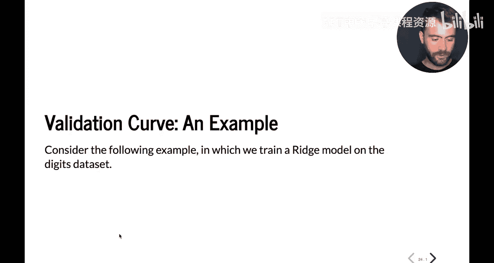
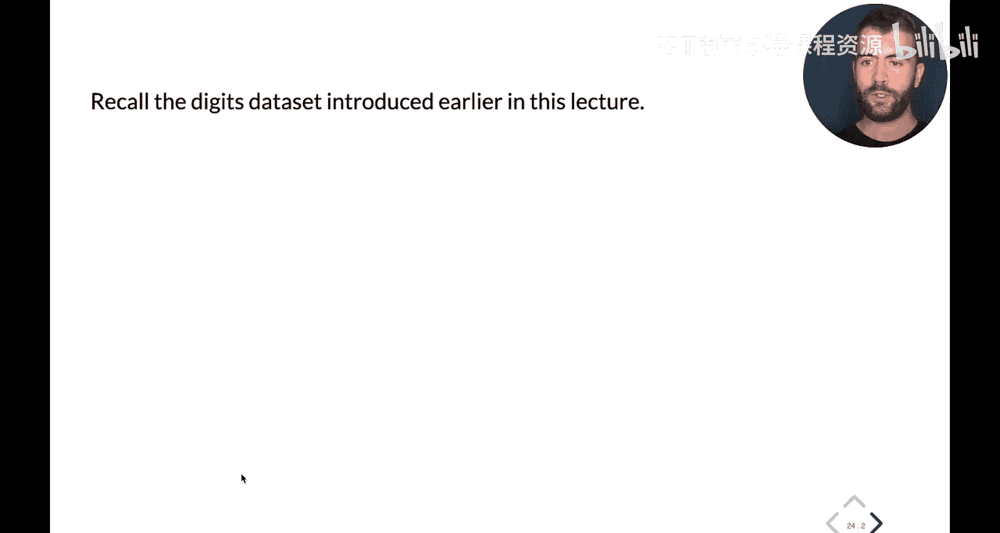
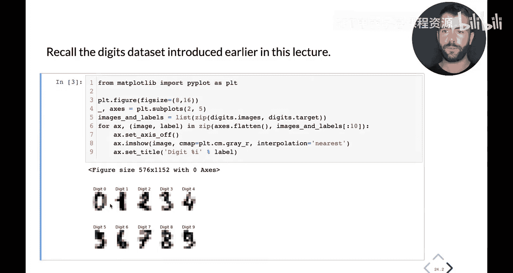
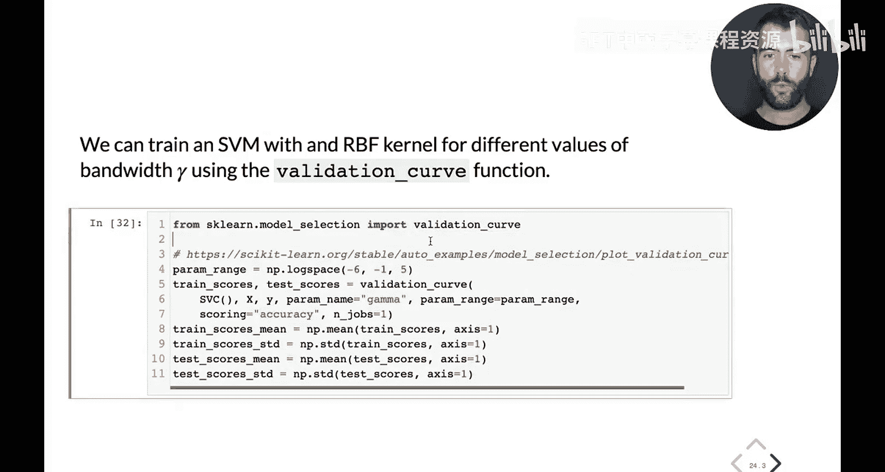
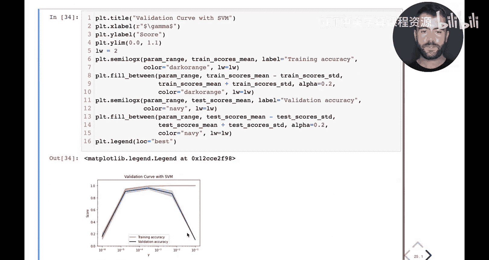
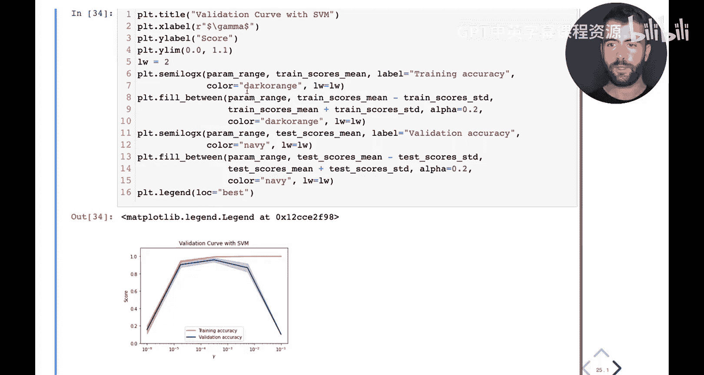

# 22.3：第3部分：验证曲线 📊

在本节课中，我们将学习一个用于诊断和解释机器学习模型性能的重要工具：验证曲线。我们将了解它的作用、如何生成以及如何解读。

上一节我们讨论了模型评估的基本流程，本节中我们来看看一个专门用于分析超参数影响的工具。

验证曲线是模型开发工作流中的一部分。在这个工作流中，我们迭代地训练新模型，在开发集上观察其性能，调整模型参数并重新训练。当我们对模型满意后，才在独立的测试集上进行最终评估。

验证曲线对所有具有重要超参数的机器学习模型都很有用，这基本上涵盖了大多数模型。超参数是指那些影响模型性能，但我们不直接在训练过程中优化的参数。

验证曲线通过展示模型性能随特定超参数值变化的函数关系，来解释超参数的影响。它会同时显示模型在训练集和开发集上的性能。

以下是机器学习中常见超参数的例子：
*   **L2正则化的强度**：`lambda` 或 `alpha`。
*   **神经网络层数**：`num_layers`。
*   **神经网络大小**：`layer_size`。
*   **学习率**：`learning_rate`。
*   **RBF核函数的带宽**：`gamma`。
*   **K均值聚类中的簇数量**：`n_clusters`。

为了具体说明，我们来看一个验证曲线的例子。我们将使用本讲前面介绍过的数字数据集，训练一个带有RBF核的支持向量机（SVM）模型，并测试该核函数带宽超参数的不同取值。

回忆一下，RBF核的带宽参数 `gamma` 控制着模型在预测新数据点时，需要考虑的邻近数据点的范围。较小的 `gamma` 值意味着考虑更广范围的点，而较大的 `gamma` 值则使模型更关注非常邻近的点。

在Scikit-learn中，有一个方便的函数 `validation_curve` 可以用来计算验证曲线。通过少量代码，我们可以生成并可视化这条曲线。

以下是通过代码生成的验证曲线示例：

这就是一个验证曲线的例子。

在X轴上，是超参数 `gamma` 的不同取值。在Y轴上，是模型的性能指标，这里用的是准确率。

对于较小的 `gamma` 值（图左侧），代表训练集准确率的橙色曲线和代表验证集准确率的蓝色曲线都很低且相似。随着 `gamma` 值增加，两条曲线的性能都得到提升，并在某个区域（大约 `10^-3` 到 `10^-1` 之间）趋于稳定，达到较高的性能水平。

然而，当 `gamma` 值继续增大（超过 `10^-1`），橙色曲线（训练准确率）保持在高位，但蓝色曲线（验证准确率）开始下降。这意味着，对于大约在 `10^-3` 到 `10^-1` 范围之后的 `gamma` 值，模型开始对数据过拟合。较高的 `gamma` 值增加了模型的表达能力，使其在训练集上表现优异，但在验证集上表现变差，这正是过拟合的迹象。

通过绘制整条曲线，我们可以清晰地看到发生了什么。这个工具就是验证曲线，它能帮助我们直观地理解使用不同超参数值所带来的影响。

本节课中我们一起学习了验证曲线。我们了解到，验证曲线是一个强大的可视化工具，它能同时展示模型在训练集和验证集上性能随某个超参数变化的趋势。通过观察两条曲线的分离情况，我们可以诊断模型是欠拟合、拟合良好还是过拟合，从而为超参数调优提供直观的指导。