# 22.4：第4部分 - 分布不匹配 🧩

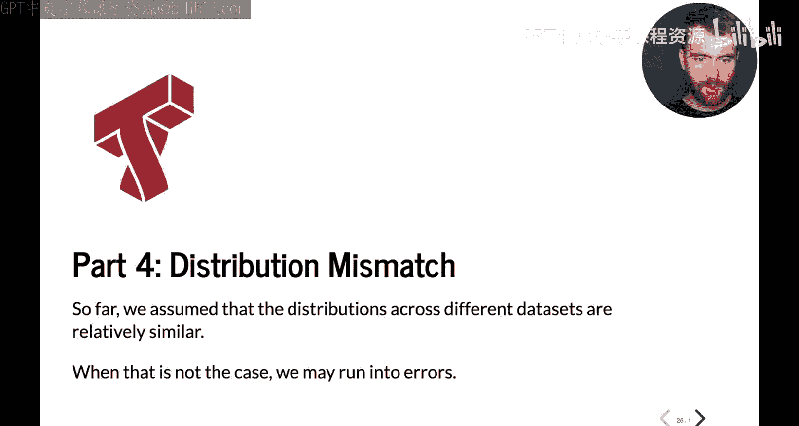

在本节课中，我们将要学习机器学习中一个特定的问题：**分布不匹配**。这个问题会影响模型的性能，尤其是在训练数据与开发/测试数据来自不同分布时。我们将探讨如何诊断、量化并解决这一问题。

---

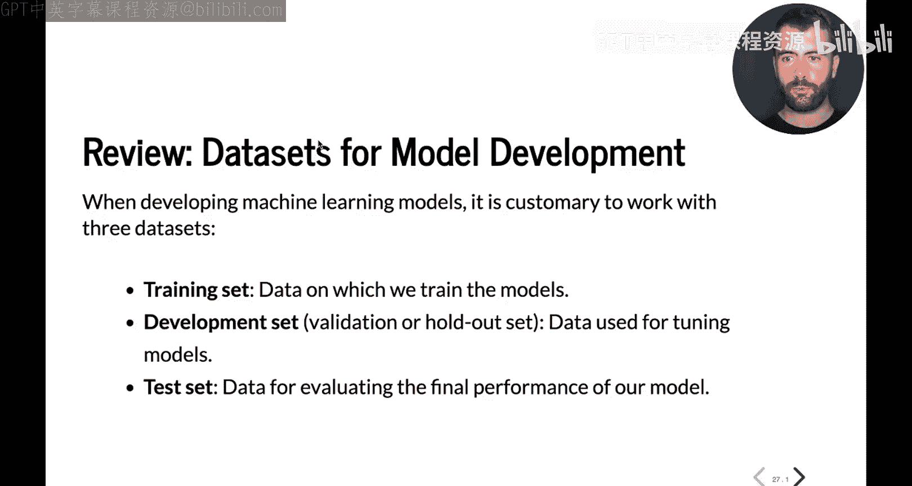

## 机器学习中的数据划分

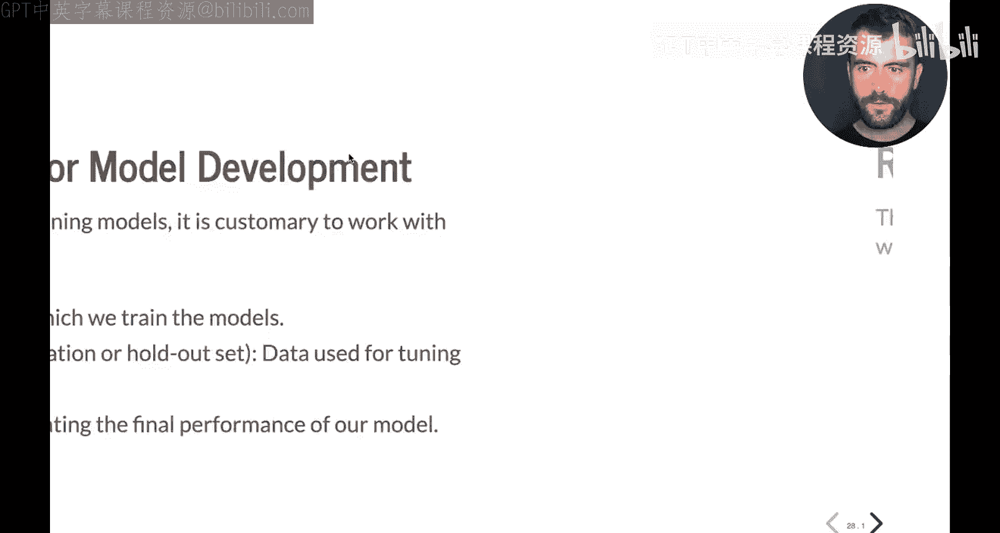

上一节我们介绍了机器学习模型开发的基本流程。在开发模型时，我们通常使用三个不同的数据集：

*   **训练集**：用于训练或拟合我们的模型。
*   **开发集**：用于检查我们所做的特定建模选择是否有效，并用于开发和改进模型。
*   **测试集**：用于评估模型的最终性能。

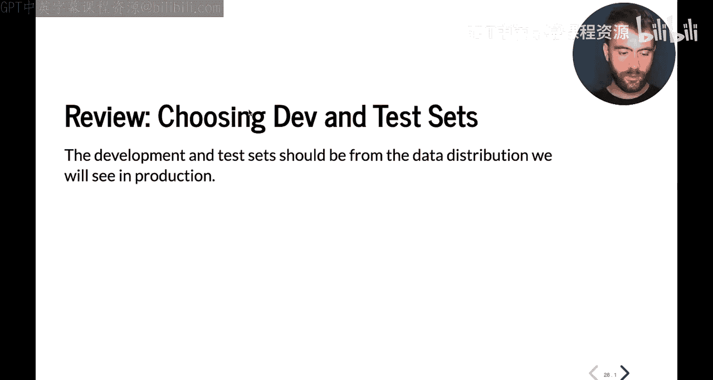

为了使机器学习工作良好，这些数据集必须能代表我们期望从该模型获得的最终性能。

具体来说，开发集和测试集应来自我们预期在生产环境中看到的数据分布。一旦部署了系统，我们将看到特定的输入模式，这些模式应与我们在开发和测试集中看到的相似。

与开发集和测试集不同，训练集可能来自相同的分布，也可能不是。例如，如果我们正在构建一个用于检测图像中是否有猫的分类器，那么拥有一个包含多种动物图像的数据集可能是有用的。或者，如果我们正在检测猫与狗，拥有其他动物的图像也可能有助于模型学习更通用的特征，从而提高猫类别的性能。

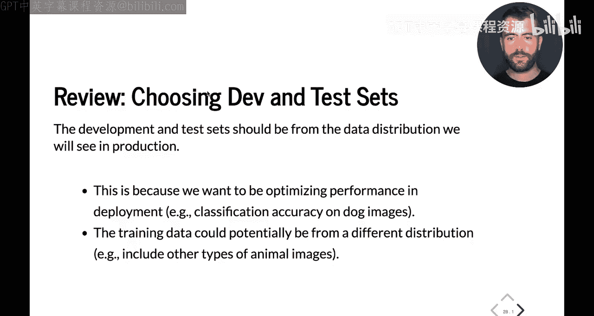

---

## 分布不匹配问题

当这些分布条件不满足时，就会出现问题。例如，当开发集或测试集不再代表真实的数据分布，或者当我们选择的训练集与开发集差异太大时，就可能出现分布不匹配。如果我们添加了太多与最终任务（如分类猫狗）无关的图像（例如汽车或PDF文档），这可能会损害我们的性能。这是一种由于分布不匹配而产生的不同类型的错误。

在实践中，我们在现实世界中看到的数据最终会与我们正在处理的数据变得不同。理解和检测这类问题非常重要，因为它们可能导致非常显著的性能问题。我们目前所做的所有分析都假设这些不同的分布以我之前描述的方式相关，但如果这个假设不成立，很多分析就会失效。

---

## 诊断分布不匹配：训练-开发集

为了诊断训练集和开发集之间的不匹配问题，我们可以创建一个特殊的新数据集，并通过观察模型在这个新数据集上的性能来判断问题是否存在。我们称这个新数据集为**训练-开发集**，它是训练集和开发集之间的混合。

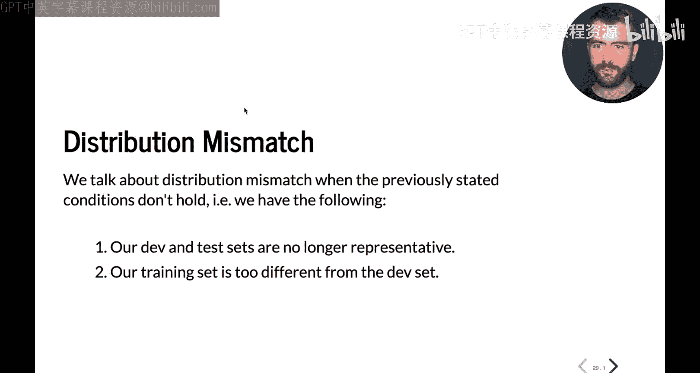

以下是创建训练-开发集的方法：
我们从训练集中随机抽取一个子集，将其用作第二个验证集或开发集。例如，如果我们的训练集有200,000张图像，我们可以随机抽取5,000或10,000张，将它们保留为一个单独的验证集。现在，在模型训练完成后，我们将同时在标准开发集和训练-开发集上测量性能。

这个数据集使我们能够诊断偏差、方差，以及关键的分布不匹配问题。

---

## 通过误差分析进行诊断

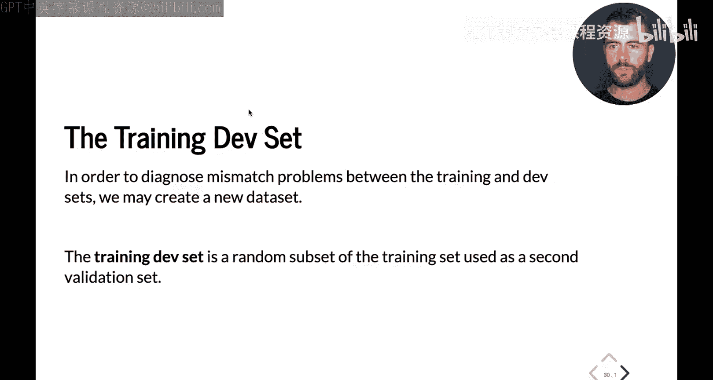

以下是使用误差模式进行诊断的方法。我们已经确定开发误差很高，这可能源于方差问题、偏差问题，也可能是分布不匹配问题（意味着我们在训练集中添加了太多不相关的示例，从而分散了模型的注意力）。

以下是几种典型的误差模式及其含义：

*   **情况一：高方差**
    *   训练误差低，但训练-开发误差和标准开发误差都高。
    *   这表明模型过拟合了训练集，无法泛化到训练-开发集和标准开发集。

*   **情况二：高可避免偏差**
    *   训练误差、训练-开发误差和开发误差都高（例如，远高于人类误差）。
    *   这表明模型存在高偏差，即使在训练集上也表现不佳。

*   **情况三：分布不匹配**
    *   训练误差和训练-开发误差都低，但标准开发误差显著更高。
    *   这表明模型能很好地泛化到训练-开发集（与训练集同分布），但无法泛化到标准开发集。原因只能是标准开发集与训练集的分布差异很大。

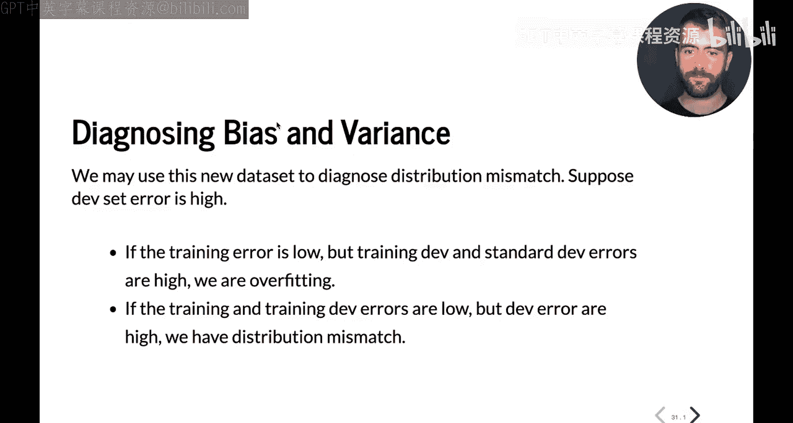

---

## 具体示例：猫图像分类器

让我们通过一个具体例子来理解。假设我们正在构建一个猫图像分类器。

*   **训练集**：包含猫和其他动物的图像。
*   **训练-开发集**：从训练集中抽样，因此也包含猫和其他动物。
*   **开发集和测试集**：只包含猫的图像，因为我们最终只评估对猫的分类性能。

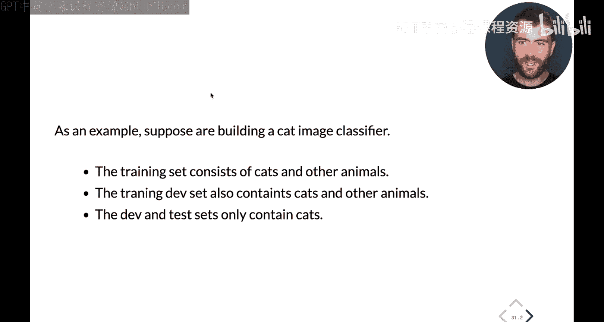

现在，观察以下误差模式：

1.  **高方差示例**：
    *   训练误差 = 2%
    *   训练-开发误差 = 6%
    *   标准开发误差 = 6%
    *   模型能完美拟合训练集，但即使在同分布的训练-开发集上误差也更大，这表明过拟合。

2.  **高偏差示例**：
    *   训练误差 = 10%
    *   训练-开发误差 = 11%
    *   标准开发误差 = 12%
    *   人类误差 = 1%
    *   即使训练误差也远未接近人类误差，这是高可避免偏差的典型例子。

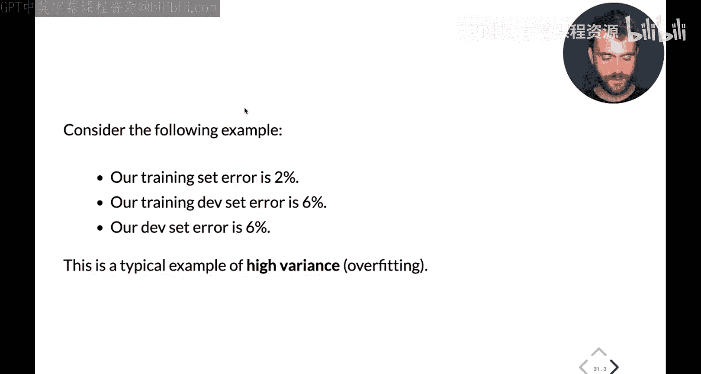

3.  **分布不匹配示例**：
    *   训练误差 = 4%
    *   训练-开发误差 = 5%
    *   标准开发误差 = 13%
    *   模型能泛化到训练-开发集，但不能泛化到标准开发集，这明确指向了分布不匹配。

---

## 量化分布不匹配误差

我们可以在之前学习的误差分解基础上，增加一个分布不匹配分量，从而更精确地量化开发误差。

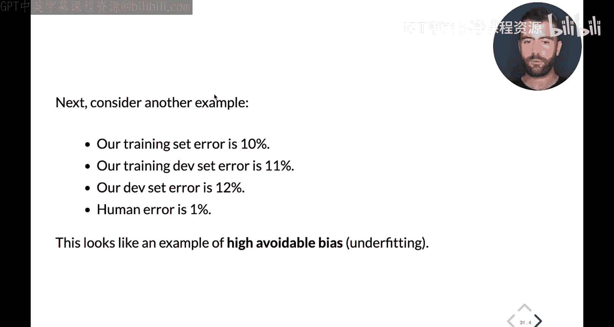

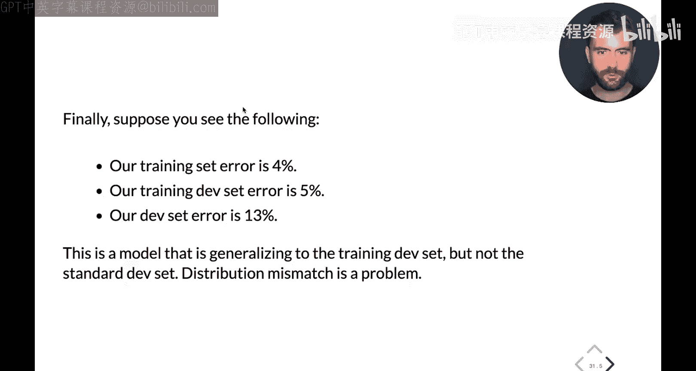

开发误差可以分解为：
`开发误差 = (可避免偏差) + (方差) + (分布不匹配) + (不可避免偏差)`

更形式化地，我们可以这样表示：
`Err_dev = (Err_train - Err_bayes) + (Err_dev_train - Err_train) + (Err_dev - Err_dev_train)`

其中：
*   `Err_train - Err_bayes` 近似为**可避免偏差**。
*   `Err_dev_train - Err_train` 代表了**分布不匹配**（因为训练-开发集与训练集同分布，此差值反映了模型对同分布新数据的泛化能力，若差值大则说明训练集本身可能有问题，但这里我们主要关注下一项）。
*   `Err_dev - Err_dev_train` 是关键的**分布不匹配**量化指标，它直接衡量了开发集分布与训练集分布之间的差异所导致的额外误差。
*   剩余部分为**不可避免偏差**。

这是一种更定量化的方式来表述我们刚刚描述的概念。

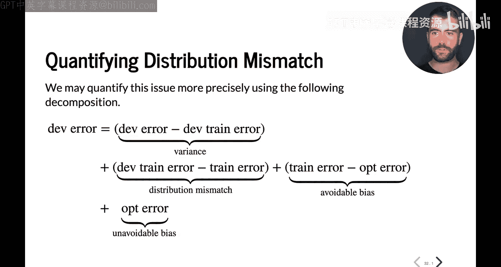

---

## 检测开发集与测试集的“陈旧化”

尽管这个想法是在训练集和开发集的背景下描述的，但我们也可以在其他上下文中使用它。例如，我们可以使用相同的思路来检测开发集和测试集是否“陈旧”，即它们是否不再代表生产数据分布。

为了确定它们是否陈旧，我们会收集额外的真实世界数据，并将其作为另一个开发集或测试集（可称为“真实世界数据集”）。如果我们的模型在旧的开发集上泛化得很好，但在新数据集上表现不佳，那就意味着我们的旧数据已经变得陈旧，是时候更新我们的数据集了。

在实践中，当机器学习系统部署到生产环境后，数据最终都会变得陈旧，因此监控这种行为非常重要。

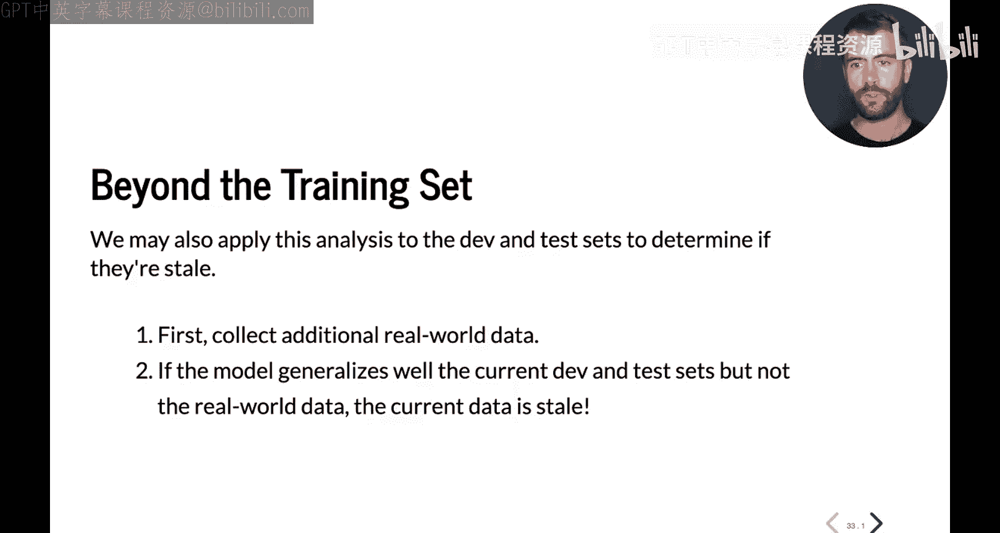

---

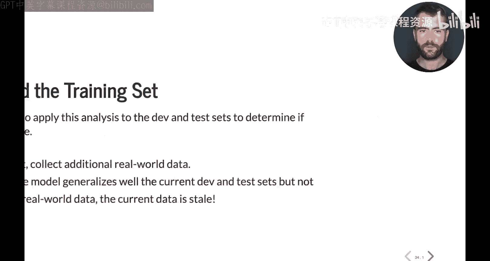

## 如何解决数据不匹配问题 🛠️

最后，如何解决数据不匹配问题？本质上，这需要理解导致不匹配的数据属性。

我们需要弄清楚不匹配是因为我们在不同环境中收集数据（例如，用户来自不同国家，不同数据集的国家分布不同），还是因为数据采集条件不同（例如，一些声音在汽车内录制，另一些在安静房间内录制），或者是其他原因（例如，语音录音中有不同口音）。

理解导致差异的具体属性非常重要。一旦理解了这些属性，我们就希望最小化它们的影响。我们可以选择：
1.  **移除**导致不匹配的数据部分。
2.  **添加**更多匹配良好的数据来弥补任何缺陷。

理解数据的哪些属性导致了不匹配，以及应该移除或添加哪些数据，最好的方法是通过**检查数据**。这可以通过我们之前学过的**误差分析**来完成。误差分析是一个有效且通用的过程，用于理解如何修复机器学习模型、模型主要犯哪些错误。同样的过程可以应用在这里，以解释机器学习系统的错误，并解释数据或分布不匹配在此过程中的作用。

---

## 总结

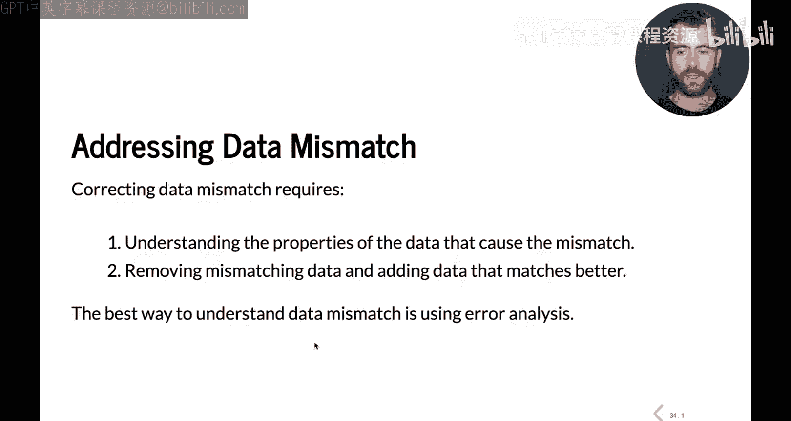

在本节课中，我们一起学习了机器学习中的**分布不匹配**问题。我们了解到，当训练数据与评估数据（开发集/测试集）来自不同分布时，模型的性能会受到影响。我们介绍了使用**训练-开发集**来诊断这一问题的方法，并通过分析训练误差、训练-开发误差和开发误差的模式，来区分高方差、高偏差和分布不匹配。我们还探讨了如何量化分布不匹配误差，以及如何检测数据集的“陈旧化”。最后，我们讨论了解决数据不匹配的策略，核心在于理解数据差异的属性，并通过误差分析指导数据集的修正。掌握这些诊断和解决方法，对于构建鲁棒且能在真实世界中良好工作的机器学习系统至关重要。