# 康奈尔大学《应用机器学习 CS 5787_ Applied Machine Learning 2020》中英字幕（deepseek -BV12udzYvEFM_p54-

This is now part3 of lecture 14 on neural networks and in this video I am going to talk about back propagation in the previous video I defined how an artificial I define well first we define an artificial neuron and we define an neural neural network and now I'm going to show how to train an artificial neural network use gradient descent and in order to compute the gradient of an artificial neural network。

We are going to use a special algorithm called be propagation。

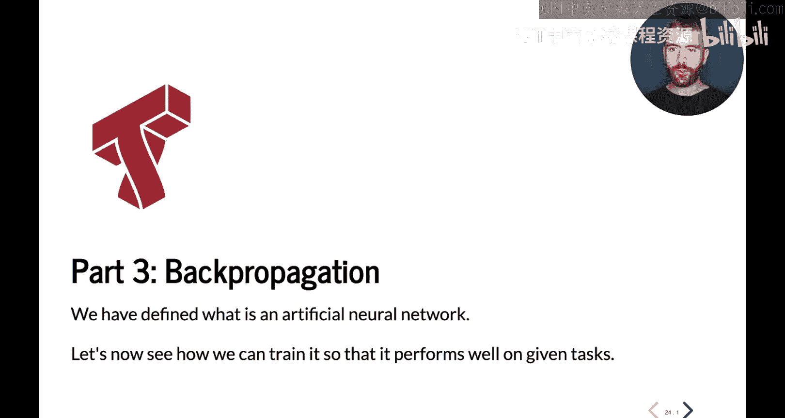

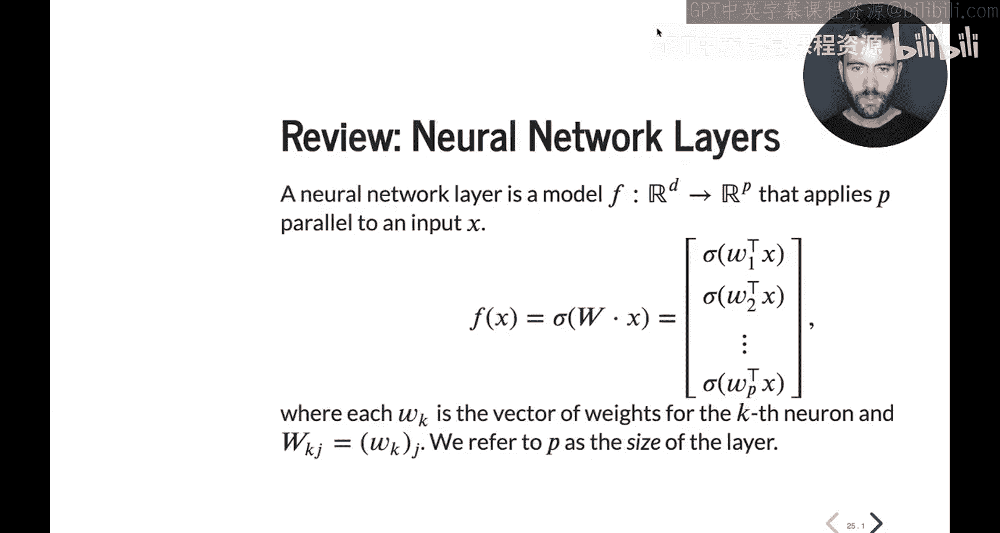

So recall that a neural network layer has the following structure where we have inputs X。

 each of them is multiplied by a different vector that corresponds to a different neuron。

 we can put these together into a matrix W， and then we apply the activation function to each neuron。

 or in vectorized form， we can write it like this， and this gives us the output of a neural network layer。

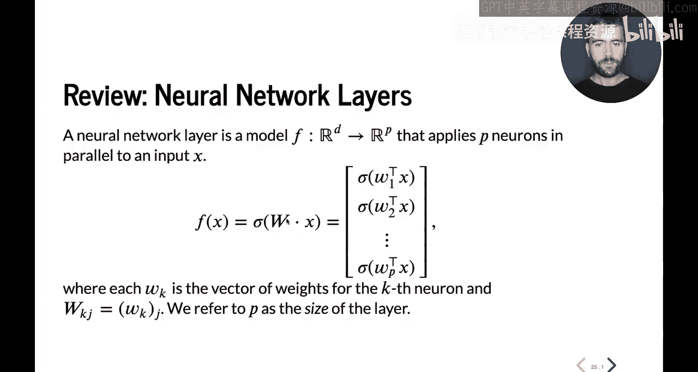

And now when we compose these neural network layers if we take L of them and we compose them one after the other。

 then we have what is called an official neural network。

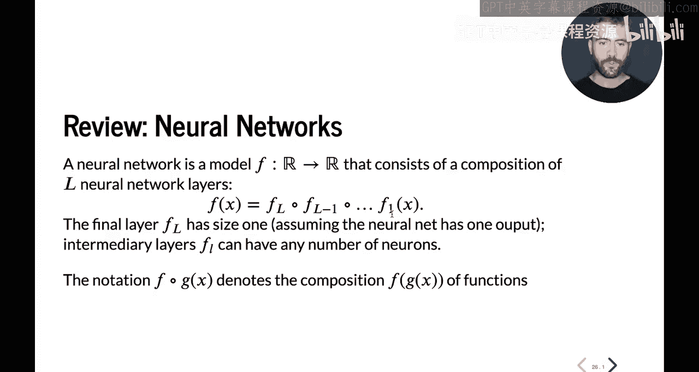

And visually， we can represent the structure as follows here， we have the different。

Sequences of layers， and the final layer is called the output layer。

 and these blue layers are called the hidden layers of the neural network。

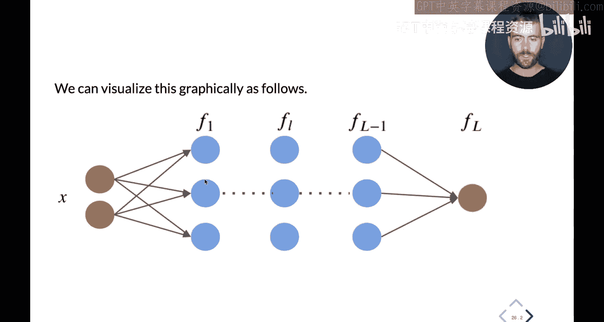

Now， typically， when we optimize。A。Machine learning models， we use gradient descent。 In fact。

 we had to use gradient descent to optimize even a single neuron。

which behaved like which was identical to logistic regression。

 but if we also use the perceptron or any other activation function。

 we would still have to optimize this using gradienting descent。

 there's no formula or closedform solution。And therefore。

 we will also use drain descent to optimize neural networks。

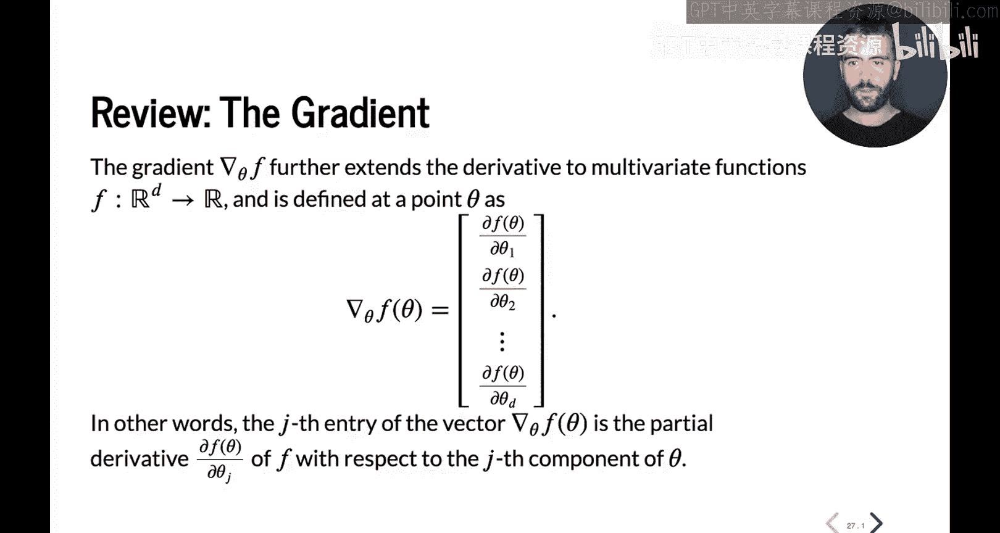

And the structure of green descent is as follows， we start with some guess of the parameters。

 and then we repeatedly apply the following update in which we move in the space of parameters along a direction that is given to us by the gradient of the objective function。

 and this is the direction that minimizes the objective function quickly。

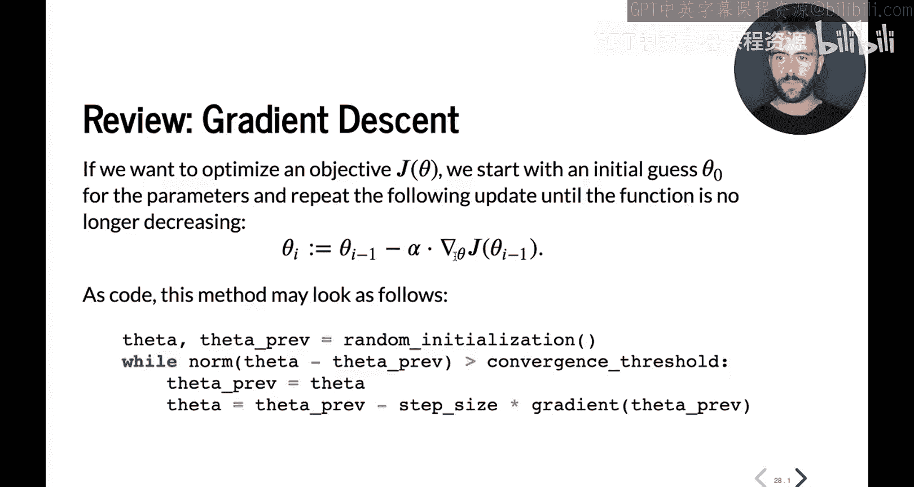

So in order to apply gradient descent， we need algorithms for we need gradients relative to every parameter of the neural network model and we parameter we need to compute the gradient of every layer。

And back propagation is going to be the name of the algorithm that will allow us to do this。

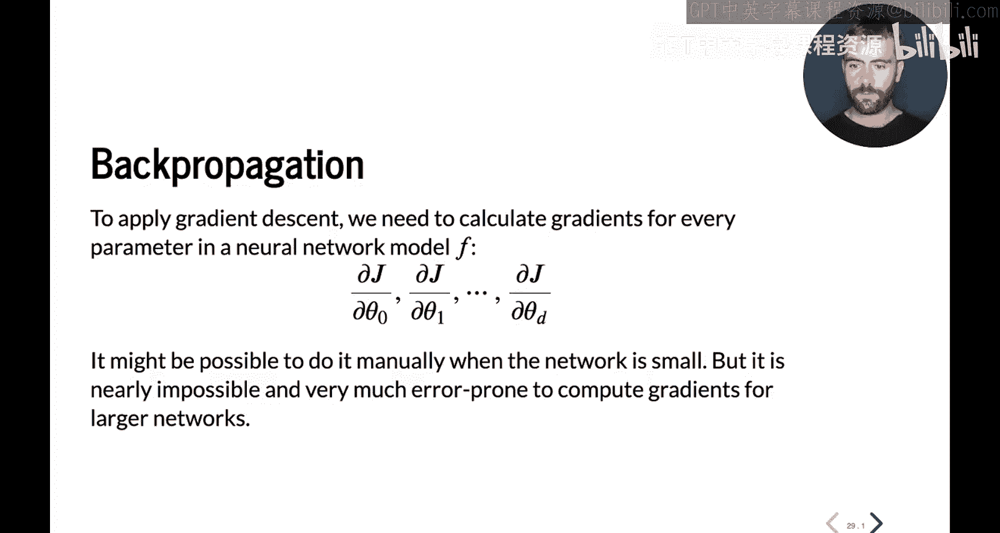

And the core idea of back propagation is something。

 it's a simple formula from calculus that is called the chain rule。

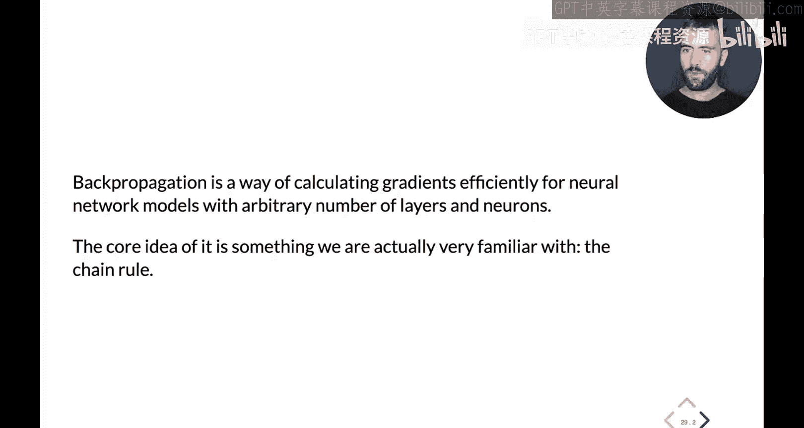

So you should remember from calculus that there is a formula for computing the gradient of the composition of two differentiable functions。

 So if I have F composed with G， then the gradient of this is given by。

The green of F at G of x times the green of G of x。Or using this other notation。

 we have the following formula。 So if y is the output of the final。Well。

 you can already see that these will correspond to layers of the neural networks。

 so if y is the output of the final layer and U is the output of the hidden layer。

Then the derivative with respect to x of the final layer is going to be the derivative of the first layer with respect to its input times the derivative of the second layer with respect to its input。

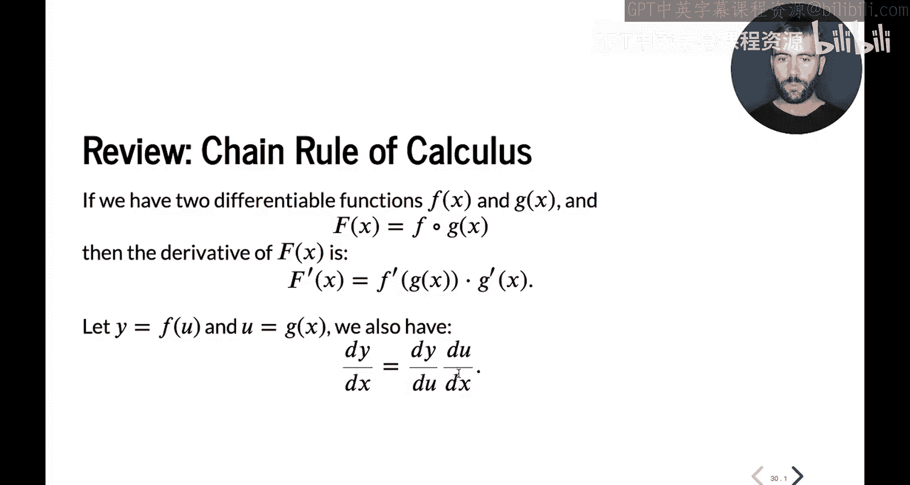

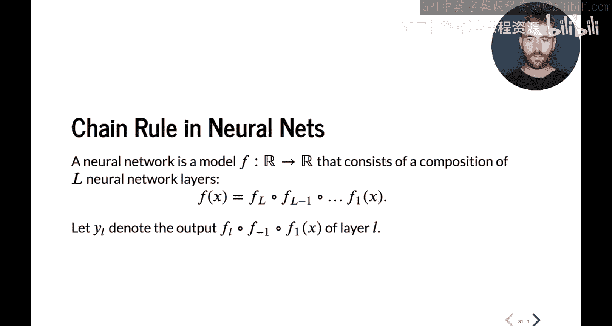

So again， as I mentioned， a neural network has this structure。

 it's a composition of function functions， and so in order to compute the gradient of a neural network。

 we're going to apply the chain rule to the following。To to the following sequence of layers。

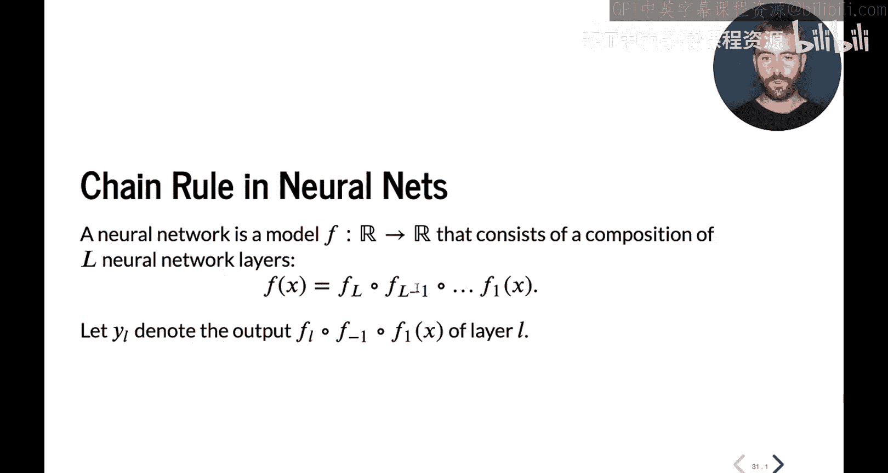

So let's say that we have some parameter that should actually be theta of L。

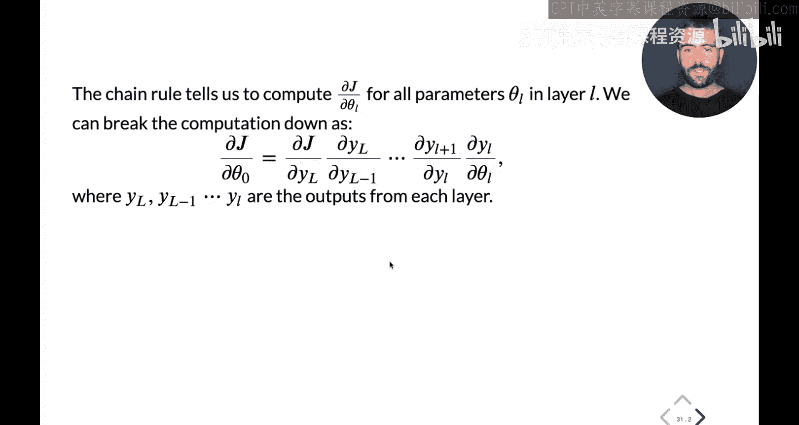

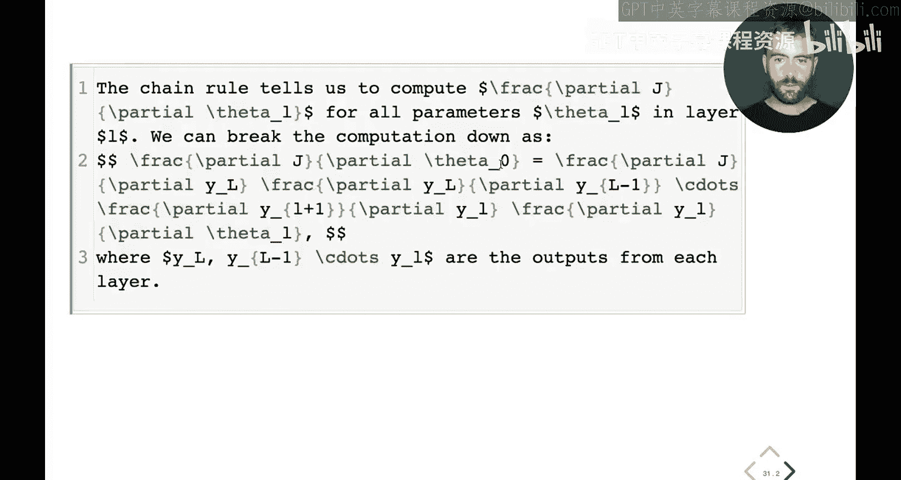

That I want to compute。And I want to compute the green of the objective with respect to this parameter theta L。

And let's say that these are the parameters of layer L。Well， by the chain rule。

 this is going to be the value of our loss is going to be the gradient of the objective with respect to the output of the final layer。

Dmes the derivative of the。Of the final layer with respect to its input。

 which is the output of the L minus1 layer and then all the way down to layer L plus1 derivative of that with respect to layer Y L and then。

And then the derivative of Hawaii with respect to this Sta so theta L is just one scalar parameter of the elf layer。

 and we can compute its derivative using the following formula。

 which is simply an application of the chain rule。

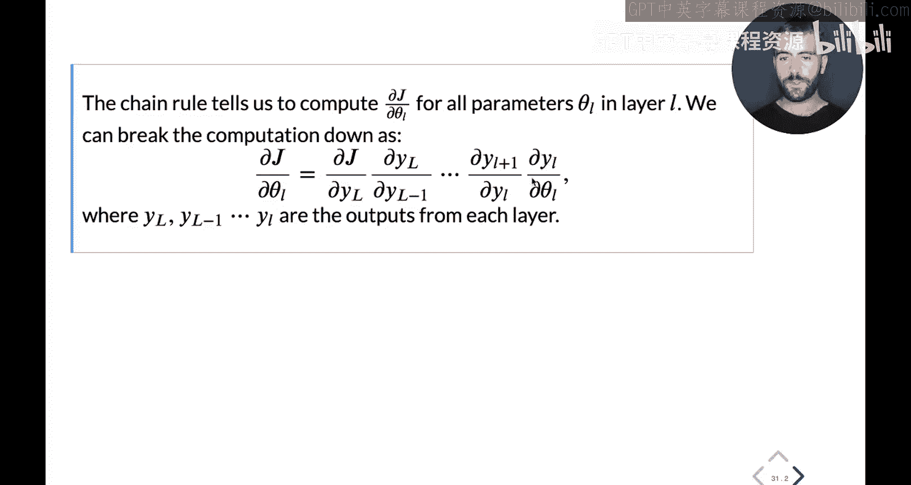

And now one important observation is that。If I use another L， that's let's say farther。

 so let's say or let's see if I look at the gradient。

If I want to look at the derivative of some other parameter， theta L minus1。

 which is a parameter of the L minus1 layer。Then the formula will be really similar。

 except there will be an additional set of terms here。And these derivatives。

 yl with respect derivative yL with respect to yL minus1。

 this is going to be reused in many gradients。And so the backreagation algorithm。

 it's an algorithm that computes all these intermediary gradients and then it stores them and reuses them for all the gradients that are downstream so in other words。

 when we're computing this derivative with perspectives and parameter theta L in the L layer。

We will have saved or we will save all these gradients。

All the gradients that are here and that come before this one。 and then and the at the next step。

 if we compute some。

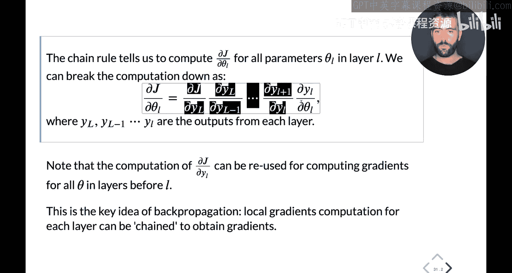

Greding of theta L minus1 that's in the L minus1 layer。

 we're going to reuse all these things that we have saved。

And so that's actually a form of dynamic programming if you are familiar with algorithms and different algorithmic techniques。

 this idea of reusing computation from previous steps is called dynamic programming。

 so you can think of back propagation as a particular dynamic programming algorithm。

 but essentially back propagation is an efficient way of implementing the chain rule in deep neural networks。

So the chain rule is the formula that gives us the definition of the gradient and back propagation is the algorithm that allows us to compute it in a way that reuses gradients from earlier layers as much as possible to compute the gradients or derivatives of later layers。

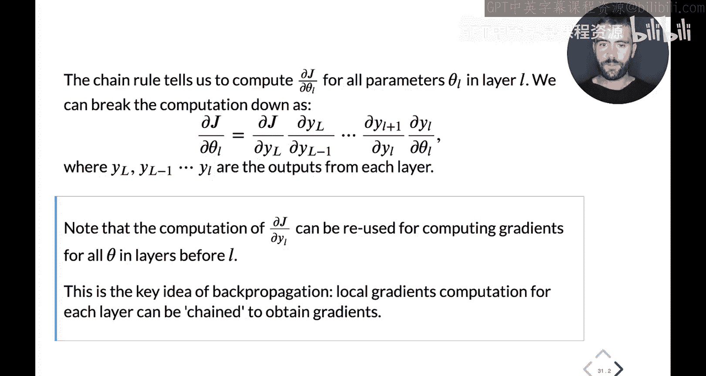

Now let's look at a simple example of how this would work。

 let's say we have some layer which receives an input X。

 this can be either an actual input or this can be the output of another layer that comes before it and it has an output Y。

Let's say that this is the final layer and we have some loss function with some kind of target y hat。

And we can form the loss。And now if we wanted to compute the derivative with respect to some parameters here。

 we would start by first forming the derivative of J with respect to y。

 which is the output of the layer。

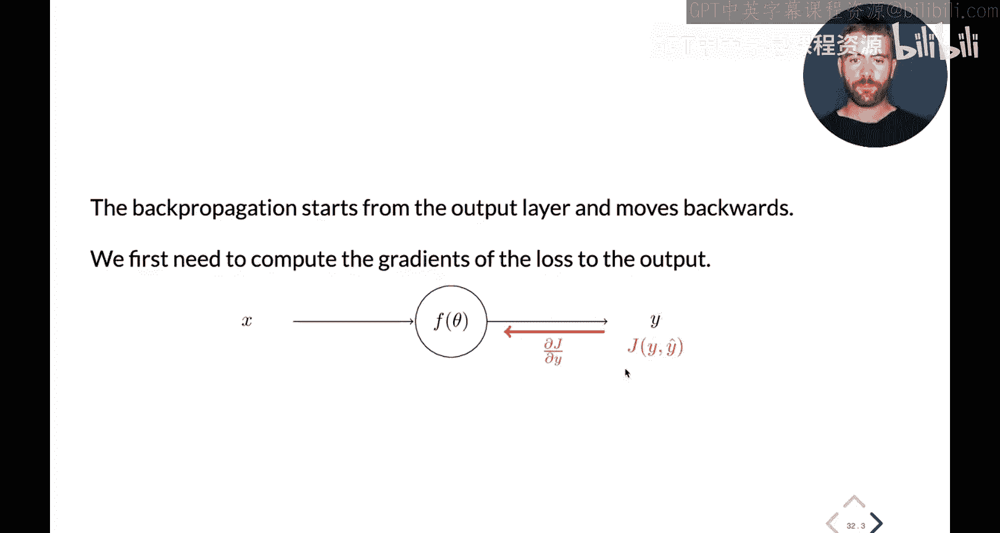

And now I can compute the derivative of jde with perspective parameters， theta。

By simply applying the chain rule。The output is y， and then。Y is a function of theta。

 And this function is given by F here。 so I can simply do。This is simply。

 this is the formula and it's an implication of the chain rule。Now， at the next step。

 I may want to also compute the derivative of y with respect to x， which again。

 this is going to be useful if x is actually an input that comes。

 it's an input that is also the output of a previous layer。In that case。

 I would be interested in completing the derivative of J with respect to x。And by the chain rule。

 that is simply derivative of j with respect to y times the derivative of y with respect to x。

And notice that the derivative of J with respect to Y。I have already computed it here。

And so the back propagation algorithm will store this value and well reuse it for both this gradient and this gradient。

And， and then it will also use it downstream as well。Now。

 imagine that I have another layer that comes before。So by the same logic。

 the gradient of this F of L is going be going to use the gradient that comes before it。

 which is so this internally is going to be a product of many derivatives that are obtained by the chain rule。

 but I can just store this product，It will be some number， I can store it。

 and then I can use it I can use the same technique to compute the derivatives for this layer and then pass pass another gradient downstream。

 which is going to be used。To compute the derivatives with respect to this layer。

 and then it will pass something downstream， etc。 So this is the structure of back propagation。

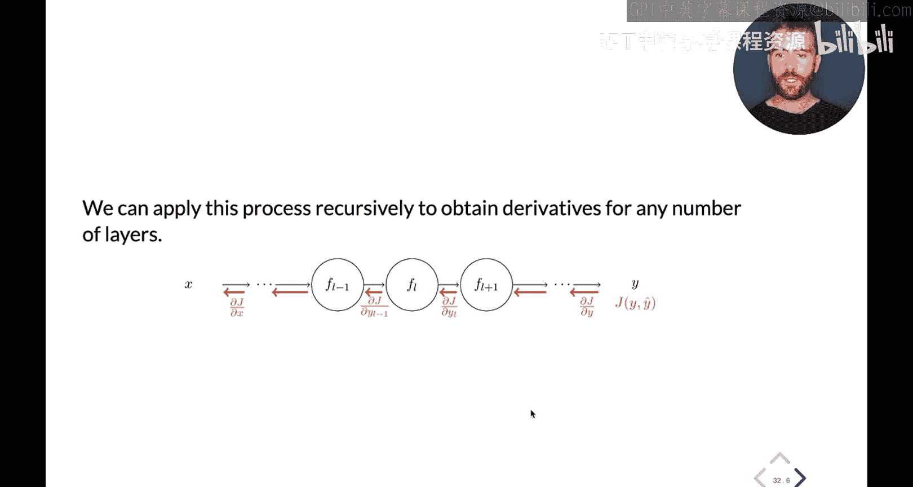

And now just to make things a little bit more concrete。

 let's implement this by hand and we'll do it for a simple two layer neural network。

 like the one we have seen earlier in which we have。

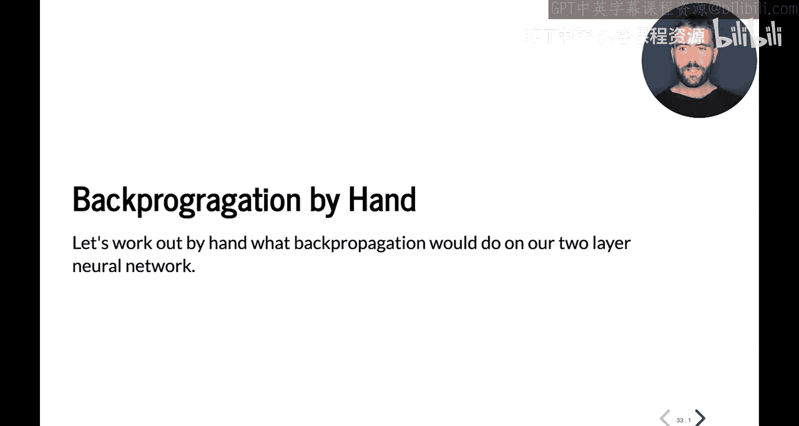

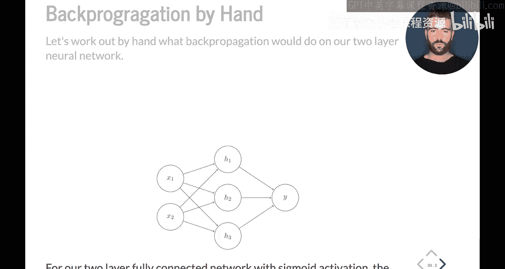

Three hidden units， one output unit and two inputs， X1 x2， which are scalrs。

So we're going to use double to denote the weights of the hidden layer。

So here H is given by sigma w times x， and V is going to denote the outputs of the layer Y。

And we're going to use sigma as our activation function in all the layers。

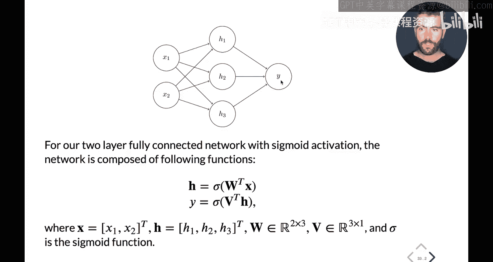

So let's assume that we have the following set of weights， we have the following target， Y hat。

 and this is our input。And now let's work through what the。What this would what this would give us。

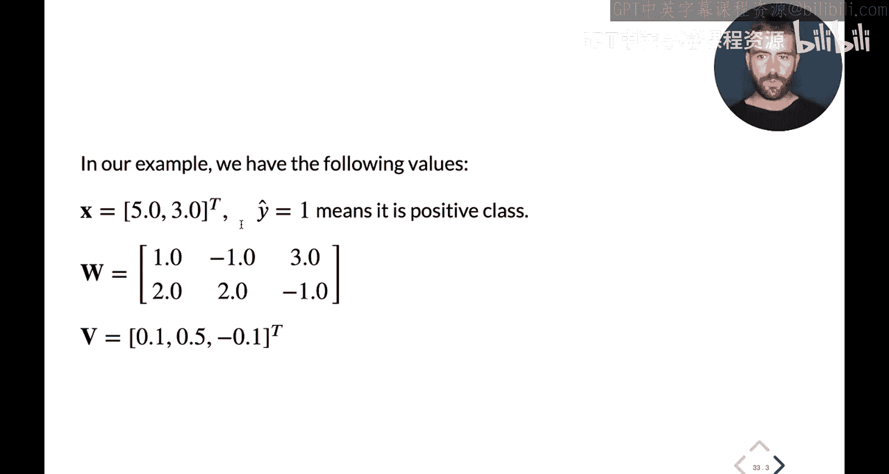

I'm going to use a few colors here， so blue will denote the weights。

And flag the notes the values of the nodes。 So I have here my inputs 5 and 3。

And I want to compute the output of this neuron。While this neuron will take input 5 input 3。

 it will multiply them by the weights， which are 1 and 2。

 and then it will apply the sigmoid function， which is going to give us something that's really close to one。

 and this is going to be here in black the value of this node which is simply the output of this neuron。

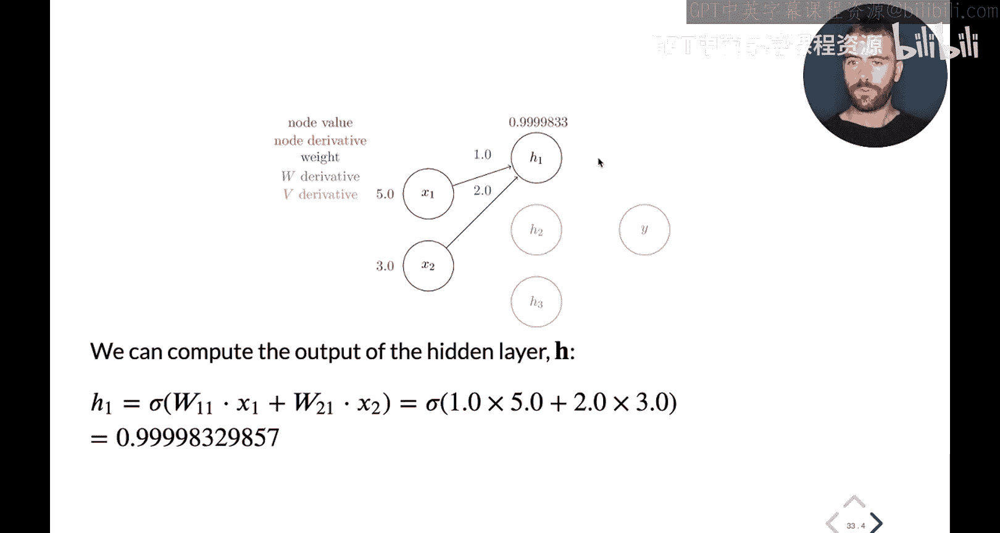

Now I can do the same thing for the middle neuron here my weights are minus-1 and 2。

 so this gives me a different input which is smaller and if I apply the sigmoid to this input I have the following value。

 I have the following output something close to 0。73。

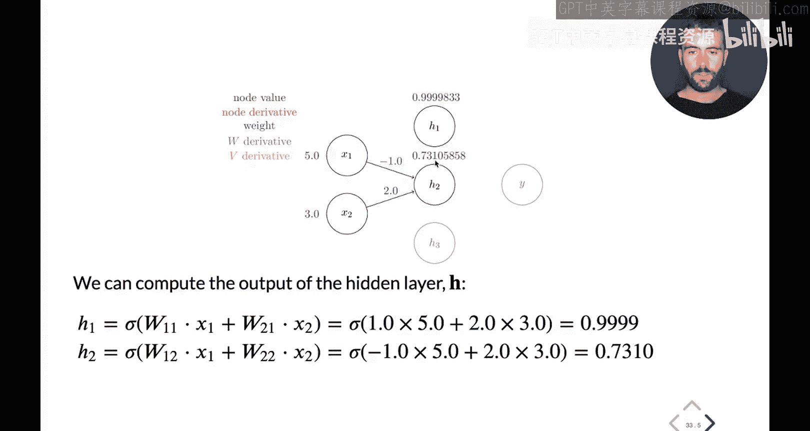

And for this one， I also have a really large value。 and this is what it looks like。

So here I have computed the outputs。

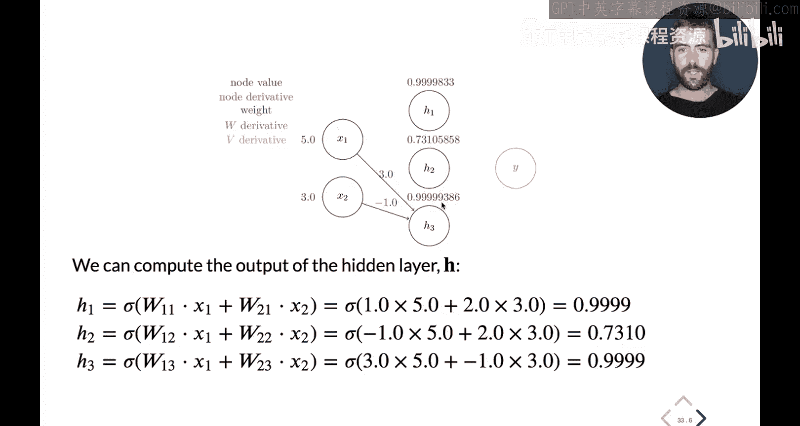

And now I can similarly compute the outputs， the output of the final layer。

 these are the weights along each of these connections。

 again you can think of this connection as the dendrite of this neuron and the axon of this neuron。

 it has a weight 0。1 so I simply take these outputs。And I， so 0。9，0。73，0。99。

 I multiply them by these weights。 I sum them。 and now I have an output。

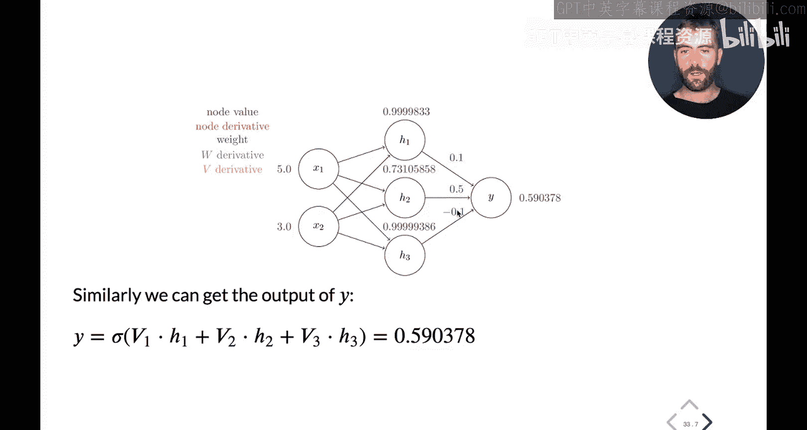

And finally， it can compute the value of the loss， let's say we use the carcenttropy loss。

 then this is going to be the value of our loss and it's going to be approximately 0。52。

Now we can start to compute the gradient。Right， because I have some value of this loss。

 but my goal here is to compute a gradient of this it will be to compute gradients or derivatives for each of these weights。

In order to perform gradient descent。And in back propagation。

 we often talk about the forward pass and the backwards pass。

 what I just showed is called the forwards pass。I have computed the values and have computed the outputs of every neuron。

 including the output neuron， and now I'm going to go backwards and actually compute all the gradients。

So the first gradient we want to compute here is the derivative of J with respect to the output。

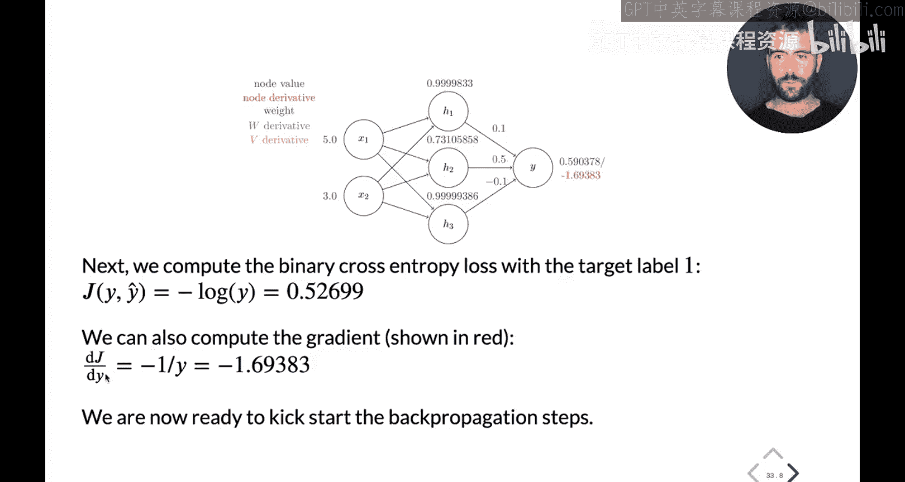

And。Using， again， the formula in order to compute the gradient of V is going to be as follows。

 this is simply the chain rule。And now using the fact that the derivative of the sigmoid is simply sigmoid times 1 minus the sigmoid。

And we have seen this in our lecture on logistic regression。 I can form the derivative。 I can。

 I can show that the formulas for the， for the derivatives simply equals。Well。

 it equals exactly this。嗯。So it's really easy to check from this formula in this definition that this is the formula for each partial derivative for the weights of the output neuron。

So these are the weights of the output neuron， and here I may have formulas。

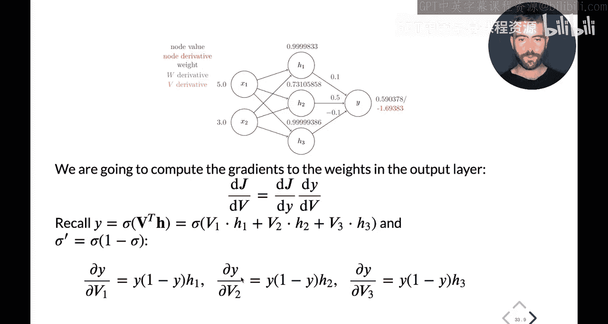

So applying these formulas， I can now compute the gradients for each of these weights。

 so here in blue I have the weights and in red I have their gradients。

And this is just an im of the formulas that I had in the previous slide。

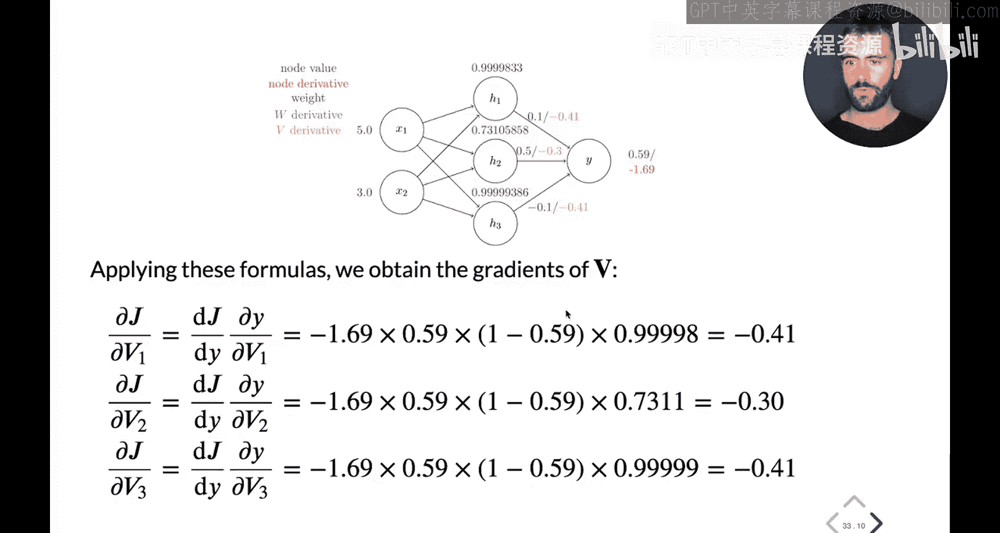

And now I want to compute the gradient with respect to the weights of of the hidden layer。

So these are going to be the gradient that are here。

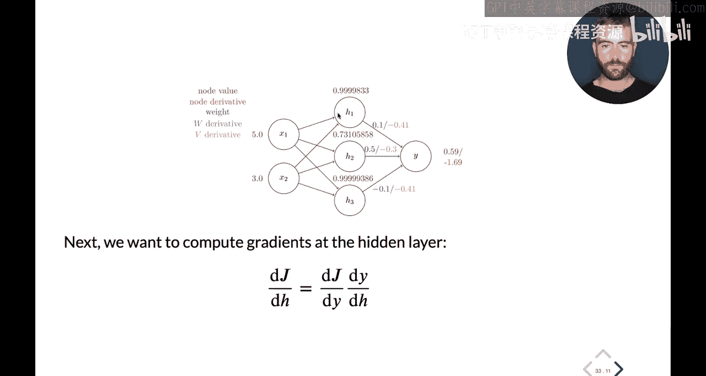

So here I will， well， by the same formula that I that I had earlier。 so but by the chain rule。

 the weights of the hidden layers are。

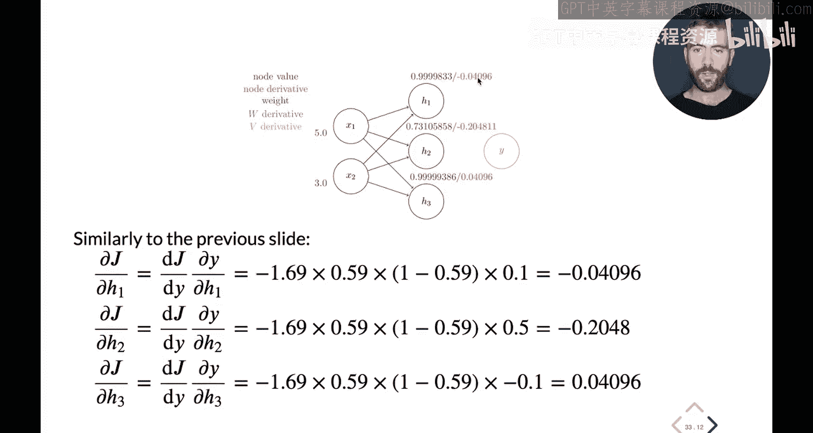

The derivative。 So h is the output here。So sorry， just to clarify， I have just computed。Here in red。

 I have the gradient of the parameters and now I'm going to compute the gradient with respect to H1。

 H2 and H3， which are the outputs of the neural net。

 and the reason I want to do this is because in the next step of back propagation。

 I will use these to compute the gradients of the next set of weights。

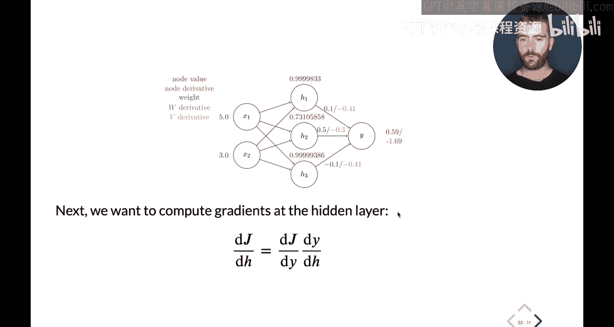

Again here I'm applying the formula， so the derivative of J with respect to H1。

 so the output of hidden neuron1 is the derivative of J with respect to y， y with respect to H1。

 and applying this formula， I have the following derivative for these ones。

And now what's important is that this node y becomes essentially for the purposes of compute ingredients。

 I will no longer need to use this node， everything that I need to know about this node or if I had more nodes。

 everything that happened，At the upper layers of the neural network。

 I have summarized them within these three numbers。And that is the only thing that I need to track。

 And I can get rid of all the all the neurons that。

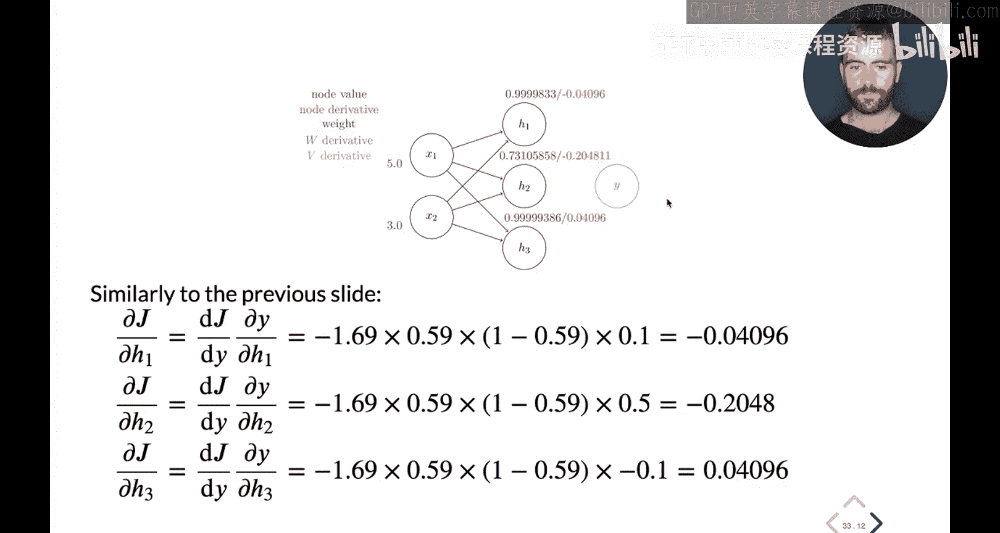

And then we have had here。Or sorry， by getting rid of the neurons。

 I mean that we no longer need to know what happened here as long as we have those partial derivatives。

 as long as these partial derivative derivatives are computed。

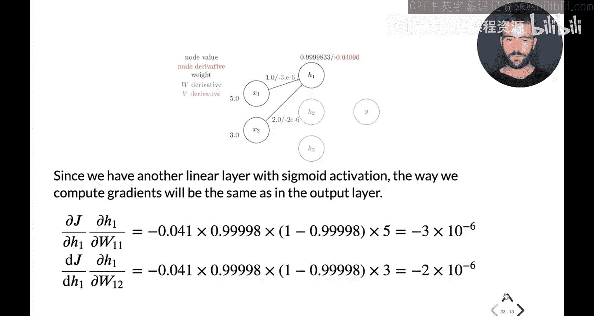

It doesn't really matter if we had just an output layer or if we had multiple hidden layers before。

 these contain all the information from everything that happened upstream in the neural network。

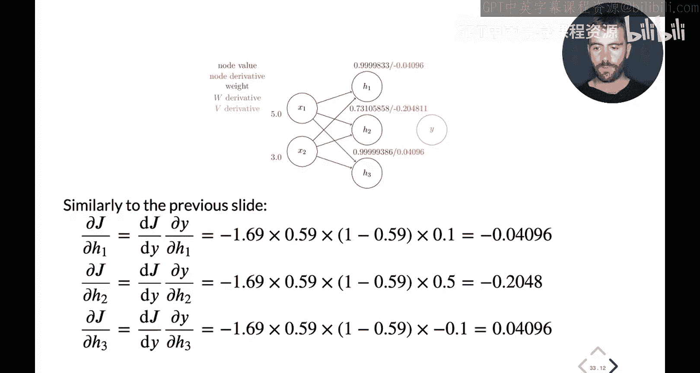

So let's。Let's now compute the gradients of these weights， of the blue weights。

 and again the partial using the chain rule of calculus。

The the probability of the derivative of the loss J with respect to the parameters。呃。W。

 and here it is。This parameter 1， this parameter 2， so W11 is here 1， this is the other parameter。

 so the derivative is by the chain rule derivative of J with respect to H1。

 which is the output layer H1， and then derivative of H1 with respect to W11。And this。This here。

 this term， the derivative of H1， we can easily compute it because this is simply given by the formula of。

Of an artificial neuron， this is simply the derivative of the output of the artificial neuron with respect to its weights。

And this term， I have computed it and I have stored it from the previous steps of thes of the algorithm。

So this is what I computed earlier and what I saved and this internally also has been computed via the chain rule。

 but all the different steps of the chain rule have now been saved and I only have this one weight in the root of J with respect to H1 and that's it and that's the only number that I have from the previous versions of the。

Of the neural of， of running this。This algorithm， and now applying the formula。

 I have the following derivatives for the I have the following partial derivatives for this layer。

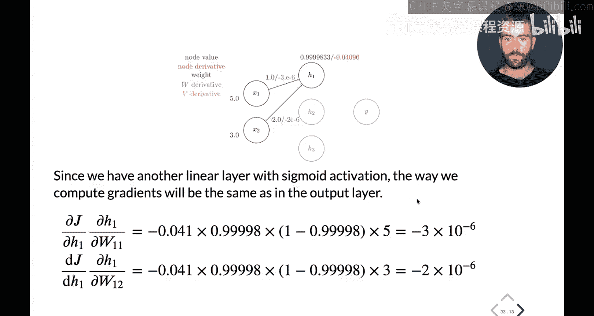

I can similarly compute this for。

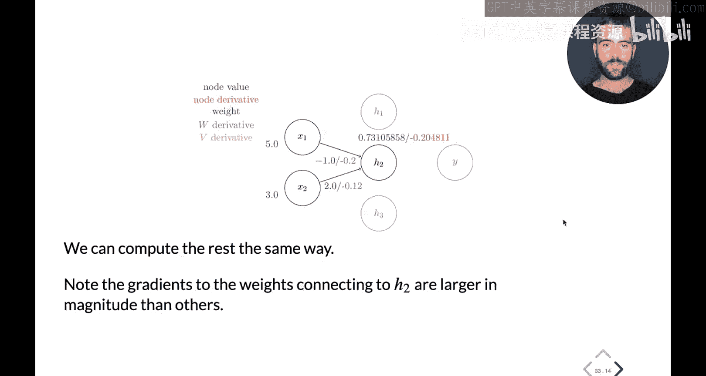

For this later。And for this layer， again， I the derivative in red here is derivative with respect to the output。

 And here， these ones in purple are the derivatives with respect to the。To the。To the weights。

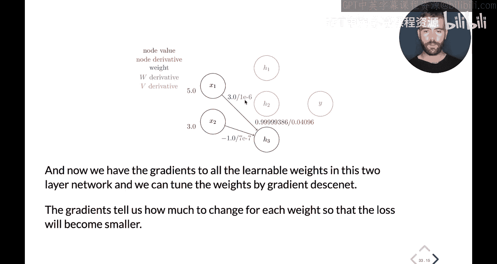

So here I run it by hand。 Let's now see how we can implement this algorithm in Pthon。

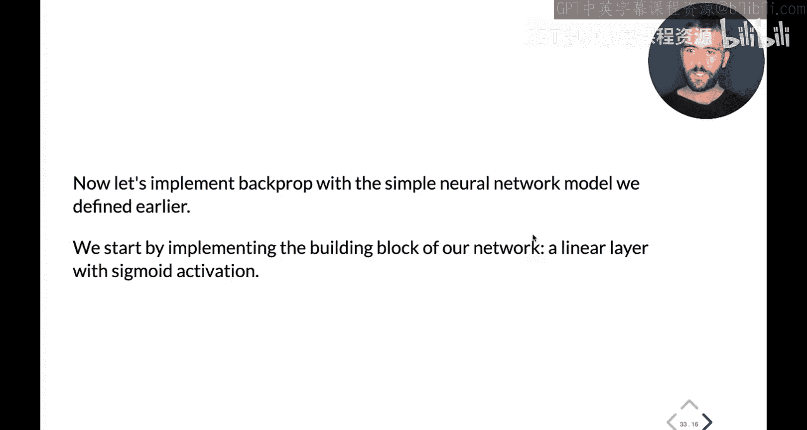

So you can revisit this later， this implementation is it's not something that you need to understand by looking at this slide。

 but just at a really high level， we can define，A class that describes a layer。

 this class has a set of weights， it has an activation function。

 and the forward function gets the output of this layer。So we simply apply matrix multiplication。

 we apply the activation function and we output compute it and we return the output and we also save this version this output here Now when we apply the backward step we can compute the gradient and here the backward step receives the gradient that is coming to it from the layers that are above so this can be either the gradient of the loss or this can be the gradient of the layers that come after this layer basically everything has been compute it before we synthesize it in into a gradient that comes here and now the gradient of this layer is a function of the gradient of。

This of each neuron， with respect to its。To its weights。

 and it's also multiplied by the output gradient。And that is the green that we have here。Again。

 you don't need to understand this code now， but if you're interested in the practical implementation of back propagation。

 I encourage you to go back and。Look more carefully about into how this is implemented。

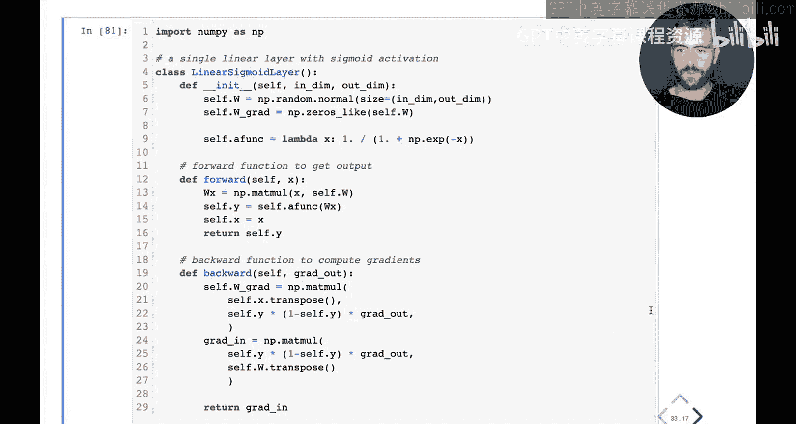

Now， we can form a neural network by defining a few classes of these layers here。

 I have two sigmoid layers， and I have these。So each one has has a set of weights。

 This one has an input of dimension x output of this dimension， and this one。

 this is our output layer。 So it has an output of one and its input is the。

Output of the previous layer。If I want to output predictions from the neural net。

 I run the forward pass of the hidden layer and then I run the forward path of the output layer。

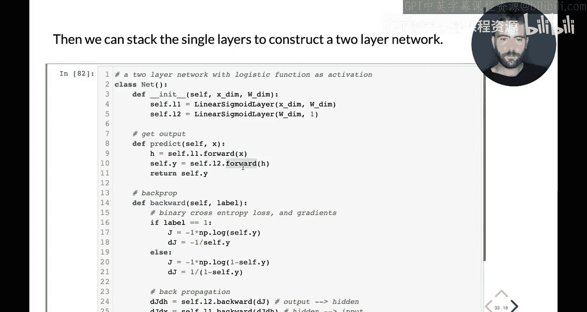

And in order to apply back propagation， we。

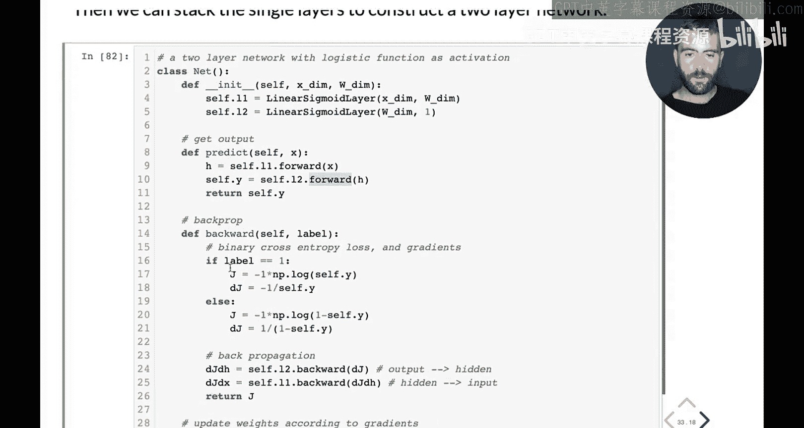

We first form the derivative of the loss。 then we compute the gradient with respect to。

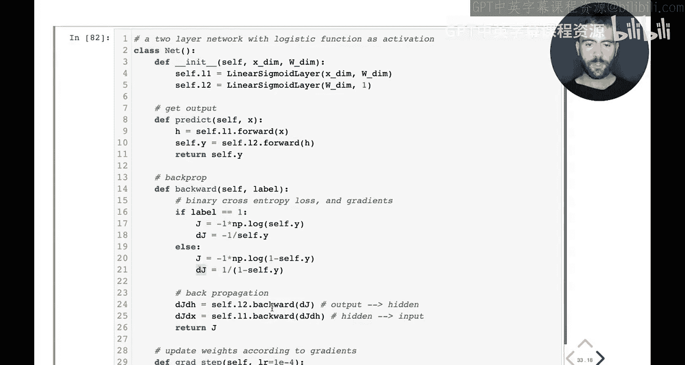

Well， sorry， we perform a backward pass。Which in， in which we。Pass along these the algorithm。

 So again， this is the gradient of。The output layers， and it synthesizes all the information。

From the layers that come before layer 1， and I pass it to layer 1。

 and then when we perform the backward pass of this layer。

 it saves its gradient and now I can retrieve this gradient using this operation。

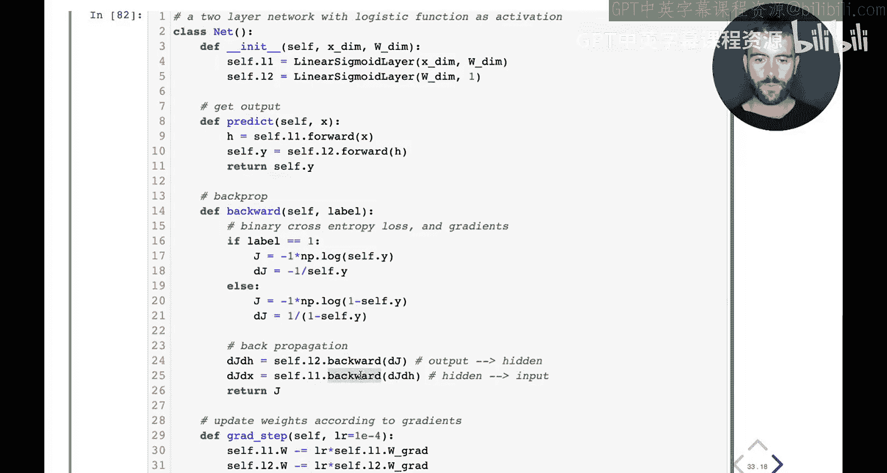

And I can perform a step of green in descent。

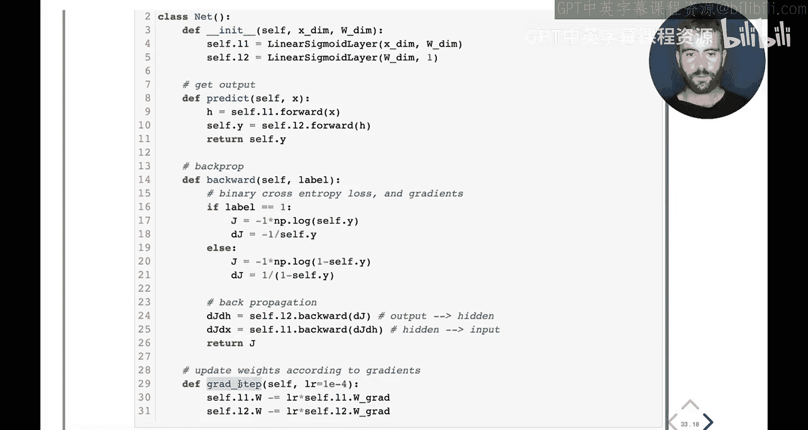

Using this particular form。嗯。Herere i have instantd these numbers using using。

Using the weights and the values that we had in the previous example。

 and now I run the backwards pass and you can check that these gradients。

 they correspond to the gradients that we have computed earlier by hand。

 you can double check that these values match。

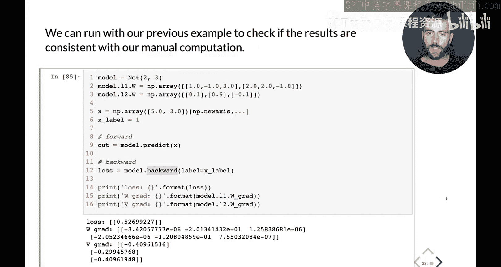

And finally we can also run gradient descent here this is a simple implementation of gradient descent for 100 steps。

 we perform the backward pass， we compute the gradient。

 then we perform a step on this gradient and we append the value of our objective。

 so here we're simply minimizing the loss on one example with a training size of one。

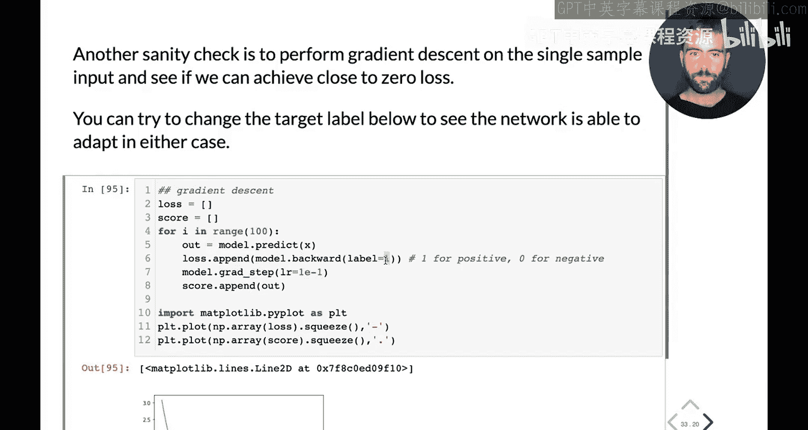

And。After a few steps here I'm plotting the value of the loss， which goes to zero over 100 steps。

 and in orange I have the prediction of the neural network。

 which approaches one and one is the label that we're optimizing。

So this is an implementation of how this algorithm can work and again。

 you don't need to understand this implementation by looking at the slides now。

 but I think you will better understand the internals if you will better understand the back propagation algorithm if you study the implementation as well as the formulas。

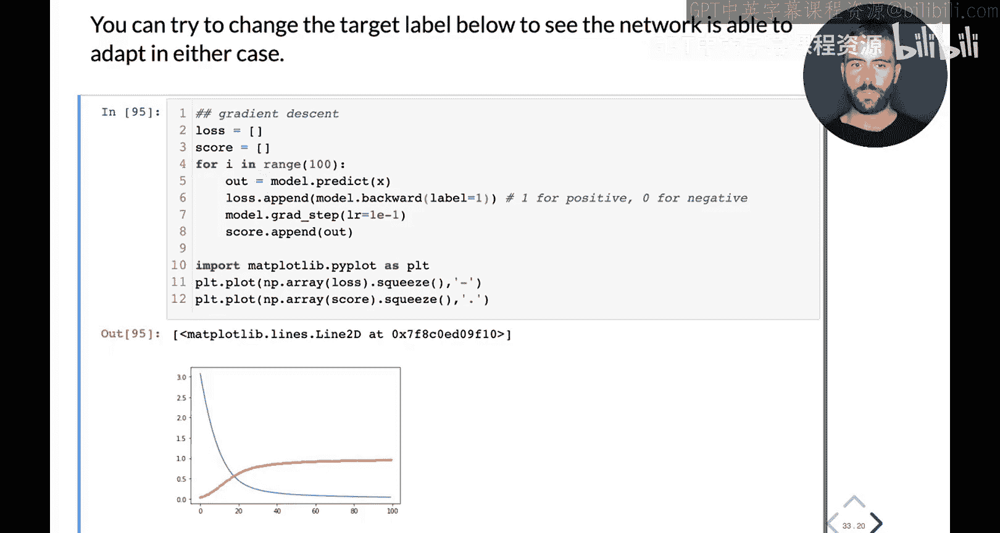

Alright， so in summary， we have defined the back propagation algorithm。

 which allows us to efficiently compute the the。The gradients of a neural network。And as a result。

 we can train these powerful neural network models using gradient descent。Now， in the next lecture。

 we are going to see some more modern families of neural network algorithms。

 which are part of deep learning。And finally， I would also like to thank ginsson。

 the course assistant for helping out with these slides and helping out with a lot of implementations and again I encourage you to revisit these implementations and the examples that ginson and I have created for these for these slides in more detail and。

And study them to have a better understanding of the back propagation algorithm。

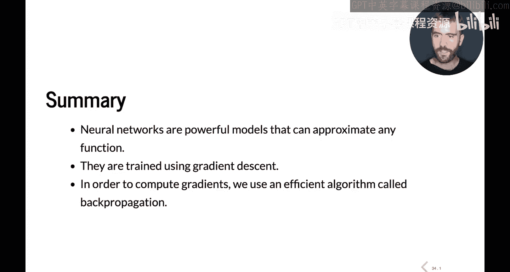