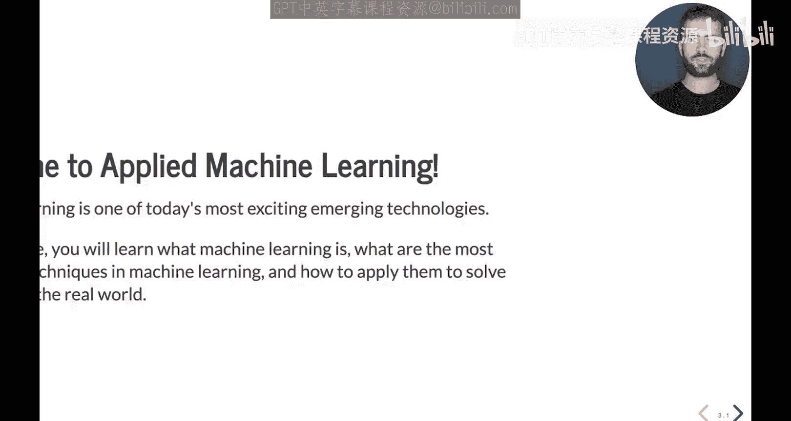
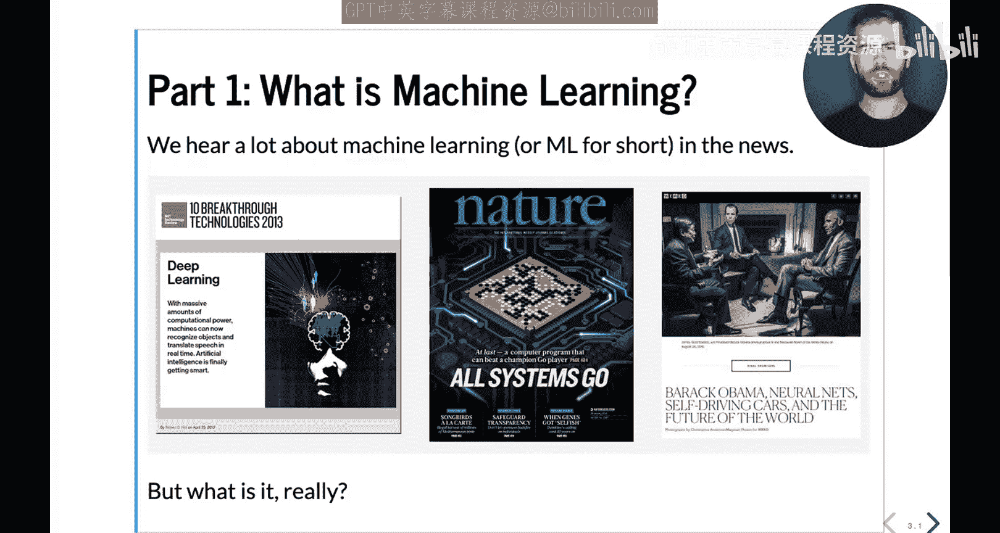
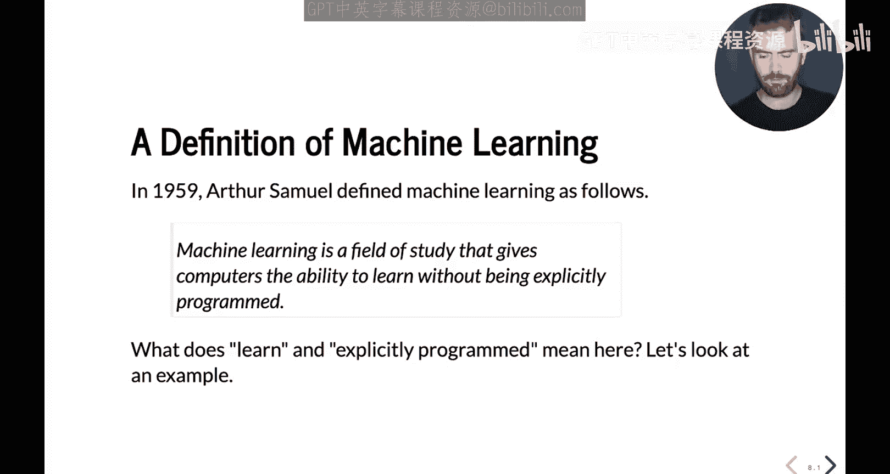
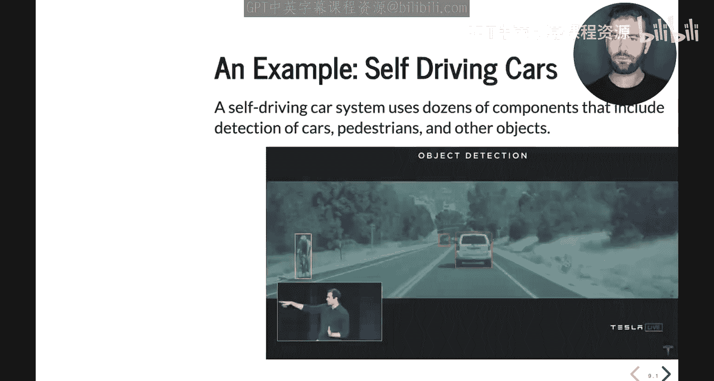
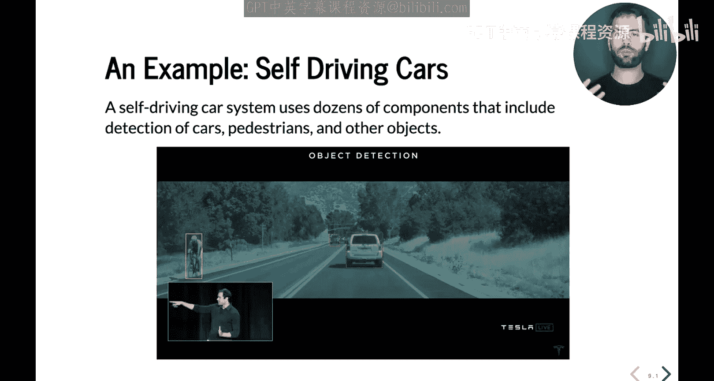
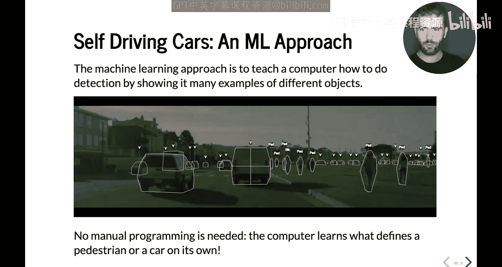
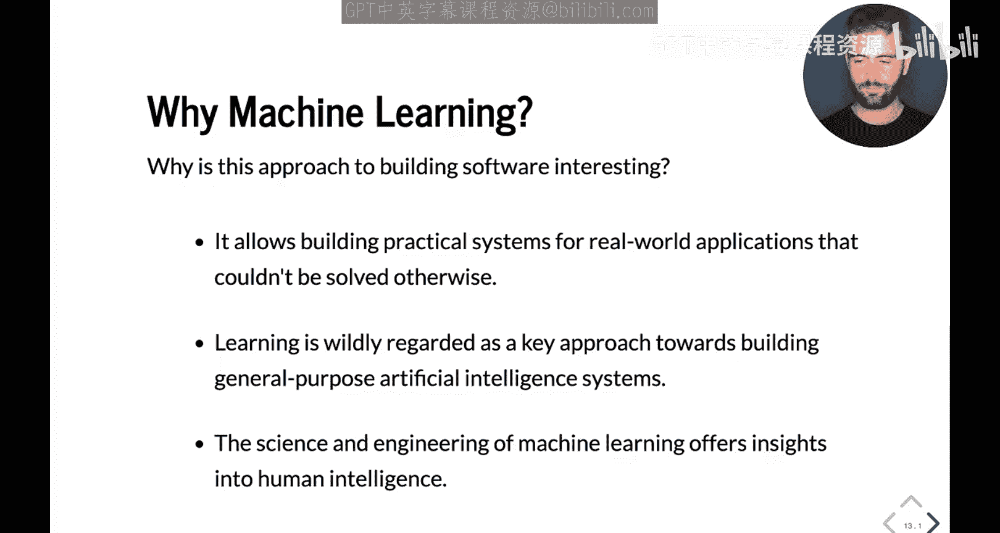

# 康奈尔大学《应用机器学习 CS 5787_ Applied Machine Learning 2020》中英字幕（deepseek p01 -01-. Lecture 1. Part 1_ Introduction to Machine Learning.zh_en -BV12udzYvEFM_p1-

。Hi and welcome to Applied Maine learning My name is Vladimir Kushov and I'm a professor in the computer Science department at Cornell Tech and Cornell University。

 and I'm going to be your instructor for this course。

I would like to start this course with the question of what is machine learning。

I personally think that machine learning is one of today's most exciting emerging technologies。

 It is having a huge impact on technology， on real world products， on policy making。😊。

And in this course， we are going to see what machine learning is。

What are the main tools and technical ideas and algorithms in the field of machine learning。

 and finally we're going to see how we can use these techniques and algorithms to solve interesting practical problems in the real world。

And I would like to start this discussion with a few snippets from the press from several years ago。

Here on the left side， you see a snippet from the MIT tech Review from several years ago。

 which at the time named deep learning， which is a form of machine learning as one of the emerging technologies of the year。

 and in the years since it has led to important breakthroughs in various fields of science and technology。

One really famous field in which there was a big breakthrough was in here is shown here in the middle on the cover of nature。

 this was a project from Google Deep Mind in which a machine learning based system。

 an AI based based system was trained to beat the current world championion of Go at the time。

And this was a feat that was previously thought to be decades away。

 and yet it was accomplished in a few years using recent advances in machine learning。And finally。

 the last snippet that you see here on the right is a conversation with Barack Obama on the topic of machine learning。

 artificial intelligence， automation， and this is just to show you that the implications of this emerging technologies have not just been on realworld purely technological applications。

 but they have also shaped policy， and they have been part of the discussions of policymakers at the highest possible level。

So these are all interesting snippets about machine learning， but what is machine learning really？

I would say that you may have used machine learning today many times without even realizing it。

For example， if you used a search engine like Google in order to， for instance。

 find these course materials， then you almost certainly use machine learning。

When you type a query into Google search， it uses machine learning algorithms to understand your query and to translate it into some form that can be executed against Google's backend。

 which will also use machine learning algorithms to retrieve information that is relevant to your query。

If you are using a smartphone， you are also almost certainly relying on machine learning。

 Your smartphone uses machine learning in many， many of its components。For example。

 if it has a personal assistant functionality such as Apple Siri or Google Assistant。

These systems rely heavily on machine learning， for example， when you speak into your phone。

 it uses speech recognition algorithms which are powered by machine learning to transform the sound of your voice into a sequence of characters or words。

Then it uses a different set of machine learning algorithms to translate these words into meaning that the computer can understand。

 And then it would also use machine learning in order to。

Understand the meaning of these words and then to execute this query against some sort of backend to retrieve information like here in this example。

 it would use the query to retrieve certain images。

Finally， if you have used email today， you have also almost certainly relied on machine learning。

Machine learning is widely used in applications like Gmail for spam detection here this is a screenshot of my own spam folder from a couple days ago。

 and I did not have to read through all of these emails that were useless in spam because there was a machine learning system that triage them for me and put them in a separate location。

And even more generally， if you are dealing with banks or credit card companies or financial institutions。

 these companies are all using machine learning to automatically detect malicious and fraudulent behavior。

 flag it and stop it before it happens so if you didn't get。

A lot of fraud recently on your credit card account that is。

 in part due to machine learning algorithms that have been used for this topic。Finally。

 a fourth application of machine learning that I would like to highlight。

 and this is perhaps an emerging application is in autonomous vehicles or self driving cars。I think。

Autonomous vehicles are one of the more most interesting and powerful applications of machine learning that they have a lot of potential to transform society。

Selfding cars can significantly reduce traffic， and most importantly。

 they can reduce significantly the number of accidents on the road and they can give access to mobility to people who wouldn't have access to mobility otherwise。

So this is just an example of how machine learning in the future can have an even more significant impact than what it is having today。

So these are all examples of what machine learning is and what machine learning can do。

 but how can we put a definition on what machine learning is？

I'm going to propose here a definition that is due to an early pioneer of machine learning called Arthur Samuel。

 Arthur Samuel became famous for building one of the first algorithms。

 one of the first systems for playing board games in his case， checkers using machine learning。

 and the way his system works worked is that it played against itself for many games and it learned how to play well from selfplay。

And so Arthur Samuel gave the following definition of machine learning， he said。

M learning is a field of study that gives computers the ability to learn without being explicitly programmed。

So this is a really interesting definition， but it may sound vague at first， what here。

 what does learn mean here and what does explicitly program mean？

And in order to understand that a little bit better， let's look again at an example。

 let's revisit our earlier example of the self driving car。

So a self driving car is actually a really complex system that is made of many different components。

A big percentage of which are powered by machine learning。One of these systems is object detection。

 so in order to understand what to do， the car needs to know what is happening on the road around it。

And here you see a screenshot from a presentation by the Tesla self-driving team that shows an example of what an object detection system might produce。

 so here the object detection system placed bounding boxes on different objects on the road and it has highlighted the car that's in front of us in red and then there's also a cyclist on the left that's highlighted in yellow and this is the kind of output that that is crucial in order to have an effective cell- driving car system。

So。How might one build a machine learning system for doing this in order to understand the difference between machine learning and not machine and non machine learning。

 let's first try a simpler approach which would not rely on machine learning that would involve just classical programming or classical software engineering。

So one way of trying to solve this problem would be using some kind of rule based system。

Here on the image you see how an input from from the camera on the car could look like and this is the image we had before。

 and so if we wanted to detect what is in the system we could do something like you see here。

 this is of course not real code but。In principle， what this is doing is that it's retrieving some sort of object。

 and then it's trying to see， does this object have wheels？If it has wheels， well。

 then it's probably either a car or a bicycle and if it has four wheels。

Then most likely this is a car。 and then it has two wheels， well。

 we would imagine that this is probably a bicycle， but actually， if you look at this image。

 the car that's in front of us， the first car in red。

 it actually also has two wheels from this angle。Which means that a car might also have two wheels if it's viewed from the back。

 so we could try to modify this code and specify that if the car is seen from the back。

 then it's probably or if the object is seen from the back and it has two wheels。

 then it's probably a car and if it's seen from sideways， well then it's probably a bicycle。

So you can see that even in this simple example， the rules for for writing this code that would understand what's in this image is quickly getting very complicated and you can easily imagine that as we start to see all the kinds of images and all the kinds of inputs that a real car would receive。

 this is going to be much more complex than are rule-based system can handle so us as humans that are actually programming all the different behaviors that the system could be doing。

 we will not be able to cover all the possible cases that the system will see。

So the approach of machine learning is instead to not specify rules by hand。

 but instead show the machine a large set of examples of desired behavior。

And then teach the machine to perform the required task by observing this behavior。

So in this example， this is again a slide from the same presentation by Tesla。

 and here this is an example of a view of what a car could see where the different objects on the road have been highlighted and have been given a label。

 so you see here the big boxes are examples of vehicles and then on the right here you see outlines of pedestrians which have been highlighted。

And the idea of machine learning is that if we give the computer a sufficiently large data set of these images with annotations or with other kinds of extra information。

 And if we and by observing this large set of images the computer will be able to learn。

 what makes a pedestrian a pedestrian， what makes a car a car。

 and it will be able to infer these rules from data automatically。 So us as human programmers。

 we no longer have to write all these rules by hand。

 we only need to specify a large data set of examples。

 and then we also need to write a much shorter meta algorithm that will。

By following which the computer will be able to learn the desired behavior and infer the low level rules automatically by itself。

And this is a much， much， much more effective approach at programming for many。

 many real world applications that we would care about。

So now we can revisit again our definition of machine learning and now hopefully the definition of to learn and being explicitly programmed is a little bit more clear。

Now， of course this was an example for self-driving cars。

 but the same kind of algorithms and the same kind of approach can be used in countless other domains。

 it could be applied in medical diagnosis where， for example。

 we could show radiology images that are of healthy individuals and unhealthy individuals and by providing a sufficient number of examples。

 the machine will learn to distinguish these automatically。

These same approaches hold for other domains， industrial automation， machine translation。

 where we would give the computer many examples of the same sentence in different languages。

These are all applications in which we can develop systems using this approach to writing software that is machine learning。

Now， why is this approach interesting？There are a few reasons。First。

 this approach allows building systems for a wide range of real world domains in which we could not write systems in any other way。

 Currently our our best and most effective approach for building。

 say object detection systems and also speech recognition systems and many other kinds of practical software。

 it crucially relies on machine learning and we don't know any better way of writing the software。

 except that。To use machine learning。So this is a very practical reason。

A more general reason is that one of the goals of engineering and science and specifically the field of artificial intelligence is to build general systems which can exhibit intelligent behavior and can solve a wide range of tasks that we would consider normally intelligent。

And machine learning is widely considered to be。One of the essential tools for making this happen so by studying machine learning。

And by studying the field of machine learning we。We develop。

 we learn skills and we learn techniques that will be crucial towards building increasingly intelligent systems。

And finally， a third and more philosophical approach of why machine learning is important is that by studying。

By studying the engineering and the scientific aspects of learning in machines。

 we are also able to infer and gain better knowledge about human learning and what learning is in essence。

 and so there are many cases where studies of machine learning have given new insights into human learning。

So overall， these are all reasons why I think machine learning is a truly exciting and one of the most exciting emerging fields in science and engineering。

 and throughout this course I hope to be able to tell you much more about machine learning and give you many more examples of what machine learning is what it can do and again。

 convince you why this is such an exciting emerging new area。

