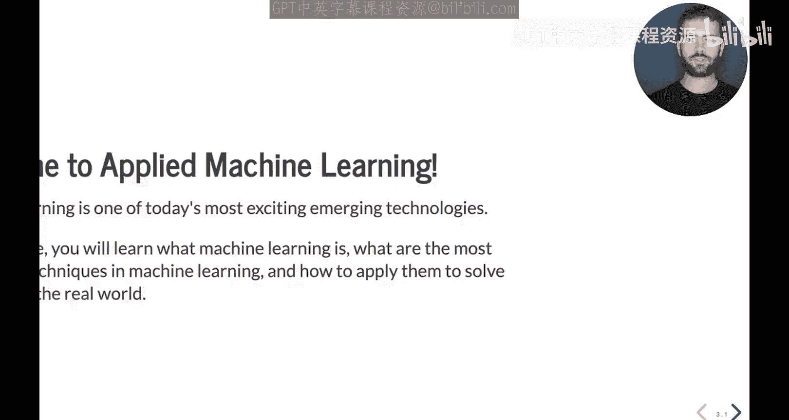
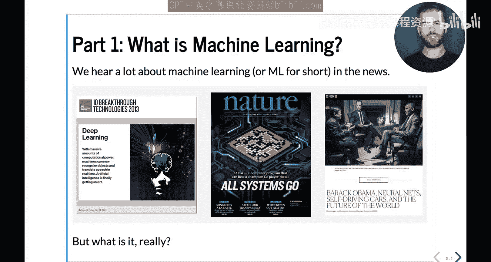
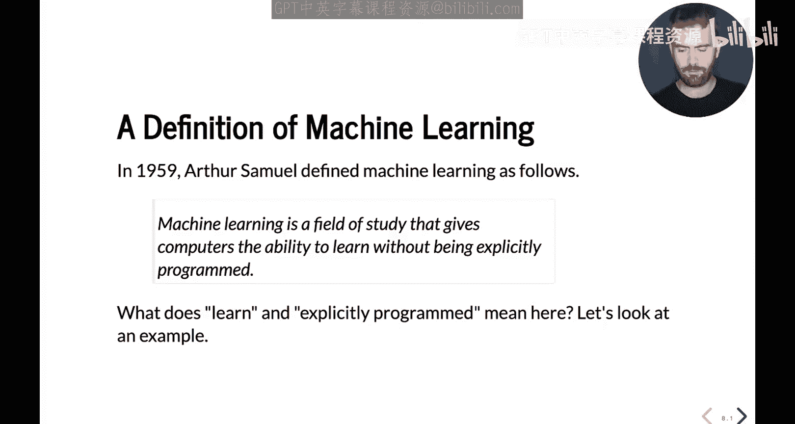
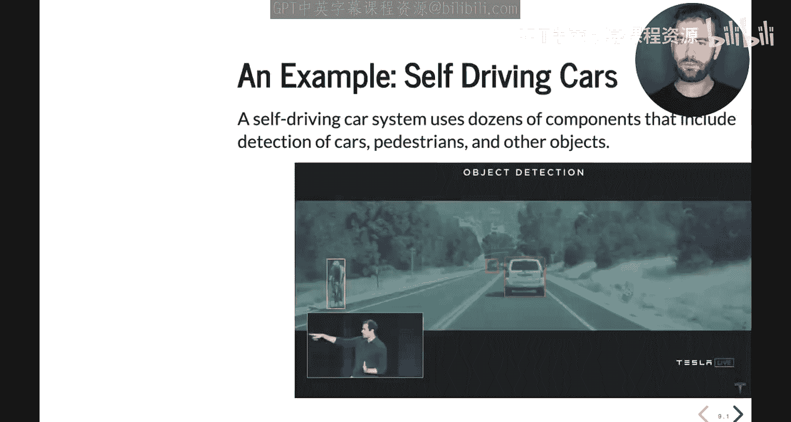
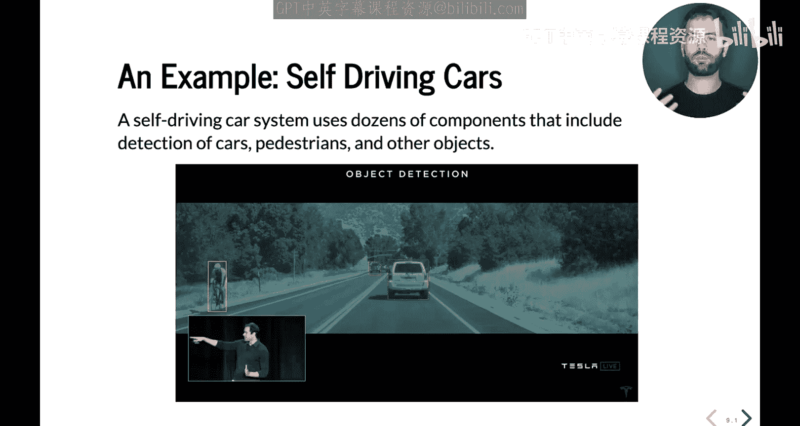
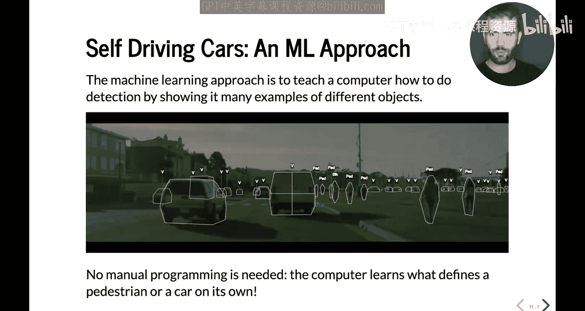
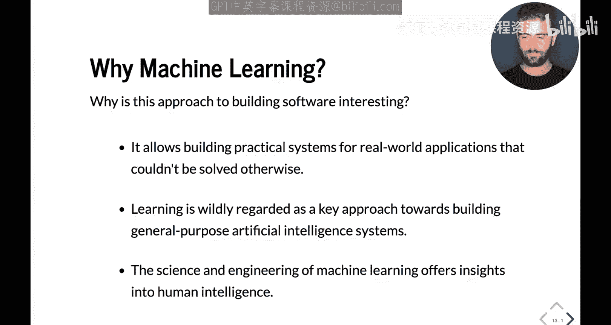

# 应用机器学习：第1讲：机器学习导论 🚀

## 概述
在本节课中，我们将学习机器学习的基本概念。我们将探讨机器学习的定义、它在现实世界中的应用，以及它与传统编程方法的区别。通过具体的例子，我们将理解为什么机器学习是当今最具影响力的技术之一。

---

## 什么是机器学习？🤔

机器学习是当今最令人兴奋的新兴技术之一。它对技术、现实世界产品和政策制定产生了巨大影响。

在本课程中，我们将了解什么是机器学习。我们将探讨机器学习领域的主要工具、技术思想和算法。最后，我们将学习如何利用这些技术和算法解决现实世界中有趣的实际问题。

我想从几年前媒体的一些片段开始讨论。

左边是几年前《麻省理工科技评论》的一个片段，当时它将深度学习（机器学习的一种形式）命名为年度新兴技术之一。自那时起，它在科学技术的各个领域带来了重要突破。

一个非常著名的重大突破领域是围棋。中间是《自然》杂志的封面，展示了谷歌DeepMind的一个项目。该项目训练了一个基于机器学习的系统，一个基于人工智能的系统，击败了当时的围棋世界冠军。这一成就曾被认为需要数十年才能实现，但借助机器学习的最新进展，它在几年内就完成了。

最后，右边是巴拉克·奥巴马关于机器学习、人工智能和自动化话题的对话片段。这表明这项新兴技术的影响不仅限于纯粹的技术应用，还塑造了政策，并成为最高决策者讨论的一部分。

这些都是关于机器学习的有趣片段，但机器学习到底是什么？

---

## 机器学习的日常应用 📱

你可能今天已经多次使用过机器学习，甚至没有意识到。

例如，如果你使用像谷歌这样的搜索引擎来查找这些课程材料，那么你几乎肯定使用了机器学习。当你向谷歌搜索输入查询时，它使用机器学习算法来理解你的查询，并将其转换为某种形式，以便与谷歌的后端执行。后端也会使用机器学习算法来检索与你的查询相关的信息。

如果你使用智能手机，你也几乎肯定依赖于机器学习。你的智能手机在许多组件中使用机器学习。例如，如果它具有个人助理功能，如苹果Siri或谷歌助手。这些系统严重依赖机器学习。例如，当你对着手机说话时，它使用由机器学习驱动的语音识别算法，将你的声音转换为一系列字符或单词。然后，它使用另一组机器学习算法将这些单词转换为计算机可以理解的含义。接着，它还会使用机器学习来理解这些单词的含义，然后针对某种后端执行此查询以检索信息。在这个例子中，它会使用查询来检索某些图像。

最后，如果你今天使用了电子邮件，你也几乎肯定依赖于机器学习。机器学习被广泛应用于像Gmail这样的应用程序中进行垃圾邮件检测。这里是我自己几天前垃圾邮件文件夹的截图。我不必阅读所有这些无用的垃圾邮件，因为有一个机器学习系统为我进行了分类，并将它们放在一个单独的位置。

更广泛地说，如果你与银行、信用卡公司或金融机构打交道，这些公司都在使用机器学习来自动检测恶意和欺诈行为，标记并在其发生前阻止它。因此，如果你的信用卡账户最近没有发生大量欺诈，这部分归功于用于此主题的机器学习算法。

我想强调的第四个机器学习应用，也许是一个新兴应用，是自动驾驶汽车或无人驾驶汽车。我认为，自动驾驶汽车是机器学习最有趣和强大的应用之一，它们具有改变社会的巨大潜力。自动驾驶汽车可以显著减少交通拥堵，最重要的是，它们可以大大减少道路上的事故数量，并为原本无法获得出行机会的人提供出行便利。这只是机器学习在未来可能产生比今天更重大影响的一个例子。

这些都是机器学习是什么以及机器学习能做什么的例子，但我们如何定义机器学习呢？

---

## 机器学习的定义 📖

我在这里提出一个由机器学习早期先驱亚瑟·塞缪尔提出的定义。亚瑟·塞缪尔因构建了最早的算法之一、最早的使用机器学习玩棋盘游戏（在他那个时代是跳棋）的系统而闻名。他的系统工作方式是，它自己与自己进行了许多游戏，并从自我对弈中学会了如何玩得好。

因此，亚瑟·塞缪尔给出了以下机器学习定义：

> 机器学习是一个研究领域，它赋予计算机学习的能力，而无需进行显式编程。

这是一个非常有趣的定义，但起初可能听起来有些模糊。这里的“学习”是什么意思？“显式编程”又是什么意思？

为了更好理解这一点，让我们再看一个例子，重新审视我们之前提到的自动驾驶汽车的例子。

---

## 自动驾驶汽车示例 🚗

自动驾驶汽车实际上是一个非常复杂的系统，由许多不同的组件组成，其中很大一部分由机器学习驱动。其中一个系统是物体检测。为了理解该做什么，汽车需要知道周围道路上发生了什么。

这里你看到特斯拉自动驾驶团队演示文稿中的一个截图，展示了物体检测系统可能产生的输出示例。物体检测系统在道路上不同的物体上放置了边界框，并将我们前面的汽车用红色高亮显示，左边还有一个用黄色高亮显示的骑自行车的人。这种输出对于拥有有效的自动驾驶汽车系统至关重要。

那么，如何构建一个机器学习系统来实现这一点呢？为了理解机器学习与非机器学习的区别，让我们首先尝试一种不依赖机器学习的更简单方法，即仅涉及经典编程或经典软件工程的方法。

解决这个问题的一种方法是使用某种基于规则的系统。在图像上，你看到汽车摄像头输入的可能样子，这是我们之前的图像。因此，如果我们想检测系统中有什么，我们可以做类似这里看到的事情。这当然不是真实的代码，但原则上，它正在做的是检索某种物体，然后尝试查看这个物体是否有轮子。如果它有轮子，那么它可能是一辆汽车或一辆自行车。如果它有四个轮子，那么这很可能是一辆汽车。如果它有两个轮子，我们会想象这可能是一辆自行车。但是，实际上，如果你看这张图像，我们前面的第一辆红色汽车，从这个角度看实际上也只有两个轮子。这意味着如果从后面看，汽车也可能有两个轮子。因此，我们可以尝试修改这段代码，并指定如果从后面看到物体并且它有两个轮子，那么它可能是一辆汽车；如果从侧面看到，那么它可能是一辆自行车。

你可以看到，即使在这个简单的例子中，编写能够理解图像内容的代码的规则也迅速变得非常复杂。你可以很容易地想象，当我们开始看到真实汽车将接收到的所有类型的图像和所有类型的输入时，这将比任何基于规则的系统所能处理的要复杂得多。作为实际编程系统所有可能行为的人类程序员，我们将无法涵盖系统将看到的所有可能情况。

因此，机器学习的方法是，不手动指定规则，而是向机器展示大量期望行为的示例。然后通过观察这些行为来教导机器执行所需的任务。

在这个例子中，这又是特斯拉同一演示文稿中的一张幻灯片。这里是一个汽车可能看到的视图示例，其中道路上的不同物体已被高亮显示并赋予了标签。这里的大框是车辆的示例，右边是已被高亮显示的行人轮廓。

机器学习的想法是，如果我们给计算机一个足够大的带有注释或其他额外信息的图像数据集，通过观察这个庞大的图像集，计算机将能够学习什么使行人成为行人，什么使汽车成为汽车，并且它将能够自动从数据中推断出这些规则。因此，作为人类程序员，我们不再需要手动编写所有这些规则。我们只需要指定一个大的示例数据集，然后我们还需要编写一个更短的元算法，计算机遵循该算法将能够学习期望的行为，并自行自动推断出低级规则。

对于我们关心的许多现实世界应用来说，这是一种更有效的编程方法。

---

## 重新审视定义与重要性 🌟

现在我们可以重新审视机器学习的定义，希望“学习”和“显式编程”的定义现在更清晰一些。

当然，这是自动驾驶汽车的一个例子，但同类算法和同类方法可以应用于无数其他领域。它可以应用于医学诊断，例如，我们可以展示健康个体和不健康个体的放射学图像，通过提供足够数量的示例，机器将学会自动区分它们。

这些相同的方法也适用于其他领域，如工业自动化、机器翻译，我们会给计算机许多不同语言的相同句子的示例。这些都是我们可以使用这种编写软件的方法（即机器学习）来开发系统的应用领域。

那么，为什么这种方法有趣呢？有几个原因。

首先，这种方法允许为广泛的现实世界领域构建系统，而这些领域我们无法以任何其他方式编写系统。目前，我们构建物体检测系统、语音识别系统和许多其他类型的实用软件的最佳和最有效方法，关键依赖于机器学习。除了使用机器学习，我们不知道任何更好的编写软件的方法。这是一个非常实际的原因。

一个更普遍的原因是，工程和科学，特别是人工智能领域的目标之一是构建能够表现出智能行为，并能解决我们通常认为需要智能才能完成的广泛任务的通用系统。机器学习被广泛认为是实现这一目标的重要工具之一。因此，通过研究机器学习，我们学习技能和技术，这些对于构建越来越智能的系统至关重要。

最后，第三个更哲学的原因是，通过研究机器学习的工程和科学方面，我们也能够推断并获得关于人类学习以及学习本质的更好知识。在许多情况下，机器学习的研究为人类学习提供了新的见解。

总的来说，这些都是我认为机器学习是科学和工程领域真正令人兴奋、最激动人心的新兴领域之一的原因。在本课程中，我希望能够告诉你更多关于机器学习的知识，并给你更多关于机器学习是什么、它能做什么的例子，再次让你相信为什么这是一个如此令人兴奋的新兴领域。

---

## 总结
在本节课中，我们一起学习了机器学习的基本概念。我们探讨了机器学习的定义，了解了它在搜索引擎、智能手机、电子邮件过滤和自动驾驶汽车等日常生活中的广泛应用。通过对比基于规则的传统编程和基于示例的机器学习方法，我们理解了机器学习“从数据中学习，而非显式编程”的核心思想。最后，我们讨论了机器学习在解决复杂问题、推动人工智能发展以及增进对人类学习理解方面的重要性。机器学习是一个强大且不断发展的领域，为构建智能系统和解决现实世界问题提供了关键工具。