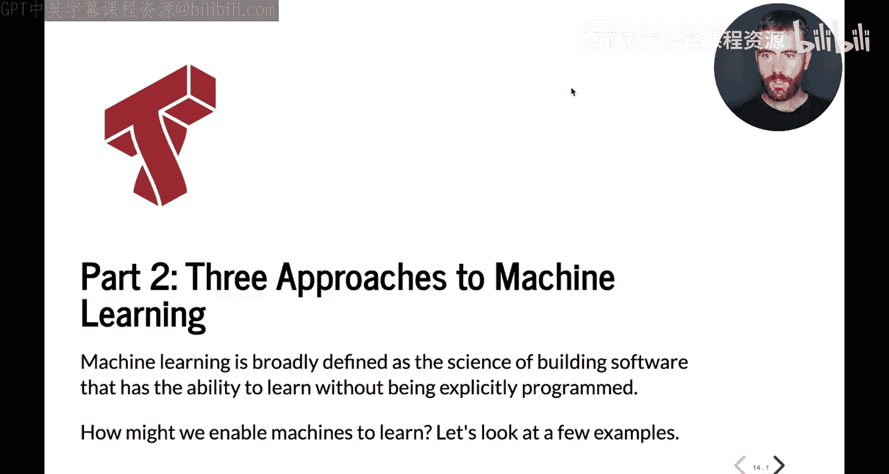
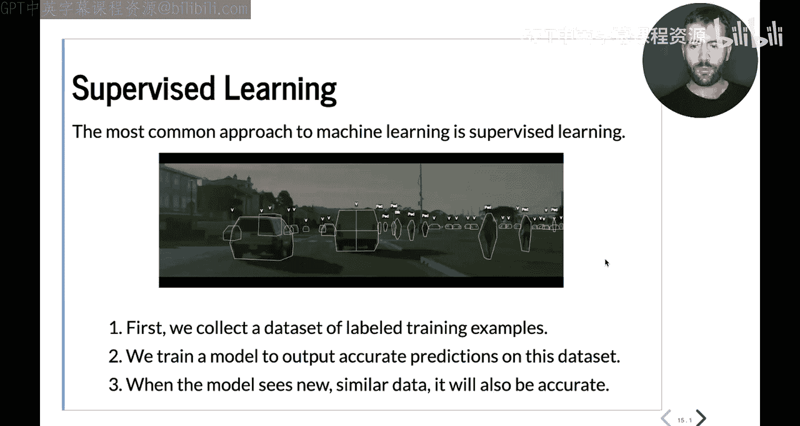
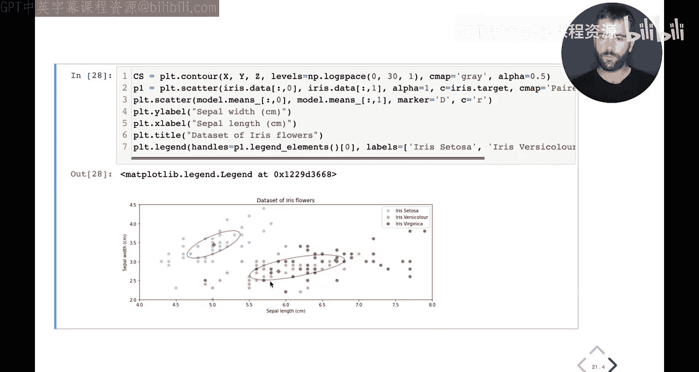
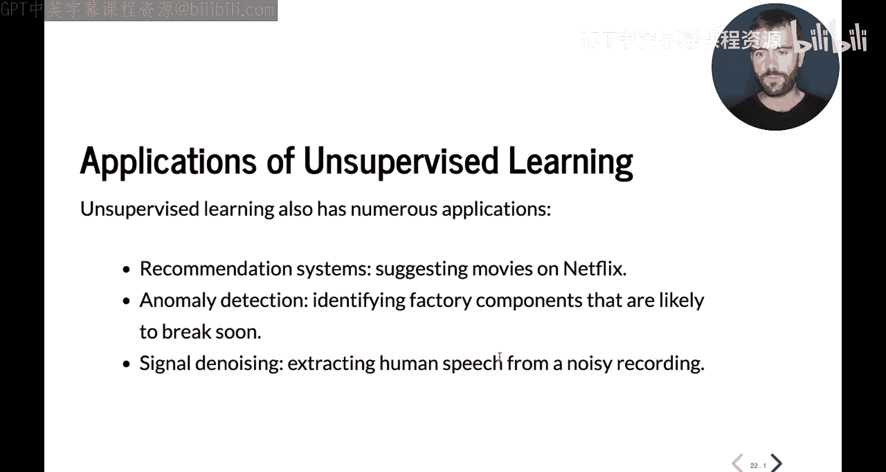
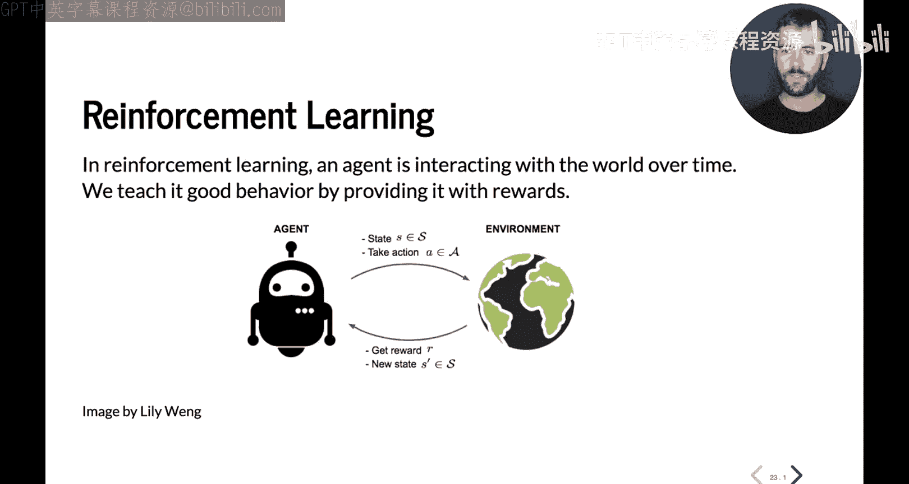
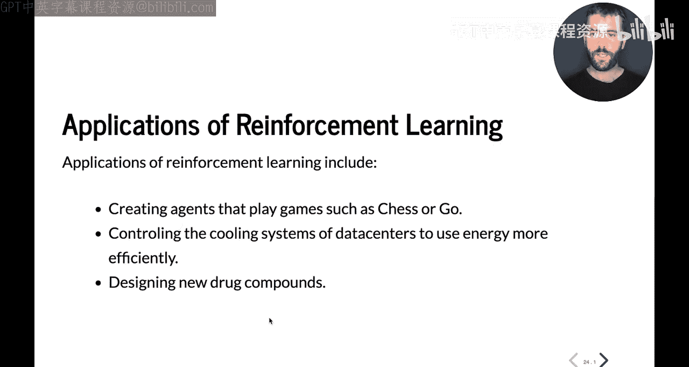
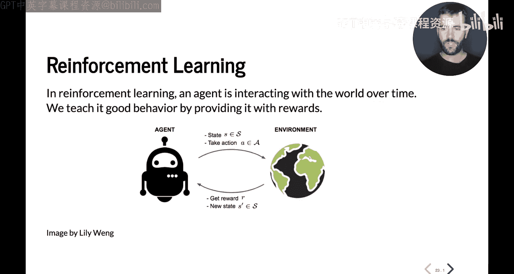
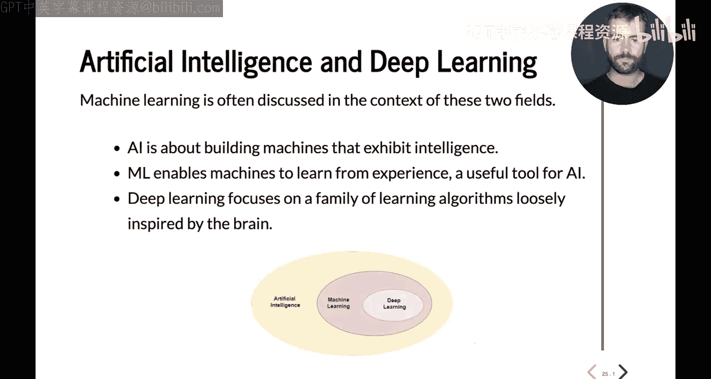
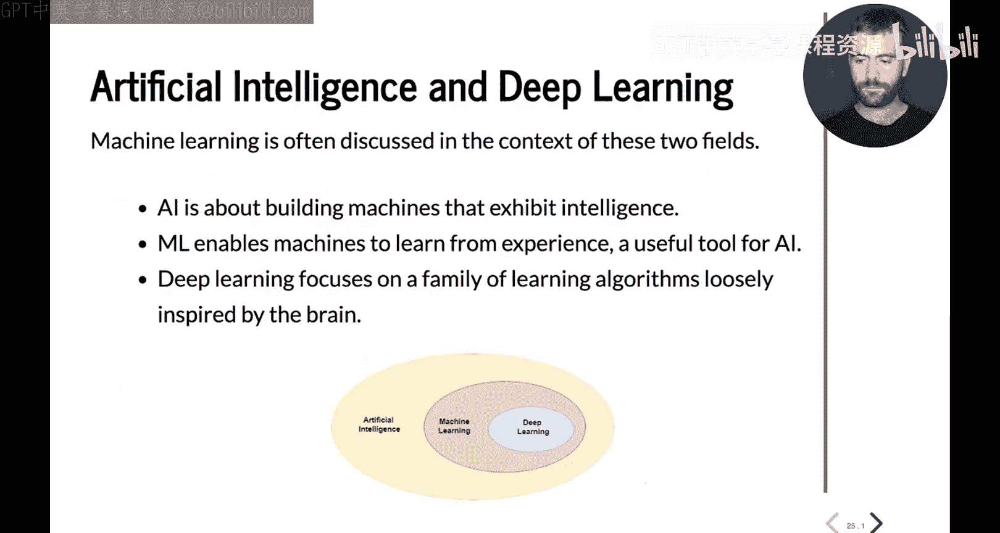

# 康奈尔大学《应用机器学习 CS 5787_ Applied Machine Learning 2020》中英字幕（deepseek p02 -02-Lecture 1. Part 2_ Three Approaches to Machine Learning.zh_en -BV12udzYvEFM_p2-

Hi and welcome back。In this video， I would like to continue our introduction to machine learning by describing three general families of machine learning algorithms that represent three high level approaches towards building machine learning systems and solving the problem of machine learning。

So the first class of machine learning methods is something that we have seen before in our previous video and that is called supervised learninging。

The example that I gave earlier that is an instance of supervised learning is this example with detecting pedestrians in an image that's taken by a self driving car。

The general idea of supervised learning is that we want our machine learning algorithm to output useful predictions or to just generally produce useful outputs on a certain set of inputs。

And the way that we get it to do that is by collecting a labeled data set of training examples。

 which are pairs of inputs and outputs。And then we train the algorithm to output these correct predictions on our data。

 so we train the model to output accurate predictions on the training data。

 and then when the model will see new， similar data。

 data that is similar to what it has seen in its training set。

 it will also output accurate predictions。And here in this example。

 we have labels for pedestrians and cars。 and if we give this computer vision systems enough of these labeled regions。

 it will learn to output accurate。To to make accurate。

Predictions of what is a pedestrian and what is a car on new images that it hasn't seen before。

Here， let's look at another example of a supervised learning data set that might be a little bit more concrete。

 housing prices in Boston。So here， each data point in this data set is a house。

And we know different attributes of this。About this house， so we know its price。

 we also know its neighborhood， we know its size， the zip code， we know how many rooms it has。

 we have a lot of additional information。So I'm going to load this data set in the。

Using Psychit Learnarn， which is a popular library for machine learning and in Python I can load this library。

 I can load its data module， and I can I can load this data here into this set of slides。

And now using another library called Maplotlibb， I can visualize this data set into dimensions。

 and in particular， I'm going to look at。I'm going to look at its price。

 which is a function of the neighborhood education level。 So here on the X axis。

 I have the percentage of adults in the neighborhood they don't have a high school diploma and so if a large if35 in neighborhoods where 35% of adults don't have a high school diploma。

 the price tends to be lower。Than in higher educated neighborhoods。

 and you can see this downward trend in the data just by inspecting it。

So a simple supervised learning algorithm is one that would map some kind of inputs in this case。

 we have our education level， two certain outputs which in this example are going to be the house prices and what I had before was a data set of examples of x and y where x is the education level and y is the house price。

 and we can use this as training data for a supervised learning algorithm。

That will be used to predict the prices of new houses。

So here I'm loading a particular algorithm from the Psy Learn library that is called Colonel Ridge and we will see later in the course actually what is the kernelon Ridge algorithm。

 but for now I am just going to load this algorithm。

 I will train it on this data and it learns this curve that passes through the data and that detects the relationship between the neighborhood education level and the house prices。

And if I have access to a new neighborhood education level in the future。

 it will I will be able to use this curve to make new predictions。

 So this is a really simple example of supervised learning。

But this approach can be used in a lot of applications。

 I think some of the most successful applications of machine learning today involve applications of supervised learning。

 and these include tasks like classifying medical images or translating between pairs of languages or the example that I gave earlier。

 which was to detect objects in a self-driving car system。

But supervised learning is not the only type of machine learning that we can do。

 another important type of machine learning that we're going to see in this class is called unsupervised learning。

And here we have a data set that doesn't have any labels， it doesn't have any human annotations。

And our goal is to learn something interesting about the structure in this data。So， for example。

 maybe we will see that this data set contains several clusters。

 So there are different groups of points that are more similar to each other in this data。

 and it will be useful to find them。 So maybe we have groups of individuals that have。

Certain certain similarities， maybe they have similar physiological measurements。

 which means they have similar either diseases or the absence of diseases。

 and we can discover this in a。Just by inspect this well by inspecting the structure of the data and then this is also useful for visualizing the structure later on。

 or maybe there are particular data points which are unusual and interesting or their errors and we want want to identify those data points or another application of supervised learning is if we have some signal but it's hidden under noise but if we know that the signal has some kind of interesting structure we could try to recover it from the noise for example。

 we could try to recover human speech in a noisy room or within a noisy phone。

This is going to be a little example of what unsupervised learning can do here I'm going to use thes function in the dataset module in the psychic learn library to learn to load another dataset set called the IIS dataset this is a dataset set of Iis flowers and for each flower we have in this visualization we have two measurements the Sepal width in the Sepal length and these are in centimeters and each data point here corresponds to a flower with the measurements that are specified on the X and Y axis。

And just looking at this data set， you already can see that it has some kind of structure here。

 these points seem to be a little bit more similar to each other than these points。

And an unsupervised learning algorithm can be used to the text structure in this data。

So in particular， we're going to try to learn a probability density over this data。

 and we're going to use an algorithm that we're also going to see in this course called Gasian mixture model。

We're going to assume that this data is well have three components which we're going to try to learn。

 but we're only going to say that there are three components and then let's see what happens if we learn this data so in fact the first thing that it finds is that we have these two groups here。

 we have this group and we have this group and this is something that we saw already in the data by inspecting it and then it further says that this group breaks down into two smaller subgroups which are given by the two red dots here。

And。Now what's interesting is that。We actually have labels for this data set。 I haven't used them。

 but I can now load them as well， and I can show the label of each flower using a different color。

And what we see is that indeed we have three classes in this data and the first class corresponds to this cluster and all these blue flowers。

 they're actually from the same subspecies of iris flowers called Irissoosa。

And this group of points also actually happens to have two。Two types of flowers。

 which Im noted here in yellow and brown。These are called iris versic and Virginiaica。

 and these two are more similar to each other。 but using unsupervised learning。

 we were able to find that these two dots correspond to。

To these to the to the centers of these two classes。

 and you do see that yellow flowers tend to occur more on this side of this group and brown flowers tend to occur more on this side。

 And without looking at the labels just by。Just by looking at the structure of the data。

 we were able to identify these three groups of flowers， even though we didn't know what they were。

Unsupervised learning also has a lot of practical applications。Systems。

 which are called recommendation systems， for example， the。The recommendation system。

For movies on Netflix， some components of it or some versions of these kinds of systems can be unsupervised or at least more complex production systems have some unsupervised components。

We can also use unsupervised learning for anomaly detection。

 so if certain data are errors or noisy or if they're noise。

 or if they are really different from their normal state， for example。

 a factory component that's likely to break that is useful and also signal denoising that I mentioned is another useful application of unsupervised learning。

And finally， the last class of machine learning， and this is also a really interesting approach is called reinforcement learning。

In reinforcement learning， we have a slightly different setup。Here we have an agent that is。

Acting in some environment。And this agent has some kind of internal state based on this state。

 it determines to take a particular action。It sends that to the environment， the environment。

Changes in some way。 and then based on what happens。The state of the agent changes。

And as he changes a state， the agent also observes a reward of using a particular action in a particular state。

And the goal of this agent is to maximize reward over time。

Let me give you a slightly more specific example imagine。

We have a robot that is trying to perform some kind of task， like maybe。

waash wash a part of or clean part of a kitchen table if the robot performs tasks that involve cleaning。

 then the robot receives a reward， we say hey good robot and then if the robot does something unrelated if it breaks a glass。

 then we give it a negative reward and we say a bad robot， stop。So。

Agents and algorithms that learn from these kinds of rewards are called reinforcement learning agents。

 and this is the third approach towards machine learning that I'm going to describe。

This approach also has a lot of practical applications， for example。

 agents that play board games like chess or go， state of the art agents are built using reinforcement learning。

And reinforcement learning also has a lot of practical applications in industry， for example。

 cooling systems for data centers， we can use reinforcement learning to design policies for when to on or when to turn off cooling in order to keep a data center at optimal performance and without incurring too much cost。

So reinforcement learning has a lot of practical applications。

 and I also want to highlight this is a little bit different from regular supervised learning。

Because of this reward structure， but also because of these states and often in reinforcement learning。

 an agent must so there are often some。Locally opt， optimal decisions that give it immediate rewards。

 but then they enter state with with bad rewards。 So let's say the。

The agent might get stuck in some bad state and so reinforcement learning is more challenging than other types of machine learning because we have to perform this kind of long term planning and longterm exploration to make sure we're not stuck in any in any bad states and also the decisions that led us to this good state may not be。

Or if we make good decisions， we may only observe their good results。Farther out in the future。

 and this makes learning the agent a little bit more difficult。

 it makes learning good policies for the agent more difficult。

Finally， the last distinction I want to make in this video is between two related fields of two related fields。

 which are artificial intelligence and deep learning。And we often hear them。

In the same context as machine learning， but they are not quite the same。First of all。

 artificial intelligence is a general academic and also applied field that is concerned with building systems which mimic human intelligent behavior so the ultimate goal of artificial intelligence is what this is also called general artificial intelligence or strong artificial intelligence is to build entities that appear to be and that behave as intelligently as humans。

 but there are also lots of subgoals towards that for example。

 logical reasoning maybe be one of them or planning maybe be another one。

And machine learning is a subset of artificial intelligence。

 which consists in building machines that can learn from experience。

So this is a feature of an intelligent system， but not the only one， for example。

 logic may be a property of an intelligent system that is not necessarily tied to learning or logical reasoning may not be tied to learning。

 but machine learning is nonetheless considered a very。

 very important tool towards building artificial intelligence systems and it is considered to be the most promising approach towards achieving that long-ter goal。

And in deep learning is a subset of machine learning。

 which focuses on a particular type of model that is called a neural network。

 which is loosely inspired by how the brain works。And these kinds of models are very successful today。

 They can solve a lot of important practical problems。

 such as image recognition or speech recognition， machine translation。 These are tasks on which。

Deep learning models have achieved really， really impressive results。

 and this is why deep learning is a particularly interesting and exciting area of application today。

