# 康奈尔大学《应用机器学习 CS 5787_ Applied Machine Learning 2020》中英字幕（deepseek p03 -03-Lecture 1. Part 3_ About the Course.zh_en -BV12udzYvEFM_p3-

Welcome back in the previous videos， we saw what machine learning is and we looked at different ways in which we can approach machine learning problems。

 for example， supervised learning， reinforcement learning and supervised learning。In this part。

 I would like to tell you a little bit more about the course itself and what we're going to see。

 how we're going to see it， and why are we going to see it in that specific way。

So。To start， I just want to mention how we're going to be approaching the different material that we're going to see。

The title of this course is applieded machine learning and it has two parts applied in machine learning。

It's a machine learning course in the sense that we're going to see a broad range of tools from different subfields of machine learning and we're going to see the core algorithms from each area of machine learning and as a result we're going to see and you will learn a general toolkit that will be really broad。

 really general and will be applicable to a really wide range of problems so there are some courses that tend to focus either on on one subfield for example。

 on deep learning only in this course， the idea is to we're going to see deep learning。

 but we're also going to see many other kinds of algorithms that are widely used。

 really important and really central to machine learning。

Then the other part of this course is the applied part。

We will emphasize applications a lot and we will not just define what the algorithms are。

 but we're also going to show how they work either by implementing them or applying them in exercises or examples。

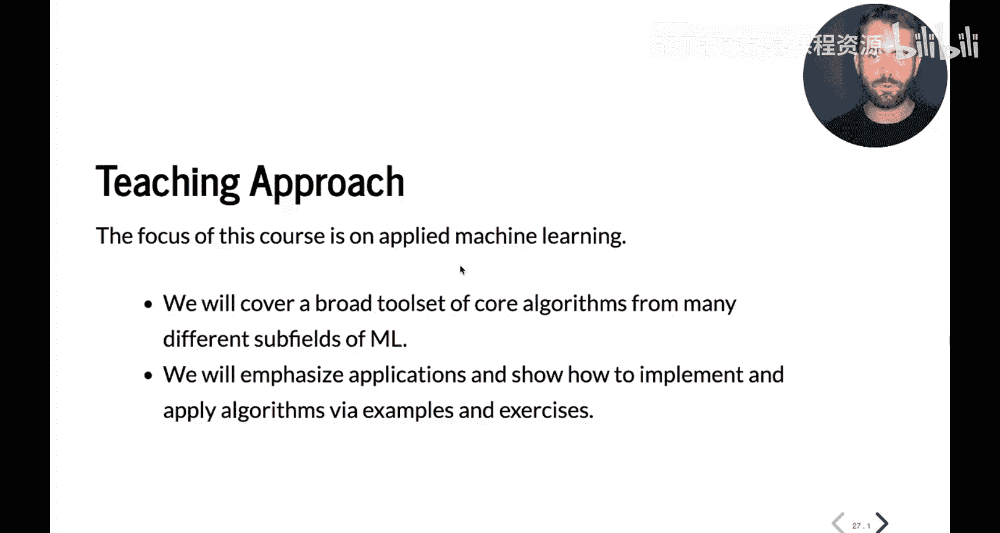

And I'm going to give you a few examples later on for how this might work。So why。

 why this particular approach。 So one really。Practical reason is that applying machine learning is really useful。

 it's a skill that's really important， it's really valued。

 and the reason it's valued is because machine learning can have a lot of impact in different practical domains。

So this is a very practical reason。I guess a more well a different reason is that there's often a gap between defining the algorithm and applying it。

 you may know how to write the algorithm on a piece of paper but getting it to work in practice is a different skill and understanding both is really important and covering this gap is something that we're going to try to do here。

And finally， a more。Hedagogical reason is that in order to understand how a particular algorithm works。

The best way to do that is often to implement the algorithm or at least to study its implementation。

 and so by focusing on applications， we can also better understand how these algorithms work。

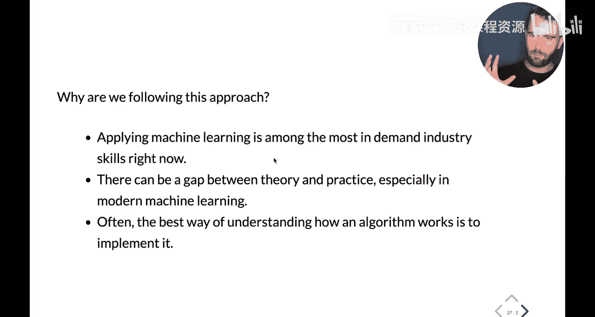

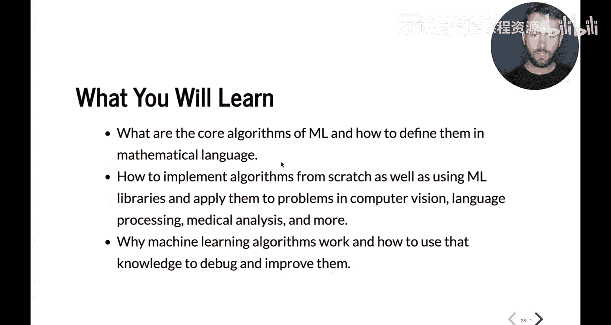

Now， what are some of the things that we're going to see？

The first thing we're going to see is a wide range of algorithms。

 again from different subfields of ML， and these will be the most important algorithms that typically we need to know。

 and we're going to define what they are using standardation using mathematical language。

Then we're also going to see how to implement these algorithms from scratch， well。

 either from scratch or using machine learning libraries and how these can be applied to problems in various domains such as computer vision。

 language， medical analysis， etc。And then another aspect that's going to be specific to the course that is often not covered in standard machine learning courses is how to approach machine learning problems and how to solve machine learning problems in practice So for example。

 you may apply certain algorithm like a deep neural network to a problem but then once you have a first implementation It's often not obvious how to what to do next。

 do you try to change the internals of the algorithm， do you try a different algorithm。

 do you try to get more data， do you try to do something else。

's there's a practical problem solving approach that's needed in order to deploy these algorithms in practice。

 and that's something that we also will look at in the course。

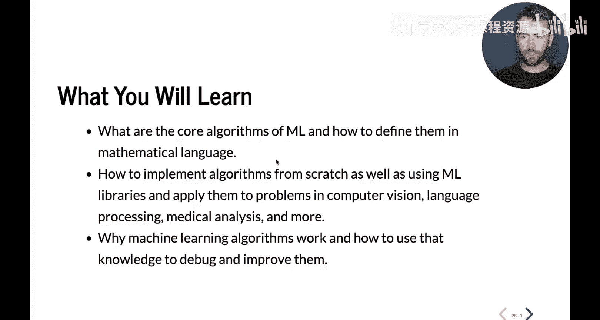

Throughout this course， we're going to be using a lot of standard machine learning packages。

 these packages are all based on the Python programming language。And a few of them。

 well the most important ones are going to besyLarn。

 which is a library that implements a lot of very popular and standard core machine learning algorithms we will also be using deep learning libraries such as Tensorflow cares byytorch and all of these libraries are built on top of core linear algebra modules。

 linear algebra libraries， Nmpy and pandas is more of a data processing library。

 a lot of our work will involve these libraries as well。

 and being able to see how these algorithms are implemented using these libraries is something that's going to be really valuable I think。

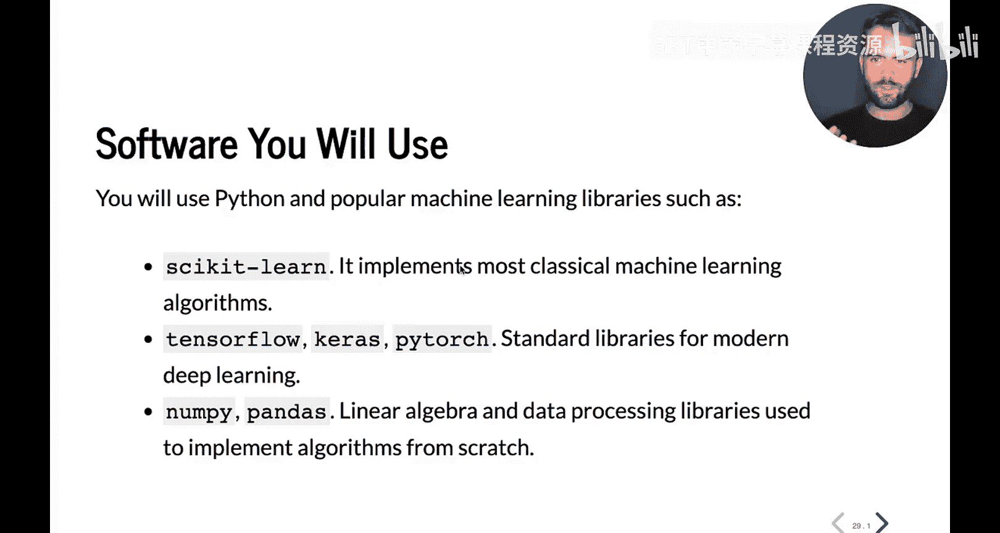

One really interesting part of the course which I'm personally really excited about is the idea of having executable course materials you have seen a few examples of this in the earlier slides。

And the idea is that all the materials that I'm going to be presenting through these slides。

 these are actually executable notebooks。 So there's I'm going to be showing you code that will run directly in the slides。

 and it's actually running in my browser here on my computer。

We're going to be using this code to demonstrate different concepts in machine learning。

 so we will show the concept using mathematical notation and then you will see how to either implementer from scratch or how to use it within via existing library and all the code that you see in these slides or in the materials that I'm going to be sharing with you。

 you can download this code to your computer and you can run this you can run everything locally and you can reproduce all the results and all the figures that I'm going to be showing in slides or in other materials。

Just to give you a better sense of what this means， let's look at one。Let's look at one example。

 so this is here this is an example of a cell and this cell contains Python code。

 so here I'm just importing a few standard libraries， Ny Matpllibb，sitLn。

 and I can execute this slide in I can execute this cell as part of my slides and now this code just ran in my browser as I was recording this video。

So to give you a sense of how this might be used， let's look at another example。

 or as a follow up to this example， I can use these libraries that are just loaded to load a data。

 so here I am using the psyit dataset sets module to learn to load a dataset set of digits。

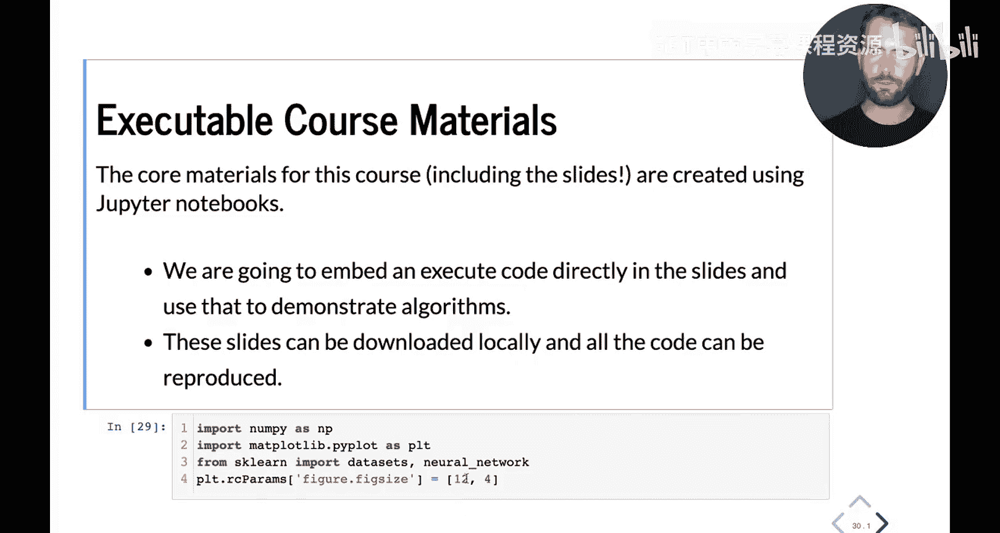

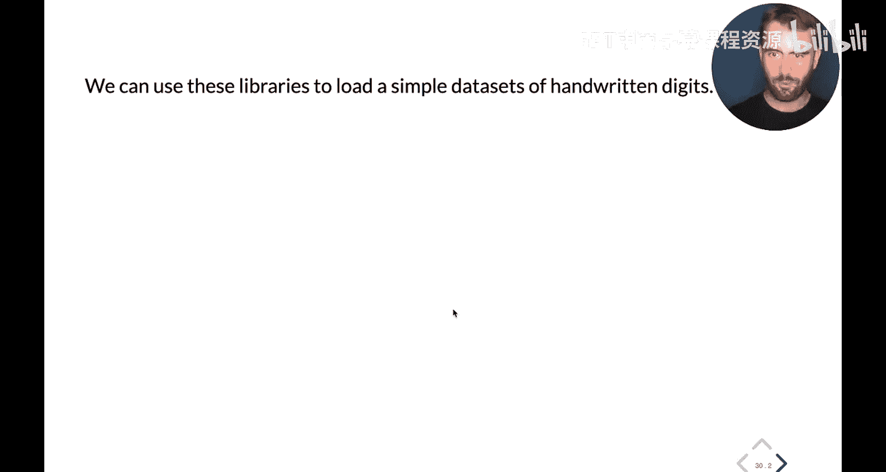

And here I'm using a bit of Python to display for digits on the screen。

 so this is this is a toy data set that contains eight by8 pixel images of handwritten digits and here I just showed you。

I just showed you four examples， four digits from this data set。

We're going to well here's a way in which these in which I can in which we can use executable slides to demonstrate how a machine learning algorithm would work so in these slides and I'm now going to train a machine learning algorithm live so here I am I am importing a neural network classifier and I am going to train it。

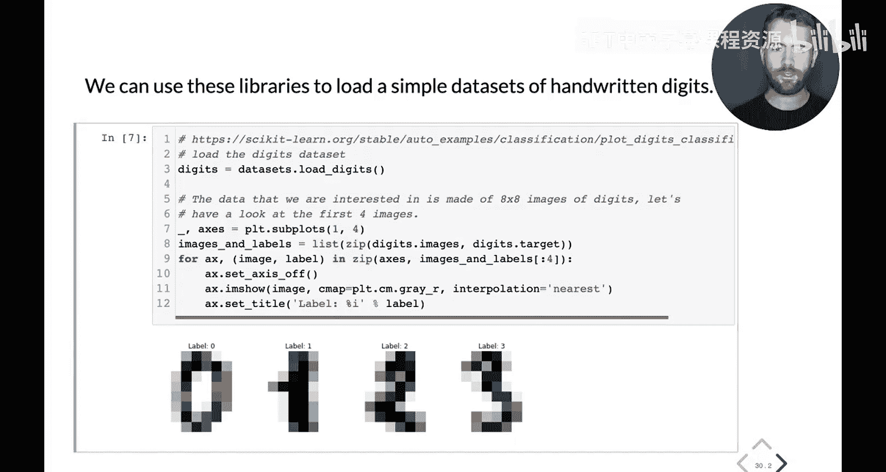

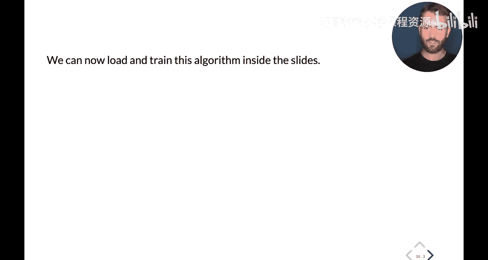

Weear this line of code。To recognize these digits and to classify them by their label。

I am going to execute this slide now， and this， of course， this is a small toy data set。

 So in the one second they just passed。The this code executed。

 and I just trained this machine learning model on my laptop。

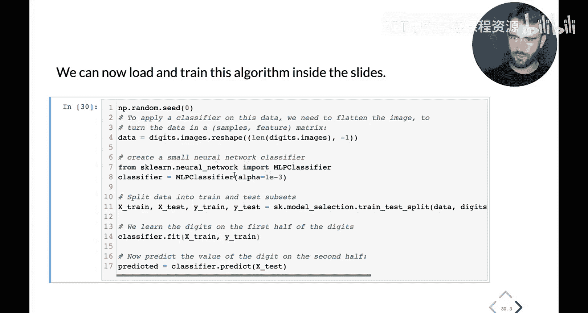

And now if I go down， I can display these results， So I'm just executing this code now。

 And for these four random samples from a data， the model has generated live in my browser predictions。

 And so here it's saying this is a9。 This is a4。 These are kind of hard to distinguish。

 but this one it's saying it's a 6。 This one I think it's an8。 that's unclear。 maybe it's a 9。

 These are very low resolution and very toy images。

But what you see here is a way of。Demonstrating live how an algorithm。

 how a machine learning algorithm could be imported and used。

And I have just used it live to classify this data set。

So this is one of the really exciting things about the course that I hope you will find useful。

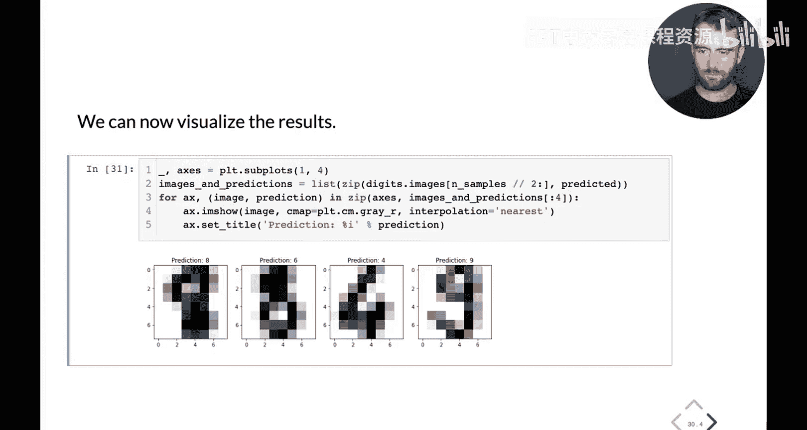