# 应用机器学习 CS 5787：1.3：关于本课程 📚

在本节课中，我们将要学习本课程的具体安排、教学方式以及你将学到什么。我们将了解课程为何采用“应用”与“机器学习”相结合的方法，并预览课程中将使用的工具和独特的可执行教学材料。

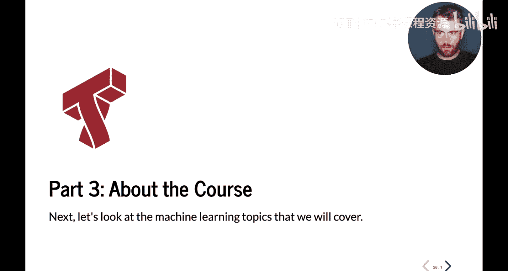

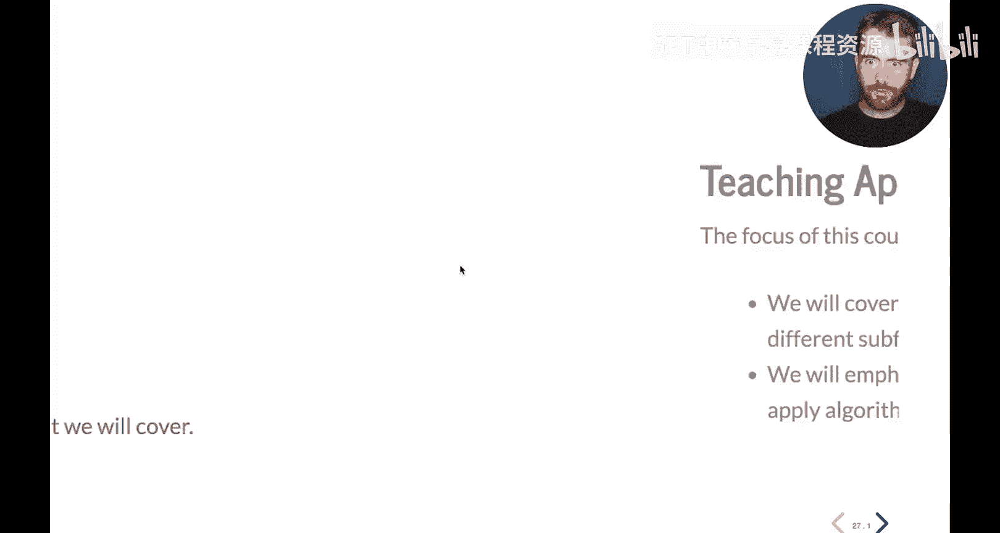

欢迎回来。在之前的视频中，我们了解了什么是机器学习，并探讨了处理机器学习问题的不同方法，例如监督学习、强化学习和无监督学习。在本部分，我想更多地介绍课程本身，我们将学习什么内容，如何学习，以及为何采用这种特定的方式。

## 课程方法：理论与实践并重

首先，我想说明我们将如何呈现将要学习的各种材料。

本课程名为“应用机器学习”，它包含两个部分：“应用”和“机器学习”。它是一门机器学习课程，意味着我们将学习来自机器学习不同子领域的广泛工具，并了解每个机器学习领域的核心算法。因此，你将学习到一个非常广泛、通用且适用于极广范围问题的通用工具包。有些课程倾向于只专注于一个子领域，例如仅专注于深度学习。在本课程中，我们也会学习深度学习，但同时也会学习许多其他被广泛使用、非常重要且对机器学习至关重要的算法。

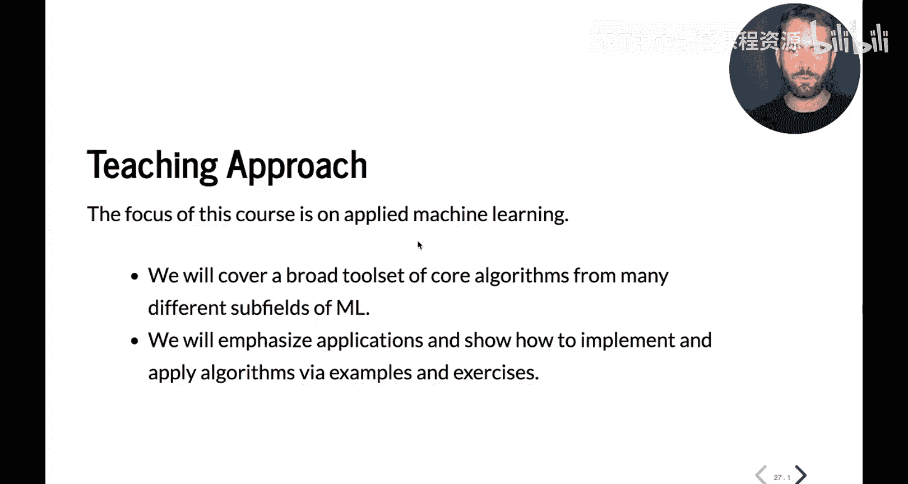

本课程的另一部分是“应用”部分。我们将非常强调应用。我们不仅会定义算法是什么，还会通过实现它们或在练习、示例中应用它们来展示它们如何工作。稍后我将给出几个例子来说明这是如何运作的。

## 为何采用此方法？

那么，为何采用这种特定的方法？一个非常实际的原因是，应用机器学习非常有用，这是一项非常重要且备受重视的技能。它之所以受重视，是因为机器学习可以在不同的实际领域产生巨大影响。这是一个非常实际的原因。

另一个原因是，定义算法和应用算法之间常常存在差距。你可能知道如何在纸上写出算法，但使其在实践中工作是另一项技能。理解两者都非常重要，弥合这一差距是我们在这里要尝试做的事情。

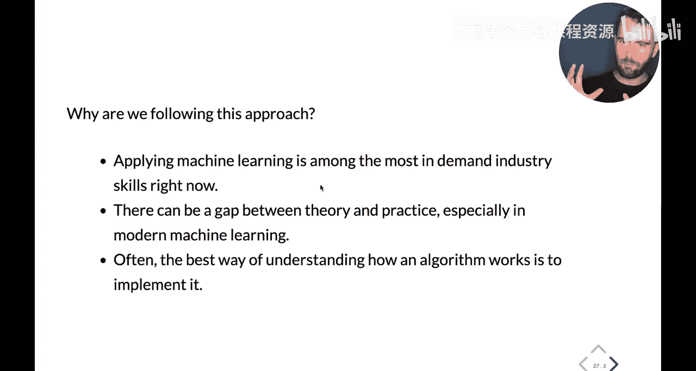

最后，一个更偏向教学法的原因是，为了理解特定算法的工作原理，最好的方法通常是实现该算法，或者至少研究其实现。因此，通过专注于应用，我们也能更好地理解这些算法是如何工作的。

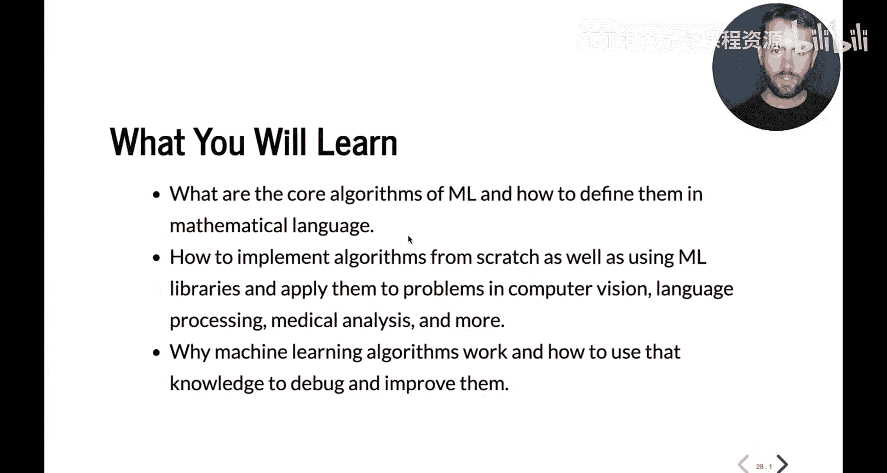

## 课程内容概览

现在，我们将要学习哪些内容？

我们将要学习的第一件事是广泛的算法，同样来自机器学习的不同子领域。这些通常是我们需要了解的最重要的算法。我们将使用数学语言和标准符号来定义它们。

然后，我们还将学习如何从头开始实现这些算法，或者使用机器学习库来实现，以及如何将它们应用于计算机视觉、语言、医学分析等各个领域的问题。

本课程另一个特有的方面，是学习如何应对和解决实践中的机器学习问题，这在标准的机器学习课程中通常不涉及。例如，你可能将某种算法（如深度神经网络）应用于一个问题，但一旦有了第一个实现，接下来该做什么往往并不明确。你是尝试改变算法的内部结构，尝试不同的算法，尝试获取更多数据，还是尝试其他方法？在实践中部署这些算法需要一种实际的问题解决方法，这也是我们将在课程中探讨的内容。

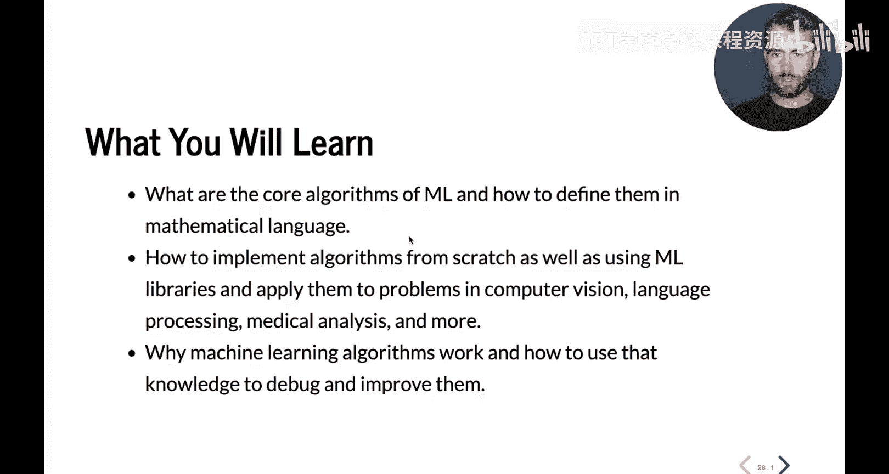

## 课程使用的工具

在整个课程中，我们将使用许多标准的机器学习软件包。这些软件包都基于 Python 编程语言。其中最重要的一些包括：

*   **Scikit-learn**：一个实现了许多非常流行和标准的核心机器学习算法的库。
*   **深度学习库**：如 TensorFlow、Keras 和 PyTorch。
*   **核心线性代数库**：所有这些库都建立在核心线性代数模块之上，例如 NumPy。
*   **Pandas**：这是一个更偏向数据处理的库。我们的许多工作也将涉及这个库。

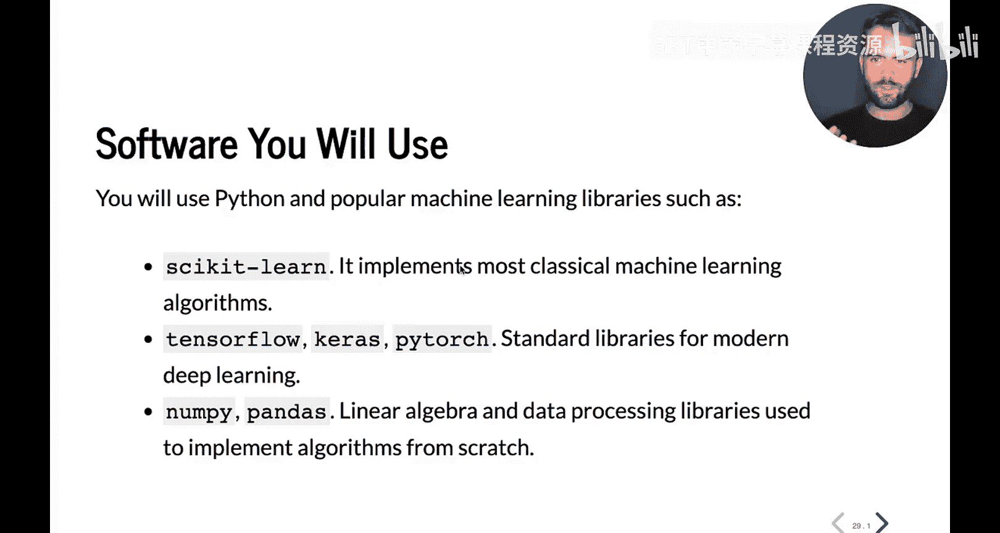

我认为，能够看到如何使用这些库来实现这些算法将非常有价值。

## 独特的可执行教学材料

本课程一个非常有趣的部分，也是我个人非常兴奋的一点，是拥有可执行的课程材料。你在前面的幻灯片中已经看到了几个例子。

其理念是，我将通过这些幻灯片展示的所有材料，实际上都是可执行的笔记本。因此，我将向你展示可以直接在幻灯片中运行的代码，并且它实际上是在我电脑的浏览器中运行的。

我们将使用这些代码来演示机器学习中的不同概念。因此，我们将使用数学符号展示概念，然后你将看到如何从头实现它，或者如何通过现有库使用它。你在这些幻灯片或我将与你分享的材料中看到的所有代码，都可以下载到你的电脑上，你可以在本地运行所有内容，并复现我将在幻灯片或其他材料中展示的所有结果和图表。

为了更好地理解这意味着什么，让我们看一个例子。这是一个单元格的例子，这个单元格包含 Python 代码。这里我只是导入了一些标准库：NumPy、Matplotlib、Scikit-learn。我可以将此单元格作为幻灯片的一部分执行，现在这段代码就在我录制此视频时在我的浏览器中运行了。

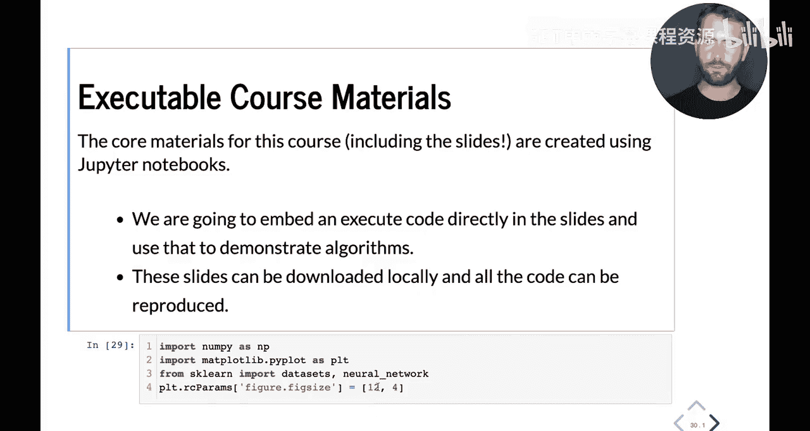

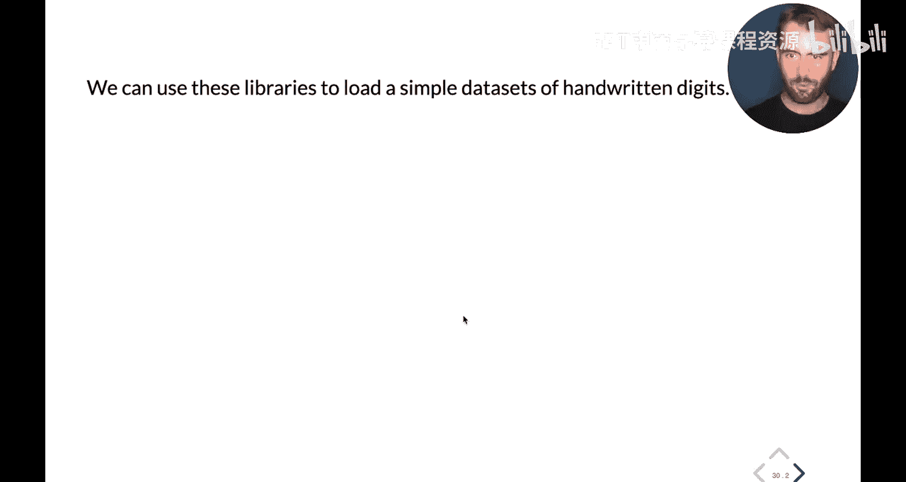

为了让你了解这可能如何使用，让我们看另一个例子，或者作为这个例子的后续，我可以使用刚刚加载的这些库来加载数据。这里我使用 Scikit-learn 的 `datasets` 模块来加载一个手写数字数据集。

这里我使用了一点 Python 代码在屏幕上显示四个数字。这是一个包含 8x8 像素手写数字图像的玩具数据集，这里我刚刚向你展示了四个例子，来自这个数据集的四个数字。

这是一种我们可以使用可执行幻灯片来演示机器学习算法如何工作的方式。在这些幻灯片中，我现在将实时训练一个机器学习算法。这里我导入一个神经网络分类器，并准备训练它。

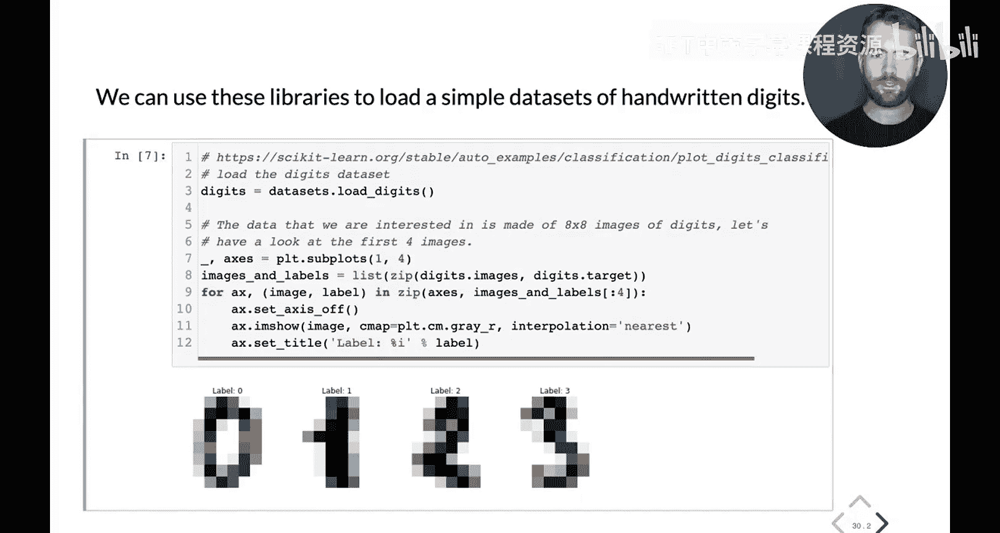

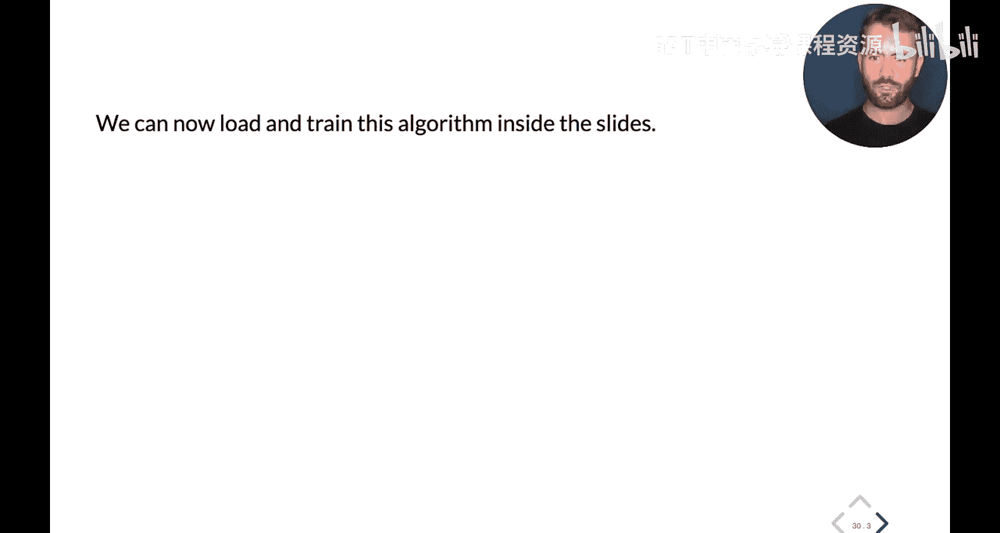

通过这行代码来识别这些数字并根据它们的标签进行分类。我现在将执行这个幻灯片。当然，这是一个小型玩具数据集。所以，在刚刚过去的一秒钟里，这段代码执行了，我刚刚在我的笔记本电脑上训练了这个机器学习模型。

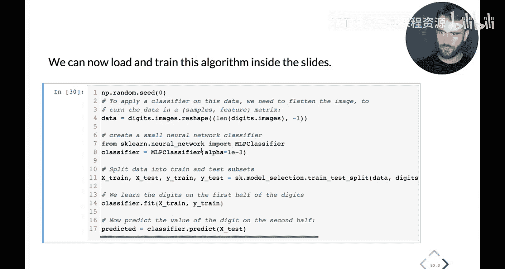

现在，如果我向下滚动，我可以显示这些结果。我现在正在执行这段代码。对于数据中的这四个随机样本，模型已经在我浏览器中实时生成了预测。这里它说这是 9，这是 4。这些有点难以区分，但这个它说是 6。这个我认为是 8，不太清楚，也许是 9。这些都是分辨率非常低、非常玩具化的图像。

但你在这里看到的是一种实时演示算法、演示机器学习算法如何被导入和使用的方式。我刚刚实时使用它来对这个数据集进行分类。这是本课程真正令人兴奋的事情之一，我希望你会发现它很有用。

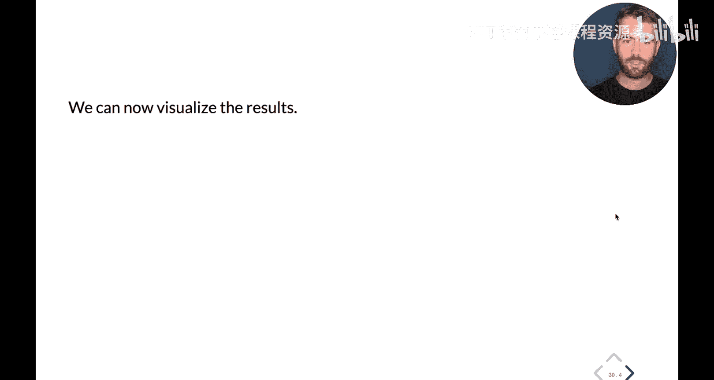

## 总结

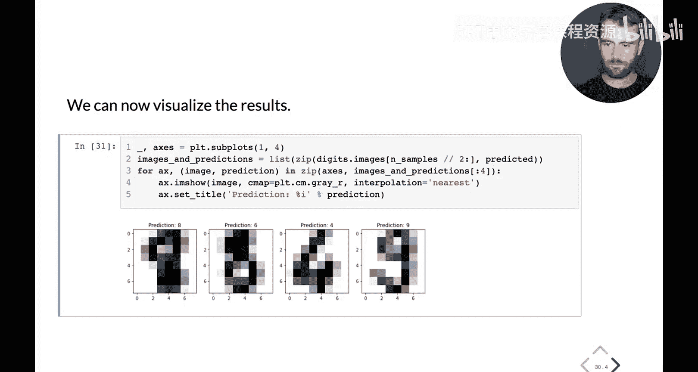

本节课中，我们一起学习了《应用机器学习》课程的整体框架。我们了解了课程将采用理论与实践并重的方法，涵盖从核心算法到实际应用的广泛内容。我们预览了课程中将使用的 Python 生态系统工具，如 Scikit-learn、TensorFlow 和 NumPy。最重要的是，我们介绍了本课程独特的可执行教学材料，它将允许我们实时运行代码、演示算法并加深理解。在接下来的课程中，我们将开始深入探索这些激动人心的机器学习概念和工具。