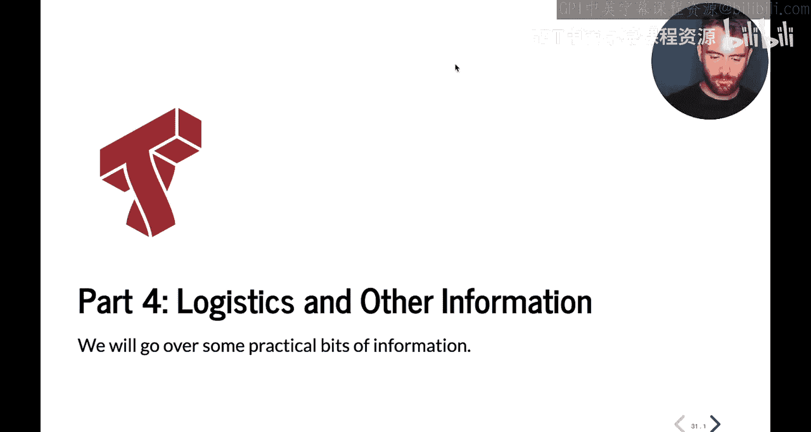
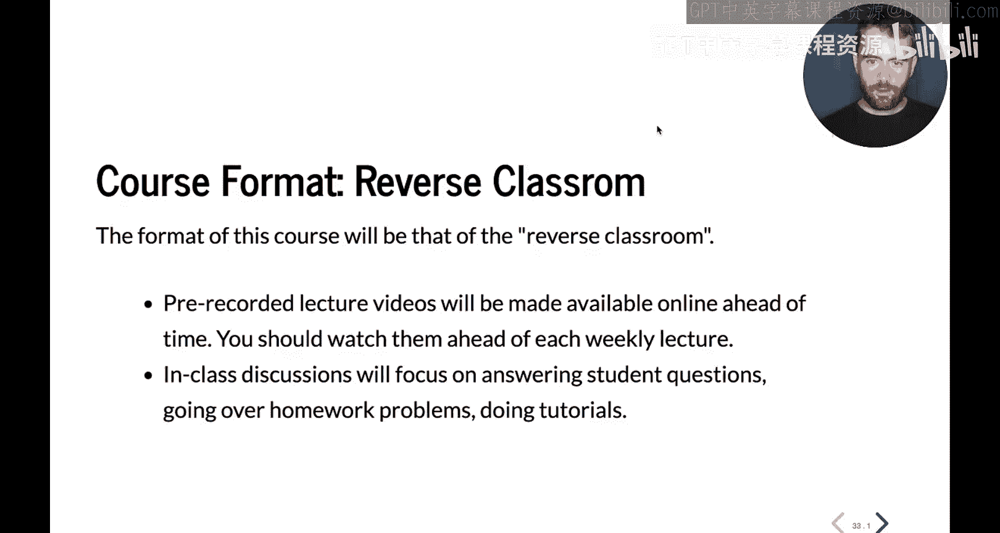
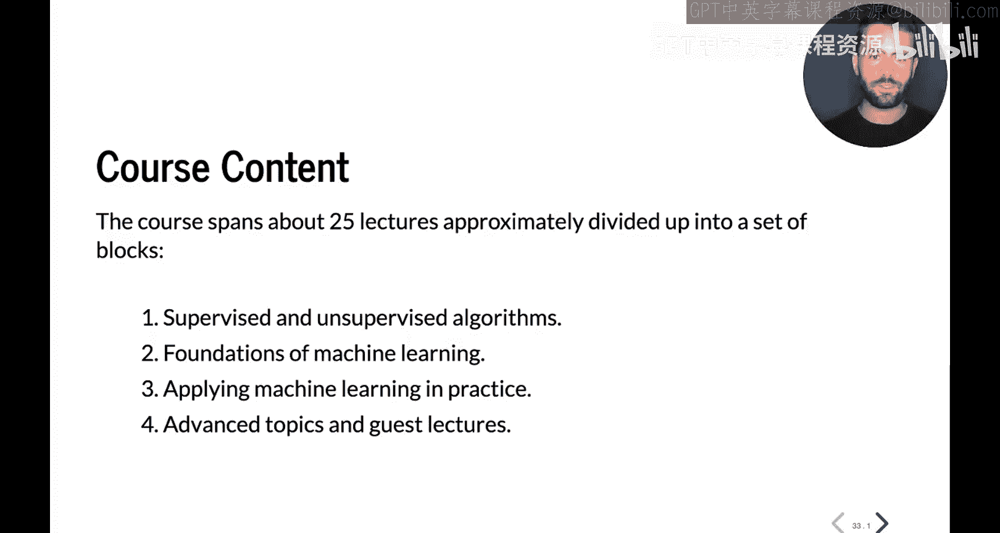
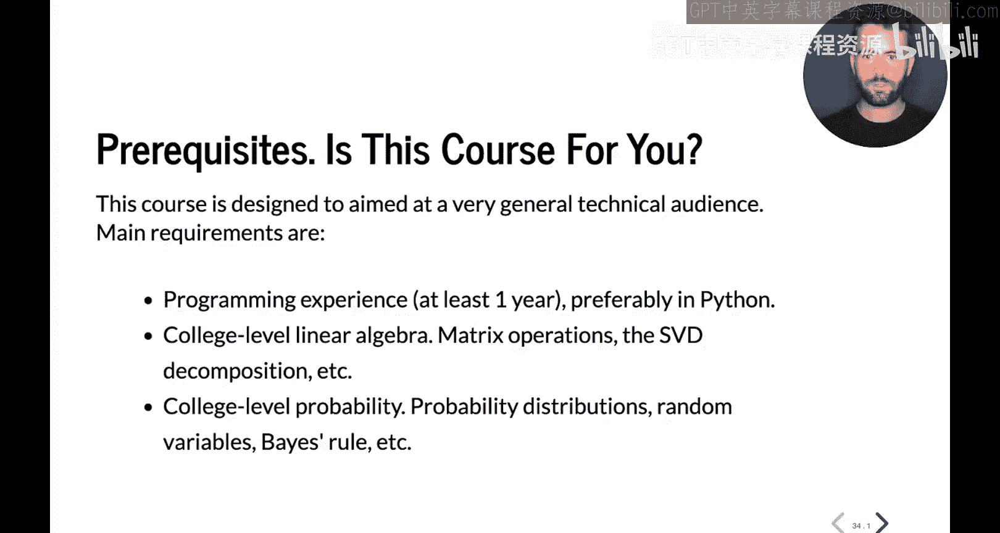
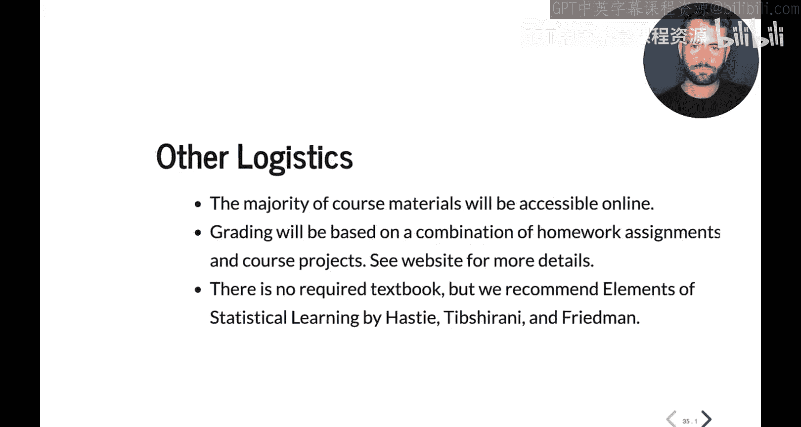
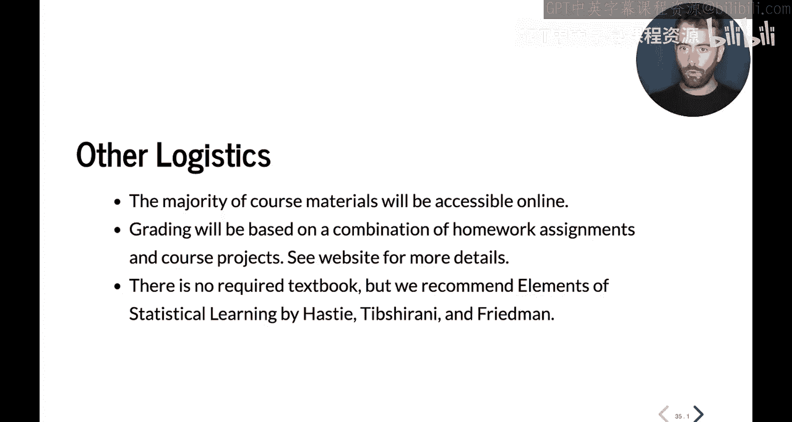
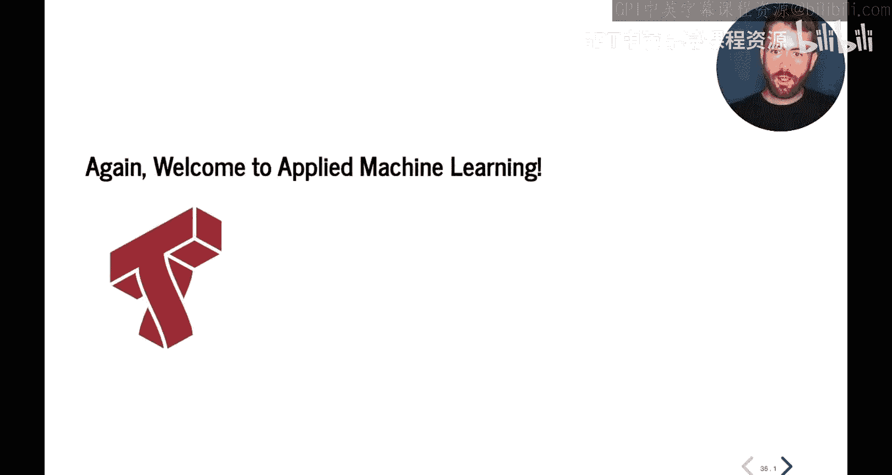
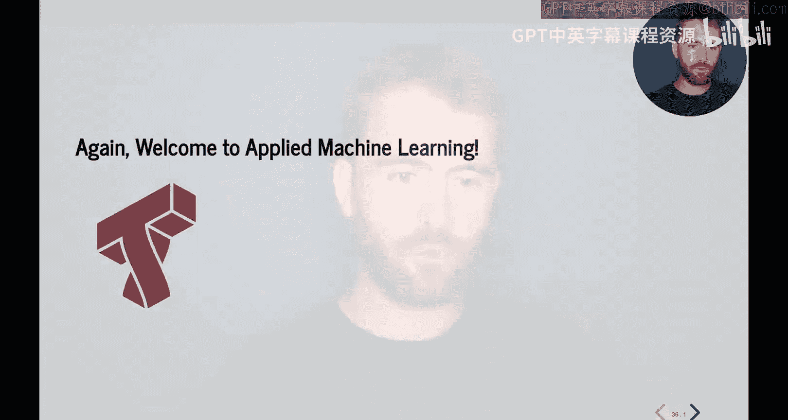

# 康奈尔大学《应用机器学习 CS 5787_ Applied Machine Learning 2020》中英字幕（deepseek p04 -04-Lecture 1. Part 4_ Logistics and Other Information.zh_en -BV12udzYvEFM_p4-

Welcome back。In the final part of this lecture， I would like to go over more logistical details。

 discuss more the format of the course， and also give you a few other bits of information。

So the format that we're going to follow in this course is what's called the reverse classroom。

 The idea of the reverse classroom is that the main content， the main material of the course。

 is available separately in a prerecor form and。For this course specifically。

 these are the lectures that you're looking at， the videos that you're looking at。

 the main material will be available in the form of slides and videos。

And the in person time will be used for things like Q& A going over problems。

Answering questions and doing tutorials。This is going to be the focus of the in personson sessions。

 but you should ahead of time make sure you watch the videos and you review the material so that you are familiar and you're able to participate and ask questions。

The content of this course is going to be roughly 25 lectures。

 and they will be divided into four main parts， four main blocks。As I mentioned。

The a very important part of the course will be looking at algorithms from different areas of machine learning。

 This includes supervised learning algorithms， unsupervised learning algorithms。

 and we will briefly mention reinforce learning as well。You。

Most of the lectures will be on understanding and explaining these algorithms。In addition。

 there will be。Material on what I call the foundations of machine learning。

 which means that we don't want to just define the algorithm。

 but we also want to understand why this algorithm works in practice。

There is a really deep technical theory behind machine learning that proves using language of statistics and various mathematical techniques。

 it proves that machine learning algorithms do indeed work when they're given a certain kind of data and certain amounts of it。

We will not dive too deeply into the theory and the mathematical proofs。

 but we will explain at a high level why machine learning algorithms really work and also importantly。

 when they don't work，What are their limitations？So by understanding the foundations of machine learning。

 this enables us to do point number three on this list。

 which is to understand how to effectively apply machine learning in practice。

That we will spend on the order of four， five lectures on。

On the practical applications aspect of machine learning， once we have seen the core algorithms。

 so we will see things like how do you diagnose the performance of a machine learning model by understanding by understanding why algorithms work and why do they not work。

 how can we use this knowledge to understand why a particular algorithm might not be giving optimal performance on a particular problem and what is the problem solving process to get it to work better and to even squeeze the maximal performance from this algorithm？

This will involve topics like error analysis， understanding overfitting versus underfitting。

 performing no tracking metrics， measuring the performance of algorithms。

 These are all things that we're going to see as part of。

How to apply machine learning and practice and finally。

 the last part of the course will cover some advanced topics and we're also going to have guest lecturers that will share their insights into specific that they will give lectures on particular topics in machine learning that are within their area of expertise。

What are the prerequisites for the course。The prerequisites are really general。

 and I would say the main one is a basic level of programming experience。Ideally。

 this would be at least a year of a programming in any programming language。

 but preferably in Python。A lot of the material will be presented in the form of Python code。

 and so it will be very helpful for you to be familiar with Python。Of course。

 machine learning is also defined in the language of mathematics。

 and the two main areas of math that are really important are going to be linear algebra and probability。

And in order to fully understand this material， it will be very useful to have a college level background in both linear your algebra and probability when I say college level。

 I mean having taken and be familiar with the material that you would learn in a firsty course of either well both in your algebra and probability at the undergraduate level。

If you are not familiar with all of these topics， we will also be sharing materials and doing tutorials that will help you get up to speed with some of these topics more quickly。

 or if you have forgotten certain materials， hopefully this will serve as a refresher and will be useful for you。

Finally， a few other logistical details about the course。We will use the course website to。

Share materials and there will be a course website for Cornell students which is going to be hosted on so the link for that will be shared and will be available and there will also be a public facing version of the course that will hold these course materials and I am not going to put this in these slides because this might change over the years but this websites will be shared and we will use them to synchronize our we we use them for discussions to post assignments etc。

The grading for this course will be a combination of homework assignments and course projects。Again。

 see the website for information about the course project。

 but essentially there will be four assignments and the course project will involve implementing a machine learning algorithm to some problem that's interesting to you and we will be sharing project ideas for the course。

And also we will be sharing some specifics about the requirements for this project。

 but essentially it will be a paper that's between five to eight pages long that will be due at the end of the course。

Finally， there is no required textbook for the course， but if you want to。

Read up on this material from a different source， I personally recommend the textbook by Hasty Tpianman and Friedman。

 the elements of statistical learning， it's a great textbook。

 it covers all of the materials that we're going to see in this course and more and I highly recommend it。

So finally， again， I just want to again share with you my excitement for teaching the course。

 this is I think machine learning is a really fascinating field of study and I'm personally really excited to be creating these lectures and am I hope you will enjoy this material as much as I do。

Thank you。