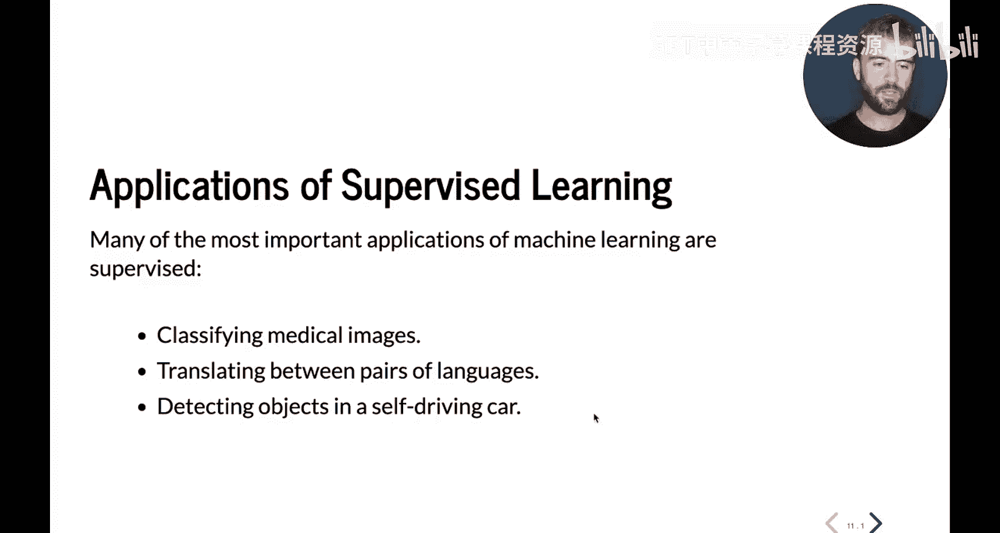

# 康奈尔大学《应用机器学习 CS 5787_ Applied Machine Learning 2020》中英字幕（deepseek p05 -05-Lecture 2 - Part 1_ A Supervised Machine Learning Problem.zh_en -BV12udzYvEFM_p5-

Hi and welcome back to applied machine learning。In the previous lecture we saw what machine learning was。

 we looked at different applications of machine learning and looked at why machine learning is an interesting approach to solving practical problems。

We also saw that there were three main approaches for how we can build machine learning algorithms。

 these were called supervised learning， unsupervised learning and reinforcement learning and we saw examples of each of these three approaches。

In this lecture， I would like to start our discussion of machine learning and its core algorithms and technical ideas with the first approach of these three。

 which was supervised learning。So my goal here in this lecture is going to be to explain in more detail what machine learning is and provide the basic language and notation so that we can start。

Defining new research we can start to learn about specific machine learning algorithms in the next lecture。

Now to begin， let's recall from the previous lecture the brief definition that we gave of supervised learning。

We saw that supervised learning is a setting in which we are trying to teach a machine to teach a computer to perform certain tasks by giving it a data set of labeled training examples。

 which， for example in the case of an object detection system。

 these could be annotations of what is seen in a given image here we have an annotation from a presentation by Tesla in which we had annotation of pedestrians and cars。

And in addition to this data set， we specify a learning algorithm by which the model will infer what makes a pedestrian。

 a pedestrian， what makes a vehicle， a vehicle， and it will accurately predict。

It will accurately predict on new images what is a pedestrian and what is a vehicle。In this video。

 I would like to dive deeper into another example of supervised learning。

 and I would like to use this example to show you what are the different kinds of components that comprise a learning algorithm。

 a supervised learning algorithm。The example that I want to use here is going to be a running example throughout this video。

 and also a few of the following videos is going to be a medical example predicting diabetes risk。

So suppose that we have access to a data set of diabetes patients。

 let's say this is recorded in this data set is coming to us from a hospital and we have the patient's medical records and in the medical records we have all sorts of data including physiological measurements and we have the age and the sex of a patient。

And in addition to that， we also have access to a diabetes risk score。

 and we would like to predict the diabetes risk from this data and more generally we may also want to understand。

How the different variables and data in the medical records are affecting the diabetes risk of these patients。

So the first thing I want to highlight are three important components of a supervised machine learning problem。

As I mentioned earlier， the supervised learning approach consists of providing。

of providing a data and very high level a relatively short learning algorithm by which if the machine follows this algorithm。

 it will be able to extract the knowledge that it needs from the dataset in order to perform useful tasks such as such as prediction or perhaps other data analysis tasks。

 and this is again in contrast to a more classical software engineering approach in which we would try to manually specify the behavior of that the computer should perform via a set of rules or via detailed instructions。

And so。To make things more concrete。A supervised learning algorithm takes in a data set and outputs a predictive model。

And we are going to see in the rest of this video what a supervised learning data set would look like。

 what an algorithm would look like， and what a predictive model would look like。

Let's start with the supervised learning data set。In our example of predicting diabetes risk。

We are going to use a very common data set in machine learning。

 which is called the UCI diabetes data set。 This is it's called a toy data set because it's relatively small and it's used widely for teaching about machine learning。

And specifically in this data set， as I mentioned， it has different physiological measurements。

 and in particular the measurement that we are going to be interested in is going to be the body mass index or BMI。

We will have， for each patient their body mass index index and we are also going to have access to a diabetes risk score。

 which is a number from0 to 300， which indicates how likely a person is to how much at risk a person is for developing diabetes。

And our goal here with this data set is going to be to understand the relationship between these two variables。

So let's load this data set into into。Into our notebook here。

 we are going to load this data set from the Psyit Learn library， which is widely used。

AMachine learning library in Python that we're going to use a lot throughout this lecture here at the beginning I am loading a Ps learn as well as two other very common libraries that we're going to use。

 which are NmI and pandas。And then here I load the data， which， as I mentioned earlier。

 will have two components X and Y。 and then after applying a few transformations in the last line。

 I can visualize this data and here I have an example of how it looks like。

 So this is these are the first five。Rose from this data set and as you can see for each patient which is numbered here by an index。

 we have access to their BMI and we have access to their diabetes risk score。

 which is called here the target。We can visualize this data set using a library called Matplotlib。

 we are again going to be using MatpllootlibB in pretty much every lecture in this class。

And this is again a widely used library that you should familiarize yourself with and in this example we can display this two dimensional data as a scatter plot and on the X axis here I have the DMMI on the Y axis I have the diabetes risk we loaded only 25 we only loaded the first 25 data points from this data set and by visualizing it we can immediately see some structure in this data we see that patients with a higher body mass index on the right here tend to have higher diabetes risk scores on average so already we can see some structure in this data as we visualize it。

So。Once we have a data set， we would like to define an algorithm for this。

 for the task of predicting diabetes risk。And the first part towards defining a supervised learning algorithm is going to be to assume something about the relationship between body mass index and diabetes risk。

We're going to start by making the assumption that BMI is I'm sorry that risk is a linear function of BMI。

 in other words， for some unknown set of numbers， we have this linear relationship between BMI which is y and between the target which is the risk here。

 which is y and the BMI X。So this is just a linear equation。

 this is just a simple line with a slope and an intercept。

 and we will start by making the assumption that there is some line that explains the relationship between BMI and diabetes risk。

So some technical definitions here， the theta 1 and theta 0， the slope and the intercept。

 we are going to be referring to these as the parameters of this equation and x is going to be the input or the dependent variable and y is going to be the target or the independent variable here。

So let's look at a few examples of what this means here。

 I have just I have just defined a list of different values of theta 1，2 to 110。

 And here Im using matpllib to plot align with these different parameters。

 So here these are just different lines that are defined by the slope and the intercept that are on this list。

 So again， the assumption here is that we are assuming that the relationship between Bmi and risk is and diabetes risk is given by some kind of。

Lai。Now， assuming that we have this relationship between X and y。

 the goal of a supervised learning algorithm is to learn the parameters data in a way that is consistent with the data that we have。

So we are going to see later on many ways in which we can learn these parameters。

 but just to give this one example， I am going to use an algorithm from the psychic learn library which and I'm going to use this algorithm as a black box to obtain a set of parameters for the model。

So here I am importing this algorithm which is called linear regression。

 so as you can imagine this is an algorithm that behind the scenes。

 it essentially fits the best line to the data that we have。

Using this algorithm comes from the circuit Learn linear models library and here I can use in this line I can fit this algorithm to 25 point data set that we just saw and then I can generate predictions on the same data set using the model that we have fit。

And here I can obtain the coefficients from this model， and it says that this。

Algorithm that we have this black box algorithm that we have imported is saying that the ideal slope for this data set is 37。

 while the intercept is minus 800。So I will come back in a second to this example。

 but essentially we have fixed parameters of two we have fixed a set of values and we have given a set of values to parameters theta 1 and theta 0。

 and we're going to call these theta 1 star and theta 0 star。And by fixing these parameters。

 we define what I was referring to as the predictive model F star。

 So the predictive model now is only a function of x， and it outputs an estimate of the target y。

Let's visualize the predictive model that was given to us by the psy learn model。

 by the psy learn algorithm， and whose slope and intercept which is printed out。

So here I am visualizing in black the line that has the slope and the intercept that we just saw on the previous screen。

 and as you can see here， it does fit this linear trend that we seem to observe in the data。Now。

 it doesn't fit every example perfectly。 In fact， it doesn't fit。Most examples very well。

 but it does capture the trend and intuitively if we were to guess given the data what is the diabetes risk in this region well。

 we would probably guess something around 200 as opposed to say。

 something around 100 which would be here and so this model does provide us some intuitively valid estimate of the diabetes risk。

Now。Since we have a predictive model， we can start to use this predictive model to make predictions about the data。

For example， if we have a new data point， a new patient X prime for which we know the BMI。

 then we can plug this X prime into our predictive model with whose parameters whose slope and intercept are known。

 and this will give us an output y prime， which is going to be our estimate of diabetes risk for this new patient。

Let's look at how this will look on the data set that we have here。

So first we can collect a few more data points， recall that we only use the first 25 data points from this data set and now we can just collect three more and here they are。

TheseThese are the data points that I'm loading here。

 and have visualized these points as I visualized them in red on the scatter plot that we saw earlier。

So this is the same scatter plot as we had before with new patients shown in red。

And now we can use our linear model to estimate the diabetes risk for these patients。

Here in black have the line that we have learned。And these the red dots are the BMI values for the new patients。

And the red crosses show us the predictions that our model provides for these patients。

Now you can see here on the left that with this patient we are almost spot on and we're able to almost exactly predict their BMI here are this is almost correct with these two examples we are somewhat overestimating of their BMI that is because this line is only an approximation to the true to the true relationship between BMI and the diabetes risk。

And also we may just not be able to learn this relationship perfectly because there is inherently some randomness here even even if we had a lot of data and we knew the patients's BMI may it may not be possible to directly predict their diabetes risk because there is inherently some。

 because there are inherently other factors that are in play here and which may appear as noise in this data。

 so the red cross here are the predictions for these patients notice that this is just the value on the line for this red dot that we saw。

And so there is some risk here， but generally we are in the right ballpark。So。As we saw here。

 we were able to use a simple machine learning algorithm， a simple supervised learning algorithm to。

😊，That we use this algorithm combined with a data set of diabetes patients in order to learn a model。

 a simple linear model that was still useful machine learning to predict diabetes risk for these new patients。

And more generally， the supervised learning approach is very useful because it can provide us with a powerful set of tools for making predictions on new andeen data。

It works here in a very simple example， but this approach can be very complex and it can produce really really good results really it can produce really powerful models in much more complicated scenarios such as cell driving cars or much more complicated medical scenarios。

And also， we can use this model to， to。Answer more general questions about the data， for example。

 about the structure of the relationship between the different variables。 For example， in our。

 in our diabetes， Toy example， we were able to our model essentially told us that。

It confirmed our intuition that。Diabetes risk is increasing as a function of PMMI。

 and so these kinds of relationships about variables in the data is another type of analysis that we can do using supervised learning。

And again， as I mentioned， supervised learning was an example that we saw in the context of diabetes of cell driving cars。

 but this is a widely used approach which is very powerful and has applications in many other domains including machine translations。

 for example， so here we would give the computer， many pairs of examples of the same sentence in different languages。

 and many other applications both in the medical domain， autonomous vehicles，Industrial applications。

 speech recognition and many， many others。So hopefully this analysis has been useful to you and you were able to gain an intuition about what a supervised learning algorithm might look like and you gain some in initial intuitions in the next set of videos we are going to dive deeper into each component of the supervised learning problem that we saw which is the data。

 the algorithm， the predictive model and we're going to define these a little bit more precisely using mathematical notation。

 and in subsequent lectures， we are going to see many examples of supervised machine learning algorithms and how they work。

