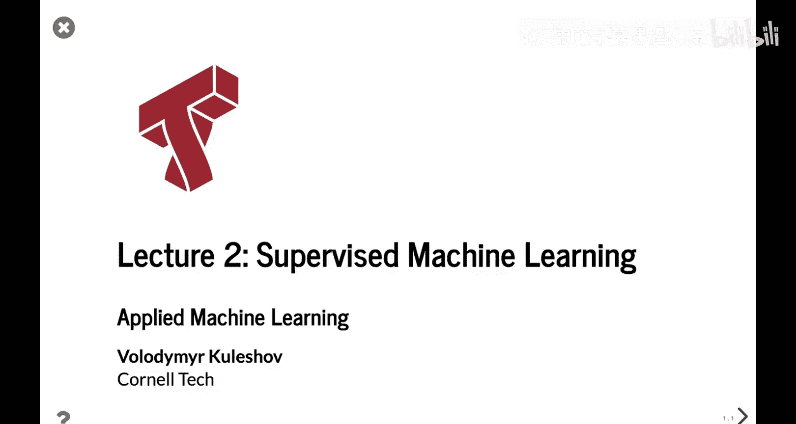
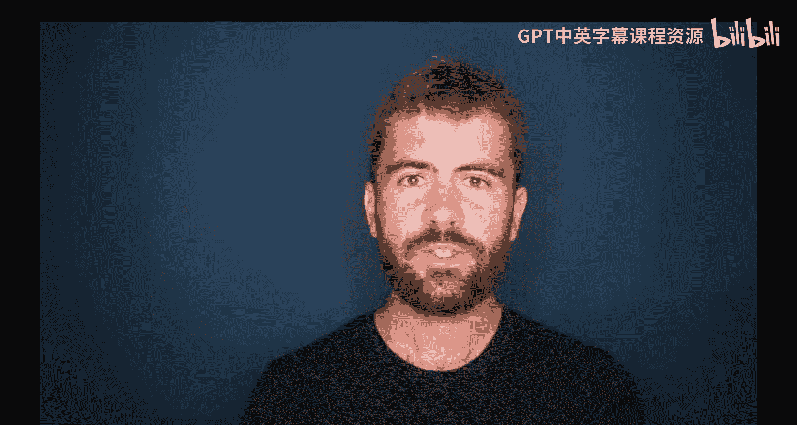
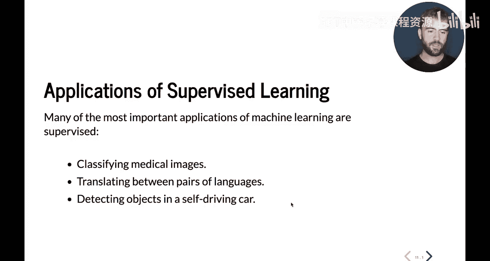

# 应用机器学习：第2讲：第一部分：监督机器学习问题



## 概述



在本节课中，我们将深入学习监督机器学习。我们将通过一个具体的医学预测示例，详细拆解监督学习算法的核心组成部分，包括数据集、算法和预测模型。我们将使用简单的线性回归作为例子，让初学者能够清晰地理解整个过程。

---

## 回顾与引入

上一讲我们介绍了什么是机器学习，探讨了其不同应用领域，并理解了机器学习为何是解决实际问题的有趣方法。

我们还了解到构建机器学习算法主要有三种方法：**监督学习**、**无监督学习**和**强化学习**，并分别看到了这三种方法的示例。

在本讲中，我们将从这三种方法中的第一种——监督学习——开始，深入探讨机器学习的核心算法和技术思想。我们的目标是更详细地解释什么是机器学习，并提供基本术语和符号，以便我们能够开始定义新的研究，并在下一讲中学习具体的机器学习算法。

---

## 监督学习定义回顾

首先，让我们回顾上一讲中给出的监督学习的简要定义。

监督学习是一种设置，我们试图通过给计算机一个带有标签的训练示例数据集，来教会它执行特定任务。例如，在物体检测系统中，这些标签可以是给定图像中内容的标注。在特斯拉的一个演示中，我们看到了行人和车辆的标注。

除了这个数据集，我们还指定一个学习算法，模型将通过该算法推断出什么构成了行人，什么构成了车辆，并能在新图像上准确预测出行人和车辆。

---

## 深入示例：预测糖尿病风险

在本视频中，我想深入探讨另一个监督学习的例子，并利用这个例子展示构成一个监督学习算法的不同组件。

我将使用一个贯穿本视频及后续几个视频的连续示例：一个预测糖尿病风险的医学示例。

假设我们有一个糖尿病患者的数据库。这个数据集来自一家医院，我们拥有患者的医疗记录，其中包含各种数据，包括生理测量值、患者的年龄和性别。

除此之外，我们还拥有一个糖尿病风险评分。我们的目标是从这些数据中预测糖尿病风险。更广泛地说，我们可能还想了解医疗记录中的不同变量和数据如何影响这些患者的糖尿病风险。

---

## 监督机器学习问题的三个重要组成部分

首先，我想强调监督机器学习问题的三个重要组成部分。

正如前面提到的，监督学习方法包括提供一个数据集和一个相对简短的学习算法。如果机器遵循这个算法，它将能够从数据集中提取所需的知识，以执行有用的任务，如预测或其他数据分析任务。这与更传统的软件工程方法形成对比，在传统方法中，我们会尝试通过一组规则或详细指令来手动指定计算机应执行的行为。

为了使内容更具体，一个监督学习算法接收一个数据集，并输出一个预测模型。我们将在本视频的其余部分看到监督学习数据集的样子、算法的样子以及预测模型的样子。

---

## 1. 监督学习数据集

在我们的预测糖尿病风险示例中，我们将使用机器学习中一个非常常见的数据集，称为**UCI糖尿病数据集**。这是一个“玩具”数据集，因为它相对较小，广泛用于机器学习教学。

具体来说，在这个数据集中，正如我提到的，它有不同的生理测量值。我们特别感兴趣的测量值是**身体质量指数**。

对于每个患者，我们将拥有他们的身体质量指数，并且我们还将获得一个糖尿病风险评分，这是一个从0到300的数字，表示一个人患糖尿病的风险程度。

我们使用这个数据集的目标是理解这两个变量之间的关系。

以下是加载和可视化数据集的代码示例：

```python
import sklearn
import numpy as np
import pandas as pd

# 加载数据
from sklearn.datasets import load_diabetes
data = load_diabetes()
X = data.data[:, np.newaxis, 2]  # 取BMI特征
y = data.target

# 可视化前25个数据点
import matplotlib.pyplot as plt
plt.scatter(X[:25], y[:25])
plt.xlabel('BMI')
plt.ylabel('Diabetes Risk')
plt.show()
```

通过可视化，我们可以立即看到数据中的一些结构：身体质量指数较高的患者（图中右侧）往往具有较高的糖尿病风险评分。这表明数据中存在我们可以利用的模式。

---

## 2. 学习算法与模型假设

一旦我们有了数据集，我们就想为预测糖尿病风险的任务定义一个算法。定义监督学习算法的第一步是假设身体质量指数和糖尿病风险之间的关系。

我们首先假设风险是身体质量指数的一个**线性函数**。换句话说，对于一组未知的参数，风险 `y` 和身体质量指数 `x` 之间存在线性关系。

这个关系可以用以下公式表示：

**`y = θ₁ * x + θ₀`**

这只是一个简单的线性方程，一条具有斜率和截距的直线。我们首先假设存在某条直线可以解释身体质量指数和糖尿病风险之间的关系。

这里有一些技术定义：斜率 `θ₁` 和截距 `θ₀` 我们将称为这个方程的**参数**。`x` 是**输入**或自变量，`y` 是**目标**或因变量。

---

## 3. 拟合模型与获得预测

假设 `x` 和 `y` 之间存在这种关系，监督学习算法的目标是以与我们所拥有数据一致的方式学习参数 `θ`。

我们将看到许多学习这些参数的方法。为了给出一个例子，我将使用 `scikit-learn` 库中的一个算法作为“黑盒”来获取模型的一组参数。

以下是使用线性回归算法拟合模型的代码：

```python
from sklearn.linear_model import LinearRegression

# 创建并拟合模型
model = LinearRegression()
model.fit(X[:25], y[:25])  # 使用前25个点训练

# 获取学习到的参数（斜率和截距）
theta_1_star = model.coef_[0]
theta_0_star = model.intercept_
print(f"斜率 θ₁*: {theta_1_star}")
print(f"截距 θ₀*: {theta_0_star}")
```

运行后，算法可能会告诉我们，对于这个数据集，理想的斜率约为37，截距约为-800。通过固定这些参数值 `θ₁*` 和 `θ₀*`，我们定义了我之前提到的**预测模型** `f*`。

现在，预测模型 `f*` 只是 `x` 的函数，它输出目标 `y` 的估计值。

让我们可视化由 `scikit-learn` 算法给出的、具有我们刚看到的斜率和截距的预测模型：

```python
# 绘制数据点和拟合的直线
plt.scatter(X[:25], y[:25], label='Training Data')
plt.plot(X[:25], model.predict(X[:25]), color='black', label='Learned Model')
plt.xlabel('BMI')
plt.ylabel('Diabetes Risk')
plt.legend()
plt.show()
```

正如你所见，这条黑线确实拟合了我们在数据中观察到的线性趋势。它不能完美地拟合每个示例，但它捕捉到了总体趋势。直观地说，如果我们要根据数据猜测这个区域的糖尿病风险，我们可能会猜测在200左右，而不是100左右。因此，这个模型确实为我们提供了对糖尿病风险一些直观有效的估计。

---

## 4. 使用模型进行预测

既然我们有了一个预测模型，我们就可以开始使用它来对数据进行预测。

例如，如果我们有一个新的数据点，一个新患者 `x‘`，我们知道他的身体质量指数，那么我们可以将这个 `x‘` 代入我们参数已知的预测模型中，这将给我们一个输出 `y‘`，即我们对这位新患者糖尿病风险的估计。

让我们看看这在我们已有的数据集上是什么样子。假设我们收集了三个新患者的数据点：

```python
# 假设的新数据点 (BMI值)
new_patients_bmi = np.array([[-0.05], [0.05], [0.15]])
# 使用模型进行预测
predictions = model.predict(new_patients_bmi)

# 可视化
plt.scatter(X[:25], y[:25], label='Training Data')
plt.plot(X[:25], model.predict(X[:25]), color='black', label='Learned Model')
plt.scatter(new_patients_bmi, predictions, color='red', marker='x', s=100, label='Predictions for New Patients')
plt.scatter(new_patients_bmi, [y[26], y[27], y[28]], color='red', label='Actual New Patients') # 假设这些是新数据的真实值
plt.xlabel('BMI')
plt.ylabel('Diabetes Risk')
plt.legend()
plt.show()
```

在图中，黑线是我们学习到的模型。红点是新患者的身体质量指数值。红叉显示了我们的模型为这些患者提供的预测。

你可以看到，对于左边的患者，我们的预测几乎完全正确。对于另外两个例子，我们有些高估了他们的风险，这是因为这条线只是对身体质量指数和糖尿病风险之间真实关系的一个近似。

此外，我们可能无法完美地学习这种关系，因为这里本质上存在一些随机性。即使我们拥有大量数据，知道患者的身体质量指数，也可能无法直接预测他们的糖尿病风险，因为本质上还有其他因素在起作用，这些因素在数据中表现为噪声。

红叉是这些患者的预测值，请注意，这只是我们看到的红点在线上的对应值。虽然存在一些误差，但总体上我们在正确的范围内。

---

## 总结

在本节课中，我们一起学习了监督机器学习的基本流程。我们能够使用一个简单的监督学习算法，结合糖尿病患者的数据库，来学习一个模型——一个简单的线性模型，该模型仍然可以用于预测新患者的糖尿病风险。

更广泛地说，监督学习方法非常有用，因为它可以为我们提供一套强大的工具，用于对新的、未见过的数据进行预测。它在这个简单的例子中有效，但这种方法可以非常复杂，并且可以在更复杂的场景中产生非常强大的模型，例如自动驾驶汽车或更复杂的医疗场景。

此外，我们还可以使用这个模型来回答关于数据的更一般性问题，例如不同变量之间关系的结构。在我们的糖尿病玩具示例中，我们的模型本质上证实了我们的直觉：糖尿病风险随着身体质量指数的增加而增加。这种对数据中变量关系的分析是我们可以使用监督学习进行的另一种分析类型。

正如我所提到的，监督学习是我们在糖尿病和自动驾驶汽车背景下看到的一个例子，但这是一种广泛使用且非常强大的方法，在包括机器翻译在内的许多其他领域都有应用。例如，在机器翻译中，我们会给计算机提供许多不同语言中相同句子的示例对。监督学习在医疗领域、自动驾驶汽车、工业应用、语音识别等许多其他领域都有广泛应用。




希望这个分析对你有用，你能够对监督学习算法是什么样子获得一些直觉。在接下来的系列视频中，我们将更深入地探讨监督学习问题的每个组成部分——数据、算法、预测模型——并使用数学符号更精确地定义它们。在后续的讲座中，我们将看到许多监督机器学习算法的例子以及它们的工作原理。