# 康奈尔大学《应用机器学习 CS 5787_ Applied Machine Learning 2020》中英字幕（deepseek p06 -06-Lecture 2 - Part 2_ Anatomy of Supervised Machine Learning_ The Dataset -BV12udzYvEFM_p6-

Hi and welcome back to part  two of lecture 2 of applied machine learning。In the previous lecture。

 we saw what supervised learning was and we saw a simple running example of a supervised learning problem and a simple example of a supervised learning algorithm。

In this video， I would like to dive deeper into the different components of a supervised learning problem and lay out the mathematical notation and the definitions that we're going to be using later on to define various kinds of supervised learning algorithms。

And in this video， I would like to focus in particular on the data sets。

 which is going to be the first component of a diverseupvised learning problem。

So recall from our earlier video that a supervisor during problem has typically。

It can be seen as having the following three components， a data set an algorithm。

 and when you combine the two， the output is a predictive model。So for example。

 if we were to build an object detection system for a self-driving car。

 we would only need to specify a data set of where there would be some signal about the behavior that the algorithm should take that the computer should take and we would also specify a learning algorithm and when the computer executes the learning algorithm on the data。

 it learns the。The structure of the data and outputs a predictive model which can be used for useful tasks and in particular for predicting future instances of the data that we see。

So in this video， I would like to dive deeper into the notion of a data set and start laying out some technical definitions。

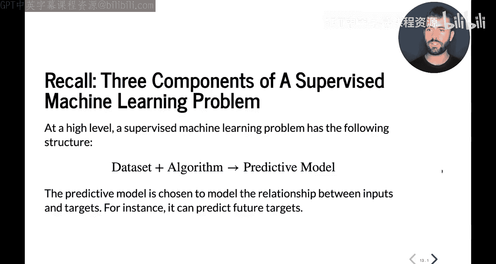

As a running example， we are again going to use the UCI diabetes data set。

 which we saw in the earlier video。And recall that this is a dataset set of patients and for each patient we have a number of measurements。

 some of these are physiological measurements， some of these are I will show you in a moment a few other types of measurements that are in this data。

 and earlier we focused on BMI， but actually there are a few additional useful measurements in this data。

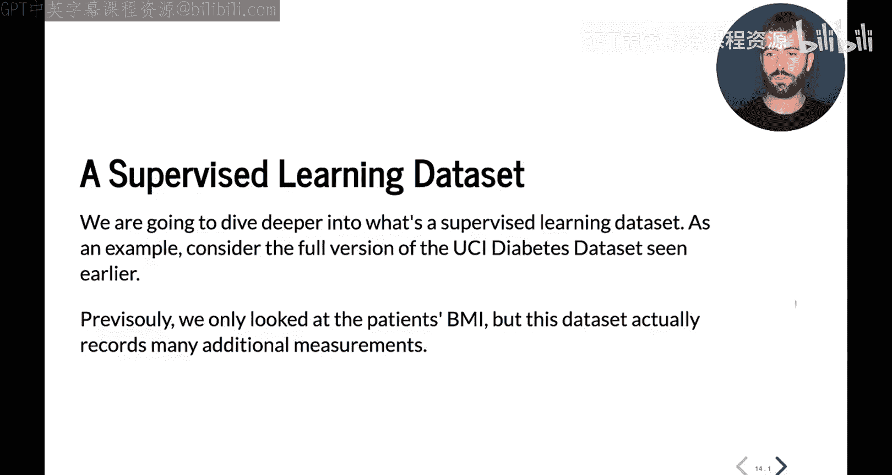

So。As earlier I am going to load this data set using the psychicLn library。

 which you see here and in addition I'm going to import again the standard machine learning and linear algebra libraries for Python so nonp in pans I'm going to import Matpllib for doing visualizations and here I'm going to import psyic learnn which contains datas as well as algorithms for。

Foror per doing machine learning。And here in this line I'm going to load the diabetes data and the first thing I would like to do is just to print a description of this dataset which is available with the init learn with with this object here and you can read this definition here on your own。

 but essentially it tells us that we have in this data at total of 442 patients and for each of these 442 patients we have 10 measurements that are shown here。

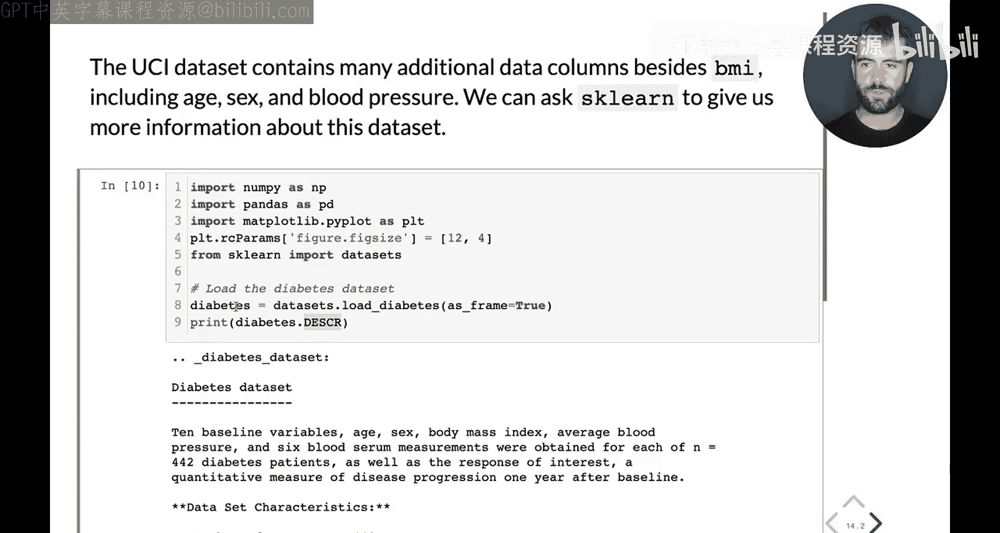

You see here the BMI measurement that we have used earlier for our examples。

 and also it has things like the age of a patient， their sex， and there's the blood pressure。

 and then there's a set of physiological measurements that you can read about here。

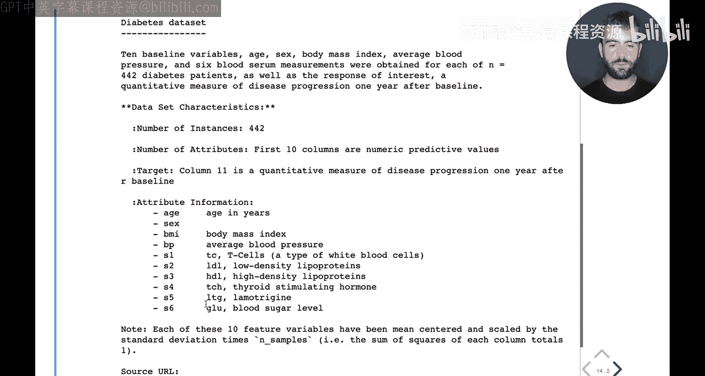

So this is a definition of the data set， a short description of the data we're going to be working with。

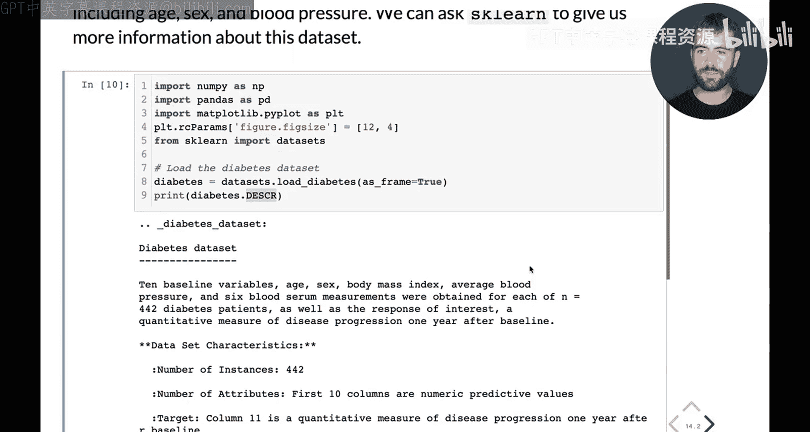

嗯。I would like to now。Look at how we can define what a data set is a little bit more formally。

So throughout this course， we're going to be defining various kinds of supervised learning algorithms。

 and we're going to be defining them using the language of mathematics。

And in order to define these algorithms。We are going to need to define a little bit more formally again。

 using mathematical notation， we will define what what a data set is。And specifically。

 I will define a data set as a mathematical set that you can see here of tus， X and Y。

There are n tus in this data set， and they're all indexed by the variable I。

 which appears here as a superscript， so this superscript is not an exponential it's not it's not's not。

We're not taking y to the I power， this is just an index over all of these data points。And。

Each tuple here that's indexed by I， it is associated with in our early example it would be associated。

 for example， with a patient。And each tuule is going to be called a training example。

This training example has two parts， X and Y。Why is going to be called the target。

In our previous example， this would be the diabetes risk。

And X here is going to be called an input or an input object。

And this is typically the data that we have for a patient before we make the prediction。

In our earlier example with diabetes， this would be the set of measurements that we have recorded for this patients。

And the reason these are called a training example is that most machine learning algorithm will they will try to predict y from X。

 and in order for the algorithm to know which y to predict。

 we will feed it a large number of these examples of these training examples that it the correct y for each patient and for each set of measurements for this patient。

 which are not by x， and after seeing enough of these examples。

 the algorithm will learn to predict the correct y。

So this is just general notation that define what a data set is。

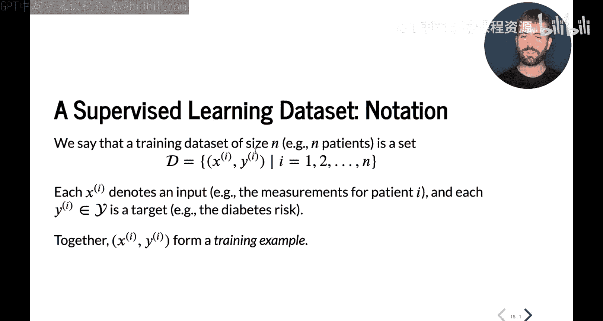

And we can look at this。We can make this a little bit more concrete by loading the diabetes data set and looking at the raw numbers in this data set。

So here you can see that even in p Psychic learn it's already broken up into two components。

 the target and the target here， and the data， which is the set of inputs that we just saw。

And here I am printing out the。The the data frame of inputs for that's contained in this data set and you see here that it has a set of rows here I'm just printing out the first five rows each of these rows is indexed by a number0。

1，2，34 etc cea， This is the index of the patient and for each patient we have different measurements age sex BMI blood pressure etc cetera。

 So it has the。It has a forum similar to what we just saw。

You may notice that some of these measurements are a little bit some of these numbers are a little bit strange。

 for example age here is sometimes taking negative values。

 that is only because this data was preprocessed for us and so the age was rescaled to be in a region in an interval thats center at zero and where the numbers are roughly between1 and minus1 or maybe even a little bit more concentrated around zero。

 this is just a numerical preprocessing step that was done already in psyicL and this is something that's often done in practice in order to make it easier for machine learning algorithm to use this data。

I wouldn't worry about this is a small technicality and I wouldn't worry about it。

 but in case you were wondering why these numbers are a little bit unusual。

 it's just a small technical reason。

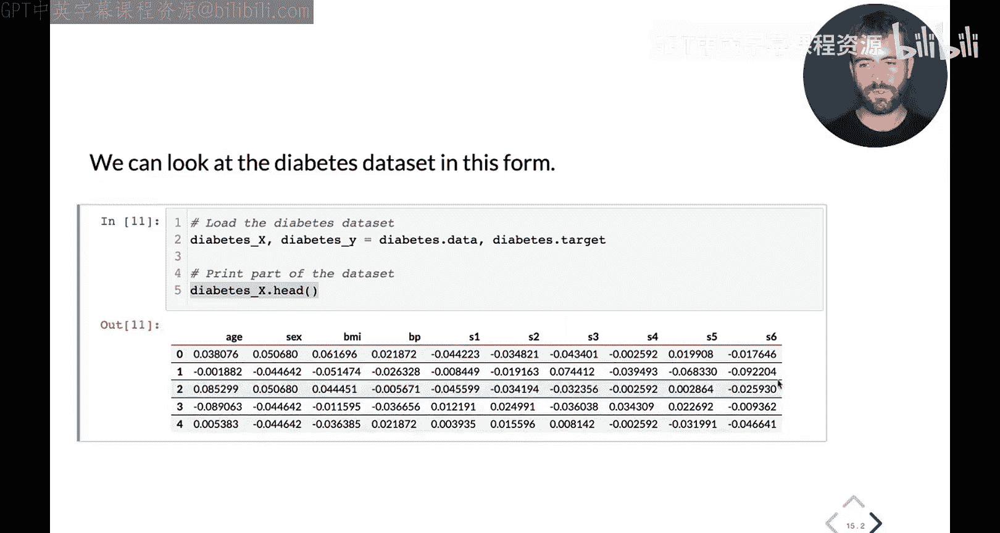

So。As I mentioned earlier， a training data set is a set of。

Training examples which contain an x no OI Let's now look at what an X looks like in more detail and let's also introduce some notation for what is an x variable。

So I'm going to assume that I'm going to define each input object， Xi as a vector。

 as a D dimensionsional vector that has this form。So recall from linear algebra that a vector is essentially。

A column of numbers where the numbers are stacked one on top of the other。

Each number here is a scalar and you can think of it as one of the measurements that we just saw in our earlier data set。

 so for example， the first number here can correspond to the age of a patient。

 the next one can be their BMI here we could have blood pressure。And in total。

 we're going to assume that there are D of them in our early example， DOS 10。

 but we could have an arbitrary number of measurements for any patient。

And the set of values that each of these measurements can take。

 we're going to denote this with script X and script X is called the feature space in practice。

We often have script text being either equal to the D dimensionsional set of real numbers。

 or it could be a subset of the real numbers。

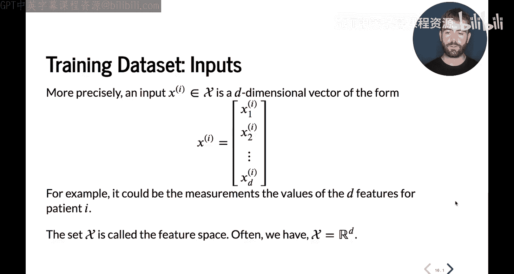

Allright， let's look again at an example here I am using my diabetes data set in my data frame of inputs and I am looking at the first one and again here I am printing out these values as a column of numbers and this here is a concrete example of the vector that I was just showing on the earlier slide。

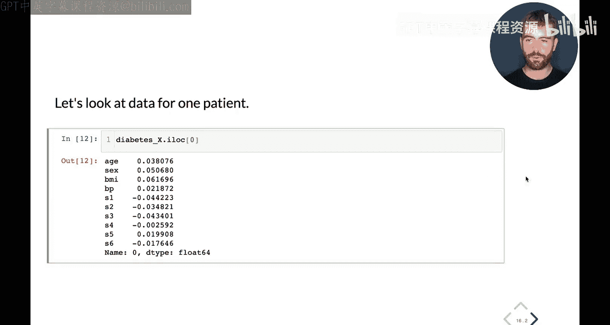

Now， each entry in this vector is often referred to as an attribute。Again。

 examples of attributes can be the age of a patient， their gender， their BMI。

And these are different facts， different bits of knowledge that we have about the patient。

 and this is what we're going to use in order to make predictions about this patients。

So attribute here is an important definition。

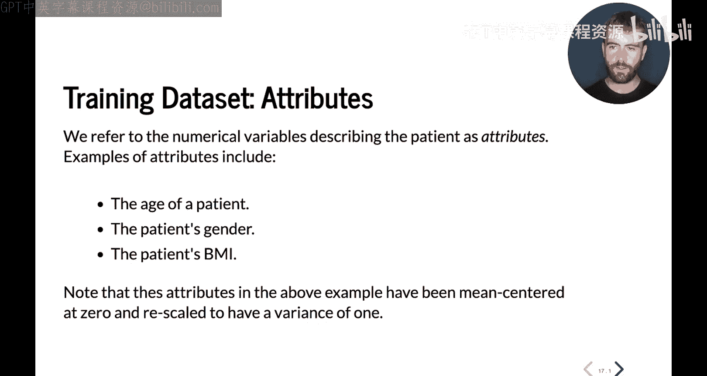

And similarly， another related， slightly distinct， important definition is that of a feature。

So in some cases， these attributes may not be enough to make useful predictions。

 or they may be too difficult to work with for a machine learning algorithm。For example。

 it may be the case that old men are at particularly high risk of diabetes。

And it would be really useful if the machine learning algorithm that takes the input X。

 it would be really useful if it would also know if this particular patient also happens to be an old man。

So this requires us to look at a combination of two attributes。

 whether the person is a man and whether the person is old and old means some definition that could vary。

 and if both of these are true， then we would want to add another attribute to our vector that is an indicator of whether the person is an old man or not。

Another example would be whether a person is obese or not。

 so we may want to use BMI as and we could see if it's above some threshold which is a definition of obesity and if it is we could also add that as an extra attribute as an extra attribute to our vector x。

Now， you can see that this is a way of us to encode our prior knowledge about what is useful for a machine learning algorithm。

 and it is a very powerful， it's a very powerful idea。

 very often we can make machine learning algorithms much more effective by creating rich and interesting features for this algorithm to use。

And also I want to add that in principle， if we use certain kinds of algorithms。

 they should be able to learn automatically from data that being an old man is something that puts you at risk of the diabetes。

 but often this may be difficult because either the algorithm may not have the right structure to do this or we may not have enough data。

 and this is why creating custom features is really important for making the algorithm work。

And so we're going to use the term feature to denote these custom attributes that we have created for the model。

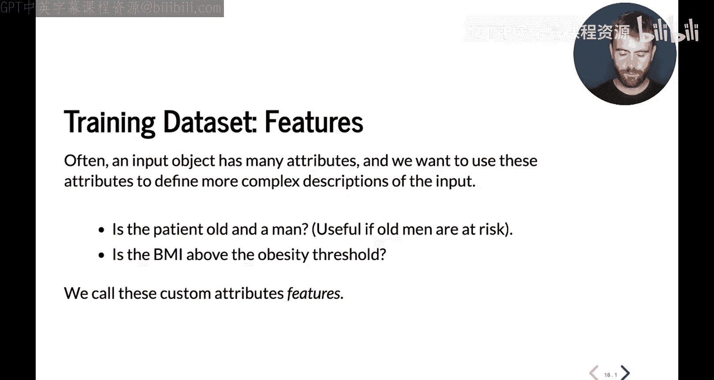

Again， here just to show you an example， I am creating in this data frame and you call on called Old man。

 which is true if the sex of the patient is above zero， which means that it' it's。

It's the male sex and if the age is higher than a certain threshold and you can see here that we have a new colon called Old Man and it's false for most patient but it's true for this one。

 this one happens to be an old man and so we have essentially just added this feature to our。

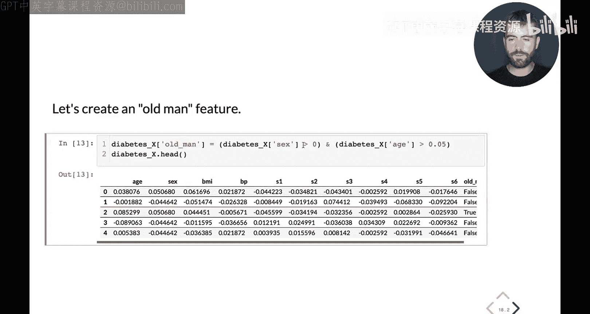

To all of our input objects。

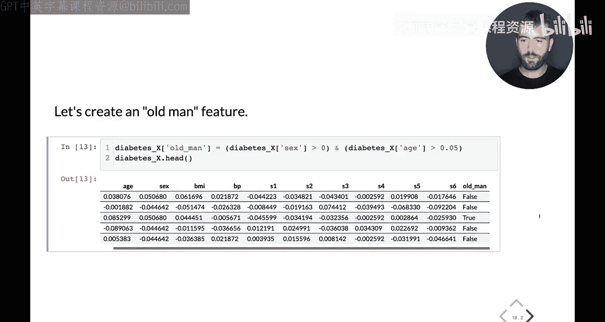

Let's now define features a little bit more formally again using mathematical notation。

We're going to say that we're often going to use a function which we're going to notify。

 which is going to be the set of features that we're going to compute。

So this function phi takes an input object X and its attributes， and it will output another vector。

 which is going to have some other dimension P which may be different from D， it may be larger。

 it may be smaller than D。And。And so this vector will again look the output of this function will again look like a vector with p components。

 so here I have applied the function phi to an input object X。

 and the result is a vector of dimension P， these are p scal or numbers and each of them represents a different feature。

 so for example this one can be whether the person is an old man。

 this one can be whether the person is obese and this can be just again the gender of the person that taken can without modification。

And。The result of applying the feature function to an input object is going to be what's called a futurized input and again each component of this vector is what we're going to call a feature。

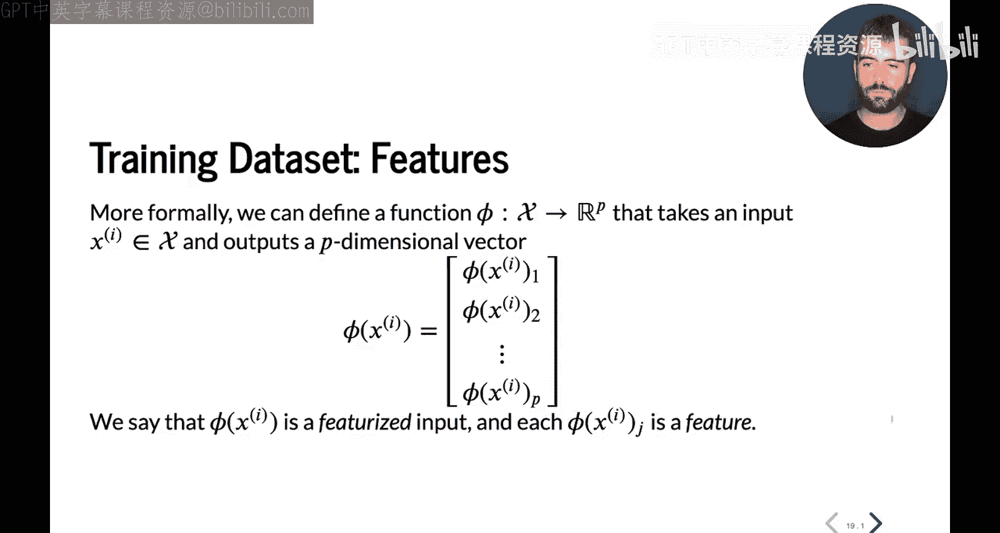

Now， I just want to add bit of an important definition here or a slight nuance to what I said earlier。

The technical difference between attributes and features is what I said earlier。

 and attribute is what we would normally get in the data and features are descriptions of the inputs object input objects that we create so we define them and we can either reuse attributes or we can combine attributes in different ways according to our prior knowledge this is the technical definition but often in practice when people talk about machine learning。

 they often use the two terms somewhat interchangeably and often people also use features when they actually mean attributes and often when we are when we see an object X we often also call this a vector features。

And this would。This would be true， for example， if we have already precomputed features before or if someone gave us a set of features that we know are good。

 and we are just working with them in order to not introduce this extra notation of adding this Phi function。

 we often just call x a vector of features， even though it could technically be attributes。

So in this course I am going to be using most often the word the term features。

 if there's no ambiguity between whether we're talking about an attribute or a feature。

 I'm just going to call it a feature。 but if there is if there is ambiguity and if we're going to need to use this function p。

 then I will try to use the correct term either feature or attribute depending on which one is relevant。

 So I just want to make sure that that this distinction is clear and if if I or when I will be using the term feature throughout the rest of the video and in other videos。

 you will know that feature is I may be just referring to an attribute and this distinction is probably not crucial in that case。

So this is just a small clarification that I wanted to make here。

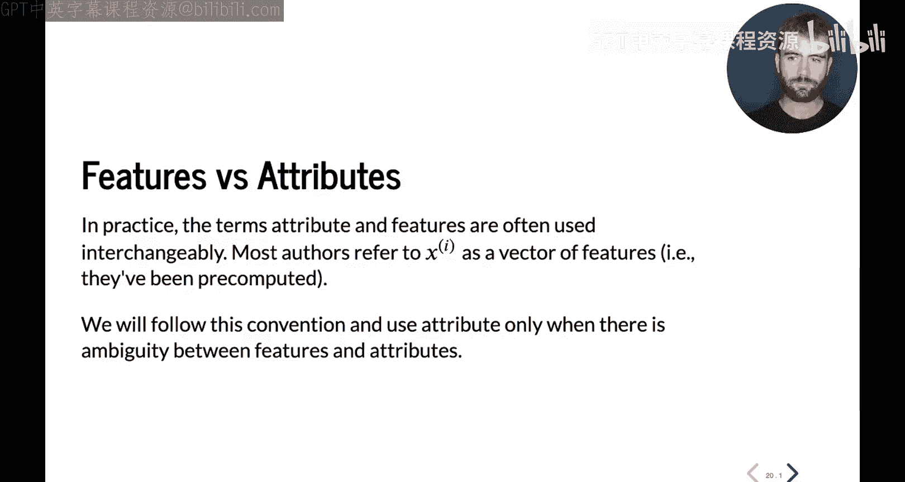

So one interesting aspect of features is that they can take different。

Generally two types of features， discrete and continuous。

 and these may be the distinction may be important for certain kinds of machine learning algorithms which work well with one type of feature。

 but don't work as well different with the other type。

So a continuous feature is essentially it most likely what you think it is。

 it's a feature which can take any real value or which can take numbers in an interval in a subset of the real line that's continuous so here an example that we saw earlier of a continuous feature is the BMI feature and we can see that it takes a range of values。

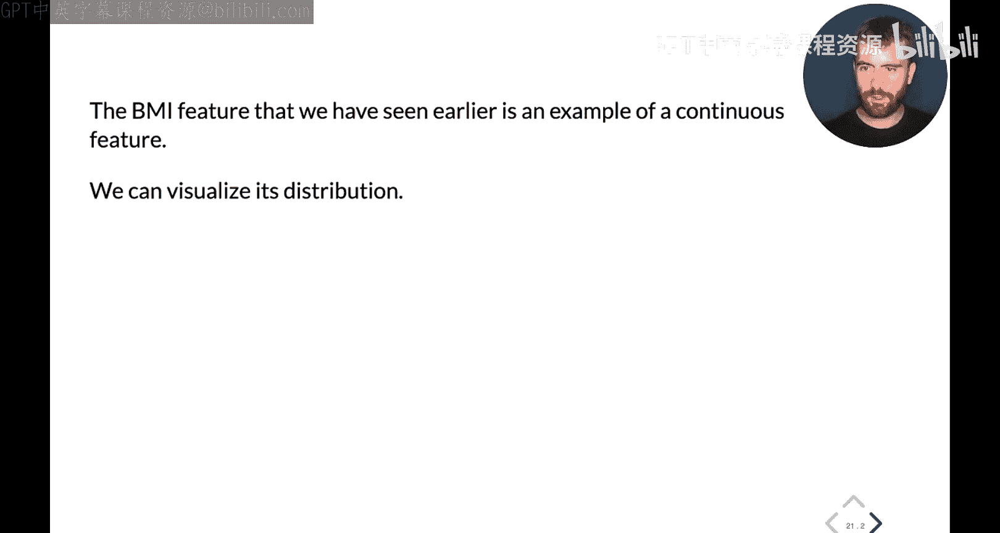

If I plot the histogram， then you can see that it has this bell shaped curve。And。

For different patients， this value can take any number within this range and it could even be outside this range if we see some new patient thats。

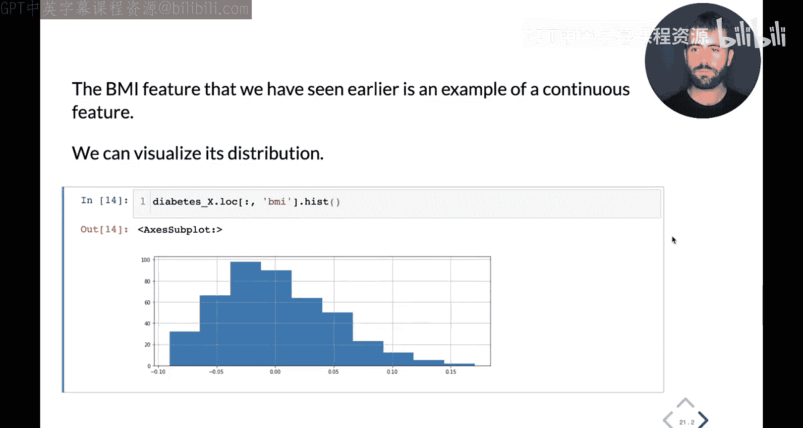

That has a particularly high or low BMI。An example of a categorical distribution is the sex feature here。

 if I plot the histogram of the sex feature， you can see that across all the patient it only takes two values and these values。

The way that psyic learn has packaged the diabetes data set。

 they happen to take these two numerical values， but they might as well take the values 0 or 1。

 these two numbers are arbitrary， they just happen to be set to these values because the data was normalized to have mean zero。

And also a variance of one。 but the the main idea here is that discrete feature。

Discreet features take on one of a finite number of possible values。 In this case。

 they take one of two possible values。 This distinction is going to be important in later on for certain kinds of algorithms that we're going to see。

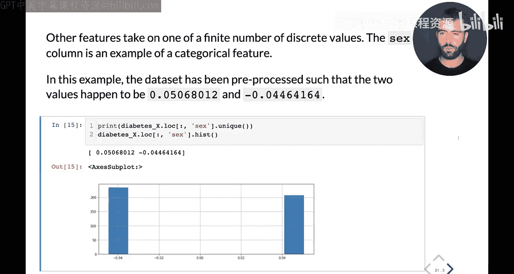

So。So far we looked at what is a data set and we looked more in more detail about what a training。

 what an input object can look like， what an X can look like let's now talk a little bit more about what a y is so here each y as I said earlier it is called a target and they live in a set script Y which we're going to be calling the target space。

 and here an example of what a target can be， is the diabetes risk。

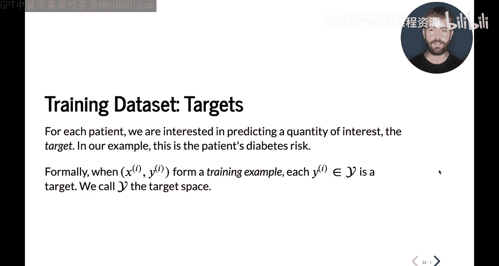

We can plot the distribution of diabetes risk， this is what it takes， this is what it looks like。

 it can go up to around 350 and it might even go higher for certain patients that are particularly at risk。

So this is the target， and this is the value that we are interested in predicting from the input object X。

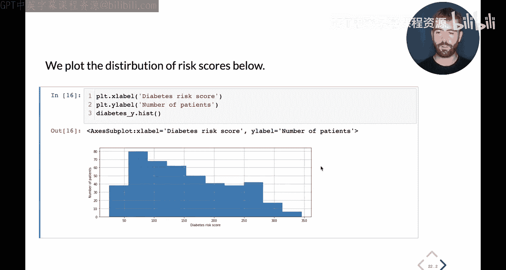

There is an important distinction that we're going to make between two types of targets y。

The target Y can be either continuous or disc。And this will define two different types of supervised learning problems。

 which we're going to be calling regression and classification this is actually a very important distinction。

 It may remind you of what I just said earlier about input features being either discrete or continuous this is a similar distinction。

 but it's going to have much more a much bigger impact on what an algorithm and what a machine learning algorithm can look like。

So the simple， the， the simplest example， or I guess that're。

 they're probably both of they have both equal complexity。

 But in the earlier example of diabetes that we saw， the variable Y was continuous， so it can take。

A continuous number of values。 It lives somewhere and it's some sort of continuous subset of the real numbers and our goal is to predict this y from from the inputs。

 which means we want to fit some kind of curve on on the data set of inputs that we saw。 for example。

 in our earlier example， we try to fit a line to approximate the relationship between x and y。

 This is an example of a regression problem Now a different kind of problem that we're going to see several we're going to see a lot in this course is ecc classificationification problem。

 which means that y is discrete street。 and now the value that each y takes can be thought of being some kind of class。

 and our goal here is to predict different classes。And to separate them。

 so we will be essentially you can interpret a classification problem as placing a boundary in some vector space between between the two classes and separating them so that the examples of one class live on one side of the plane。

 the other example lives on the other side of the plane and by depending on where a new input falls。

 whether it's on one side or the other of this separating plane。

 we can use that to predict the class of that new input。

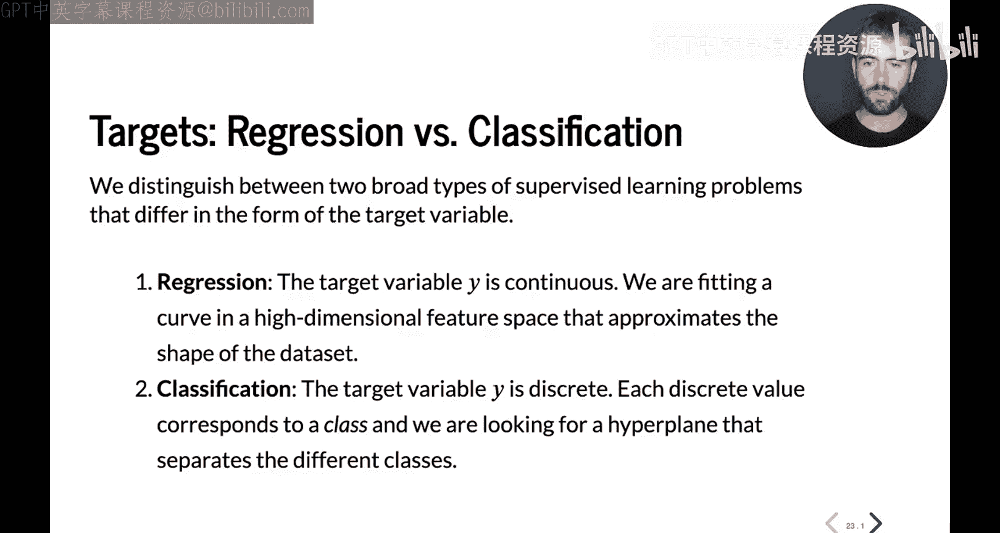

Alright， so this was an example， so this is a really important distinction and just to make it a little bit more concrete again。

 let's look at an example of a classification problem now。

 we can often turn regression problems into classification problems， for example。

 we could disretize our diabetes risk into either being high or low。

Here I am just arbitrarily choosing the threshold of 150 to decide whether a patient is high risk or low risk and here you can see that I have separated these into two classes here the X axis as BMI Y is the diabetes risk this is the same scatter plot we saw earlier in our first video but now I have colored each point depending on whether it's a high risk or a low risk patient and according to this 150 threshold that are just defined and you can see that above this line above 150 all the patients are read。

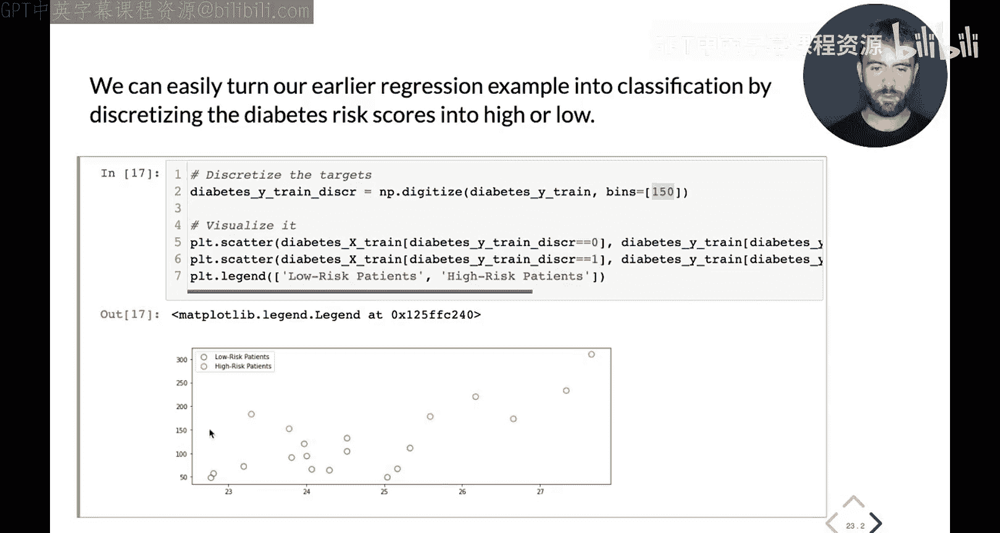

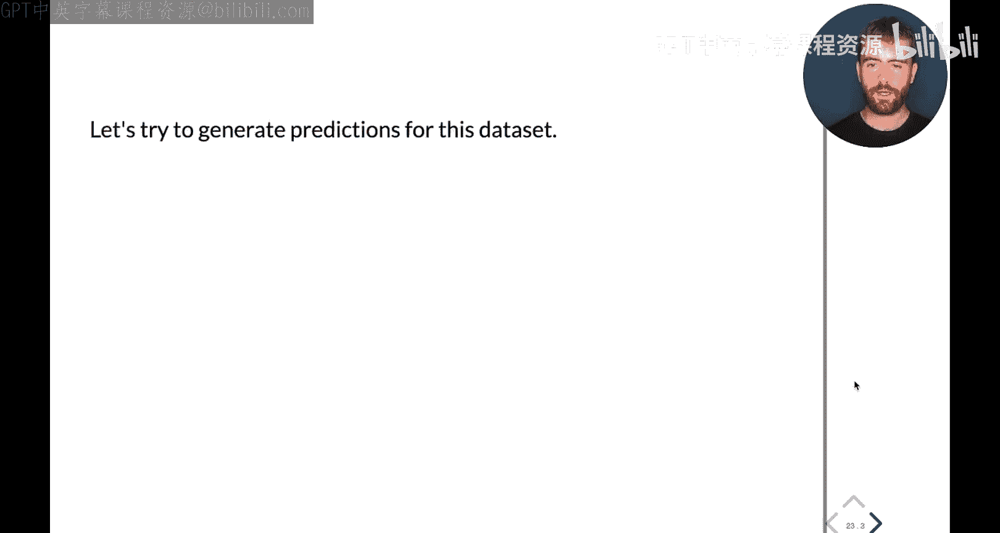

We can train supervised learning algorithms to make predictions on this data set。

I am not going to go yet into the details of what this algorithm does。

 but it's an algorithm which is called logistic regression。

 I know it's called regression but it's actually a classification algorithm this is a very interesting misnomer。

So this is actually the classification algorithm and I'm importing it from the learn library from the Psy learn linear models library here。

 I am training it on this data set with now these discretized binary examples。

And then I'm using the same data set to generate outputs。

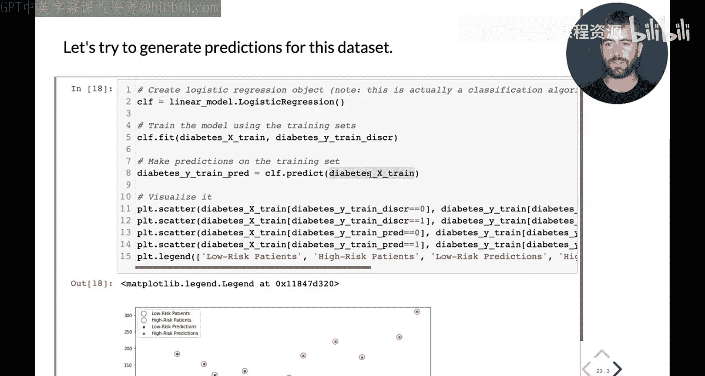

And you can see the results here inside each circle。

 there's a dot and this dot is the prediction of the algorithm。

And you can see that it was almost able to classify all of them correctly。 Now， of course， this is a。

This is a simple to example if we were careful we could get it to classify all the examples correctly。

 but most green examples are indeed classified correctly and then here we have a few mistakes for we have these two mistakes where these high risk patients are accidentally classified as low risk。

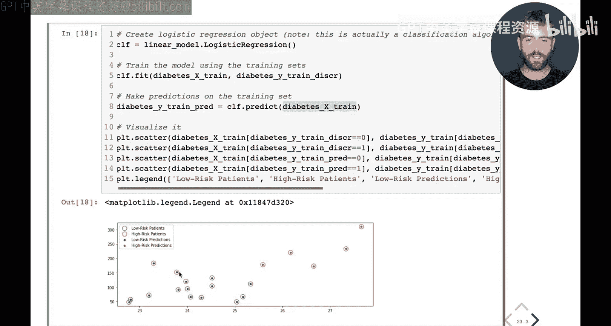

But overall here we were able to train a classificationification problem。

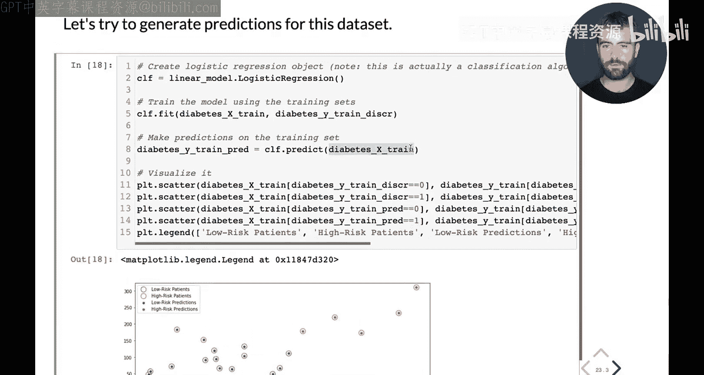

All right， so this ends this video and again we looked in more detail into what a training data can look like。

 we looked at two main components of a training data， the input and the target。

And we saw different definitions different in various notation that is going to be important in the later videos and in next video I want to look at the other component of a supervised learning algorithm。

 which is going to be of a supervised learning problem， which is going to be the learning algorithm。

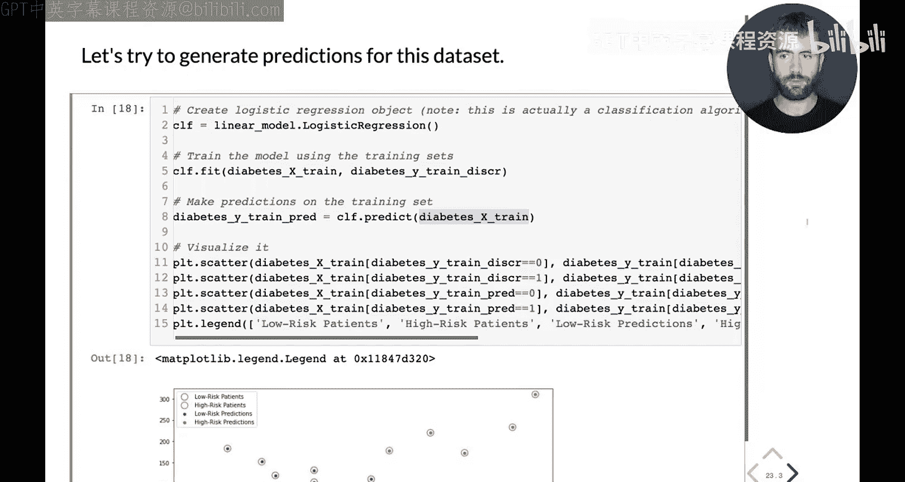