# 应用机器学习：2.2：监督机器学习剖析：数据集 📊

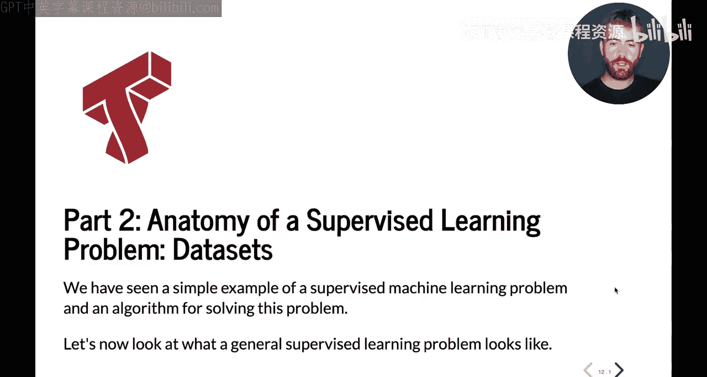

在本节课中，我们将深入学习监督机器学习问题的核心组成部分，特别是数据集。我们将使用数学符号和定义来精确描述数据集的构成，这对于后续理解各种机器学习算法至关重要。

在上一节中，我们介绍了什么是监督学习，并看到了一个简单的监督学习问题及其算法的运行示例。本节中，我们将更深入地探讨监督学习问题的不同组成部分，并重点聚焦于数据集。

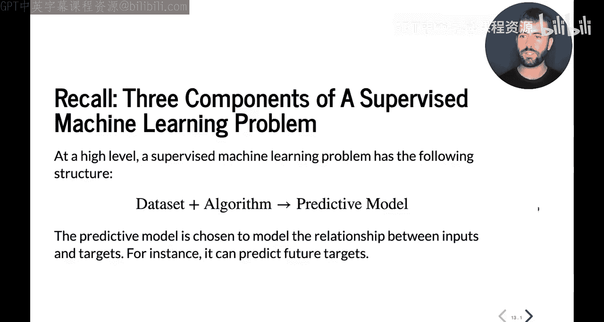

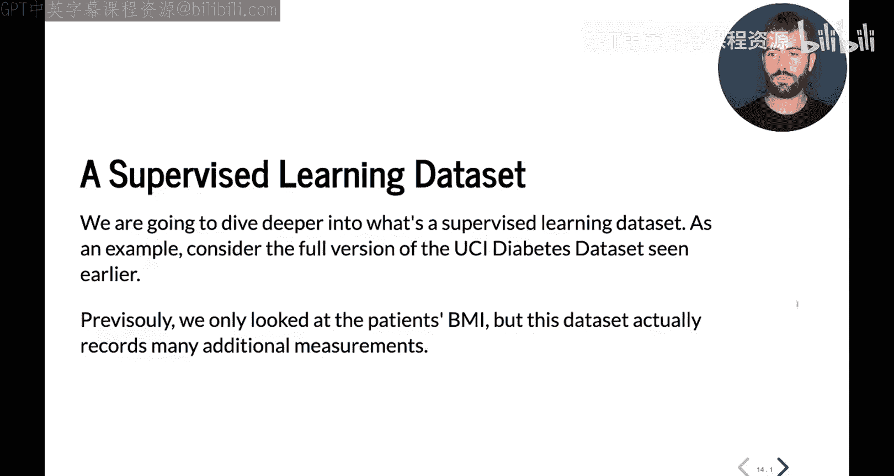

## 监督学习的三要素

回顾之前的视频，一个监督学习问题通常包含以下三个核心部分：
1.  **数据集**
2.  **算法**
3.  **预测模型**

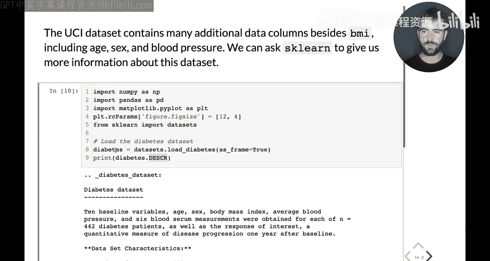

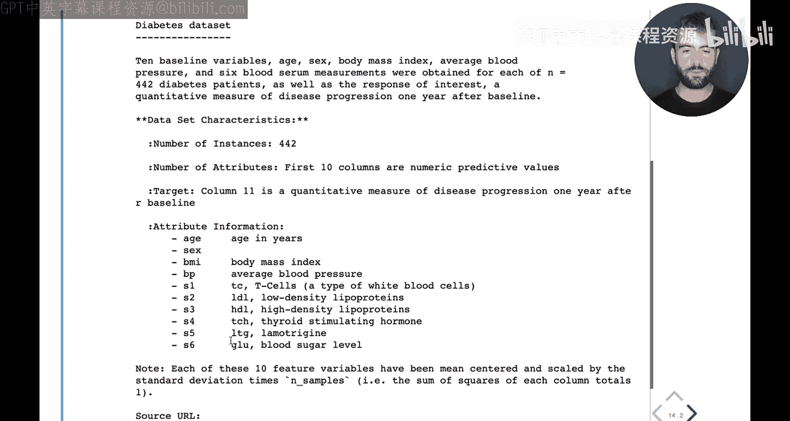

例如，如果我们为自动驾驶汽车构建一个物体检测系统，我们需要指定一个数据集（其中包含算法应遵循的行为信号）和一个学习算法。当计算机在数据上执行该算法时，它会学习数据的结构并输出一个预测模型，该模型可用于预测未来遇到的数据实例。

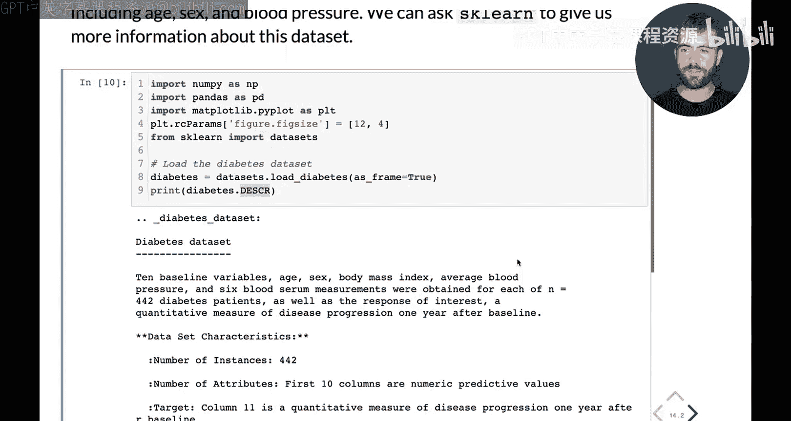

## 深入理解数据集

我们将继续使用UCI糖尿病数据集作为贯穿本节的示例。该数据集包含多名患者的记录，每条记录包含多项测量值，例如生理指标。之前我们重点关注了BMI，但实际上该数据集中还有其他有用的测量值。

以下是加载和查看该数据集描述的代码：
```python
import numpy as np
import pandas as pd
import matplotlib.pyplot as plt
from sklearn import datasets

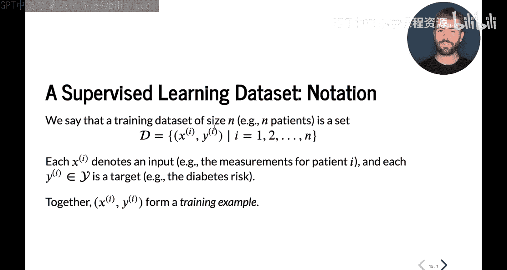

# 加载糖尿病数据集
diabetes = datasets.load_diabetes()
print(diabetes.DESCR)
```
数据集描述显示，总共有442名患者，每名患者有10项测量值，包括年龄、性别、BMI、血压等。

## 数据集的数学定义

为了用数学语言精确定义后续的算法，我们需要更形式化地定义数据集。

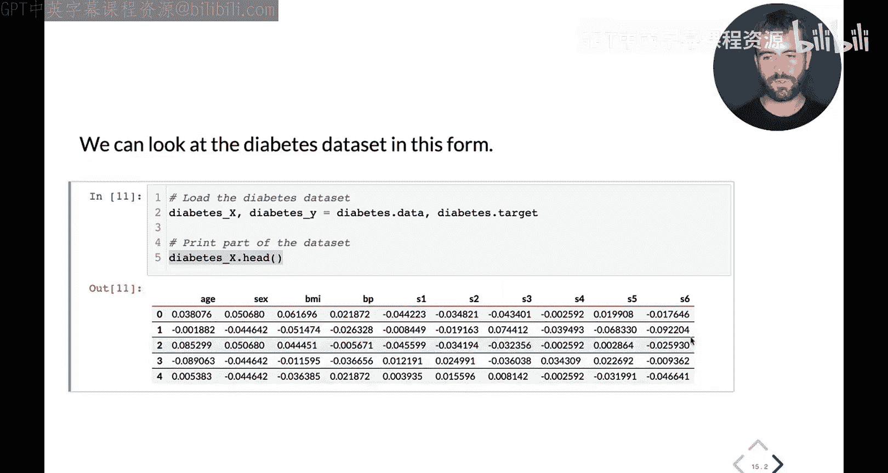

我们将一个数据集 **D** 定义为一个包含 **n** 个训练样本的数学集合：
**D = {(x⁽¹⁾, y⁽¹⁾), (x⁽²⁾, y⁽²⁾), ..., (x⁽ⁿ⁾, y⁽ⁿ⁾)}**

其中：
*   上标 **i** 是样本索引，并非指数运算。
*   每个元组 **(x⁽ⁱ⁾, y⁽ⁱ⁾)** 称为一个**训练样本**。
*   **y⁽ⁱ⁾** 称为**目标值**。在我们的例子中，这就是糖尿病风险。
*   **x⁽ⁱ⁾** 称为**输入**或**输入对象**。这通常是我们在进行预测前拥有的患者数据（各项测量值）。

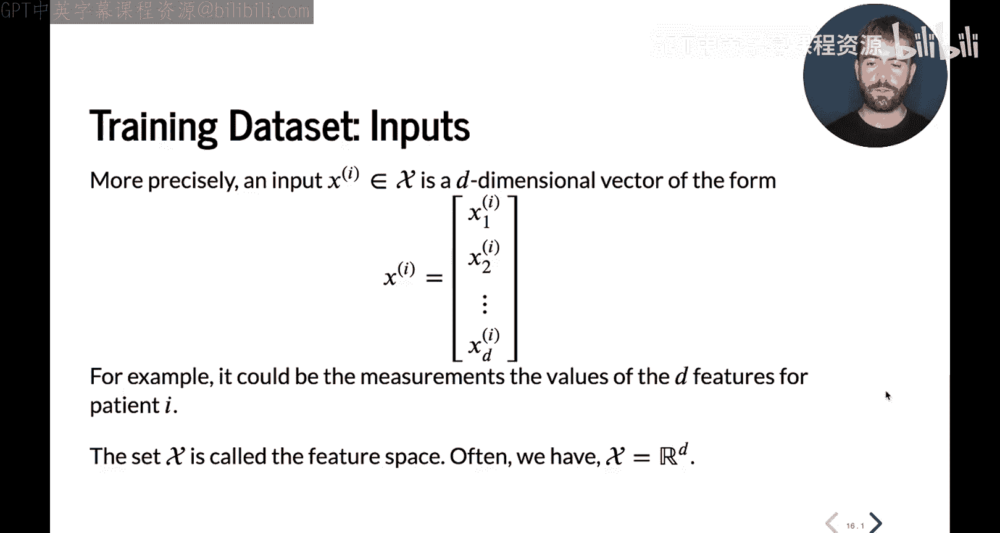

机器学习算法通过学习大量“输入-正确目标”的配对样本，来学会从 **x** 预测 **y**。

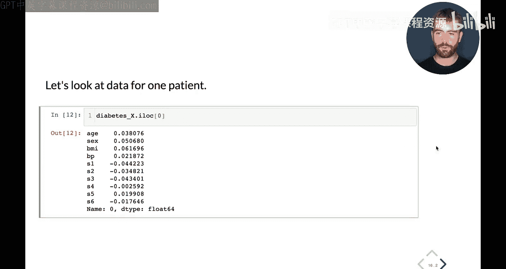

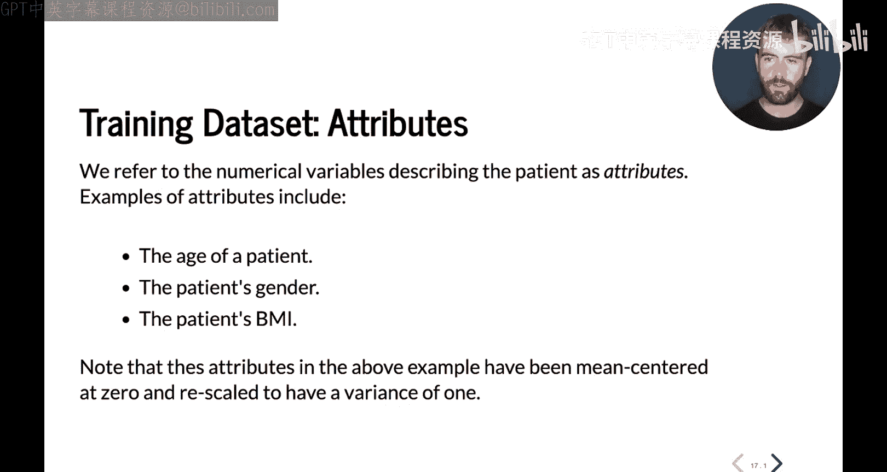

我们可以查看糖尿病数据集的具体数值，它已被分为输入数据（`diabetes.data`）和目标值（`diabetes.target`）两部分。输入数据是一个数据框，每一行代表一名患者，每一列代表一项测量值。某些数值（如年龄出现负值）是数据预处理（如归一化）的结果，这是为了让算法更容易处理数据，属于常见的技术操作。

## 输入对象：属性与特征

现在，让我们更详细地了解输入 **x**，并引入相关符号。

我们假设每个输入对象 **x⁽ⁱ⁾** 是一个 **d** 维向量：
**x⁽ⁱ⁾ = [x₁, x₂, ..., x_d]ᵀ ∈ 𝒳**

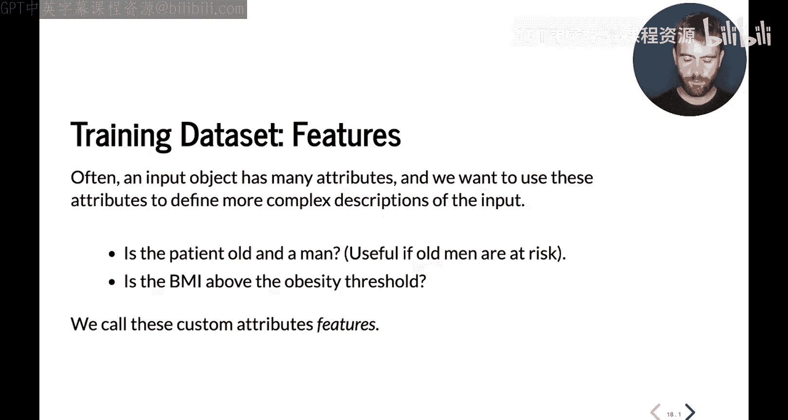

其中：
*   向量中的每个标量值对应一项测量（如年龄、BMI）。
*   **𝒳** 称为**特征空间**，通常是 **d** 维实数空间 **ℝᵈ** 或其子集。

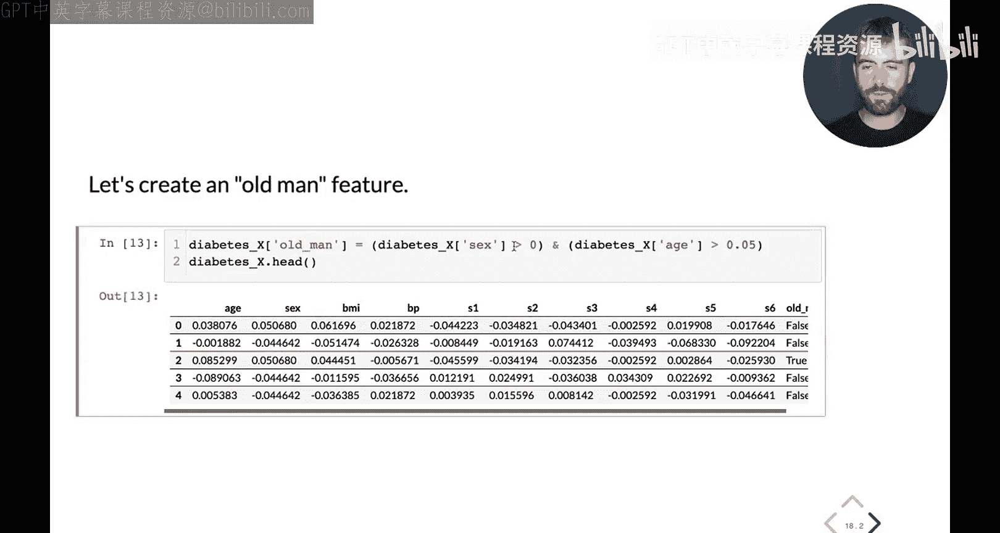

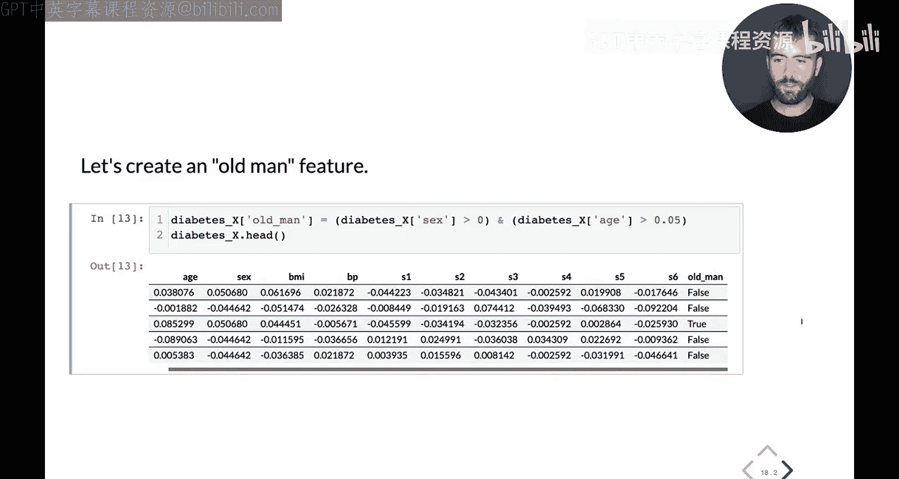

向量中的每一项通常被称为**属性**，例如患者的年龄、性别、BMI。这些是我们拥有的关于患者的不同信息片段，将用于进行预测。

另一个相关但略有区别的重要概念是**特征**。有时，原始属性可能不足以做出有效预测，或者对算法来说难以处理。例如，我们可能认为“老年男性”患糖尿病的风险特别高。这就需要我们结合“性别”和“年龄”两个属性，创建一个新的特征“是否为老年男性”。

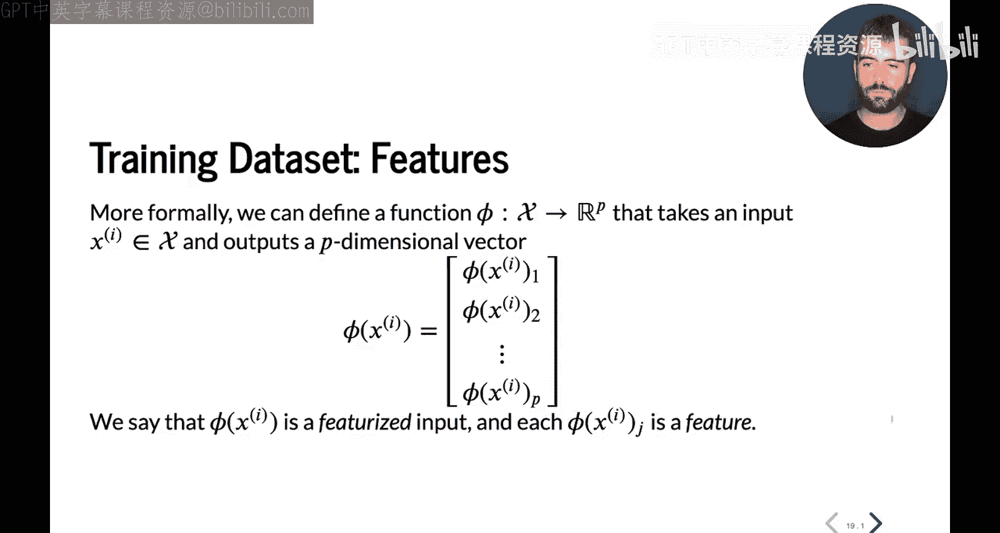

以下是创建“老年男性”特征的代码示例：
```python
# 假设 df 是包含‘sex’和‘age’列的数据框
df[‘old_man‘] = (df[‘sex‘] > 0) & (df[‘age‘] > threshold_value)
```
通过创建丰富而有意义的特征，我们可以极大地提升机器学习算法的效能。虽然某些算法理论上能从数据中自动学习这种组合关系，但通常由于算法结构限制或数据不足，自定义特征对于算法成功至关重要。

## 特征的形式化定义

我们使用一个**特征函数 φ** 来形式化地定义特征提取过程：
**φ: 𝒳 → ℝᵖ**
**φ(x) = [φ₁(x), φ₂(x), ..., φ_p(x)]ᵀ**

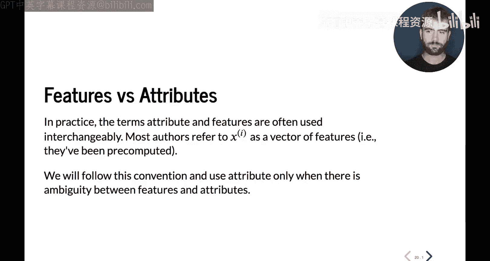

该函数将原始输入对象 **x** 映射到一个新的 **p** 维向量。**p** 可能与原始维度 **d** 不同。这个新向量的每个分量就是一个**特征**（例如，“是否为老年男性”、“是否肥胖”）。函数 **φ** 的输出结果称为**特征化后的输入**。

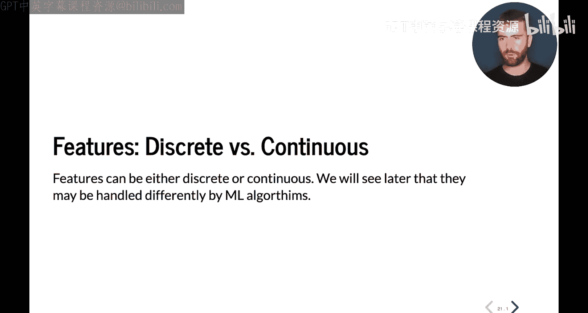

需要说明的是，在实践中，“特征”和“属性”这两个术语经常互换使用。当上下文清晰时，我们通常直接称 **x** 为特征向量。

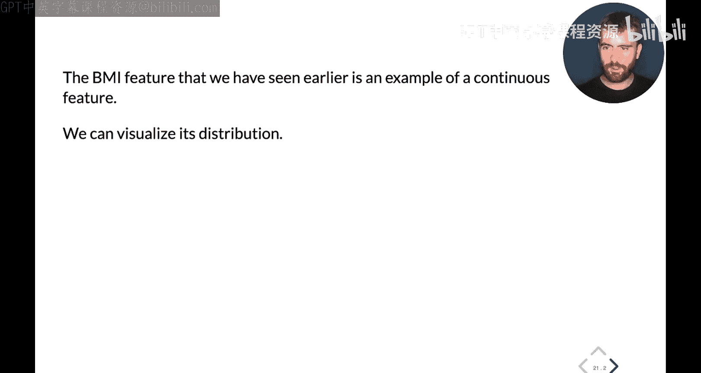

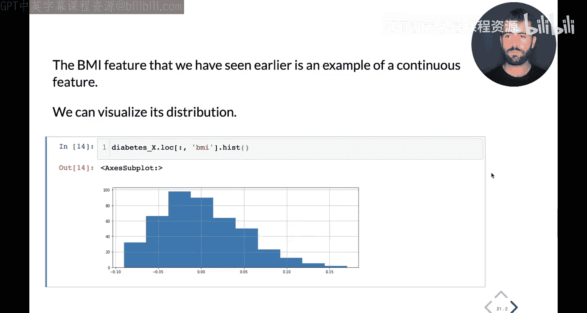

## 特征的类型：连续与离散

特征可以分为两种重要类型：连续特征和离散特征。某些算法可能对其中一种类型处理得更好。

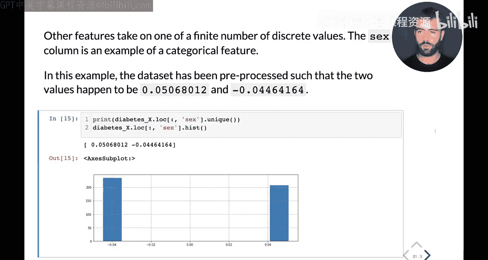

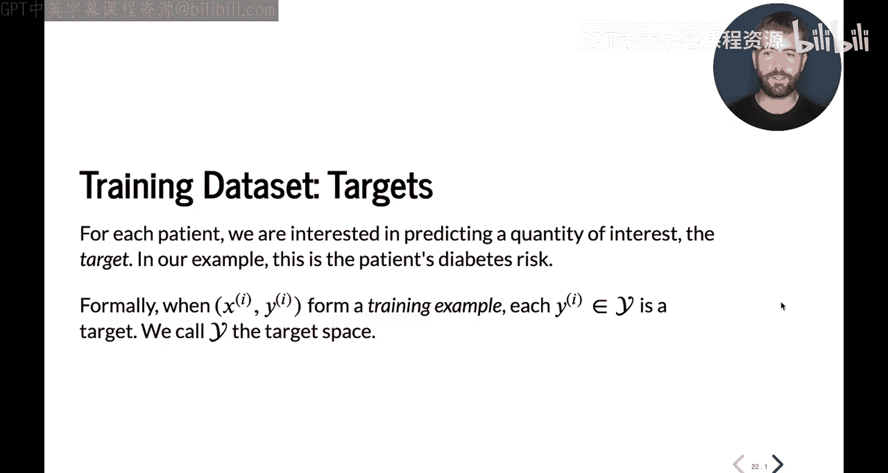

*   **连续特征**：可以在实数区间内取任意值。例如，BMI特征就是一个连续特征，其直方图呈钟形曲线分布。
*   **离散（分类）特征**：只能取有限个可能值中的一个。例如，性别特征（在数据集中编码为两个数值）就是一个离散特征，其直方图仅显示两个柱状。

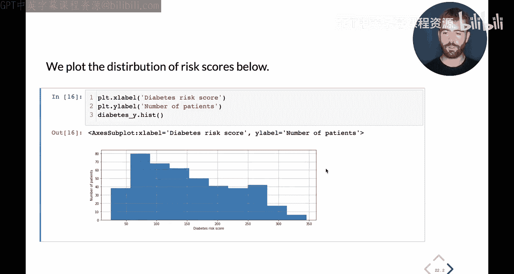

## 目标变量：回归与分类

现在，让我们更深入地讨论目标变量 **y**。每个 **y** 称为目标，其取值属于**目标空间 𝒴**。在我们的例子中，𝒴 就是糖尿病风险值的集合。

目标变量 **y** 同样可以是连续或离散的，这定义了两种根本不同的监督学习问题：

1.  **回归问题**：目标变量 **y** 是连续的。我们的目标是拟合一条曲线（或超平面）来近似 **x** 与 **y** 之间的关系。预测糖尿病风险就是一个回归问题。
2.  **分类问题**：目标变量 **y** 是离散的。每个取值代表一个**类别**。我们的目标是在特征空间中找到一个决策边界，将不同类别的样本分开。对于一个新输入，根据其落在边界的哪一侧来预测其类别。

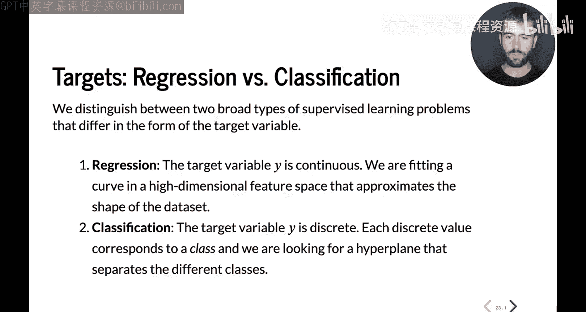

我们可以通过设定阈值，将回归问题转化为分类问题。例如，将糖尿病风险高于150的定义为“高风险”，否则为“低风险”。以下是使用逻辑回归算法（尽管名字叫“回归”，但它是一种分类算法）在这个二分类数据集上进行训练和预测的示例：
```python
from sklearn.linear_model import LogisticRegression

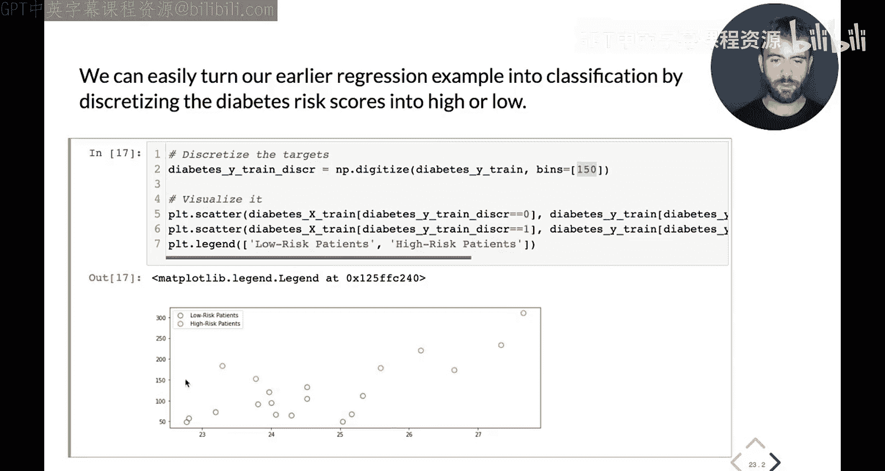

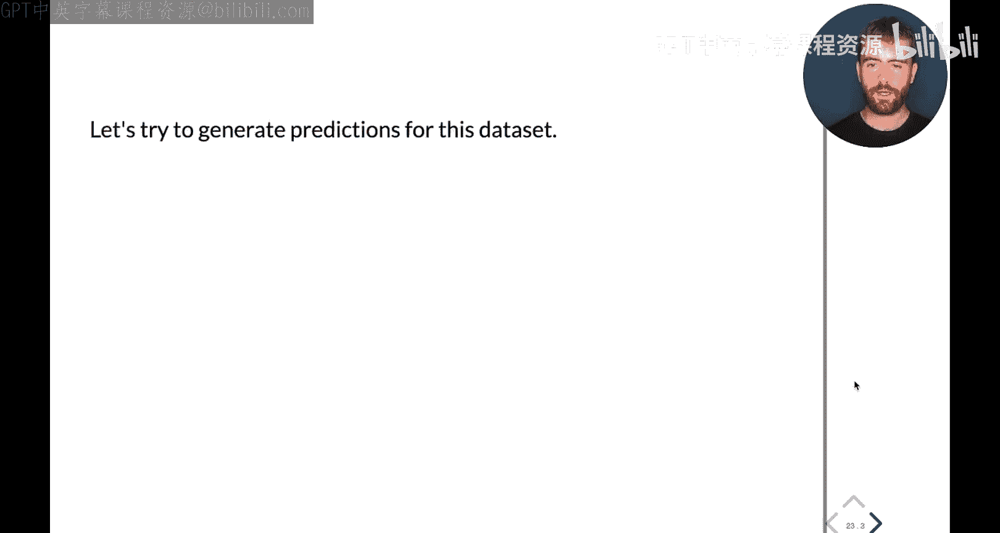

# 假设 X 是特征， y_binary 是二值化（高风险/低风险）后的标签
model = LogisticRegression()
model.fit(X, y_binary)
predictions = model.predict(X)
```
算法在大多数样本上都能正确分类，尽管存在少数错误。这展示了如何训练一个分类模型。

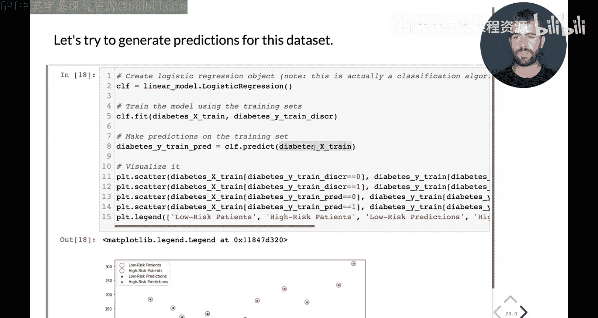

## 总结

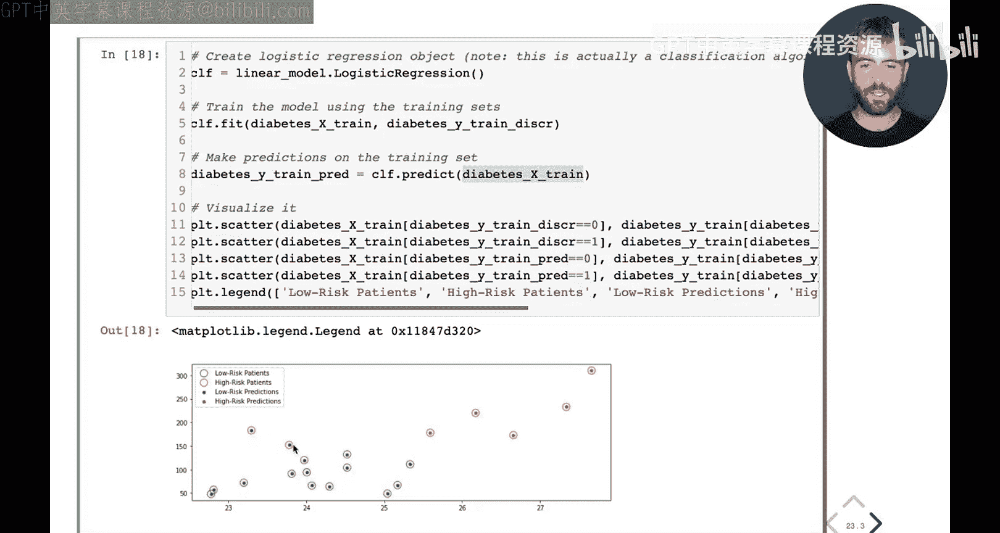

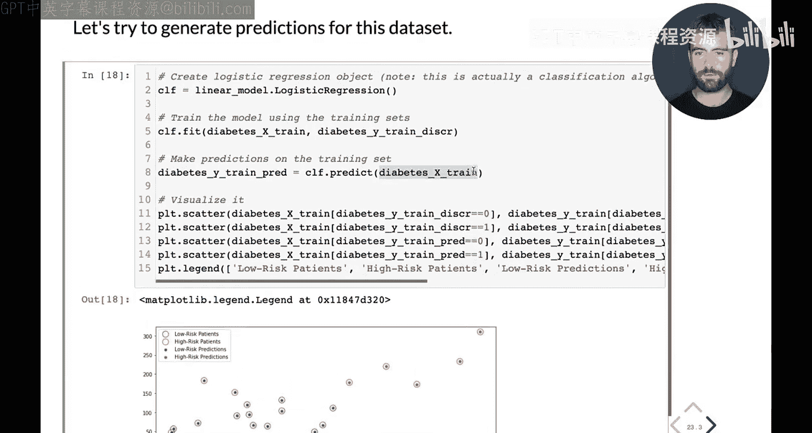

本节课中，我们一起深入探讨了监督机器学习中的数据集组件。我们学习了：
*   数据集的数学定义：**D = {(x⁽ⁱ⁾, y⁽ⁱ⁾)}**，包含输入 **x** 和目标 **y**。
*   输入对象 **x** 作为向量，其分量可以是**属性**或人工构造的**特征**，并引入了特征函数 **φ** 的形式化描述。
*   特征的两大类型：**连续特征**与**离散特征**。
*   目标变量的两大类型所定义的核心问题：**回归问题**（连续目标）与**分类问题**（离散目标）。

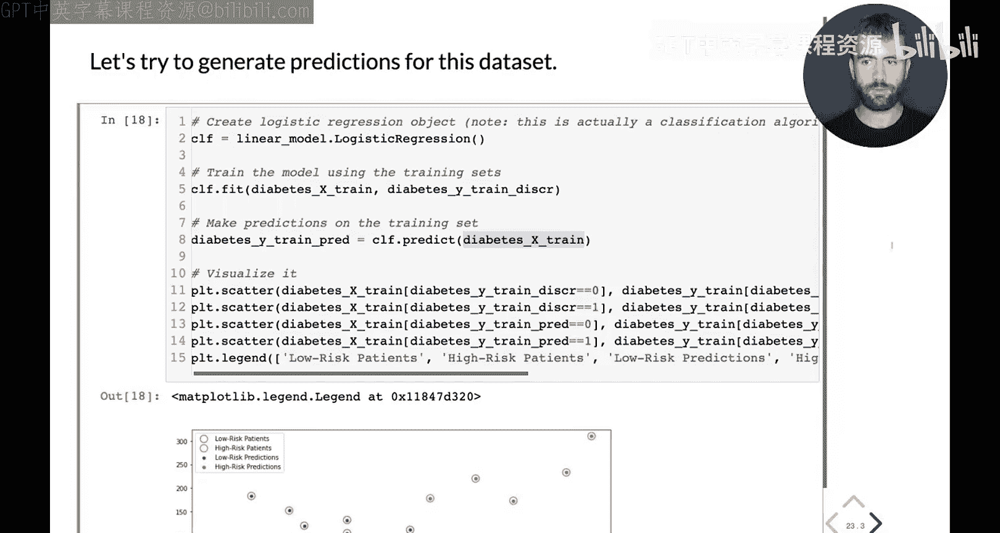

在下一节中，我们将把目光转向监督学习问题的另一个核心组成部分：学习算法。