# 康奈尔大学《应用机器学习 CS 5787_ Applied Machine Learning 2020》中英字幕（deepseek p07 -07-Lecture 2. Part 3_ Anatomy of Supervised Learning_ Learning Algorithms -BV12udzYvEFM_p7-

This is now part3 of lecture 2 of applied machine learning。In this part of the lecture。

 I want to now turn our attention to a different part of the supervised learning setup。

 which is the learning algorithm。And in this video。

 I'm going to define the different components of a supervised machine learning algorithm。

 and I will establish a lot of mathematical notation that we're going to use in the subsequent lectures to define many kinds of supervised learning algorithms。

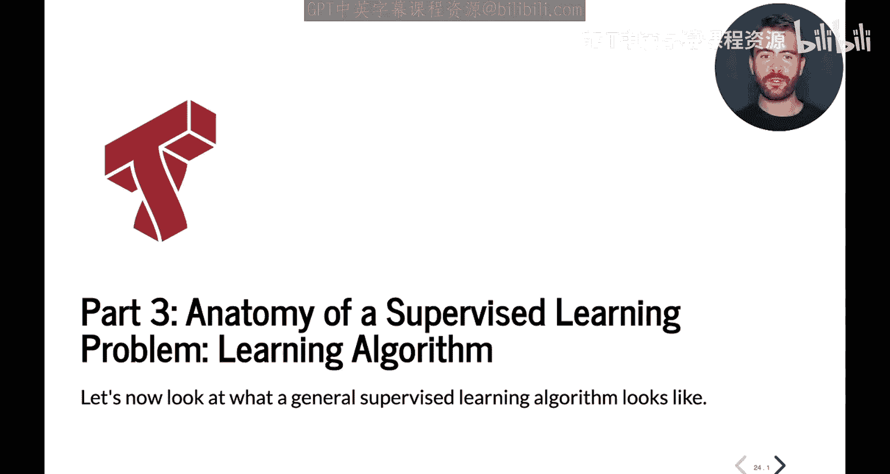

Recall from the earlier lectures that we defined the structure of a supervised machine learning problem to be the following。

In supervised machine learning， we collect a dataset set in through which we specify the desired behavior of the algorithm。

 and then we specify another component called the learning algorithm by which the computer processes the data and then outputs a predictive model that will achieve good supervised learning performance in the future on new datasets。

And in the previous video， we defined how a supervised learning dataset looks like。

 and we defined a lot of notation for describing a machine learning， a supervised learning data set。

 and now I would like to do the same for a supervised learning algorithm。And again， the output here。

 the eventual output of combining the learning algorithm and the data will be a predictive model that will model the relationship between the inputs and the targets。

 and in particular it can be used to accurately predict future targets。

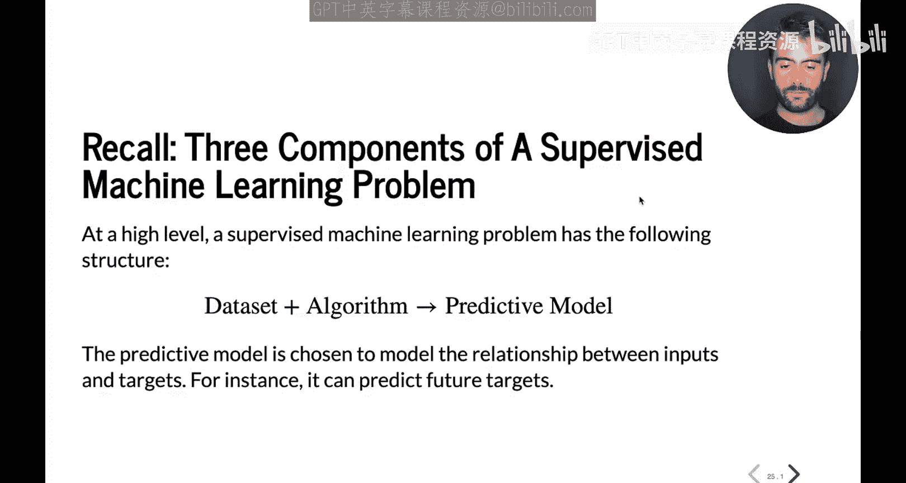

So similarly to how we defined certain structural components of a supervised learning data。

 we can define the components of a supervised machine learning algorithm。And at the highest level。

We can think of a supervised machine learning algorithm as having the following three important components；

 in fact， the learning algorithm is entirely defined by these three components。

The first component is what we call the model class。

Recall that the eventual output of our algorithm is going to be a predictive model。

And the set of all the possible predictive models that we can output is。

Is the is the is is what the model class is exactly the model class。Now。

 some of these models will be abouter than others， and we need a way of scoring or we need a way of quantifying what is a good model and what is a bad model。

For this， we have something called an objective function， an objective function。

This function defines how well a particular model fits our data set。

And we want to return a model that has the best possible value， according to our objective function。

 the one that has the best possible fit。In order to find this model， we need a procedure。

 we need an optimization procedure that will explore the set of all the possible models in the model class and find the one that optimizes our objective。

So that part of the algorithm is an optimizer。And so an optimizer that is run on a model class with a particular objective returns a predictive model。

 and that is the output of our algorithm。 So these are precisely the three components of a supervised machine learning algorithm and in this video I would like to define each of them in more detail。

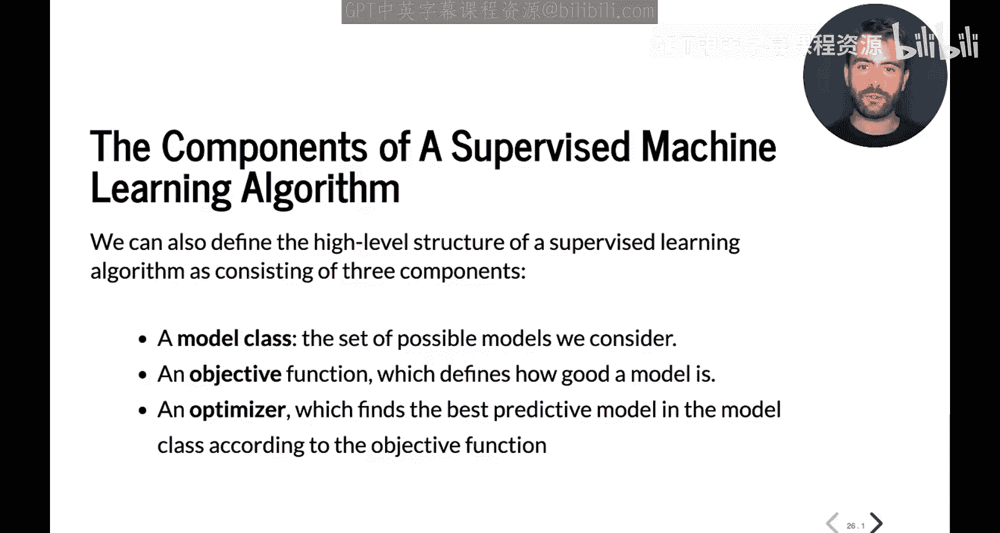

In order to define them， I will use our diabetes data as a running example。

 recall that we have introduced this data in our earlier videos。

 and it's a data set of individuals for which we collect various physiological measurements as well as information about their aged sex。

 BMI blood pressure。And we can put all of these measurements into a table where each row contains the attributes for a particular。

Patient。

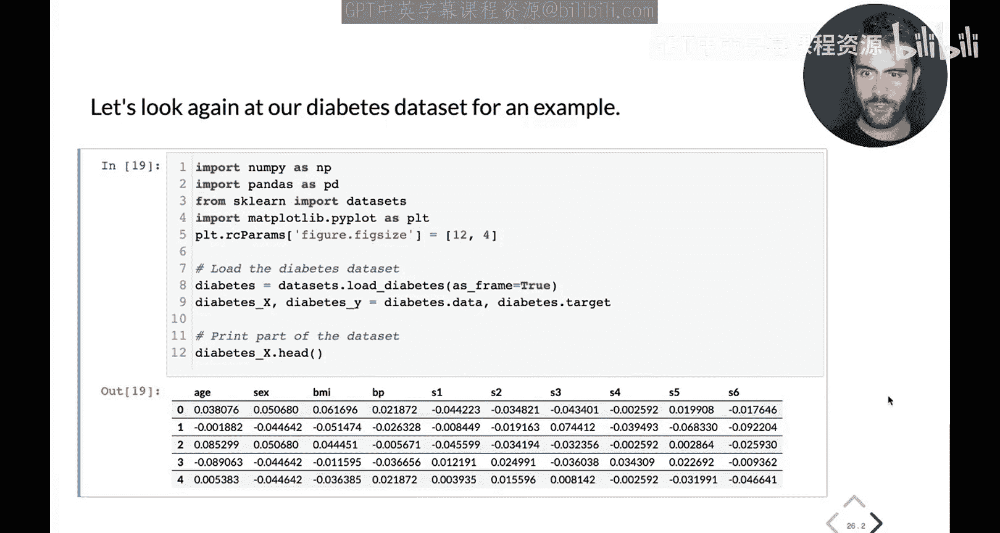

So the first。Component or the first element of a supervised learning algorithm that I want to define more formally is the model。

 So a predictive model is something that the algorithm will output。

And we can think of this model as just being a function that maps inputs x to targets y。

In our diabetes example， this is going to be a function we'll receive the attributes and features of a patient and it will output a value for its diabetes risk。

Often the models that that we're going to be working with will have parameters。

 which I'm going to be denoting by the symbol theta and these parameters live in some kind of set which I will denote by capital theta and when a model has a certain set of parameters。

 we will write them as。As follows， I will denote the parameters with a subscript data。

 So this is a model that。Given a set of parameters data。

 we fixed the model and now it defines a mapping between x and Y。

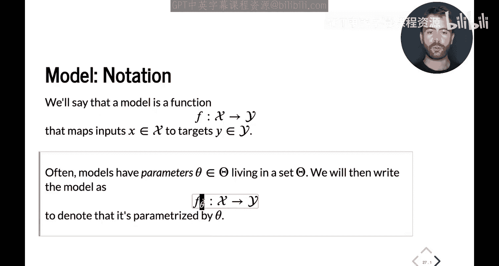

No。The model class that we consider is a subset of all the possible functions that map X to Y。Again。

 this is the set of models among which we're going to choose the one that we will output and the one that fits our data well。

If these models have parameters， then we can easily define this model class via the set of valid parameters。

 so here we can write the model class as the set of models that have a certain set of parameters theta which live in our valid set of parameters and so again for each possible value of theta。

 we have defined a particular model F sub theta。

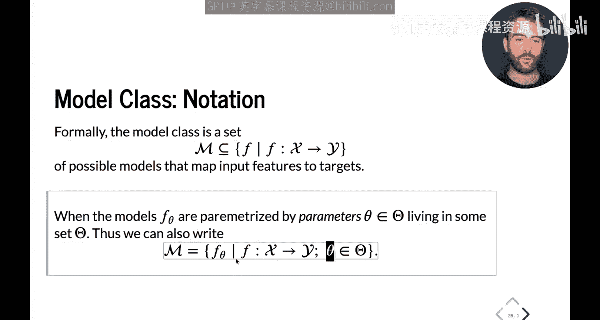

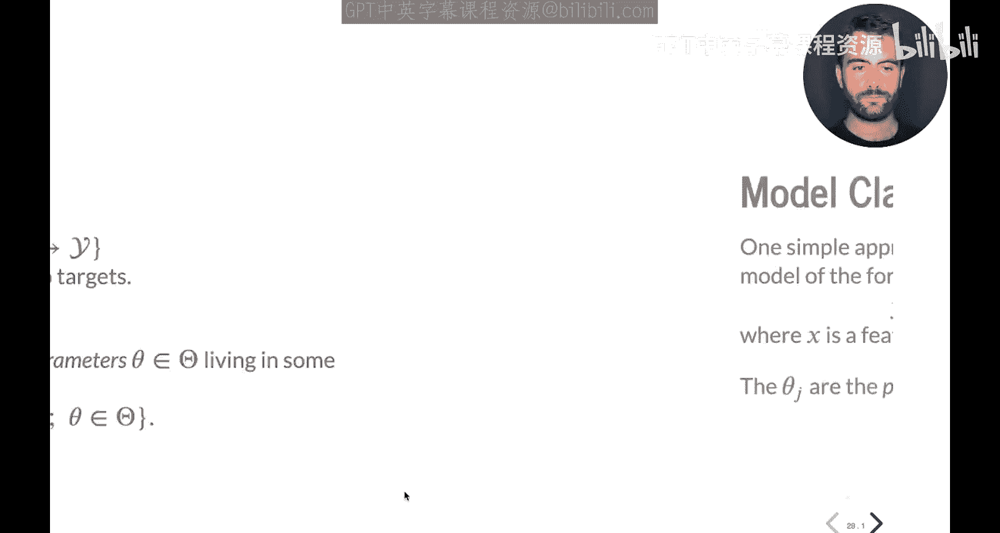

Let's make this a little bit more concrete via an example。

One very common approach in machine learning is to assume that the relationship between Y and X is a linear relationship。

In other words， the target y is related to the input X via the following linear equation where the output y is a linear function of inputs x and parameters theta。

So here， in order to obtain a y， we take each attribute， we multiply it by a parameter theta。

 and then we add all of these together and that is our output。And each theta J here each。

Each of these values is a scalar and the entire set of thetas form， there's D of them。

 we can place them into a vector and that is a de dimensionsional vector of parameters theta that we combine with d dimensionional input x in order to make predictions。

And we saw an example of this in earlier videos where we fit a linear function to predict the diabetes risk from BMI here we had a there we had a simple linear model in which we only had a slope and an intercept。

 but this functional form can be generalized to any number of dimensions in this particular way。

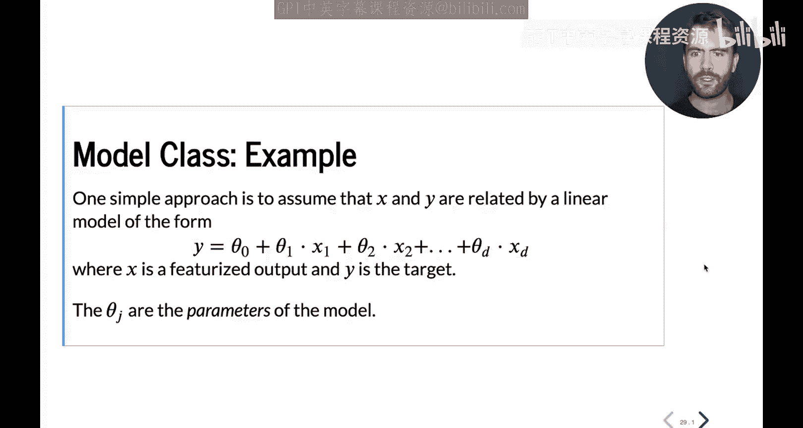

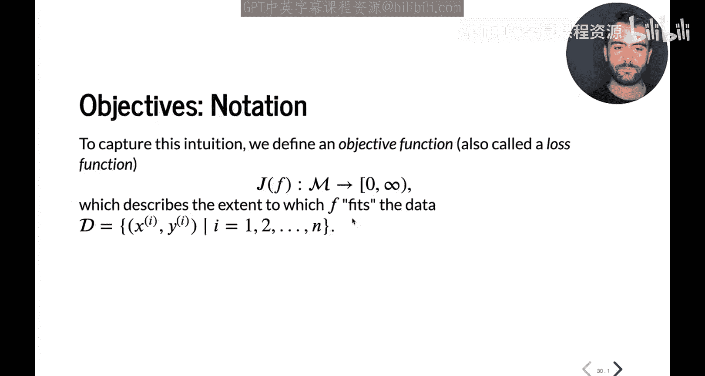

Now， given a model class， we have to have a way of choosing what kind of model is a good fit to the data and what model is a bad fit to the data。

And for that， we need to define an objective function。

It is also often called a loss function because it tends to be large when the model doesn't fit the data well and it tends to be small when the model fits the data well。

And in general， an objective is simply a function over the set of models， given a model F。

 it assigns some score， and minimize we typically want to minimize this objective function。Again。

 if F is parameterized by theta， we can define Rj to be directly a function of the parameters theta。

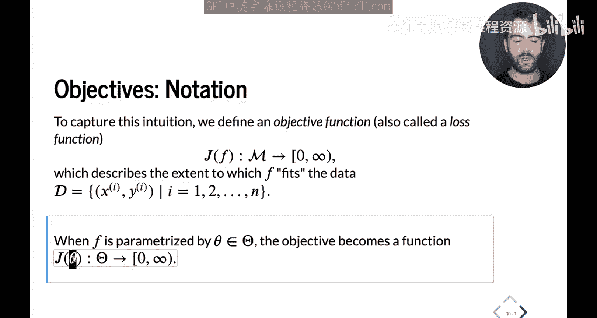

There are many kinds of objectives that exist in machine learning。

 but here are a few simple examples。Perhaps the most widely used example of a supervised learning objective is the mean squared error。

This is the definition of the mean squared error， and we simply look at the difference between the predicted value for the target from our model and we compare it to the true target that we should be predicting。

We look at this difference， we square it， and then we minimize its difference。

 and this value should ideally be small when this value is small。

 then the predictions from our model are very similar to the true targets。

 and therefore we have fit our data well。Another loss function that is also used a lot is the L1 error where we simply look at the absolute difference between the predictions of our model and the。

Target labels that it should be predicting， and we want to minimize this difference。

 so a model that fits our data well is one that outputs predictions that are really similar to the targets that we have provided for supervision。

And again， this is a function of the parameters because we are choosing the model with the parameters that fit the data best。

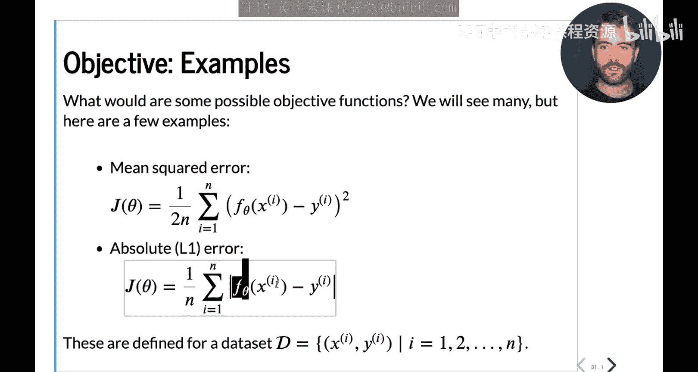

And here I have a few examples of these。Of these two objectives。

 so the p Psychic learn library that we have used before has a package called metrics from which we can import these two error or for at these two objective functions and here I have simply created a set of two vectors with the following numbers and I can easily compute their mean scoredd error and their mean absolute error and here I have output the results。

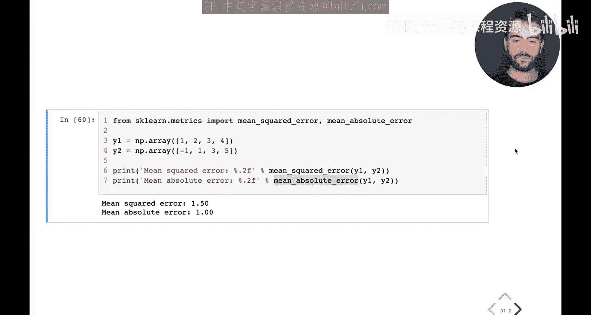

Now， the final component that is missing in order to define an algorithm is the optimizer。

And the optimizer is simply a procedure which solves the following minimization problem。

 an optimizer is any algorithm that finds the model that lives within our model class F that has the smallest value for the objective J。

And by the way， the objective J is called the loss function。

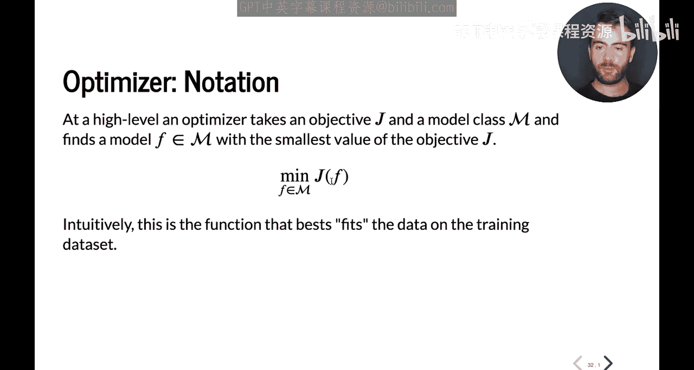

Because here we in this particular example， you can see that this is。

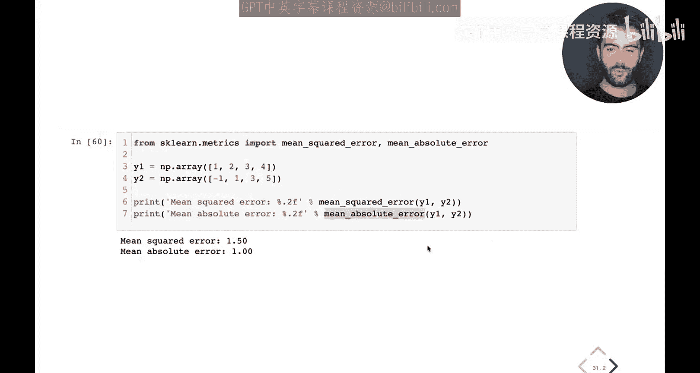

We want to minimize this and this is。It's a measure of inaccuracy that we want to minimize and this is why the word loss is often used for the objective。

 but in some types of machine learning algorithm， this objective can be more than just a loss。

 it can be the loss plus other terms， which is why I am just calling it an objective in general for now。

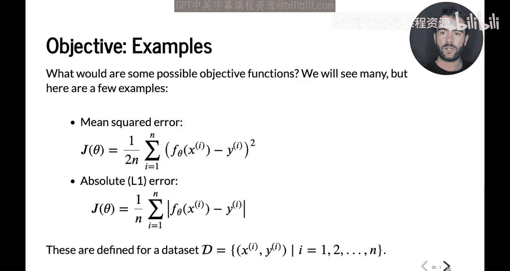

So intuitively， the optimizer finds the model that has the best fit on the training data。And again。

 if F is parameterized by parameters theta， then this optimization problem。

 it minimizes the function sub J of theta over all the possible values of theta。

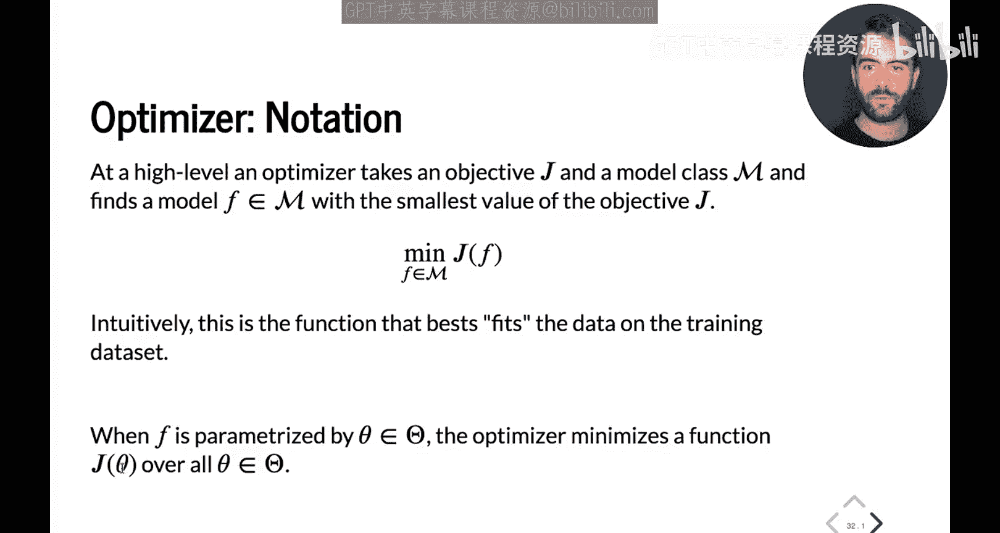

The optimizer perhaps is the part of the algorithm for which it is most difficult to find a short example。

 but we will see many optimizers in this course。But for now just to give an example。

 I will simply call the following class in the psychic Learn library which will invoke a certain optimization algorithm to solve the following optimization problem so here we have a linear model F sub dataator here is going to be a linear model even though I haven't defined this on this slide and we are going to solve the following optimization problem where we are going to be minimizing this mean squared error。

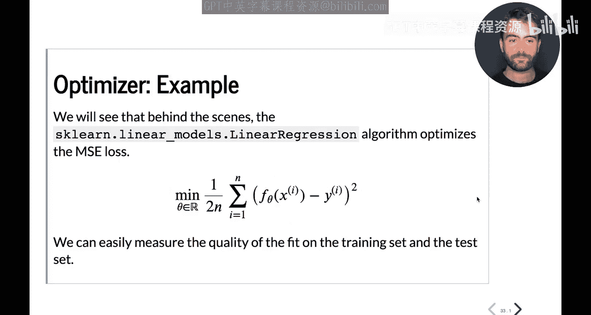

嗯。We can run this so now I have an example of a machine learning model， that's the linear model。

 I have an example of an objective， this is the mean squared error objective here and I will use this algorithm from psychic learnarn to perform this minimization and now I have an example of each of the three components and together these define an example of a learning algorithm。

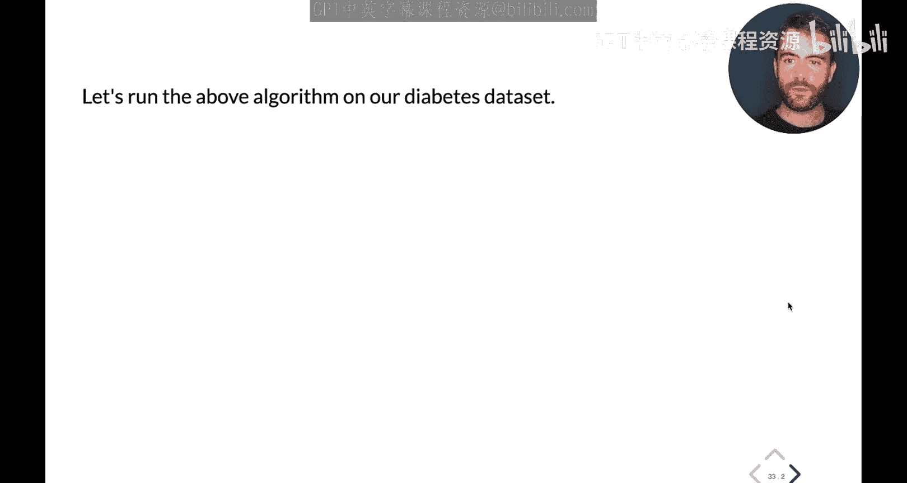

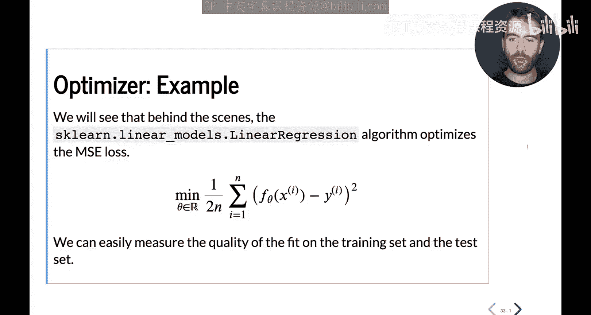

And I can run this learning algorithm on the diabetes data set that I have shown at the beginning of this video here I create a training set that contains X and Y。

 and then I import this linear regression class from psychic learn and I fit it on I invoke the fit function on the training set when I do this it solves the optimization problem that I had on my earlier slide and the result is now that this regression class as a model that I can use to make predictions。

Here I generate these predictions。And also I generate them both on my training set and also on three data points that were not part of the training set。

 which I'm calling the test set and here I generate predictions from them as well。

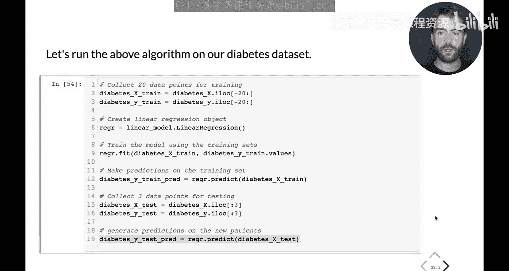

And now I can visualize these predictions as follows using psychic learn。Here in blue。

 I have my set of training points。And now instead of just using the the simple linear model。

With one dimension that I had earlier， now I'm using all of the dimensions behind the scenes。

 so my x is a multivariate input with about 10 dimensions。

And similarly to how we did this with the model that only had BMI， I can take these three patients。

 so these are my new patients and I can generate predictions for them at these data points and the x is the prediction from the model and you can see that these x's are actually not too far from the actual point。

 the red point is the true prediction and the x' is close to them which means that we are outputting predictions of diabetes risk。

 which are not too far from the actual prediction， and also you can double check that these are more accurate than the predictions that I had in my very first example because I am now using all of the features to make this prediction。

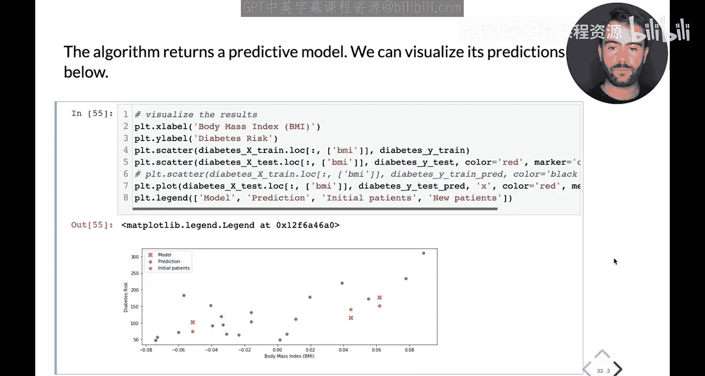

And now finally， to summarize， again， a supervised machine learning problem has as components。

 the data set and the algorithm。And the algorithm itself has the following three components。

 the model class， the objective and the optimizer， and together these form an entire learning algorithm。

Now， in our next lecture， we are going to see our first example of a real non toy algorithm where we will derive all of these three components from first principles。

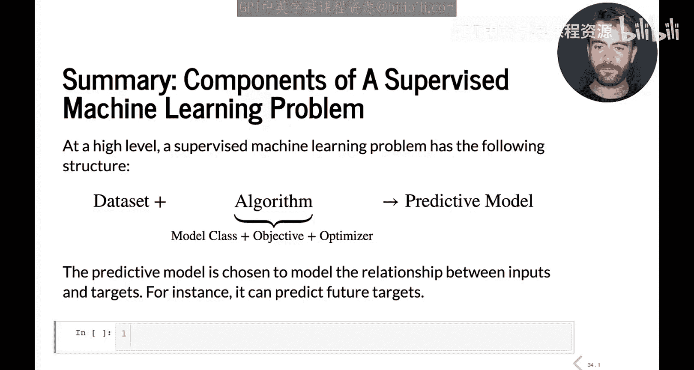