# 康奈尔大学《应用机器学习 CS 5787_ Applied Machine Learning 2020》中英字幕（deepseek p09 -09-Lecture 3. Part 2_ Gradient Descent.zh_en -BV12udzYvEFM_p9-

Hi and welcome back to lecture 3 of applied machine learning。In this video。

 we are going to use grainy descent in order to define our first supervised learning algorithm in linear models。

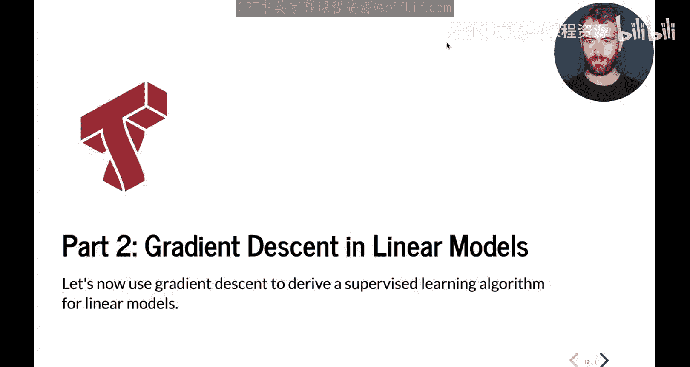

Recall that green in descent is an algorithm that can be used to iteratively optimize an objective function J by applying the following rule multiple times。

In order to apply this rule， we start with some initial guess theta0 for what the minimum of the function J might be。

 and then we repeatedly update our guess of theta according to this rule。

And this rule has crucial the key element of this rule here is the gradient。

And the -1 times the gradient， which you see here is。

Is going to be pointing in the direction of steepest descent of the function J。

 which means that it is going to be pointing in the direction where the function decreases most steeply when this direction of steepest descent is measured at this point。

And by applying the following equation， we are our function。

 we are updating our current guess of the minimum of this function， which is theta I minus1。

 we update it by moving along the direction of steepest descent， by a step size that equals alpha。

So we take a step in the direction where the function is decreases and if our step size here is chosen correctly。

 we will obtain a new estimate of where the minimum might be and the value of the function J at the new theta I will be smaller than what it was at the previous iteration。

This is the basic intuition of gradient in descent and here I have a very simple pseudo implementation of gradient descent。

 which applies this rule here repeatedly here I have defined this rule and we are applying it repeatedly as long as the function keeps decreasing between two consecutive guesses of theta between theta I minus1 and theta I long as the function is decreasing。

 we keep minimizing it according to this gradient in descent update rule。

So this is the definition of green descent。 How can we use it to obtain a learning algorithm？

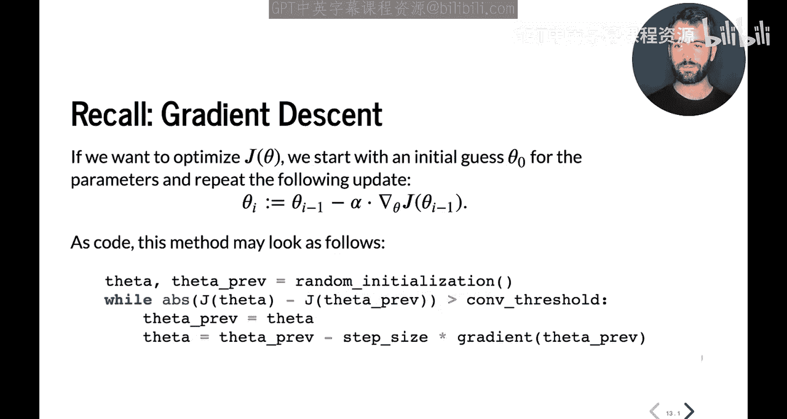

Now recall that in order to define a learning algorithm， we need to define a model class。

 an objective function， and an optimizer， which in our case is going to be creating descent。

Let's start first with the Model family。For this example。

 we are again going to use the simple linear model family that we saw earlier。

A linear model is one that has the following form。Here we are assuming that the relationship between the target y and the input x is linear in the sense that it has the following form where we have taken all we have taken each of the features of this de dimensionmensional vector features x。

 and we are assuming that y is a weighted sum of these features where the weights are given by the parameters of the model theta。

This is an extension of the very first example that we saw on the at the very at the very beginning of when we started to look at supervised learning there we looked at models which were。

Lines with a particular slope and intercept and this generalizes that form to inputs of multiple dimensions。

 we still have an intercept here， theta 0， but now each feature gets its own slope that's given by these parameters of theta。

Now， one interesting trick that we can do here in order to simplify this form is given in this equation here。

In order to simplify this notation， we can add a virtual feature to every input and this feature will have the index is zero。

And the only thing that will be special about this feature is that it will take the value1 everywhere。

 so we are going to simply add a one a feature that's just a constant value of one to each of our inputs and then using this notation。

 we can very compactly write the form of our model using a sum。

And then we can write it even more compactly using vector notation as follows。

 So this is just the dot product between theta and the dimensional and the D dimensional。

 or I guess now D plus one dimensional input x。And this stock product is simply defined as being this sum。

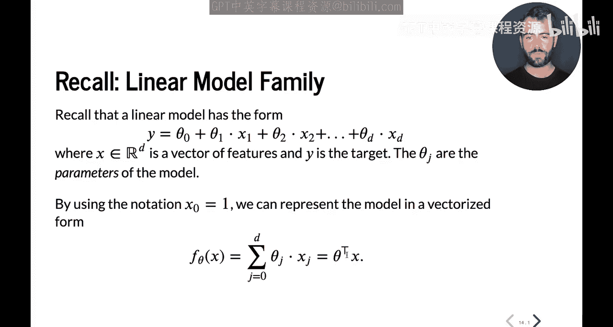

This。Function is not only easy to。Define mathematically。

 it's also very easy to implement in Python here I have defined the function F sub theta of x and we can write the expression for this function really simply。

 it's again simply the dot product of x and theta。

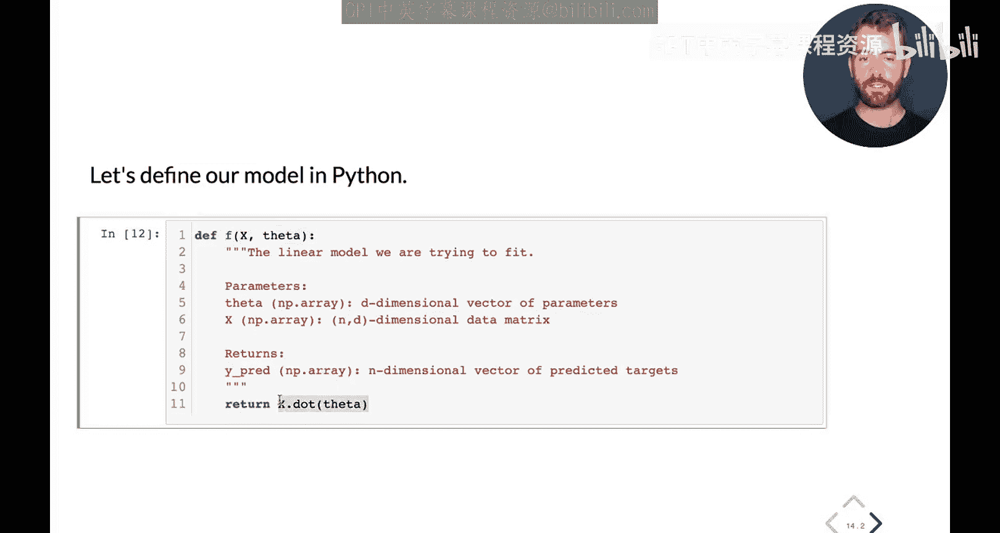

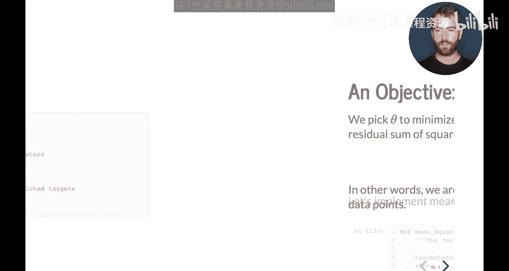

So this defines our model class， and the remaining component that we need in order to define a supervised learning algorithm is an objective function。

For the objective function， we are going to use the mean squared error， which we saw earlier。

Recall that the mean squared error is simply the average over the average or the sum of all the predictions that that the model is making at each training example in our dataset and we are looking at the difference between the target。

 the estimate of the target that's predicted by a linear model。

 which is here and the actual target which is given to us in our data and if these two values are close to each other。

 then this objective function or this loss function will be small and if there's a larger difference between what the model predicts and what we think it should predict then this value will be large so this is。

Going to be looking for a theta which achieves the best average error sum over the entirety of this data set。

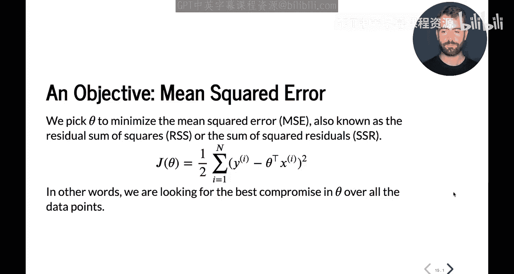

We can also implement this really easily。Here I'm defining the mean squared error as a function of parameters the and then a training data set given by x and Y。

And here I have I am again just taking the average error between the true targets and the output that's provided by our model here。

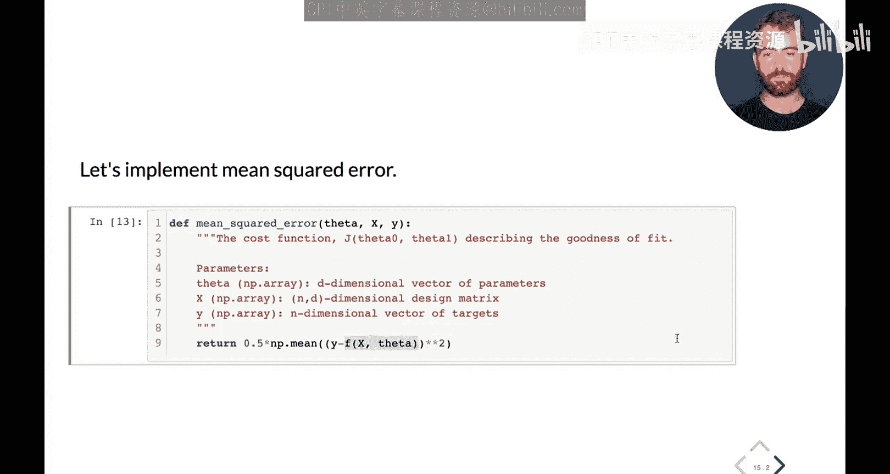

Now， in order to optimize the mean squared error using gradient descent。

 we need to obtain an expression for this gradient。

And the gradient of you may recall that the gradient of a function is simply a vector of its partial derivatives。

 and so in order to obtain the gradient， we need to compute a form for the partial derivative of this objective with respect to some value。

With respect to some parameters， datata J。Fortunately。

 this expression is really simple here I have just defined the mean squared error at some training example X Y。

Because this is a quadratic function we can using the roots of calculus。

 we know that it has this particular form here， the two was brought down to multiply this term。

 but then it cancels out with the one half which gives us this expression then we multiply by the derivative of the insight of this function and here I have just rewritten this expression。

usings the actual definition of the model， and you can see here that this is a sum of d plus one terms and only one term involves the parameter theta J and the derivative of that one term simply equals xj。

So here we have obtained an expression for the partial derivative of this function。

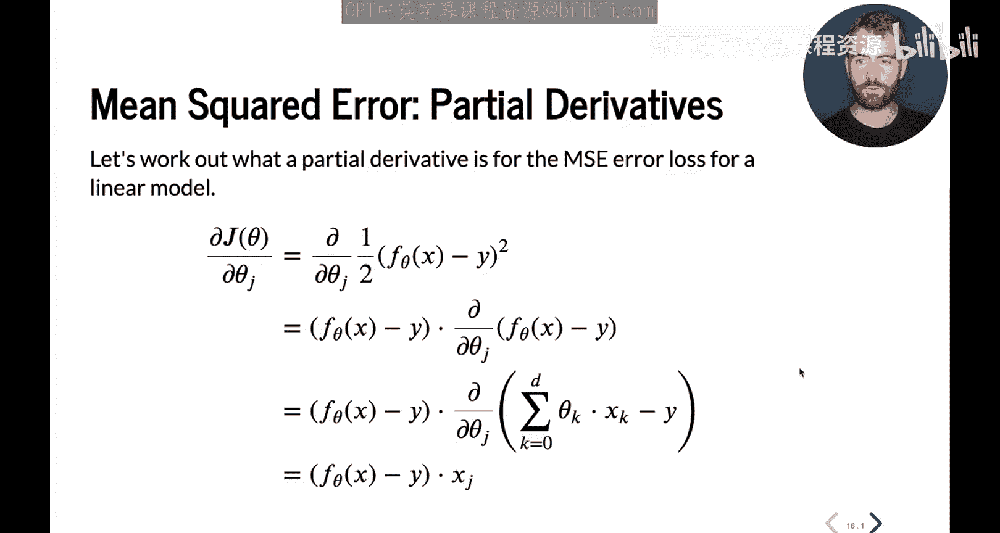

We can now combine these partial derivatives in order to。

In order to obtain an expression for the gradient here。

 this is just the definition of the gradient here I have plugged in the definition of each of our partial derivatives。

 and now we can use vector notation to。呃。To define this this gradient a little bit more succinctly。

 again， it is simply the the the gradient at an input X is simply X。

 and each of each of its components has been scaled by。F of x minus y。

This is just plugging in our earlier derivation for the partial derivative into the definition of a gradient。

This is a simple expression， and again in Nmpy， we can define this in one line as follows。

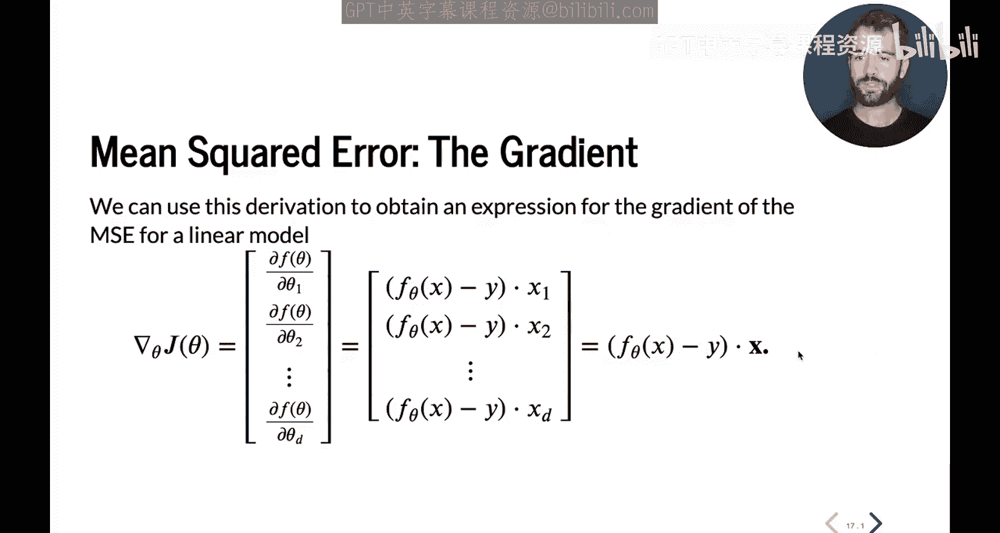

So this again here is the gradient of the function of the mean squared error over our entire data set。

Or in fact， over any arbitrary number of points here that's given within this parameter x。

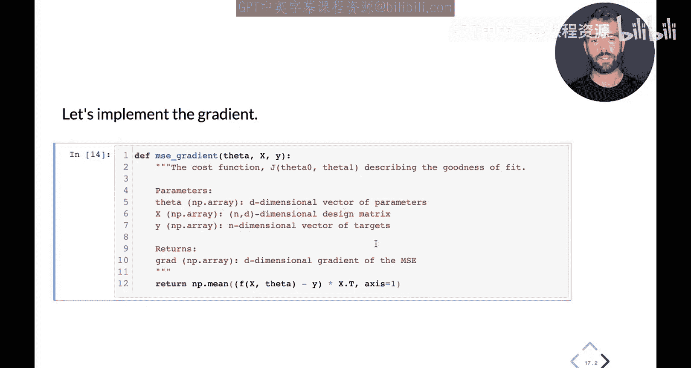

Now let's apply gradient descent over a linear model over a real data set。

 and again we're going to use our diabetes dataset which you saw earlier and recall that the diabetes data set contains data for a number of patients and for each patient we have various measurements and the one that we're going to use is the body mass index and in addition to the BMI。

 we also have their diabetes risk score which is a number that's roughly between 0 and 300 or perhaps a little bit higher but generally within this range。

And we are interested in training a linear model that will predict a person's diabetes risk from their BMI。

Here I have again visualized this data set and here again this is a scatterpl of the 20 data points that we have chosen for this example。

 and these data points have the following shape here。

 this is a scatter plot and you can see that there is a linear trend between them。

 makes it which means that it makes sense to try to fit a linear model here。

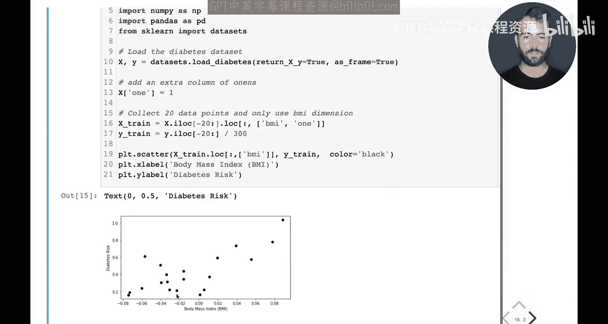

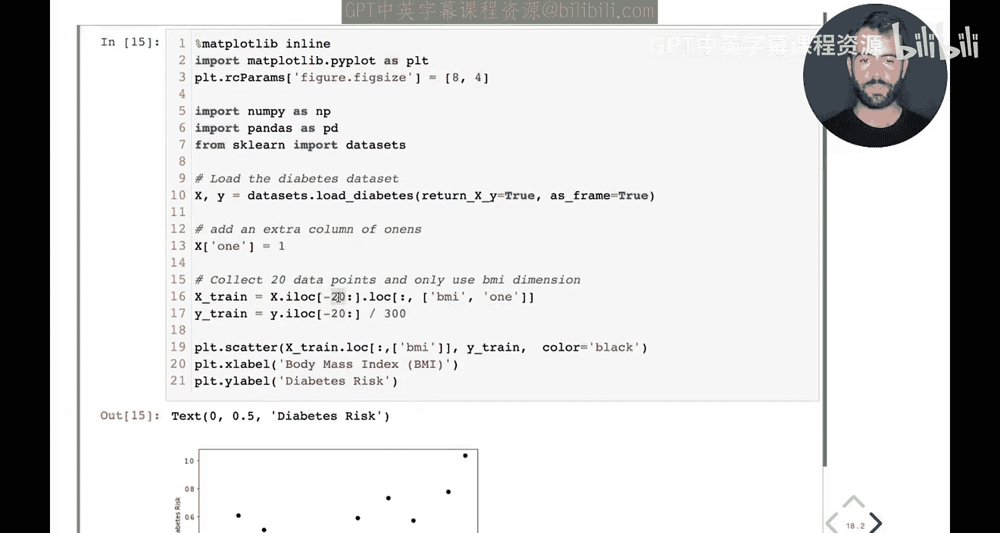

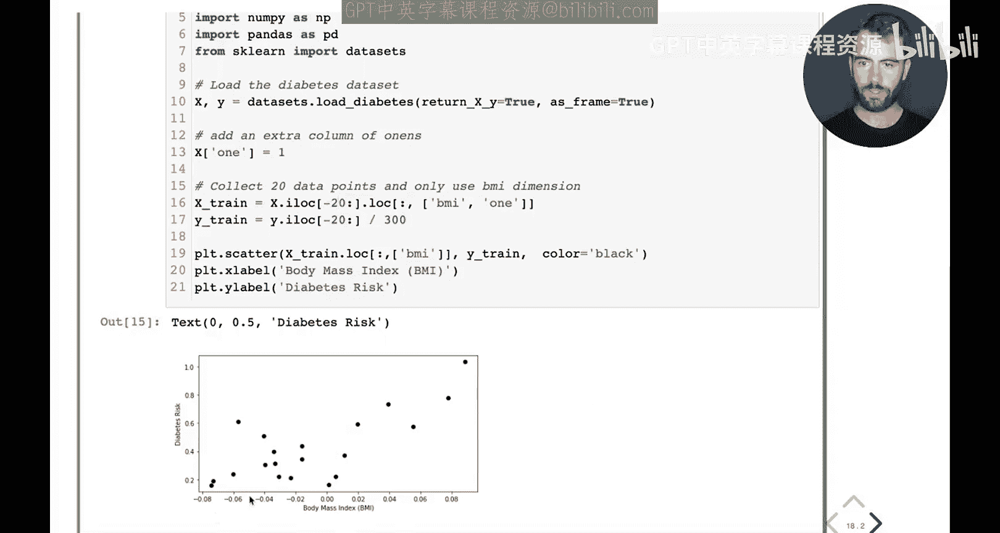

So recall that gradient descent repeatedly applies this rule here。

 and here I have instantiateated gradient descent with the definition of our gradient that we saw earlier。

 so I simply took our earlier definition of gradient descent and I have plugged in the expression for the gradient here in this definition。

And now we have what is a full supervised learning algorithm， we have specified a model。

 we have specified an objective， and we have specified here how to obtain the best parameter for this model using an optimization algorithm。

 which happens to be gradient in descent。This algorithm is often called either at least in squares or the Wirow Hoff learning rule。

 and this is a very， very simple， but also a very important algorithm in machine learning that is also of very important practical significance。

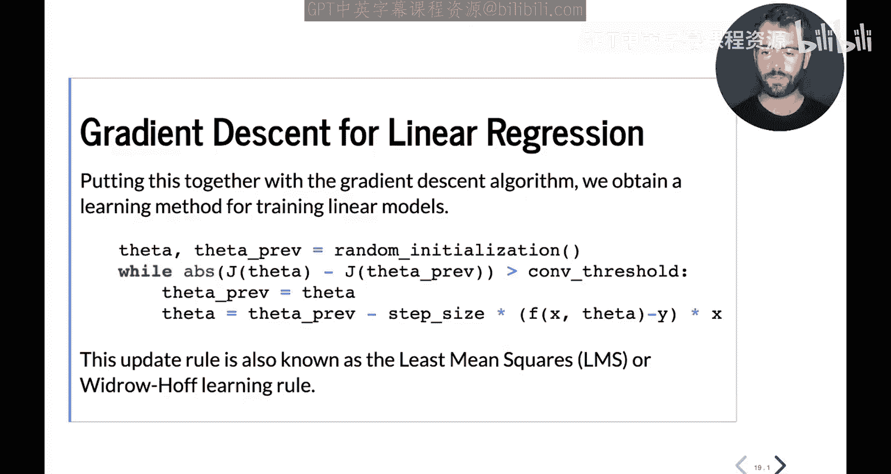

Let's now implement this algorithm。So here I have。Again， defined。

 have implemented gradient descent in Ny， and the structure is the same as you just saw in C code。

Until the function has not converged， we keep repeating we keep computing the gradient and then we simply apply the we simply update our estimate of theta by moving along the direction of steepest descent。

 which is given to us here by our gradient and as we do this we collect。

Both the gradients and the values of the function that we are and every00 iteration。

 we also print out the value of this function， and if we run this。

 we see the following optimization procedure as we perform more and more iteration。

 the value of the subjective function decreases until it stabilizes roughly at the following value。

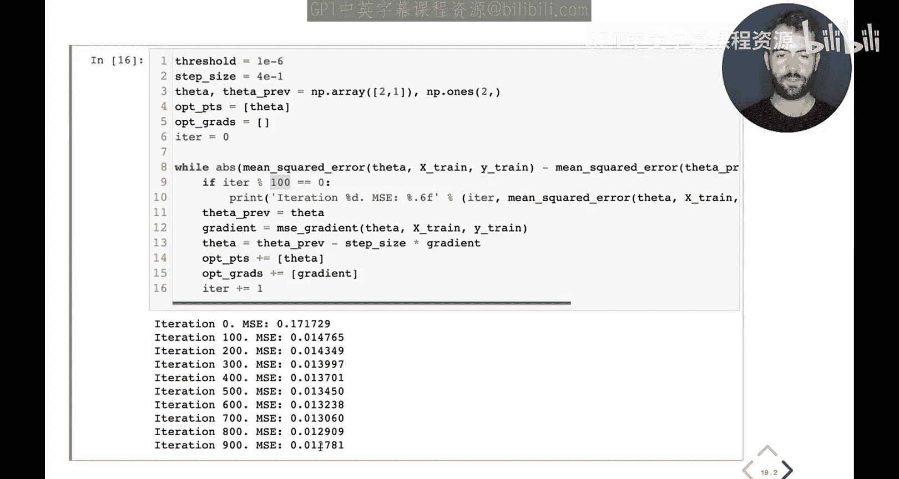

And now we can actually visualize this function and it looks like the following line。

So here I am taking the last optimization， the final point in the optimizationization sequence。

 which I was recording earlier， and I am using it to compute an estimate for I'm essentially plotting the line that is specified by the very last set of parameters of the optimizationization process and indeed this line here shown in blue is a fit to to the data set that we have here and it approximately matches the linear trend that we saw earlier。

So here we have successfully used gradient Descent in order to apply supervised learning to this problem in order to optimize a linear model and obtain our first supervised learning algorithm。

And in the next set of slides， we are going to look at extensions of this approach。

 and we are going to look at a few other ways in which we can use。

 optimization algorithms to fit linear models。

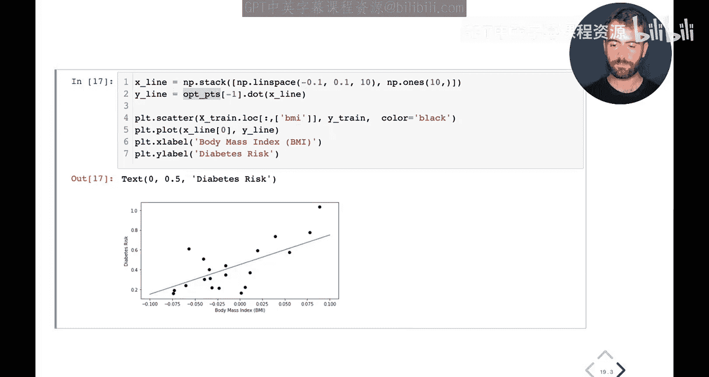