# 应用机器学习：3.2：梯度下降法 🧠

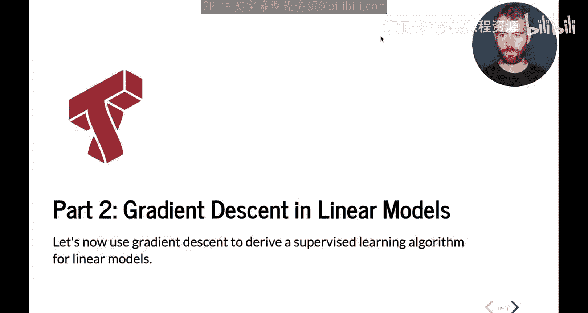

在本节课中，我们将学习如何使用梯度下降法来定义我们的第一个监督学习算法——线性模型。我们将从回顾梯度下降的基本原理开始，然后逐步构建一个完整的线性回归模型，并使用梯度下降法对其进行优化。最后，我们将在一个真实数据集上应用这个算法。

---

## 梯度下降法回顾 📉

上一节我们介绍了监督学习的基本框架。本节中，我们来看看如何利用梯度下降法来优化模型。

梯度下降法是一种迭代优化算法，用于最小化目标函数 **J**。其核心更新规则如下：

**公式：** `θ_i = θ_{i-1} - α * ∇J(θ_{i-1})`

为了应用此规则，我们首先对函数 **J** 的最小值进行一个初始猜测 **θ₀**。然后，我们根据上述规则反复更新对 **θ** 的猜测。规则中的关键元素是梯度 **∇J**。梯度乘以 -1 后，指向函数 **J** 在当前点 **θ_{i-1}** 处最陡峭的下降方向。通过沿此方向移动一个步长 **α**，我们更新对最小值的估计。如果步长 **α** 选择得当，新估计值 **θ_i** 处的函数值将小于前一次迭代的值。

以下是梯度下降法的一个简单伪代码实现：

```python
while J(θ_i) < J(θ_{i-1}):
    θ_i = θ_{i-1} - α * ∇J(θ_{i-1})
```

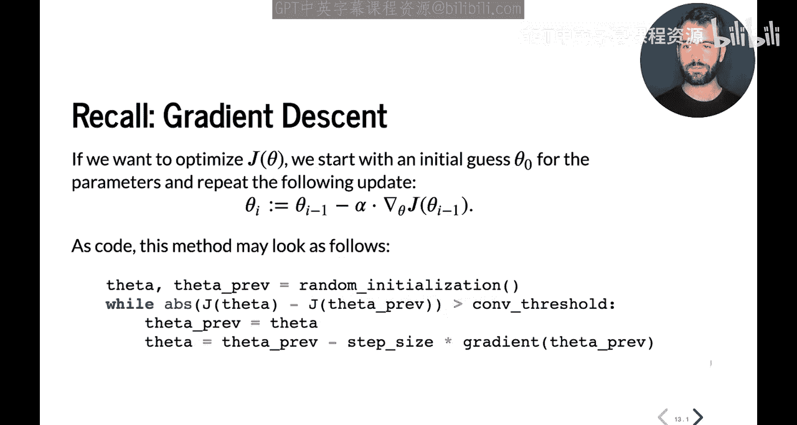

只要函数值在连续两次猜测之间持续减小，算法就会根据梯度下降更新规则继续优化。

---

## 定义学习算法 🧩

现在，我们利用梯度下降法来构建一个学习算法。定义一个学习算法需要三个部分：模型族、目标函数和优化器（此处即梯度下降法）。

### 模型族：线性模型

我们首先从模型族开始。对于此示例，我们将使用之前见过的简单线性模型族。

线性模型具有以下形式。我们假设目标 **y** 与输入 **x** 之间的关系是线性的，具体形式如下。我们取 **d** 维特征向量 **x** 的每个特征，并假设 **y** 是这些特征的加权和，权重由模型参数 **θ** 给出。

**公式：** `y ≈ θ₀ + θ₁*x₁ + θ₂*x₂ + ... + θ_d*x_d`

这是我们在监督学习开始时看到的第一个示例的扩展。当时我们看的是具有特定斜率和截距的直线模型，而此形式将其推广到了多维输入。我们仍然有一个截距 **θ₀**，但现在每个特征都有自己由 **θ** 参数给出的斜率。

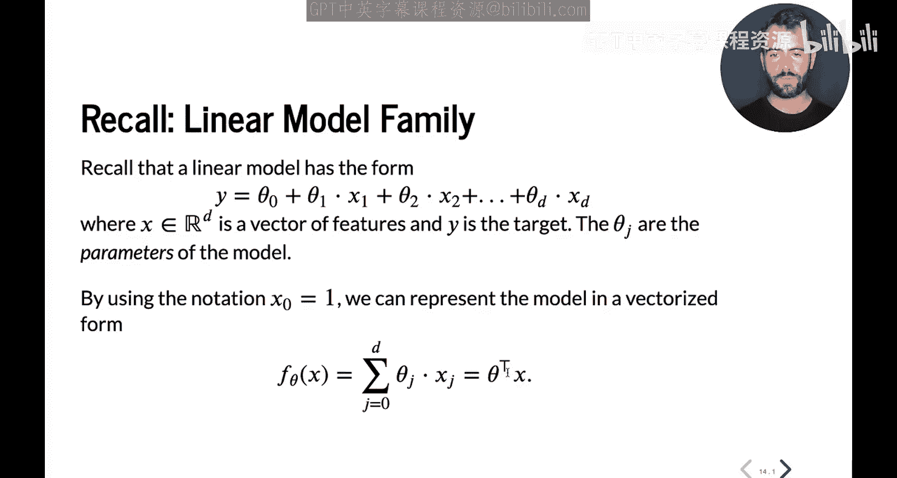

为了简化这个形式，我们可以给每个输入添加一个虚拟特征，其索引为 0。这个特征的特殊之处在于其值处处为 1。

**公式：** `x₀ = 1`，则模型可写为：`y ≈ Σ_{j=0}^{d} θ_j * x_j`

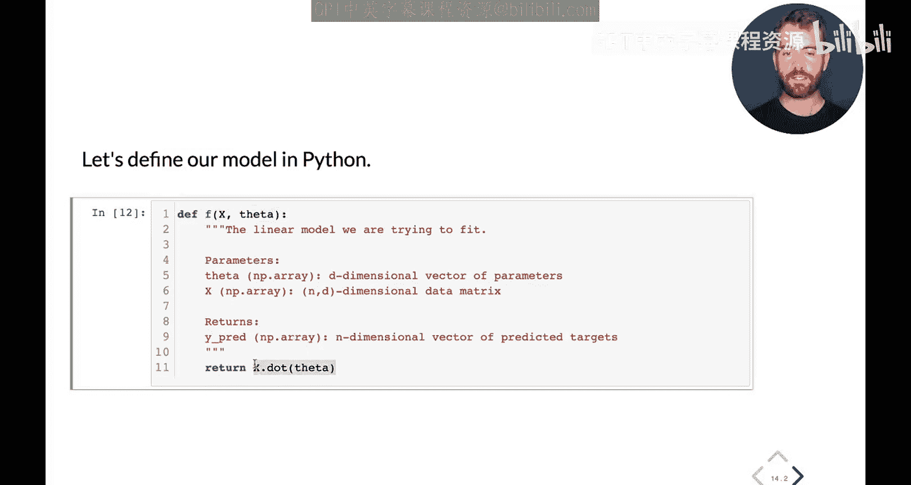

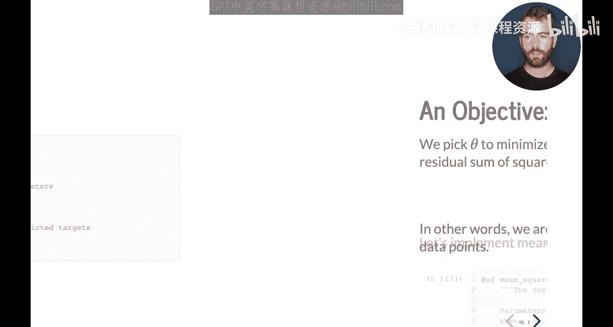

使用向量表示法，我们可以更紧凑地将其写为 **θ** 和 **x** 的点积（内积）。

**公式：** `f_θ(x) = θᵀ x`

这个函数不仅在数学上易于定义，在 Python 中也易于实现。

```python
def f_theta(x, theta):
    return np.dot(x, theta)
```

### 目标函数：均方误差

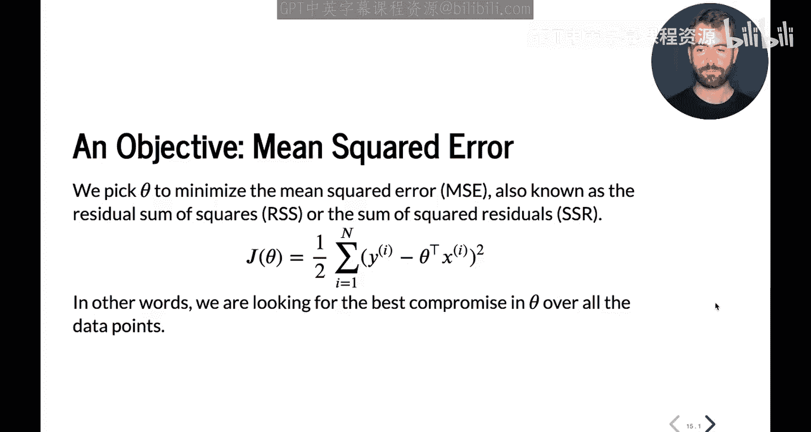

定义监督学习算法所需的剩余组件是目标函数。对于目标函数，我们将使用之前见过的均方误差。

回忆一下，均方误差是模型在数据集中每个训练样本上所做预测的误差平方的平均值（或总和）。我们查看线性模型预测的目标估计值 **f_θ(x)** 与实际目标值 **y** 之间的差异。如果这两个值彼此接近，则此目标函数或损失函数的值就小；如果模型预测值与我们认为它应该预测的值之间存在较大差异，则此值就大。

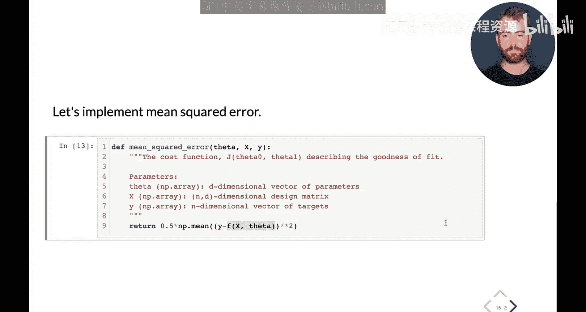

**公式：** `J(θ) = (1/2n) * Σ_{i=1}^{n} (f_θ(x⁽ⁱ⁾) - y⁽ⁱ⁾)²`

我们寻找能在整个数据集上实现最佳平均误差总和的 **θ**。

我们同样可以轻松地实现它。

```python
def mean_squared_error(theta, X, y):
    predictions = np.dot(X, theta)
    return np.mean((predictions - y) ** 2) / 2
```

### 计算梯度

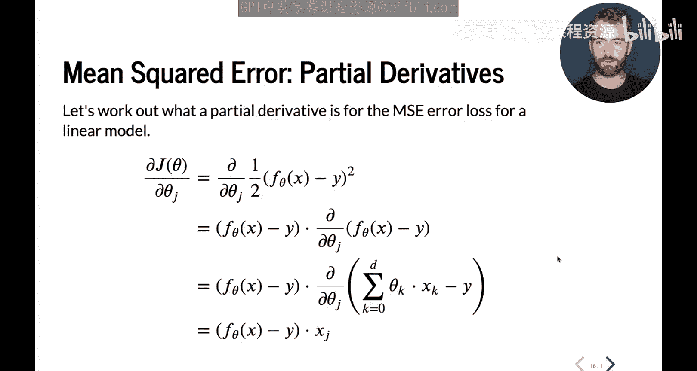

为了使用梯度下降法优化均方误差，我们需要获得其梯度的表达式。

函数的梯度是其偏导数的向量。因此，为了获得梯度，我们需要计算此目标函数相对于某个参数 **θ_j** 的偏导数形式。

幸运的是，这个表达式非常简单。由于这是一个二次函数，根据微积分法则，其偏导数具有以下特定形式。

**公式：** `∂J/∂θ_j = (1/n) * Σ_{i=1}^{n} (f_θ(x⁽ⁱ⁾) - y⁽ⁱ⁾) * x_j⁽ⁱ⁾`

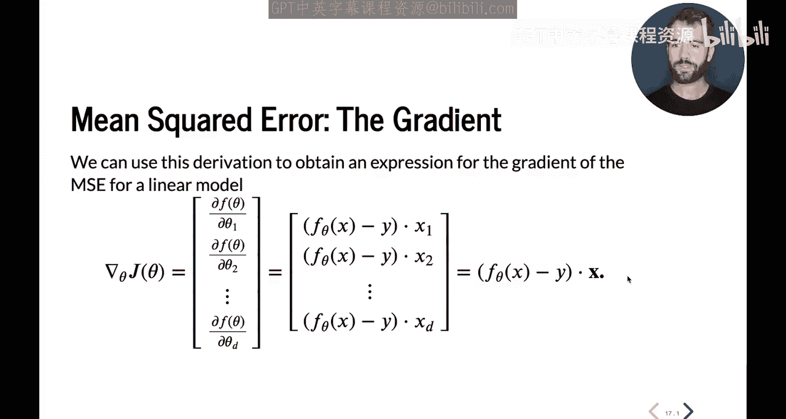

我们可以组合这些偏导数以获得梯度的表达式。

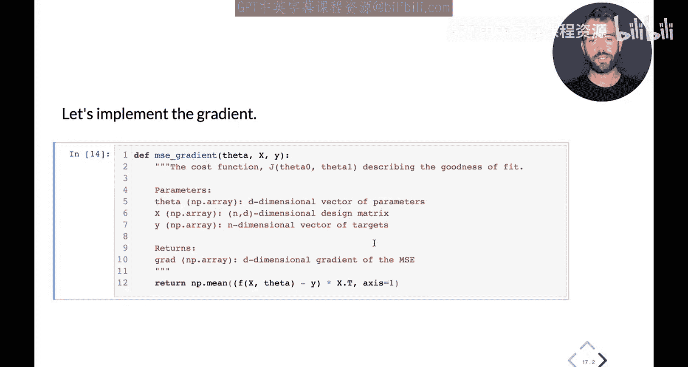

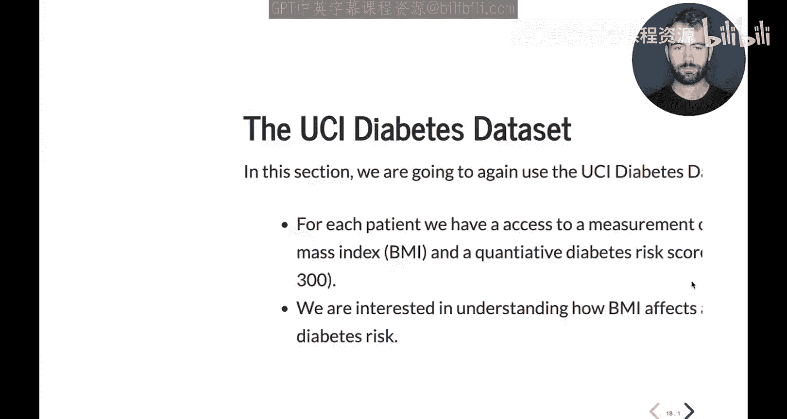

**公式：** `∇J(θ) = (1/n) * Xᵀ (Xθ - y)`

这是一个简单的表达式，在 NumPy 中，我们可以用一行代码定义它。

```python
def gradient(theta, X, y):
    n = len(y)
    predictions = np.dot(X, theta)
    return (1/n) * np.dot(X.T, predictions - y)
```

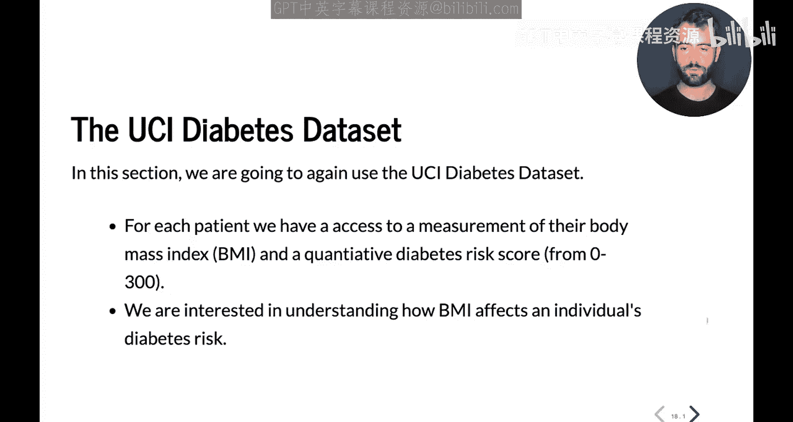

---

## 在真实数据集上应用 🏥

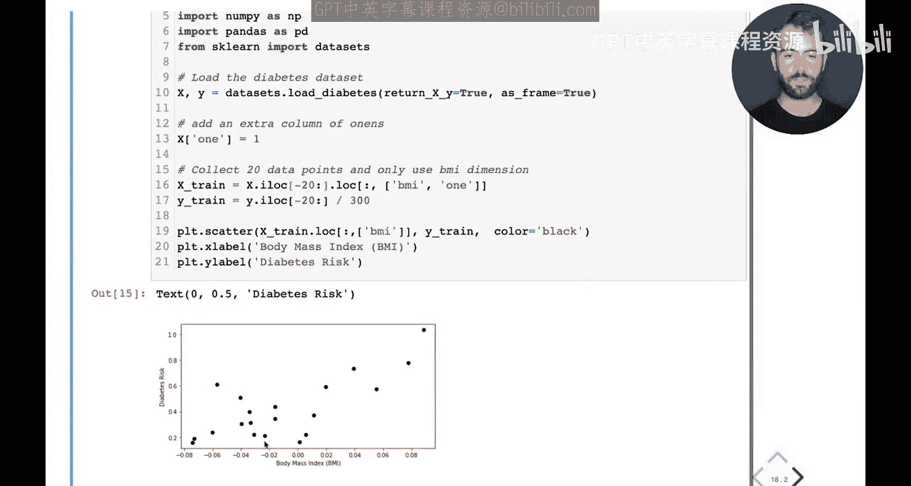

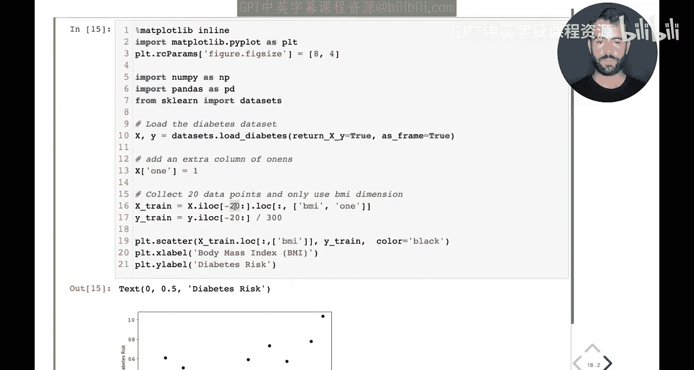

现在，让我们在线性模型上对一个真实数据集应用梯度下降法。我们将再次使用之前见过的糖尿病数据集。

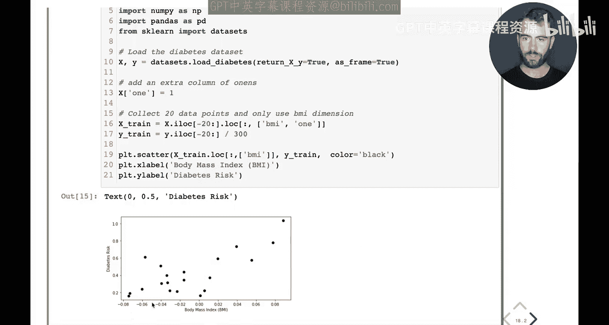

该数据集包含许多患者的数据，对于每位患者，我们有各种测量值。我们将使用的指标是身体质量指数。除了 BMI，我们还有他们的糖尿病风险评分，这是一个大致在 0 到 300 之间（或略高）的数字。我们有兴趣训练一个线性模型，根据一个人的 BMI 来预测其糖尿病风险。

以下是该数据集的散点图，包含了为此示例选择的 20 个数据点。可以看到数据点之间存在线性趋势，这意味着尝试拟合线性模型是合理的。

### 实现算法

梯度下降法反复应用前述更新规则。这里，我们用之前看到的梯度定义实例化了梯度下降法。我们只需将之前的梯度下降定义与梯度表达式结合即可。

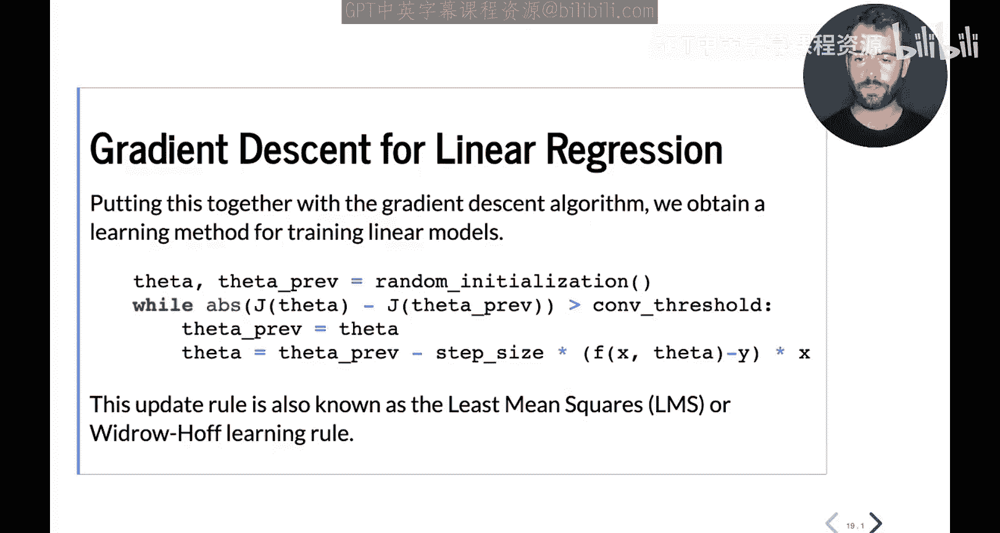

现在，我们有了一个完整的监督学习算法：我们指定了一个模型，指定了一个目标函数，并在此指定了如何使用优化算法（即梯度下降法）来获得此模型的最佳参数。该算法通常被称为最小二乘法或 Widrow-Hoff 学习规则，这是机器学习中一个非常简单但非常重要且具有实际意义的算法。

让我们现在实现这个算法。

```python
def gradient_descent(X, y, theta_init, alpha, max_iters):
    theta = theta_init
    for i in range(max_iters):
        grad = gradient(theta, X, y)
        theta = theta - alpha * grad
        # 可选：每100次迭代记录或打印损失值
        if i % 100 == 0:
            loss = mean_squared_error(theta, X, y)
            print(f"Iteration {i}: Loss = {loss}")
    return theta
```

当我们运行此优化过程时，随着迭代次数增加，目标函数的值不断下降，直到大致稳定在某个值。

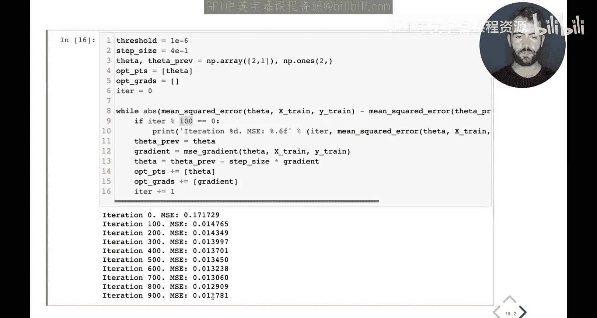

现在，我们可以可视化这个函数，它看起来像下面这条线。我们取优化序列中的最后一个点（即最终参数集），并用它来计算估计值——本质上是绘制由优化过程最后一组参数指定的直线。图中显示的蓝色直线确实是对我们数据集的拟合，它大致匹配了我们之前看到的线性趋势。

至此，我们已成功使用梯度下降法将监督学习应用于此问题，优化了一个线性模型，并获得了我们的第一个监督学习算法。

---

## 总结 ✨

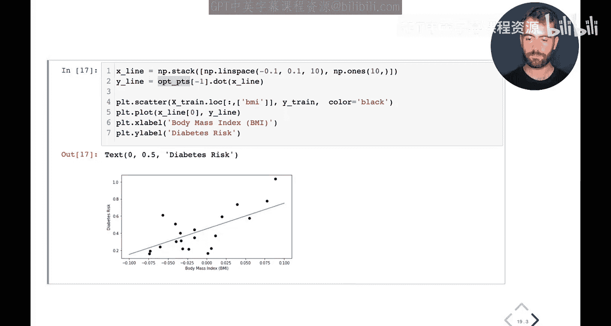

本节课中，我们一起学习了如何将梯度下降法应用于线性回归模型，从而构建一个完整的监督学习算法。我们回顾了梯度下降的原理，定义了线性模型和均方误差目标函数，推导并计算了梯度，最后在一个真实的糖尿病数据集上实现了算法并进行了可视化验证。在接下来的课程中，我们将探讨这种方法的扩展，并了解使用优化算法拟合线性模型的其他几种方式。