# 康奈尔大学《应用机器学习 CS 5787_ Applied Machine Learning 2020》中英字幕（deepseek p10 -10-Lecture 3. Part 3_ Ordinary Least Squares.zh_en -BV12udzYvEFM_p10-

Welcome back to Appli machine learning。We have just seen our first supervised learning algorithm。

 which was a linear model learned using gradient descent。In the next video。

 I want to look at a different way in which we can fit a linear model。In practice。

 the green and thecent approach that we just saw is not the best way that we have in order to find and optimize of the parameters of a linear model in this video we are going to see a more practical approach which is based on an approach called the normal equations and this will give us our first nontoy supervised learning algorithm。

 which is called ordinaryary least squares。

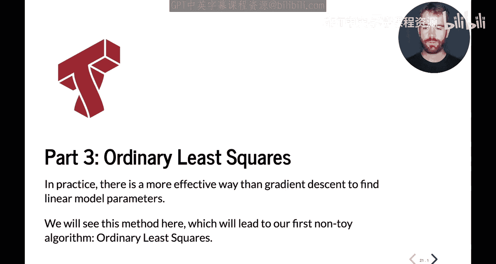

To start recall the definition of the gradient， which is an important tool from calculus and optimization that we have used in order to define our first optimization algorithm called gradient descent。

Essentially， the gradient denoted in this form is the vector of partial derivatives of the function f at the point theta0。

And the gradient can be seen as giving the direction。

 or it can be used to obtain the direction of steepest descent for function。

 and by following this direction of steepest descent， we can iteratively minimize the function。

In this video， we will see a new application of gradient descent that is going to give us an even better algorithm that will be faster in many applications。

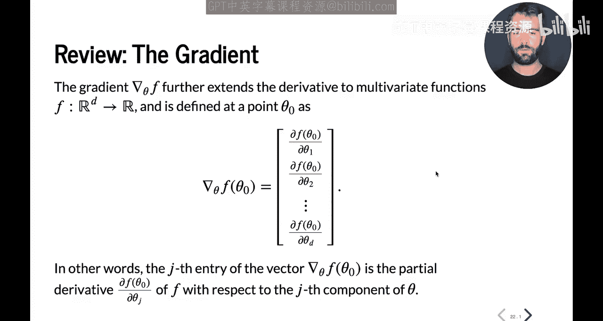

As in the earlier videos， we are going to be using the UCI diabetes data status or demo。

 recall that the diabetes data set is the set of patients for which we have a set of measurements such as the body mass index。

 and we have a quantitative risk score， the score for diabetes risk。

 and our goal is to predict diabetes risk from an individual's measurements such as BMI。

Here I have again loaded 25 points from this data set and I'm visualizing in two dimensions the relationship between body mass index and diabetes risk。

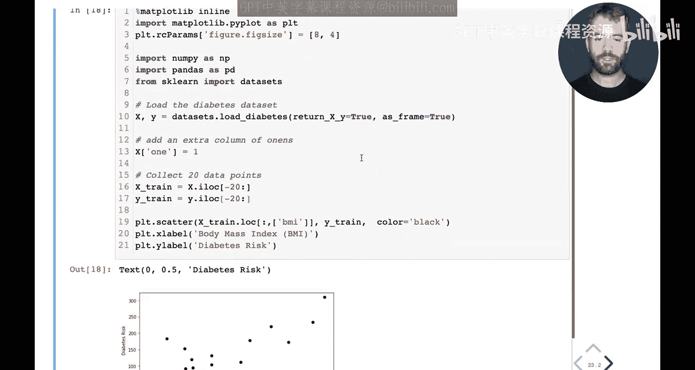

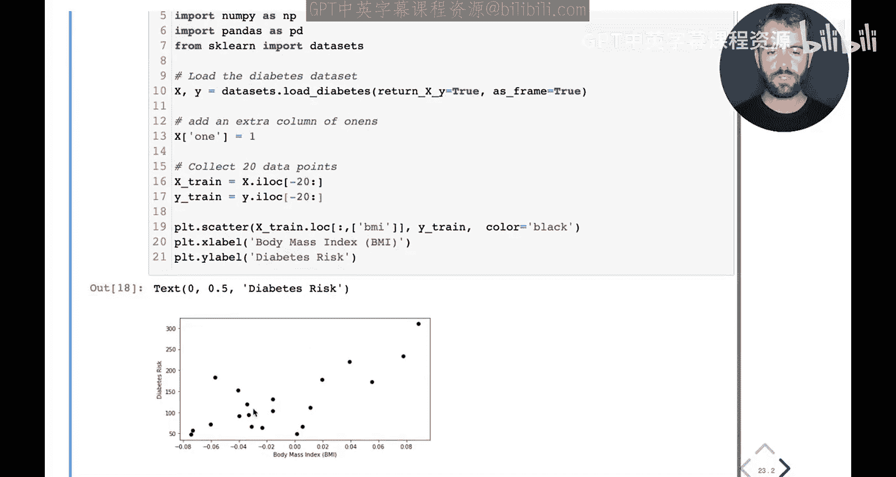

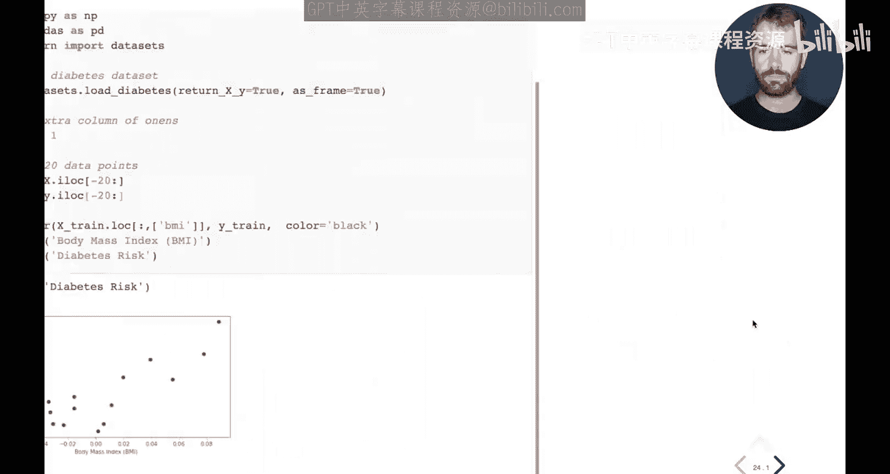

In order to define this new algorithm， which is going to be ordin least squares。

 I first want to start with some notation。The first set of notation that I want to introduce is something that is called the design matrix。

The design matrix is essentially just a convenient way of representing our training data set。

We know that each of our training instances， each of our training examples has an input X。

Which is a D dimensionsional vector。The design matrix is simply the concatenation of all of these。

Vectctorors along a second dimension。Here is the definition of the design matrix。

 and you can see that it's nothing more than the input vectors being put in a row form and stacked one on top of the other。

In other words， x is a matrix of dimension n by D， where n is the size of our data set and D is our dimension and the entry。

 the row of this matrix corresponds to the I。Input object to the I vector features and the column and column J corresponds to feature J。

 So in the cell IJ of this matrix or I guess in the here in this example in row 2 column2。

 we have the second。Dension of the second dimension of the second input vector。

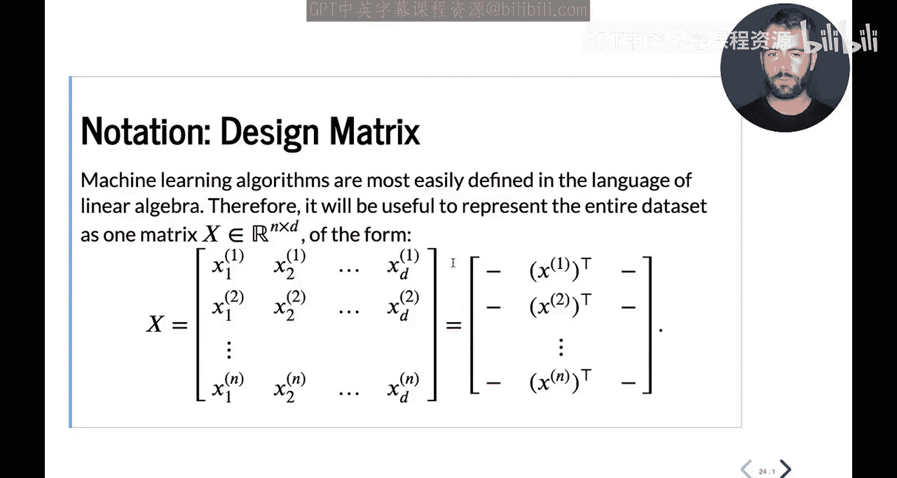

We can obtain easily the diabetes matrix for the diabetes data set， in fact。

 the data set already comes in the form of this matrix and this is what it looks like。

 these are the first five entries in this matrix and you can see here that each row corresponds to a patient and each columnant corresponds to a different feature or attribute。

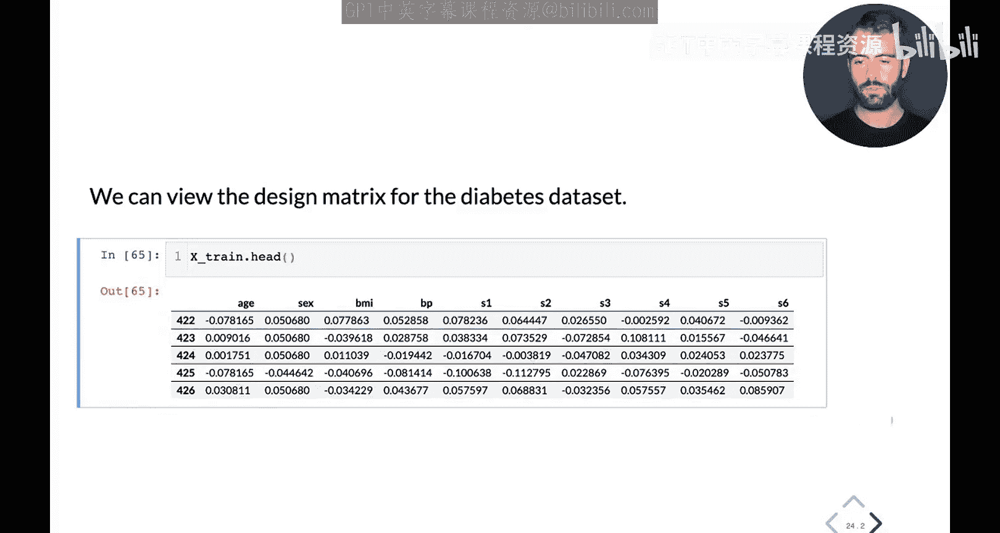

Another part of this notation that I want to introduce is also the following vector。

 which is simply the concatenation of all the targets。That we have in our data。

 we have simply placed them in a single column vector here。

 so we just stacked all the targets that we have。 the n targets in our data are placed here in a column and now they become a vector。

 This is another piece of notation that I want to introduce。Now， using these two bits of notation。

 I am going to define。

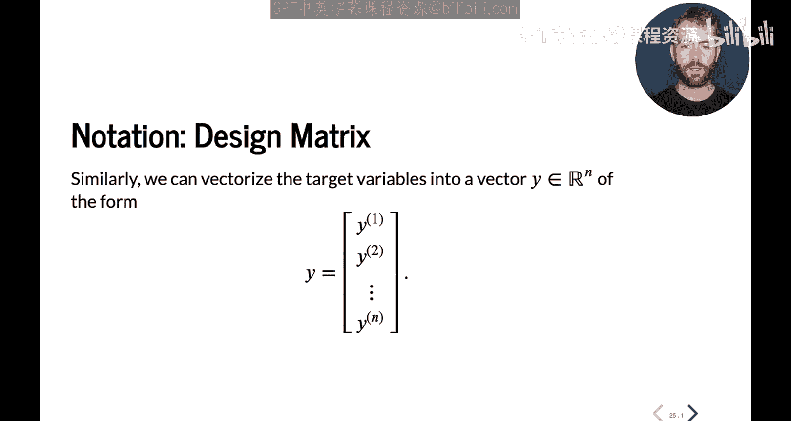

These are going to be really crucial to define our algorithm。

This algorithm that I'm going to introduce will also be optimizing the mean squared error。

Recall that the mean squared error is simply the square difference between the true target for any given example and the target that is predicted by our machine learning model。

So in other words， we are looking for a of parameters theta， which on average， explain the data well。

We have already seen this form， but we can now use our。

 we can use an annotation that we just introduced to write it in a more complicated in a more。

In a more compact form that uses matrix notation。So our objective here here it says our assess the residual sum of squares。

 which is just another name for the mean squared error， we can write it as follows。

You can convince yourself that this notation here is equivalent to the notation that we have here。

 essentially each。Essentially what we are doing here is we are multiplying our design matrix by the vector of features which produces another vector whose with n with n rows or with n components it's just a vector and the result of multiplying basically the Ih component of this vector will simply equal this dot product。

 this is just a definition of a matrix vector。Definite the definition of matrix vector multiplication。

And now we're going to have the vector of y's， the vector of these components。

 and so the subtraction of these two vectors is going to be another vector of dimension n whose Ih component will equal exactly this term that's within the parentheses。

And now in order to obtain this equation， we can simply apply the dot product of these two vectors。

And by the definition of the dot product， this will equal exactly this expression， so in other words。

 here havewritten we have rewritten the mean squared error in this particular form。

 which is simply a dot product between two vectors that perform the same abras。

 but we're just writing this using a more compact matrix notnotation。And finally。

 another way of writing the same expression involves the following notation。

 this is these two bars here， they describe what is called the Euclidean norm and the Euclidean norm is simply one way of measuring the distance between two vectors and the definition of the Euclidean norm is just the dot product between these。

Of the squared Euclidean norm is the dot product these two extras here we have just applied the definition of the Euclidean norm。

 these are two equivalent ways of writing the same thing which you may see in different machine learning textbooks and they are hair equivalent。

So in this slide， what we did is we rewrote the mean squared error in this vectorized form。

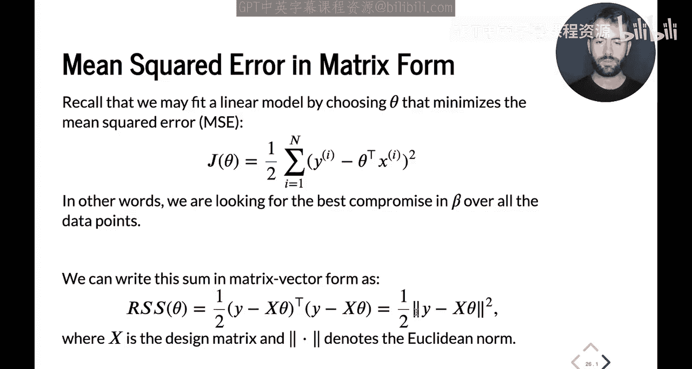

Now that we have written it in this vectorized form。

We can use a little bit of algebra to derive a gradient for this objective。Now。

 recall that our mean squared error objective has the following form。

And so now we are interested in computing the gradient of this expression。So again。

 this will be the gradient of the entire mean squared error for the entire data set。

In these few lines we do a few simple algebraic derivations here in the first line。

 we are simply multiplying each term on this side， but with each term on this side。

 so x theta essentially this dark product equals the dark product of x theta with x theta of x theta with y。

 y with x theta and y and y here this is just really simple algebra。Now。

 since we're taking a derivative and this term is constant。

 we can remove it and we can also see that these two terms are the same here we're using the property that a transpose B equals B transpose a to merge these two terms into this term multiplied by 2。

And now we want to obtain the gradient of this expression。Which is， again， this is a。

This is this number here is a scalar， but it's a function of the set of parameters data and we can apply the rules of matrix derivatives to obtain an expression for this vector so we are going to use two rules from matrix calculus the first one is that the gradient of b transpose x it just equals B you can easily verify this by just working out the partial derivatives of this equations and seeing that each partial derivative the partial derivative with respect to x sub I will just equal p sub I hence this holds and similarly really similar exercise can be used to show that the gradient of an expression of this form equals this and again this can be easily shown by writing out explicitly matrix the partial derivatives and so applying these two identities。

In this line， we obtain the following line。And then we just the two cancel out。

 and we have the following expression for the gradient of the mean squared error in a vectorized form。

All right， so so far we have done a lot of matrix manipulations to obtain this gradient。

Now we can use this gradient in several ways。 we could use it to perform gradient descent。

 but instead we are going to use it in a different way now。

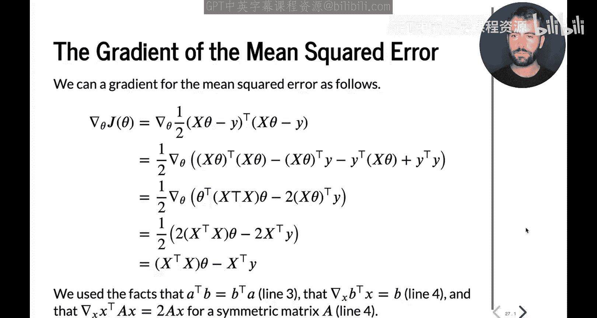

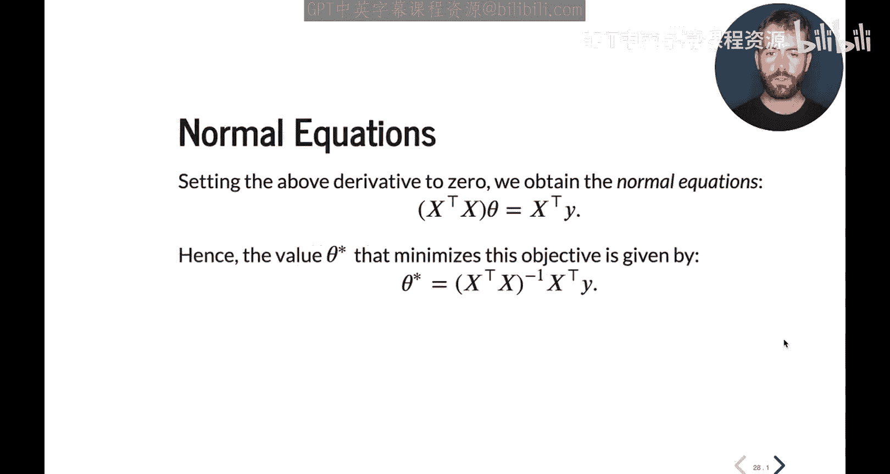

You know from basic calculus that at the minimum of a function。

 the gradient takes or the derivative takes the value 0。

We've seen a simple example of this in the first video of this lecture where we plotted a few derivatives for the one dimensionsal quadratic function that was a simple example。

 but more generally for a multidimensional function in a way that's really similar to that early example。

The gradient at the minimum of the function equals 0。 so this green here would equal 0。

 hence at the minimum of this quadratic function， this expression this expression here would equal 0。

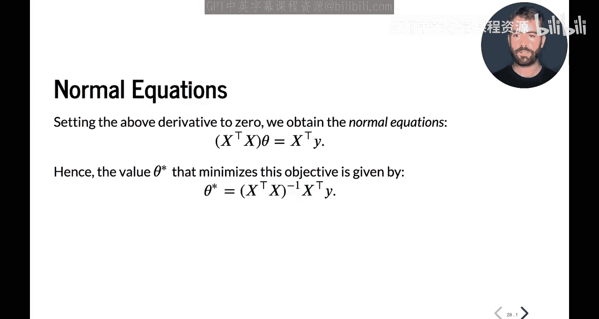

And furthermore， because J is a quadratic function here。

We know that this is it's a simple fact of corographictic functions in that they only have one minimum and so if we can solve the equation0 equals this。

 if we can solve this for theta，Then we can obtain a closed form expression for the minimum of this objective function。

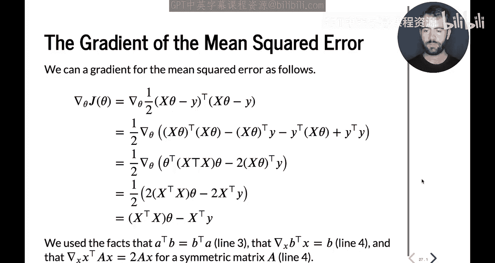

In other words， what we do here is we set the following term to0 and now rearranging terms。

 we obtain the following equation， which is called the normal equation。

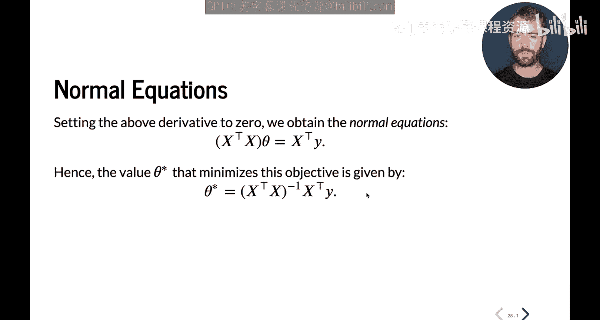

Now since this is since both the left hand side and the right hand side are vectors。

 they define actually a set of linear equations， hence they're called normal equations in plural。

So the theta that satisfies these equations has to be the minimum of the objective function that we're minimizing。

 this has to be the theta that minimizes the mean squared error。

And we can solve for this theta by simply multiplying on both sides of the equation by the inverse of the matrix x transpose x。

And now doing this， we obtain a closed form expression for theta star。

 which is the minimum of the mean squared error。So using all the derivations that you have seen。

 we have obtained a simple form for the minimizer of the mean squared error。

 and it is simply a product of a few transformations of our design matrix that we have defined earlier。

I want to add just one additional note in order for this to work， this matrix here。

 x transpose x has to be inverable。It will often be the case。

 most often in applications this will be the case， and when it is not the case there are simple ways of addressing these issues。

 this issue， and we will see one example， we will see one way of doing this in the next few lectures。

All right， so here we have defined the normal equations and their solution。

Let's now look at how we can implement this in practice。

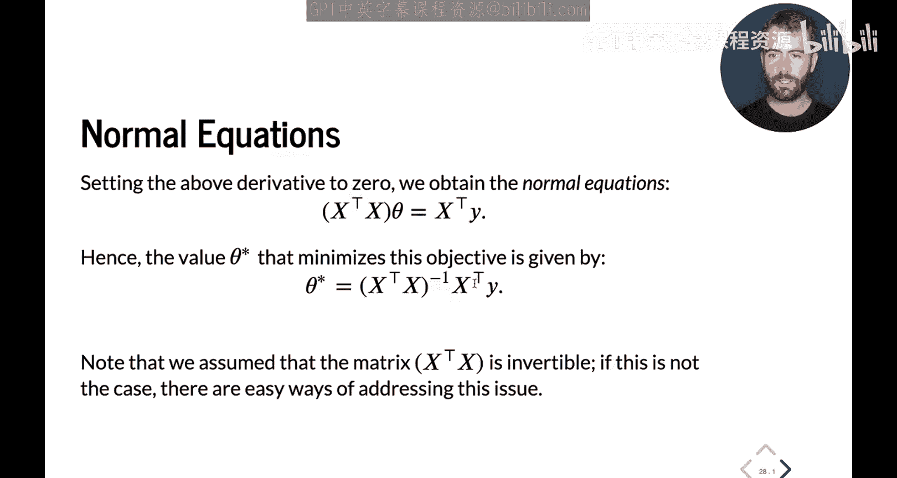

We can apply the normal equations very easily to our UCI data set using NI and in fact it's just one line of NmpI。

 so here I have an expression for theta star， which I'm calling here theta best and this is simply the implementation of the normal equations in one line of Python。

So running this equation， we obtain a value for theta best and now with a little bit of bands in order to make it prettier on the screen。

 I have am' displaying the values that it's assigning to these different parameters。

So these are the values that the star assigns to to each one of our terms here。And now， using this。

Using this。Using this new set of parameter data best， we can make some predictions。

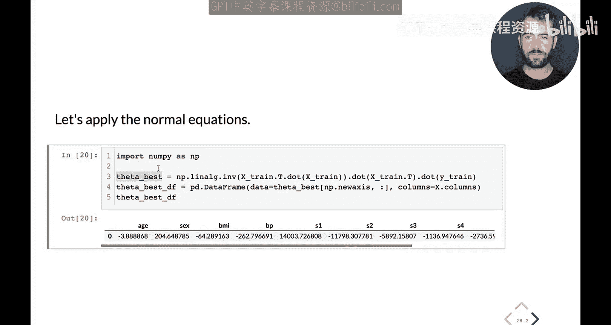

So here I am going to load again three data points that are distinct from our training set。

And these are the same three data points that we used in our earlier examples。

And I'm going to generate predictions for these new data points using our new set of parameters data best by simply multiplying these also form a design matrix with with three inputs and again I can just do the dot product to obtain predictions for these training examples。

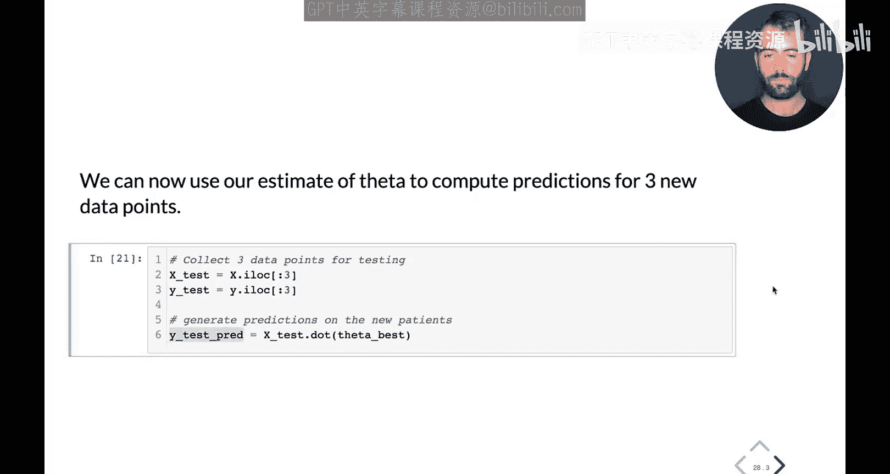

And now I can visualize both the data and our three data points here。

And you can see that the predictions here are which are given by the Red Cross are indeed very close to the actual true values。

 which are the red dots。So now here with。Only a few lines of Python and Nmpy。

 we have implemented a real algorithm called which is called Or Le squares。

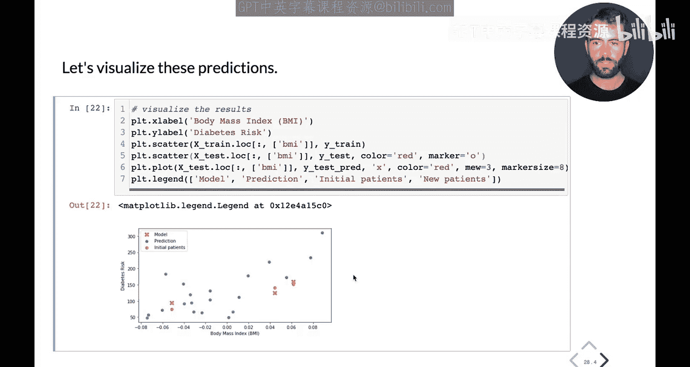

And this is going to be our first non toy supervised learning algorithm。In practice。

 this is often preferable to the gradient des set approach since it doesn't really require any tuning of parameters such as the learning rate。

 and in practice it just requires solving a set of linear equations for which there are many effective linear algebra algorithms and really efficient implementations that we can use。

And so when you run the linear regression model or the linear regression object in the psychic learn that linear model library behind the scenes it uses。

 it implements the few lines of numpy that I just showed you。

And so now this slide summarizes what is the ordinarily squares algorithm。

It uses the thenotation that we have seen earlier。So ordinarily squares is a supervised learning algorithm。

 and specifically it is aimed at regression problems or why is continuous in practice we could apply it for classification but we will see much better approaches later on。

ItIt finds parameters within the set of linear models。

 and it chooses parameters which minimize the mean squared error。

And it does so by using the solution to the normal equations to obtain the parameters which optimize this mean squared here。

 so the optimizer here is a solver for normal equations。So this here is our first nontoy algorithm。

 and we will soon see ways of using this algorithm to derive even more interesting and more sophisticated algorithms。

 both in this lecture and in later lectures as well。

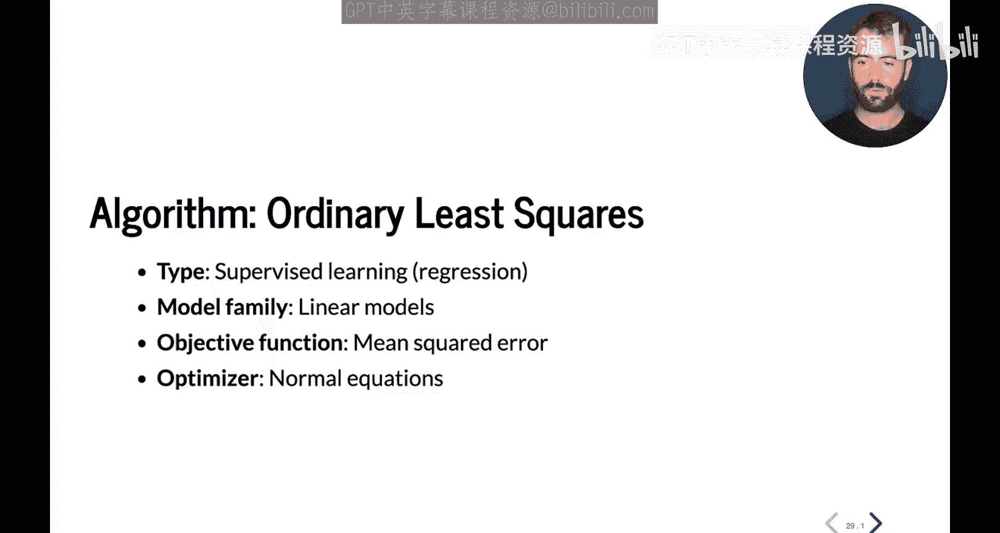