# 应用机器学习：第3讲第3部分：普通最小二乘法 📊

在本节课中，我们将学习一种新的线性模型拟合方法——普通最小二乘法。这是一种比梯度下降更实用的方法，通过求解正规方程来直接找到最优参数。

## 概述

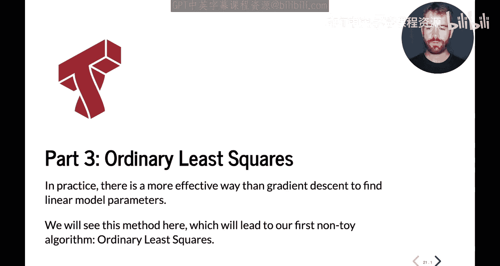

上一节我们介绍了使用梯度下降法学习线性模型。本节中，我们将探讨一种更高效的方法——普通最小二乘法。这种方法通过求解一组线性方程（正规方程）来直接找到最小化均方误差的参数，无需迭代调整学习率。

## 设计矩阵与向量化表示

为了定义普通最小二乘法算法，我们首先需要引入一些新的数学符号。

### 设计矩阵

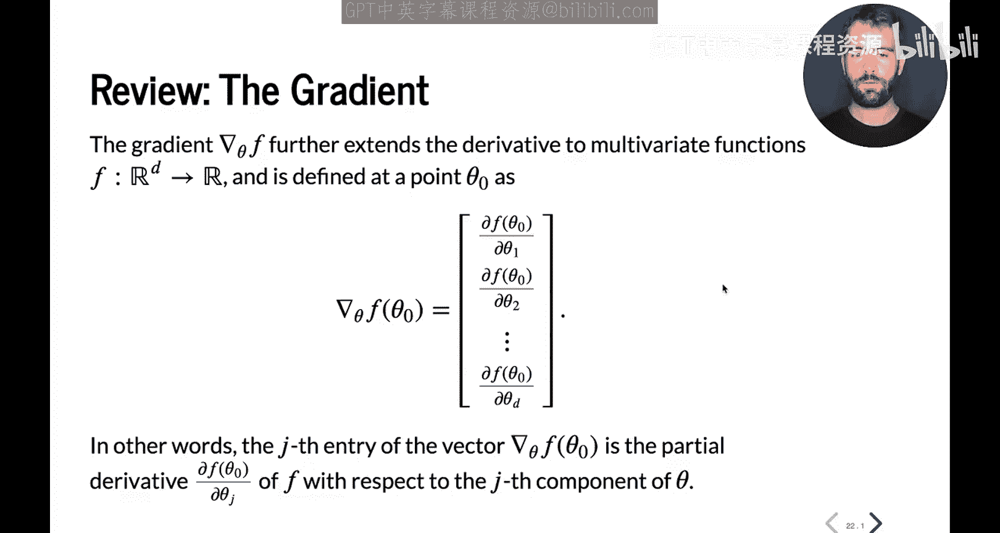

设计矩阵是一种方便表示训练数据集的方式。每个训练样本的输入是一个D维向量，设计矩阵就是将所有样本的输入向量按行堆叠起来。

**设计矩阵的定义**：
设我们有n个训练样本，每个样本的输入特征为D维向量。设计矩阵X是一个n×D的矩阵，其中第i行对应第i个样本的特征向量。

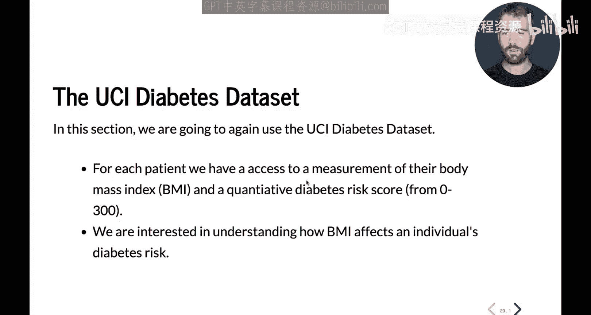

**代码表示**：
```python
# X 是一个 n x D 的矩阵
# 每一行是一个样本的特征向量
X = np.array([
    [x_1^1, x_1^2, ..., x_1^D],
    [x_2^1, x_2^2, ..., x_2^D],
    ...,
    [x_n^1, x_n^2, ..., x_n^D]
])
```

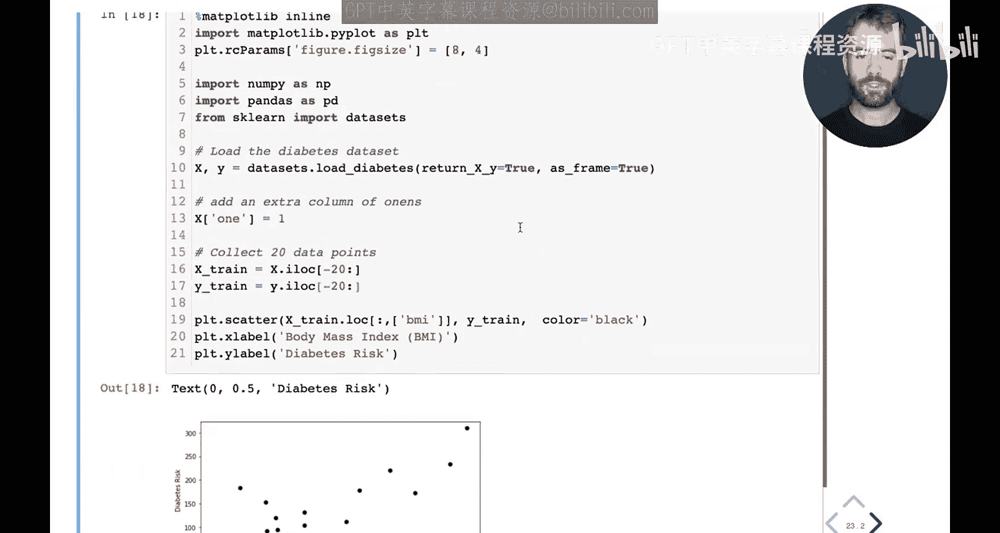

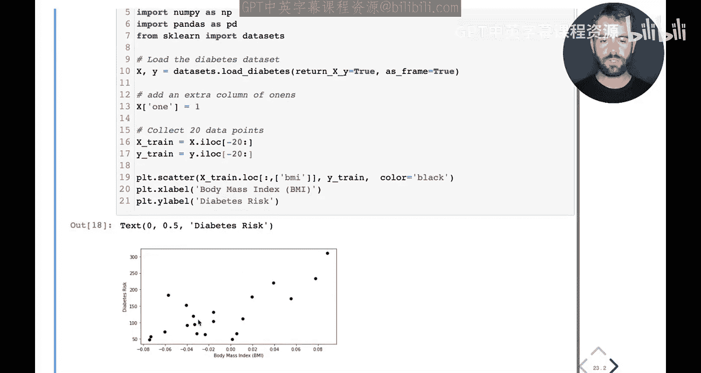

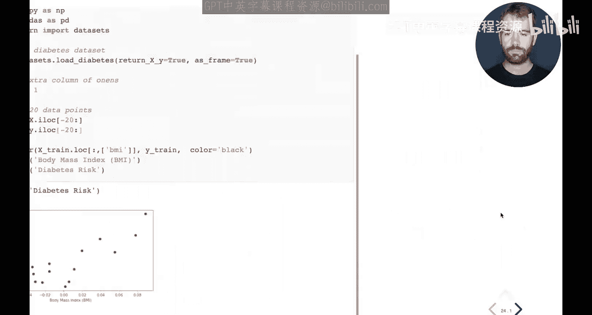

### 目标向量

类似地，我们将所有训练样本的目标值（标签）堆叠成一个列向量。

**目标向量的定义**：
y是一个n维列向量，其中第i个元素是第i个样本的目标值。

**代码表示**：
```python
# y 是一个 n 维列向量
y = np.array([y_1, y_2, ..., y_n])
```

## 均方误差的向量化表示

现在，我们可以使用矩阵表示法来重写均方误差（MSE）目标函数。

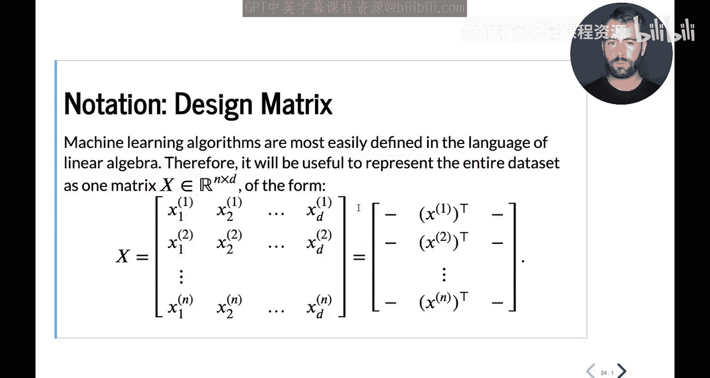

**均方误差的原始定义**：
均方误差是预测值与真实值之间平方差的平均值。

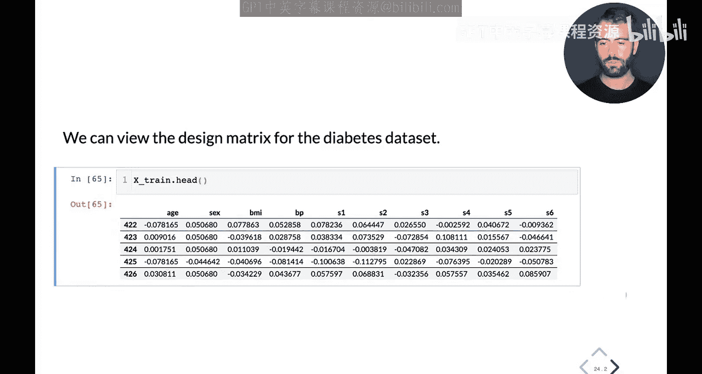

**向量化表示**：
使用设计矩阵和目标向量，我们可以将均方误差写成更紧凑的形式：

**公式**：
```
J(θ) = (1/n) * ||Xθ - y||²
```

其中：
- X是设计矩阵（n×D）
- θ是参数向量（D×1）
- y是目标向量（n×1）
- ||·||表示欧几里得范数（向量的长度）

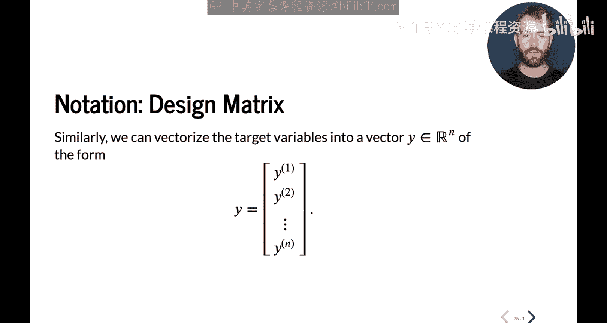

这种表示等价于原始的均方误差定义，但使用了更简洁的矩阵运算。

## 推导梯度并求解最优参数

有了均方误差的向量化表示，我们可以推导其梯度表达式。

### 梯度推导

通过矩阵微积分运算，我们可以得到均方误差关于参数θ的梯度：

**公式**：
```
∇J(θ) = (2/n) * Xᵀ(Xθ - y)
```

这个梯度表达式告诉我们目标函数在任意参数点θ处的变化方向。

### 利用梯度为零的条件

在函数的最小值点，梯度必须为零。由于均方误差是二次函数，它只有一个最小值点。

**设置梯度为零**：
```
0 = (2/n) * Xᵀ(Xθ - y)
```

**简化后得到正规方程**：
```
XᵀXθ = Xᵀy
```

### 求解正规方程

正规方程是一组线性方程，我们可以直接求解参数θ：

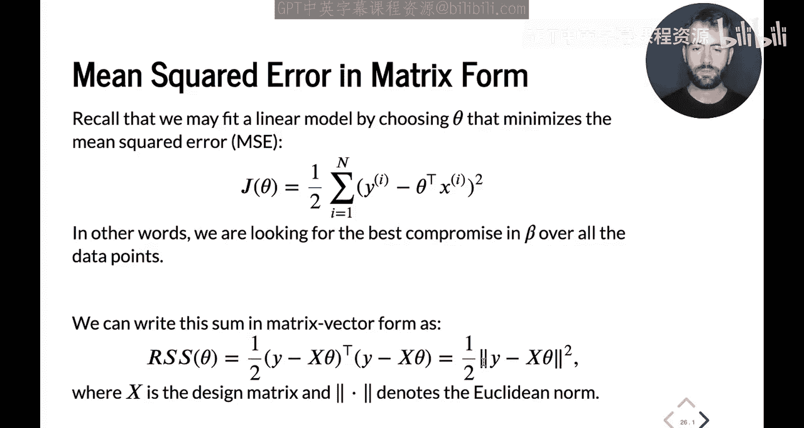

**最优参数的闭式解**：
```
θ* = (XᵀX)⁻¹Xᵀy
```

这个公式给出了最小化均方误差的最优参数。需要注意的是，矩阵XᵀX必须是可逆的，这在大多数实际应用中都能满足。

## 在糖尿病数据集上的应用

让我们将普通最小二乘法应用于UCI糖尿病数据集，该数据集包含患者的身体测量指标（如BMI）和糖尿病风险评分。

### 数据准备

以下是加载和准备数据的步骤：

**代码示例**：
```python
import numpy as np

# 加载糖尿病数据集（示例）
# X_train: 训练特征矩阵 (n_samples x n_features)
# y_train: 训练目标向量 (n_samples,)

# 添加偏置项（截距）
X_train_bias = np.c_[np.ones((X_train.shape[0], 1)), X_train]
```

### 应用普通最小二乘法

使用推导出的公式计算最优参数：

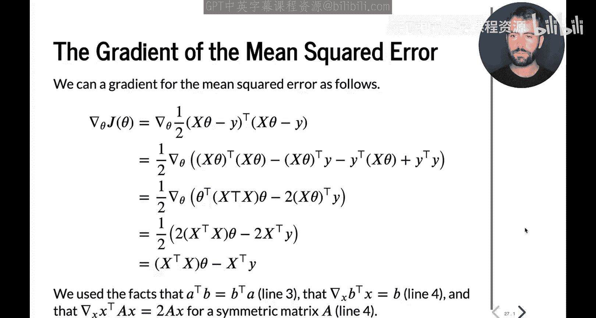

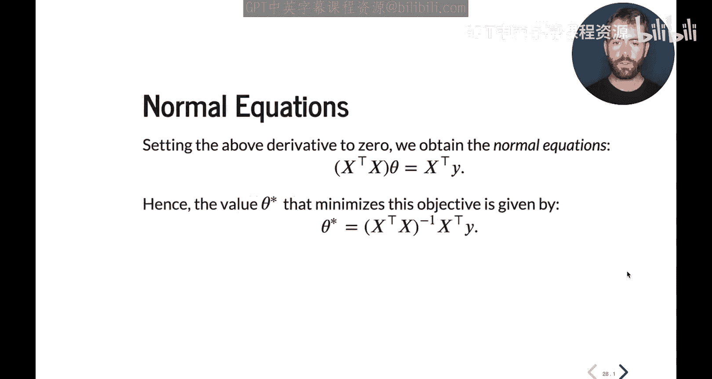

**代码实现**：
```python
# 计算最优参数
theta_best = np.linalg.inv(X_train_bias.T @ X_train_bias) @ X_train_bias.T @ y_train
```

### 进行预测

使用学习到的参数对新样本进行预测：

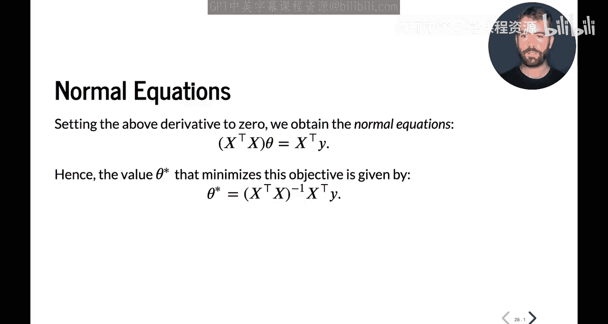

**预测代码**：
```python
# 对新数据点进行预测
X_new_bias = np.c_[np.ones((X_new.shape[0], 1)), X_new]
y_pred = X_new_bias @ theta_best
```

## 算法总结

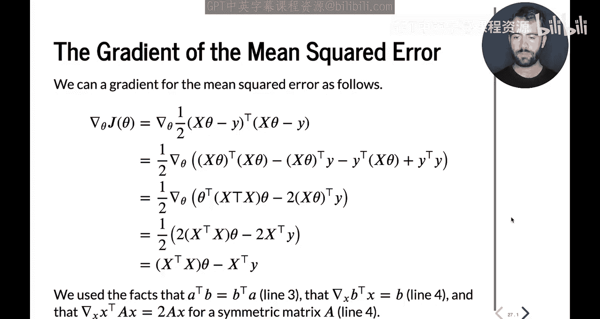

以下是普通最小二乘法算法的关键点总结：

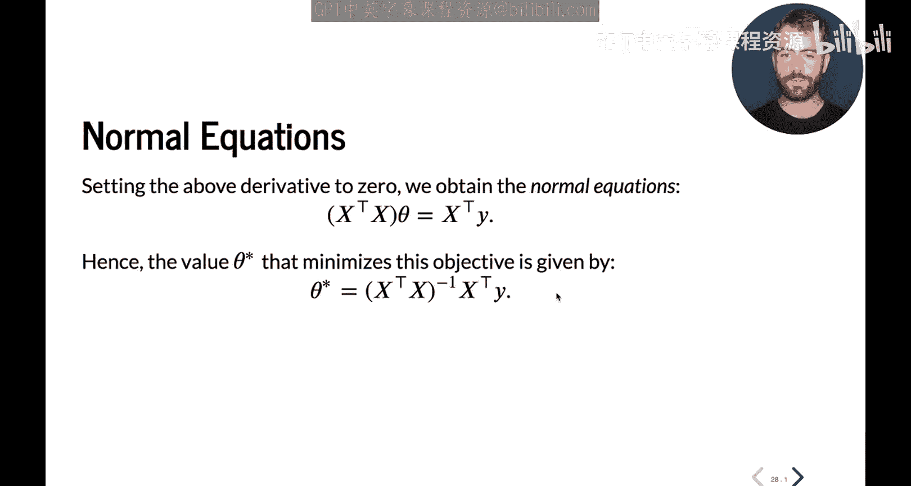


**算法特性**：
- **类型**：监督学习算法
- **适用问题**：回归问题（目标变量连续）
- **模型类型**：线性模型
- **优化目标**：最小化均方误差
- **优化方法**：求解正规方程

**优点**：
1. 无需调整学习率等超参数
2. 计算效率高（直接求解线性方程组）
3. 有闭式解，保证找到全局最优

**局限性**：
1. 需要计算矩阵逆，当特征维度很高时计算成本高
2. 要求XᵀX矩阵可逆
3. 对异常值敏感

## 与梯度下降法的比较

以下是两种方法的对比：

**计算复杂度**：
- 普通最小二乘法：O(D³)，其中D是特征数量
- 梯度下降法：O(k·D)，其中k是迭代次数

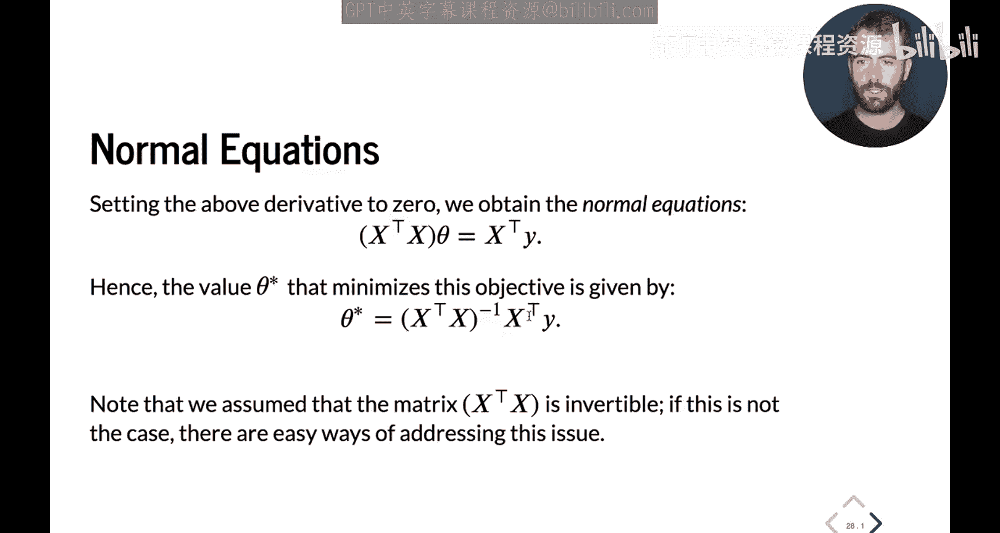

**适用场景**：
- 当特征数量较少（D < 10000）时，普通最小二乘法通常更快
- 当特征数量非常大时，梯度下降法可能更合适
- 当数据无法完全装入内存时，需要使用随机梯度下降等变体

## 实际应用注意事项

在实际应用普通最小二乘法时，需要考虑以下问题：

### 处理不可逆矩阵

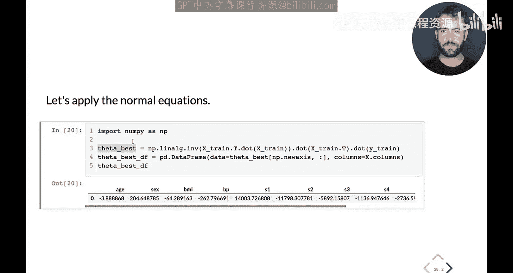

如果XᵀX不可逆，可以采取以下措施：

**解决方案**：
1. 检查特征之间是否存在多重共线性
2. 使用正则化（如岭回归）
3. 使用伪逆代替逆矩阵

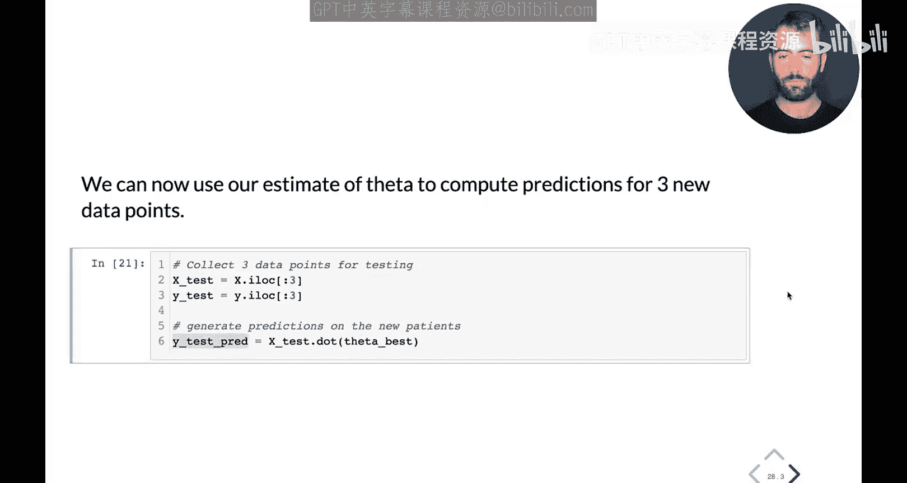

**代码示例**：
```python
# 使用伪逆处理不可逆情况
theta_best = np.linalg.pinv(X_train_bias.T @ X_train_bias) @ X_train_bias.T @ y_train
```

### 数值稳定性

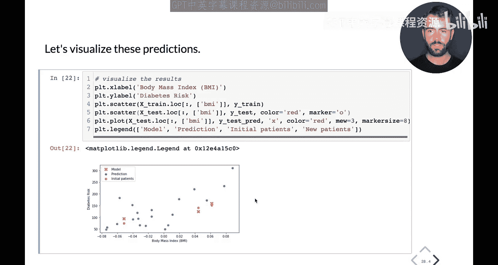

为了提高数值稳定性，建议：

**最佳实践**：
1. 对特征进行标准化
2. 使用QR分解等数值稳定的方法求解
3. 添加小的正则化项确保矩阵可逆

## 总结

本节课中我们一起学习了普通最小二乘法——我们的第一个非玩具监督学习算法。我们：

1. **引入了设计矩阵和目标向量**的表示法，使数学表达更简洁
2. **推导了均方误差的向量化形式**，便于矩阵运算
3. **计算了梯度并设置其为零**，得到了正规方程
4. **求解正规方程**得到了参数的最优闭式解
5. **在糖尿病数据集上实现了算法**并进行了预测
6. **分析了算法的优缺点**及其与梯度下降法的比较

普通最小二乘法是线性回归的基础，也是许多更复杂算法的起点。在后续课程中，我们将以此为基础，探讨正则化、非线性扩展等更高级的主题。

**关键公式回顾**：
- 设计矩阵：X ∈ ℝⁿˣᵈ
- 目标向量：y ∈ ℝⁿ
- 均方误差：J(θ) = (1/n)||Xθ - y||²
- 最优参数：θ* = (XᵀX)⁻¹Xᵀy

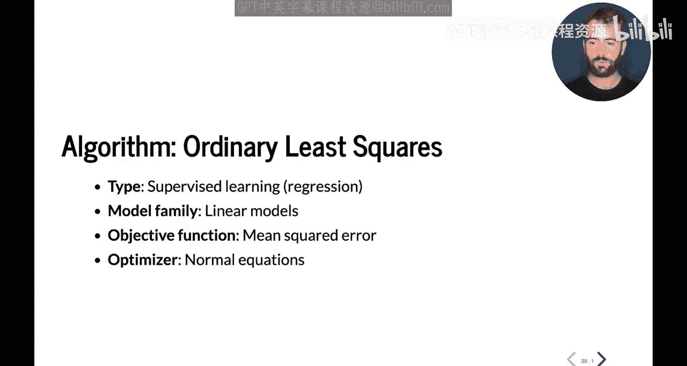

这个算法在实际中被广泛使用，例如scikit-learn中的线性回归模型在背后就实现了这些计算。掌握普通最小二乘法为我们理解更复杂的机器学习算法奠定了坚实基础。