# 康奈尔大学《应用机器学习 CS 5787_ Applied Machine Learning 2020》中英字幕（deepseek p11 -11-Lecture 3. Part 4_ Non-Linear Least Squares.zh_en -BV12udzYvEFM_p11-

Hi， this is the fourth and last part of lecture three of applied machine learning。So far。

 we have used gradient descent to derive two supervised learning algorithms， including one。

 which is a real non toy supervised algorithm that is widely used in practice。In this video。

 let's now look at some extensions of this algorithm and in fact we are going to see many extensions throughout this course and in this video we will look at one particular extension calledn nonlinear least squares。

So all the models that we have seen so far have been linear。This is these models are widely used。

 but often in practice， we might have nonlinear relationships in this data。In this video。

 we're going to see a simple way of extending the least squares approach that we saw earlier to also train nonlinear models。

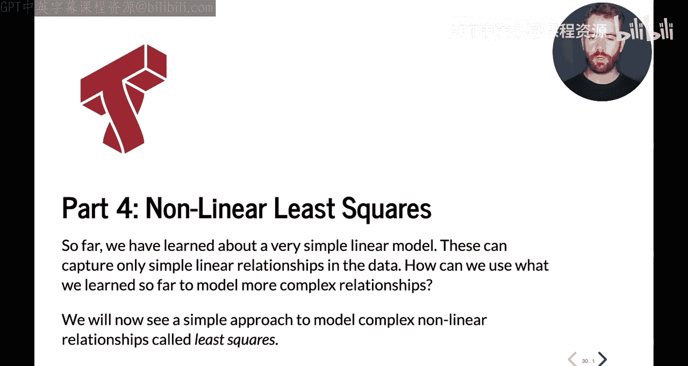

To start let's look at functions of this type which are called polynomial functions。

 so you may recall from algebra either a first year course of college algebra or human high school algebra that polynomial functions are functions of this form these are polynomial functions over scalar variable x and here we here this polynomial is a sum of p plus one terms where each term involves taking x to some power up to x to the power P for this term here and in each case we are multiplying this term by a particular this term involves a parameter multiplying it。

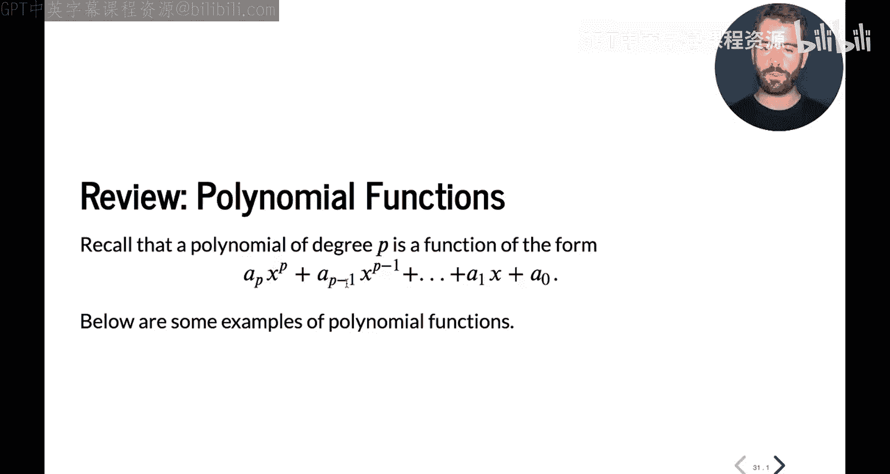

Let's look at a few examples of polynomial functions。

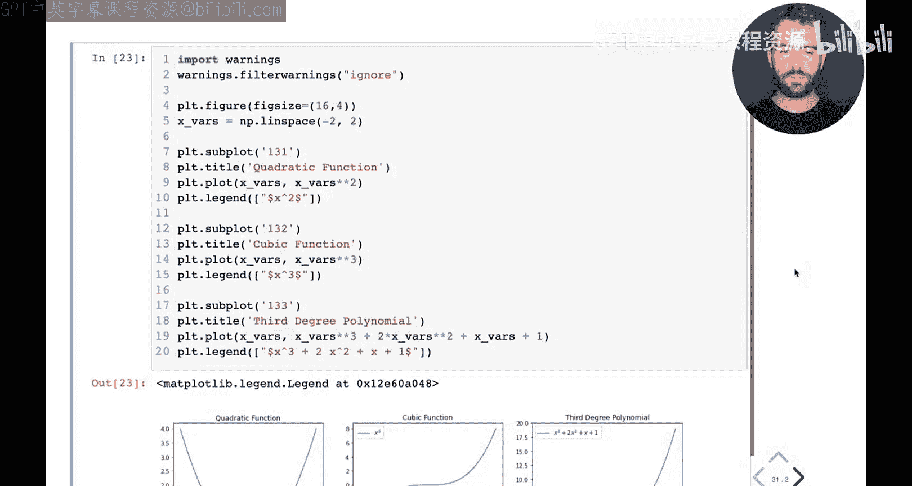

Here I am again using a nuy and matpl lip to visualize a few polynomial functions。 Here。

 this is the quadratic function that we have seen earlier。 so that's simply x squared。

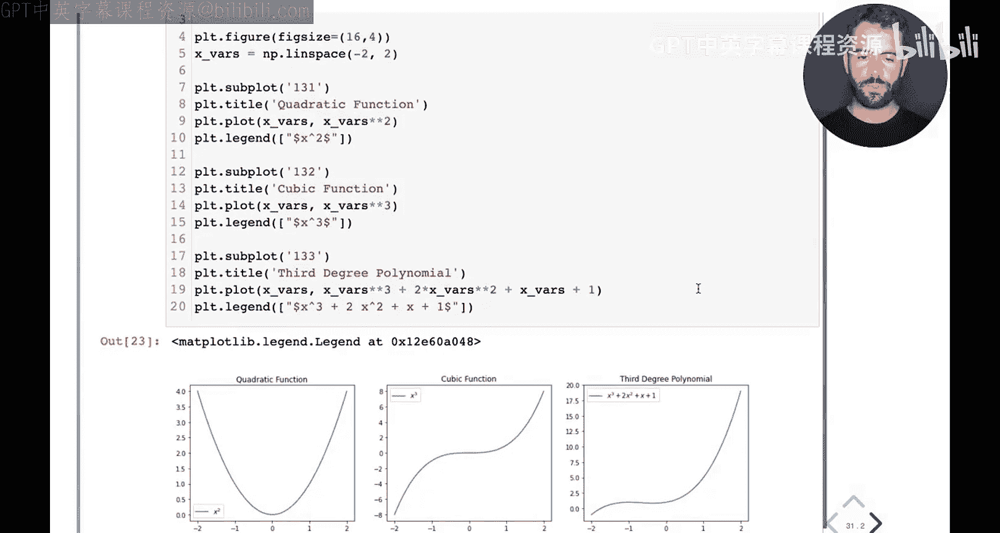

The cubic function is another polyial function。 It's here it's x cubed， and we can also combine。

Combine these polynomials to to obtain functions which have interesting form and which can be useful for fitting。

For fitting data， so in this example， we actually have a more complex third degree polynomial which involves xq plus 2 times x squared plus x plus1。

 and you see here that it has this interesting shape which is more or less constant in when x is less than zero and which then sharply increases with a fast slope x is greater than zero。

The idea of showing these plots is just to show you that polynomials are very expressive and hence interesting functions。

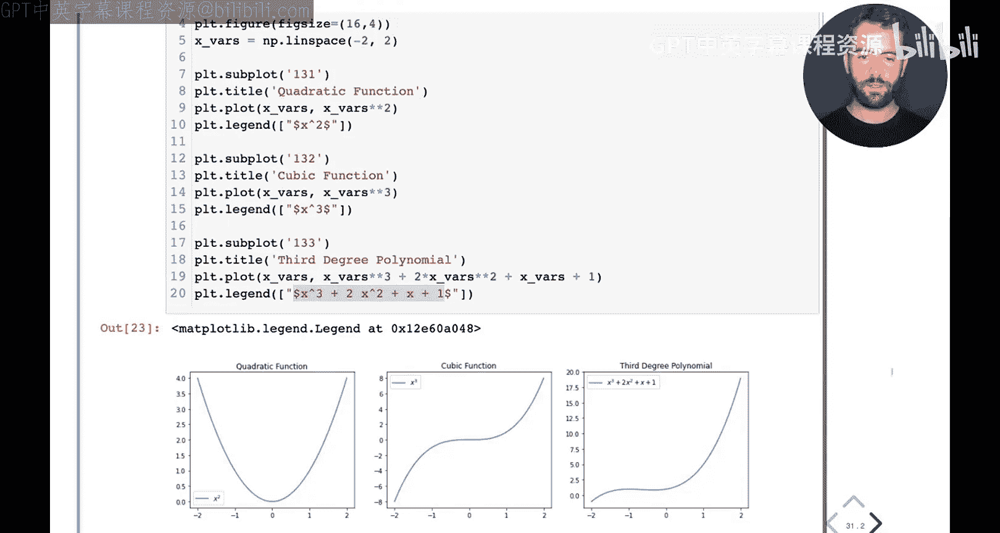

Now。I would like to start by showing you how we can use our machinery for ordinary lease squares to fit polynomials of arbitrary complexity to our data。

So specifically， consider the following feature mapping for one dimensional input attribute X。

So consider a one dimensional regression setting in which we have training examples X and Y and x is simply a scalar。

 this would be the setting that we started earlier that we had earlier in the BMI example。

And now consider a feature function which has this form and essentially this feature function maps are one dimensional attribute to a p dimensional space。

 a p plus one dimensional space， this is actually a typo and this this function takes on the following values。

 x to the power0， x to the power1， x to the power 2， etc cetera， up to x to the power P。

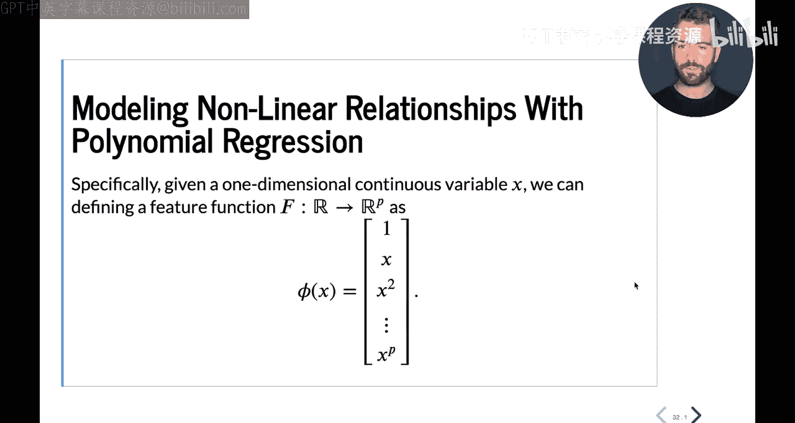

Consider now the class of linear models over these sets of features。

So now a model with a a particular instance of this model that's parameterized by features theta has the following form。

 this is our the usual form of our linear model that we saw earlier。

 except that now we are applying this linear term， not over the raw attributes x。

 but instead over a futurized version of x。And if we plug in here our definition of the polynomial features。

 we have the following expression， this is just plugging in the features that we had on the previous slide into the definition of a linear model。

And now you can see that the term that we have here， that is simply a polynomial of degree P。

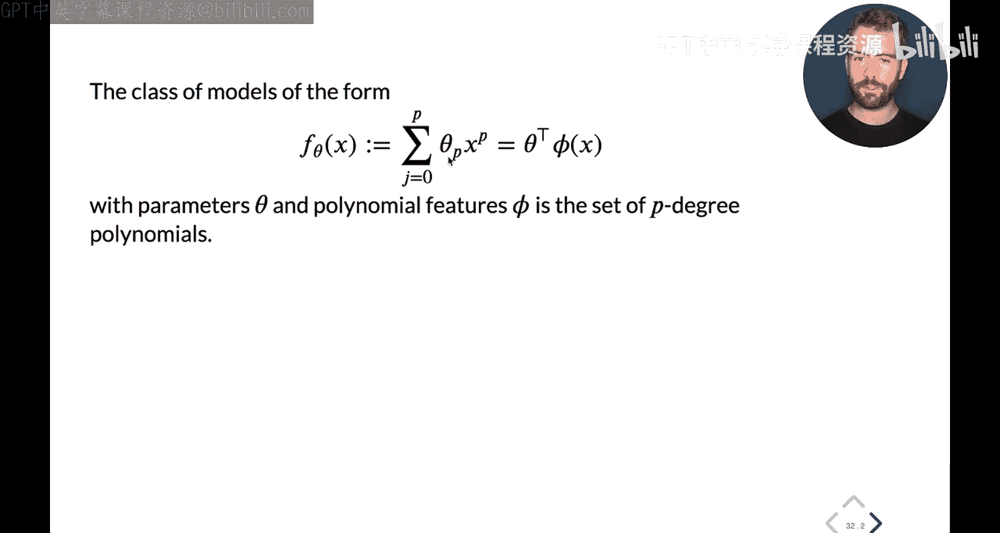

This is exactly the definition that we had earlier on this slide。

 except that this is exactly a function of this form， which is simply a polynomial of degree P。

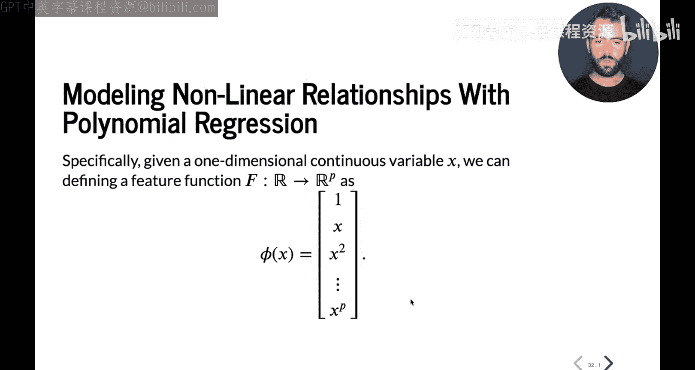

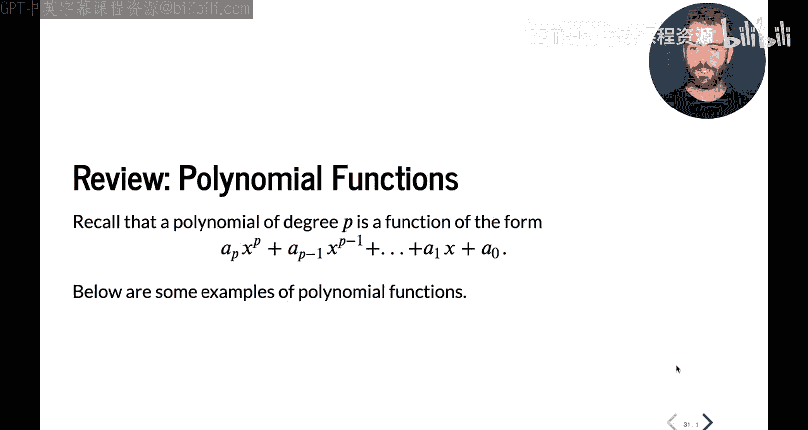

And。And so the class if we consider the following model class。

 which consists of all linear models over this feature function that we have just defined。

 then our model class is essentially the set of all the polynomials of degree P。So in other words。

 here we have the beginnings of a new supervised learning algorithm as we have defined a model class that contains all polynomials of degree P。

Now， there are a few interesting observations that we want to make about this class of model。

The first observation is that these models are all nonlinear and even I would say highly nonlinear as a function of the input variable x。

RightSo F as a function of x is nonlinear because the function phi here itself is nonlinear。

And this allows us to model complex nonlinear relationships in the data。However。

 as a function of theta。The model parameters， this function is still linear。Hence。

 it is effectively a linear model， and we can use everything that we have learned so far about least squares and optimizing linear models to optimize。

And find the best fitting model within this model class。

So this is a really powerful observation because we have just shown how we can fit very complex and linear polynomial models while at the same time keeping reusing the same machinery。

 which allows us to perform optimization over this class of models very efficiently。

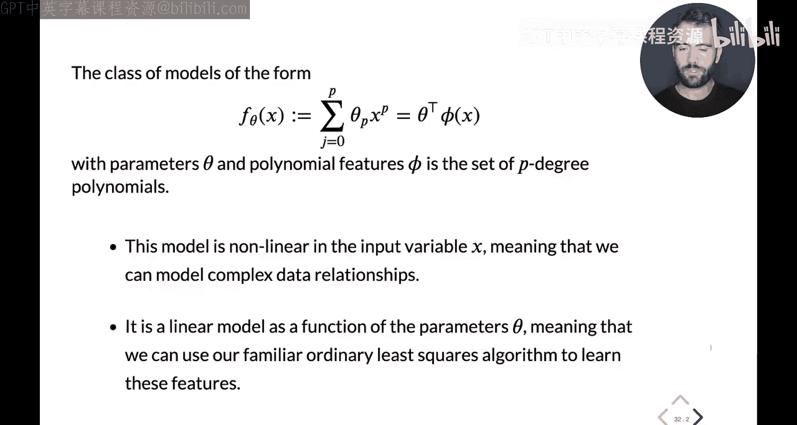

Again， to make things more concrete， let's look at an example using our UCI diabetes data set here I am going to use only one dimension from this data set。

 which is going to be again the BMI。And I'm going to revisit the problem of predicting the diabetes score from BMI。

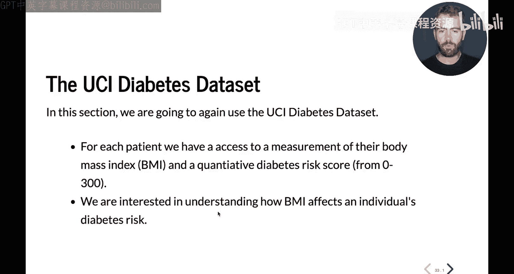

Again， just to remind you here I have plotted 25 points out of this data set and on the X axis we have BMI and on the Y axis we have the diabetes risk。

 and here we see something which is a relationship where this function where the BMI is increasing over time and earlier we tried fitting this with a linear function and we were able to capture the linear trend。

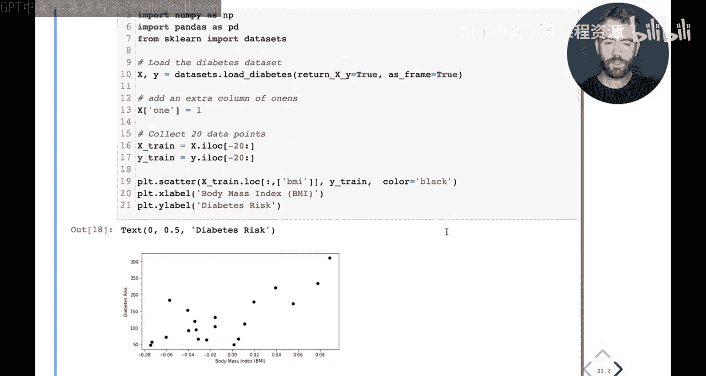

Let's now see what happens if we apply our approach with polynomial features fit using linear regression。

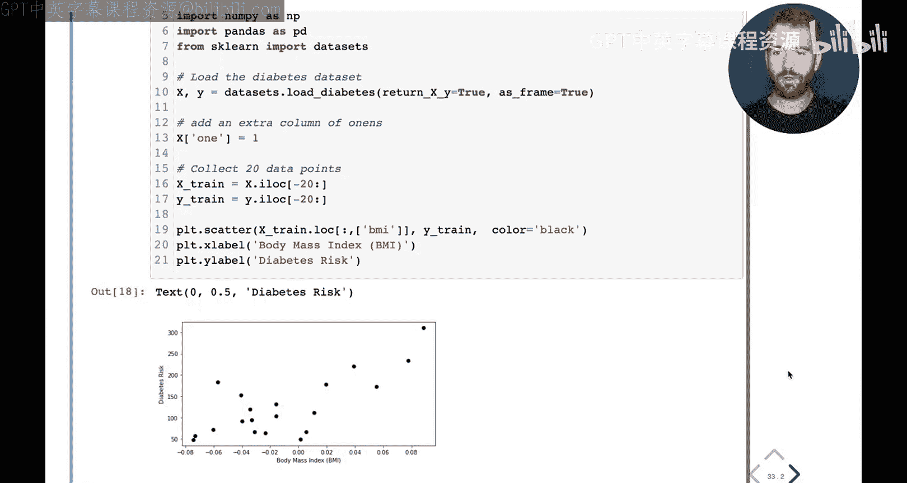

The first thing we need to start is to compute nonlinear features for this data set。

So here I am going to define this variable as being a design matrix that contains only a single feature。

 which is BMI。And now in this line， I am creating another feature matrix where I have added all the polynomial features of up to degree 3。

So here I'm taking the BMI and I'm taking to the power 2 to the power 3 and in this line I'm also adding a column of ones。

 and now if I visualize the resulting design matrix。

 I have design matrix with four features here I have the column of ones and also I have two BMI features。

 I have three BMI features， I have BMI itself and then I have BMI squared and BMI cubed。

So now this is our new design matrix。And now that we have our design matrix。

 we can simply apply our existing machinery。

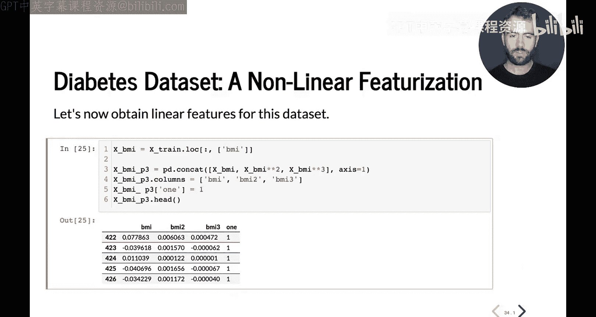

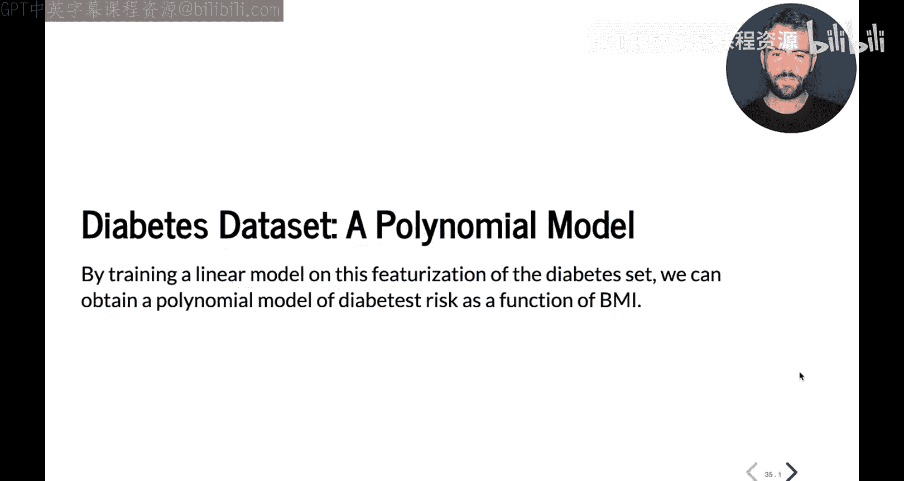

We we can apply the normal equations that we saw earlier and again this is just this one line implements that implements the solution to the normal equations。

 but notice that we're using this a design matrix of polynomial features as inside the solution to the normal equations。

 and the output of this is a set of parameters theta。

And the dimension of theta is not going to be four because we have these four features。

And now I can create a set of points on the X axis。 I can compute polynomial featuress for these aes。

I'm concatenating a column of ones with third， second， and zero and first degree polynomial features。

And now I'm just doing that product to obtain predictions for this data set of points。

And visualizing it， I now see that the model has found this nice curve that fits the data much better than a linear model。

And if you think of it， this may actually be a good model to this data set because here we have on this side。

 the relationship between BMI and diabetes risk seems to be much more flat。

 whereas it increases here and it's only truly linear in this part and our linear model is not able to capture this earlier。

 but this third degree polynomial model is able to plot this relationship in the data that we have。

So this is a really interesting example， and hopefully this shows you how this idea of using polynomial features can be powerful。

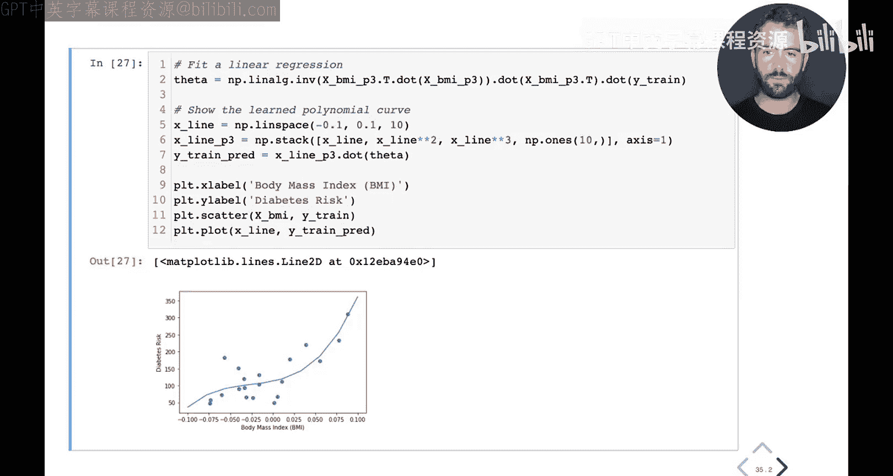

Now， so far I defined polynomial features only for a one dimensional variable， which was only BMI。

 but the same approach can extend to polynomials of any dimension。For example。

 here this is the general form of a polynomial of degree 2。

And essentially this general family of polynomials involves terms where the first variable x1 is squared and x2 is squared。

 and then we have also x1 to the power 1， x2 to the power 1， both of them to the power0。

 and we also have a cross term where we have where we're multiplying x1 by x2 and the highest power in this polynomial is2。

 which makes it a multivariate polynomial of degree2。And more generally。

 any second degree polynomial of degree2 can be written in this form。

 which is simply the set of all the products between the two variables。

 the sum of all the possible products between the two variables， each with their own。

Each with their own multiplying term and some of these two powers cannot exceed too。

That is simply a definition of a second degree polynomial， and furthermore。

 the same definition extends to polynomials of three variables， four variables。

 and any number of variables。

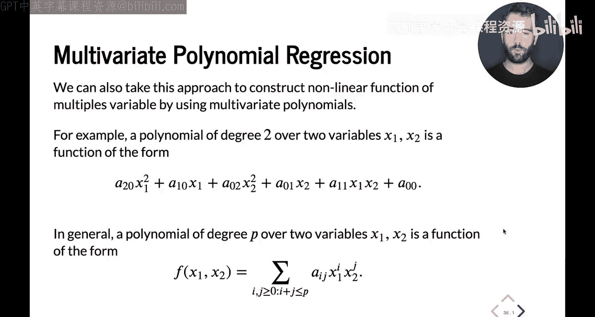

We can also use polynomial features for for these multivariate polynomials as well。

 here I have shown how we can here this would be the set of features that we would need in order to capture all second degree polynomial。

 notice that this is a feature function at maps。That goes from r2 to r6。

 so it takes two inputs x1 and x2， and it maps them to inputs of six dimensions which are x1。

 which are just the following ones and again the same approach can hold for polynomials of any number of variables。

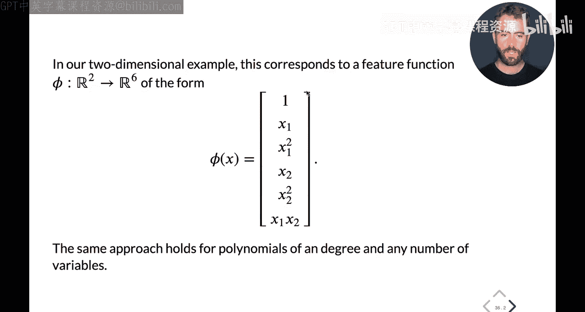

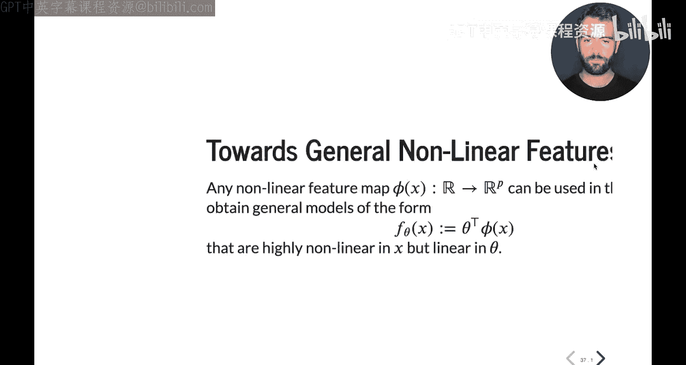

And finally， the last thing I want to mention is that this approach that we're taking is even more general。

 in principle we could be using nonlinear features of any form together with these models。

As long as we are looking at models which which are linear in the parameters theta。

We are going to be able to apply our machinery of ordinary least squares to optimize and find the best fit in terms of data。

And at the same time， Phi can be any nonlinear function， and this approach will still work。

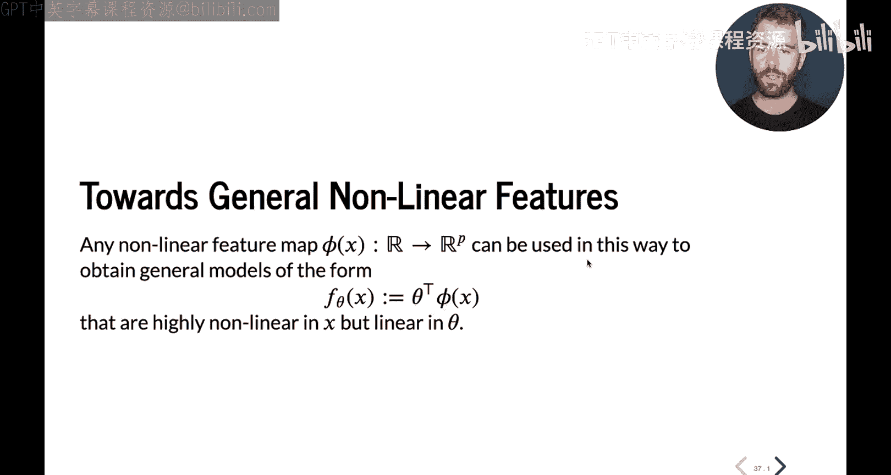

Here let me just give you another example of what nonlinear function we might use here I'm going to give you a few examples of sine and cosine functions。

 so here I have a regular sine function here I have this is a sine function here。

 this is a cosine function and here I just use a simple combination of sine and cosines。

 the formula I'm using cosine plus sine of 2x plus cosine of 4x and it has this。

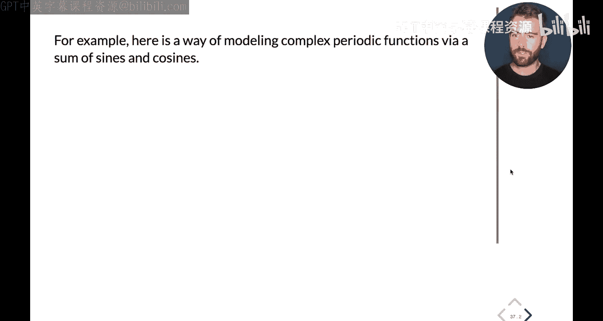

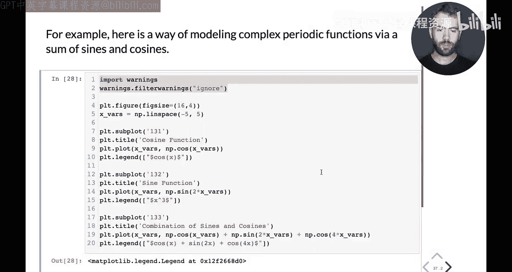

Interesting shape that we can use to fit complex functions。

we can use to fit to complex relationships that we might encounter in the data。And， of course。

There is an endless range of possibilities as to the kinds of functions that we could design this way。

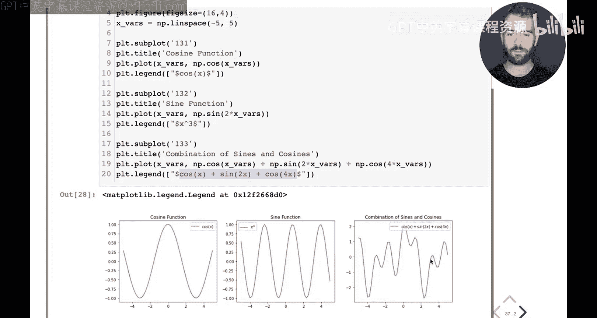

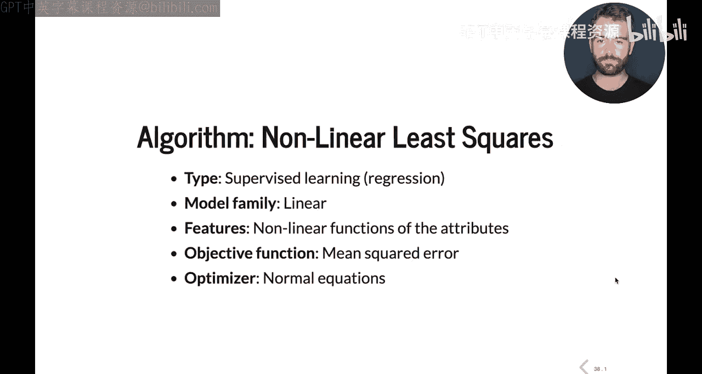

All right， so finally I want to conclude this lecture by just summarizing our an extension of ordinary least squares that allows us to work with nonlinear features。

 this is called this algorithm is called nonlinear least squares and it's an instance of regression and supervised learning。

 the model families is still linear， but now we are using nonlinear features that are we're using features which are nonlinear functions of the attributes。

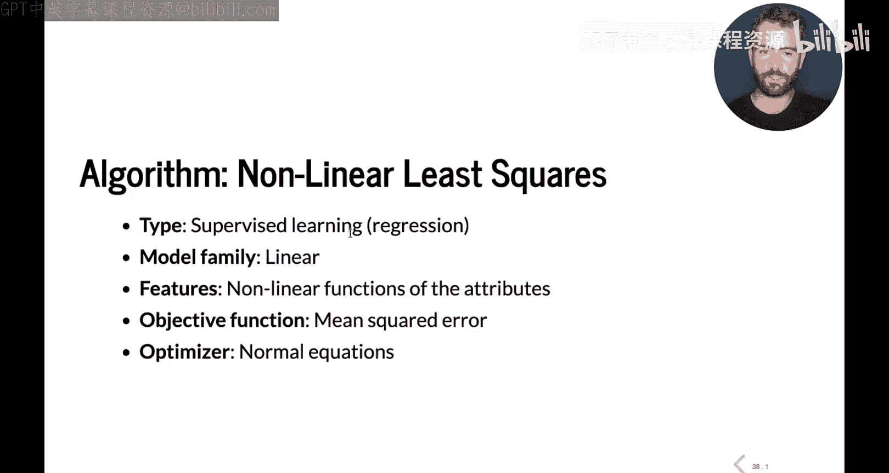

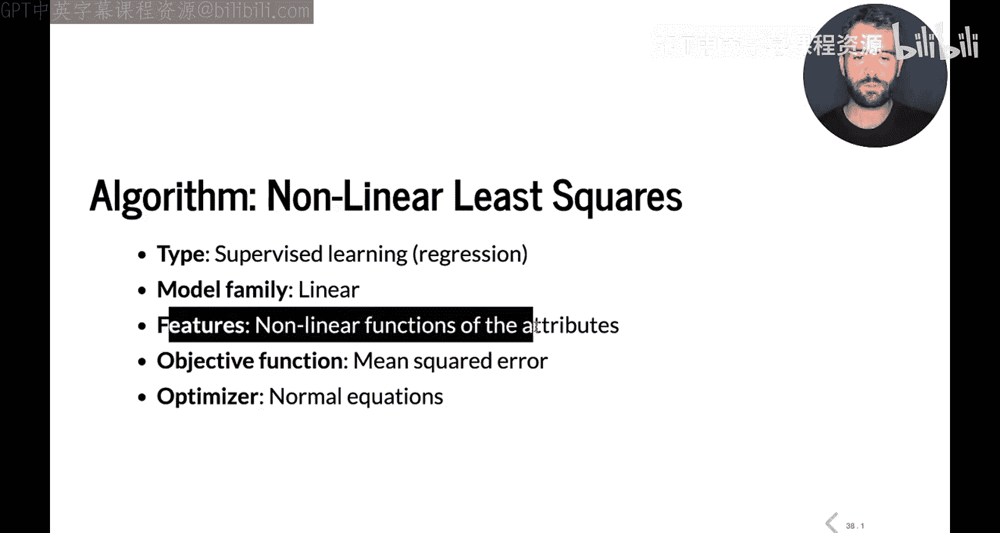

And these models are usuallyly optimized using the normal equations。

 which find the solution that minimizes the mean squared error。Allright， so this concludes lecture 3。

 We have now seen。Several real world machine learning algorithms， and in the next set of lectures。

 we are going to look at more algorithms and we are also going to start to better understand why these algorithms work。

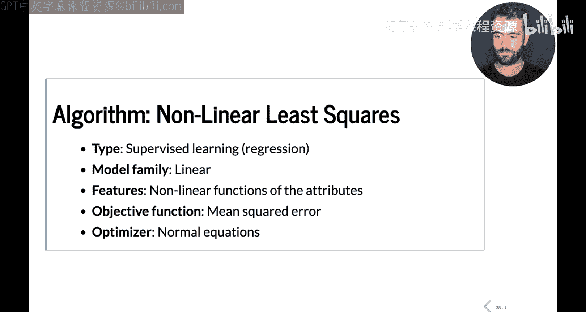