# 康奈尔大学《应用机器学习 CS 5787_ Applied Machine Learning 2020》中英字幕（deepseek p12 -12-Lecture 4. Part 1_ The Data Distribution.zh_en -BV12udzYvEFM_p12-

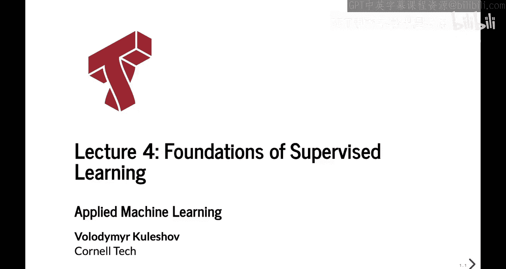

Hi and welcome to Le 4 of applieded machine learning。In lecture four。

 I would like to briefly switch gears and look at a slightly different topic from the ones we've seen earlier。

 I would like to use this lecture to briefly talk about some aspects of the foundations of supervised learning。

In particular， I would like to look at why supervised learning algorithms work， when they do work。

 why do they sometimes not work？And then I would like to use this intuition for developing a new set of learning algorithms。

In the previous few lectures we defined supervised learning and we saw our first examples of supervised learning algorithms now in this lecture I want to gain additional intuition why they work。

 that will be in the first half of the lecture and then in the second half of the lecture we are going to use this intuition to improve the algorithms that we have seen that we have seen in order to address the problems that we will identify at the beginning of this lecture。

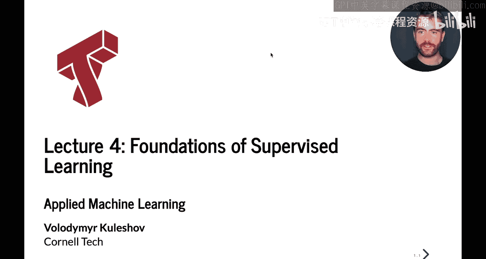

So again， the topic of this lecture is why does supervised learning work？

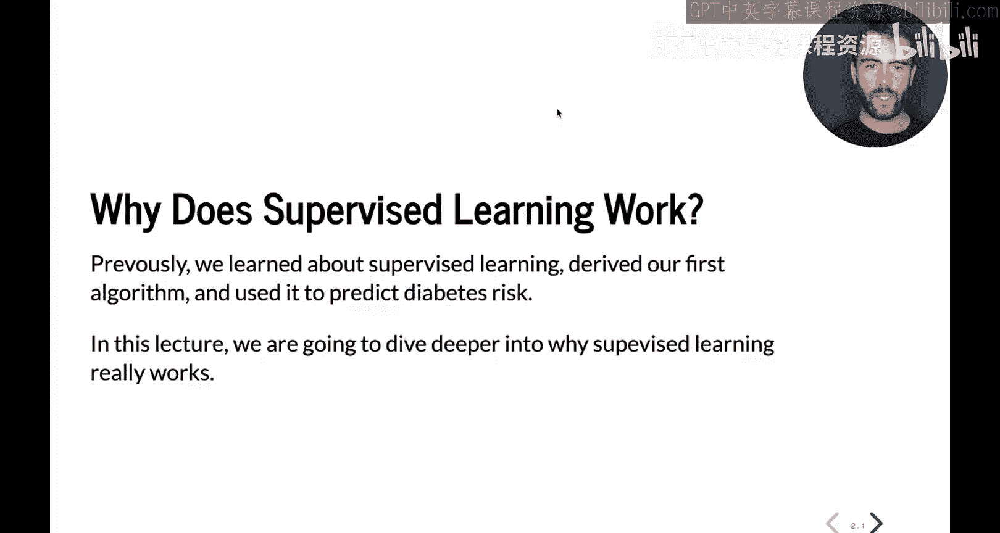

In the first video， I want to again establish some mathematical foundations that will allow us to answer this question in the next video。

In particular， I will define one mathematical concept called the data distribution。

 and this concept will be useful first for explaining why algorithms sometimes work and why they sometimes don't work。

 and two it will be also useful for defining a new set of learning algorithms both in this lecture and in the following lectures。

So what I'm going to describe here is going to be a particular assumption on where our data comes from。

 and if we make this assumption， then we can better explain。

 then we can prove that in some cases learning algorithms work and in some cases they don't。

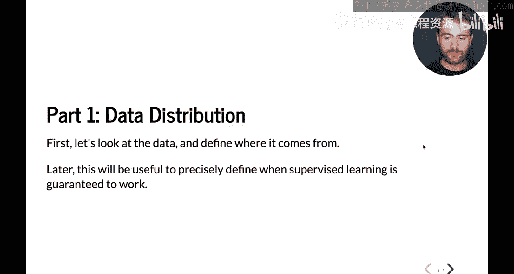

So recall from our earlier lectures that a supervised machine learning problem has the following components。

In order to apply supervised machine learning， we have to create a training data set。

Wwhich is a label dataset set of inputs X and target labels Y。

 and then we also specify a learning algorithm and when the learning algorithm is executed on the training dataset。

 the output is a predictive model that we can use to make predictions about the future。

So I have previously defined the data set to be a given。

And now I would like to look at where this data set might come from。

I'm going to make a particular assumption。And this assumption may or may not be true in practice。

 and algorithms may work or may not work。They may still work if this assumption is not exactly met。

 in fact， it's not entirely verifiable， but if we。If we make this assumption。

 then we can prove that they work。And we can also gain intuition for why they do not work。

You will see what I mean by this shortly， but for now， let me introduce this mathematical。

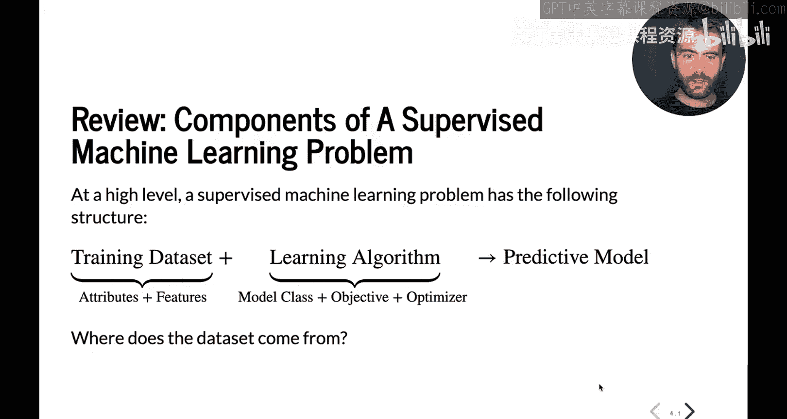

Idea that I。嗯。That I that I want to introduce。So this mathematical。

Pinciple is something called the data distribution， typicallyyp in machine learning。

 we assume that the data that we have comes from some kind of probability distribution。

And we call this probability distribution， the data distribution。

 and we use this capital P to denote this probability。

And we use this particular notation to denote that x and y are distributed according to this probability。

So this can be any distribution over X and Y， for example。

 if we are in a medical setting and we are observing patients that come into the hospital。

 the of then you can consider the set of all the possible patients， some of them are more likely。

 some of them are less likely， and we assume that there is some chance of seeing a particular patient' patient。

 and we observe this the patients that we come in are taken from this unknown。

Probability distribution that's out there。And in particular， our training set。

 which has the following form， we say that it consists of independent and identically distributed or IID for short samples from the data distribution P。

So again， this is an assumption that is typically made in machine learning。

 it is not necessary for the algorithm to work。But we can use it to prove that algorithms will work in certain cases when this assumption is met。

 and we can also use it to gain intuition for why an algorithm that doesn't work in practice we can gain intuition for the reasons why it doesn't work and we can also use this。

Distribution to develop better and improved learning algorithms。

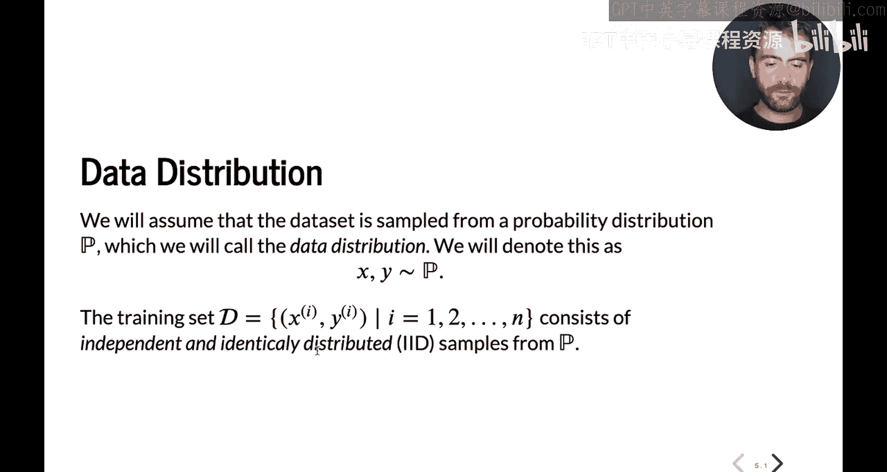

Now， the key part of this definition that I haven't thoroughly defined is the independent and identically distributed part。

Essentially， what this means is that each training sample is coming from the same distribution that is the identically distributed part。

So each of them is a sample from the data distribution P。And also。When we are collecting。

A particular training example， it does not depend on the samples that were collected earlier。

So if we collect our Nth training example and we have already collected a data set before that。

That new data is independent of what we happen to have collected earlier。Let's look at an example。

 one simple example is flipping a coin。EachEach coin flip has the same probability of landing heads and tails。

And whether the coining lands， heads or tails doesn't depend on what happened during the previous flips。

A counter example would be。Something like yearly census data。

Imagine that we're measuring the population of a city over time。

The change in population is an unknown quantity that essentially behaves as random。嗯。

If the city is growing by a certain amount， it's really hard for us to predict how many new people will move to the city or how many people will be born。

 this is essentially an unknown quantity that we can treat as random。

So the population of a city over time can be thought of being samples from a random probability distribution。

 but these samples are correlated because the probability of the city the population of the city in a given year will be closely dependent and correlated on the population of the city in the previous year。

So because these samples are closely correlated， they are not independent。

So here this example violates the independence assumption。

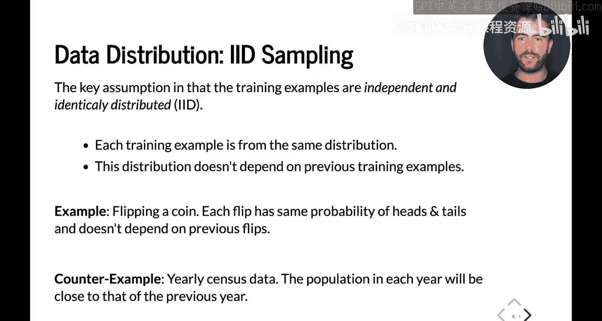

Now， to get a better understanding of the data distribution。

 we can also create our own the data distribution。I'm now going to define a particular database distribution。

 and I'm going to draw samples from it。Here I'm going to implement this in nuy and the first step will be to define a function around which I'm going to collect samples。

 so I will define the following function using nuy。

 this is the code and we can visualize it and it looks as follows。

 so consider the following function this is clearly non nonlinear。

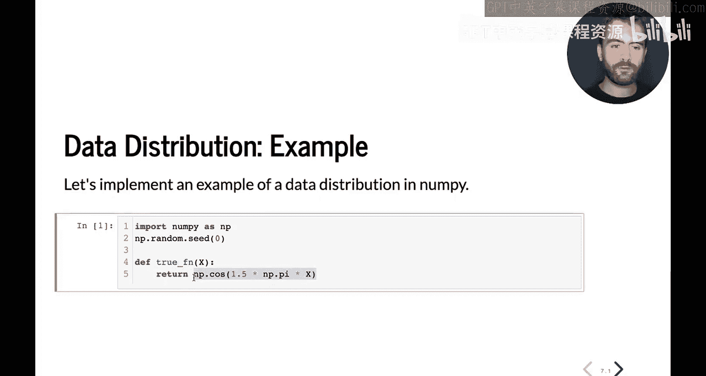

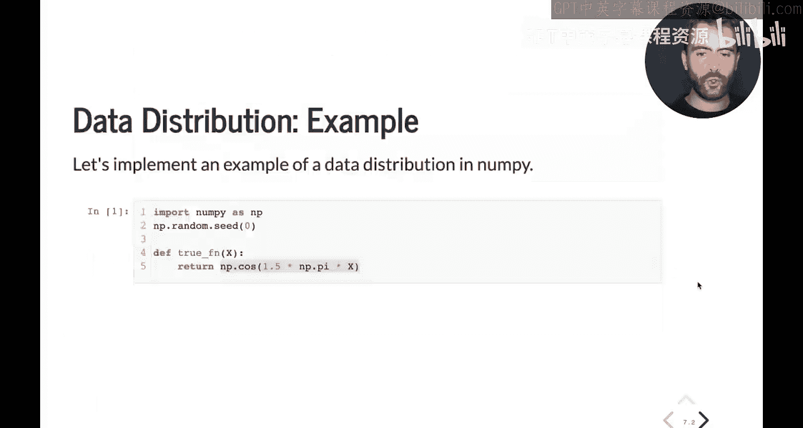

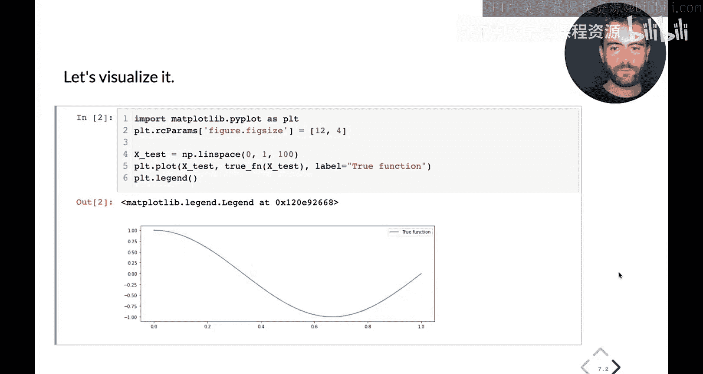

And consider the following process for generating data。

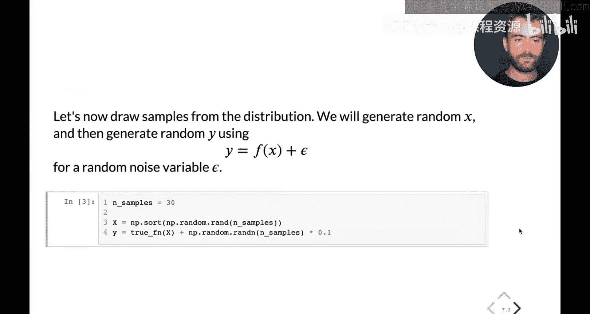

I can draw samples from a data distribution as follows。

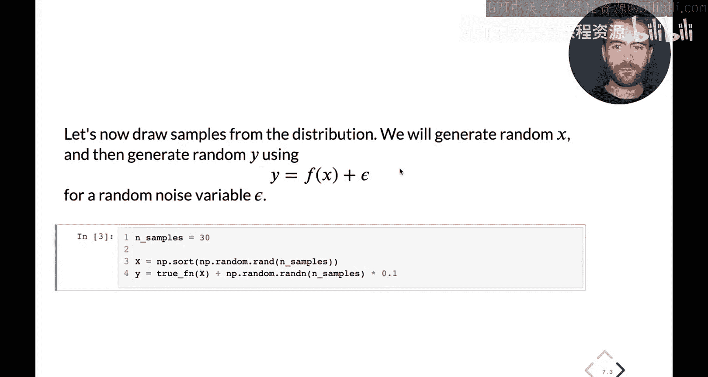

First， I generate a random x in the domain of this function。

 so I will uniformly at random choose an x between 0 and 1， which is the domain of this function。

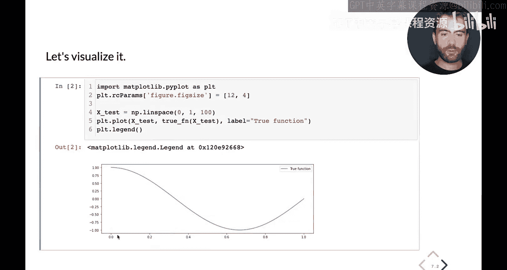

And then I will generate a target y by looking at the true value of this function and then adding some noise to it。

 so this is going to be Gaussian or normal distributed noise or white noise around the function。

 it will have mean zero， so I will just randomly perturb the value of the function at this input X。

I can implement this in noni as follows here I'm generating 30 samples， I generate 30 random x's。

 and then to generate the Y， I compute the value of the true function。

 and then I just add random noise。Did I scale by some small value？And then this defines the set of Y。

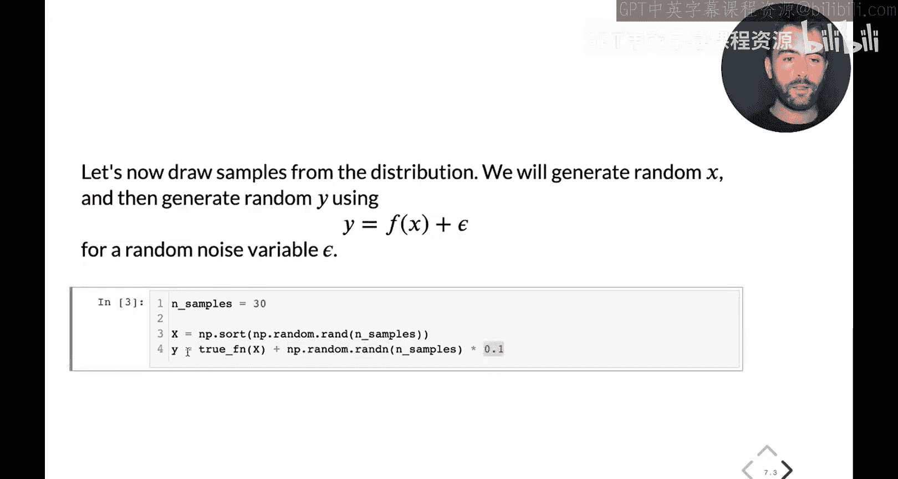

I can visualize these x's and y's as follows， and these are the blue dots。

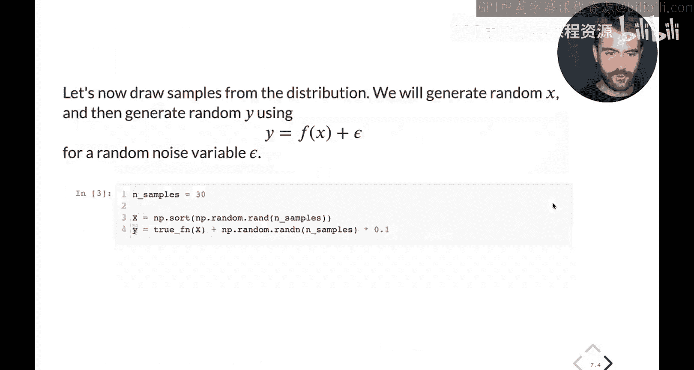

So now the blue data set is the data set of blue points is a machine learning data set that we have generated from a data distribution。

That consists of the process that you just described where we take an X。

 and then we generate a value that's the noisy realization of this function。

And now this is a valid machine learning data set， and we can apply the learning algorithms that we have seen earlier in order to learn the relationship between X and Y。

 we can try to learn the true shape of this function from this data from this noisy data。But again。

 in this example， it is governed by the probability of distribution that we have just defined。

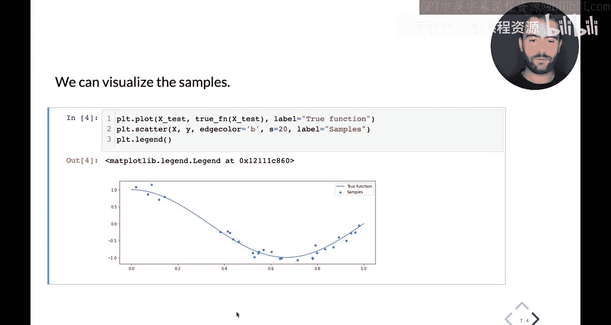

Now， again， I just want to summarize why do we want to assume that the data set that we're dealing with is sampled from a distribution？

So first of all， in many cases， in many， in fact in most practical applications of machine learning。

 the process that we are trying to model， it essentially behaves as if it had randomness in it。Often。

 there is， there is uncertainty and there is randomness in the way the data is collected。For example。

 the data itself may be collected using instruments which are noisy。

 for example we may be using a thermometer which only has some level of accuracy and the data that we're collecting our random samples around some true value which we cannot collect because there's some error in our data collection process。

 there's some inherent noise in our error collection process and so the data that we have is not determin is that it has some randomness in it and we want to make this modeling assumption。

Often there's also uncertainty in the process itself that we're trying to model for example。

 if we're trying to predict the price of a particular stock。

 then this price is determined by a very large number of factors that we are not able to incorporate in our system it may depend on the mood of particular individuals which are making trades on a particular day and these are not factors that we can measure。

 we only have a limited number of features that we can use and so for the purposes of designing our system。

 this stock price essentially behaves as a random quantity it behaves as a random quantity that has some signal to it。

 some part of it we can predict， but then there is a big part that is random and that we cannot predict。

And so it is often so modeling this via probability distribution is something that is accurate and realistic and reflects reality。

And finally， the third and the most relevant reason to use a data distribution is that if we make the assumptions that I just made earlier。

 then we can use tools from probability and statistics to analyze supervised learning algorithms and prove that they work。

And if they don't work， if they don't work in practice。

 then we can use our intuition derived from the data distribution to explain why they wouldn't work。

And yeah， we can also use this language of a distribution to define what it means for a model to be accurate。

 and this is something that I want to explore in the next video。

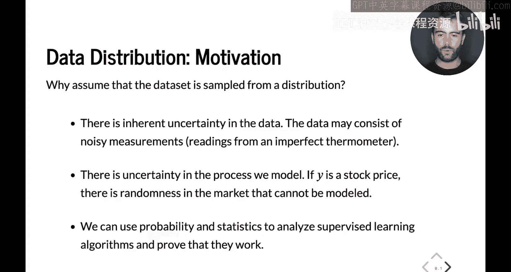