# 康奈尔大学《应用机器学习 CS 5787_ Applied Machine Learning 2020》中英字幕（deepseek p13 -13-Lecture 4. Part 2_ Why Does Supervised Learning Work_.zh_en -BV12udzYvEFM_p13-

This is now part two of lecture 4 of appliedlied machine learning。AndIn this part of the lecture。

 I want to now give an argument for why the approach that we've taken earlier is a good approach and why it would work well in practice。

In the previous video， I defined this notion of a data distribution。

And now I'm going to use it to define what it means for an algorithm to work well。

 for a supervised learning algorithm to work well。And then I will give a high levelvel argument for why supervised learning algorithms should eventually work well under the assumptions that we have made。

 and then in the next video I will give an example of why they wouldn't work well and how we can use the definition and the intuition that we're going to make in this video to explain problems in their behavior。

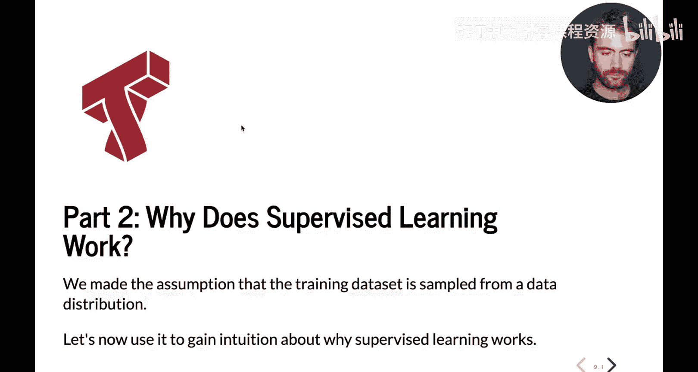

So recall that in the previous video we defined this tool called the data distribution。

 it's a mathematical assumption that we're making， and we assume that the data with which we're working the X and Y in particular this training data set of X and Y consists of IAD samples from a probability distribution P。

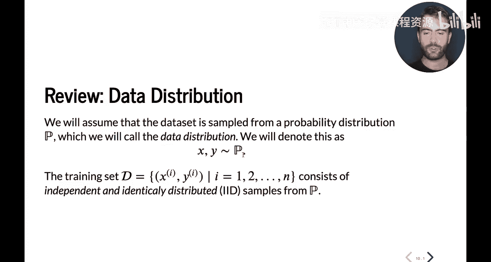

嗯。Now I would like to use this definition to define what it means for a machine learning model to be accurate and recall that our definition of a machine learning model is simply a function that maps x to Y。

So the output of a supervised learning algorithm is a predictive model that makes hopefully good predictions y based on inputs x。

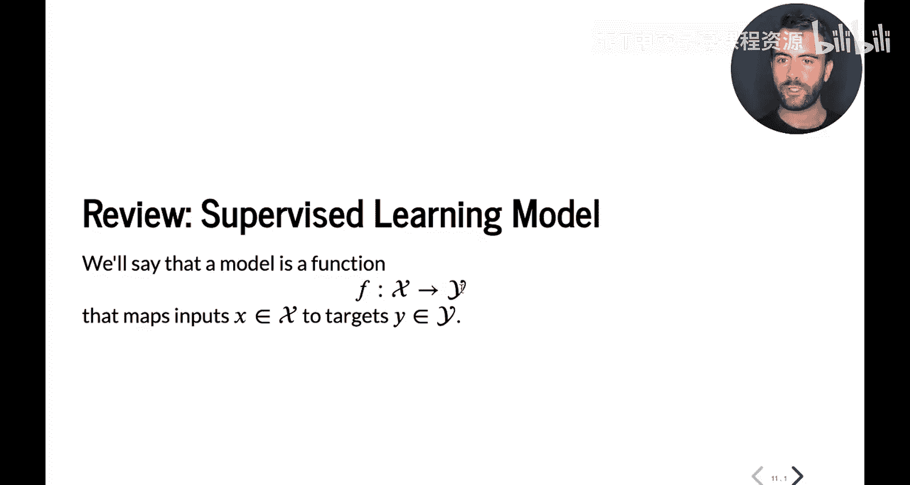

And now the first question I want to start with is what makes a good model？

SSuppose that we have run a supervised learning algorithm and it has outputted a predictive model。

 how do we tell whether it's a good model or not？Well， this model has to make accurate predictions。

Clearly。But also crucially， these accurate predictions。

 they must be accurate on new data that we have not seen at training time。Ultimately。

 our goal is to take our predictive model and to put it in the real world。

 we want to productionize it as part of some system， we want to deploy it。

 and then once the model is deployed， it will observe new data points， it will observe new inputs。

And we want the model to be accurate。On those predictions that it has not seen a training。

 a training time， This is really important。 And this is the main。

This is the ultimate goal of a machine learning system and this is something that we're going to revisit many times in this course and I think understanding that there's a distinction between the training data and then the future data that the model will see is really。

 really important for understanding machine learning。

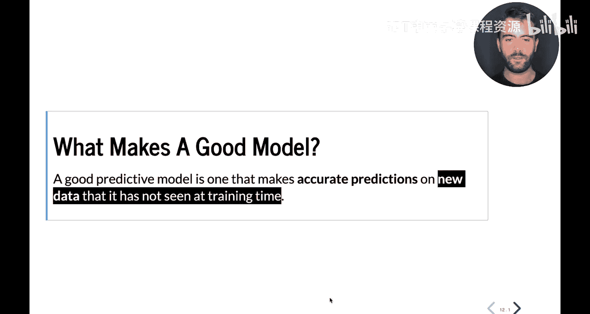

Now， in order to make this intuition that I had in the that I had it on the previous slide。

 in order to make this intuition more precise。I am going to again define a few tools or concepts。

The first idea I want to define is this idea of a holdout data set。

So we have worked so far with a training dataset， but it is also useful to define another a second data that has the same structure as our training dataset。

 meaning that it consists of pairs of X and Y。But and this data set is sampled it also consists of IED samples from the same distribution as B。

From this institution P is the training data set。But these two data sets are going to be disjoint。

And in order to distinguish between them， I will use this dot here as notation to tell them apart and every symbol that has a dot a is a symbol that is associated with the holdout data set。

Let me define what I mean by a holdout data set in this example。Recall that in the previous video。

 we defined a data distribution for a regression data set in which we have a true function that describes the relationship between x and Y。

And we create a data set by generating noisy points around this function。

 so these are noisy realizations of this function that are generated by a particular pbabilistic process that we have defined。

And in the earlier video， I a datad， I defined a training data sampled from this distribution。

 which is shown here in blue， and it's the same one as in the previous video。But now in this example。

 I also generated an additional set of samples which are in red。And these are holdout samples。

 they are collected from the same distribution， but they are disjoined from the blue data set。

 they represent a different set of points。And I claim that a machine learning model works well if it fits both the blue points well。

 but that's easy we know them when we build our data。It is also in order to be accurate。

 it also has to be able to fit the green to fit the red points well， to fit the holdout samples well。

 and that is the true definition of an accurate machine learning system。

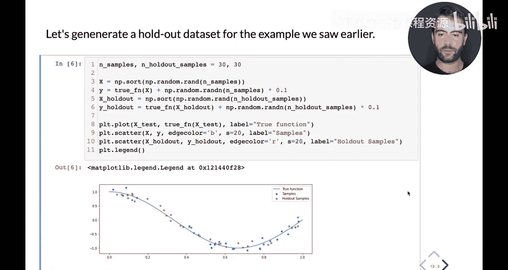

So again， let's make this intuition a little bit more precise。

Let's assume that we have some threshold for defining what is an accurate prediction。

Let's say that we have a label y， and then we have an estimate y prime or it can be the other way around。

And we want to define some notion of accuracy。Between y and y prime。

 it doesn't really matter for the purposes of this video， how we define them。But for example。

 we could use our prior knowledge about this problem to define a threshold at which y and y prime are close enough。

 and if they're close enough then we say is accurate is true， otherwise it equals false。

If we have a e classificationification problem and y and y prime are discrete labels。

 then we can say accurate equals true if the label is correct， otherwise false。

So there are many different definitions and the exact problem the exact definition is not important。

The idea is that we want a model to be accurate according to however we define it on holdout data。

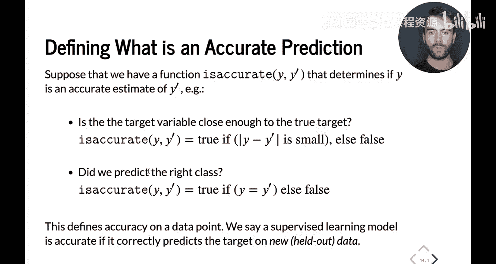

So in other words， we can formally define what it means for a model to be accurate using the following definition。

We're going to say that this predictive model is accurate if its probability of making an error on a random holdout sample is small。

So its probability of being inaccurate on a random sample is small。

And this formula is a way of making this intuition precise。So here we have aendum sample X and Y。

And we are looking at the probability that it is not accurate， so1 minus the probability is accurate。

 that's the probability that's not accurate， and this value is at most epsilon where epsilon can be thought of some really small number。

 like 1%。So for example， so if we sample a random x and Y。

And the probability that it is not accurate， so1 minus the probability of being accurate is the probability of it not being accurate。

 if that is less than 1%， then we say that this is an accurate model where again epsilon is something that we would choose for a particular application。

Or to interpret this differently， suppose that we have sampled。A large number of holdout points。

 X and Y， and these are distinct from our training set。

 let's say we have sampled a thousand0 of them。And this probability here will correspond to the fraction to the fraction of these points for which we have an accurate prediction。

And we want this value to be large， we want this to be something high。

 we want this something to be higher than 99%， and the percentage of points at which we are not accurate will be 100% minus this percentage。

 and so if this is above 99%。Then one minus this value will be below 1%， and so we will be accurate。

And again， Epsilon can be any small number that we get to choose。

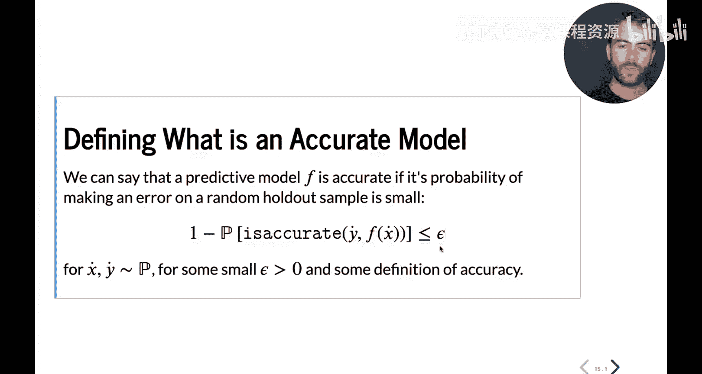

And conversely， we can say that our model is not accurate if its probability of making an error on the random holdout sample is large。

So the probability of making an error is at least epsilon so it's more than 1% if we sample 1000 points。

 more than 1% of them will have an error， this is what this inequality is saying and we can just rewrite these terms and say that you know this so the probability the fraction of points for which we will output an accurate prediction will never be more than some value and therefore the model is inaccurate。

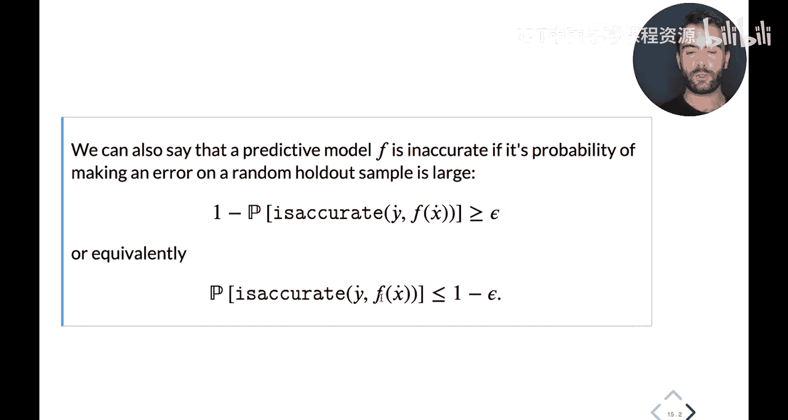

So this definition is really important and it uses， in fact。

 there's a special word for describing the property that I just defined and this is used throughout machine learning。

 this concept is generalization。II will repeat here what I described earlier。

 but this is really important， so I want to reemphasize it。

The property of a predictive model to achieve。Good performance on new unseen data that is different from the training set is called generalization。

And we want to make sure that supervised learning methods return models that generalize。

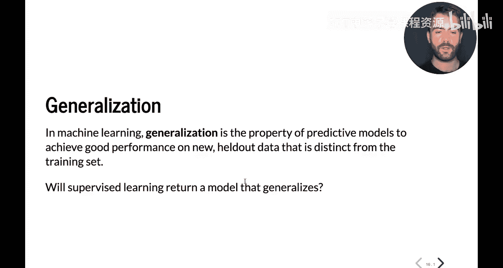

So。Can we say that supervised earn returns the model jet generalizes。

So recall that supervised learning at a high level involves the following procedure。

So first we collect a training dataset of labeled examples and this data is notnoted by D。

 and then we run a learning algorithm which finds a model that has a good fit on the training dataset。

 so it does well on the training dataset and in particular it will be accurate on the training dataset。

So I claim that this procedure will also return models that generalize well to unseen data if D is large enough。

And in the next two slides， I want to sketch a mathematical proof for why I think this is true。

 if you don't follow exactly the details of this argument， this is not important。

 or it's not critical for understanding the algorithms that we're going to define later on。

 but it is an interesting fact about machine learning models and supervised learning but the most important part to understand from this video is that accurate machine learning models are one that are accurate on unseen data。

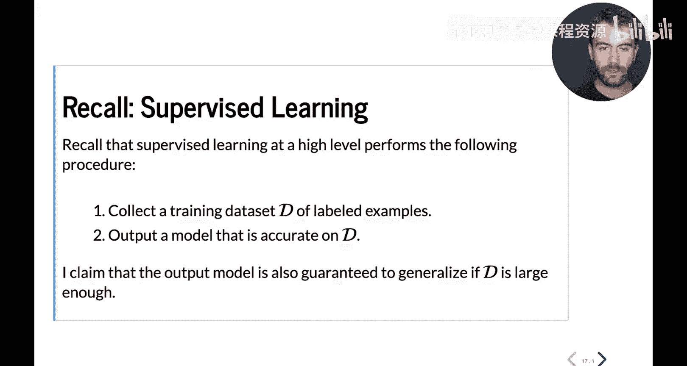

So now let's look at this argument。In order to make this argument I will make two simplifying assumptions。

 it is possible to not use these assumptions， but it will make the argument simpler。 First。

 I'll assume that the model class that we're working with contains at most h different models where Hs is a number。

 so maybe we are choosing the best model out of 10，000 that live in our model class M。

And I will also assume that one of these models fits the training data perfectly。

 so it's accurate on every point according to our threshold of accuracy。

 and the supervised learning algorithm will choose that model because it chooses the model with the best fit。

 one of them will perfectly fit the data and therefore we will choose this model。

 and I claim that given a large enough data set if we collect enough data。

Then the output of this procedure。supervised learning under these two assumptions will be a model that generalize as well。

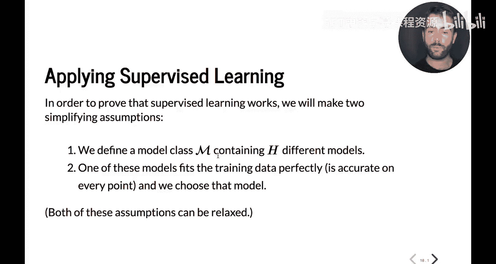

So this is my claim， supervised learning will return。

The probability that it will not return in an accurate model decreases exponentially with training size N。

 so as we give the model more data， it is guaranteed to give us a model that generalizes。

How do we prove this？We have the argument has two short steps。First。

 recall that we say that a model F is inaccurate if the probability。

If its probability of being accurate is at most some value1 minus epsilon。Now， suppose that。

We have returned， suppose that supervised learning has returned a model that is inaccurate。

 supposeupp that the output of supervised learning is a model that is actually inaccurate。Well。

 I claim that if this model is inaccurate， then。This can happen with only very low probability if the output F is inaccurate。

If the model F is inaccurate， then the probability of F being returned is very small。

So imagine that F is returned and it is inaccurate， let's compute the probability of that happening。

So if F was chosen， then F must have fit the training data perfectly。

So it means that it is accurate on every training input。Yi and Xi。

And the only way this can happen is that。Well。The probability that this happens because each YI and XI is an I sample from the training set。

 then the probability that all of them are accurate are is the product of these probabilities。

 and we know that，Since f is inaccurate， then each of these is at most 1 minus epsilon。

 so the probability of this happening is at most 1 minus epsilon times n。

So you can see that this is a number that will decrease exponentially to0 at an exponential rate to zero as we increase n。

And therefore， the probability that any particular inaccurate model fits the data perfectly。

It vanishs to zero at a very quick rate。The only missing part to this argument is that because we have a total of H model in M。

 it's possible that one of them by chance， might have this this error and the more models we have。

 the more likely that at least one of them will。Stilled with some small probability。

 fit the data well。 And so in order to bound the probability that no model in M or that no inaccurate model in M can fit the training data。

 we have to multiply this value by H， which is the maximum number of inaccurate models that we can have。

 And this puts the probability on the event that。one inaccurate model out of at most H will fit the train data by chance。

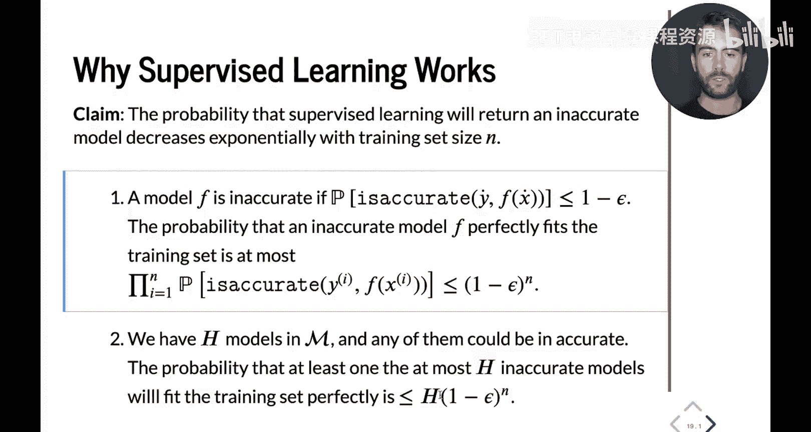

And this probability， as I said earlier， it goes to 0 at an exponential rate as we increase the trading size N。

 and therefore， my claim holds as we give the model。

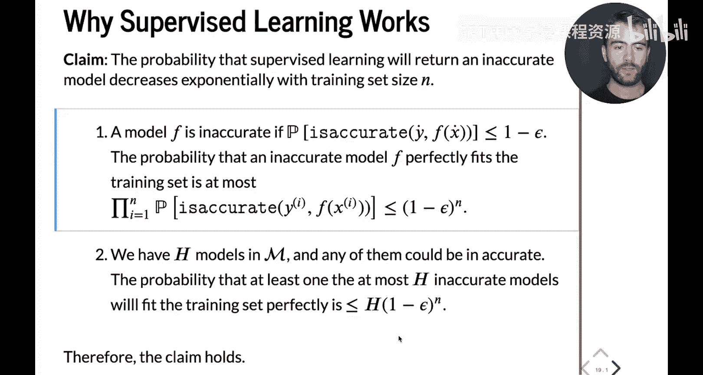

As we give supervised learning more data， the probability that the model that it returns is inaccurate decreases to 0 at an exponential rate。

So this was a short argument for why supervised learning can work。And in the next video。

 we're going to use this definition of。Accurate model。

 we're going to use this definition that a model is accurate if it generalizes to explain a few reasons why。

This might not happen。If our data set size is too small we're going to so in order for supervised learning to work。

 we need to have enough data， but in practice we may have too little data。

 and in that case we will have certain failure modes which we can diagnose using the tools that we have defined in this video。

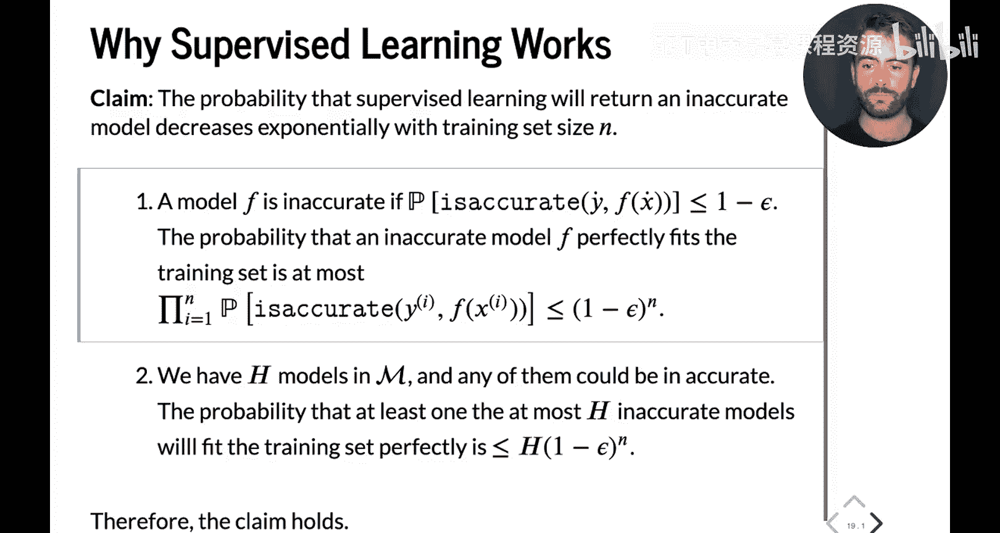