# 应用机器学习：第4讲第2部分：为什么监督学习有效？ 🤔

在本节课中，我们将探讨监督学习算法在实践中能够有效工作的原因。我们将基于之前介绍的数据分布概念，定义什么是“好的”机器学习模型，并解释为什么在特定假设下，监督学习能够产生泛化能力强的模型。

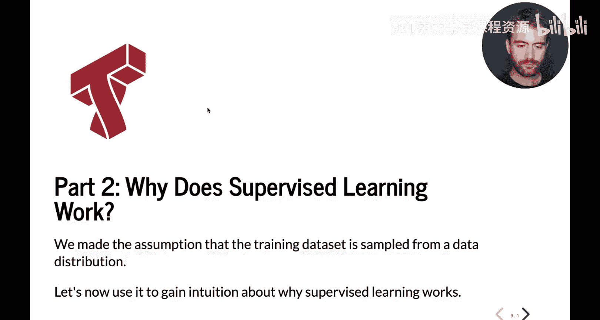

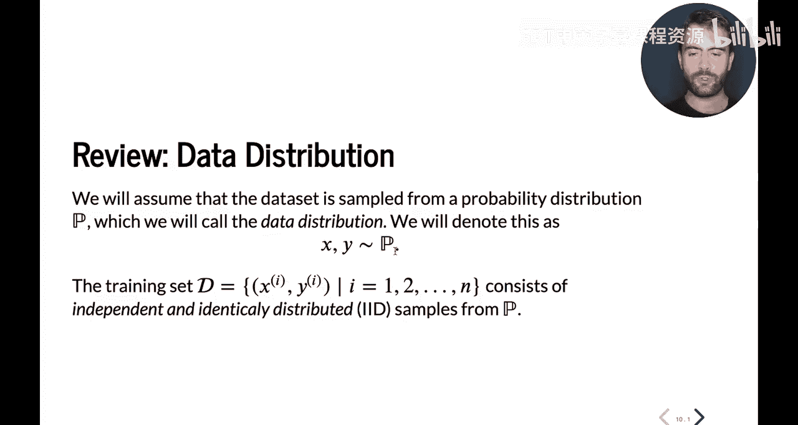

---

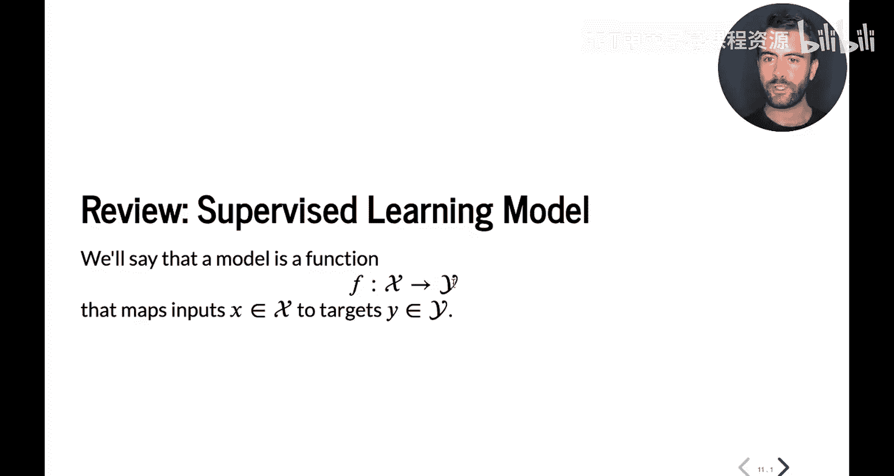

## 数据分布回顾 📊

上一节我们介绍了数据分布的概念。它是一个数学假设，即我们处理的数据（特别是训练数据集中的X和Y）是从某个概率分布P中独立同分布（IID）采样得到的。

**公式表示**：训练数据 \( D = \{(x_i, y_i)\}_{i=1}^n \) 中的每个样本对 \((x_i, y_i)\) 都独立地来自同一个分布 \( P \)。

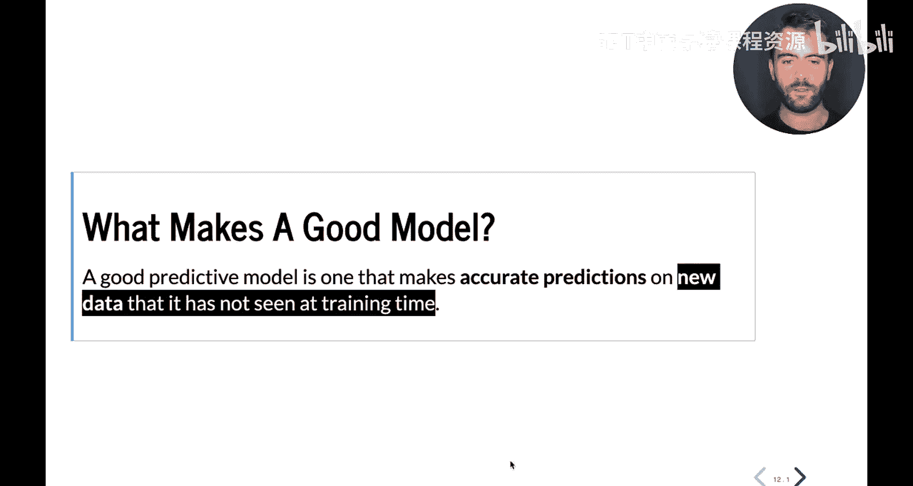

---

## 什么是好的模型？ ✅

假设我们已经运行了一个监督学习算法，并得到了一个预测模型。如何判断它是否是一个好模型？这个模型必须做出准确的预测，但关键在于，这些预测必须对我们在训练时未曾见过的新数据也保持准确。最终，我们的目标是将模型部署到现实世界中，让它处理新的输入数据并做出准确预测。理解训练数据与模型未来将遇到的数据之间的区别，对于理解机器学习至关重要。

---

## 留出数据集的概念 📈

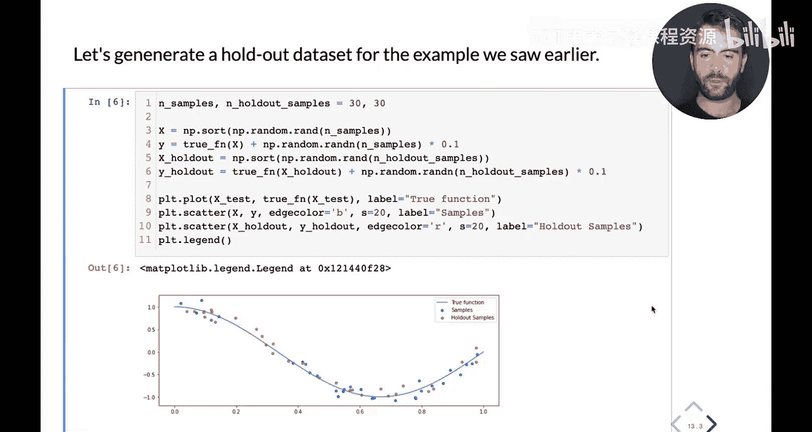

为了使上述直觉更精确，我们引入“留出数据集”的概念。除了训练数据集，我们定义另一个具有相同结构的数据集，它也由来自同一分布P的IID样本对 \((x, y)\) 组成，但与训练集互斥。我们用带点的符号（例如 \(\dot{x}, \dot{y}\)）来区分留出数据集。

**核心思想**：一个机器学习模型要表现良好，不仅需要很好地拟合训练数据（蓝色点），还需要能够很好地拟合留出数据（红色点）。后者是衡量模型准确性的真正标准。

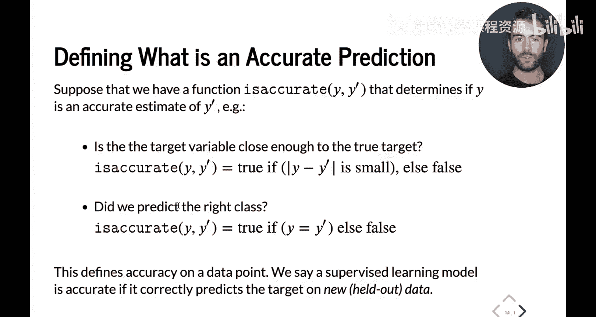

---

## 模型准确性的形式化定义 🎯

我们假设有一个阈值来定义什么是“准确”的预测。对于回归问题，可能是预测值 \(\hat{y}\) 与真实值 \(y\) 足够接近；对于分类问题，可能是预测标签正确。具体定义方式取决于问题本身。

我们可以形式化地定义模型的准确性：一个预测模型 \(f\) 是准确的，当它在随机留出样本上犯错的概率很小。

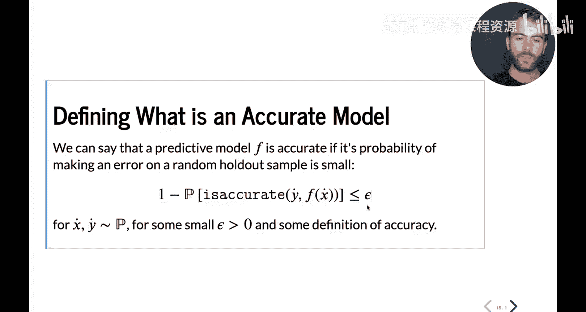

**公式表示**：
\[
P_{(x, y) \sim P}[\text{accurate}(f(x), y) = \text{False}] \leq \epsilon
\]
其中 \(\epsilon\) 是一个很小的数（例如0.01或1%）。这意味着，如果我们从分布P中采样大量留出数据点，模型在其中做出错误预测的比例不超过 \(\epsilon\)。

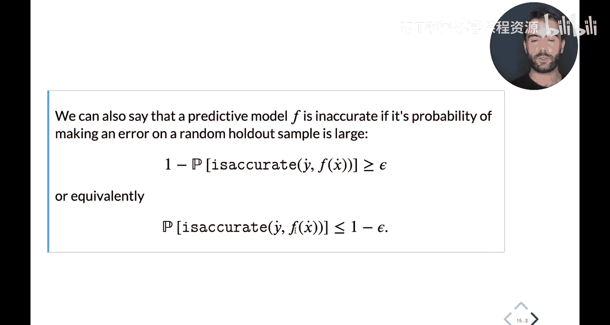

反之，如果模型在留出数据上犯错的概率至少为 \(\epsilon\)，则认为它是不准确的。

---

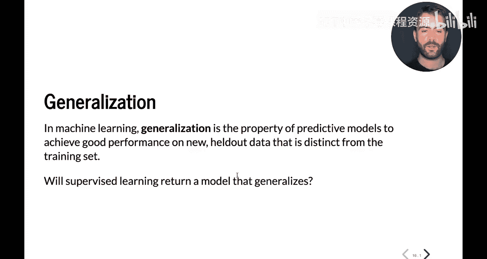

## 泛化能力 🌉

模型在不同于训练集的新数据上取得良好性能的特性，被称为**泛化**。我们希望监督学习方法返回的模型具有良好的泛化能力。

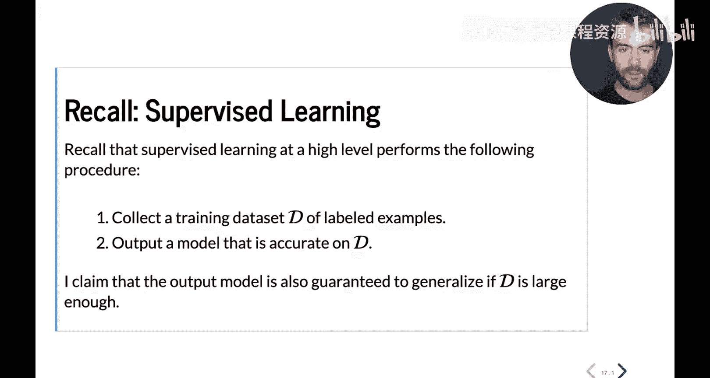

---

## 为什么监督学习能返回泛化好的模型？ 🛠️

监督学习的高级流程如下：
1.  收集带标签的训练数据集 \(D\)。
2.  运行学习算法，找到一个在训练数据集上拟合良好的模型。

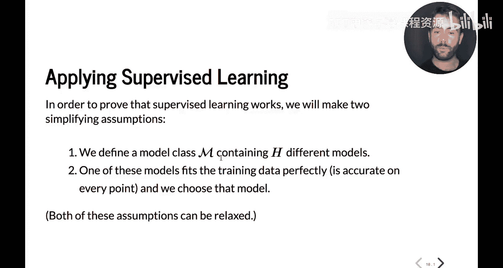

我们声称，如果训练数据集 \(D\) 足够大，这个流程将返回一个泛化能力好的模型。下面简要说明原因（基于两个简化假设）：
1.  **有限模型类**：我们工作的模型类 \(M\) 中最多包含 \(H\) 个不同的模型。
2.  **完美拟合假设**：模型类 \(M\) 中至少有一个模型能完美拟合训练数据（即对每个训练样本都预测准确），并且学习算法会选择这个模型。

**论证思路**：
*   假设监督学习返回的模型 \(f\) 是不准确的（即泛化差）。
*   由于 \(f\) 被选中，它必须完美拟合了所有 \(n\) 个训练样本。
*   因为 \(f\) 不准确，它在任何一个随机样本上预测准确的概率最多为 \(1 - \epsilon\)。
*   因此，\(f\) 完美拟合所有 \(n\) 个**独立**训练样本的概率最多是 \((1 - \epsilon)^n\)。
*   考虑到模型类中最多有 \(H\) 个不准确的模型，那么**任何一个**不准确模型完美拟合训练数据的概率最多是 \(H \cdot (1 - \epsilon)^n\)。

随着训练样本数量 \(n\) 的增加，概率 \(H \cdot (1 - \epsilon)^n\) 会以指数速度趋近于0。这意味着，只要我们有足够多的数据，监督学习算法返回一个不准确（即泛化差）的模型的概率将变得极低。

**结论**：在数据量足够大的情况下，监督学习算法返回的模型几乎肯定能很好地泛化到新数据。

---

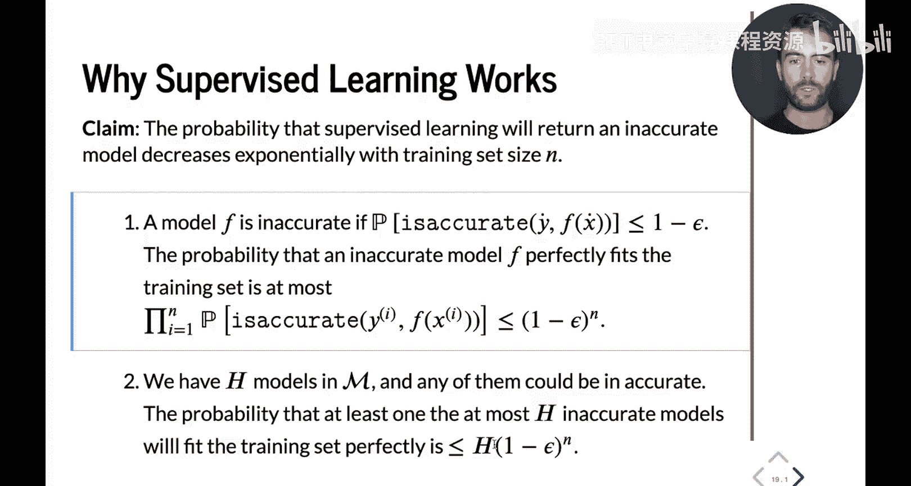

## 总结 📝

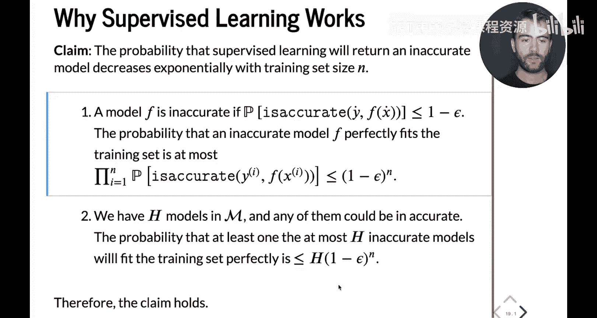

本节课我们一起学习了：
1.  **数据分布**是理解监督学习的基础假设。
2.  **好的模型**需要在未见过的留出数据上表现准确，这引出了**泛化**的核心概念。
3.  我们形式化定义了模型的准确性，即模型在留出数据上犯错的概率应低于一个阈值 \(\epsilon\)。
4.  通过一个简化的理论论证，我们说明了为什么在拥有足够多训练数据且模型类有限的情况下，监督学习能够返回泛化能力强的模型。

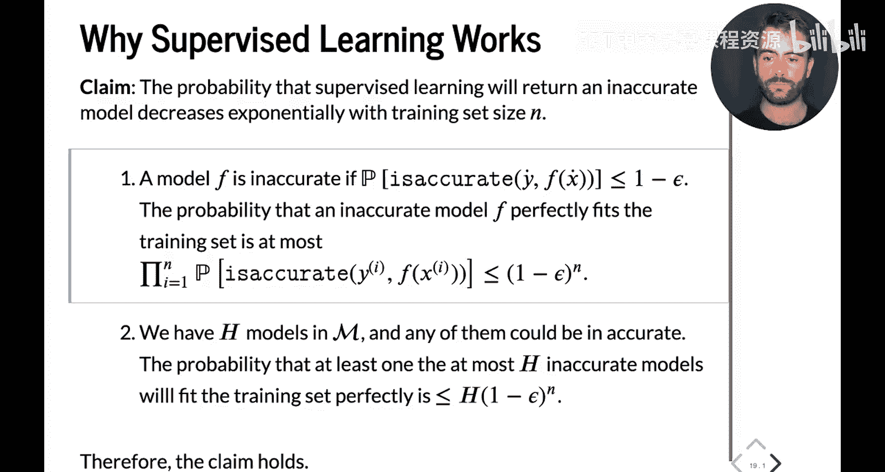

在下一节中，我们将利用本节定义的准确性和泛化概念，来分析当数据量不足或其他条件不满足时，监督学习可能遇到的问题和失败模式。