# 康奈尔大学《应用机器学习 CS 5787_ Applied Machine Learning 2020》中英字幕（deepseek p14 -14-Lecture 4. Part 3_ Overfitting and Underfitting.zh_en -BV12udzYvEFM_p14-

Hi， this is partt3 of lecture 4 of applied machine learning。Now in this part of the lecture。

 we're going to look at a few reasons for why supervised learning might not work。

In the previous video， we gave a general argument for， well first of all。

 we defined what it means for supervised learning to work， what it means to have an accurate model。

 and then we gave a high level sketch of a proof for why applying supervised learning with high probability output accurate models。

Now in this part of the lecture we're going at slightly we're going to take somewhat of an opposite angle。

 and we're going to see a few failure modes of supervised learning and how we can mitigate them。

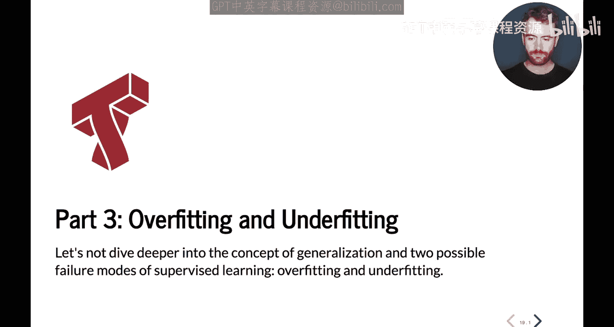

So recall that a really key concept in machine learning is generalization and in order for a model to be accurate。

 it has to generalize。So specifically， we assume that the data that our training data。

 or in fact the data in general is described by a probability distribution P。

 and we have access to our training data is a set of samples from this distribution。

And then we also have another sample that's distinct， which is called the holdout set。

And if the model generalizes， it means that it is accurate on the hold outset。

 and this means that the model will be providing us with accurate predictions when we deploy it in the real world and we're going to see new data that is distinct from what we have seen in a training。

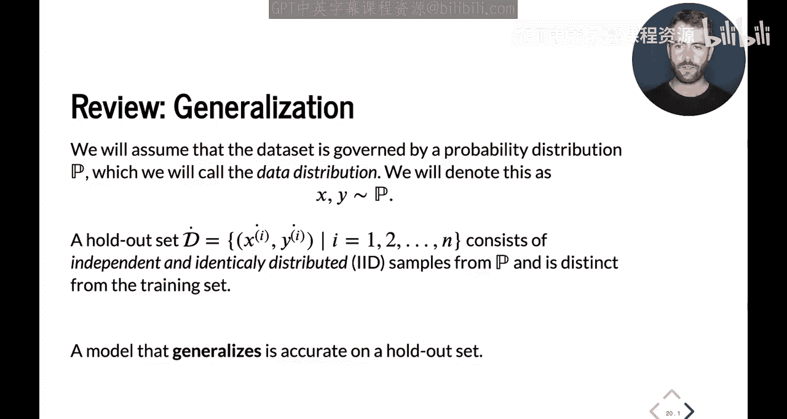

Now let's look at an example of what happens to generalization when we fit one of the models that we saw earlier in this course in particular polynomial regression。

Recall that in polynomial regression here I'm defining it in one dimension so we're just going to fit a curve。

 a one dimensional curve going from x to y， so going from a real number to real number。

 and in polynomial regression， we fit a model of this form， which is linear in a set of features phi。

And these features phi are themselves not linear， they go from r to a higher dimensional space。

 and if we choose a set of features that has this form。

 then we can then then the class of models of this form corresponds to the set of polynomials of degree at most be。

So by and then we saw that we can use our machinery for fitting a least squares model to fit nonlinear models of this form。

 which are polynomials。

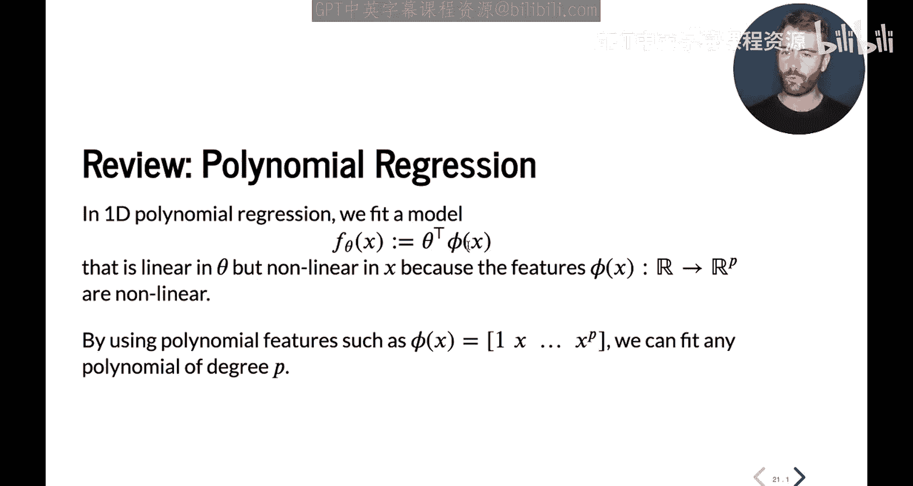

So why would we use polynomial models， as you can imagine。

 as we switch from linear models to polynomials， we can fit the data much better and therefore we can increase the accuracy of our models。

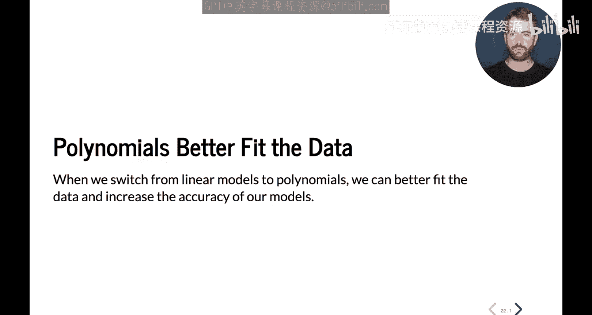

To give you an example of what I mean， let's again revisit the same example we've been using in the previous videos here we have this curve and I've sampled this training set that I showed you earlier。

 it's shown here in blue。

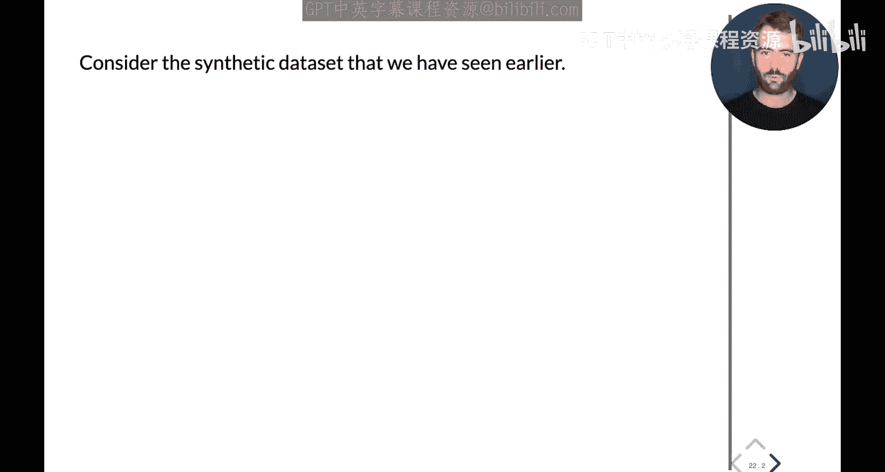

And now let's consider fitting a few models if you putno new models to this data set。

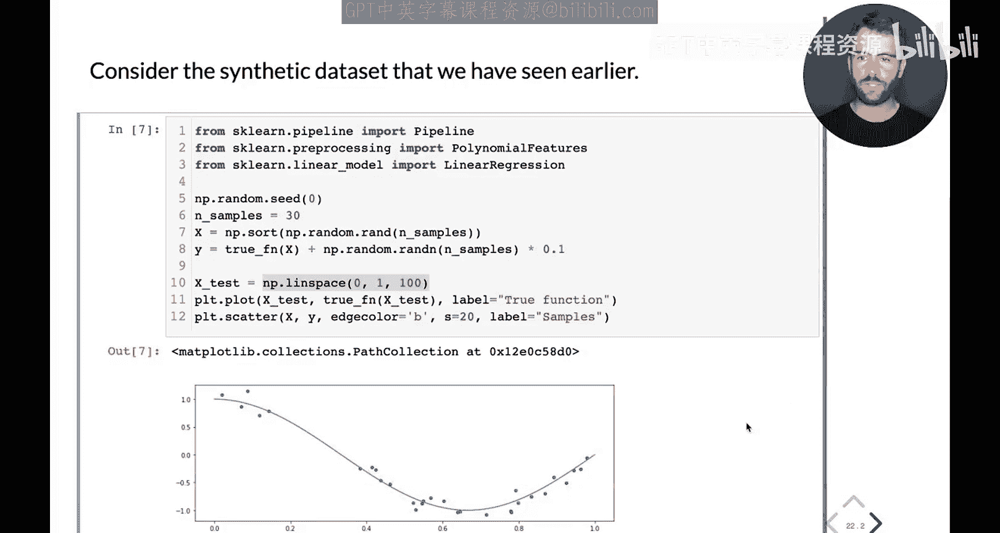

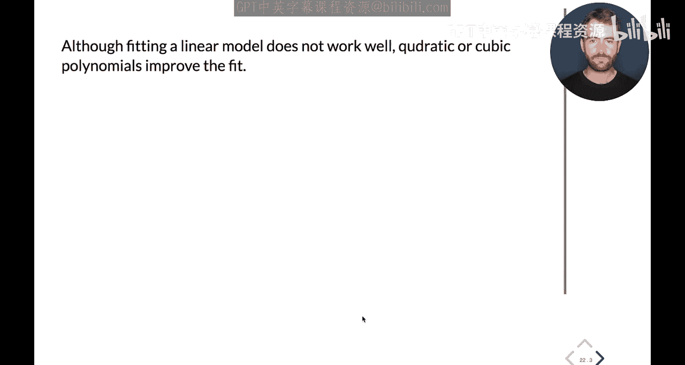

So here I'm fitting a polynomial of degree1 which is just a straight line which is just a line polynomial of degree 2 and a polynomial of degree3。

 and you can see that as we increase the degree of the polynomial here clearly this function is nonlinear and so this linear model doesn't really provide us with a good fit。

 but now when I increase the degree of the polynomial to2。

Already we're able to capture the main flex of the curve here much better and now if I set the degree to3。

 then we're fitting the curve very， very closely and here you can see the the Python Nmppy and psychicL code that I used in order to generate these three polynomials essentially I just created a set of polynomial features which is something that comes from the psychic learn library and then a fi linear regression on top of it so it's using the same algorithm that that we saw earlier underneath the hood but I'm just relying on a standard machine learning library on psychitLarn。

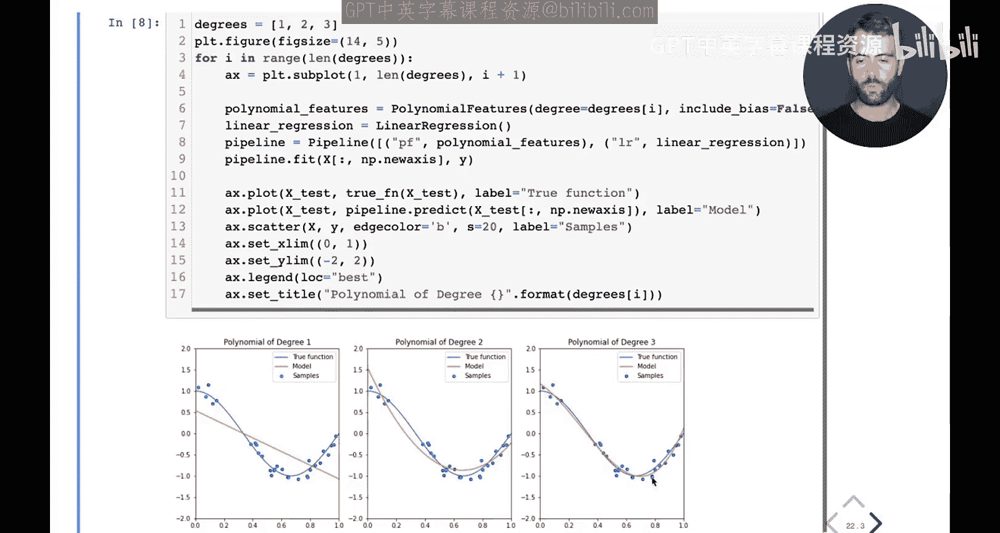

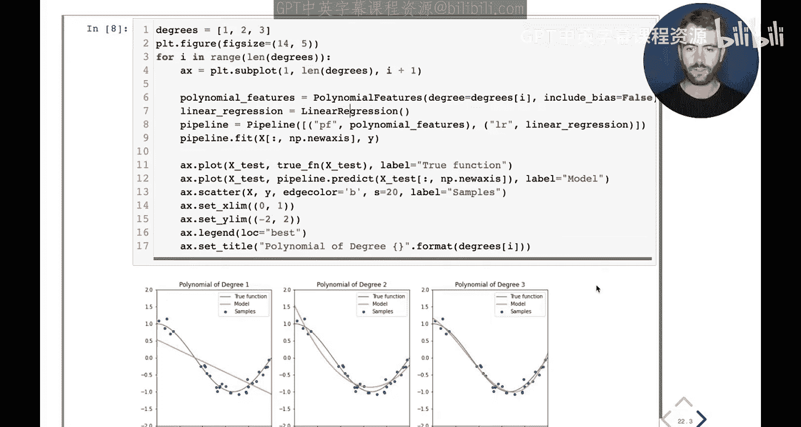

So the takeaway here is that increasing the expressiveness， the expresssivity of our model。

Helps us to better fit the data。

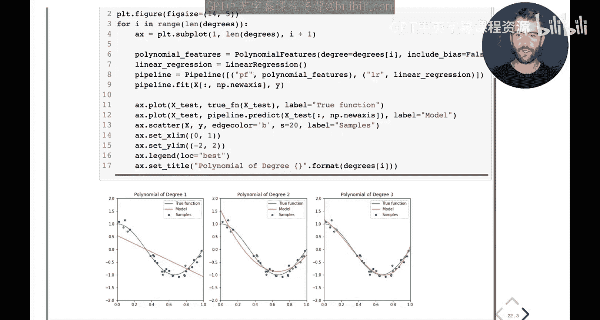

And so let's see what happens if we now increase the capacity of our model even further。

 Let's now consider polynomials of an even higher degree。

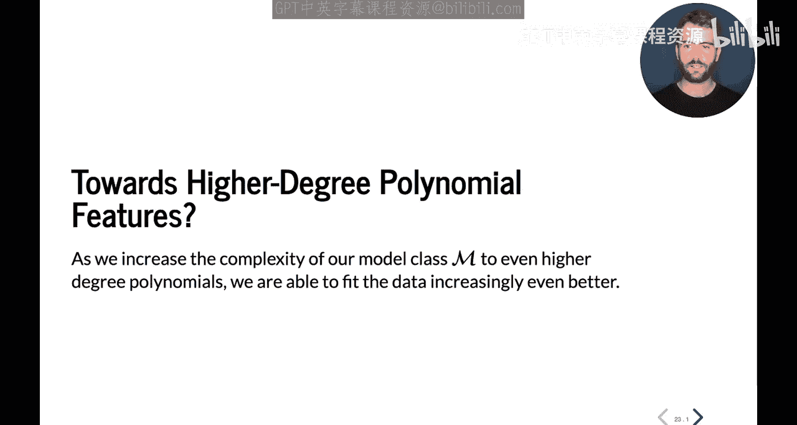

So here I'm now fitting a polynomial of degree 30。

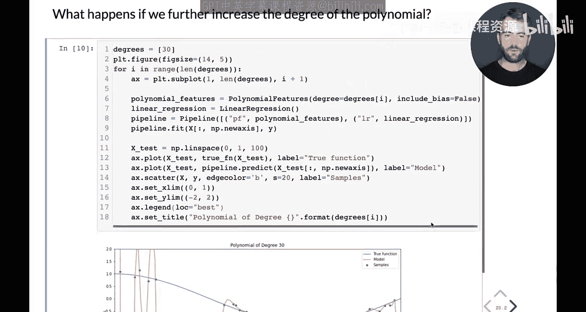

So this is a very very high degree polynomial has degree 30 and you can see here that it fits the data really well right so here it hits this point perfectly and this one and this one and at all of these points it fits the curve it fits the data almost perfectly。

But now you can also see that we have a problem。 the orange curves look the orange curve looks nothing like the true curve here。

 which is in blue。We have these really， really massive fluctuations。

 these massive changes in the value of the orange curve， which is the model that we have fit。

 and even though it's correct at the blue points，Its predictions are wildly inaccurate。

 It's way off the blue curve at everywhere else， except these blue points。

And so now this is clearly problematic because this orange line is unlike anything that's in the true data set。

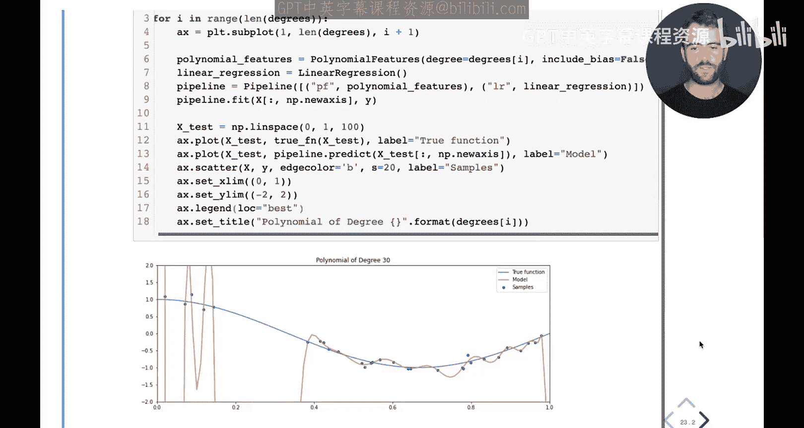

So this here， this example here shows why increasing model capacity is not the only thing that we need to care about。

Again， here in this example， we were able to fit the data perfectly。

 but its predictions were simply horrible。

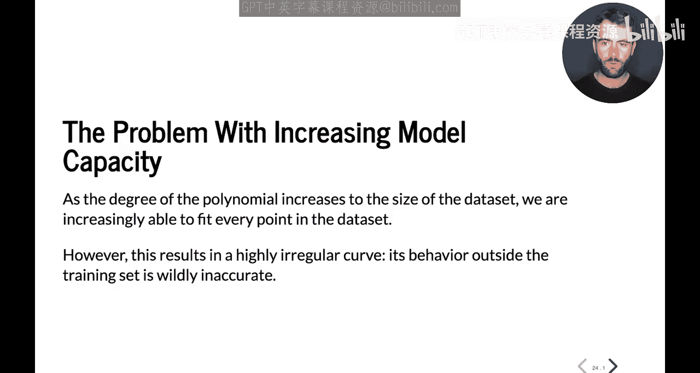

So what does it mean？The example that I gave you is an instance of what is called machine learning overfitting and overfitting is one of the main concepts that you need to understand in order to apply machine learning in practice overfitting is a hugely important concept in machine learning and it's perhaps one of the most important failure modes of a machine learning algorithm。

Again， essentially the idea is that when we overfit the data。

 we're able to fit our training dataset set perfectly。

 but doing so makes the model wildly inaccurate in areas that are outside our training region and therefore the model doesn't generalize。

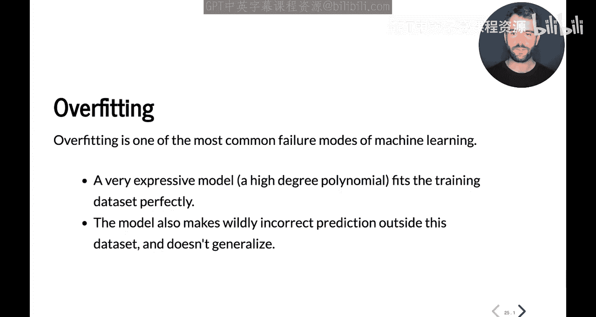

Overfieding is also closely related to another concept called underfitting。

And underfitting is essentially the problem that we saw at the very beginning when we tried to fit a linear model to the data。

 So in that example， we tried to fit a straight line。

But the straight line did not fit the data well at all because the true function was much more complex。

And so this model will also not be accurate on new data because if it doesn't fit the training data well。

 the heldout data will come from the same distribution and the model will also not be accurate on that data。

And so finding the trade off between overfitting and underfitting is one of the main challenges in applying machine learning。

And finding the right balance between the two is one of the main problems that you need to solve in order to have a machine learning system that works well in practice。

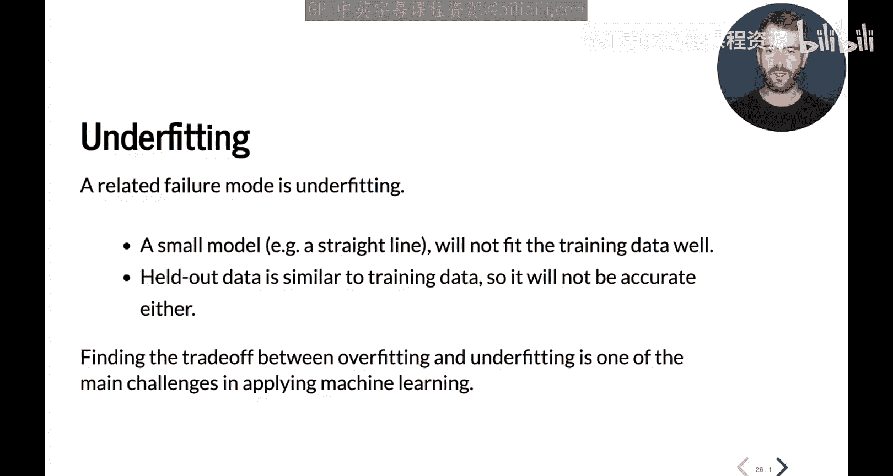

嗯。

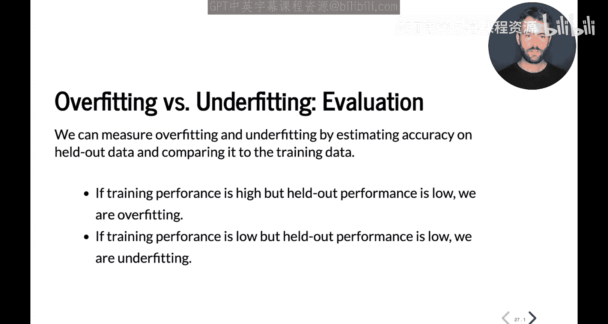

And again， an example of what an accurate model would be here is in the earlier example with the polynomial functions that were fitting our curve。

 a model that is neither overfitting nor underfitting would be one that follows the curve smoothly but is not providing any。

 but doesn't have any of these wild fluctuations that we saw earlier。

 it would be something like the polynomial of the G3 that we saw at the very beginning。

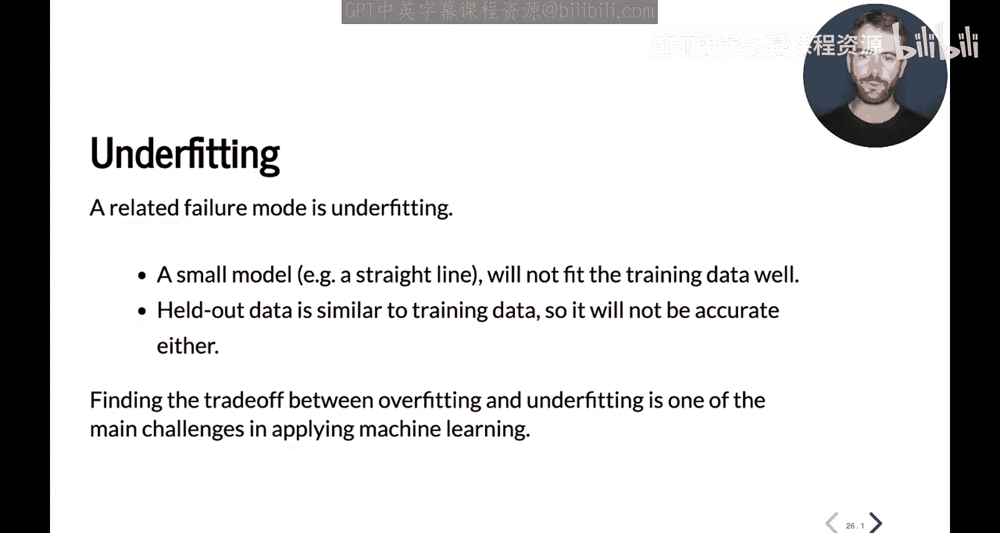

So how can we tell that our model is overfitting or underfitting？

We're going to revisit this much more closely later in the course when we're going to talk about how to deploy and analyze and debug and improve machine learning models in practice。

 but at a high level a model is overfitting， has really high training performance。

But if we take a holdout set， the performance on that holdout set is going to be really low。

And this holdout set is something that we can either create ourselves or it's something that we're going to encounter once we deploy the model in the real world。

And finally， at the same time， conversely。Underterfitting means that。

Our training performance is going to be low and therefore the performance on the hold outside is going to be low as well。

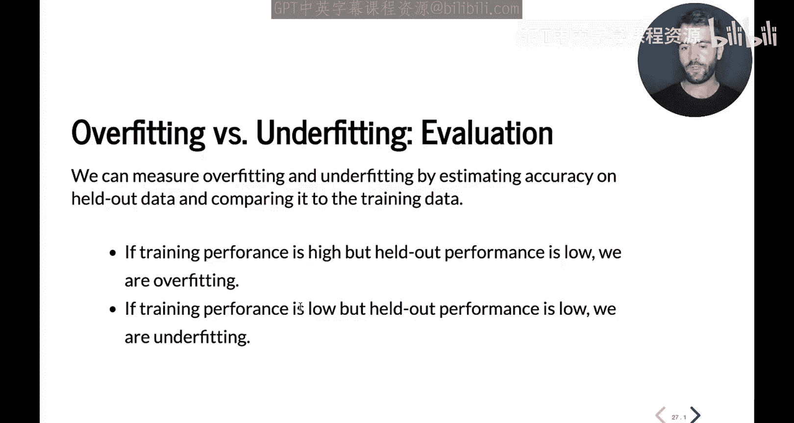

So here I am again showing an example of overfiing and underfitting on a holdout set。

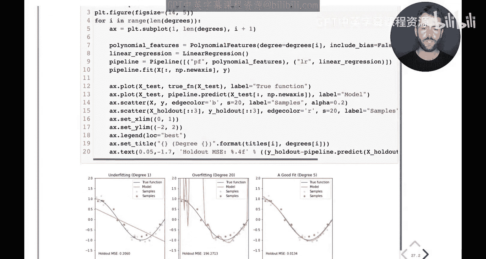

Here， again， we have， I have exactly the same curve and the same training set。

 And now I am plotting a small number of。

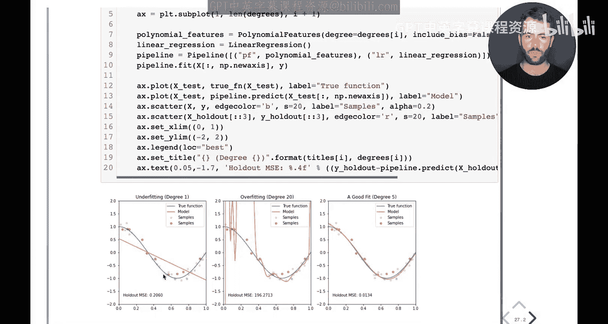

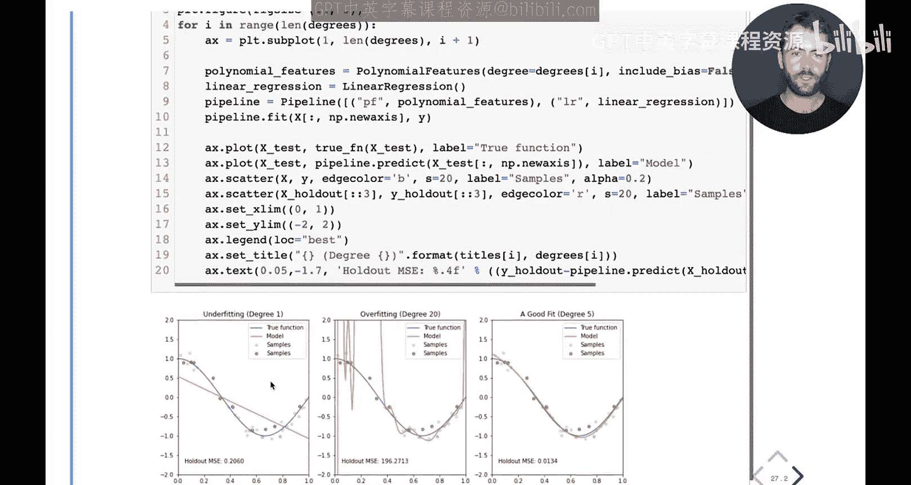

Of held out samples in red here。And I am fitting three models。On the left。

 I'm fitting a simple linear model。And clearly， this model is not very accurate on the red points because it's simply not flexible enough to capture the true shape of the data。

 And so here， if we compute the mean squared error on this hold outet， we have。Val of was 0。2。Now。

 if I fit a polynomial of degree 20， again， we have this crazy curve which looks nothing unlike the true data。

 and here we have a massive holdout error。And finally。

 a better polynomial fit here is one that has degree5。And if we fit this data。

 we now have a holdout error of 0。01， which is the lowest of the three。

 and also visually we see that the orange line fits that it passes really closely to all of the red points and also it matches the shape of the true curve which we know here。

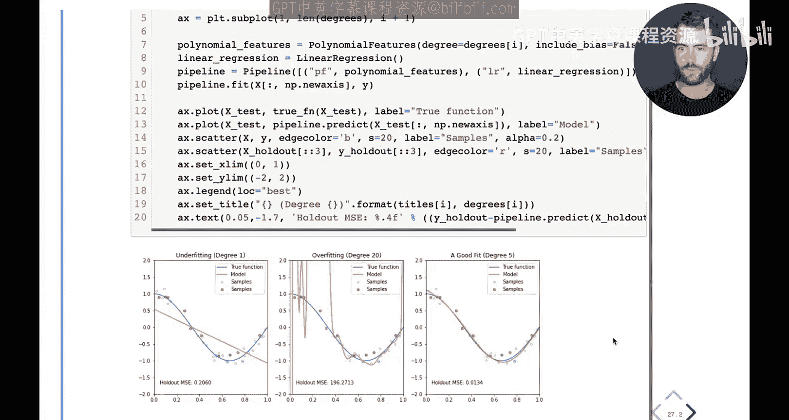

So overfitting and underfitting are two really important problems that have deal that we have to deal with in machine learning。

How do we address these problems in this course， we're going to see a lot of strategies。

 but for in this video， let me just give you a high level a few high level examples so if if we have a model that's underfitting the data。

The solution is to increase the class of models that we consider and add more complex models to this class。

So for example， this could be a set of this could be nonlinear models or it could be models that are linear。

 but that use more expressive features So for example。

The polynomial features that you saw earlier are an example of more complex features。

 although it's also closely related to using more expressive models。

 but we could also use our own intuition to handcraft certain features， so for example。

 if this was an example of diabetes and we knew that men with。

That old men were particularly at risk of the diabetes。

 but our linear model could not combine the future man and future age。

 we could create this feature manually such that a linear model would be able to account for the fact that being an old man is an important risk factor and assign a proper weight。

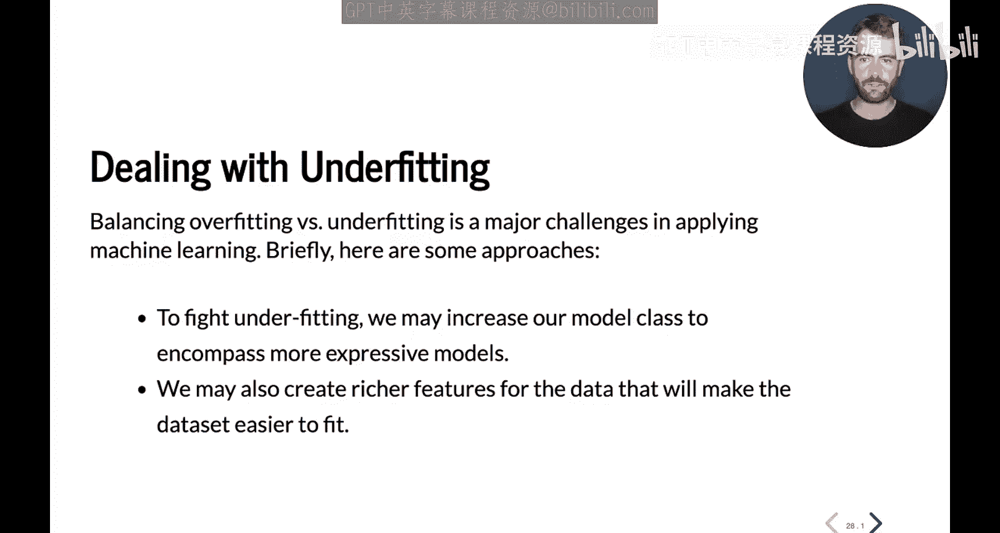

In order to deal with overfiing， we have to do the opposite。

 we have to find a way of reducing the complexity of our models by reducing the size or the complexity of the model class M。

 essentially our model class has models which are too expressive relative to the size training of our training set and that are able to fit this training set perfectly。

We need to reduce the size of the models that we consider in order to restrict ourselves to models that generalize better。

One one way of doing this is to directly change the class of models that we consider， so for example。

 we could go from using a highly nonlinear machine learning algorithm or supervisor learning algorithm that works with nonlinear models。

 change we could change it to a different supervised learning algorithm which only works with linear models or we could also find a way of penalizing these complex models by keeping the same model class。

 but changing our objective function such that it is incentivized to choose the models that are simpler。

This second way of dealing with overfiing is actually really important and it's something that's widely used in practice。

 and that is something that I want to talk about in more detail in the subsequent videos。

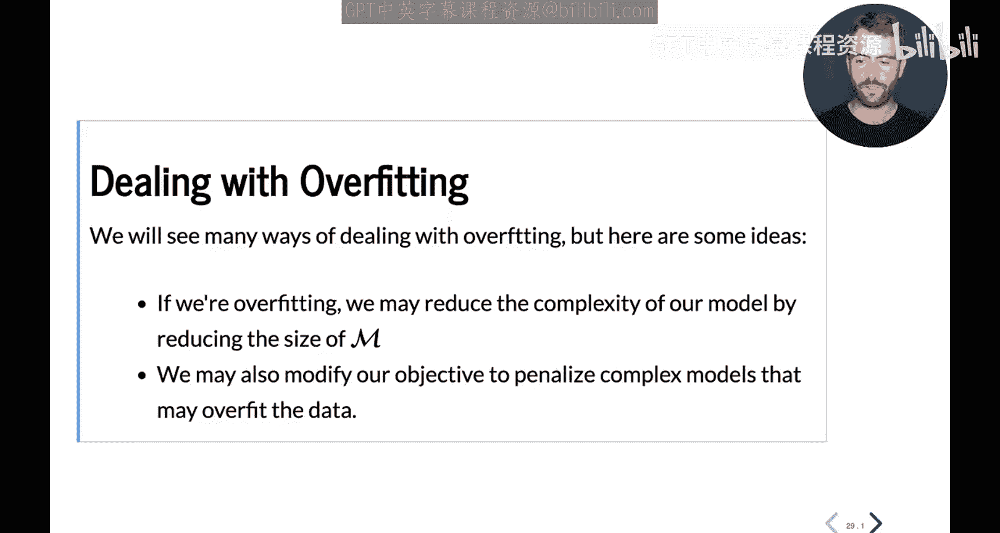