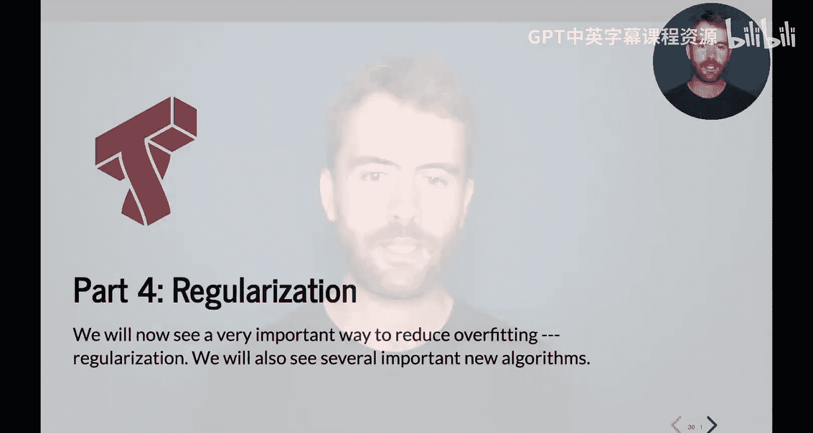
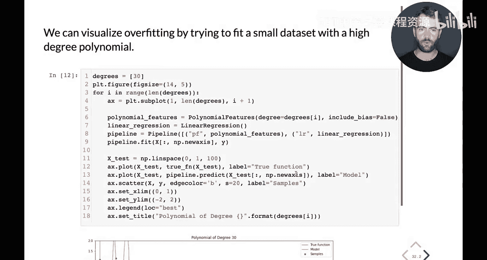
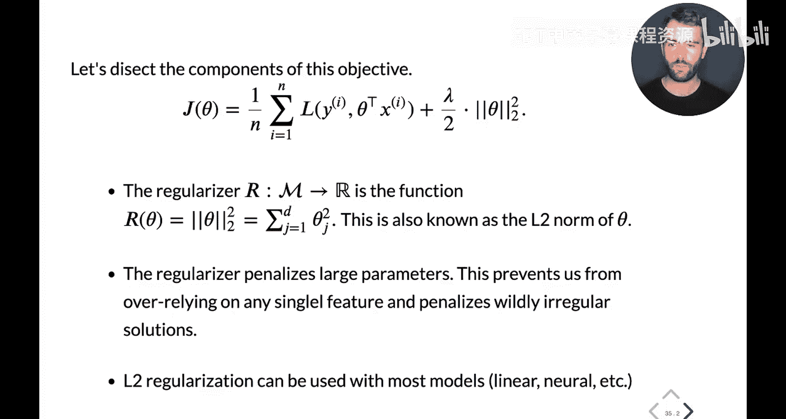
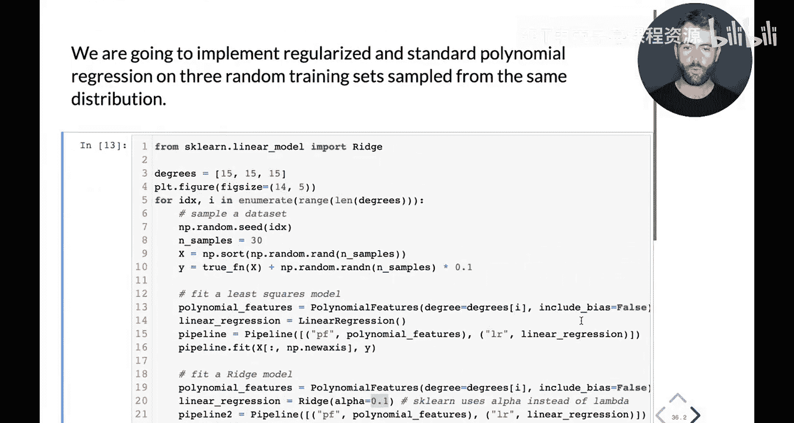
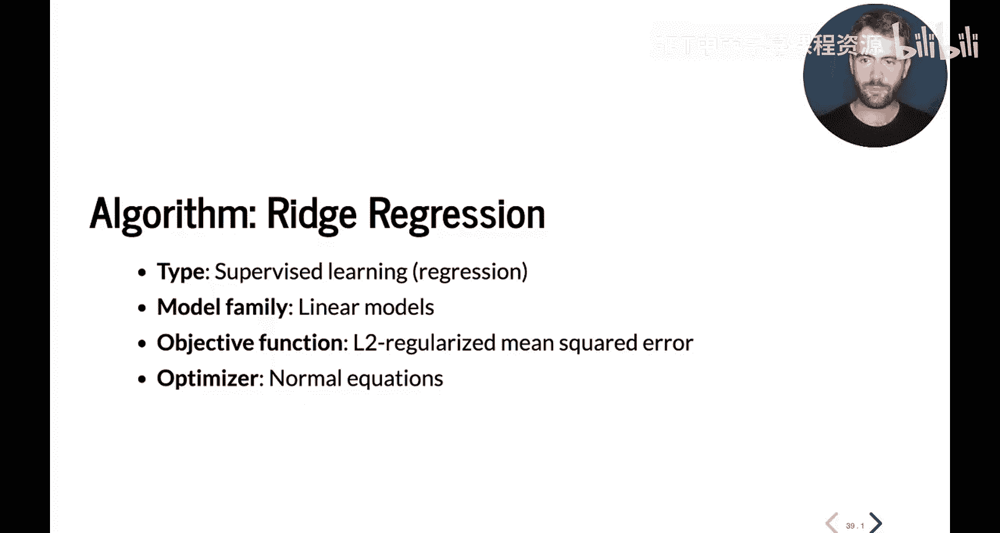

# 康奈尔大学《应用机器学习 CS 5787_ Applied Machine Learning 2020》中英字幕（deepseek p15 -15-Lecture 4. Part 4_ Regularization.zh_en -BV12udzYvEFM_p15-

We're now back to part4 of lecture 4 of applieded machine learning。

In this lecture， I am going to talk about something called regularization。In the previous videos。

 we looked at overfitting as being a major problem that affects machine learning algorithms and supervised learning algorithms in particular。

And we saw a few ways in which we briefly saw a few ideas and approaches for how we could reduce overfitting and regularization is one of these approaches that I want to discuss in more detail in this video and also while as we see overfitting。

 we will also define a few new important machine learning algorithms。So to begin。

 let's again revisit the setup that we've been using throughout this lecture。

 we are in a setting in which we have data that is sampled from a data distribution in order by P。

 and we have both a training data set as well as a holdout data set。

 which are IAD samples from a data distribution P。And we say that the model will generalize if once trained on the training distribution。

 it also performs well in the real world on new samples。

 and in particular it will perform well on a holdout data set of examples。Now。

 one of the reasons why supervised learning might not work is if we choose a model that's too complex for the data size that we have。

 if we have a small data set， it is possible that we're going to fit our data perfectly and this data still be the model that we will find will work really well on this data。

 but it will work really badly right outside the training set and therefore it will not generalize。

We saw a really simple example of how this could look like here we have a training data set which consists of the blue points and the blue points are all samples around this blue curve which is the true shape of the data and here a fit polynomial of degree 30 and this polynomial is really accurate on our training set here it almost perfectly。

It almost perfectly fits the blue data points， but right outside this area its performance is really it's really bad。

 its performance is really bad outside the neighborhoods that are really close to these points。

 and so here this is an example of massive overfitting。

The idea of regularization is to reduce overfitting by changing our objective to include a term that penalizes complex models。

So for example， in this setting with the with polynomial regression。

One way of doing regularization would be to optimize for functions that fit the data well。

 but also assign a penalty when the function fits the data well has a really high degree。

When it's a high degree polynomial， let me give you a more general definition of regular regularization。

 and then we are going to see how it can be applied to settings like the one we just saw earlier。

The high level idea of regularization is as follows。

We define an augmented objective J that is assigning a score to elements of our model class M。

 and this objective J consists of a loss function that's defined on our training dataset set。Plus。

 an additional term here are， which is going to be called the regularizer。

 which penalizes models that are complex。Now let's dissect this objective again。

 as I mentioned earlier we have an objective function L and again this could be something like the mean squared error and if we only had L。

 then we would have a standard linear regression problem and we could compute the normal equations and this would give us the least squares algorithm and now we have added this extra term R which penalizes certain models if they are complex according to some definition of complex and we're going to see an example earlier。

 and finally this lambda here is this is a regularization parameter which controls the strength according to which we penalize complex models。

Of course， in practice， our models are often parameterized by parameters theta。

 and therefore we can write this expression as follows as using this equivalent notation in which everything is a function of theta。

So what can we use as a regularizer in practice， What is a good example of how a regularizer might look like。

I'm going to define here a first example of regularization， which is called L2 regularization。

 and this is going to be a really important approach that is widely used in practice and that is actually going to solve the overfitting problem that we saw earlier。

So assume that we have a linear model of the following form。

 this is again the same model that we saw in the earlier lectures。

And the idea of L2 regularization is to define an objective in which the regularizer consists of the L2 norm of the weights theta。

So this here is simply the sum of the squares of the weights of the vector theta。

Let's again look at these components here， as I mentioned。

 the regularizer is simply the sum of the squares of the parameters。

 and this is called the L2 norm of theta， which is why this or sorry this dissentation here is something called the L2 norm of theta theta is a vector it has a norm and this is one such norm called the L2 norm。

 and。This is what gives Lreization its name。Now this regularizer penalizes large parameters I'm going to give you a few ways of understanding why this is helping with overfitting。

 but one way is that it prevents us from overall relying on any single feature。

And it also happens to penalize models which have this erratic irregular behavior that we saw earlier。

And finally， I want to add that even though L2 regularization is defined here。

 I have defined it in the context of linear models。We can also apply this with many of the models。

 many of the machine learning models that we're going to see later in the course。

 such as neural networks or support vector machines。

 we have different ways of applying regular we can apply little to regularization any time when we have a vector of parameters theta。

So let's now see how we can apply L2 regularization to polynomial regression。

In the context of polynomial regression， recall that we have these polynomial features phi and we have we're fitting a linear model over these polynomial features and we're using the mean squared error loss so here this term is simply the standard objective for linear regression。

And on this side， I have added our new L2 regularizer。

So here I'm going to start with a demonstration of what。Of what this algorithm can do。

Here I'm going to fit several instances of the model for different data sets。

So here I have this function。Here， I have a function that's。

So we're going to be using data that's still sampled from the same。Function。

And I am going to fit to this data a few different models。 So again。

 this is here I have the same set of blue points that we had earlier。

 and here I just sampled another set of another training set and another training set。

And now I am fitting two polynomial regression models， which have degree 15。

The blue model is one that has not been regularized and you see here that it has this erratic behavior that we talked about earlier。

 so it has these wild swings and clearly this doesn't look like the data here it has a massive swing in this region。

And in orange I have the same model， but to which we have added a regularization term with a regular regularization parameter of 0。

1 here again I am using standard pschic learn implementations of these algorithms in the next few slides I'm going to define how this is implemented internally。

 but for now you should just see this as two types of models that we have fit to each of these three samples from the same distribution。

 and you can see that the blue model outputs a really different prediction every time whereas the regularized orange model outputs something which looks much more reasonable and which looks much more like the true shape of the data so this is just a demonstration of how Alregization with can really help us with this with this overfitting problem and also this approach happens to be really simple and easy to implement。

And in order to gain a little bit more intuition， we can look at the weights that have been found by the regularized model and the non regularized model。

So these are weights from the non-regularized models and you can see that these weights are huge so this one is on the order of 3000 this one is on the order of 10。

000， this one is on the order of 1 million， this weight is on the order of 10 million and these are just 10 weights that I have sample。

 these are just the first four weights of the 15 that our model has learned。

So what this means is that in practice numerically in order for a polynomial function to perfectly fit our data points。

 it has to have really it has to have numerically high weights。

 this is another intuition for why reducing the magnitude of these weights forces us to have a smooth function so when weights are small。

 the function has to be smooth because in order to get a nonsmooth function。

 we need to have these really large weights to specify it。

So now if we look at the same set of weights but when the mo has been regularized。

 these are much smaller， these are-2。7-1。20。9 they're all small and wellbehad and as a result the curve also is really well behaved even though it is still a 15th degree polynomial again I just want to emphasize here that the orange curve that we have fit here that is still a 15th degree polynomial but this is a 15th degree polynomial with very small and well behavehad coefficients and as a result it looks like like a well behavehaved curve that we would expect。

One practical question that I want to briefly address is how do we choose the parameter Lambda。

 Lambda is what is called hyperparameter of the model， and we're going to revisit this in much。

 much more detail later， but I just want to give you one way in which we can use in which we can define Lambda in which we can set the value of Lambda to something that works well and we're going to。

Later look into we're going to look in more detail why this is a good idea。

 but essentially a simple strategy here would be to just set Lada to something that works well on a holdout validation set。

 So imagine we have our training set。 and then we have another holdout set。

 a small holdout set that is distinct thing from the training set。

 we can choose the value of Lada that gives us best the best performance on this holdout set。

 And this is a way of estimating our generalization error。 Again。

 we will revisit this in much more detail later， but I just want to give you one。

 I just want to mention briefly that there's there there are several standard ways of choosing Lambda。

And finally， in the few remaining slides， I want to look at the question of how we might fit a linear model。

 a regularized linear model of the form that we have seen earlier。

So recall that a machine learning model， that a supervised learning model。

That a supervised learning algorithm， sorry， consists of a model class。

 an objective function and an optimizer。 We have seen what our model class and what our objective look like。

 We have linear models， and our objective is an L2 regularized loss。But how can we fit this loss。

It turns out that there is a simple way of doing this。

 which is a simple modification of our approach for fitting a nonreized least squares model。

So we can write the regularized objective in this form， which is the same form that we saw earlier。

 and here I have replaced the mean squared error with its vectorized form you can again revisit our lectures on least squares to see how we came up with this particular definition。

 but again this is the same notation as we used in least squares。And。

Now that we have this vectorized form of the objective function。

 we can apply a really similar approach to derive the gradient for this expression。

Here the gradient is simply the gradient of our loss plus the gradient of the regularizer。

We have already computed the gradient of this loss in our previous lecture。

 and it has this form here， so this is the form of the gradient of this loss。

And now we just need to compute the gradient of this function。

 but this happens to be just lambda theta。 This is using the following identity。

 using the following identity。 We can easily see that the gradient of this objective is just。

Lambda theta and。Maybe in case this is not clear this notation here。

 which is the L2 norm that is just equivalent to the vector transpose with itself。

 so this term here also is equal to theta transpose theta or it's equal to the dot product theta with itself。

And now that we have this form， we can rewrite this in a slightly more convenient form， which is。

Almost the same thing that we had earlier with our unregularized normal equations。

 except we have this extra Lada term that appears here。

And in the same way using the same strategy as we followed earlier。

 we can set the derivative to0 to obtain a set of normal equations which have this form。

 and now we can again， obtain a closed form for the optimal theta by solving for theta in this equation to obtain the following form。

So here we have again derived a set of normal equations which can be solved and which can give us a closed form expression for the L2 regularized model that we saw earlier。

And finally， another important thing I want to note here is that this matrix will now be always invertible。

 That is because it has full rank because the matrix here I has full rank and so adding this matrix to this full rank matrix again results in a full rank matrix hence it will be invertible so we have seen how we can fit a regularized model and we have also seen how we can address the potential numerical issues that we mentioned earlier so when we were working with unregularized rid。

 we said that this matrix could in theory be not invertible。

 but now by adding a small regularizer we can make it perfectly invertible and so in practice this is something that we might do in order to。

We can regularize our model by a small amount in case there are any issues with inverting this matrix。

So the result of this is an algorithm that is called Ri regression。

 so Ri is just another name for L2 regularized regression。

And this is an algorithm that that is an extension of least squares。

 in fact it's almost the same algorithm we are using it's a form of supervised learning and regression in particular。

 it's a form of linear model， he uses the form of linear models and it optimizes them using normal equations and the only difference is that our objective function is now the L2 regularized mean squared error。

And again， Ridge is there a very important algorithm in machine learning that is widely used in practice。

 so this is not atoy algorithm， this is something that's used in production widely in various machine learning systems。

And it performs much better in terms of reducing overfiing and in terms of numerical performance。

So in the next lecture， we are going to talk about or sorry in the next video。

 we are going to continue talking a little bit more about regularization and we're going to see a different form of regularization that is going to be also very important。

