# 康奈尔大学《应用机器学习 CS 5787_ Applied Machine Learning 2020》中英字幕（deepseek p16 -16-Lecture 4. Part 5_ L1 Regularization and Sparsity.zh_en -BV12udzYvEFM_p16-

This is now the fifth and final part of lecture4 of Apped machine learning。In this lecture。

 we are going to continue talking about regularization and we are going to see a new way of regularizing machine learning models that's different from the one that we saw before。

And by looking at this new regularization technique， we will also learn about sparsity。

 which is a really important concept in machine learning。

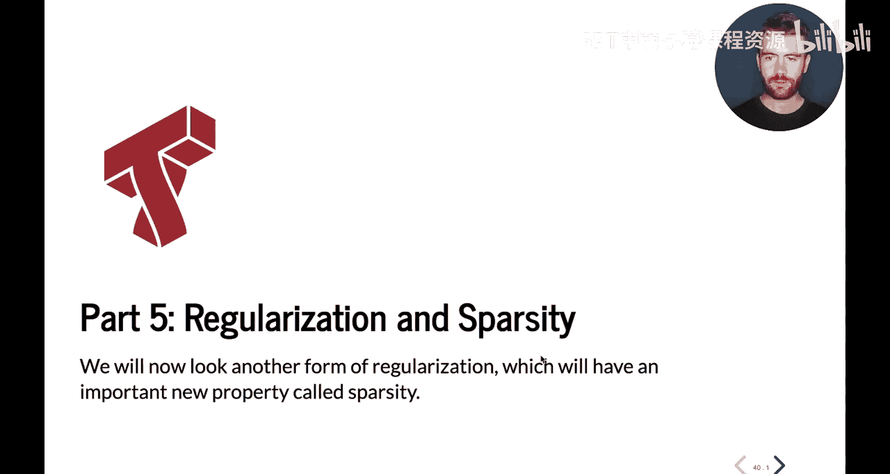

So recall from the previous video that we defined regularization as a way of penalizing complex machine learning models by taking a standard machine learning objective function and adding to it an extra term called the regularizer which assigns a high value to machine learning models that are complex。

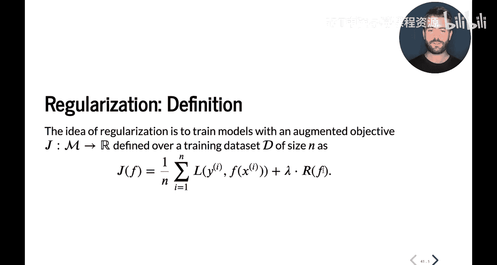

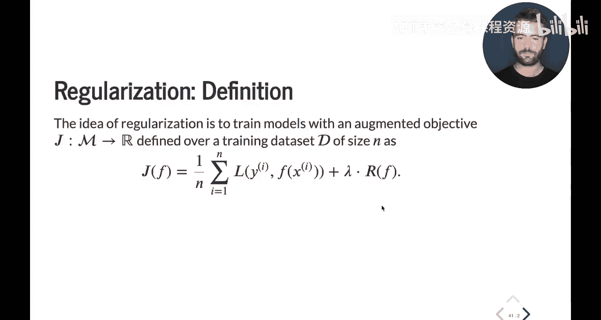

Again， looking at these different components， we have a standard machine learning loss。

 which could be something like the mean squared error。

And then we have this extra regularizer and the strength of this regularizer is controlled by this extra parameter lambda。

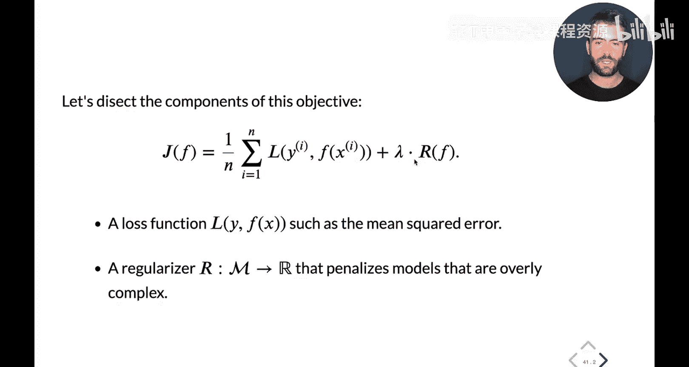

In the previous lecture we saw in the previous video， I should say。

 we saw one way of regularizing models called L2 regularization in which we chose the regularizer to be the L2 norm。

In this video， we are going to look at a different way of regularizing models。

 which consists of using the L1 norm instead of the L2 norm for penalizing complex models。Now。

 at first， you may think that this approach is really similar to L regularization and in a way it is。

 in a way that it's defined， it really is， but we're going to see that there is a surprising difference in the kinds of outputs that are produced by both techniques。

And we'll see the advantages and advantages of both of these methods。

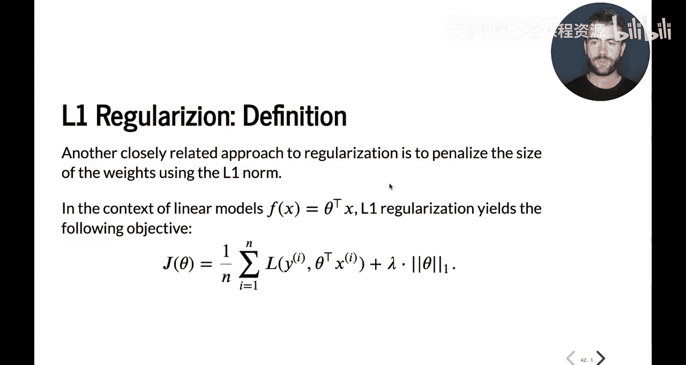

Now again， this is the objective of L1 regularization and as we discussed earlier。

 there is this regularizer term， which in the context of L1 regularization is the L1 norm。

 which is denoted as follows and this is just the definition of the L1 norm。

 it's the sum of the absolute values of the。Entries of this vector。Now。

 in the same way as L2 regularization is regularizing models。

Adding this norm will penalize large weights， and it will reduce the complexity of the model and it will enforce。

It will encourage us to choose smooth， simpler models in the same way that L2 regularization does。

However， the two norms， as we're going to see earlier。

 the two norms will be really different in terms of which solutions they choose。

The al norm will tend to choose vectors the。The solution theta of an Lreized problem will just tend to have uniformly small weights。

But the L1 regularizer will have small weights， but also most of them will be zero。

 which is going to be a really interesting and useful property of L1 regularization。

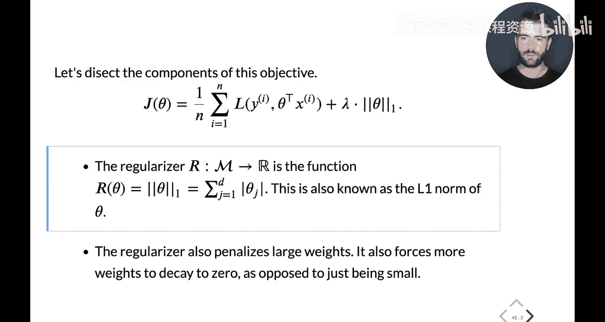

So let me start by defining and giving an outline of an algorithm， which is called the Laso。

 and the Laso is essentially L1 regularized linear regression in the same way that Rige is L2 regularized linear regression。

 Laso is the regularized version。And Laso by the way。

 stands for least absolute shrinkage and selection operator， I had to look this up on Wikipedia。

 most people call this just the Laso or an L1 regularized linear model。

 but this is a fun little acronym that the authors came up with。So as I said earlier。

 Laso is a form of it's a type of supervised learning algorithm。

 specifically it's a regression algorithm， although we can apply L1 regularization more broadly。

 but Laso is there are some slightly different definitions depending on the textbook。

 but for the purposes of this course， I'm going to use Laso to refer to。

The regression version of this algorithm that is applied to a linear model。

 and we are optimizing over the space of linear models by optimizing the mean squared error to which we have added an L1 regularized objective。

I am not going to go into a lot of detail about how we can optimize this model。

 but I will just mention a few different optimization techniques as with L2 error and as with the as with the meancor error in general and the L2。

Regularized version in particular， there are many ways in which we can compute the optimum。

A simple way would be to apply gradient descent and in fact in this course we have already seen all the ingredients that we need in order to apply gradient descent。

 so if you want， you could implement a version of this on your own。

 and there are other techniques such as coordinate descent and there are also some specialized algorithms。

 such as one that is called Lars， Lars stands for least angleng regression。

This is a more specialized algorithm for this task and there are others as well that I'm not including here。

The key takeaway you should make the the key takeaway I want to。

Leave here is that there are many common and well functioning ways of optimizing this objective and compute the optimal set of weights。

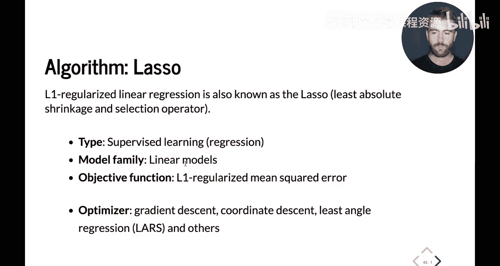

So now that we have defined both Ri and Laso， I would like to talk a little bit about the difference between the two。

 but before I do that， I just want to mention that there are two ways in which we can apply both L1 and L2 regularization to a model。

And this would be useful for in a moment explaining the differences between the two。The idea of。

Of this other form of regularization is to regularize via constraints as opposed to a penalty term。

The approach that we have seen this is。The approach that uses a penalty term。

 So we're adding this extra term here to our。Normal objective function。Instead。

 a different approach that we can take is to define a constraint optimization problem。

 So here on in the second set of equations。I am optimizing the objective subject to the constraint that the complexity of the model as measured by this term R。

Is not too large。 It's not more than some value。 Lambda prime。Intuitively。

 you should see that both of these approaches will output a model that will be。

That will be less complex than one that did not involve the regularizer。

So these are two closely related ways of controlling the penalty of the model。

 controlling the complexity of the model。 This one simply penalizes complex models and this one。

Just makes them not part of the set of models that we consider。And I will not prove this。

 but I just want to。State this as a fact that versions these two ways of applying regularization are essentially equivalent in the sense that if we start with this one。

 and we have some weight lambda， then there is a version of this problem with some different weight lambda prime which will give us exactly the same solution and vice versa。

 but this is an interesting technicality that we're not going to prove in this course。

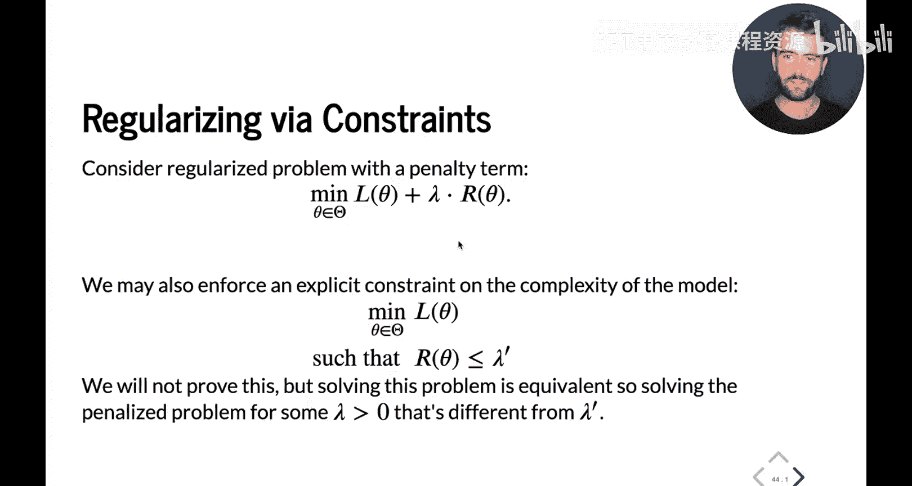

And so again， these are two approaches that are closely equivalent to each other。

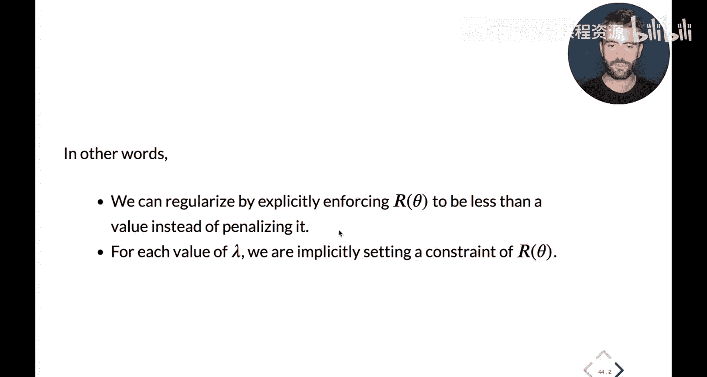

And now if we were to apply constraint based regularization to the linear models that we've seen earlier。

 we will get an objective which looks like the following here at the top。

 we're optimizing the mean squared error for a linear model and at the bottom we have a constraint on the norm of this vector。

It's constrained to be not more than lambmbda prime。And this norm here。

 we can set it to be either the L1 norm or the L2 norm， which will give us。

Both types of regularization。So now that we have this form。

 let's look at what are the differences of applying either the L1 norm or the Lto norm to this example。

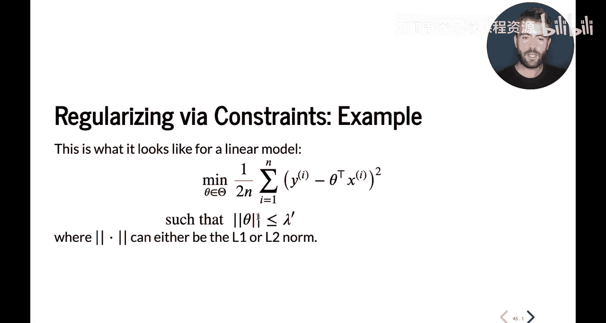

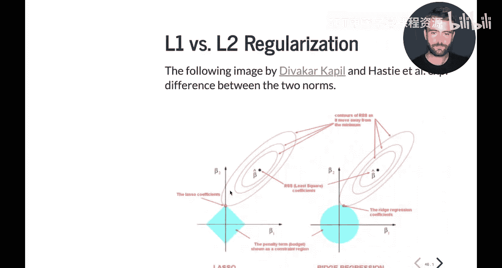

In order to illustrate this difference， I'm going to use the following figure。

 which I'm going to explain in a second。And this figure will give us an important intuition about the difference between these two regularizers。

 and then I'm also going to run through a few examples in Python and nonpyy to illustrate the implications of this figure。

So this is a figure that's originally from the textbook by Hasty at all， and it has been modified。

 there's a modified version， there's an annotated version online by Diva Carrk Appeel。

 which I took for explaining this lecture。So， here。What you， what you see here are。Several functions。

So on the here， these ellipses are the level curves of the mean squared error。

 the mean squared error is a quadratic function。And。As we saw earlier， the level curves。

 which are the points for which the which which is the set of beta for which the objective value takes the same the objective function takes the same value。

 these are these take the form of。Hllips says， as you see here。

So this outer ellipse is the set of values of beta that all have the same mean squared error。

 and the x's here are beta 1 and beta 2， so we assume that beta as a vector with two components。

 we're solving a two dimensional regression problem and so we can put the we can put these dimensions along the x and y axis here by the way。

 this is using beta， but before we were using theta。This is。

This is just the notation that we're using in the textbook。

 but essentially beta is the the that I was using in the earlier slides and so you can see here these level curves and as you would expect in the middle of the level curve。

 we have the optimal solutions to the least squares problem so if we did not have have any regularization we would simply output this。

Value of the parameters that's in the middle of the quadratic function that attaindas its lower value。

Now， however， if we in this case， we are also applying regularization。

 we're applying constraint based regularization。And the constraint on this vector beta， or again。

 this is the same thing as theta from the from this lecture， this constraint says that。

The L1 norm or the L2 norm， so on the left it's the L1 norm on the right it's the L2 norm。

 this norm has to be less than some value。And for this norm to be less than some value。

 it means that the set of parameters beta must live in what is called a ball around the origin。

In the case of the L2 norm， this is indeed a ball， so this purple region here is the set of all the betas for which the L2 norm is not more than some amount。

 which is essentially the radius of this circle。So， when the。When the norm of。

When the L norm of beta is less than lambda prime， then this vector lives inside this function。

And for the L1 norm， we also have something similar。

 except that because we're looking at the absolute value instead of the squared value of the coefficients。

Because we're using the absolute value， this。Quote unquote ball has this shape， actually。

 so it looks like a diamond。And you can convince yourself that。

That the points here inside this diamond， they all have an L1 error that is less than some number that corresponds to the length of this segment。

So these two regions are the feasible regions for our constrain constraint based regularizer。

 the value of the parameters beta has to live within this blue region and same thing here on the left。

So the point that we will choose has to be within this region。And now the question is。

 which point are we going to choose out of this blue region。Well。

 we want to choose the point that minimizes the mean squared error the most。

Which means that it has to be the point that is tangent to the outermost level curve of this function。

Now recall that these level curves， they as we move away from the center。

 the function becomes larger and larger。And so the far。

 the point that this outer ellipse is the set of points。That have。

 they have the largest value of all these ellipses。

 But this is also the first ellipse that touches the。The feasible region。

 And so this point here is both in the feasible region and also it's part of the smallest。

 it's part of the innermost。Level curve that still touches the feasible region。And therefore。

 this is the point that we're going to return if we apply L2 regularized。

Linear regression in this particular setting。If we chose some other point。

 then it would be further inside here and it would be on a level curve that's。

Larger than this one that's shown in red。 And therefore， the function would attain。

A higher loss value。 And we would not choose that。 We would choose the smallest loss that is still feasible。

 which would be this point。 And similarly， we have the same thing on the left here。

And now the really important observation to make is that these two points。

 they're not exactly the same。And this point。Aieeves some small number， some some small norm。

 And so does this point。 But this point lies。On the edge of the diamond。And in particular。

 for at this point， the coefficient beta 2 has this value， but beta 1 equals 0。

So here we've chosen a point at which one of the coefficients is zero。

And you can convince yourself that for most curves。For most angles at which these curves。

 so we could have a different mean squared error where the elliptical level curves lie along a different dimension。

 but we will almost always the level curve that is tangent to the diamond will almost always be tangent at one of the edges。

And when it's tangent at one of the edges， it means that。

That part of the coefficients that part of the coefficients are set to zero。Essentially at each edge。

 we have at least one of the coefficients that are set to zero and in high dimensional spaces a large subset of the coefficients at most edges of this high dimensional diamond will be set to zero。

And so what I've shown here is a graphical argument for why when we minimize the L1 norm。

 we will tend to return。Stets of parameters， which will have a lot of。Parameter components set to 0。

With the L2 norm， we will return some small vector of parameters where each parameter will be small。

 but with the L1 norm， not only will they be small， but a large number of them will be equal to 0。

 and that is the really crucial distinction between L1 regularization and L2 regularization。

So let's look at a few examples of what this means in practice and I'm going to implement a few versions of these algorithms。

 but before we do that， I just want to put a name on this property that I just described。

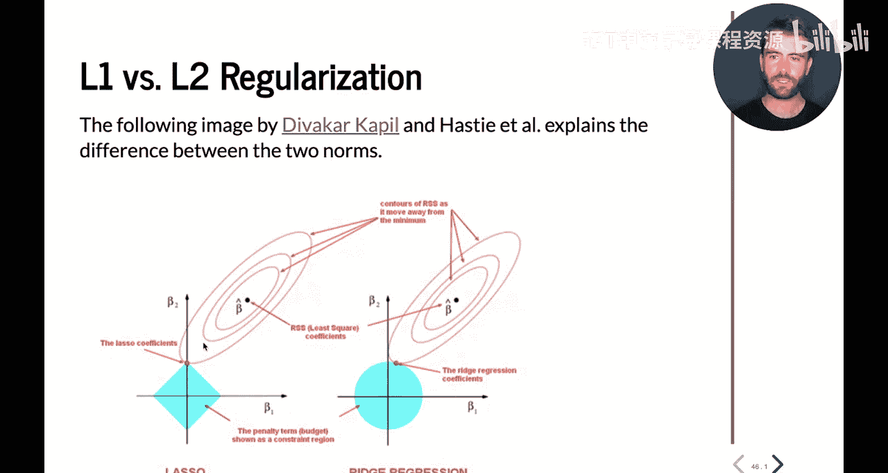

In this name， it's a really important technical term in machine learning and in mathematics more generally。

 and it's called sparsity。Essentially， sparsity is the property of a vector。

In which most entries are equal to 0， or if not most， then a large fraction is equal to 0。

 So in other words， we say that a vector is sparse if a large fractions of its entries equals0。

And the main one of the main and perhaps the most interesting property of L1 regularization compared to other kinds of regularizations is that it will output sparse weights。

 and this is going to be really interesting and important because these weights are going to be interpretable。

And what this means is that imagine we have a very high dimensional problem where we have a lot of different factors that may influence。

 we have a lot of different features or attributes which may influence the target Y， for example。

 in the diabetes example， we may have a really large set of physiological measurements。

But if we apply L1 regularization， we will find a model that is mostly sparse and which means that for most of these。

Most coefficients associated with some sort of input will be0。

 which means that the model will determine that they are not relevant for predicting the target。

 So if we have a large set of physiological measurements。

 but most of them have weights that are zero， it means that the model considers those do not be important and it will only return a small subset of non-zero coefficients and therefore by inspecting what the non-zero coefficients are。

 we can find an interpretable set of features which influence the target。 So for example。

 if if in total， we have 100 features or attributes。

 but L1 regularization outputs a coefficient where only 10。Prameterters are non zero。

 then those 10 parameters。 they exactly identify what we think are the 10 most important。

Features that are useful for predicting the target。

 which could be diabetes so we can identify the factors。

 it basically zeros out the factors that it thinks are irrelevant for diabetes and it keeps the relevant factor and because of that sparsity is really important if we want to have interpretable models。

And also， in practice， there can be computational advantages of using sparse models if we have a really。

If we have a very large input dimension， it may be faster and more practical to keep a smaller subset of the weights and we can。

 for example， discard and in the future， once we have trained our model with for predicting diabetes that only requires1 features now in the future when new patients come in to the hospital and we're using this model we only need to collect。

Features for those， we only need to collect those 10 measurements。

 and so that reduces also the cost of deploying the model both in terms of collecting measurements and then in terms of implementing it from a computational perspective。

So Sparrsity is really important and it's a really， really important concept in machine learning。

And now just to illustrate this a in a little bit more detail。

 I'm going to implement Ridge and Laso on a particular problem that we've seen earlier。

 and so this problem is again going to be our diabetes prediction task and on this slide I'm going to implement Ridge on this problem。

 but I will not only fit one Rige model I will fit here 200 possible values of the regularization parameter ins learn it's called alpha。

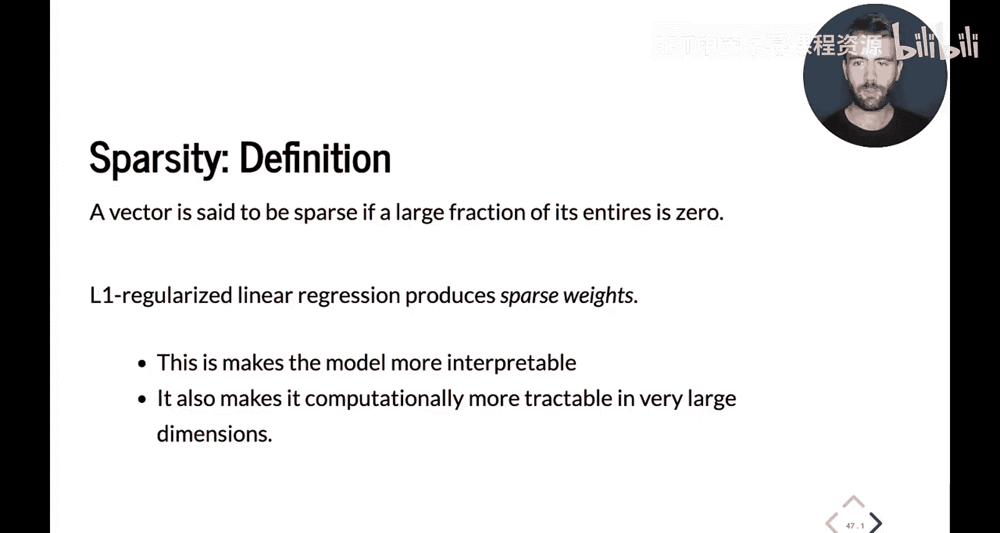

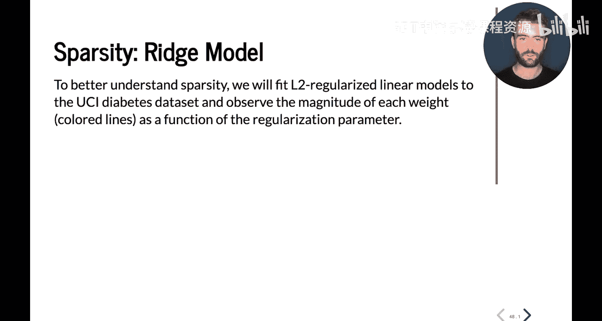

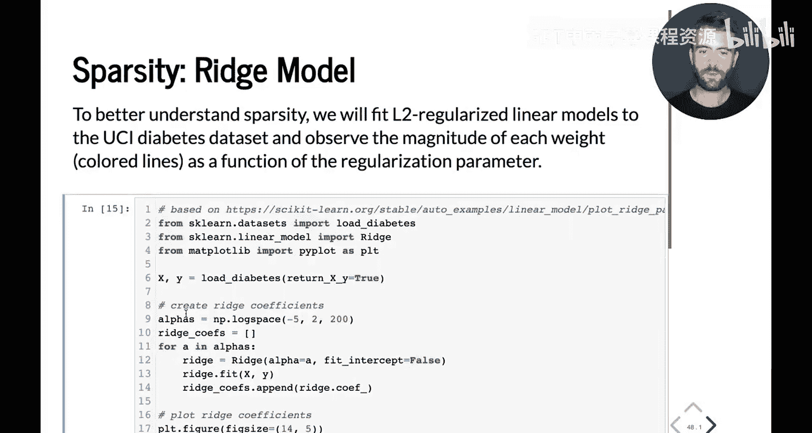

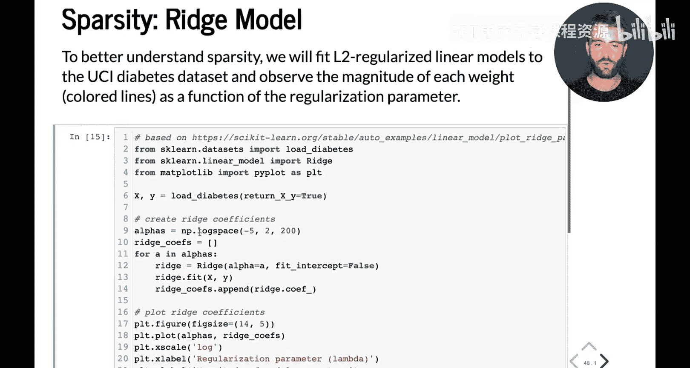

But this is the same as our lambda parameter that we saw earlier。

 and I'm going to fit one model for each of the 200 possible values of Lambda。

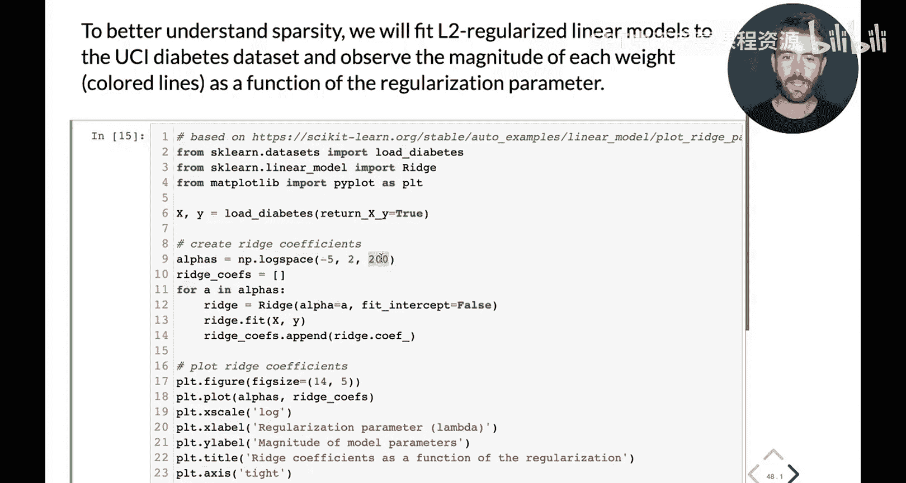

And then I'm going to plot the magnitude of each coefficient as a function of this regularization parameter。

 and we have a plot which looks like this。

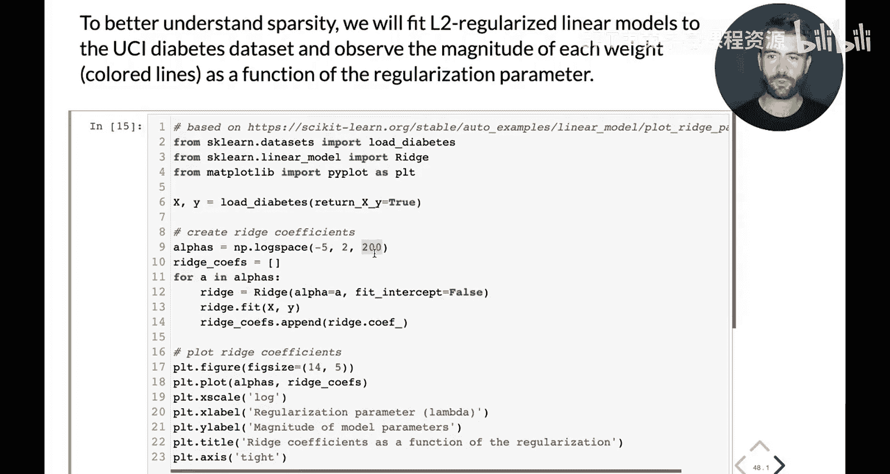

Here we have 10 colored lines and each of these lines corresponds to one of the 10 possible measurements。

 one of the 1 10 features that are in this data set， So we have a linear model。

 we have 10 features and we have therefore a linear model has 10。Has 10 weights。

And when the regularization parameter is really small。

 the magnitude of these weights is relatively large。 so here on the y axis。

 I have the magnitude of each parameter。 So when when the regularization parameter is really small。

 then the weights， this purple weight here is on the order of minus 800 this one。

 this green one is on the order of 800， this one is 200400。 so these are relatively large weights。

 but now as I increase the regularization parameter， the magnitude of these weights decreases。

 and now if regularization is really strong， then most of these weights are here in a very tight region around 0。

 So this shows you how increasing the regular regularization parameter tends to output weights which are just numerically smaller。

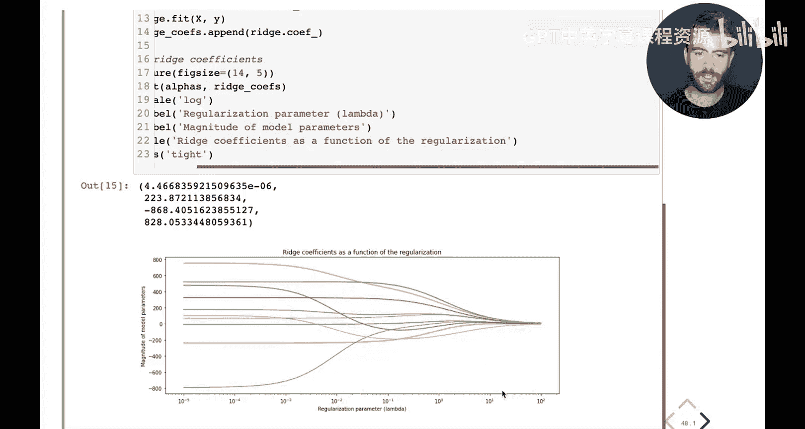

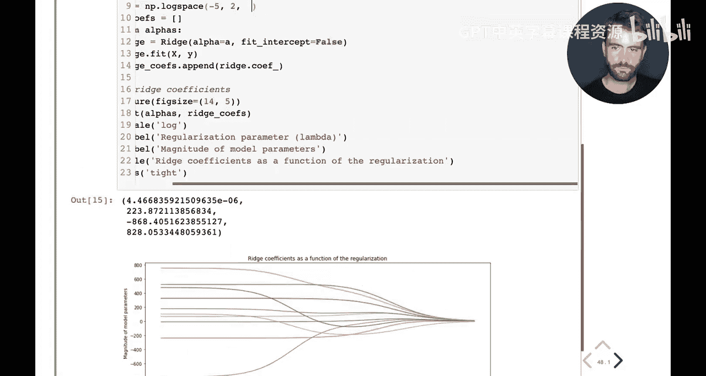

Now let's compare the same thing to L1 regularization。

Here again， I'm implementing， so I'm running an algorithm called Laretz and Lares。

 it returns the same。It also returns a set of weights for different values of the regularization parameter。

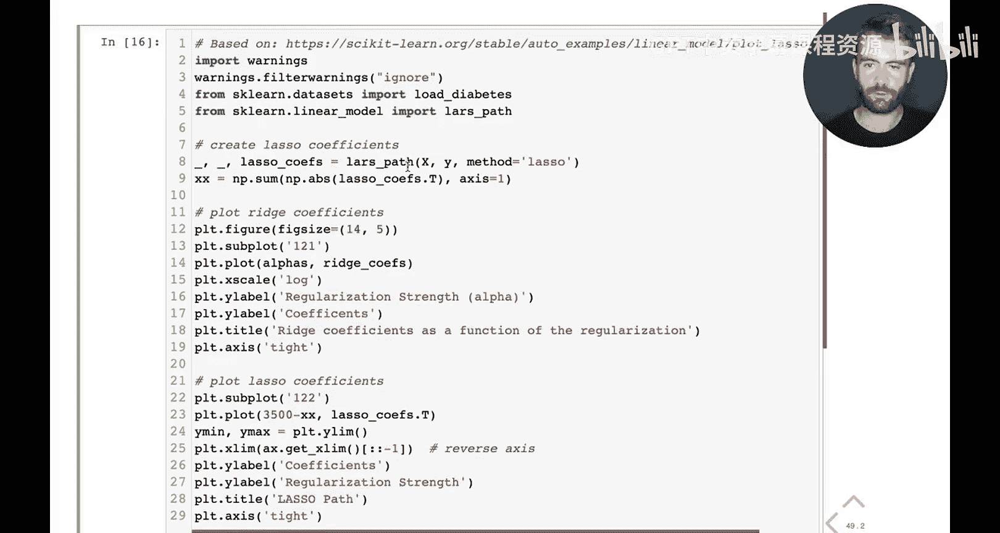

And now I can plot side by side the weights of ridge on the left and the weights of Laso on the right as we vary the strength of the regularization parameter。

And now what you see here is so the Laso path here is somewhat flipped。 So0 here means so0 here is。

Very little regularization。 And then as we， as we as we move towards the left here。

 we have stronger regularization。 And so at 0， when there's no regularization。

 both models have essentially the same weights。 So this one is also around the purple one for loss。

 So it's also around 800 green one is around。 This one is-800 green is plus 800。 and these。

These weights are essentially the same because we're fitting an unregularized model in both cases。

 And now， as we increase regularization， we see that the magnitude of these weights also decreases。

 But what's really interesting here is that these。These lines they approach zero and then at some point they hit zero and then they stay at  zero。

 so once we have increased our regularization our L1 regularization parameter to around here here it says so this is not the value of the regulars itself。

 this is the index along the path of possible values。

 but once we have reached approximately at this point。

Then the value of the purple coefficient becomes0。 and then if we regularize a little bit more now the orange coefficient becomes0 here。

 the red coefficient becomes 0 and at this point we only have after after we have reached here we only have two nonzero coefficients and everything else has been set to0。

 So here this parameter path is really different from the one that's on the left because here they still stay nonzero。

 even though they're small。But on the right， they don only become small。

 but they also become zero as we see here graphically。So again。

 Laso is a very important algorithm and L1 regularization is a hugely important concept in machine learning。

 it's not a toy example that I'm showing it's one of the most important ideas of machine learning and here we have seen one way of applying it。

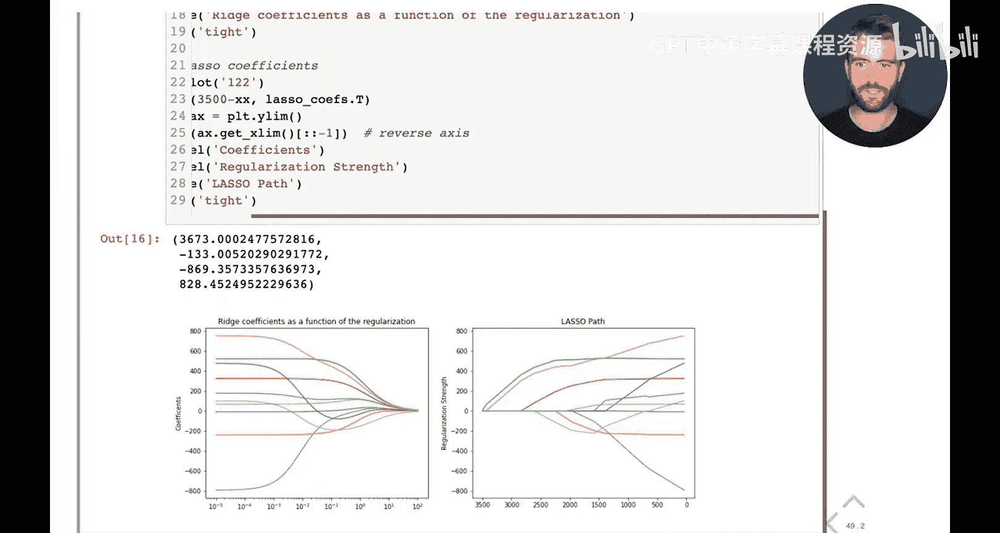