# 康奈尔大学《应用机器学习 CS 5787_ Applied Machine Learning 2020》中英字幕（deepseek p17 -17-Lecture 5. Part 1_ Probabilistic Modeling.zh_en -BV12udzYvEFM_p17-

Welcome to Leture 5 of applieded machine learning。The title of this lecture is going to be maximumim likelihood Learning。

We're going to see in this lecture what this really means and what is maximum likelihood。

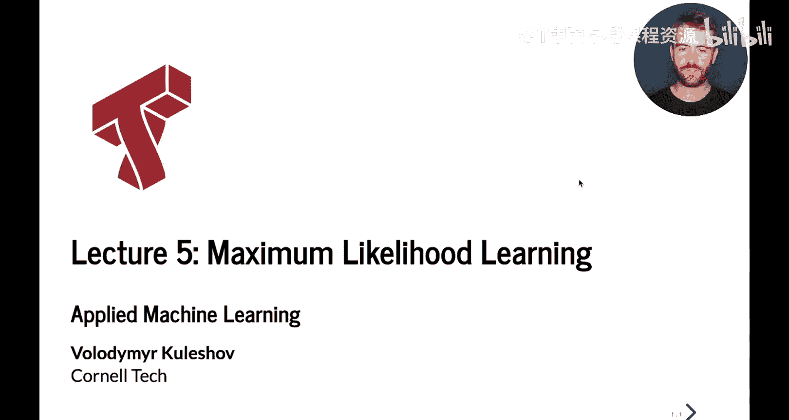

But at a high level， this lecture again is going to be looking at the different aspects of the foundations of supervised learning and machine learning in general。

In this lecture， we're going to take a slightly different angle。

 which is going to be that of probabilistic modeling。

We're going to see how we can define machine learning algorithms using the language of probability。

And as a result， we're also going to see a new explanation for why supervised learning works。

 and also we're going to be able to define several new machine learning algorithms。

 both in this lecture and in the upcoming several lectures。So first， in this video， I want to。

Talk about the probabilistic approach in general， and I would like to start by setting up some notation。

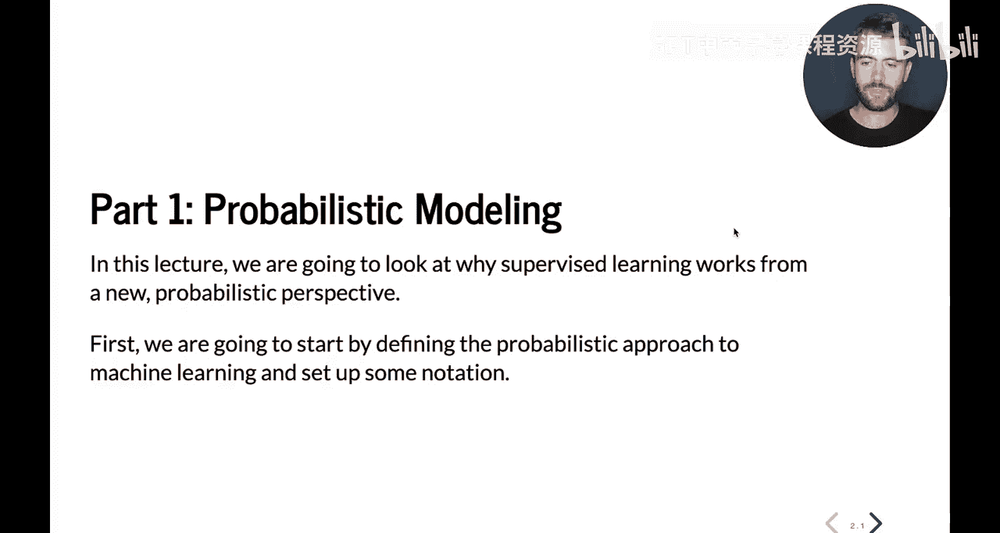

So recall that earlier in our discussion of supervised learning。

 we defined a supervised learning model as a function that maps inputs x to targets y。

And we also saw that machine learning models can often be parameterized by parameters theta。

 and in that case weote functions， we can denote parameterized machine learning models that map X to Y with this particular notation with a subscript theta。

We also saw a few examples of these models， the main example that we looked at were linear models that are linear in the features x。

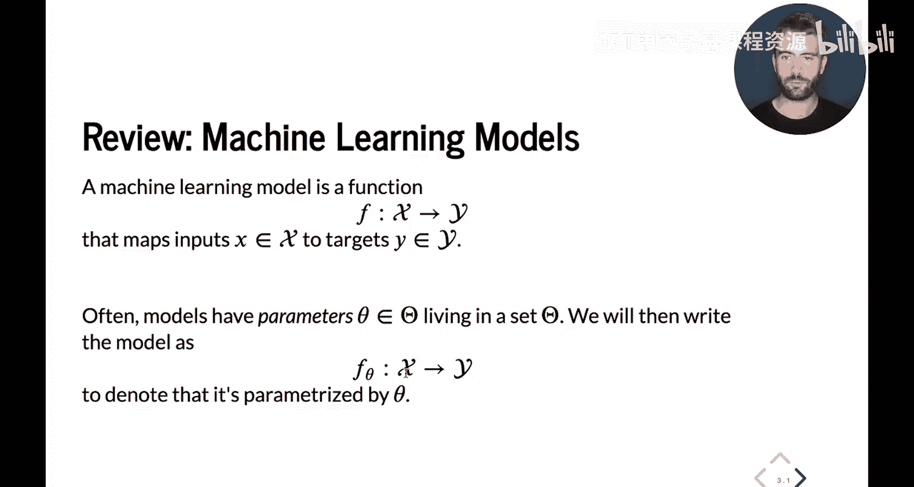

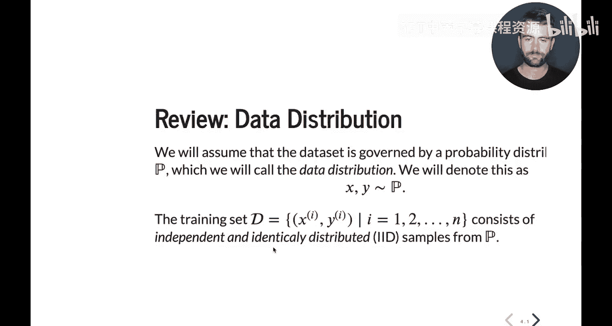

Then later on， we also saw what is a data distribution？In briefef。

 a data distribution is a probability over x and Y。

And we say that our training data set consists of IED samples。I ID samples。

 each of which are tus X Y that are all sampled from this data distribution P。

And we use the concept of data distribution to explain why machine learning works and why it might not work。

 and we talked about concepts such as generalization， overfitting， underfitting， and more。

In this lecture， I want to make the observation that we have a data distribution and we have a concept of a machine learning model。

If the data is coming from this data distribution。Why not use a machine learning model。

 a supervised learning model that is also itself a probability that tries to mimic and approximate the true data distribution from which the data would come？

In other words， if we could learn this data distribution from data， then we would be done。

 we would know how the data is distributed and generated。

And the probabilistic angle to supervised learning consists in framing supervised learning as approximating this data distribution P。

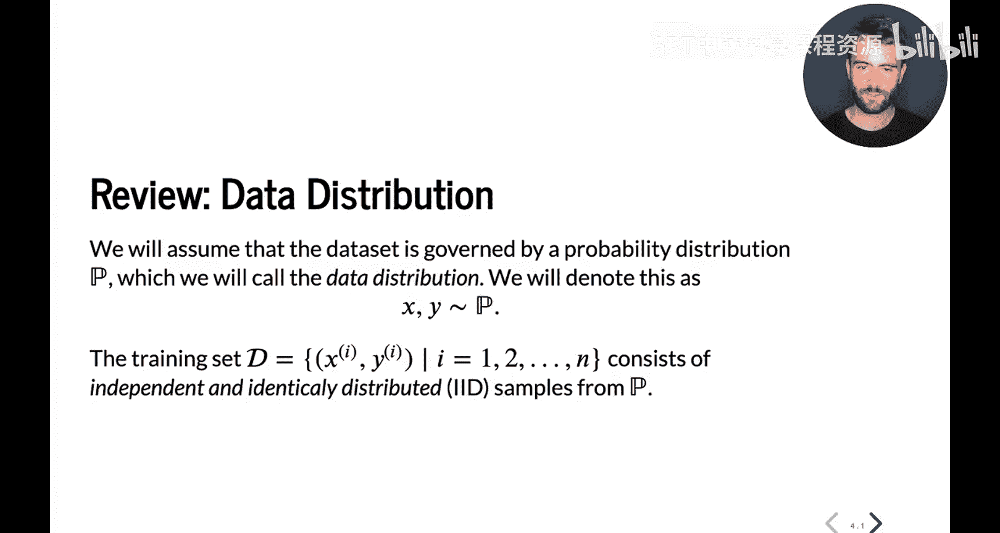

So more specifically， we're going to extend our notion of what is a machine learning model to include general these more general probabilistic models。

So we're going to say that a probabilistic model is also a probability distribution over x and y in the same way that a data distribution is a probability over x and y。

Similarly to how。To how a regular supervised learning model can have parameters。

We will also say that a supervised learning model may have parameters which are parameterized by this value theta。

 which again we're using as a subscript。And even though this definition here assumes a model over x and Y。

I just want to point out that we can use this model to make predictions of y given x in the same way that our regular supervised learning model did by looking at the conditional probability of Y given x。

 In other words， if we know the joint distribution of x and y。

We can then derive from it using the rules of probability， a distribution of y given x。

 and now if we receive a new input x， we can infer what y is by looking at the conditional probability of y given x。

So this is。This allows us to perform prediction just as well as a regular supervised learning model。

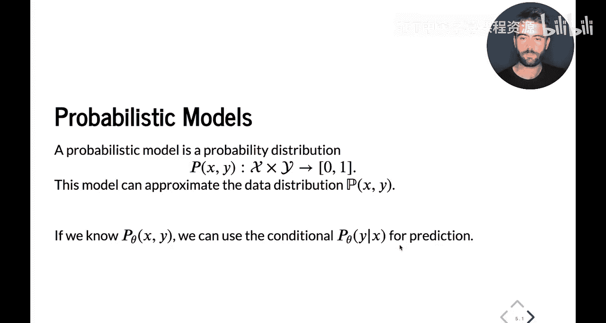

Let's look at a concrete example of what a probabilistic model could look like in our earlier example where we have been predicting diabetes from BMI。

In order to make things simpler， I'm going to look at a slightly simplified version of this problem。

 but later on in this lecture and in other lectures。

 we're going to see how probabilistic models can be applied much more general to very general。

Supervised learning problems。So the simplification I would like to make in order to illustrate a simpler probabilistic model is simply to discretize the input and the target。

I'm going to discretize the target by assuming that it takes two possible values， 0 and 1。

 which correspond to low risk or high risk。In our lecture on supervised learning。

 we already saw that we can easily discretize a continuous variable and we saw a very specific example of how we could perform this deization in this same setting where we're predicting diabetes risk from BMI。

And then in exactly the same way， I would also like to discretize BMI。

 and I will assume that there is some discritization into three classes， 0，1 and2。

 which correspond to an individual having either a low level， a medium level or high level of BMI。

So let's assume that we have the same data set that we've been working with before。

 except that we have discretized BMI to be either。Both BMI and risk are disretized in these buckets。

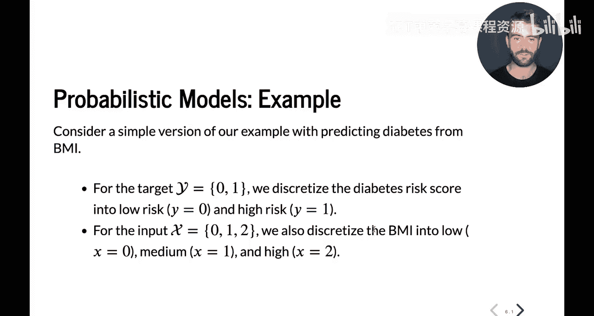

And now with this discritization， I can define what a simple probabilistic model might look like。

Because everything is discrete， I can define this model in the form of a simple table。

 This table has three columns。TheM I。Wwhich is our input X risk， which is our target y。

 and now here I have a probability that's assigned to each combination of x and y。

 and because both x and y are discrete， I can enumerate the six possible cases where x taking three values Y is taking two values。

 there are six possible cases， I can enumerate them in a table and I can write down our probability for each of these examples。

So if you look here， the probability of seeing an individual with。

With high BMI and high risk is estimated to be 35% and the probability of seeing the same individual with a high BMI。

 but low risk is 0。2， having low risk。Having。Low BmiI and high risk is considered to be unlikely。

 that's only only 5% of the individuals fall in this category and similarly weve assigned probabilities to each of the possible assignments of x and Y so now this is a valid probability distribution over x and Y and we can use this distribution to make predictions。

 For example， if I wanted to translate this distribution from the joint over X and Y to the conditional distribution of y given X。

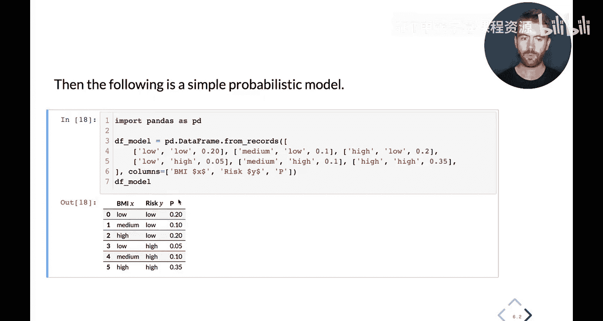

I can perform this particular operation here， this is simply the definition of conditional probability。

And now I can here I use pandas to perform this separation on the table that you just saw earlier and now for each assignment of Y and X I have this distribution。

 in other words， if I have a patient that has low BMI。

 then its probability of having high risk is only 20% and its probability of having low risk is 80%。

 and conversely if I have a patient with high BMI， then its probability of having high risk is higher。

 it's around 64% and its probability of having low risk。

 given it has high BmiI is lower it's only 34%， so this is an example of how we can use our probabilistic model to make predictions。

And again， this is a really simple idealized probabilistic model。

 but even this model is useful and we could easily estimate these probabilities。

 we could estimate the original joint probabilities by simply looking at our training data set and looking at how many patients have low BMI and low risk which fraction of the。

 what fraction of patients has medium BMI and low risk， etctera。

 and we could fill in these numbers with the percentages of patients that fall in each category and that would give us a simple probabilistic model。

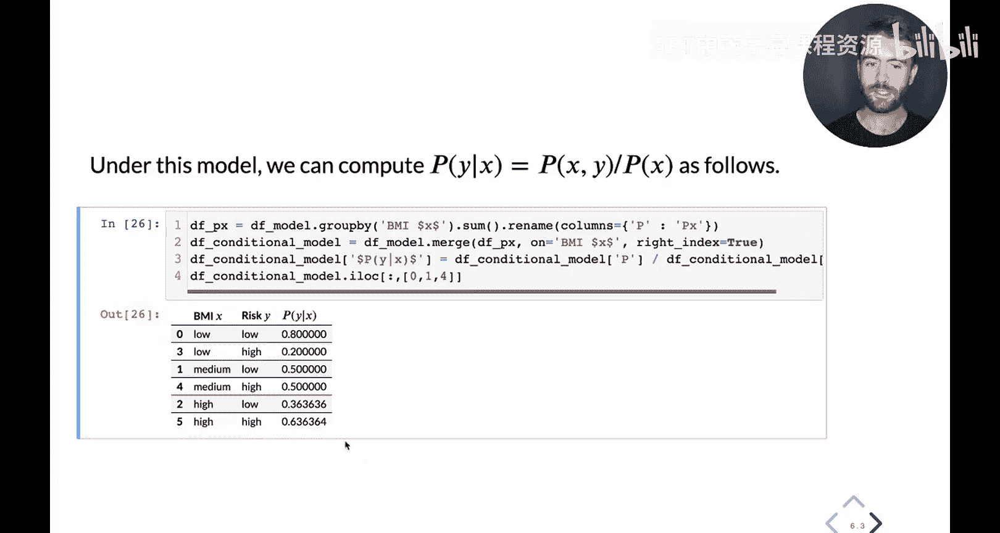

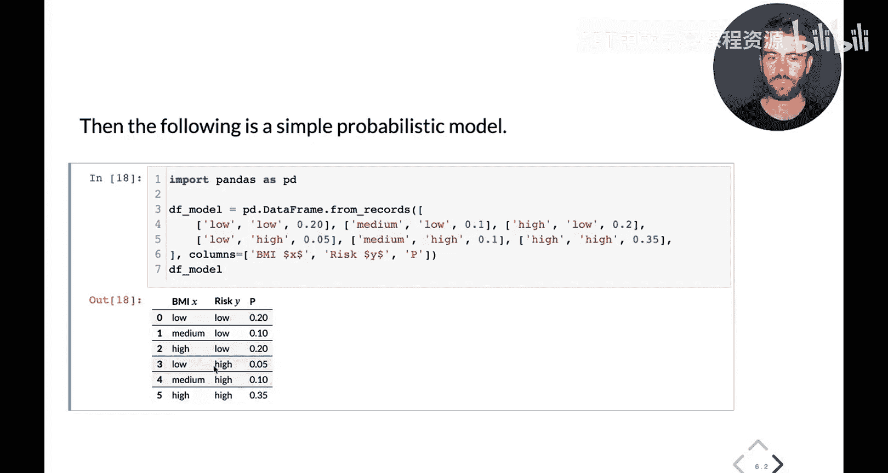

So now we have a better understanding of what probabilistic models are。

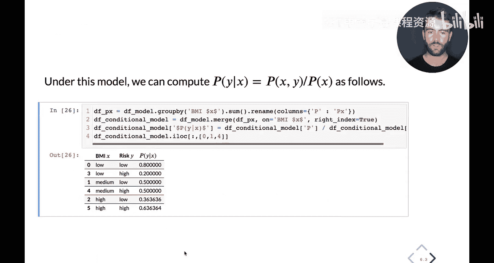

Why are probabilistic models useful。They are useful for several reasons。

 One reason is that we can capture。What is called predictive uncertainty。

 As I mentioned in the earlier lecture， there are many reasons for which we may not be able to provide accurate predictions。

Maybe the data that we collect is noisy。 So， for example， if our。

If we're collecting temperature measurements， we will only be able to be as accurate as the precision of the thermometer that we use。

 or if we're trying to predict stock options， there are so many different factors involved that from the point of view of the user。

The behavior of a stock looks like it has a big random component。

 and we could model this random component if if we include randomness in our supervised learning model。

 if we make it a probability。Another reason is that we could construct more principled machine learning models by explicitly modeling the data distribution。

In other words， if we believe that our data distribution encodes a particular process。For example。

 if we're dealing with diabetes risk， we may think that diabetes risk is influenced by blood sugar。

 which it then is influenced by a person's diet， then we can encode this chain of events as part of our model。

 in other words， if we know that the data has been generated in a particular way based on our prior knowledge。

 we could mirror the structure inside our probabilistic model as well。And finally。

 the last reason which I'm going to explore more in the rest of this lecture is that it can provide a new perspective on why supervised learning works and it can provide a new principle for understanding existing algorithms and deriving new ones and this is something that we're going to see。

Shortly。

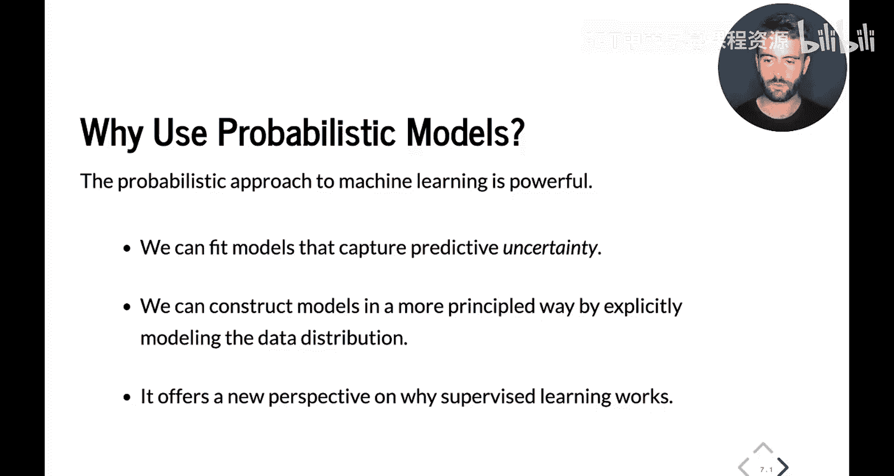