# 应用机器学习：第5讲：概率建模（第一部分）🎯

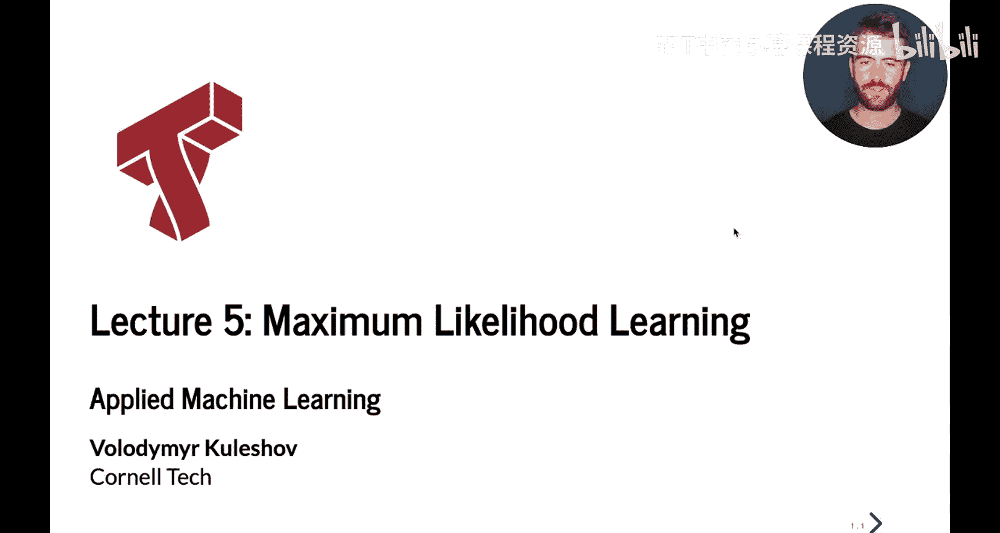

在本节课中，我们将学习概率建模的基本概念。我们将探讨如何用概率的语言来定义机器学习算法，并理解为什么监督学习能够工作。此外，我们还将看到如何通过概率模型来捕捉预测的不确定性，并基于此构建更原则化的机器学习模型。

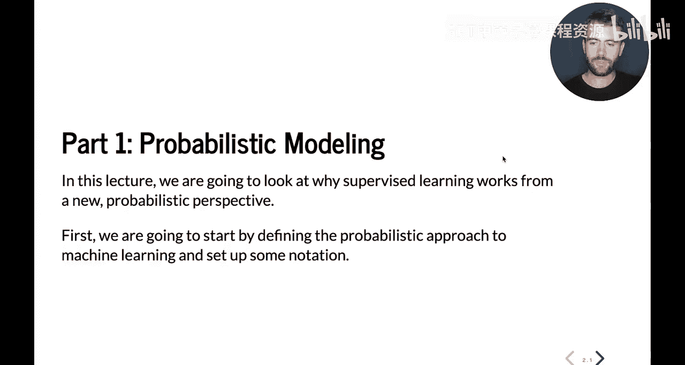

## 概率建模概述 📊

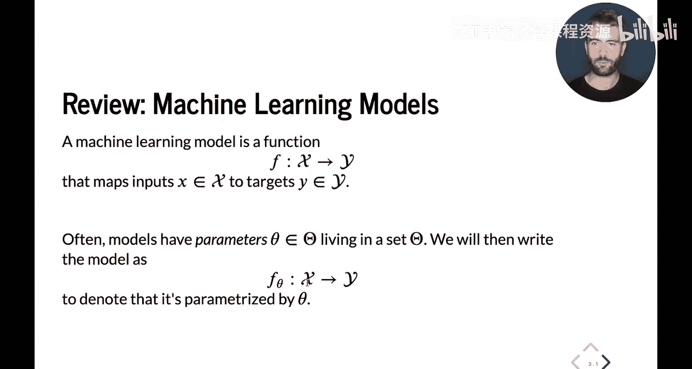

上一节我们介绍了监督学习模型作为从输入 `x` 映射到目标 `y` 的函数。本节中，我们将从一个不同的角度——概率建模——来审视监督学习。

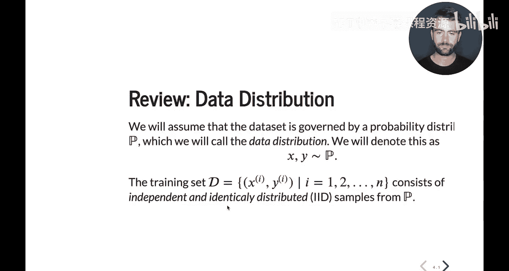

具体来说，我们将扩展机器学习模型的概念，使其包含更一般的概率模型。一个概率模型，就像数据分布一样，是 `x` 和 `y` 上的一个概率分布。与常规监督学习模型可以有参数类似，概率模型也可以由参数 `θ` 参数化，我们将其记为 `P_θ(x, y)`。

即使这个定义假设了 `x` 和 `y` 的联合模型，我们仍然可以像常规监督学习模型那样，通过观察给定 `x` 时 `y` 的条件概率 `P_θ(y | x)` 来进行预测。换句话说，如果我们知道 `x` 和 `y` 的联合分布，就可以利用概率规则从中推导出给定 `x` 时 `y` 的分布。

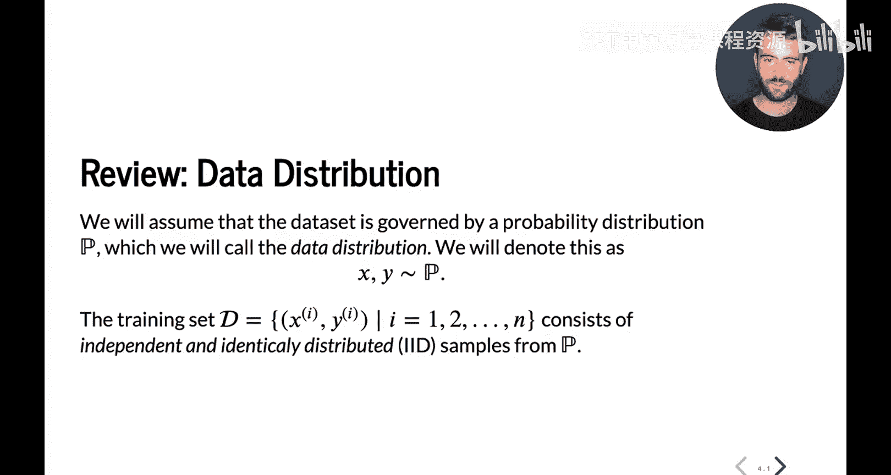

## 一个具体的概率模型示例 🧮

为了更好地理解概率模型，让我们看一个具体的例子。我们将使用之前预测糖尿病风险的简化场景，并对输入（BMI）和目标（风险）进行离散化处理。

以下是离散化设定：
*   **目标 `y`（风险）**：取两个值，0（低风险）或 1（高风险）。
*   **输入 `x`（BMI）**：离散化为三个等级，0（低）、1（中）、2（高）。

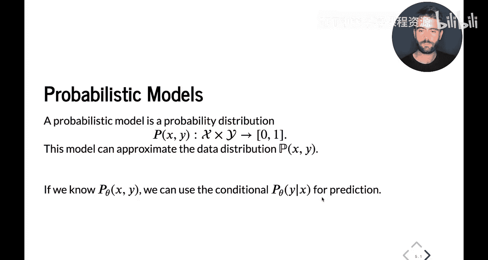

基于此，我们可以用一个简单的表格来定义一个概率模型，该表格列出了 `x` 和 `y` 每种组合的联合概率。

以下是该概率模型的表格表示：

| BMI (x) | 风险 (y) | 概率 P(x, y) |
| :--- | :--- | :--- |
| 高 | 高 | 0.35 |
| 高 | 低 | 0.20 |
| 中 | 高 | 0.10 |
| 中 | 低 | 0.15 |
| 低 | 高 | 0.05 |
| 低 | 低 | 0.15 |

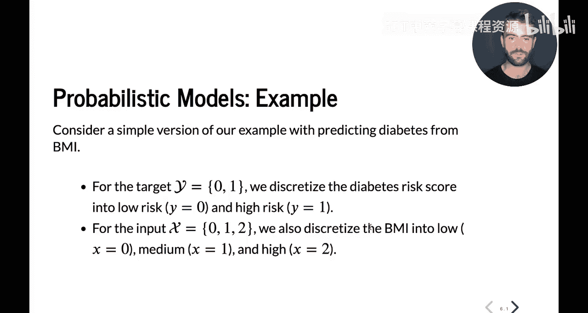

这是一个有效的 `x` 和 `y` 联合概率分布。我们可以利用这个分布进行预测。例如，要计算给定 `x` 时 `y` 的条件分布，我们使用条件概率公式：

`P(y | x) = P(x, y) / P(x)`

其中 `P(x)` 是边缘概率，通过对所有 `y` 求和得到：`P(x) = Σ_y P(x, y)`。

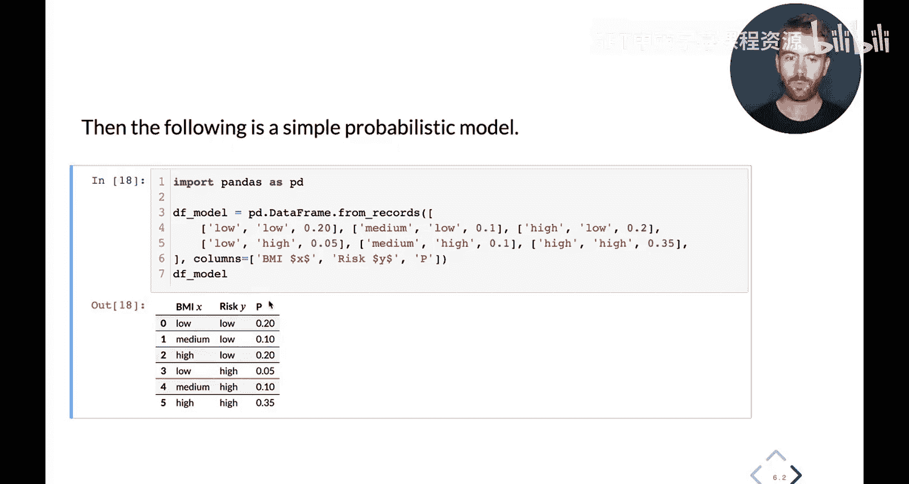

对上述表格应用此计算，我们可以得到给定不同 BMI 等级时的风险预测概率。例如：
*   对于一个 **低 BMI** 的患者，其 **高风险** 的概率约为 20%，**低风险** 的概率约为 80%。
*   对于一个 **高 BMI** 的患者，其 **高风险** 的概率约为 64%，**低风险** 的概率约为 36%。

这个简单的模型可以通过统计训练数据集中落入每个类别的患者比例来估计。

## 为什么使用概率模型？🤔

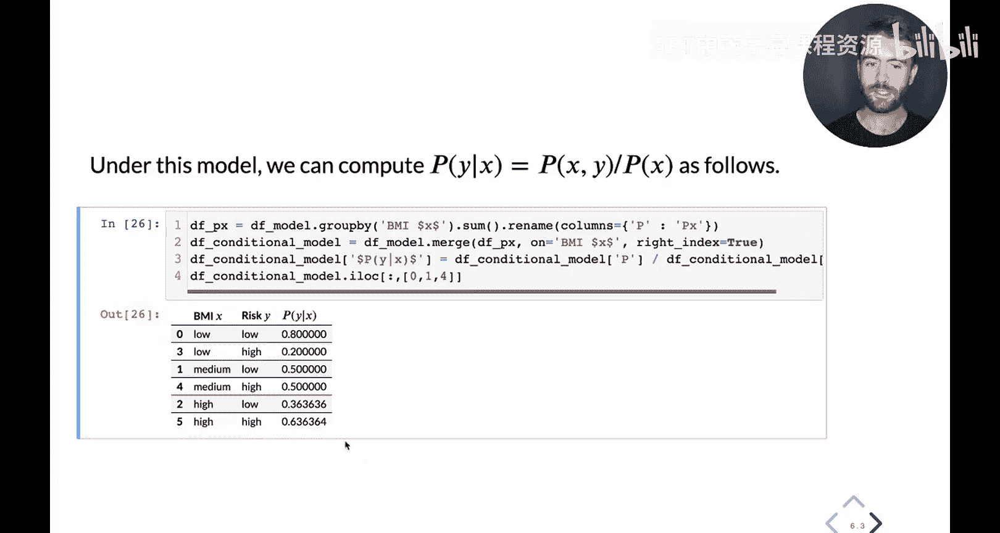

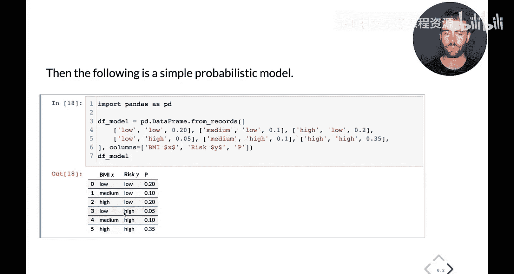

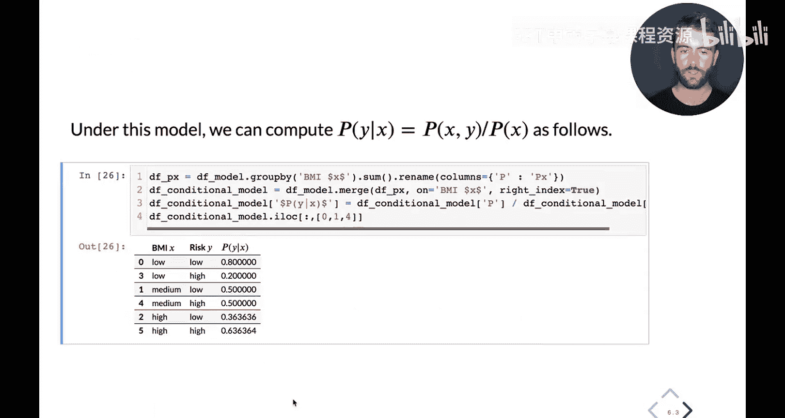

概率模型之所以有用，主要有以下几个原因：

以下是概率模型的几个关键优势：

1.  **捕捉预测不确定性**：数据可能本身存在噪声（如测量误差），或者预测任务本身具有内在随机性（如股票预测）。概率模型通过输出分布而非单一值，可以自然地表达这种不确定性。
2.  **构建原则化模型**：如果我们对数据生成过程有先验知识（例如，糖尿病风险受血糖影响，而血糖又受饮食影响），我们可以将这些因果关系编码到概率模型的结构中，从而构建更贴合问题本质的模型。
3.  **提供新的理论视角**：概率框架为理解监督学习为何有效提供了新的解释。更重要的是，它为我们理解现有算法和推导新算法提供了一个统一的原则。我们将在本讲后续部分深入探讨这一点。

## 总结 📝

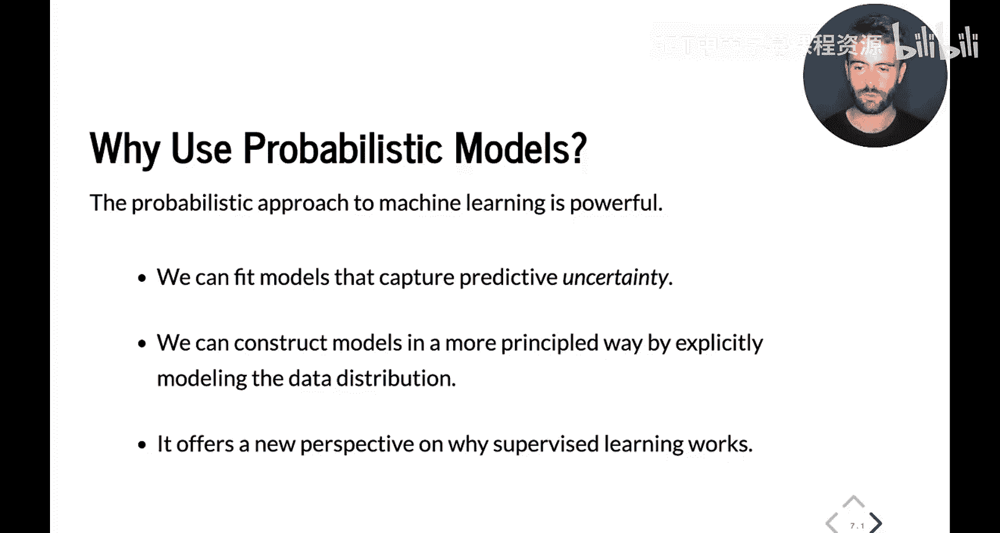

本节课我们一起学习了概率建模的基础。我们首先将监督学习模型的概念扩展为 `x` 和 `y` 的联合概率分布 `P_θ(x, y)`，并了解到可以通过条件概率 `P_θ(y | x)` 进行预测。接着，我们通过一个离散化的糖尿病风险预测示例，具体展示了如何构建和利用一个简单的概率模型。最后，我们探讨了概率模型的三大优势：量化不确定性、编码领域知识以构建结构化模型，以及为机器学习提供新的理论基石。在接下来的部分，我们将深入探讨如何从数据中学习这些概率模型的参数，即**最大似然估计**。