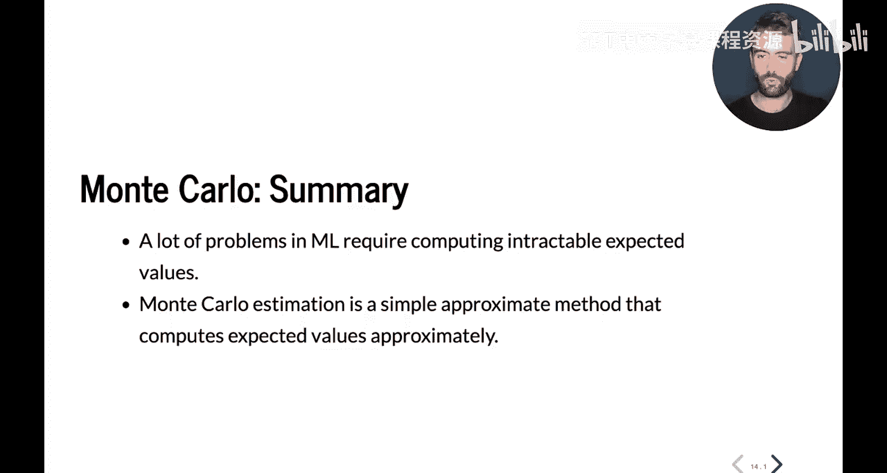

# 康奈尔大学《应用机器学习 CS 5787_ Applied Machine Learning 2020》中英字幕（deepseek p18 -18-Lecture 5. Part 2_ Monte Carlo Estimation.zh_en -BV12udzYvEFM_p18-

This is part two of lecture 5 of applied machine learning。In this video。

 we're going to take a little detour from our earlier discussion of probabilistic models and we're going to spend this video talking about a tool that is going to be useful in the rest of this lecture called Monte Carlo estimationation。

This is going to be a mathematical approach that will be used both in this lecture and in several other lecture in the rest of this course。

So before we define what is Monte Carlo estimation， let's establish some notation。

We're going to assume that we have a random variable x， which lives in some space X。

 and this some script X， and this variable is described by a probability distribution P。

This doesn't have to be a vector of features anymore， this is just any random variable。

 it can be either a sample from a data distribution or it can be any random variable it can be the outcome of a throw of a coin。

 it can be a roll of a dice。This is just some random variable。So if this is random。

 if x is a random variable。We can compute the expected value of various functions of this random variable。

So， let's say that x is。Let's say that x is a role of a die or let's say it's the role of two dies。

 so we throw one diece， we throw another dis， and we want to know their sum G can be a function computes their sum and we want to estimate the expected value that the sum of the two dies throws will take。

This form here gives us this expression here gives us the definition of an expected value。

And this is a basic concept from probability and what it says here is the expected value that the function G will take。

 so the expected sum of the two throws of dice that will simply equal the average value of the function G where the average is weighted by the probability so in other words let's say that x can take some throw which so let's say x is the result of throwing to dice which can be either a two or three or3 or4。

 so if it's a2 or three then theres sum is5 if it's a three or4 then the sum is7 so here we're simply adding all the possible outcomes and we're weighing them by the probability and this is the definition of an expected value。

So expected values are really important， they're used everywhere in statistics and in machine learning as well。

But computing these values can often be difficult。 For example， if take if x takes a lot of。

 if x takes a large number of values， then here we have to sum over a very large number of these possible values。

 and that may not be。That may not be possible in practice。

Or something else that can happen is x could be continuous here I made the assumption that x is discrete and I gave the definition of an expectation when x is discrete。

 but when x is continuous， this becomes an integral and we may not be able to solve this integral in closed form。

So。Computing the expectation may be challenging。And in practice， in most。

In most practical applications。Expectant values are not computed exactly。

 they are computed in an approximate way using approximate techniques。

And Monte Carlo estimation is one such technique for computing expected values approximately。

Let's now look at the definition of Monte Carlo estimation。Again。

 we are interested in computing this expected value approximately。

And the idea of Monte Carlo estimation。Is going to be to draw some number of samples。

Which we're going to denote by capital T from this data distribution P。

And then we're simply going to average the value G here across all these possible samples。

And G had here。Which is a function of these T random samples that is going to be our estimate。

 our Monte Carlo estimate of the expected value。So。

Just to give you a little bit of intuition for why this would make sense。

Let's assume that x here takes three possible values， and they have different probabilities。

 One of them is very likely。 The other one is less likely。

 and the last one is very unlikely because we're sampling these x's。From the distribution P。

Orre going we're going to see each instance of each possible instance of the value that x can take will occur a number of time that's proportional to its probability P of x。

 So if we draw， let's say， a million samples。And the probability that x1 takes the first value is 80% then of this million samples about。

About 80% or 800000 will have that particular value。 And so when we do this average。

 we're going to be averaging。We're going to be averaging these numbers in a proportion that's really similar to this probability P ofx。

Let's make this a little bit more specific with a particular example。

 let's say that we're throwing dice and we have five dice。

 and we want to know what is the expected number of twos that we're going to roll。So。Specifically。

Let's have x be the following vector where each component of the vector is a number from1 to 6。

 so that's just the outcome of the J die。So x2 here， if x2 equals6， then the second I rolled to P 6。

And then G of x is simply going to be the number of twos in this rule。 So， for example， if。

 if this is 1，1，1，1，1， if we roll 51s， then g0， if we roll 2， and then 1，1，1，1，1， that that's。

 that's simply。That's that's going to be G will take on the value 1。 if we have 1，2，1，1，1，1，1。

 that will also be 1。 So you see what I mean， G is simply counting how many tools we have in in these di rows。

So we can calculate the Monte Carlo estimate of this expected value as follows in Nmpy here I'm importing Nmpy。

 and now I'm generating 10000 random rolls of these five dice。

 So I'm generating a matrix of dimension 5 by 10000。Where。In along each， in each cell。

 I have a number that's going to be between 0 and 5。 That's just because we're。

This is just because of how N works。 We're going to be using 0，1，2 3，4。

5 in order to denote the outcomes of the die and each cell in this 5 by 10000 matrix will and will contain the。

The outcome of the of the J die on。On different samples from this distribution。

And now I want to know how many times of these 10，000 rolls。

What was the number of twos in each of these two roles。

 so I'm going to simply count the number of twos in each of the 10，000 samples that we drew。

So this is what this part does。 and then I will。And then I will average across the 10。

000 samples by computing the means。And the estimate here is something around 83%。

And now if I rerun this cell， I will get different values。

And you can see here that I'm getting something that's closer to that's roughly around 83%。

 If I want to make it a little bit more precise， I can increase the number of samples。

 and now it's much closer to 83%。I could even draw more samples。

And you can see that now it's really close to 83。Essentially， as I'm drawing more samples。

 I am getting something which looks increasingly closer to the value that I want。 And indeed。

 this is the correct value， because if you work out the math the。

The expected number of twos is going to be actually five over6 you can I leave it as an exercise to the listener to prove that this is the correct number。

 but the actual expected number of ones can be computed analytically and it is indeed 83% as this Monte Carlo estimate is saying。

Now I want to highlight a few properties of Monte Carlo estimation。As I， as I mentioned earlier。

 it's an unbiased estimate of the true expectation。 And by this， I mean that as we draw more samples。

 on average， are。Our， our， our estimate， our Monte Carlo estimate， it will equal the true value。

 the true value of the expectation In the earlier example。

 what this means is that the numbers that I was generating， sometimes it was 84， sometimes it was 82。

 but they were always。Their mean was around 83%。And finally， as we collect more samples。

 the variance of this estimate decreases， and this is， again。

 the example that I showed you earlier when we looked at 10000 examples。

 the estimate would be between。Would be between 84 and 82。

 But then when we increased that to a million examples， we were。

We were now only changing the decimals of 83%。So as we collect more samples。

 Monte Carlo provides us with a more accurate estimate of the true expected value。So in summary。

 we've defined here a tool called Monte Carlo estimation。

 which can be applied to many areas of machine learning where we need to compute an expected value。

It's a very simple and approximate method that works for any probability from which we can draw samples。

 In the next video， I'm going to show how we can apply this。

This technique to an important machine learning problem。

