# 康奈尔大学《应用机器学习 CS 5787_ Applied Machine Learning 2020》中英字幕（deepseek p19 -19-Lecture 5. Part 3_ Maximum Likelihood Learning.zh_en -BV12udzYvEFM_p19-

We are now at part three of lecture5 of App machinech learning。

This video is now going to focus on maximum likelihood， which was also the title of the lecture。

And we will learn what maximum likelihood is， and we're going to see how this is a general principle that can be used to derive new machine learning algorithms and explain a lot of the algorithms that we've seen before are why they work and how they can be actually interpreted as examples of probabilistic modeling。

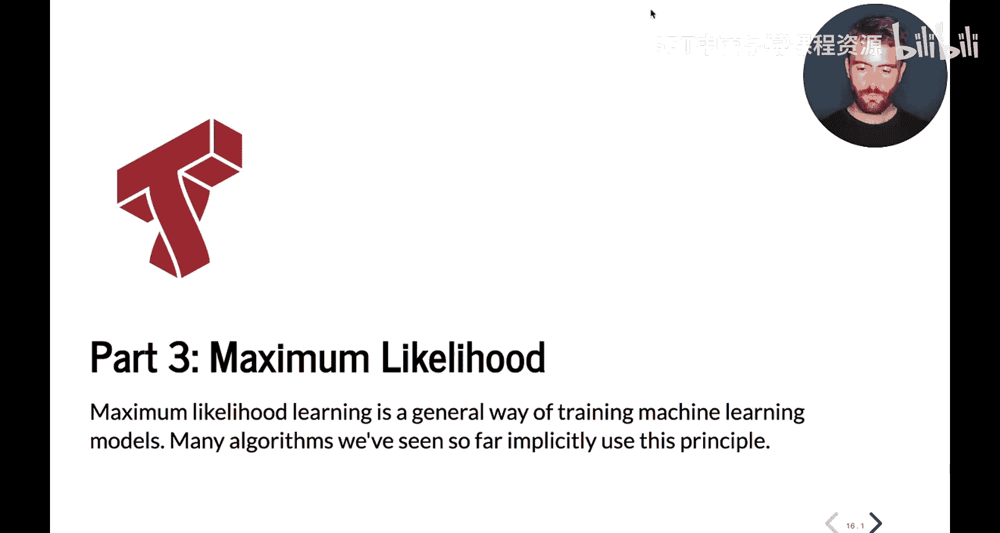

So let's recall again， our setting， we assume that our data， that our inputs x and targets y。

 are couponupils that are sampled from a data distribution。

 which is simply a probability over x and y。And we will assume that our training set is a collection of ID samples from the data distribution。

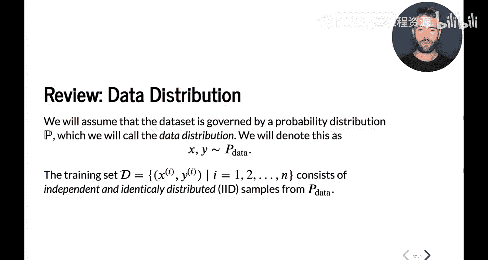

So since we have a probabilistic since we assume that data is coming from a probability distribution。

 it makes sense also to define our machine learning models as probability distributions and we can then try to interpret the。

We can try to fit these kinds of models and make them similar to the data distribution。

Here I have defined a particular distribution with parameters theta。

 and these are instances of supervised learning as well， because given an input X。

 we can apply simple rules of probability to obtain a distribution of y given x and use that for prediction。

So essentially probabilistic models are a way of fitting the data distribution using machine learning。

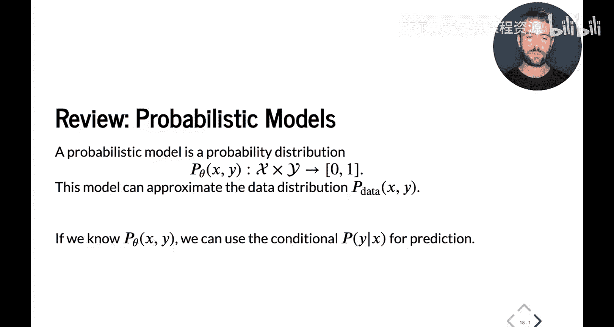

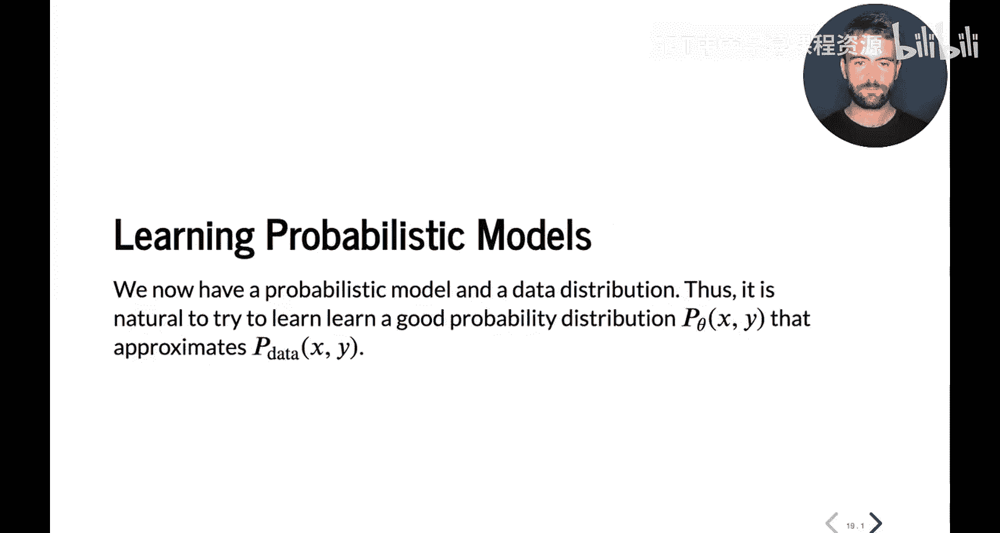

So given that we have this idea that we want to fit a probabilistic model to mirror and to approximate the data distribution。

 how would we do that， what kind of objective might we use？

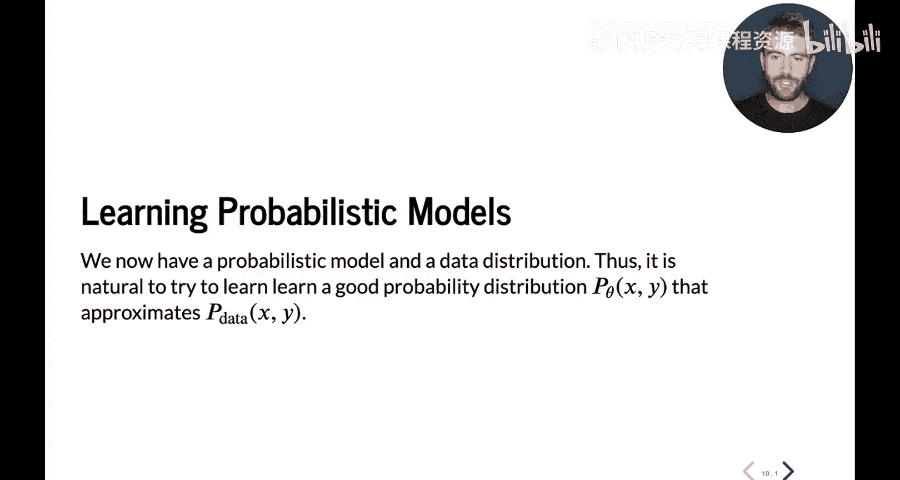

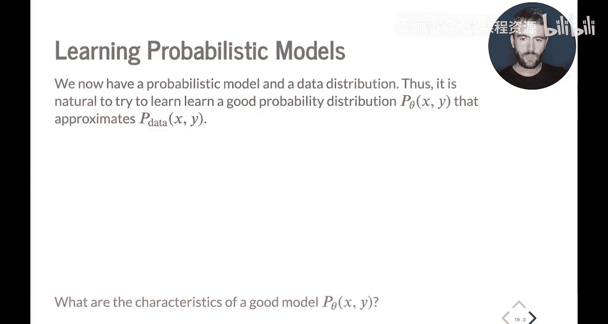

So there are many different ways in which we can define what is a good probabilistic model。

 and there are different ways of defining what is good and different things that we might want to have out of our probabilistic model。

One thing that is important and that was the focus of many of the previous lectures was predictive accuracy。

 so we might be looking for a probabilistic model that is predicting y from X， for example。

 does the patient have the As or not。We could also try to come up with models that approximate the relationship between X and Y if if our model has the same structure as the true data distribution。

 but with some missing parameters， we could learn these parameters from data by encoding our prior knowledge of the structure of the distribution and then seeing what the data is。

Telling us about the value of these parameters。 so we could try to infer which features of the patient influence their diabetes risk。

And finally， a really general goal that we might strive for is what's called density estimation。

 We could just try to approximate the data distribution on all of its support on all of the possible values of x and Y。

 and then if we're able to do that， then we're going to be able to answer any query。

 we're going to be able to perform predictions we're going to be able to ask this probability about elements of the structure of this distribution。

So density estimation is an important goal， and this is the goal that we're going to take here in this lecture。

 we're going to assume that we're striving for this really general goal of doing density estimation。

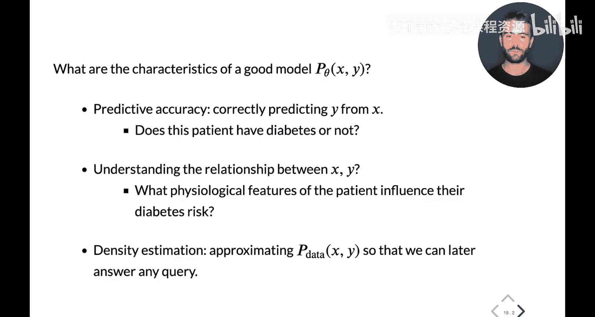

So in order to perform density estimation， we need some sort of measure of similarity or distance between two distributions。

And in order to do this， we're going to use a tool from the field of information theory called the callback libblar Dirgence。

So here I've given you the mathematical definition of the called byliar dirgence。

 this is here I've defined it for discrete variable x。

 but there are general ways of defining it as well and on the left here you see the notation that I've used for this distribution and then on the right here I have its mathematical definition。

Now， the exact form of this expression is not essential。

 it's not absolutely crucial to understand this for the purposes of this video。

But the key takeaway here is that this is a widely used way of comparing different probability distributions that is used both in machine learning in physics and in many different fields of science。

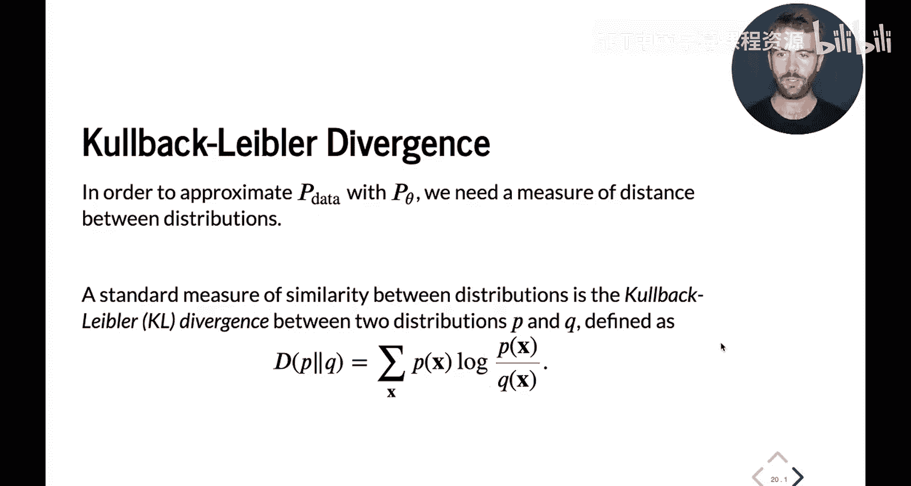

We can look at a few properties of the Colbec labar divergence that will show us why it's actually a good way of comparing probability distributions。

So one good fact about this one good property of this distribution is the following。

 it is always greater than zero and it is equal to zero if and only if the two distributions are equal。

So the proof here is is relatively straightforward， but you need。

You just need one mathematical tool that I will mention earlier， but essentially the。

Definition of the call like divergence in its most general form that applies for both continuous and discrete variables。

 it is the following。And the following identity this inequality holds because of a fact called Jenen's inequality again I will not talk about this in the lecture but it's a very common mathematical technique and applying Jenenssen's inequality we have the following expression and then here if we just simplify what's inside the log。

 this happens to be1 and log of1 equals 0 so here we have shown that the coli blur divergence is non- negativeg and you can easily see that when p equalsq this actually equals0 so this is an important property of something that we it's an important property of something that we would want to use in order to compare probability distributions。

And I also want to note that this is called a divergence because it's really similar to a distance except that the distance would in addition to having this property。

 it would also be symmetrical， so the divergence of P relative to Q would be the same as relative as Q relative to P but for the callback labar divergence that is not the case。

 which makes it a divergence between distributions and not a distance between distributions。

 this is a technical consideration that is not essential but it's just a fun fact that I wanted to share。

And again， yeah， as I mentioned earlier， it's asymmetric and finally， as I mentioned earlier。

 it has roots in information theory。Again， the key takeaway is that this is a useful way of comparing distance between probability distributions。

 and it's a very common and widely used tool。

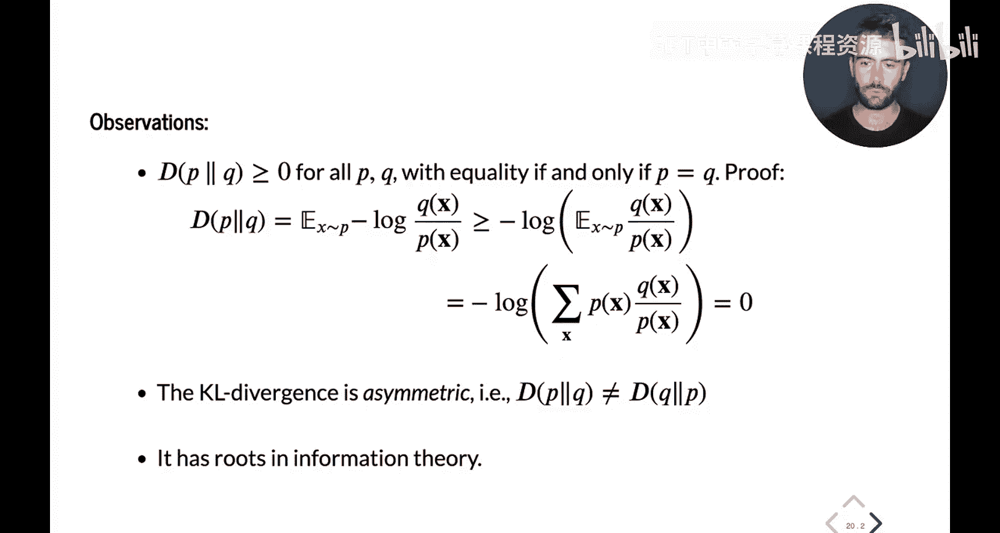

So suppose that we want to use the Colbec libblar divergence or the KL divergence for short to compare and use this as a training objective for our two probability distributions well if we wanted to apply this to our setting。

 this would give us an objective which looks as follows and again we could minimize this and try to bring it closer to zero in which case the two distributions would indeed be the same。

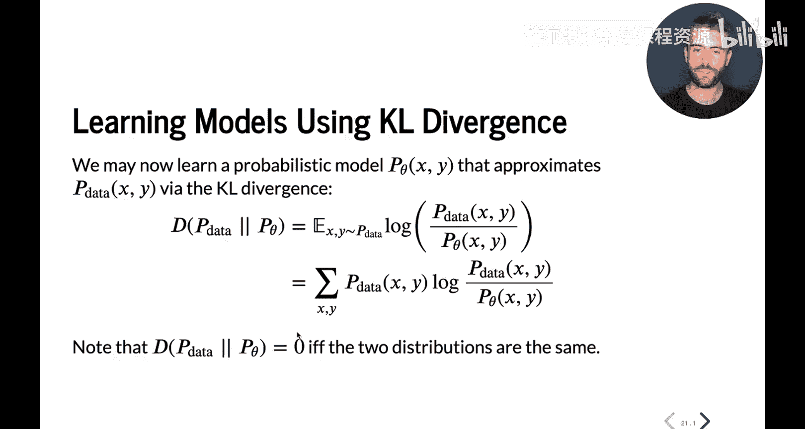

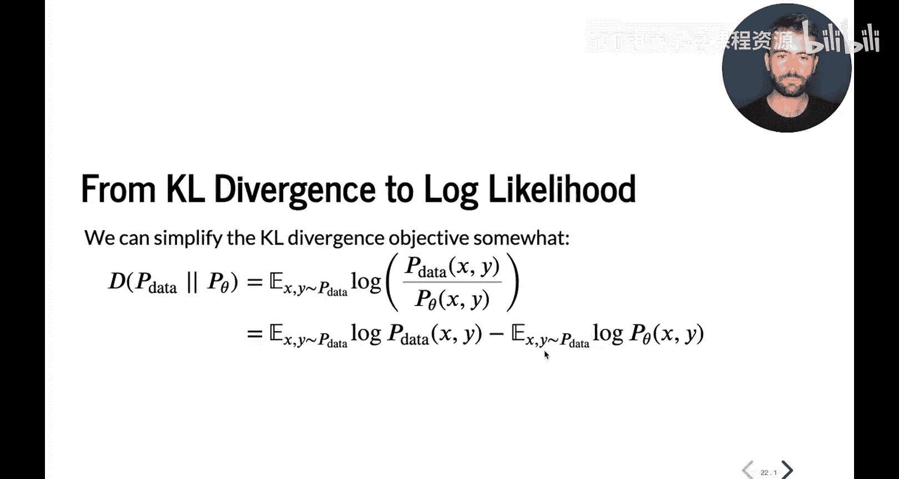

Now， this expression here， actually it's a little bit more complicated than we need。

 and I am going to now show you how we can simplify it。

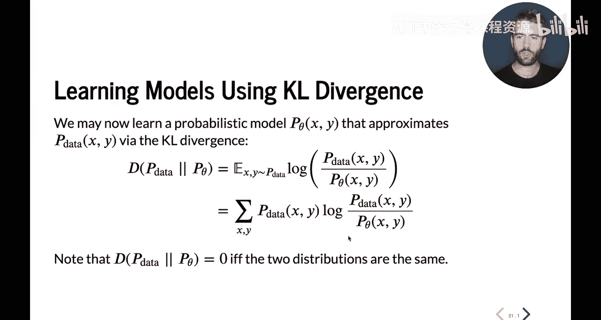

We can simplify it as follows here I am just using the definition of the col library divergence and then by the definition of the log。

 it breaks up into the following terms。And then the key observation here is that the term on the left here。

 this is only a function of the data distribution， and this is a function of the our model is only found on the right hand side。

 therefore if our only goal is to optimize for the model， we don't really need the left hand term。

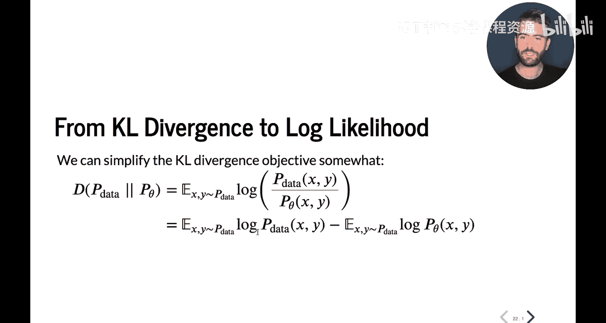

So in other words， if we're minimizing the col labular divergence over the space of models。

 then it's enough to look at the second term， which is then equivalent to maximizing this value。

And now this brings us to the main principle that we wanted to cover and present in this lecture and video。

 which is。Maximum likelihood estimation。This term here。

 the log probability is something that is called the likelihood。

 so more in general the likelihood is mathematically the definition of the likelihood is that this is the likelihood of the data and then the log likelihood is the log probability that you see here。

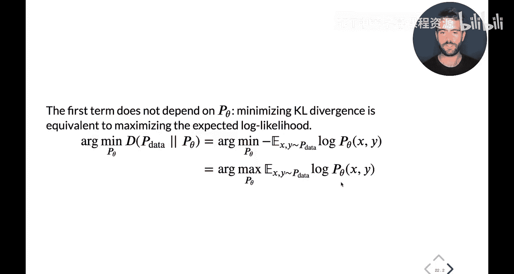

And the principle of maximum likelihood consists in optimizing the following objective。

Which corresponds to minimizing detailedLrgs between the model distribution and the data distribution？

Let's inspect in a little bit more detail what this subjective does。

Essentially here were sampling points from the data。

And we're asking it to assign high probability to data points that are sampled from the data。

 and then because this probability sums to one， it will assign low probability to points that do not come from the data。

This is a really general way applying of learning probabilistic models and there is a very extensive theory and statistics for why this is a good objective。

 we are not going to cover this in detail in this course。

 but there are many reasons for why this is a good objective for learning for training machine learning models and one of them is that it approximates the KL divergence。

 but there's actually many， many other important reasons why this is useful。However。

 we have a problem if we want to。Optimize this objective in practice。

 This is an expected value with respect to this data distribution。

And computing this expected value is not going to be tractable One reason is that the space of possible x's and y's can be really large and so computing this expectation exactly would be difficult。

 but in practice we don't even know what this distribution is and we don't know what value it assigns to each combination of x and y and therefore computing this expected value is。

Is impossible， at least in an exact form。

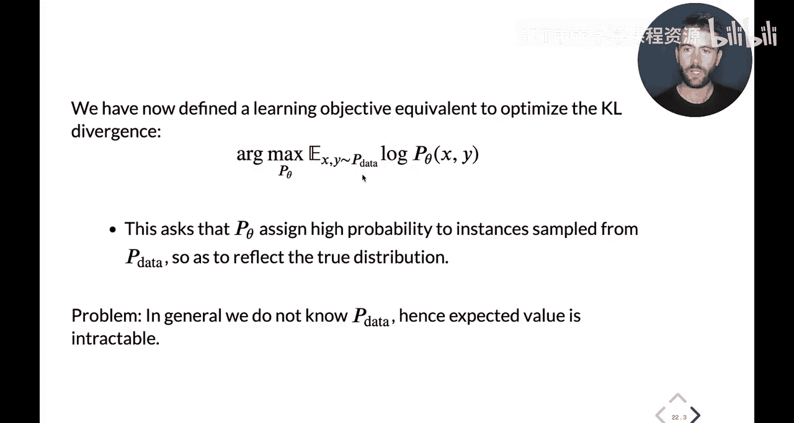

However， can approximate this， we can compute this expected value approximately using the principle that we saw in the previous part of this lecture called Monte Carlo estimationation。

We can apply Monte Carlo estimation by taking samples from the data distribution。

If we have samples from the data distribution， then we can simply estimate this expectation by averaging the log probability over the set of samples that comes from our distribution。

And now recall that our training data set， that happens to be exactly that that is precisely what we need。

 that is a set of samples from the data distribution。And so。In order to apply maximum likelihood。

We can simply compute the following objective。which is called the empirical log likelihood。

 that is simply the log likelihood of the samples that of our training data。

 which is a set of samples coming from the data distribution。So in other words。

 we are asking the model to assign a high probability to the set of samples that we have collected and that is coming from the data distribution。

And again， this is our objective function and because we have used Monte Carlo estimation。

 the expected value of this， so this is going to be an unbiased estimate of the true log likelihood that will converge to this true log likelihood as we collect more data。

In other words， by optimizing this objective， we are approximately optimizing this one which corresponds to approximating the true data distribution using our model P theta。

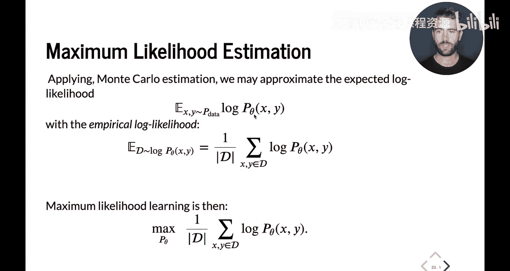

Let's now consider a simple application of maximum likelihood just to get a better intuitive understanding of what it does。

Let's say that we are flipping a random coin and we have a data set of coin flips where the two possible outcomes are either heads or tails。

And this is what our data set can look like here we have five throws and we have three heads and two tails。

We're going to assume that this data is coming from a data distribution and because we only have two outcomes。

 our data distribution is simply going to be assigning。

 it's going to be a Bernoulli distribution that assigns a probability to the two possible outcomes either has or tails。

And because our probability has this form， we are also going to assume that our model has the same form。

 Our model， again， is going to be our model class is going to be the set of berul distribution over this binary outcome。

 And if you don't know what a berno distribution is， essentially it's just。

A probabilityability that assigns a binary outcome。 So we have。Heads and tails。

 one of them is going to be success， the other one is going to be failure。

 and we have a probability P of having outcome 1， which can be heads and 1 minus p is the probability of tails and we only have this one parameter P that we need to infer in order to define our distribution。

Okay， so this is our toy example， and now let's see how we can apply maximum likelihood to this setting。

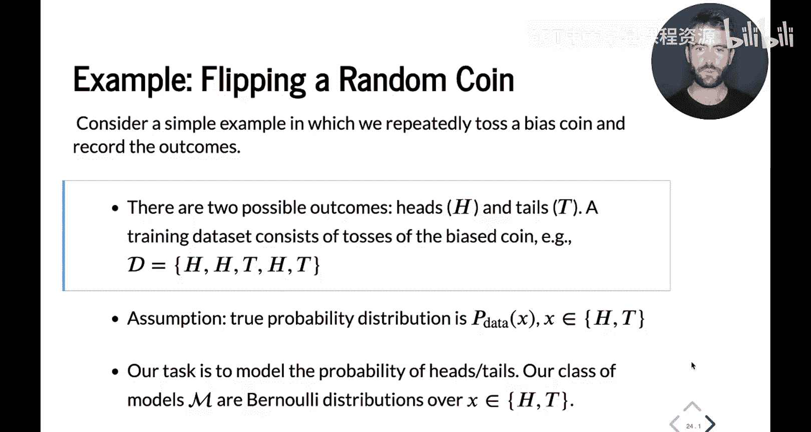

Again， our model has the following form。We have a parameter of theta。

 which is the probability of heads， and the probability of Thales is just one minus theta。

 and this is our data set。Now we can compute the likelihood of the data under this model as follows。

 this is the journal form and because this is our model。

 then our likelihood is simply theta times theta times 1 my theta， etctera。

 it's just the probability of this data。And now we want to optimize for the theta。

 which is the most likely。We can optimize this really easily first we can simply plot this log likelihood here I have my likelihood of a coin and this is what we saw earlier。

 there's theta， theta 1 minus theta， etc ceter， and now I can simply plot this function over all the different values of theta and we can see that this function reaches its maximum at 0。

6。

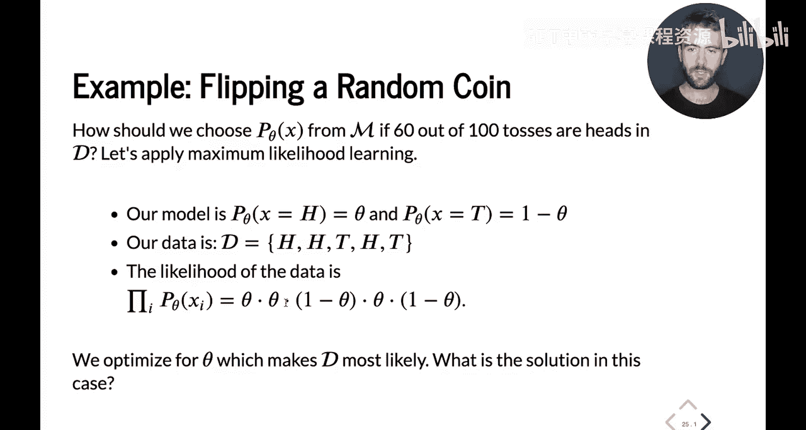

And 0。6 is what maximum likelihood believes to be the probability of heads。

And this makes total sense because。H is occurring three times out of five in our data set。

 therefore 60% is a very reasonable estimate for the probability of heads。

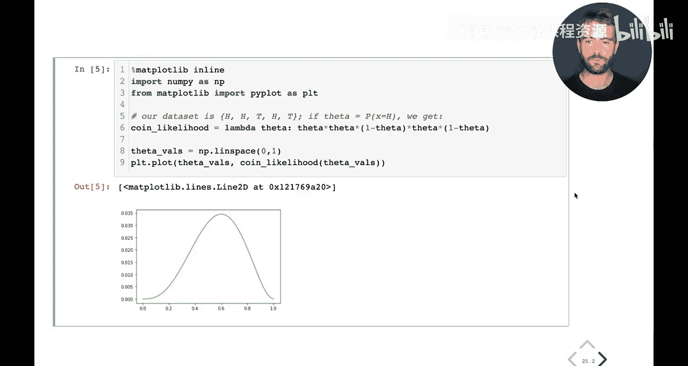

Now we can also compute this distribution analytically if we have an arbitrary number of heads and tails。

 then the probability of this data is going to be simply theta times number of heads times 1 minus theta times the number of tails。

Computing the log， we have the following form。And now we can estimate the optimal theta by simply taking the derivative of this value。

 setting it to0 and solving for theta， and therefore we will find that the optimal value for theta or maximum likelihood value of theta is simply going to be heads divided by number of heads and tails。

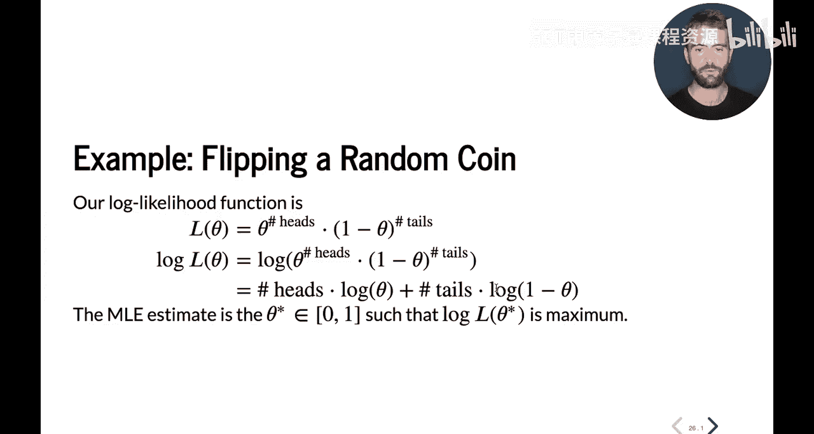

Again， this is a really intuitive way of this is a very intuitive solution。

 and it just shows that maximum likelihood applied to this problem is indeed returning us is returning very reasonable solutions。

Now， this is of course a toy example， and we will be working with much more complicated models in this course。

And often it will not be possible to compute a closed form expression for the maximum likelihood parameters。

 However， maximum likelihood is ultimately still just an objective function。

 and we can optimize this objective function using various kinds of optimization algorithms。

 including the ones that we've seen so far， such as gradient descent。

And all this means is that maximum likelihood is an objective that is going to be wildly applicable in this case。

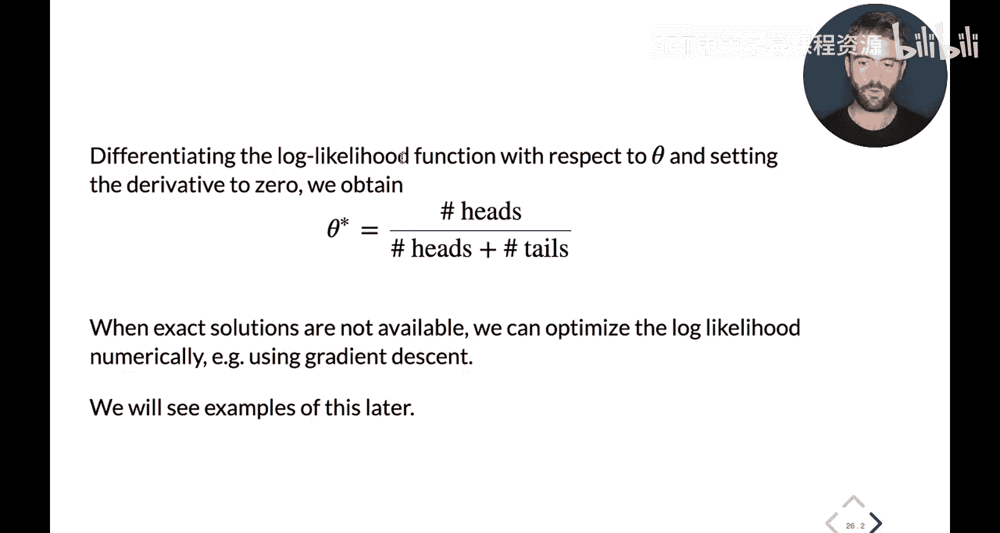

And finally， one last comment that I want to make here is sometimes we're interested to not fit a joint model over x and Y。

 but a conditional model of y given x。 Of course we can obtain a conditional model from a joint model but sometimes we would like to model we would like to use a we would like to use a conditional model in the first place and not do this transformation we can also apply the principle of conditional maximum likelihood in this case and in this case we would be simply optimizing the expected KL divergence between the data distribution and the model distribution and both of these are conditionals and we're optimizing the expected value over this data set。

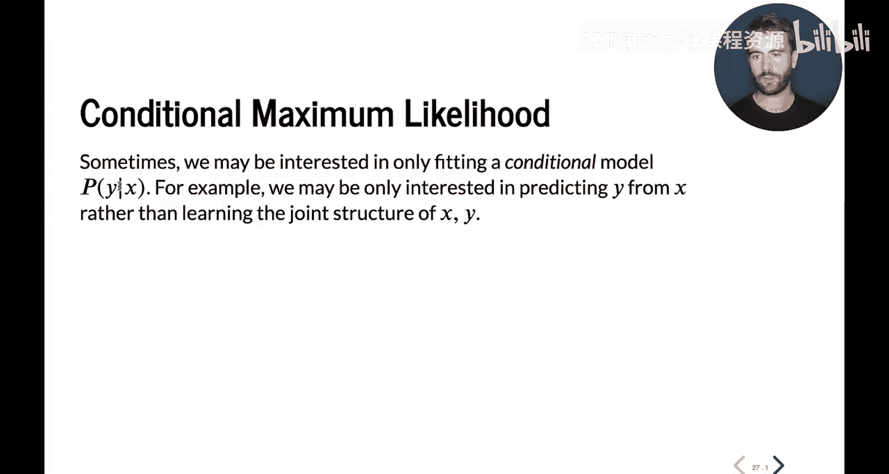

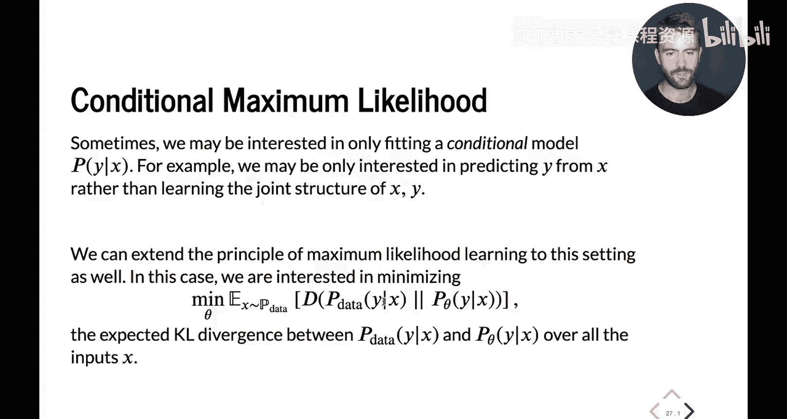

We can easily show that minimizing this example， minimizing this objective function in the same way that we showed earlier。

 this corresponds to the following objective where again we're taking samples X Y from theta。

 and we are choosing a model that assigns a high probability to the Y to the true Y given the x for a set of samples coming from the data and this is called the principle of conditional maximum likelihood。

In the next few lectures， we're going to see many applications of this principle to important machine learning models。

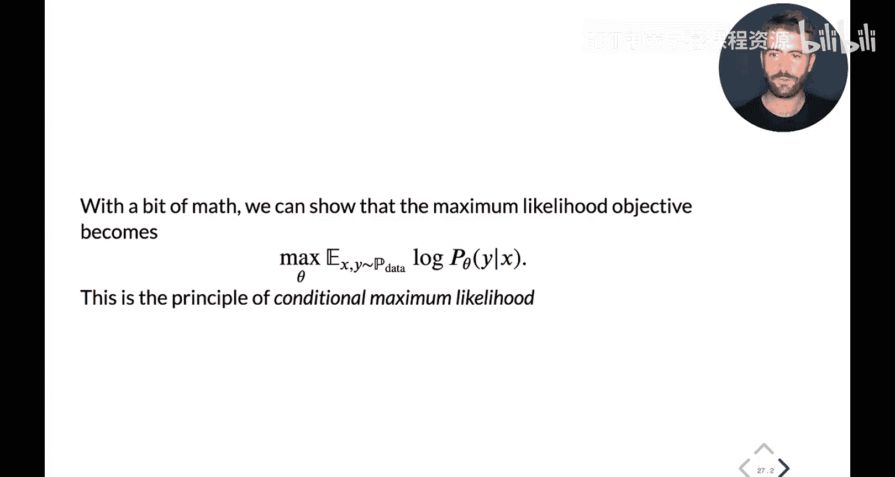