# 应用机器学习：第5讲：第3部分：最大似然学习 🎯

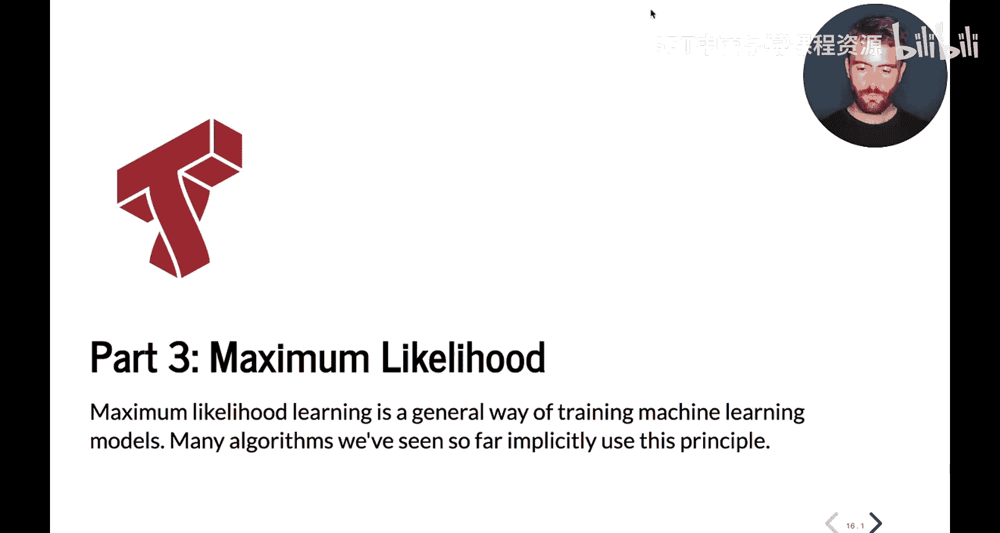

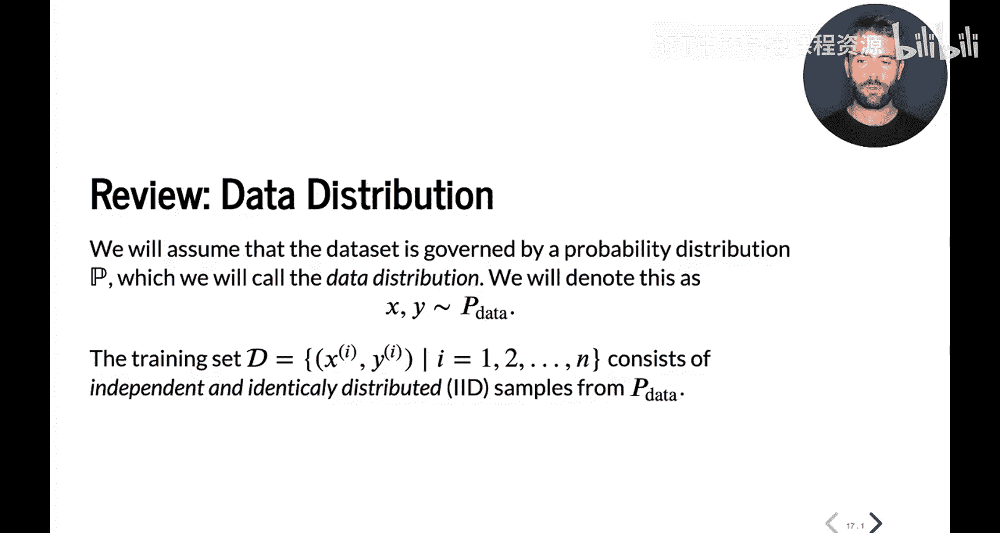

在本节课中，我们将学习**最大似然估计**。这是一个通用原则，可用于推导新的机器学习算法，并解释许多我们之前见过的算法为何有效，以及它们如何被理解为概率建模的实例。

## 概述

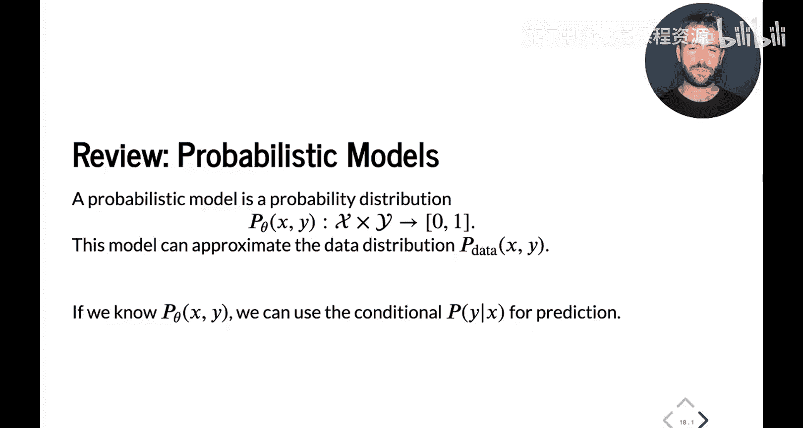

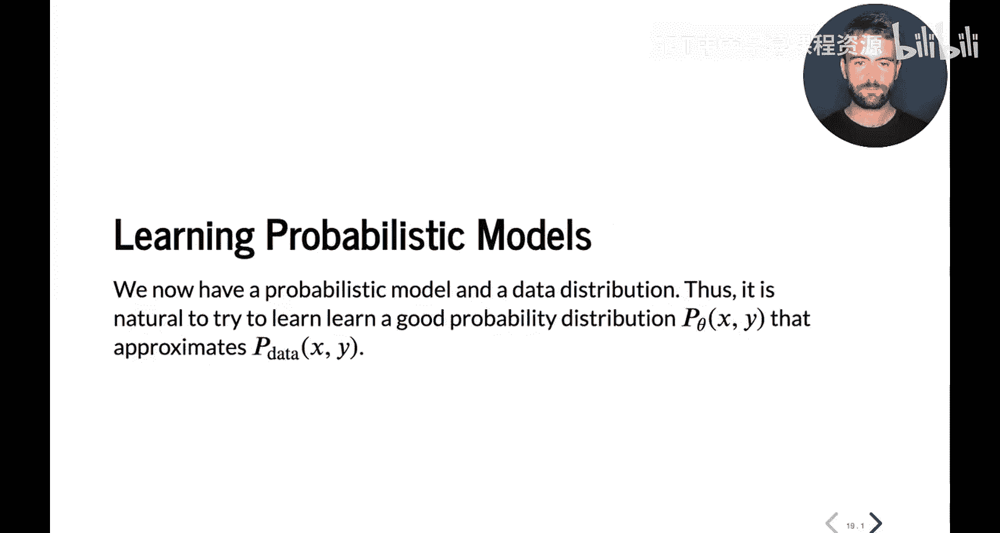

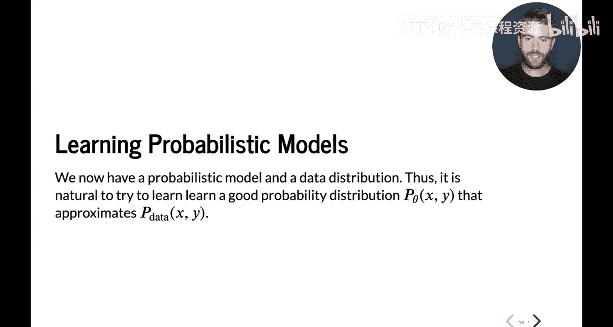

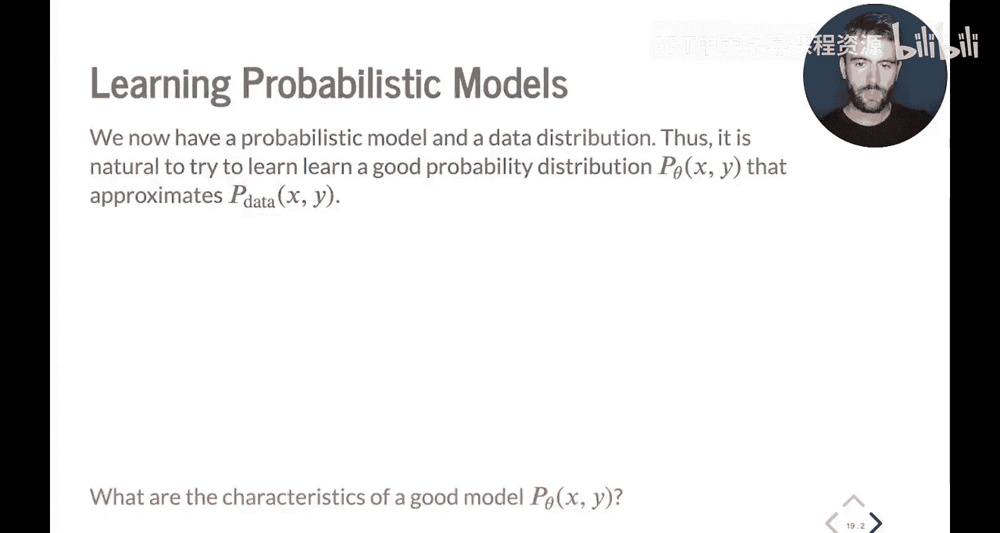

我们假设数据（输入 `x` 和目标 `y`）是从一个数据分布中独立同分布采样得到的。这个数据分布是 `x` 和 `y` 上的一个联合概率分布。我们的训练集就是来自该数据分布的一组独立同分布样本。

既然我们假设数据来自概率分布，那么将我们的机器学习模型也定义为概率分布就是合理的。我们可以尝试拟合这类模型，使其与数据分布相似。这里，我们定义了一个带参数 `θ` 的特定分布。这同样属于监督学习的范畴，因为给定输入 `x`，我们可以应用概率论的基本规则来获得给定 `x` 时 `y` 的条件分布，并用于预测。本质上，概率模型是一种使用机器学习来拟合数据分布的方法。

## 拟合概率模型的目标

既然我们希望通过拟合概率模型来近似数据分布，我们该如何做？应该使用什么样的目标函数呢？

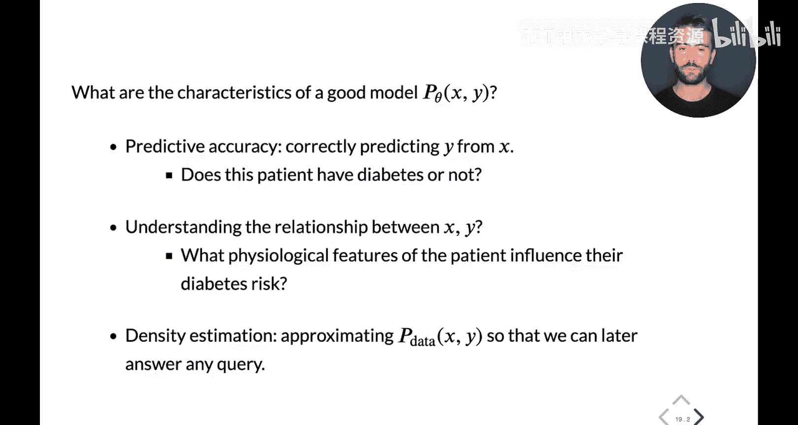

定义“好”的概率模型有许多不同方式，取决于我们希望从模型中获得什么。之前许多课程的重点是**预测准确性**，即寻找一个能准确从 `x` 预测 `y` 的模型。我们也可以尝试构建能近似 `x` 和 `y` 之间关系的模型。如果我们的模型与真实数据分布具有相同的结构，但缺少一些参数，我们可以通过数据来学习这些参数，将我们对分布结构的先验知识编码进去，然后观察数据告诉我们这些参数的值。例如，我们可以推断患者的哪些特征会影响其糖尿病风险。

最后，一个更通用的目标是**密度估计**。我们试图在所有可能的 `x` 和 `y` 值上近似整个数据分布。如果我们能做到这一点，那么我们将能够回答任何查询，进行预测，并探究该分布结构的概率特性。密度估计是一个重要的目标，也是本讲我们将要追求的目标。

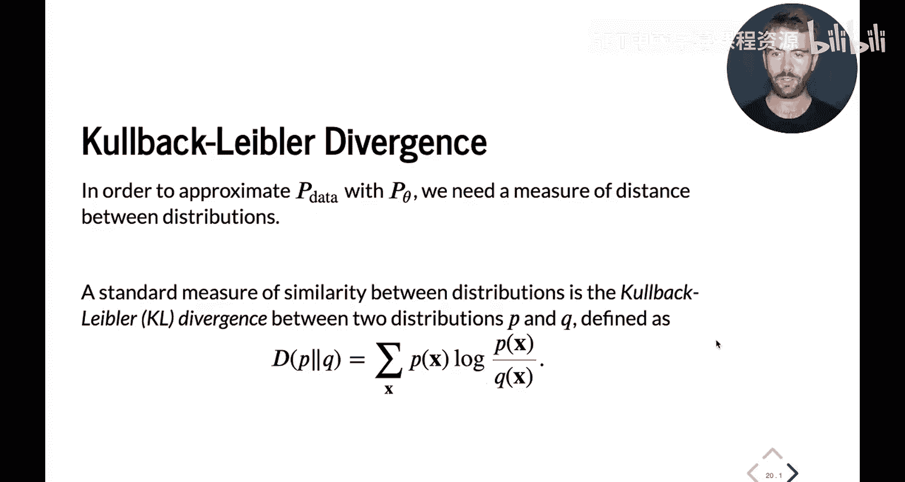

## 比较分布：KL散度

为了进行密度估计，我们需要某种度量两个分布之间相似性或距离的方法。为此，我们将使用信息论中的一个工具：**Kullback-Leibler散度**。

以下是KL散度对于离散变量 `x` 的数学定义：
```
D_KL(P || Q) = Σ_x P(x) * log( P(x) / Q(x) )
```
虽然其精确形式对于理解本视频内容并非绝对关键，但关键要点是：这是在机器学习、物理学和许多科学领域中广泛使用的比较概率分布的方法。

### KL散度的性质

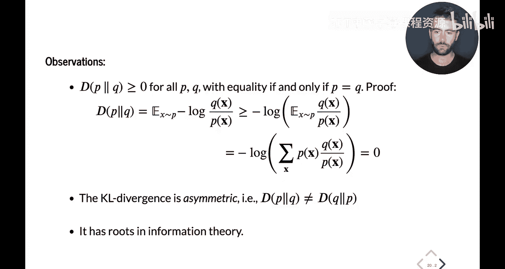

KL散度有几个重要性质，使其成为比较概率分布的良好方式：
1.  **非负性**：`D_KL(P || Q) ≥ 0`。
2.  **零值条件**：`D_KL(P || Q) = 0` 当且仅当 `P` 和 `Q` 处处相等。
3.  **非对称性**：`D_KL(P || Q) ≠ D_KL(Q || P)`，因此它被称为“散度”而非“距离”。
4.  **信息论根源**：它源于信息论，衡量用分布 `Q` 来近似真实分布 `P` 时造成的信息损失。

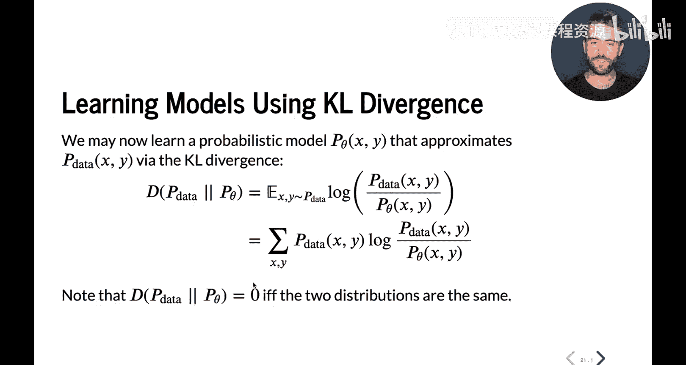

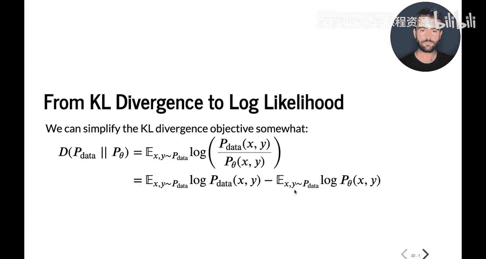

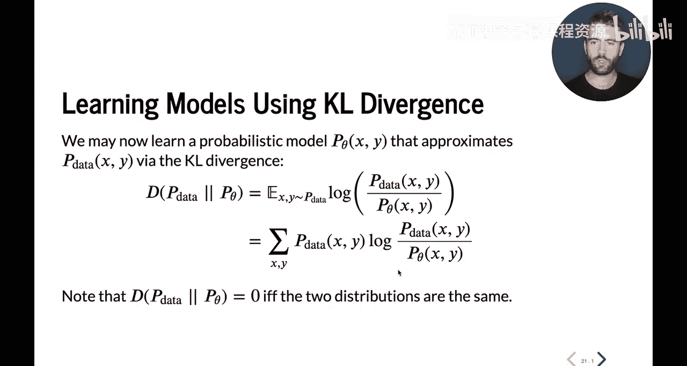


## 从KL散度到最大似然估计

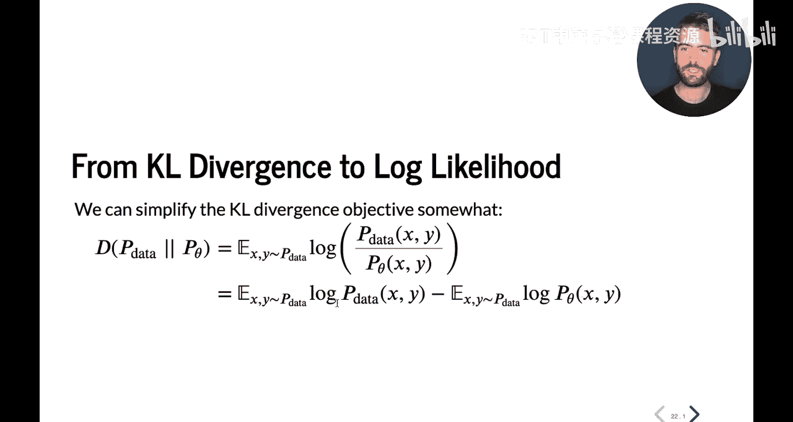

假设我们想使用KL散度作为训练目标来比较我们的模型分布 `P_θ(x, y)` 和数据分布 `P_data(x, y)`。这将给出如下目标：
```
min_θ D_KL(P_data || P_θ) = E_{(x,y)~P_data} [ log( P_data(x, y) / P_θ(x, y) ) ]
```
我们希望最小化这个值，使其接近零，这样两个分布就会相同。

现在，我们可以简化这个表达式。根据对数运算的性质，我们可以将其分解为两项：
```
D_KL(P_data || P_θ) = E_{(x,y)~P_data} [ log P_data(x, y) ] - E_{(x,y)~P_data} [ log P_θ(x, y) ]
```
关键观察是：左边第一项仅依赖于数据分布 `P_data`，而与我们的模型参数 `θ` 无关。因此，如果我们只关心优化模型，可以忽略这一项。最小化KL散度就等价于**最大化**第二项 `E_{(x,y)~P_data} [ log P_θ(x, y) ]`。

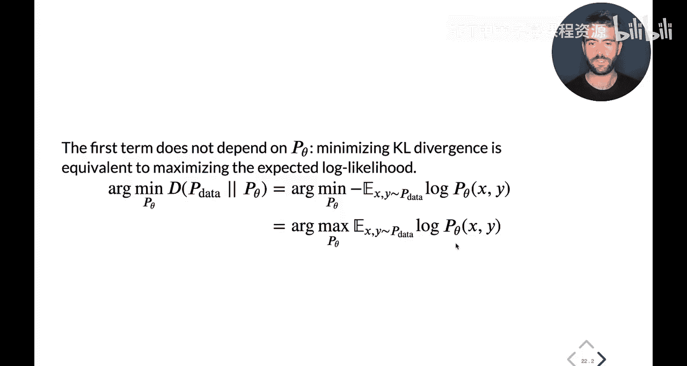

这引出了本讲的核心原则：**最大似然估计**。项 `log P_θ(x, y)` 被称为**似然**（的对数形式）。最大似然原则在于优化以下目标：
```
max_θ E_{(x,y)~P_data} [ log P_θ(x, y) ]
```
这对应于最小化模型分布与数据分布之间的KL散度。

让我们更详细地检查这个目标的作用。本质上，我们从数据中采样点，并要求模型为这些来自数据的点分配高概率。由于概率总和为1，模型自然会为那些不来自数据的点分配低概率。这是一种学习概率模型的通用方法，统计学中有广泛的理论支持其合理性。

## 实践中的最大似然：经验对数似然

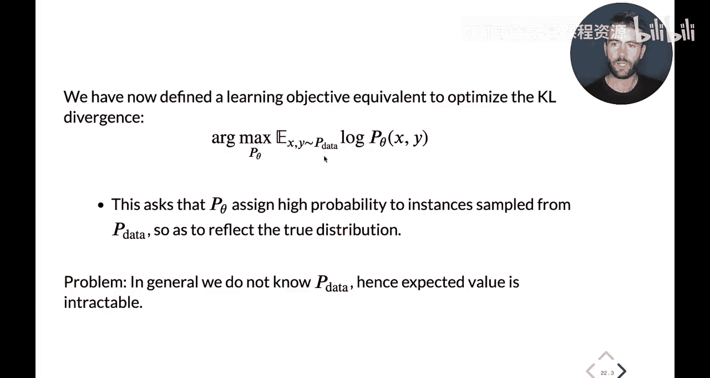

然而，如果我们想在实践中优化这个目标，会遇到一个问题：这是一个关于数据分布的期望值。精确计算这个期望值通常是不可行的，一方面因为 `x` 和 `y` 的可能空间可能非常大，另一方面我们甚至不知道真实的数据分布 `P_data` 是什么。

不过，我们可以使用本讲前面部分介绍的**蒙特卡洛估计**原理来近似这个期望值。如果我们有来自数据分布的样本，那么我们可以简单地通过对样本集上的对数概率求平均来估计这个期望。回想一下，我们的训练数据集正是我们所需要的——它就是来自数据分布的一组样本。

因此，为了应用最大似然估计，我们可以简单地计算以下目标，称为**经验对数似然**：
```
max_θ (1/N) * Σ_{i=1}^N log P_θ(x_i, y_i)
```
其中 `{(x_i, y_i)}` 是我们的训练数据。换句话说，我们要求模型为我们收集到的、来自数据分布的样本集分配高概率。通过优化这个目标，我们近似地优化了真实的对数似然，从而用我们的模型 `P_θ` 近似了真实的数据分布。

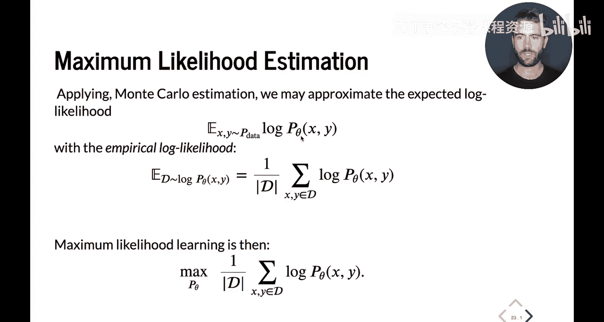

## 一个简单示例：抛硬币

让我们考虑一个最大似然估计的简单应用，以便更好地直观理解它的作用。

假设我们抛一枚随机硬币，我们有一个抛硬币结果的数据集，两种可能结果是正面（H）或反面（T）。例如，我们的数据集可能是：`{H, H, T, H, T}`（3次正面，2次反面）。

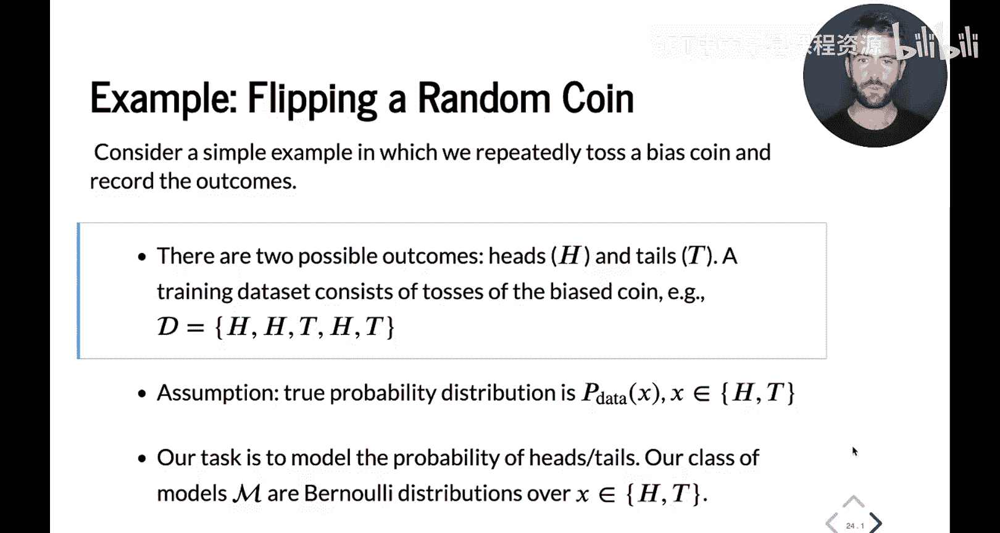

我们假设数据来自一个数据分布。由于只有两种结果，数据分布可以表示为一个伯努利分布，为两种结果分配概率。我们的模型也将采用相同的形式，即伯努利分布族，只有一个参数 `θ`（正面的概率）。模型定义如下：
```
P_θ(H) = θ
P_θ(T) = 1 - θ
```
现在，让我们看看如何将最大似然估计应用于此设置。

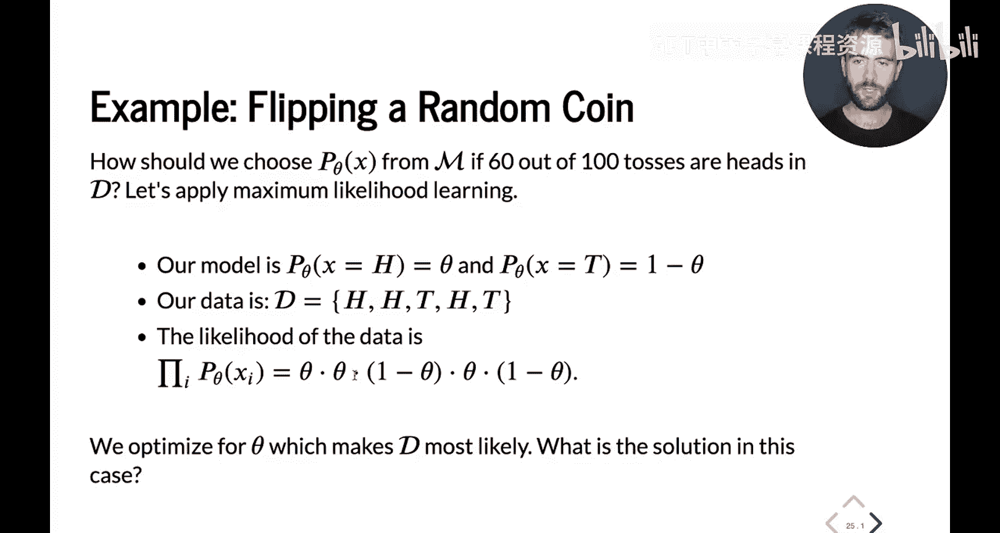

给定数据集 `{H, H, T, H, T}`，模型下的数据似然为：
```
L(θ) = P_θ(H) * P_θ(H) * P_θ(T) * P_θ(H) * P_θ(T) = θ * θ * (1-θ) * θ * (1-θ) = θ^3 * (1-θ)^2
```
我们希望找到使这个似然最大化的 `θ`。我们可以绘制这个函数，或者解析求解。对于更一般的情况，如果有 `N_H` 次正面和 `N_T` 次反面，则对数似然为：
```
log L(θ) = N_H * log(θ) + N_T * log(1-θ)
```
通过对 `θ` 求导并令其为零，我们可以找到最优解：
```
d/dθ [log L(θ)] = N_H/θ - N_T/(1-θ) = 0
```
解得：
```
θ_ML = N_H / (N_H + N_T)
```
在我们的例子中，`N_H = 3`, `N_T = 2`，所以 `θ_ML = 3/5 = 0.6`。这是一个非常直观的结果：最大似然估计认为正面的概率就是数据中正面出现的频率。

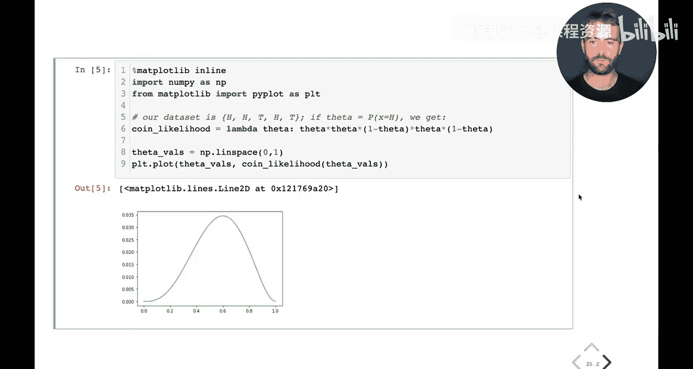

## 条件最大似然估计

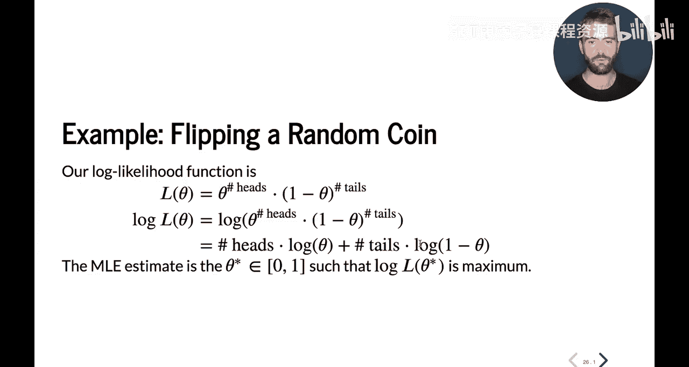

最后，有时我们感兴趣的不是拟合 `x` 和 `y` 的联合模型，而是给定 `x` 时 `y` 的条件模型。当然，我们可以从联合模型中获得条件模型，但有时我们希望直接使用条件模型。

在这种情况下，我们可以应用**条件最大似然估计**原则。此时，我们优化的是数据条件分布与模型条件分布之间的期望KL散度。通过类似的推导，这对应于优化以下目标：
```
max_θ E_{(x,y)~P_data} [ log P_θ(y | x) ]
```
同样，我们可以使用经验近似：
```
max_θ (1/N) * Σ_{i=1}^N log P_θ(y_i | x_i)
```
这被称为条件最大似然估计原则。在接下来的几讲中，我们将看到这一原则在许多重要机器学习模型中的应用。

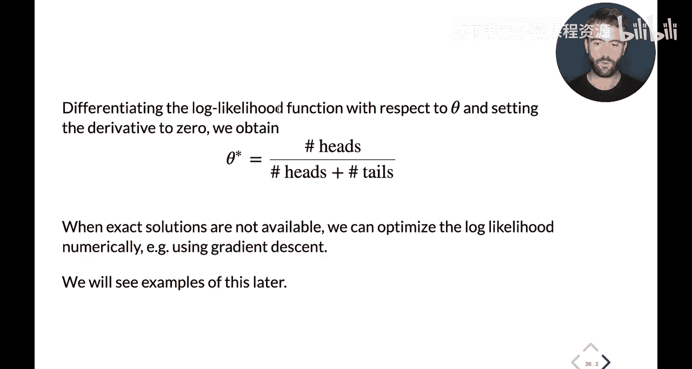

## 总结

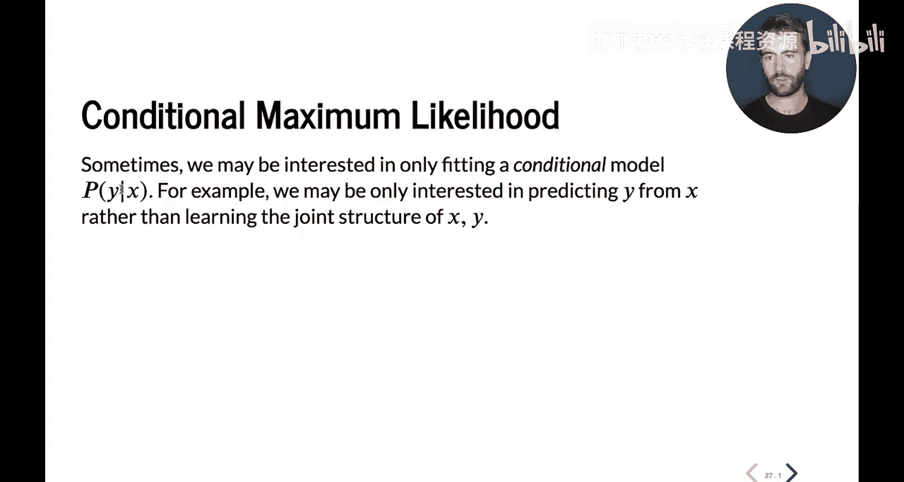

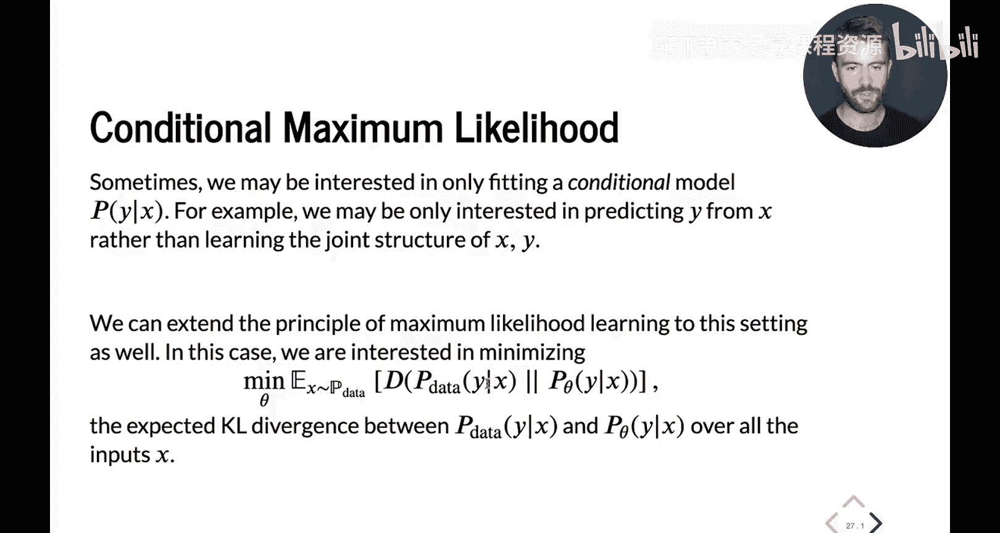

在本节课中，我们一起学习了：
1.  **概率建模的动机**：将机器学习模型视为概率分布，以近似未知的数据分布。
2.  **KL散度**：作为比较两个概率分布相似性的重要工具，其最小化等价于最大似然估计。
3.  **最大似然估计原理**：通过最大化模型在训练数据上的（对数）似然来学习模型参数，其本质是要求模型为观测到的数据分配高概率。
4.  **经验近似**：由于真实期望不可计算，我们使用训练数据的经验平均来近似最大似然目标。
5.  **简单示例**：通过抛硬币的例子，我们直观地看到最大似然估计给出了符合直觉的参数估计（正面出现的频率）。
6.  **扩展**：最大似然原则可以自然地扩展到条件分布的学习，即条件最大似然估计。

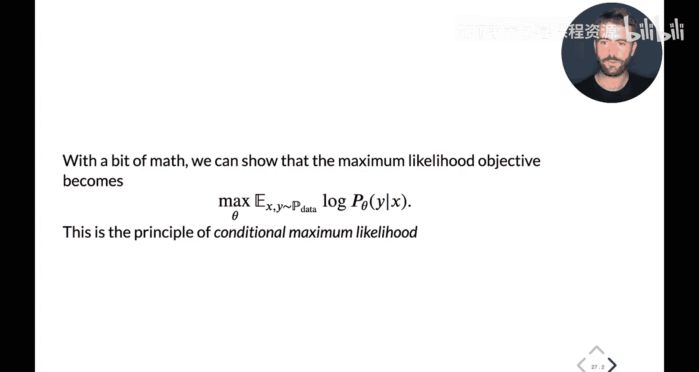

最大似然估计为许多机器学习算法提供了一个统一的理论基础，并且作为一个优化目标，它可以与梯度下降等优化算法结合，应用于非常复杂的模型。