# 康奈尔大学《应用机器学习 CS 5787_ Applied Machine Learning 2020》中英字幕（deepseek p20 -20-Lecture 5. Part 4_ Extensions of Maximum Likelihood.zh_en -BV12udzYvEFM_p20-

Welcome to the fourth and final part of Le 5 of Applied machinech learning。In this video。

 we're going to continue talking about maximum likelihood。

And we will now see some extensions of this principle。

One really important extension of maximum likelihood is going to be the Bayesian approach。

 and that's one of the things that I would like to highlight in this video。

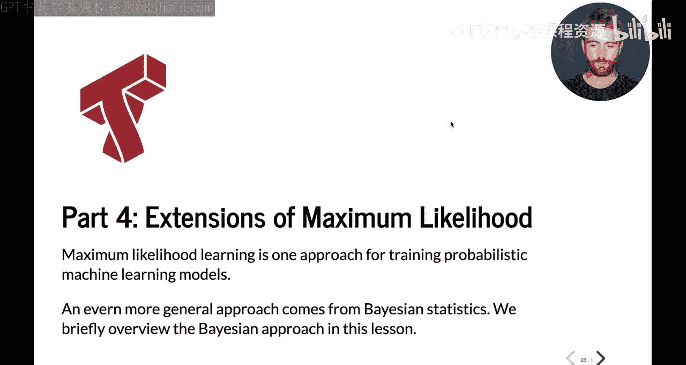

Now， recall that in the maximum likelihood learning。We are optimizing the following objective。

We have a probabilistic model P with some parameters theta。And we need to define an objective for。

For training this probabilistic model， maximum likelihood provides us with this objective that we can derive from first principles by minimizing the KL divergence。

And this is what the subjective looks like。Here under this objective。

 the model P is assigning high probability to X and Y that are coming from the data。In practice。

 we cannot compute this expected value， but we can estimate it using Monte Carlo estimation。

 And this is replaced by an average taken an average of over samples taken from the。

Probability distribution from the data distribution and therefore the model will assign high probability to samples which are coming from our data distribution。

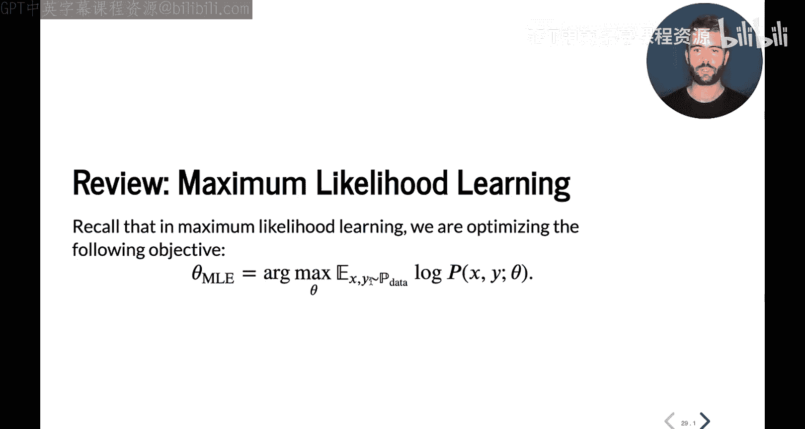

This particular way of training a probabilistic model is an instance of the frequentest approach。

 which is an important way of doing statistics， it's a very important idea in statistics。

And the key idea of frequentist approaches of the frequentist idea is that the parameter that we're trying to estimate is some kind of fixed but unknown quantity。

 and our goal as a machine learning or statistician is to discover what this true but unknown parameter is。

So for example， imagine the simple scenario that we looked in the previous videos and in the previous lectures where we're flipping a coin。

Here we have a coin and this coin has some kind of bias。

 it's biased to some extent towards heads or tails， and we observe a large number of coin flips。

And these the results of these coin flips are coming from some true data distribution in which the coin has some unknown property。

 which is the bias or the probability of having heads of returning heads and we're devising you can think of maximum molecular estimation as a statistical procedure for inferring what this。

Unknown， but fixed parameter is。

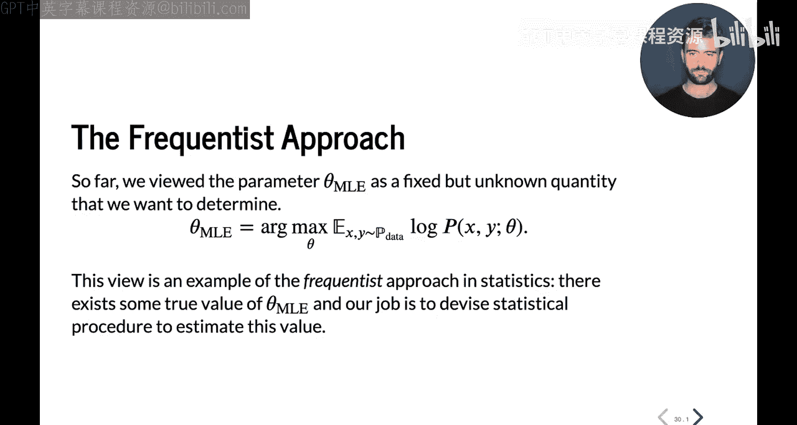

Now contrast， the frequentist approach with the Bayesian approach。

 which is another very important idea in statistics and in machine learning。In the Bayesian approach。

 we are going to consider theta the parameters that we want to infer as a random variable whose value is unknown。

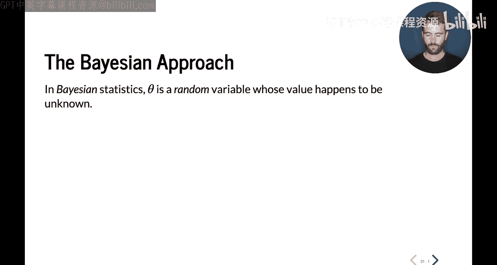

This is a very interesting idea。In order to perform Bayesian statistics。

 we're going to define a distribution over X， y and theta。

 and we're going to do this by defining two components。

The first component that we're going to define is called the likelihood。

And this is simply the probability of x and y， given some assignment to the set of parameters theta。

This is the same kind of probability distribution that we have been working with before。

 Theta is fixed to some value， and now we can estimate the distribution of x and Y given this value。

Now， in order to make it a joint distribution over X Y and theta。

 we're also going to define this other component called the prior。

 and the prior is something that assigns probability to different values of theta and it is intuitively the prior specifies what we think theta is before we have seen any data。

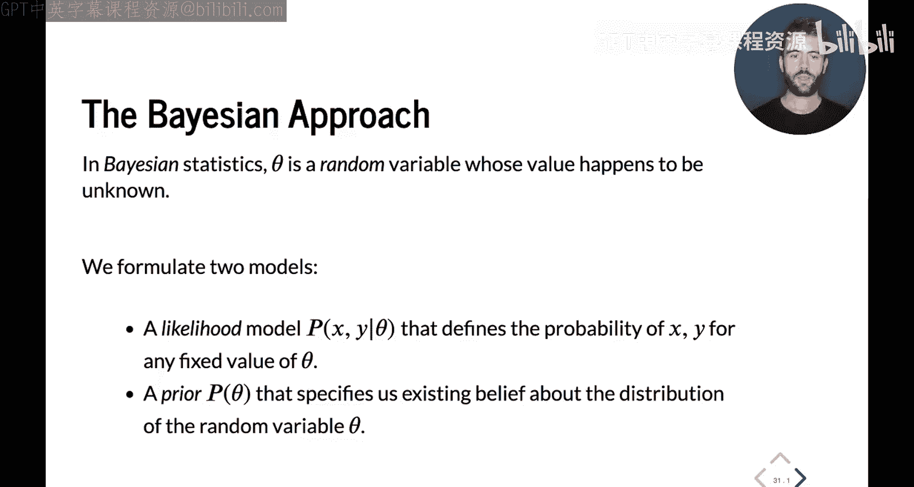

Before we have seen any samples from X and Y。And now we can use these two components to define a join distribution over X。

 y and theta， and again， I want to emphasize here that theta is now a random quantity in the same way that x and y were random quantities。

I want to highlight that this might be a little bit strange because if we were to apply this principle to our example where we're flipping heads and tails and there is some sort of unknown bias。

 now the coin that we're flipping and samples from which we're collecting this coin has we have a probability distribution over the bias of this coin。

 but this is strange because we only have one coin that we're flipping。

 so it is strange to assume that this coin has an entire probability distribution of states or different possible biases often when we think of probabilities。

 we think of frequencies， so if I flip my coin。10，000 times and it's biased and the probability of heads is 60%。

 then I'm going to see approximately 60% of my flips as being heads。

But it's really interesting and unusual to think about probabilities for events that occur only once。

 because we only have one random coin， which is which has only one possible bias。

 But now here we're considering it as a random variable。

 and one way to wrap our hand to wrap our head around this is to think of this probability over theta as being our belief about what the value。

 what the bias of the coin is and。In the different distribution， the different value。

 the probability of different value。Of the bias， a value of different values that the bias can take。

By assigning different probabilities of this， we。We can rank the different biases in terms of which ones we believe more given our prior beliefs and what we have seen of the data。

This is a slightly philosophical discussion I that we just had。

 so you don't need it's okay if this is still a little bit vague。

 I think the main takeaway here is that in statistics。

 we assume that our parameters are random variables themselves。

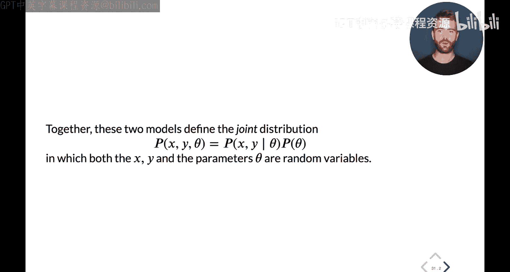

And now given this assumption， how can we learn parameters that are consistent with a particular data set？

In frequency statistics， we would infer one value of theta which explains our data well。

 we would fit one line to our data set of BMI versus As risk。

But now here because theta is a random value。We can think and we should think of a probability over the set of theta given the data that we have received。

And so in order to perform what's called Bayesian inference。

 in order to understand what are the model parameters in a Bayesian approach。

 we're going to consider and we're going to try to compute the following distribution over theta given the data set D。

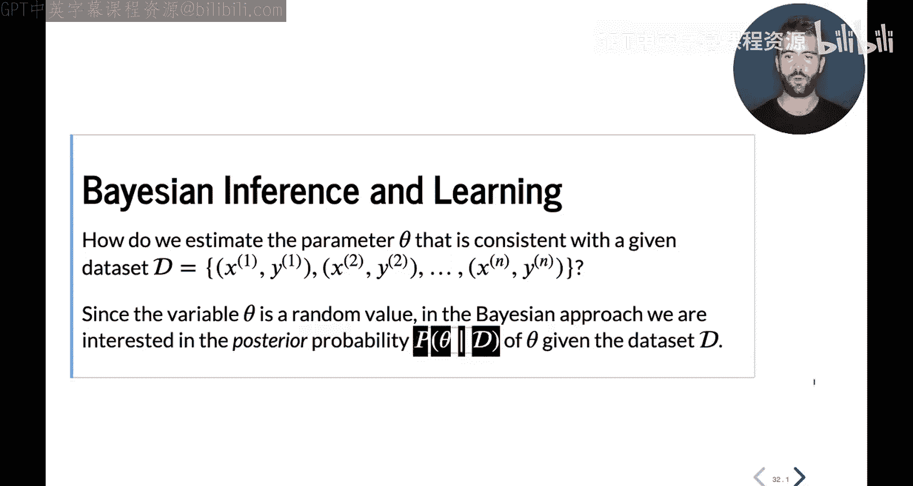

So how could we obtain this distribution？We can obtain it using what is called Bayes rule and this is also where Beijinges statisticsistic takes its name from。

You should be relatively familiar with B rule from a first course in probability。

 but essentially this is the definition， this formula here is simply an application of Bes rule。

And now we can further rewrite this by using the law of total probability to rewrite this as an integral over all the possible values of theta。

And given this definition， we now have。An expression that in principle we can actually compute because the probability of the data given theta has this particular form。

 and that's simply a function of our likelihood that we have specified。

 and the probability of theta is a prior， so if we have specified a model or a form for both a likelihood and the prior。

 then in principle this expression on the right here is well defined and we can compute it。

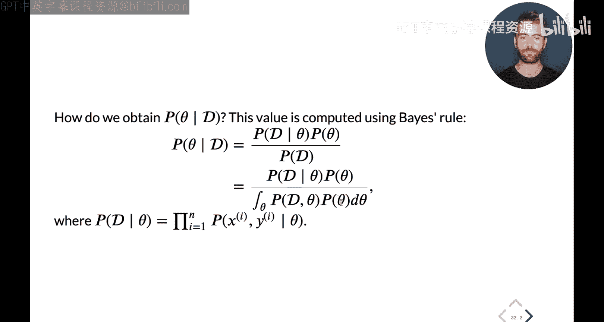

Now， how do we make predictions over predictions about Y given X innovation framework？Again。

 unlike in frequentist statistics， we don't have a single estimate of theta。

 we now have an entire distribution over values of theta。

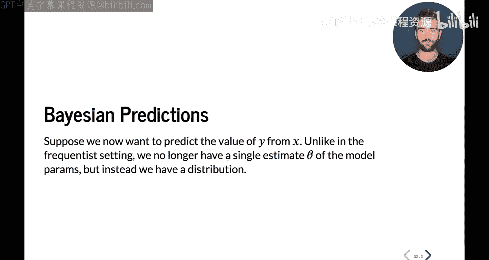

Whi is what we had earlier， it's our， by the way， this is called this distribution here that was that we just saw this one。

 it's called the posterior distribution and it's an important term。

So the Bayesian approach for estimating y from x involves not just using one parameter。

 but using all the possible parameters that we have that could be consistent with our data and we're going to be weighting the probability of y by the value that this parameter can take and again this expression here。

 it's simply using the law of total probability for。For computing this， this is just a simple。

 this equality here is just a simple identity and probability。

And the expression on the left here is what we call the posterior predictive distribution。

So in a sense， we're going to consider all the possible sets of parameters。

 we're going to look at all the possible lines that can be that can be fit to our data。

 all the possible curves， and we're going to weigh each curve by its probability given the data。

 and then the output will be the average vote of all our models where the vote of each model is weighted。

 but how likely that model is to be true given the data that we have seen。

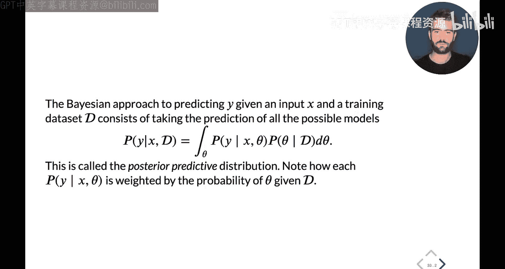

So this is a very interesting approach and you can see。

 I'm sure you can see many ways why this is a powerful approach。

One reason is that we can have principal estimates of uncertainty in our model。

 so now we're not only predicting a single value for what y can be。

 but we're predicting a distribution and then this distribution doesn't just account for the uncertainty in our prediction。

 but it also accounts for the uncertainty in what the model is。

 so by having a wide range of models vote。To by voting what the prediction y is。

 we can have potentially a more robust estimate of the value y。

 and we can also have probabilities which are which account for。

More aspects which are unknown about the predictive result， and as a result。

 these uncertainties are often considered to be higher quality。

We can also use the Bayesian framework to incorporate prior knowledge。

 so recall that we have this prior part， and so if we have some prior information about whether the coin is biased or not。

 we can include this in the prior and then have our statistical procedure account for this prior knowledge in a principled way。

And finally， the Bayesian approach provides us with a general framework for creating and building and reasoning probabilistic models。

 and we're going to see a few examples of this later on and especially in the next lecture。

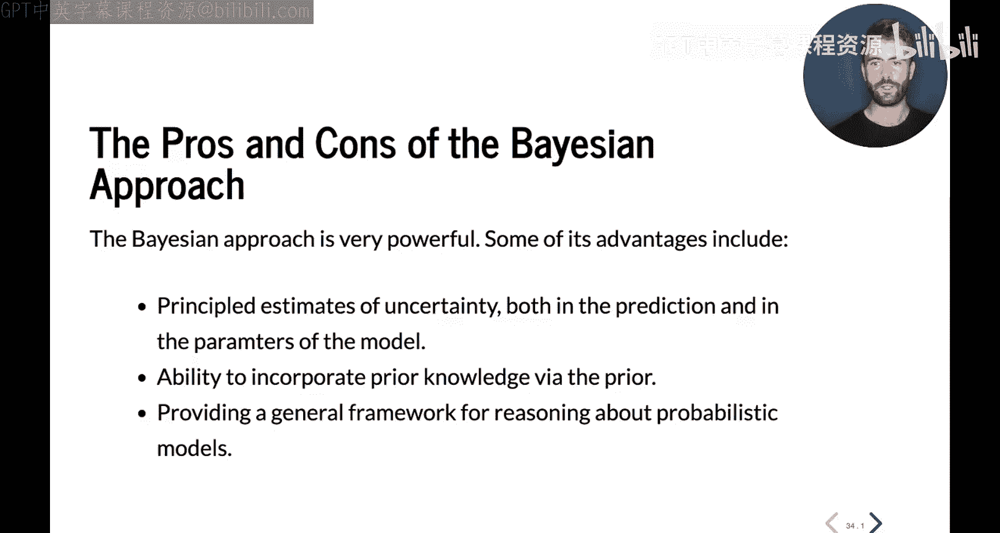

Now， the main disadvantage of using Bayesian statistics is the computational complexity。

It's going to be really difficult to compute averages over all the possible models。

 so you can imagine here you can just imagine if even with a simple linear model。

 we have an infinite number of lines that we could that we could fit the data and now we need to account of we need to account for all these possible lines we need to estimate their probability given the data and we have to combine all of them in order to make a prediction so in almost。

All the interesting applications of Beijing statistics。

 it's not possible to compute all these values that I showed you in the previous slides in their exact form。

But instead we can compute approximations to what these values are。

 and a huge part of Bayesian statistics and Bayesian machine learning is about finding good。

 accurate and tractable approximations to these Bayesian quantities that we saw earlier。

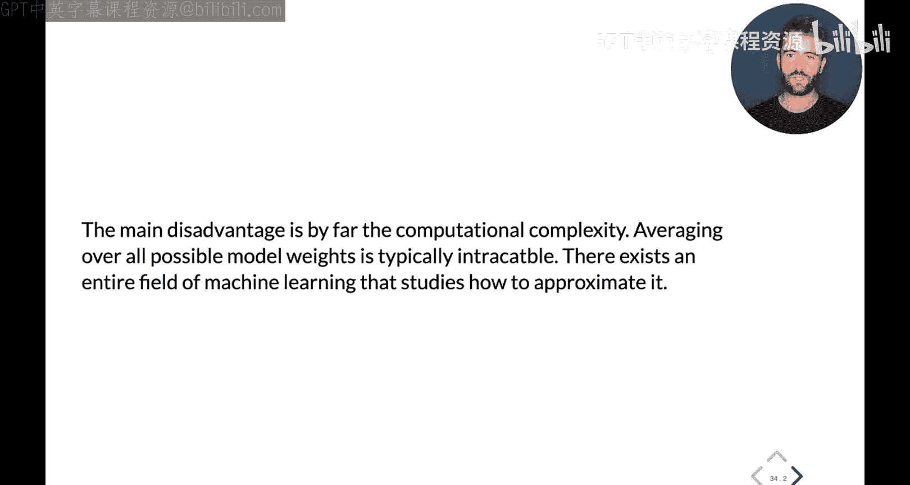

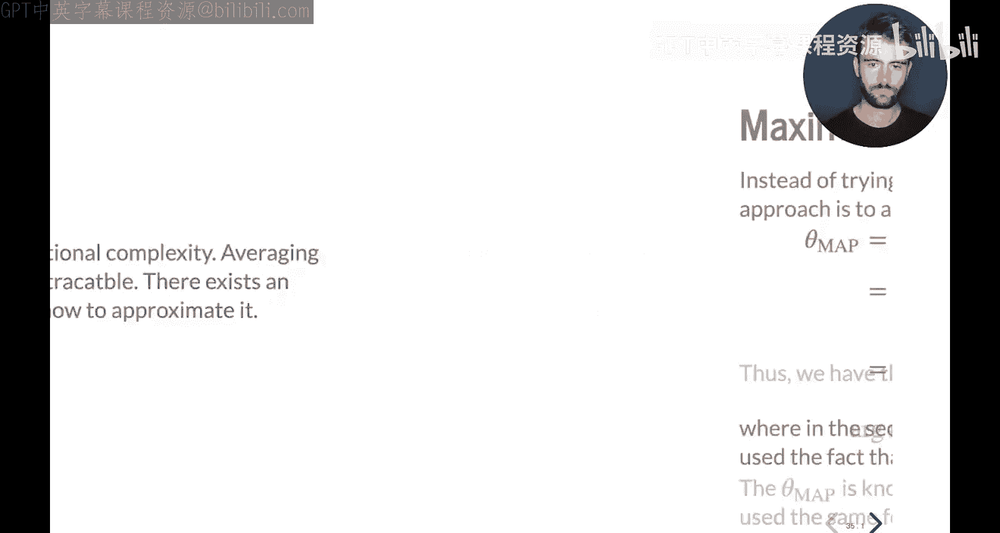

In the rest of this video， I would like to highlight one approximation to Bayian learning。

 which is called maximum Eiary learning。So we saw that computing a full distribution over the model parameters is really difficult。

The idea of maximum aiio or map learning is to approximate this distribution over all the possible。

Seets of parameters by the single one that is the one that's most likely， in other words。

We're going to compute an estimate。Theta MA， which is simply the most likely set of parameters given the data under our posterior distribution here。

And then in order to do prediction， instead of having an average over all the possible parameters。

 we will just use this single map estimate as an approximation to this large vote。

Now how can we compute this parameter， well we can apply base rule again to this probability。

 we can apply base rule to expand this and by applying base rule we have the following expression。

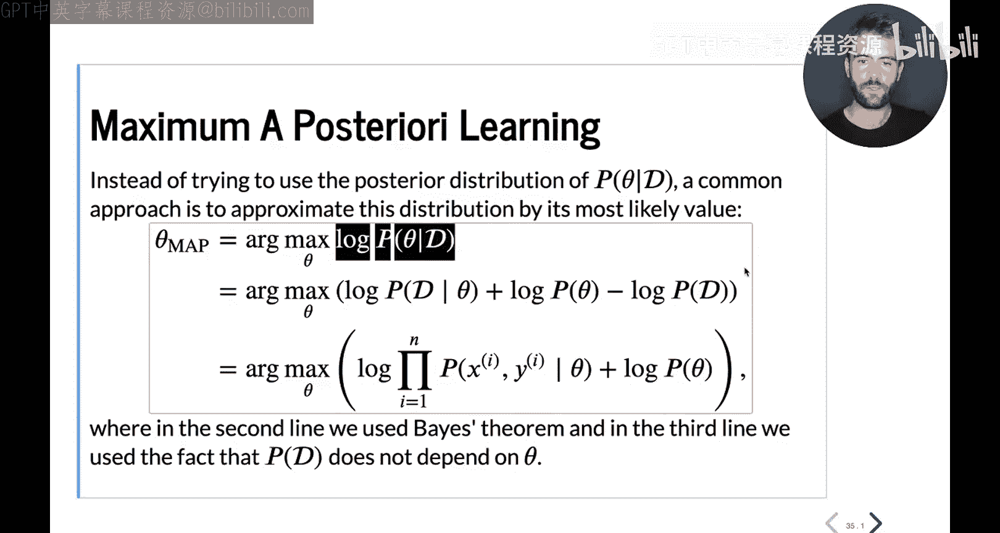

Here， the probability of the data does not depend on the parameter theta so we can get rid of this term and we can further write out the exact form of the probability of the data set given theta。

 and we have the following objective。

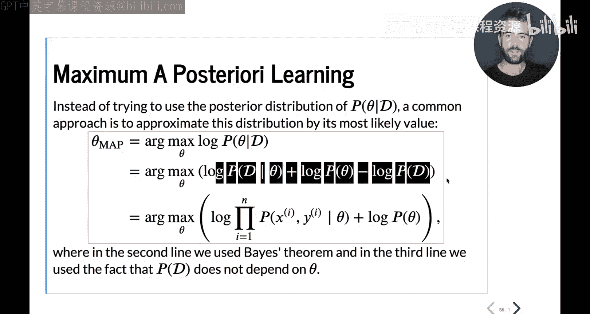

Now you can look at this line a little bit more carefully， you can see that now the MAP objective。

 the MA estimate is the maximizer of the following objective function and this objective function simply corresponds to our regular log likelihood here plus an extra parameter here which corresponds to the prior so in other words the map estimate tries to find it tries to balance between fitting the data well under the likelihood and also respecting our prior beliefs about what data should be。

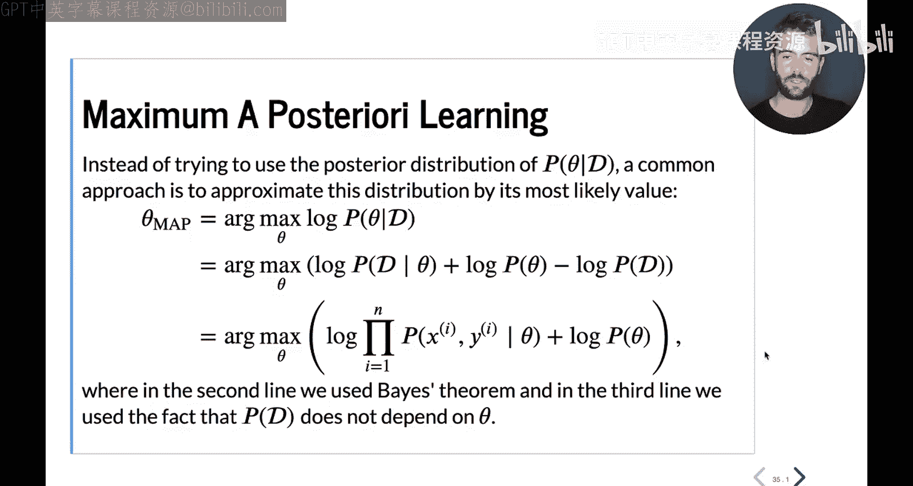

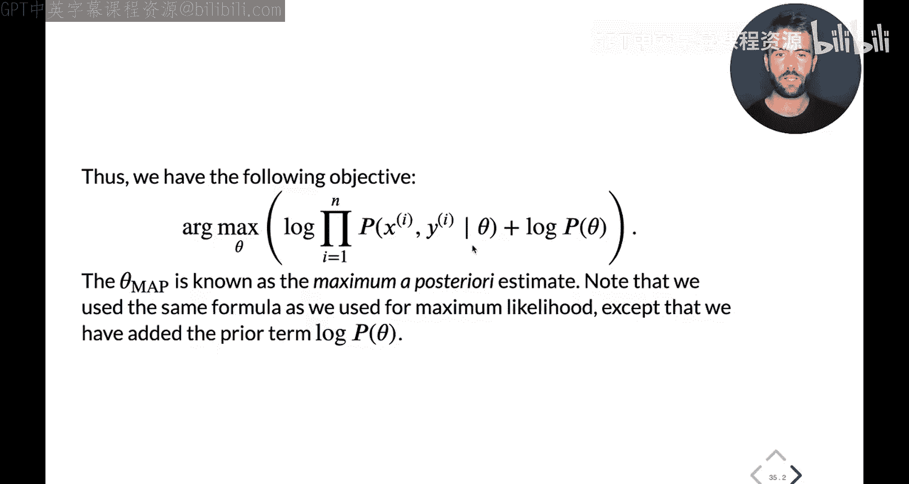

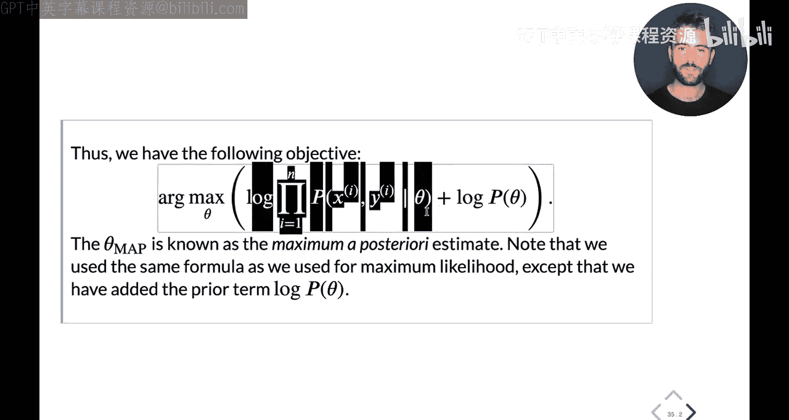

And there is a trade off between the two that is going to be made by optimizing the subjective function。

In practice， map estimation is a very common and a very powerful and practical way of performing of approximating Bayesian inference。

 and many common machine learning algorithms are special instances of map estimation。

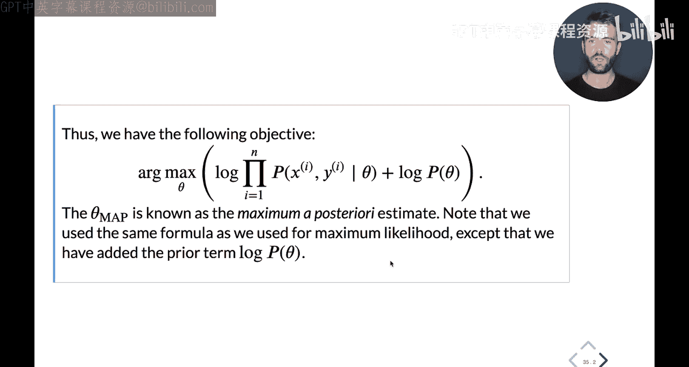

Now let's see a simple example of map estimation in the context of flipping a coin。Again。

 we're going to assume the same model that we had earlier and the same data set。

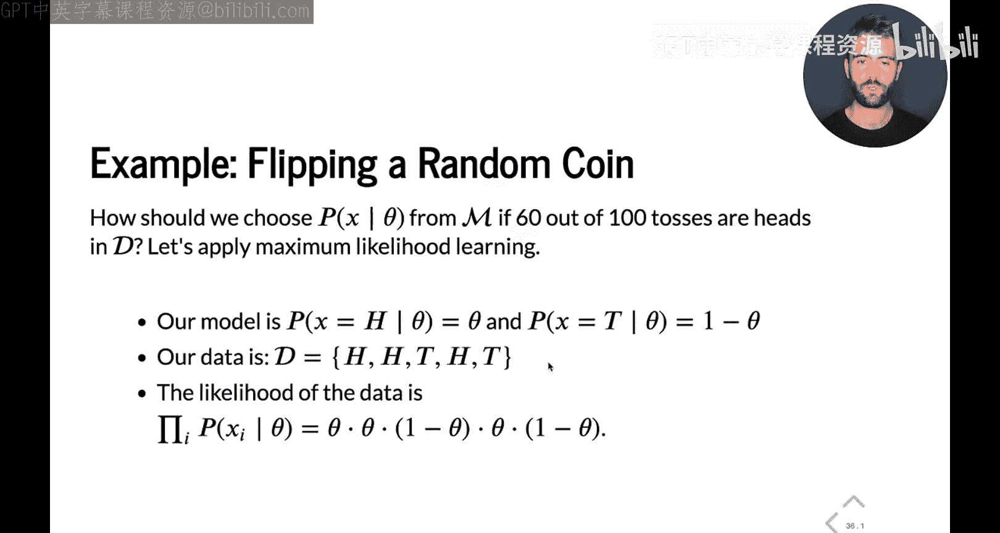

And in addition， we're going to assume this particular distribution for the prior theta。

 This is what's called a beta distribution。 You don't really need to know what it is for the purposes of this video。

 This is just a form， and this is a reasonably common。

Probability distribution and you can look it up on Wikipedia if you're interested。

And now we can look at， we can estimate the the。We can compute the MA objective as follows。

 given that this is our data， the MA objective is simply going to be the likelihood。

 which which is this part and it's also multiplied by our prior which is this term here and because this term beta because this B here that's just a beta function because this is not a function of theta。

 we can ignore this because this is just a constant that's multiplying our data。

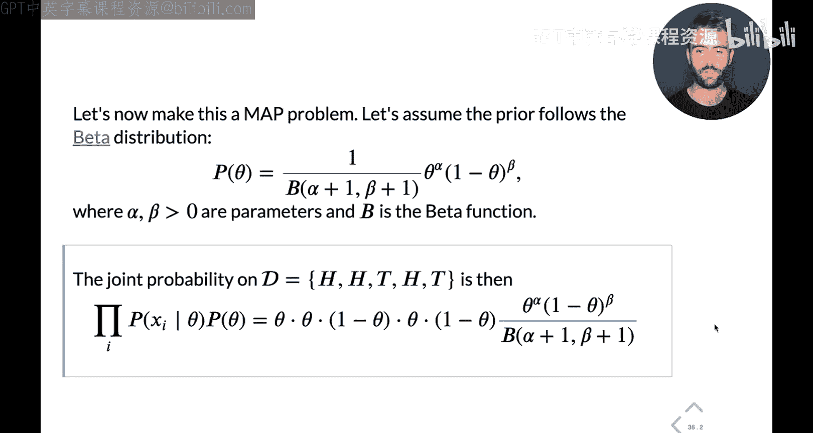

So in other words， now the log likelihood is going to be proportional。

 well the likelihood is going to be proportional to this expression。

 which is what we had earlier and we have this additional prior here on this side。

And if we take the log， we see that the expression will have the following form。

Where we have these extra parameters， alpha and beta that come in， alpha and beta by the way。

 these are parameters of the beta distribution and we can choose them depending on what we think the yeah we can these are things that we can choose when we。

Define our beta distribution。

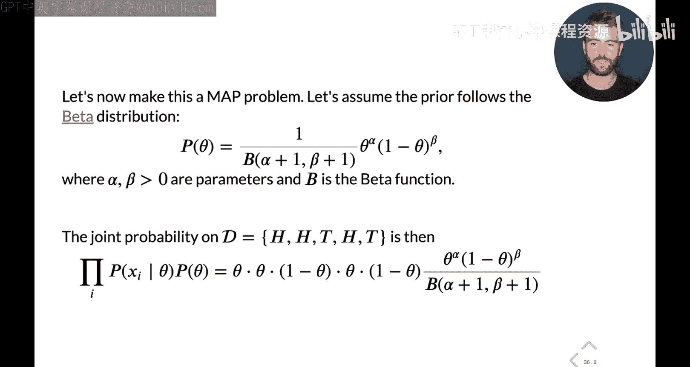

And now solving this using gradient solving this by taking the derivative and setting to zero in the same ways that we had earlier。

 we now have the following expression。

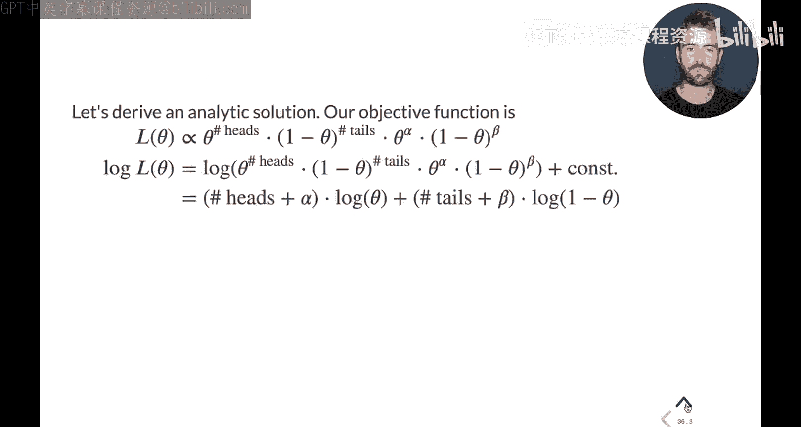

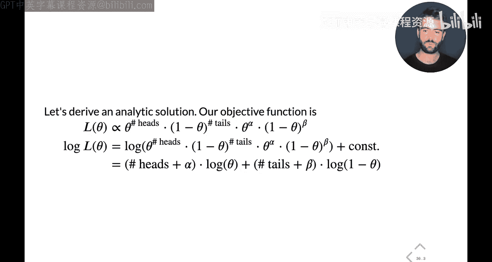

So let's look at this a little bit more closely。Now our estimate of the probability of having heads。

 it's not just heads over the total number of throws， but we've now added these parameters。

 alpha and beta。And you can think of alpha and beta as virtual counts of the number of heads and tails that we have seen。

 So， for example， if I set alpha。To 10 and beta to 20。 Then we will have。

 then it's as if we have seen。10 extra heads and 20 extra tails。

 and we're going to be computing our regular likelihood for this example。

So here this prior with hyperparameters， alpha and beta， it has this very intuitive interpretation。

 and this is also a way in which we can add prior knowledge to our model。

This is an example of how by setting a particular prior。

 we have modified our estimation procedure and we have essentially injected it with prior knowledge which can be interpreted here as having seen a number of virtual heads and virtual tails before we see the actual data。

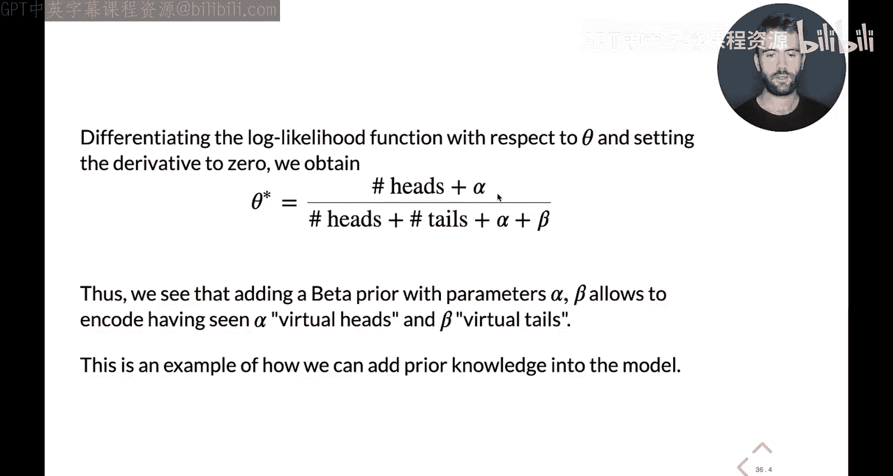

And now if we combine this with our existing distribution here。

We're going to set alpha and beta to1 each， and the maximum of this likelihood now is closer to 0。5。

So in other words， we've seen heads， heads， we've seen three heads and two tails。

 but this is a really small data set， it's only five throws。

 and it's possible that we got these by chance。In order to account for this。

 we could set alpha and beta to some values which encourage us to think that the coin is probably balanced and as a result by visualizing the likelihood。

 the maximum is indeed closer to 50% and we can also take this to the extreme if we put this  10 and 10 then the distribution is much more peaked around 0。

5 and now 0。5 seems to be the most likely estimate。

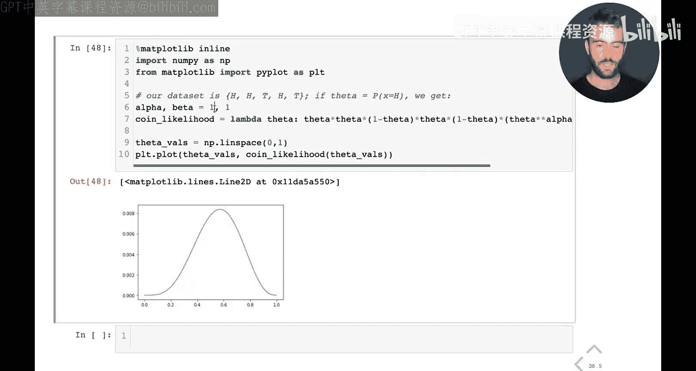

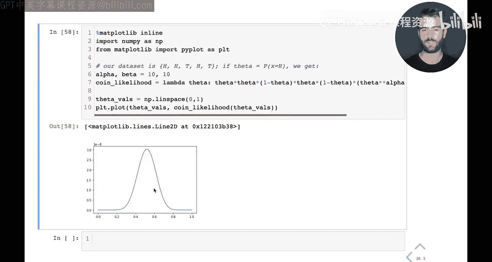

Again， this is one way in which we can add prior knowledge about a problem using the Bayesian or the MA approach。

In the next lecture， we're going to see a few applications of the MAP principle to algorithms that we have seen before。

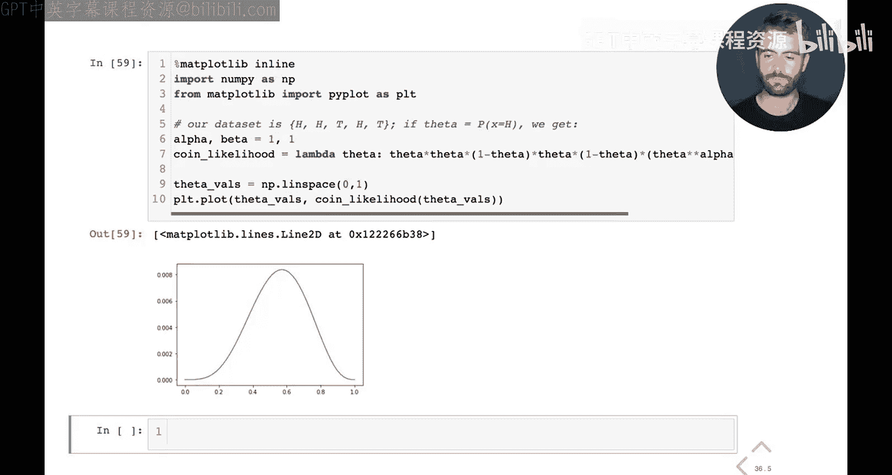